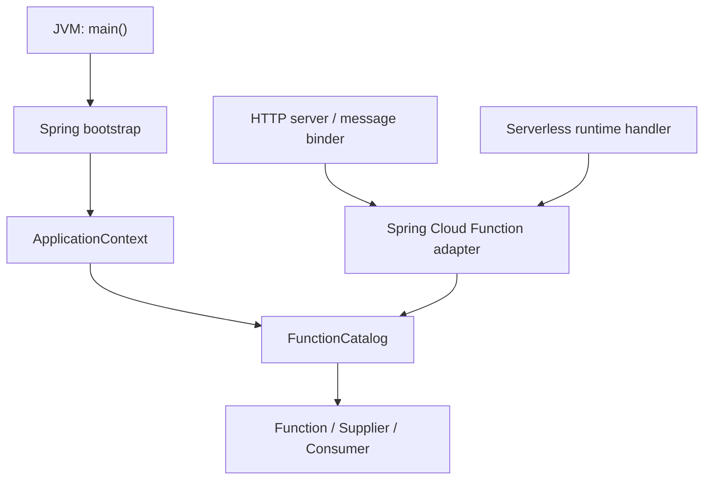
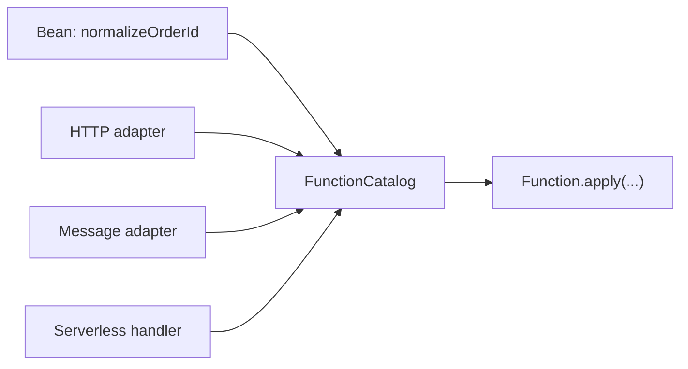

# `FunctionalSpringApplication` and Application Entry Points

## Learning Objectives

In the **Bean Registration** chapter of **Spring Cloud Function**, besides declaring `Supplier`, `Function`, and `Consumer` with `@Bean`, we can register functions in Java code to reuse business logic independently of the invocation protocol. `FunctionalSpringApplication` is the startup entry point for this style of function configuration in Spring Cloud Function versions that support that API.

After this lesson, you will be able to:

- Distinguish the **application entry point** (`main` or a deployment environment handler), **Spring bootstrap**, and the **business function entry point**.
- Use `FunctionalSpringApplication.run(...)` together with `ApplicationContextInitializer<GenericApplicationContext>` to register a `Function<I, O>`.
- Explain how beans are placed into `ApplicationContext` so Spring Cloud Function can look them up via `FunctionCatalog`.
- Understand the constraints of functional bootstrap: bean names, generic types, adapter configuration, context lifecycle, and version compatibility.
- Choose the right startup entry point for JVM, HTTP, event-driven, and serverless applications.

## 1. "Entry Point" Has Three Different Meanings

When working with Spring Cloud Function, separate three layers of responsibility:

| Layer | Example | Responsibility |
| --- | --- | --- |
| **Java process entry point** | `public static void main(String[] args)` | Starts application initialization when run directly on a JVM or via an executable JAR |
| **Spring entry point** | `FunctionalSpringApplication.run(...)` or `SpringApplication.run(...)` | Creates, configures, and refreshes `ApplicationContext` |
| **Business logic entry point** | `Function<String, String>.apply(...)` | Processes input data and returns a result; unaware of whether data came from HTTP, messaging, or serverless |

In serverless environments, the cloud platform typically invokes a **handler/adapter** defined by the runtime, so the application's `main` method is not necessarily what gets called when a new event arrives. Regardless of how startup happens, the business function can remain unchanged as long as the adapter initializes or locates the right Spring context and `FunctionCatalog`.



The diagram highlights the division of responsibilities: **`main` starts the application**, **Spring manages beans**, **the catalog locates functions**, and **the adapter translates protocol calls into function invocations**. In real deployments, the adapter also runs within or connects to the bootstrapped application context.

## 2. What Is `FunctionalSpringApplication`?

`FunctionalSpringApplication` belongs to the Spring Cloud Function infrastructure; in versions that provide this class, its commonly used fully qualified name is:

```java
import org.springframework.cloud.function.context.config.FunctionalSpringApplication;
```

This API provides a way to launch an application with **functional bean registration**, in which a class implementing `ApplicationContextInitializer` declares beans in Java code. Typical usage:

```java
public static void main(String[] args) {
    FunctionalSpringApplication.run(FunctionApplication.class, args);
}
```

Here, `FunctionApplication.class` is the **source of application configuration and initializers**; it is not a `Function` instance that will be called with business data. When the application starts, Spring Cloud Function uses the corresponding functional bootstrap mechanism to bring the bean registrations into the context.

In many classic functional examples, the main application class simultaneously:

1. Provides the `main` method so the JVM can launch the application.
2. Implements `ApplicationContextInitializer<GenericApplicationContext>` to register functions.

**Version dependency:** the `FunctionalSpringApplication` class, its package, bootstrap behavior, and configuration support level can vary across Spring Cloud Function release lines. In a real project, verify the API available on your classpath and the compatible Spring Boot/Spring Cloud Function versions. Do not assume an example from one framework generation compiles unchanged in every generation.

### Relationship to `SpringApplication`

`SpringApplication` is Spring Boot's general-purpose bootstrap API. The standard style uses `@SpringBootApplication`, `@Configuration`, `@Bean`, and annotation/configuration processing.

`FunctionalSpringApplication` emphasizes **programmatic bean declaration**, where initializers and bean definitions take center stage. This can help control how beans are created and selected during startup. However, **you should not assume that simply switching the `run` method makes an application automatically faster, removes Spring Boot dependencies, or supports every auto-configuration the same way as the standard launcher**. Those capabilities must be verified against your specific version and configuration.

## 3. Hands-On Example: A Runnable Functional Application

Suppose a system receives an order ID as a string and needs to normalize it before passing it downstream. We write a function of type `Function<String, String>` so it can be used through the catalog and appropriate adapters.

The following example illustrates the **API style of versions that include `FunctionalSpringApplication`**. Your project needs the Spring Cloud Function Context dependency compatible with Spring Boot. To accept HTTP requests, you must add the corresponding web adapter and HTTP server.

### Step 1. Write the Application-and-Initializer Class

File `FunctionApplication.java`:

```java
package example.function;

import java.util.Locale;
import java.util.function.Function;

import org.springframework.cloud.function.context.config.FunctionalSpringApplication;
import org.springframework.context.ApplicationContextInitializer;
import org.springframework.context.support.GenericApplicationContext;

public class FunctionApplication
        implements ApplicationContextInitializer<GenericApplicationContext> {

    public static void main(String[] args) {
        FunctionalSpringApplication.run(FunctionApplication.class, args);
    }

    @Override
    public void initialize(GenericApplicationContext context) {
        context.registerBean(
                "normalizeOrderId",
                NormalizeOrderId.class,
                NormalizeOrderId::new);
    }

    public static final class NormalizeOrderId
            implements Function<String, String> {

        @Override
        public String apply(String input) {
            return input.trim().toUpperCase(Locale.ROOT);
        }
    }
}
```

In this example:

- `main(...)` calls `FunctionalSpringApplication.run(...)` to start the application.
- `FunctionApplication` is the initializer; `initialize(...)` receives the context before initialization completes.
- `registerBean("normalizeOrderId", ...)` declares a bean named **`normalizeOrderId`**.
- `NormalizeOrderId.class` implements `Function<String, String>`, preserving the generic type information the framework needs for data conversion.
- `NormalizeOrderId::new` is the bean creation factory, **distinct** from a `Supplier<O>` serving as a business data source.
- `apply(...)` has zero dependency on `main`, HTTP requests, or message brokers.

The input `"  order-47  "` produces `"ORDER-47"`.

There is no need to annotate `NormalizeOrderId` with `@Component` or add a `@Bean` method: the initializer already registered the bean explicitly. Avoid registering the same `normalizeOrderId` name again through other mechanisms.

### Step 2. Understand the Startup Sequence

```text
JVM calls main(String[] args)
    |
    v
FunctionalSpringApplication.run(FunctionApplication.class, args)
    |
    v
Create / prepare Spring ApplicationContext
    |
    v
Invoke FunctionApplication.initialize(context)
    |
    +-- registerBean("normalizeOrderId",
    |                NormalizeOrderId.class,
    |                NormalizeOrderId::new)
    |
    v
Refresh context; Spring manages bean instance
    |
    v
Spring Cloud Function configures FunctionCatalog
    |
    v
lookup("normalizeOrderId") -> Function.apply(...)
```

The key point is that `registerBean(...)` primarily **registers a bean definition** in the context; `NormalizeOrderId::new` is used by Spring when instantiating the bean according to the container lifecycle. For non-lazy singletons, the instance is normally created during refresh, not necessarily at the moment the initializer runs.

Once Spring Cloud Function is properly configured, the bean named `normalizeOrderId` can be looked up through `FunctionCatalog`.

### Step 3. Look Up the Function via `FunctionCatalog`

In a component that holds a reference to the catalog:

```java
import java.util.function.Function;
import org.springframework.cloud.function.context.FunctionCatalog;

// Example: catalog is injected from the Spring ApplicationContext.
Function<String, String> fn = catalog.lookup("normalizeOrderId");

if (fn == null) {
    throw new IllegalStateException("normalizeOrderId not found");
}

String result = fn.apply("  order-47  "); // ORDER-47
```

This is an example of **using the catalog**, not a standalone Java file: the `catalog` variable must be injected or obtained from the Spring `ApplicationContext`. The catalog allows looking up functions by name and can provide wrapping/conversion and function composition depending on configuration. Calling `new NormalizeOrderId().apply(...)` directly runs the same business logic, but bypasses Spring Cloud Function's management and conversion layer.

## 4. Comparing Launch Styles

| Launch Style | Entry Point | How Functions Are Registered | When to Use |
| --- | --- | --- | --- |
| Standard Spring Boot | `SpringApplication.run(App.class, args)` | Typically `@Bean`, `@Component`, or Spring config | Boot applications built on standard annotation-based configuration |
| Functional bootstrap | `FunctionalSpringApplication.run(App.class, args)` | Initializer calls `GenericApplicationContext.registerBean(...)` | When you want programmatic function registration using the functional API provided by your version |
| Spring Boot + explicit initializer | Create `SpringApplication`, call `addInitializers(...)`, then `run(args)` | Initializer declares beans in the Boot context | When you want standard Spring Boot combined with programmatic bean registration |
| Serverless runtime | Platform-specific handler/launcher | Depends on the adapter and how the Spring context is bootstrapped | When the execution environment controls the invocation entry point |

### A Variant Using `SpringApplication.addInitializers(...)`

If a project prefers the standard Spring Boot startup mechanism or does not have `FunctionalSpringApplication` on the classpath, one way to do **programmatic bean registration** is:

```java
@SpringBootApplication
public class BootApplication {

    public static void main(String[] args) {
        SpringApplication app = new SpringApplication(BootApplication.class);
        app.addInitializers(new FunctionInitializer());
        app.run(args);
    }
}
```

Where `FunctionInitializer` implements `ApplicationContextInitializer<GenericApplicationContext>` and calls `registerBean(...)`. The `SpringApplication` and `SpringBootApplication` imports come from Spring Boot, while the initializer and context come from Spring Framework.

**Note:** the two bootstrap approaches should not be treated as strictly identical in auto-configuration or startup optimization. This example proves **you can do functional-style bean registration inside a regular Boot application**; it does not replicate every detail of `FunctionalSpringApplication`.

## 5. From Application Entry Point to HTTP, Events, and Serverless

Spring Cloud Function lets you write a function independent of the protocol:

```java
public final class NormalizeOrderId implements Function<String, String> {
    @Override
    public String apply(String value) {
        return value.trim().toUpperCase(Locale.ROOT);
    }
}
```

The function can be placed into `FunctionCatalog` via the same bean registration. How the function gets invoked depends on the runtime:

**JVM/CLI application.** The JVM runs the application class's `main`; after the Spring context initializes, Java code can call `catalog.lookup(...)`. For a one-shot command-line application, you can explicitly close the context when finished.

**HTTP application.** A web application needs an HTTP server and the appropriate Spring Cloud Function Web adapter. With the right default configuration, a request can be routed to the bean by name:

```bash
curl -X POST http://localhost:8080/normalizeOrderId \
  -H 'Content-Type: text/plain' \
  --data-binary '  order-47  '
```

Expected output is `ORDER-47`. This command only works when a web adapter is present, the server is running, and the endpoint is exposed; **`FunctionalSpringApplication.run(...)` by itself does not guarantee an HTTP endpoint is created**.

**Event-driven application.** With Spring Cloud Stream or an appropriate messaging adapter, the system receives messages and delivers payloads to a function in the catalog according to binding/definition configuration. Managing binders, brokers, and message configuration is the integration layer's responsibility; there is no need to embed HTTP/Kafka code inside `NormalizeOrderId`.

**Serverless application.** The platform invokes a handler according to the runtime's contract. The Spring Cloud Function handler/launcher is responsible for setting up or reusing the Spring context and routing events to the function. Some environments or adapters **do not invoke `main`** per request, so you should not place function registration or critical side effects solely in statements after `run(...)` in `main`. The proper bootstrap must follow that platform's adapter.



If there are **multiple function beans**, adapters/binders may require specifying a function name or composition expression via configuration such as `spring.cloud.function.definition`. This property selects the function at runtime; it **does not replace bean registration** or create a bean that does not exist.

## 6. Function Names, Type Information, and Composition

### Bean Names Are Part of the Lookup Contract

```java
context.registerBean(
        "normalizeOrderId",
        NormalizeOrderId.class,
        NormalizeOrderId::new);
```

In the example above:

- `normalizeOrderId` is the **name used for registration and lookup** in the context/catalog.
- `NormalizeOrderId` is the bean's **Java class**, which does not by itself dictate the URL or binding name.
- `Function<String, String>` is the **data type contract** of the business logic.

Renaming the bean while keeping `lookup("normalizeOrderId")` can cause lookups to fail. If an adapter has configured a function name, renaming the bean requires updating the corresponding configuration.

### Preserving Generic Types During Registration

Registering with a concrete implementation class that specifies generics:

```java
context.registerBean("normalizeOrderId",
        NormalizeOrderId.class, NormalizeOrderId::new);
```

gives Spring a basis to analyze `Function<String, String>`. On the other hand, registering a lambda directly using the raw type:

```java
context.registerBean(
        "normalizeOrderId",
        Function.class,
        () -> (Function<String, String>) text -> text.trim());
```

uses `Function.class`, which carries no `<String, String>` type arguments. Casting the lambda in Java does not guarantee Spring Cloud Function can infer the input/output types at runtime. For JSON payloads that must be converted into DTOs, type metadata is especially important.

When using dynamic lambdas or needing to declare types explicitly, consider `FunctionRegistration` and the type-declaration APIs for **your Spring Cloud Function version**. `FunctionRegistration` is not synonymous with `GenericApplicationContext.registerBean`: one describes function registration for Spring Cloud Function, while the other is Spring Framework's bean registration API.

### Function Composition Without Depending on `main`

Suppose the application also has an `appendMarker` bean, both being `Function<String, String>` with proper metadata. Spring Cloud Function supports looking up a composition expression using catalog syntax, for example:

```java
Function<String, String> pipeline =
        catalog.lookup("normalizeOrderId|appendMarker");
```

The business flow runs `normalizeOrderId` followed by `appendMarker`. This is a capability of **the catalog**, not of JVM `main` or `FunctionalSpringApplication` specifically. For composition to work, **both functions must be registered** and their output/input types must be compatible.

## 7. Application Entry Points and the Spring Lifecycle

An initializer runs **before context refresh**, so it is usually not the right place to call `context.getBean(...)` for beans that only appear after configuration loading. The initializer's primary job is to register bean definitions and set up early configuration.

For example, instead of fetching a service immediately during initialize:

```java
// Avoid assuming all services are ready inside initialize(...).
var service = context.getBean(OrderService.class);
```

supply a factory so Spring resolves the dependency **when creating the bean**:

```java
context.registerBean(
        "orderHandler",
        OrderHandler.class,
        () -> new OrderHandler(context.getBean(OrderService.class)));
```

This snippet assumes `OrderHandler` and `OrderService` are already defined by the application and `OrderService` has a valid bean definition. This separates **registration time** from **instance creation time**.

For multi-protocol systems:

- Avoid opening network connections or calling external APIs directly in a static initializer on the `main` class.
- Do not rely on `static` mutable state instead of Spring-managed dependencies.
- Do not assume serverless invokes `main` or the initializer for every message.
- Keep business logic as pure Java as possible, and let adapters handle requests, headers, event envelopes, and protocol errors.

These practices let the same `Function` be reused without being tied to a single startup model.

## 8. Testing Functional Entry Points

### Unit Testing: No Spring Needed

Verify the function's correctness first, isolated from bootstrap:

```java
import static org.junit.jupiter.api.Assertions.assertEquals;

import org.junit.jupiter.api.Test;

class NormalizeOrderIdTest {

    @Test
    void normalizesOrderId() {
        var fn = new FunctionApplication.NormalizeOrderId();
        assertEquals("ORDER-47", fn.apply("  order-47  "));
    }
}
```

This test verifies the **Java logic** but does not prove the application registers the bean or that the catalog can look it up.

### Integration Testing: Starting Through the Real Entry Point

In versions that provide `FunctionalSpringApplication`, you can launch the context in a test and query the catalog:

```java
import static org.junit.jupiter.api.Assertions.assertEquals;
import static org.junit.jupiter.api.Assertions.assertNotNull;

import java.util.function.Function;
import org.junit.jupiter.api.Test;
import org.springframework.cloud.function.context.FunctionCatalog;
import org.springframework.cloud.function.context.config.FunctionalSpringApplication;
import org.springframework.context.ConfigurableApplicationContext;

class FunctionalBootstrapTest {

    @Test
    void exposesRegisteredFunction() {
        try (ConfigurableApplicationContext context =
                FunctionalSpringApplication.run(
                        FunctionApplication.class,
                        "--spring.main.web-application-type=none")) {

            FunctionCatalog catalog = context.getBean(FunctionCatalog.class);
            Function<String, String> fn = catalog.lookup("normalizeOrderId");

            assertNotNull(fn);
            assertEquals("ORDER-47", fn.apply("  order-47  "));
        }
    }
}
```

This test requires compatible Spring Cloud Function, Spring Boot, and JUnit dependencies. It verifies **bootstrap + registration + catalog**. It **does not automatically verify** HTTP endpoints, broker bindings, or serverless handlers; those adapters require their own integration tests when used.

If you use another mechanism to create the test context, make sure the initializer is registered in the test too. A test using only `@SpringBootTest` does not invoke the application's `main` method by default, so it can skip bootstrap setup configured only inside `main`.

## 9. Common Errors When Using `FunctionalSpringApplication`

| Symptom | Possible Cause | How to Address |
| --- | --- | --- |
| IDE reports `FunctionalSpringApplication` not found | The Spring Cloud Function artifact or version in use does not provide this class/API | Verify dependencies and version APIs; consider Boot + `addInitializers` if appropriate |
| `main` runs but `lookup(...)` returns `null` | Bean not registered, name mismatch, initializer did not run, or catalog not ready | Check `registerBean` name, bootstrap setup, and Spring Cloud Function configuration |
| `NoSuchBeanDefinitionException: FunctionCatalog` | Spring Cloud Function context/auto-configuration is not set up | Verify dependencies and context initialization, not just bean definitions |
| Two beans registered with the same name | Function declared through multiple paths | Use unique names, remove duplicate declarations; do not rely on bean overriding |
| JSON fails to convert to DTO | `Function<I, O>` generics not inferred from raw `Function.class` | Use a generic implementation class or declare explicit type metadata |
| HTTP 404 even though the catalog has the function | Missing HTTP adapter, wrong route, or server not running | Check web adapter, endpoint config, port, and function name |
| Serverless does not run code inside `main` | Runtime invokes a handler instead of `main` | Move function registration into an adapter-supported bootstrap per the runtime contract |
| Context startup differs from expectations when switching from `SpringApplication` | The two bootstrap mechanisms differ in config, dependencies, or auto-configuration | Test the actual app on your version; do not assume the two `run` styles are strictly equivalent |
| Unit test passes but catalog cannot find the function | Test only calls `apply(...)` without initializing Spring | Add an integration test that starts the context via the proper entry point |

## 10. Decision Scenarios and Self-Assessment Questions

**Scenario A — An application has only two fixed `Function` beans.** The team already uses Spring Boot and annotation-based configuration. Registering with `@Bean` may be simple enough; there is no need to switch the whole entry point to functional bootstrap just because the logic uses `java.util.function.Function`.

**Scenario B — An application needs to declare a list of functions programmatically at bootstrap.** You can use an initializer + `registerBean`; when supported by your version, `FunctionalSpringApplication` provides a startup path aligned with the functional style. Check bean names, generic types, and actual context configuration.

**Scenario C — The same business logic is invoked via HTTP and a cloud function.** Keep `Function<I, O>` protocol-independent, configure each adapter/launcher for its environment, and ensure both locate the right function in `FunctionCatalog`. The entry points of an HTTP server and a serverless handler may differ.

Self-check answers:

1. **Does `FunctionalSpringApplication.run(App.class, args)` immediately call `Function.apply(...)`?** No. It initializes the application; business logic invocation comes later via Java code, the catalog, or an adapter.
2. **Why can the application class both contain `main` and implement `ApplicationContextInitializer`?** `main` is the process entry point; `initialize` supplies bean definitions before context refresh.
3. **Do you need an HTTP adapter to call `normalizeOrderId` with cURL?** Yes, along with an HTTP server and appropriate endpoint mapping. A bean and catalog alone do not open an endpoint.
4. **Must a serverless handler invoke `main` for every request?** No; bootstrapping depends on the serverless runtime and adapter.
5. **Why avoid registering raw `Function.class` when handling DTOs?** Because the raw class does not carry the input/output generic types that message conversion may require.

**Takeaway:** `main` or the runtime handler decides **where the application starts**; `FunctionalSpringApplication` decides **how Spring initializes in the functional style**; the initializer and `GenericApplicationContext` decide **how functions become beans**; and `FunctionCatalog` plus adapters decide **how functions are located and invoked across protocols**.
