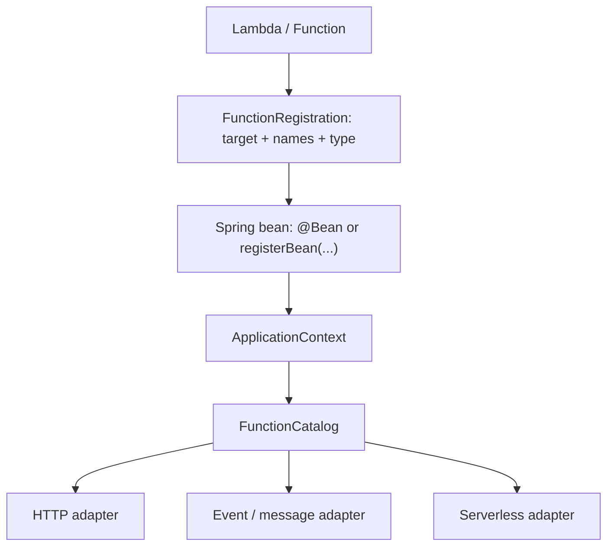

# FunctionRegistration with Explicit Name and Types

## Learning Objectives

In **Spring Cloud Function**, writing business logic as a `Supplier`, `Function`, or `Consumer` makes it possible to reuse a single function across HTTP, events, and serverless environments. However, for `FunctionCatalog` to locate and invoke the right function, the framework needs to know **which function is registered, what its published name is, and what types its input and output data have**.

This lesson belongs to the **Bean Registration** chapter and focuses on `FunctionRegistration`: an object describing a function along with an **explicit name** and **explicit types**. After this lesson, you will be able to:

- Distinguish `FunctionRegistration` from `Function<I, O>` itself and from `GenericApplicationContext.registerBean(...)`.
- Create a `FunctionRegistration` for a lambda with the name `normalizeOrderId` and the type `String -> String`.
- Explain why generics are erased at runtime and why message conversion needs type information.
- Put a registration into the Spring context using `@Bean` or the functional-style bean registration API.
- Look up functions via `FunctionCatalog`, handle name conflicts, convert DTOs, and test registrations.

## 1. Why Declaring a `Function` Bean Is Sometimes Not Enough

Consider this Java function:

```java
Function<String, String> normalize =
        text -> text.trim().toUpperCase(Locale.ROOT);
```

At the Java language level, the compiler knows the function takes and returns a `String`. However, when you pass a lambda into an API that accepts only a raw class:

```java
context.registerBean(
        "normalizeOrderId",
        Function.class,
        () -> (Function<String, String>) text ->
                text.trim().toUpperCase(Locale.ROOT));
```

`Function.class` **does not carry** the two generic type arguments `String, String`. Because of **type erasure**, you cannot assume Spring Cloud Function will accurately recover the input/output types from a lambda and a bean definition using raw `Function.class`.

This affects two distinct needs:

1. **Name for locating the function:** `FunctionCatalog.lookup("normalizeOrderId")` needs to identify the function the caller wants to invoke. Adapters can also select a function via `spring.cloud.function.definition`.
2. **Types for payload conversion:** when the input is JSON or a message from a broker, the adapter/catalog may need to know a target type such as `OrderCommand` to convert the data before calling `apply(...)`.

With a `@Bean` method that has a complete signature such as `Function<OrderCommand, OrderResult>`, Spring can usually inspect the generic information on the method. But when registering **lambdas directly, dynamically loaded functions, or raw-typed bean definitions**, proactively providing metadata avoids relying on runtime type inference.

This is the problem that `FunctionRegistration` solves.

## 2. What Is `FunctionRegistration`?

`org.springframework.cloud.function.context.FunctionRegistration<T>` describes a target function `T` together with the information Spring Cloud Function needs when registering it—specifically its **name** and **types**.

Here is the typical syntax in Spring Cloud Function versions that provide `FunctionType`:

```java
Function<String, String> target =
        text -> text.trim().toUpperCase(Locale.ROOT);

FunctionRegistration<Function<String, String>> registration =
        new FunctionRegistration<>(target, "normalizeOrderId")
                .type(FunctionType.from(String.class).to(String.class));
```

Here:

| Part | Meaning |
| --- | --- |
| `target` | The business function object, invoked via `apply(...)` |
| `"normalizeOrderId"` | The name published to Spring Cloud Function, used in the catalog and adapter configuration |
| `FunctionType.from(String.class).to(String.class)` | Explicit metadata about the input and output types |
| `FunctionRegistration<Function<String, String>>` | The registration object holding the function and its metadata |

**Important distinction:** `FunctionRegistration` belongs to **Spring Cloud Function**; `GenericApplicationContext.registerBean(...)` belongs to **Spring Framework**. Their names sound similar, but they have different responsibilities:

- `FunctionRegistration` describes **which function, under what name, and taking/returning what types**.
- `registerBean(...)` places a **bean definition** into the Spring application context.
- `FunctionCatalog` is where you **look up and standardize invocations to functions** recognized by Spring Cloud Function.

You do not have to use `GenericApplicationContext.registerBean(...)` in order to use `FunctionRegistration`: a `@Bean` method can also return a `FunctionRegistration`.



The diagram only shows the participating components. The appropriate adapter must be installed and configured; having `FunctionRegistration` alone **does not automatically open an HTTP endpoint or connect to a message broker**.

## 3. Complete Example: Registering Name and Type with `@Bean`

Let's implement an order ID normalization function. The function accepts a string, strips leading and trailing whitespace, and converts it to uppercase using `Locale.ROOT`.

The Spring Boot example below assumes the project already includes **Spring Cloud Function Context** and compatible Spring Boot/Spring Cloud Function versions. Software using a different Spring Cloud Function version should check the `FunctionRegistration`/`FunctionType` API of that specific version.

```java
package example.scf;

import java.util.Locale;
import java.util.function.Function;

import org.springframework.boot.ApplicationRunner;
import org.springframework.boot.SpringApplication;
import org.springframework.boot.autoconfigure.SpringBootApplication;
import org.springframework.cloud.function.context.FunctionCatalog;
import org.springframework.cloud.function.context.FunctionRegistration;
import org.springframework.cloud.function.context.FunctionType;
import org.springframework.context.annotation.Bean;

@SpringBootApplication
public class RegistrationApplication {

    public static void main(String[] args) {
        SpringApplication.run(RegistrationApplication.class, args);
    }

    @Bean
    public FunctionRegistration<Function<String, String>>
            normalizeRegistration() {

        Function<String, String> target =
                input -> input.trim().toUpperCase(Locale.ROOT);

        return new FunctionRegistration<>(target, "normalizeOrderId")
                .type(FunctionType.from(String.class).to(String.class));
    }

    @Bean
    public ApplicationRunner demo(FunctionCatalog catalog) {
        return args -> {
            Function<String, String> function =
                    catalog.lookup("normalizeOrderId");
            if (function == null) {
                throw new IllegalStateException(
                        "Function normalizeOrderId not found");
            }

            System.out.println(function.apply("  ord-15  ")); // ORD-15
        };
    }
}
```

Breakdown:

1. The `normalizeRegistration()` method creates **a bean of type `FunctionRegistration`**; the default `@Bean` bean name is `normalizeRegistration`.
2. The constructor `new FunctionRegistration<>(target, "normalizeOrderId")` supplies the **function name in Spring Cloud Function** as `normalizeOrderId`. This name is chosen explicitly and does not have to match the `@Bean` method name.
3. `FunctionType.from(String.class).to(String.class)` describes the `String -> String` transformation. This matters when `target` is a lambda that is difficult to analyze completely via reflection.
4. Spring Cloud Function picks up the registration from the application context to expose the function through `FunctionCatalog`; the `ApplicationRunner` looks up that exact function name and calls it.
5. The logic inside `target` does not know who invokes it: CLI, HTTP, an event binder, or a serverless launcher.

**Expected console output:** `ORD-15`. `ApplicationRunner` runs after Spring Boot has initialized the context; it is an example for testing the function call and is not required for a production service.

### Why Are There Two Different Names?

Suppose you write:

```java
@Bean
FunctionRegistration<Function<String, String>> normalizeRegistration() {
    // ...
    return new FunctionRegistration<>(target, "normalizeOrderId")
            .type(FunctionType.from(String.class).to(String.class));
}
```

`normalizeRegistration` is the **Spring bean name holding the registration**; `normalizeOrderId` is the **function name published by the registration** for catalog lookup. They can be the same or different, but you must keep them clearly separated when configuring adapters.

Maintain a consistent naming convention: a descriptive business function name such as `normalizeOrderId`, and a registration bean name that can carry a `Registration` suffix so readers recognize it as metadata. Avoid relying on framework name inference when you can provide an explicit name.

## 4. Second Example: Registering `FunctionRegistration` in the Functional Style

In an application using `ApplicationContextInitializer<GenericApplicationContext>`, you can register a **bean containing `FunctionRegistration`** without writing a `@Bean` method.

```java
package example.scf;

import java.util.Locale;
import java.util.function.Function;

import org.springframework.cloud.function.context.FunctionRegistration;
import org.springframework.cloud.function.context.FunctionType;
import org.springframework.context.ApplicationContextInitializer;
import org.springframework.context.support.GenericApplicationContext;

public final class RegistrationInitializer
        implements ApplicationContextInitializer<GenericApplicationContext> {

    @Override
    public void initialize(GenericApplicationContext context) {
        context.registerBean(
                "normalizeOrderRegistration",
                FunctionRegistration.class,
                () -> {
                    Function<String, String> target =
                            input -> input.trim().toUpperCase(Locale.ROOT);

                    return new FunctionRegistration<>(target, "normalizeOrderId")
                            .type(FunctionType.from(String.class)
                                    .to(String.class));
                });
    }
}
```

The mechanism here has **two layers**:

- `context.registerBean("normalizeOrderRegistration", FunctionRegistration.class, factory)` registers the **Spring bean definition**, so the container creates the registration object at the appropriate time.
- The factory `() -> new FunctionRegistration<>(...)` creates the **target function's metadata**, publishing the name `normalizeOrderId` and type `String -> String` to Spring Cloud Function.

Even though the `FunctionRegistration.class` argument does not express the registration's full generics, `type(...)` explicitly provides the **function's business type metadata**. Do not confuse the generics of the `FunctionRegistration` bean itself with the input/output type information needed by the catalog.

The initializer must be wired into the bootstrap process, for example in Spring Boot:

```java
SpringApplication app = new SpringApplication(RegistrationBootApp.class);
app.addInitializers(new RegistrationInitializer());
app.run(args);
```

In this snippet, `RegistrationBootApp` is the Spring Boot application source class provided by the project. You can use functional-style bootstrapping if your Spring Cloud Function version supports it. **Do not combine the `@Bean` example and the initializer example as-is into the same context**, because both attempt to publish the `normalizeOrderId` function.

The initializer runs before the context is refreshed (`refresh()`), so the registration is present while Spring Cloud Function builds and initializes its function lookup components. Avoid adding functions dynamically after the context and adapters are already running and assuming the catalog or binders will immediately update.

## 5. Type Metadata Determines Data Conversion Capabilities

The `String -> String` example is easy to follow, but it does not fully show the value of explicit type declarations. Consider an API receiving order JSON:

```json
{
  "orderId": " ord-15 ",
  "quantity": 2
}
```

Suppose a Java 17+ application defines:

```java
public record OrderCommand(String orderId, int quantity) {}
public record OrderReceipt(String normalizedId, boolean accepted) {}
```

The order-processing function can be described as:

```java
Function<OrderCommand, OrderReceipt> target = command -> {
    String normalized =
            command.orderId().trim().toUpperCase(Locale.ROOT);
    return new OrderReceipt(normalized, command.quantity() > 0);
};

FunctionRegistration<Function<OrderCommand, OrderReceipt>> registration =
        new FunctionRegistration<>(target, "acceptOrder")
                .type(FunctionType.from(OrderCommand.class)
                        .to(OrderReceipt.class));
```

When an adapter receives JSON and needs to convert the payload into an `OrderCommand`, the `OrderCommand -> OrderReceipt` metadata helps Spring Cloud Function identify the target conversion type. This declaration **does not magically turn every string into a Java object on its own**: conversion also depends on converters, content types, serializers, and adapter configuration.

### What About Nested Types Like `List<OrderCommand>`?

Describing only `List.class -> List.class` is not enough if the framework needs to know the **element type**. Java erases generic type parameters at runtime; `List.class` does not carry `OrderCommand`.

When working with `List<OrderCommand>`, `Message<OrderCommand>`, nested collections, or reactive streams, preserve the full parameterized type metadata using the API of **your Spring Cloud Function version**. You can obtain types from a method signature or concrete implementation class, or use an explicit `Type`/metadata declaration API supported by that version of the framework. Do not assume `FunctionType.from(List.class).to(List.class)` is enough to convert arbitrary complex JSON structures.

### Difference Between Types Known to Java and Types Seen by Spring

| Declaration Style | Ability to Know `I` and `O` at Runtime |
| --- | --- |
| `@Bean Function<OrderCommand, OrderReceipt> process()` | Usually inferred from the method's generic signature |
| `class ProcessOrder implements Function<OrderCommand, OrderReceipt>` | Usually inferred from the concrete implementation class |
| `registerBean("process", Function.class, () -> lambda)` | `Function.class` carries no generics; inference may be incomplete |
| `FunctionRegistration` with appropriate `type(...)` | Explicitly publishes type metadata to Spring Cloud Function |

`FunctionRegistration` is especially useful when the function is a **lambda**, generated at bootstrap, or loaded from a source where bean definition generics cannot be reliably analyzed.

## 6. Explicit Names, `FunctionCatalog`, and Function Selection Config

### Lookup by Name

Once the context and Spring Cloud Function are configured, code using the catalog can look like:

```java
Function<String, String> function =
        catalog.lookup("normalizeOrderId");

if (function == null) {
    throw new IllegalStateException("Missing function normalizeOrderId");
}

String result = function.apply("  ord-15  "); // ORD-15
```

The `catalog` variable must be retrieved from the Spring `ApplicationContext` or dependency-injected into a bean. `lookup` uses the **function name published by the registration**, not automatically the name of the method that created the registration.

### Multiple Functions in the Same Application Context

If an application has `normalizeOrderId`, `validateOrder`, and `writeAudit`, an adapter may need to know **which function** to select. Spring Cloud Function supports selecting functions via configuration, commonly:

```properties
spring.cloud.function.definition=normalizeOrderId
```

Where composition is supported, you can specify a pipeline of functions when types are compatible:

```properties
spring.cloud.function.definition=normalizeOrderId|appendPrefix
```

This configuration only works if both `normalizeOrderId` and `appendPrefix` are recognized by the catalog and have compatible data contracts. It **does not automatically create** a bean or registration for a missing function.

An example of looking up a composition directly:

```java
Function<String, String> pipeline =
        catalog.lookup("normalizeOrderId|appendPrefix");
```

Where `appendPrefix` is another registered `Function<String, String>`. The output of `normalizeOrderId` becomes the input to `appendPrefix`.

### Registration Bean Name, Function Name, and URL Are Not the Same Thing

| Name Kind | Example | Who Uses It? |
| --- | --- | --- |
| **Spring bean name** | `normalizeRegistration` | The container storing and managing the registration bean |
| **Function registration name** | `normalizeOrderId` | Spring Cloud Function catalog and function selection config |
| **HTTP endpoint/path** | `/normalizeOrderId` in a common web configuration | The HTTP adapter decides the route; can be configured differently |

If you use the Spring Cloud Function Web adapter and the server is running with matching mappings, you can test:

```bash
curl -X POST http://localhost:8080/normalizeOrderId \
  -H 'Content-Type: text/plain' \
  --data-binary '  ord-15  '
```

Expected output is `ORD-15`. **Registering `FunctionRegistration` alone is not enough for the application to serve HTTP**: you must have a web adapter, server, and matching route. Spring Cloud Stream or serverless likewise require their own binders/launchers and configuration; the `target` logic stays unchanged.

## 7. Common Issues When Using `FunctionRegistration`

### 7.1. Creating the Registration Object Without Putting It in the Spring Context

```java
var registration =
        new FunctionRegistration<>(target, "normalizeOrderId")
                .type(FunctionType.from(String.class).to(String.class));
```

This snippet only creates a plain Java object. If you do not put it into Spring using a mechanism Spring Cloud Function recognizes, `FunctionCatalog` has no way to know about that local object. Register it via `@Bean`, an initializer, or an appropriate framework registration mechanism.

### 7.2. Assuming the Registration Bean Name Is Always the Function Name

For example, `@Bean normalizeRegistration()` does not mean the published function name is `normalizeRegistration` when the registration explicitly passed `"normalizeOrderId"`. Use an explicit name in the constructor, and match that name in `lookup` and adapter configuration.

### 7.3. Declaring Types That Do Not Match the Actual Function

If the actual lambda accepts `OrderCommand` while the metadata declares `String -> String`, an adapter may convert the payload to the wrong type, causing a `ClassCastException`, message processing failures, or unexpected results.

**Type metadata does not transform the lambda's actual signature.** Always ensure `type(...)` accurately describes the target's input and output.

### 7.4. Using Raw `Function.class` and Expecting DTO Conversion

`Function.class` only says the bean is a `Function`; it does not state whether the data is `OrderCommand` or `OrderReceipt`. If you choose to register a lambda this way, provide explicit type metadata through a mechanism supported by the framework.

### 7.5. Duplicate Function Names or Registering the Same Target Twice

Registering both a direct `Function` bean and a `FunctionRegistration` for the same target/name, or using two registrations with the same name, can cause the catalog to resolve names unexpectedly. Do not rely on ambiguous overriding behavior: each published function name should have a single clear owner.

### 7.6. Copying APIs Across Release Lines

`FunctionRegistration`, `FunctionType`, and metadata declaration APIs have changed across Spring Cloud Function generations. Examples in this lesson demonstrate `FunctionType.from(...).to(...)` in versions that support this API. When compiling a real project, verify the packages/classes/methods available and pick a compatible Spring Boot/Spring Cloud Function version pair. When you need to describe nested generics or reactive types, use the exact `Type`-based API accepted by that version.

## 8. Testing Registrations via `FunctionCatalog`

A unit test that only calls `target.apply(...)` tests the Java logic, but **does not verify** the name and metadata used by the catalog. You need an integration test that builds a Spring context with Spring Cloud Function.

With the `RegistrationApplication` example using `@SpringBootApplication` above, you can test it with JUnit 5 and Spring Boot Test:

```java
package example.scf;

import static org.junit.jupiter.api.Assertions.assertEquals;
import static org.junit.jupiter.api.Assertions.assertNotNull;

import java.util.function.Function;
import org.junit.jupiter.api.Test;
import org.springframework.beans.factory.annotation.Autowired;
import org.springframework.boot.test.context.SpringBootTest;
import org.springframework.cloud.function.context.FunctionCatalog;

@SpringBootTest(
        classes = RegistrationApplication.class,
        webEnvironment = SpringBootTest.WebEnvironment.NONE)
class FunctionRegistrationIntegrationTest {

    @Autowired
    FunctionCatalog catalog;

    @Test
    void findsFunctionByExplicitName() {
        Function<String, String> fn = catalog.lookup("normalizeOrderId");

        assertNotNull(fn);
        assertEquals("ORD-15", fn.apply("  ord-15  "));
    }
}
```

The test confirms **the registration entered the context, the name was published by the catalog, and the function can be invoked**. It does not yet test HTTP requests or JSON-to-DTO conversion. To test type metadata in realistic scenarios, add integration tests with the adapter and content type in use—for example, sending `OrderCommand` JSON through the web adapter and asserting the `OrderReceipt` response.

With an initializer, attach the initializer to the test context using appropriate configuration; `@SpringBootTest` does not necessarily execute `main` where you called `SpringApplication.addInitializers(...)`.

### Checklist When a Function Cannot Be Found

| Item to Verify | Question to Ask |
| --- | --- |
| Registration bean | Was the `FunctionRegistration` object created by the Spring context and picked up by Spring Cloud Function? |
| Function name | Does the name specified in the registration match `catalog.lookup(...)` or `spring.cloud.function.definition`? |
| Data types | Does `type(...)` accurately reflect the target, including nested generic types? |
| Context startup | Was the initializer called before `refresh()`, and are all Spring Cloud Function dependencies present? |
| Adapter | Is the HTTP/message/serverless adapter installed and configured properly? |
| Conflicts | Is any other function bean/registration using the same name? |

## 9. Practice Exercises

### Exercise 1 — Register a Lambda

Write a `Function<Integer, Integer>` that accepts a product quantity and adds one unit. Register it under the name `incrementQuantity`, explicitly specify `Integer -> Integer` types, and look it up via `FunctionCatalog`. With input `4`, the expected result is `5`. Make sure the input data has the proper `Integer` type in the direct test.

Declaration hint:

```java
Function<Integer, Integer> increment = amount -> amount + 1;

FunctionRegistration<Function<Integer, Integer>> registration =
        new FunctionRegistration<>(increment, "incrementQuantity")
                .type(FunctionType.from(Integer.class).to(Integer.class));
```

You still need to add `registration` into the Spring context via `@Bean` or proper bean registration before using the catalog.

### Exercise 2 — Catch Incorrect Metadata

Suppose `target` has type `Function<OrderCommand, OrderReceipt>`, but a developer writes:

```java
new FunctionRegistration<>(target, "acceptOrder")
        .type(FunctionType.from(String.class).to(String.class));
```

Explain why the code can still construct a registration object, yet fail when an adapter converts JSON to `String` or the catalog handles data according to the declared types. Fix the metadata to `OrderCommand.class -> OrderReceipt.class`, then write a test with an actual DTO payload.

### Exercise 3 — Distinguish Three Kinds of Names

A `@Bean` method named `paymentRegistration` returns `new FunctionRegistration<>(target, "validatePayment")`. If the HTTP adapter uses the default route based on the function name, which route should you test? **`/validatePayment`**, when the web adapter has matching route configuration. When querying the catalog, use `lookup("validatePayment")`.

## 10. Self-Check

1. **Does `FunctionRegistration` automatically create an HTTP endpoint?** No. It describes the function and its metadata; endpoints depend on the web adapter and HTTP runtime configuration.
2. **Why does `FunctionRegistration` need explicit type information when the target is a lambda?** Because generics may not be fully inferred at runtime; adapters need target types to convert payloads.
3. **Must the Spring bean name `normalizeRegistration` match the function name `normalizeOrderId`?** No. The function's registration name is specified explicitly.
4. **Is `GenericApplicationContext.registerBean(...)` a method on `FunctionRegistration`?** No. It is Spring Framework's bean definition registration API.
5. **Is `FunctionType.from(String.class).to(String.class)` metadata appropriate for `Function<OrderCommand, OrderReceipt>`?** No. Metadata must reflect the target's actual types.
6. **Does a unit test calling only `new Target().apply(...)` prove the catalog registered the function successfully?** Not yet. You must initialize the Spring Cloud Function context and look it up via the catalog.

**Takeaway:** `Function<I, O>` defines **the business logic**; `FunctionRegistration` defines **which function is published, under what name, and with what types**; the Spring `ApplicationContext` stores the beans; and `FunctionCatalog` along with adapters enables **locating and invoking the function across different execution mechanisms**.
