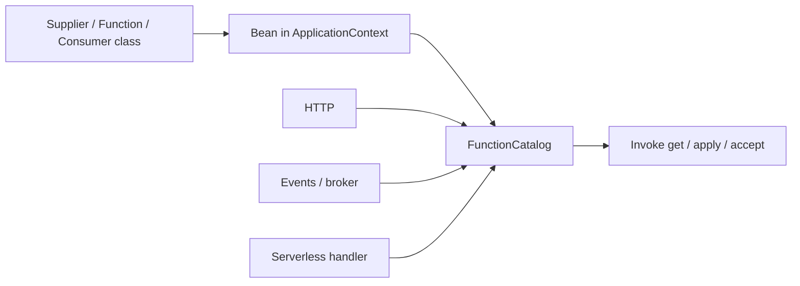

# Registering Classes That Directly Implement `Supplier`, `Function`, or `Consumer`

## Lesson Objectives

Spring Cloud Function lets you build reusable business logic using `java.util.function.Supplier`, `Function`, and `Consumer`, while decoupling processing logic from triggers such as HTTP, events, or serverless environments. In the **Bean Registration** chapter, an important technique is **writing a Java class that directly implements these interfaces and registering that class itself as a Spring bean**.

After this lesson, you will be able to:

- Distinguish **a class implementing a functional interface**, **a plain Java object**, and **a Spring-managed bean**.
- Write concrete `Supplier<O>`, `Function<I, O>`, and `Consumer<I>` classes and register them using `@Component`, `@Bean`, or `GenericApplicationContext.registerBean(...)`.
- Use `FunctionCatalog` to look up functions by name and invoke each function type.
- Understand why a concrete implementation class with explicit generics helps Spring Cloud Function recognize input/output types.
- Handle dependency injection, lifecycle, state across invocations, business errors, and limitations when composing functions or connecting adapters.

## 1. What Is a Direct Implementation Class?

Instead of only returning a lambda from a `@Bean` method, you can place your logic in a clearly named Java class:

```java
import java.util.Locale;
import java.util.function.Function;

public final class NormalizeOrderId implements Function<String, String> {

    @Override
    public String apply(String value) {
        return value.trim().toUpperCase(Locale.ROOT);
    }
}
```

`NormalizeOrderId` is already a valid `Function<String, String>`, but **it does not automatically become a Spring bean**. Calling `new NormalizeOrderId()` only creates a plain Java object. For Spring Cloud Function to discover the function through the application context, you must put the class or its instance into Spring's bean management using an appropriate registration mechanism.

The three interfaces have different contracts:

| Interface | Core Method | Input Data | Output Data | Use Case |
| --- | --- | --- | --- | --- |
| `Supplier<O>` | `O get()` | No parameters | A value of type `O` | Generate events or fetch orders to process |
| `Function<I, O>` | `O apply(I input)` | A value of type `I` | A value of type `O` | Transform an order into a receipt |
| `Consumer<I>` | `void accept(I input)` | A value of type `I` | No business return value | Write an audit log or send a notification |

The name `Supplier` in `registerBean(..., SomeClass::new)` can also refer to **a factory that creates the bean instance**. Never confuse that factory with a **business bean of type `Supplier<Order>`** whose `get()` method Spring Cloud Function invokes.

## 2. Practical Example: Three Order-Processing Classes

Consider a simplified workflow: generate sample orders, calculate pricing, and record an audit trail. Each step has a single responsibility and can be unit-tested without starting Spring.

This example uses **Java 17+** (because it uses `record`), Spring Boot, and Spring Cloud Function Context with compatible versions. The Java files belong to the `example.orders` package.

### 2.1. Defining the Data Types

File `Order.java`:

```java
package example.orders;

public record Order(String id, int quantity) {
}
```

File `Receipt.java`:

```java
package example.orders;

public record Receipt(String orderId, long totalCents) {
}
```

Each `public` record is placed in a Java file with the same name so it can be shared across packages and easily mapped when a JSON adapter needs to deserialize/serialize data. In a real project, you can add validation for `id` and `quantity` at the data ingestion boundary.

### 2.2. `Supplier<Order>`: Producing Data When Invoked

File `SupplyOrder.java`:

```java
package example.orders;

import java.util.concurrent.atomic.AtomicLong;
import java.util.function.Supplier;

public final class SupplyOrder implements Supplier<Order> {

    private final AtomicLong sequence = new AtomicLong();

    @Override
    public Order get() {
        long next = sequence.incrementAndGet();
        return new Order("ORD-" + next, 2);
    }
}
```

`get()` takes no parameters and returns an `Order`. In this example, consecutive calls produce `ORD-1`, `ORD-2`, ...; `AtomicLong` keeps the increment thread-safe under concurrent calls.

This **does not mean** Spring Cloud Function will automatically call `get()` on a schedule. A `Supplier` bean only provides the ability to produce data; on-demand, polled, or event-driven invocation depends on the adapter, binder, or application code.

### 2.3. `Function<Order, Receipt>`: Transforming Data

File `PriceOrder.java`:

```java
package example.orders;

import java.util.function.Function;

public final class PriceOrder implements Function<Order, Receipt> {

    private static final long UNIT_PRICE_CENTS = 12_000L;

    @Override
    public Receipt apply(Order order) {
        if (order == null || order.quantity() <= 0) {
            throw new IllegalArgumentException("Invalid order");
        }

        long total = Math.multiplyExact(
                (long) order.quantity(), UNIT_PRICE_CENTS);

        return new Receipt(order.id(), total);
    }
}
```

`apply(...)` takes an `Order` and returns a `Receipt`. `Math.multiplyExact` performs multiplication with integer overflow checking, which is helpful if the formula or numeric range changes later. With `quantity = 2`, the total is `24_000` cents.

The pricing logic is a pure transformation of its input: given the same valid order, it produces the same result. This property makes it easy to test and reuse across multiple protocols.

### 2.4. `Consumer<Receipt>`: Performing a Side Effect

File `AuditReceipt.java`:

```java
package example.orders;

import java.util.function.Consumer;

public final class AuditReceipt implements Consumer<Receipt> {

    @Override
    public void accept(Receipt receipt) {
        System.out.println(
                "AUDIT " + receipt.orderId()
                + ", amount=" + receipt.totalCents());
    }
}
```

`accept(...)` returns no business result. `System.out.println` is used here only for easy observation; in a real application, use logging, an audit store, or a client with proper error handling.

A `Consumer` with side effects must pay attention to **retries and idempotency**: depending on the environment, the same message may be delivered more than once, so writes or external service calls must guard against duplicate processing if business rules require it.

## 3. Registering the Three Classes Directly via `GenericApplicationContext`

We use `ApplicationContextInitializer<GenericApplicationContext>` to register **concrete classes**, not raw `Supplier.class`, `Function.class`, or `Consumer.class`.

File `OrderFunctionInitializer.java`:

```java
package example.orders;

import org.springframework.context.ApplicationContextInitializer;
import org.springframework.context.support.GenericApplicationContext;

public final class OrderFunctionInitializer
        implements ApplicationContextInitializer<GenericApplicationContext> {

    @Override
    public void initialize(GenericApplicationContext context) {
        context.registerBean("supplyOrder", SupplyOrder.class);
        context.registerBean("priceOrder", PriceOrder.class);
        context.registerBean("auditReceipt", AuditReceipt.class);
    }
}
```

Each `registerBean(name, concreteClass)` call creates a **bean definition** for Spring to instantiate and manage during context refresh:

| Bean name | Bean class | Function type implemented by the class |
| --- | --- | --- |
| `supplyOrder` | `SupplyOrder.class` | `Supplier<Order>` |
| `priceOrder` | `PriceOrder.class` | `Function<Order, Receipt>` |
| `auditReceipt` | `AuditReceipt.class` | `Consumer<Receipt>` |

Registering the concrete classes ensures the `Supplier<Order>`, `Function<Order, Receipt>`, and `Consumer<Receipt>` metadata exist on the class definitions for the framework to analyze via reflection. If you register a bean using raw `Function.class` wrapping a lambda, Spring may lack the generic information needed to convert JSON to `Order` or `Receipt`.

The initializer runs **before context refresh**, making it the right place to declare bean definitions. `registerBean` does not necessarily invoke the constructor immediately: for normal singletons, Spring instantiates the bean at refresh or on demand according to scope and lazy settings.

For classes with a no-argument constructor like the three above, the `registerBean(String, Class)` overload is sufficient. When you want to control instance creation yourself, you can supply a factory:

```java
context.registerBean(
        "priceOrder",
        PriceOrder.class,
        PriceOrder::new);
```

Use **one registration approach** per bean name. Do not add this factory line to an initializer that already registered `priceOrder`.

## 4. Starting the Application and Accessing Functions via `FunctionCatalog`

File `OrderFunctionsApplication.java`:

```java
package example.orders;

import java.util.function.Consumer;
import java.util.function.Function;
import java.util.function.Supplier;

import org.springframework.boot.SpringApplication;
import org.springframework.boot.autoconfigure.SpringBootApplication;
import org.springframework.cloud.function.context.FunctionCatalog;
import org.springframework.context.ConfigurableApplicationContext;

@SpringBootApplication
public class OrderFunctionsApplication {

    public static void main(String[] args) {
        SpringApplication app =
                new SpringApplication(OrderFunctionsApplication.class);

        app.addInitializers(new OrderFunctionInitializer());

        ConfigurableApplicationContext context = app.run(args);
        FunctionCatalog catalog = context.getBean(FunctionCatalog.class);

        Supplier<Order> source = catalog.lookup("supplyOrder");
        Function<Order, Receipt> calculate = catalog.lookup("priceOrder");
        Consumer<Receipt> audit = catalog.lookup("auditReceipt");

        if (source == null || calculate == null || audit == null) {
            throw new IllegalStateException(
                    "Missing one or more functions in FunctionCatalog");
        }

        Order order = source.get();
        Receipt receipt = calculate.apply(order);
        audit.accept(receipt);
    }
}
```

**Sample output** for a single run:

```text
AUDIT ORD-1, amount=24000
```

Processing steps:

1. `SpringApplication` creates and refreshes the application context.
2. `OrderFunctionInitializer` registers the three beans by name.
3. Spring Cloud Function detects the matching beans and exposes them via `FunctionCatalog`, once required dependencies and auto-configuration are present.
4. The application looks up each function by name, then invokes `get()`, `apply(...)`, and `accept(...)` according to the Java contracts.

The example above invokes the three functions directly for demonstration, so **no HTTP server is needed**. If you are running a one-shot CLI application, you can close the context once done. In a web service or continuously running consumer, let Spring Boot manage the lifecycle instead of closing the context right after `run()`.

**Distinguishing the two lookup approaches:** `context.getBean("priceOrder")` returns the Spring-managed bean instance, whereas `catalog.lookup("priceOrder")` returns a function recognized by Spring Cloud Function, potentially wrapped to support payload conversion, messages, and composition. In this direct exercise using `Order`/`Receipt` types, we use the `lookup` results through their respective Java interfaces.

## 5. Other Ways to Register Implementation Classes

### Option A — `@Component` and Component Scanning

If the project uses Spring Boot component scanning, you can annotate the implementation class directly:

```java
import org.springframework.stereotype.Component;
import java.util.function.Function;

@Component("priceOrder")
public final class PriceOrder implements Function<Order, Receipt> {
    @Override
    public Receipt apply(Order order) {
        return new Receipt(
                order.id(),
                Math.multiplyExact((long) order.quantity(), 12_000L));
    }
}
```

`@SpringBootApplication` scans components in the appropriate packages and registers the bean. Keep the class within the application's scan scope or configure additional scan packages. `@Component("priceOrder")` sets the bean name explicitly; if omitted, Spring uses its default bean-naming rule.

This is an **alternative** to the initializer in the previous section: if the same class is already scanned as a bean named `priceOrder`, do not register a duplicate bean with the same name via `registerBean`.

### Option B — `@Bean` Returning a Concrete Implementation Class

Inside a Spring configuration class:

```java
import org.springframework.context.annotation.Bean;
import org.springframework.context.annotation.Configuration;

@Configuration
class FunctionsConfiguration {

    @Bean
    PriceOrder priceOrder() {
        return new PriceOrder();
    }
}
```

The bean has the concrete class `PriceOrder`, so the `Function<Order, Receipt>` relationship can still be analyzed from the class type. This approach fits well when you want explicit annotation-based configuration or need to pass dependencies when creating the bean.

### Option C — `registerBean(...)` Without Annotations on the Class

The approach from Section 3 uses:

```java
context.registerBean("priceOrder", PriceOrder.class);
```

This is a good fit when the list of functions is selected in Java code during bootstrap or when you want to keep Spring annotations off the business classes.

| Criterion | `@Component` | `@Bean` | `registerBean` with class |
| --- | --- | --- | --- |
| Where bean is defined | Annotation on the function class | Configuration method | Initializer or context setup code |
| Requires class to be in component scan | Yes, unless registered via another mechanism | No | No |
| Explicit naming supported | Yes | Yes | Yes |
| Preserves generics from implementation class | Yes | Yes | Yes |
| Lifecycle managed by Spring | Yes | Yes | Yes |
| Best suited for | Standard Spring applications | Configurations with explicit dependencies | Programmatic bean registration at bootstrap |

**None of these three options determines the invocation protocol on its own.** HTTP, message brokers, and serverless still require their respective adapters/launchers.

## 6. Generics, Dependency Injection, and Bean Lifecycle

### 6.1. Letting Spring See the Actual Function Types

Declaring:

```java
public final class PriceOrder implements Function<Order, Receipt> {
    // ...
}
```

allows Java's type system and reflection to express directly that `PriceOrder` takes `Order` and returns `Receipt`. This metadata is helpful when Spring Cloud Function converts payloads based on content type before invoking the function.

Avoid replacing a concrete class with a raw interface without accounting for metadata:

```java
// May fail to preserve Order -> Receipt information:
context.registerBean(
        "priceOrder",
        Function.class,
        () -> (Function<Order, Receipt>) order ->
                new Receipt(order.id(), order.quantity() * 12_000L));
```

Casting a lambda in Java does not guarantee the framework sees the full type arguments at runtime. If you genuinely need to register dynamic lambdas, look into explicit type metadata mechanisms such as `FunctionRegistration` in your version of Spring Cloud Function.

For nested generic types such as `List<Order>` or `Message<Order>`, you must also preserve the element/content type information when an adapter needs to convert JSON. Looking at `List.class` alone is not enough to identify `Order`.

### 6.2. Function Classes Can Receive Dependencies via Constructor

Suppose unit pricing is provided by a policy service:

```java
public interface PricePolicy {
    long priceInCents(Order order);
}

public final class PriceOrder implements Function<Order, Receipt> {
    private final PricePolicy policy;

    public PriceOrder(PricePolicy policy) {
        this.policy = policy;
    }

    @Override
    public Receipt apply(Order order) {
        long total = Math.multiplyExact(
                (long) order.quantity(),
                policy.priceInCents(order));
        return new Receipt(order.id(), total);
    }
}
```

If `PricePolicy` is a Spring bean and you register `PriceOrder.class` without passing a custom supplier, Spring can use constructor injection to provide the matching dependency. If you supply a factory, you must resolve dependencies yourself:

```java
context.registerBean(
        "priceOrder",
        PriceOrder.class,
        () -> new PriceOrder(context.getBean(PricePolicy.class)));
```

The factory runs **when the container instantiates the bean**, unlike calling `context.getBean(PricePolicy.class)` directly inside the body of `initialize(...)` before `refresh()`, when many other bean definitions may not yet be loaded.

The snippets in this subsection are **design variants** that replace the no-argument `PriceOrder` class from the complete example; do not combine multiple classes with the same name into the same project.

### 6.3. Singletons and State Across Invocations

Spring beans default to `singleton` scope, meaning the same instance can serve multiple invocations and multiple threads.

- `PriceOrder` holds virtually no mutable state, making it safe for concurrent calls.
- `SupplyOrder` holds an `AtomicLong`: it is stateful, though increments are thread-safe. This is only an in-memory example and **does not guarantee global ID uniqueness** if the application runs multiple instances or restarts.
- `AuditReceipt` has side effects: consider deduplication, error logging, and retries when connecting to external systems.

Avoid using an `int counter` field with `counter++` inside a singleton `Supplier` if multiple threads can invoke it. If a data source can fail, design error handling and retry policies at the layer appropriate for the protocol; do not assume the catalog guarantees transactional correctness on its own.

## 7. Reusing the Same Classes Across HTTP, Events, and Serverless

Once the three classes are Spring beans recognized by Spring Cloud Function, an adapter can route calls to a function by name or via `spring.cloud.function.definition`.



In an application with multiple functions, an adapter may require explicitly selecting the target:

```properties
spring.cloud.function.definition=priceOrder
```

This value **selects an existing function** in the catalog; it does not create a new bean. Exact binding or route selection depends on the adapter.

If you add the Spring Cloud Function Web adapter and an HTTP server, with proper mapping you can invoke `priceOrder` via POST:

```bash
curl -X POST http://localhost:8080/priceOrder \
  -H 'Content-Type: application/json' \
  --data '{"id":"ORD-7","quantity":2}'
```

The expected business result, once the adapter and JSON converter work properly, contains data equivalent to:

```json
{"orderId":"ORD-7","totalCents":24000}
```

This illustrates a web adapter endpoint; actual routes and serialization depend on your version and configuration. Merely registering beans in Spring Cloud Function Context **does not open an HTTP port**.

With Spring Cloud Stream, a binder can trigger a `Supplier` or deliver messages to a `Function`/`Consumer` according to bindings, polling schedules, and environment configuration. With serverless, a platform-provided launcher or handler receives events and invokes the function through Spring Cloud Function. The business beans still do not need to know where the data came from.

**On composition:** when types are compatible, the catalog can support function composition via expressions like `source|transform`, though you must understand `Supplier` and `Consumer` semantics in each specific adapter. Simply having `Supplier<Order>`, `Function<Order,Receipt>`, and `Consumer<Receipt>` beans does not mean every endpoint or binder will automatically run the entire chain in order. The example in Section 4 **explicitly invoked the three functions sequentially in Java** to demonstrate the workflow.

## 8. Two-Layer Testing Done Right

### Testing Java Logic Without Spring

With JUnit 5, you can test the classes directly:

```java
import static org.junit.jupiter.api.Assertions.assertEquals;
import org.junit.jupiter.api.Test;

class DirectFunctionsUnitTest {

    @Test
    void calculatesReceipt() {
        PriceOrder function = new PriceOrder();

        Receipt receipt =
                function.apply(new Order("ORD-7", 2));

        assertEquals("ORD-7", receipt.orderId());
        assertEquals(24_000L, receipt.totalCents());
    }
}
```

This test verifies the `apply(...)` logic, not whether Spring created the bean or whether `FunctionCatalog` sees the function. `SupplyOrder` should also be tested to confirm two `get()` calls produce distinct IDs; in real applications, `AuditReceipt` should be tested against a service/mock rather than asserting console output.

### Integration Testing Bean Names and the Catalog

A Spring Boot integration test can attach the initializer to the test context:

```java
import static org.junit.jupiter.api.Assertions.assertEquals;
import static org.junit.jupiter.api.Assertions.assertNotNull;

import java.util.function.Function;
import org.junit.jupiter.api.Test;
import org.springframework.beans.factory.annotation.Autowired;
import org.springframework.boot.test.context.SpringBootTest;
import org.springframework.cloud.function.context.FunctionCatalog;
import org.springframework.test.context.ContextConfiguration;

@SpringBootTest(
        classes = OrderFunctionsApplication.class,
        webEnvironment = SpringBootTest.WebEnvironment.NONE)
@ContextConfiguration(initializers = OrderFunctionInitializer.class)
class CatalogRegistrationTest {

    @Autowired
    FunctionCatalog catalog;

    @Test
    void discoversConcreteFunction() {
        Function<Order, Receipt> function =
                catalog.lookup("priceOrder");

        assertNotNull(function);
        assertEquals(
                24_000L,
                function.apply(new Order("ORD-7", 2)).totalCents());
    }
}
```

This test requires compatible Spring Boot Test/JUnit and Spring Cloud Function dependencies. `@ContextConfiguration(initializers = ...)` is important because the test context does not necessarily invoke `main` where the example called `addInitializers(...)`. This test only checks registration and the catalog; **it does not replace tests for HTTP, messaging, or serverless adapters**.

## 9. Common Errors

| Symptom | Possible Cause | How to Fix |
| --- | --- | --- |
| `catalog.lookup("priceOrder")` returns `null` | Class only instantiated manually with `new`, not a bean; wrong name; initializer did not run | Register using one of the three mechanisms and verify the bean name |
| Bean using `@Component` is not found | Class lies outside component scan scope | Move the class into a scanned package or configure scanning |
| Bean name conflict error | Both `@Component` and `registerBean` used with the same name | Pick only one registration mechanism per bean |
| JSON-to-DTO conversion fails | Bean declared with raw `Function.class` or missing element types | Use a clear `implements Function<I,O>` class or proper type metadata |
| `NoSuchBeanDefinitionException` for a dependency | Service bean not registered or excluded by config | Register the dependency before refresh and use constructor injection |
| Duplicate IDs from `Supplier` after restart | Counter exists only in memory of a single instance | Use an ID generation service with uniqueness suited to the environment |
| `Consumer` processes an event twice | Retry/redelivery in the integration layer | Design for idempotency and check business keys |
| HTTP 404 even though the function is in the catalog | Missing web adapter, wrong route, or server not running | Check the adapter and endpoint configuration |
| Unit tests pass but catalog test fails | Test did not attach the initializer or lacks Spring Cloud Function | Use an integration test with a properly configured context |

## 10. Self-Practice Exercises

1. **Direct class registration.** Write `NormalizeCustomerId implements Function<String,String>`, register it with `registerBean("normalizeCustomerId", NormalizeCustomerId.class)`. After the context starts, look it up in the catalog and invoke it with `"  c-17  "`. Expected result: `"C-17"`.
2. **Try component scanning.** Remove the `registerBean` line for one function, add `@Component("normalizeCustomerId")` on the class, and place the class in a scanned package. Verify the catalog still recognizes the exact name.
3. **Add a dependency.** Create `DiscountPolicy` as a Spring bean and inject it via constructor into a `Function<Order, Receipt>` class. Keep the function class independent of HTTP requests.
4. **Test concurrency.** Call `SupplyOrder.get()` from multiple threads and verify no duplicate IDs are generated in a running instance; explain why that approach does not guarantee uniqueness across multiple machines.
5. **Choose an adapter.** For an application with three functions, explain why you must configure the function name and the appropriate HTTP/message adapter before external calls can trigger a specific function.

**Takeaway:** Implementing `Supplier`, `Function`, and `Consumer` as Java classes gives logic a clear name, structure, and preserved generic types. **Registering those classes as Spring beans** lets Spring Cloud Function recognize them; **`FunctionCatalog`** provides lookup; and **HTTP, event, or serverless adapters** determine how real data enters and leaves each function.
