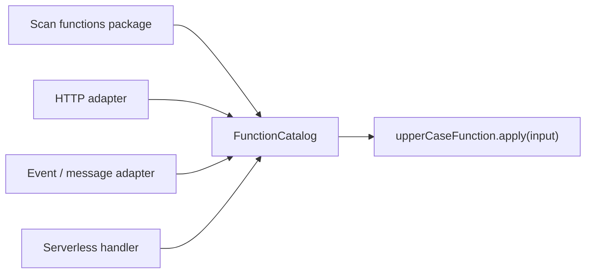

# Automatic Scanning of the `functions` Package in Spring Cloud Function

## Lesson Objectives

In the **Bean Registration** chapter of **Spring Cloud Function**, beyond using `@Bean`, `@Component`, or `GenericApplicationContext.registerBean(...)`, the framework also supports **automatically finding Java classes implementing `Supplier`, `Function`, or `Consumer` in a package**. This mechanism is commonly called *Function Component Scan*.

With this specialized scan, you can write business logic in plain Java without placing Spring annotations on every class. Discovered functions can be used via `FunctionCatalog`, and then connected to HTTP, event systems, or serverless environments when matching adapters are present.

After this lesson, you will know how to:

- Organize implementation classes in the default `functions` package and predict function names for lookup.
- Change the scan scope with `spring.cloud.function.scan.packages` or disable it with `spring.cloud.function.scan.enabled=false`.
- Distinguish **Function Component Scan** from Spring Framework's `@ComponentScan` and from explicit bean registration.
- Verify auto-discovered functions via `FunctionCatalog`, while preserving generic type information needed for message conversion.
- Avoid accidentally scanning unwanted functions, duplicate name registrations, misconceptions about automatic invocation, and errors caused by missing adapter configuration.

## 1. How Scanning the `functions` Package Works

In Spring Cloud Function's model, a concrete Java class implementing one of the following three interfaces can be **discovered by Function Component Scan**:

| Class Type | Contract | Role |
| --- | --- | --- |
| `Supplier<O>` | `O get()` | Generates data when invoked |
| `Function<I, O>` | `O apply(I input)` | Takes input data and returns a result |
| `Consumer<I>` | `void accept(I input)` | Takes input data and performs an action |

By default, Spring Cloud Function scans the package named **`functions`** if it exists on the classpath. Therefore, simply placing a matching class in this package means you do not necessarily have to add `@Component` or a `@Bean` method.

Example:

```text
src/main/java/
├── demo/
│   └── app/
│       └── ScanningApplication.java
└── functions/
    ├── UpperCaseFunction.java
    ├── SampleOrderSupplier.java
    └── AuditConsumer.java
```

Important detail: `functions` in the example is a **Java package**, declared with `package functions;`, not just an arbitrary folder name. After compilation, the corresponding classes must be on the classpath where the application actually runs.

In this example, `ScanningApplication` resides in `demo.app`, while the functions reside in `functions` outside the application's root package. This layout clearly separates Spring Cloud Function's specialized scanning from Spring Boot's default `@ComponentScan` scope.

**Limitation:** automatic scanning requires the Spring Cloud Function support for this feature to be on the classpath and enabled. Simply creating a `functions` folder in a Spring Boot app without Spring Cloud Function will not automatically activate this capability.

## 2. Complete Java Example: Three Functions Without `@Component`

Scenario: a service receives an order code and normalizes the string to uppercase, alongside a sample code supplier and an audit consumer. The processing classes do not need to know whether they will be called from HTTP or a message broker.

This example uses Spring Boot, Java 17+, and the compatible Spring Cloud Function Context dependency. To expose HTTP endpoints, you must add a web adapter and web server; calling directly via the catalog below does not require HTTP yet.

### 2.1. `Function<String, String>`: Converting Strings to Uppercase

File `src/main/java/functions/UpperCaseFunction.java`:

```java
package functions;

import java.util.Locale;
import java.util.function.Function;

public final class UpperCaseFunction implements Function<String, String> {

    @Override
    public String apply(String input) {
        if (input == null) {
            throw new IllegalArgumentException("input must not be null");
        }

        return input.trim().toUpperCase(Locale.ROOT);
    }
}
```

This class **has no `@Component`** and does not depend on any Spring APIs. The `implements Function<String, String>` signature clearly declares the input/output data types.

By Function Component Scan's naming convention, the `UpperCaseFunction` class is normally published under the name **`upperCaseFunction`** (the first letter of the class name lowercased). Therefore, the example below looks up `catalog.lookup("upperCaseFunction")`.

### 2.2. `Supplier<String>`: Producing a Sample Order Code

File `src/main/java/functions/SampleOrderSupplier.java`:

```java
package functions;

import java.util.function.Supplier;

public final class SampleOrderSupplier implements Supplier<String> {

    @Override
    public String get() {
        return " ord-42 ";
    }
}
```

The expected name in the catalog is `sampleOrderSupplier`. This is a **business data supplier function**. Its `get()` method is only invoked when application code, the catalog, or an adapter actually triggers it; being auto-scanned **does not mean the function runs on a schedule**.

### 2.3. `Consumer<String>`: Recording an Audit Entry

File `src/main/java/functions/AuditConsumer.java`:

```java
package functions;

import java.util.function.Consumer;

public final class AuditConsumer implements Consumer<String> {

    @Override
    public void accept(String value) {
        System.out.println("AUDIT " + value);
    }
}
```

The expected name is `auditConsumer`. A `Consumer` processes data without returning a business value. `System.out.println` is only for demonstration; real systems may write via an audit service, logging, or a message broker, and should handle retries/duplicates if messages can be redelivered.

### 2.4. Starting Spring Boot and Looking Up via `FunctionCatalog`

File `src/main/java/demo/app/ScanningApplication.java`:

```java
package demo.app;

import java.util.function.Consumer;
import java.util.function.Function;
import java.util.function.Supplier;

import org.springframework.boot.ApplicationRunner;
import org.springframework.boot.SpringApplication;
import org.springframework.boot.autoconfigure.SpringBootApplication;
import org.springframework.cloud.function.context.FunctionCatalog;
import org.springframework.context.annotation.Bean;

@SpringBootApplication
public class ScanningApplication {

    public static void main(String[] args) {
        SpringApplication.run(ScanningApplication.class, args);
    }

    @Bean
    ApplicationRunner demonstrate(FunctionCatalog catalog) {
        return args -> {
            Supplier<String> supplier =
                    catalog.lookup("sampleOrderSupplier");
            Function<String, String> normalize =
                    catalog.lookup("upperCaseFunction");
            Consumer<String> audit =
                    catalog.lookup("auditConsumer");

            if (supplier == null || normalize == null || audit == null) {
                throw new IllegalStateException(
                        "Missing one or more functions in FunctionCatalog");
            }

            String value = normalize.apply(supplier.get());
            audit.accept(value);
        };
    }
}
```

When Function Component Scan works, the output printed at application startup is:

```text
AUDIT ORD-42
```

Key points:

1. There is no `@Component` on the three handler classes and no `@Bean` method creating them.
2. Spring Cloud Function discovers the classes via the `functions` package and registers them for lookup through `FunctionCatalog`.
3. The sole `@Bean` in `ScanningApplication` creates an **`ApplicationRunner` for demonstration**, not to register the three business functions.
4. `ApplicationRunner` calls `get()`, `apply(...)`, and `accept(...)` **in an order chosen by Java code**. The framework does not automatically infer that these three functions form a pipeline.
5. The classes preserve the `String` generic type, giving the catalog and adapters a basis to recognize the payload type.

Because `ApplicationRunner` runs after the context initializes, it is a convenient spot for manual smoke-test code while learning. In a real service, there is no need to put test invocations in `main`; adapters trigger functions on configured requests or events.

## 3. Customizing the Scanned Package

You are not forced to place classes in the default `functions` package. If you want a domain-oriented directory structure, such as `com.example.order.logic`, place the classes in that package:

```text
src/main/java/
└── com/example/order/
    ├── OrderApplication.java
    └── logic/
        ├── ValidateOrderFunction.java
        └── NotifyOrderConsumer.java
```

The classes must declare the actual package:

```java
package com.example.order.logic;
```

And add the following to `src/main/resources/application.properties`:

```properties
spring.cloud.function.scan.packages=com.example.order.logic
```

Or in YAML format inside `application.yml`:

```yaml
spring:
  cloud:
    function:
      scan:
        packages: com.example.order.logic
```

The **`spring.cloud.function.scan.packages`** property controls the package(s) where Spring Cloud Function's *Function Component Scan* looks for classes implementing functional interfaces. When setting a custom path, verify that the package name in your Java sources and the configuration match **exactly**.

You do not need to add `@Component` just because you changed to another package. When scanning multiple parts of an application, explicitly list only the packages containing **functions you intend to expose**, to avoid accidentally adding test classes or internal functions to the catalog.

### Disabling Function Component Scan Completely

To register functions explicitly via another mechanism or prevent auto-discovery of classes in packages, configure:

```properties
spring.cloud.function.scan.enabled=false
```

Setting `false` disables **this specialized function-scanning mechanism**. It does not disable all Spring bean declarations: `@Bean` methods, `@Component` classes found by regular Spring component scanning, or explicitly registered beans can still exist. With appropriate configuration, Spring Cloud Function can continue picking up those function beans.

| Configuration | Meaning |
| --- | --- |
| Scan property omitted | Scans the default `functions` package if present |
| `spring.cloud.function.scan.packages=com.example.order.logic` | Selects a custom function package |
| `spring.cloud.function.scan.enabled=false` | Does not run Function Component Scan |
| `spring.cloud.function.definition=upperCaseFunction` | Selects the function name/expression used by some adapters; **does not change the scanned package** |

**Do not confuse `scan.packages` with `spring.cloud.function.definition`.** The first specifies where to find function classes; the second selects an already registered/discovered function for the runtime to use when needed.

## 4. Differences from Regular Spring `@ComponentScan`

Even though both contain the word *scan*, the two mechanisms use different discovery criteria.

| Aspect | Function Component Scan | Spring `@ComponentScan` |
| --- | --- | --- |
| Framework | Spring Cloud Function | Spring Framework / Spring Boot |
| Target | Finds concrete classes implementing `Supplier`, `Function`, or `Consumer` | Finds classes annotated with `@Component`, `@Service`, `@Repository`, `@Controller`, and matching stereotypes |
| Requires annotation on function class | No | Typically yes, if you want auto-discovery via component scan |
| Default package in examples | `functions` | The Spring Boot application's package and its subpackages, unless customized |
| Package configuration | `spring.cloud.function.scan.packages` | `@ComponentScan(basePackages = ...)` or Boot configuration |
| Disabling individually | `spring.cloud.function.scan.enabled=false` | Adjust/disable component scan via appropriate Spring configuration |

Consider a plain Java class:

```java
package functions;

public final class UpperCaseFunction
        implements java.util.function.Function<String, String> {

    @Override
    public String apply(String text) {
        return text.toUpperCase(java.util.Locale.ROOT);
    }
}
```

With default Function Component Scan enabled, this matching class is a **candidate for auto-discovery** even without annotations. If you only use Spring Framework's `@ComponentScan("functions")`, you should not assume an unannotated class without a stereotype annotation will be picked up as a regular component.

An application can have both mechanisms active. When a class carries `@Component` and also lives inside a function-scanned package, check for **duplicate bean registration or name collisions in the catalog**. The simplest approach is to stick to one registration path per function.

## 5. How Are Function Names Generated?

When scanning implementation classes, Spring Cloud Function derives names from the **class name**, typically following lowercase-initial Java variable naming. The official reference documentation gives the example of `functions.UpperCaseFunction` having the lookup name `upperCaseFunction`.

| Java Class | Expected Function Name in Catalog |
| --- | --- |
| `functions.UpperCaseFunction` | `upperCaseFunction` |
| `functions.SampleOrderSupplier` | `sampleOrderSupplier` |
| `functions.AuditConsumer` | `auditConsumer` |
| `com.example.order.logic.ValidateOrderFunction` | `validateOrderFunction` |

This convention is helpful when reading code, but **actual names should be confirmed via `FunctionCatalog.lookup(...)` or tests**, especially if a project customizes bean names or uses a different version.

Example:

```java
Function<String, String> fn =
        catalog.lookup("upperCaseFunction");

if (fn == null) {
    throw new IllegalStateException(
            "Function upperCaseFunction was not discovered");
}
```

When multiple functions coexist, an adapter may require selecting the target:

```properties
spring.cloud.function.definition=upperCaseFunction
```

If the name in `definition`, the endpoint name, or the name in `lookup` does not match the name published by the catalog, calls may fail to find the function. If two different packages contain classes with the same simple name, avoid name collisions when both packages are scanned together.

## 6. Generic Types, DTOs, and Message Conversion

The benefit of scanning **direct implementation classes** is that the generic signature is expressed directly on the class:

```java
public final class ValidateOrderFunction
        implements Function<OrderCommand, ValidationResult> {
    @Override
    public ValidationResult apply(OrderCommand command) {
        return new ValidationResult(
                command.id(),
                command.quantity() > 0);
    }
}
```

Suppose the application also defines two records:

```java
public record OrderCommand(String id, int quantity) {}
public record ValidationResult(String id, boolean valid) {}
```

In this specific example, when the framework receives JSON such as:

```json
{"id":"ORD-42","quantity":3}
```

the `Function<OrderCommand, ValidationResult>` information helps Spring Cloud Function determine the target type for payload conversion. JSON conversion also depends on the adapter, content type, codec/JSON mapper, and DTO instantiation rules; **scanning the class alone does not guarantee every message format is supported**.

For auto-scanned classes, keep generic types concrete rather than implementing a *raw-type* `Function` or inheriting unbound generics:

```java
// Avoid when you want the framework to clearly infer input/output types:
public final class RawOrderFunction implements Function {
    @Override
    public Object apply(Object input) {
        return input;
    }
}
```

This class does not tell the framework that the input is `OrderCommand` or the output is `ValidationResult`, so adapters may not convert payloads as expected. With `List<OrderCommand>`, `Message<OrderCommand>`, or reactive types, nested type information is even more critical. When types cannot be expressed on the class, register the function with explicit metadata using a mechanism supported by Spring Cloud Function, such as `FunctionRegistration` in compatible versions.

## 7. Integration with HTTP, Events, and Serverless

Once `UpperCaseFunction` is discovered, different invocation channels can share the same `apply(...)` logic:



**HTTP:** if the application includes the Spring Cloud Function Web adapter and a matching HTTP server, common configurations expose routes by function name. For example:

```bash
curl -X POST http://localhost:8080/upperCaseFunction \
  -H 'Content-Type: text/plain' \
  --data-binary '  hello  '
```

The expected business result is `HELLO`. The exact route depends on your version and `spring.cloud.function.web.path` configuration; **simply scanning a package will not create an HTTP endpoint if the web adapter is missing**.

**Events/broker:** with Spring Cloud Stream, a compatible binder and binding configuration can pull messages from a broker and pass them to the function in the catalog. Scanning only registers the function; message consumption, retry policies, and routing are handled by Spring Cloud Stream and the adapter.

**Serverless:** the runtime uses a handler/launcher defined by the platform contract. The handler can initialize or reuse the Spring context containing the scanned function and invoke it via the catalog. Do not assume serverless invokes `main` or automatically runs `Supplier.get()` whenever there is no event.

**Composition:** when another `Function<String, String>` named `appendSuffixFunction` is present, the catalog can look up:

```java
Function<String, String> pipeline =
        catalog.lookup("upperCaseFunction|appendSuffixFunction");
```

Condition: both functions must be discovered/registered and the previous step's output type must be compatible with the next step's input type. Package scanning only feeds functions into the catalog; it does not compose functions by file order or class order.

## 8. Testing Automatic Scanning

### Testing Java Logic

Because `UpperCaseFunction` has no Spring dependencies, unit tests can invoke it directly:

```java
package functions;

import static org.junit.jupiter.api.Assertions.assertEquals;

import org.junit.jupiter.api.Test;

class UpperCaseFunctionTest {

    @Test
    void convertsText() {
        UpperCaseFunction fn = new UpperCaseFunction();
        assertEquals("HELLO", fn.apply("  hello  "));
    }
}
```

This test verifies the Java logic, but **does not prove** scanning is configured or that the catalog finds the function.

### Integration Testing with `FunctionCatalog`

With Spring Boot Test, start a context with Spring Cloud Function and query the catalog:

```java
package demo.app;

import static org.junit.jupiter.api.Assertions.assertEquals;
import static org.junit.jupiter.api.Assertions.assertNotNull;

import java.util.function.Function;
import org.junit.jupiter.api.Test;
import org.springframework.beans.factory.annotation.Autowired;
import org.springframework.boot.test.context.SpringBootTest;
import org.springframework.cloud.function.context.FunctionCatalog;

@SpringBootTest(
        classes = ScanningApplication.class,
        webEnvironment = SpringBootTest.WebEnvironment.NONE)
class FunctionPackageScanTest {

    @Autowired
    FunctionCatalog catalog;

    @Test
    void discoversFunctionWithoutComponentAnnotation() {
        Function<String, String> fn =
                catalog.lookup("upperCaseFunction");

        assertNotNull(fn);
        assertEquals("HELLO", fn.apply("  hello  "));
    }
}
```

This test assumes scanning remains enabled, the `functions` package is on the **test runtime classpath**, and the proper Spring Cloud Function dependencies are included in the project. It verifies **auto-discovery + lookup**, not HTTP endpoints or message broker bindings.

### Testing with Scanning Disabled

If you set `spring.cloud.function.scan.enabled=false` and **do not register** `UpperCaseFunction` through another mechanism, `catalog.lookup("upperCaseFunction")` is no longer expected to find the function solely because the class sits in the `functions` package.

To test that scenario, use a dedicated test context with scanning disabled and without a function bean of the same name created by `@Bean`/`@Component`. If multiple registration mechanisms are active at once, a lookup result alone cannot tell you which scanner supplied the function.

## 9. Diagnosing Scanning Issues

| Symptom | Possible Cause | How to Fix |
| --- | --- | --- |
| `catalog.lookup("upperCaseFunction")` returns `null` | Class is not in a scanned package | Check `package`, source path, classpath, and `scan.packages` |
| Class is in `com.example.functions` but not found | Relying on default `functions` without configuring actual package | Set `spring.cloud.function.scan.packages=com.example.functions` |
| Auto-scanning is disabled | `spring.cloud.function.scan.enabled=false` is set | Re-enable if auto-discovery is needed, or register explicitly |
| Bean found with `@Component` does not prove scanning works | Spring component scan may have registered the bean | Use an unannotated class in the scanned package and a separate integration test |
| Duplicate names, unexpected function behavior | Multiple classes/beans yield the same inferred name or use multiple registration paths | Establish clear naming rules, narrow scanned packages, remove duplicate registrations |
| JSON fails to convert to DTO | Missing concrete generics or mismatched content type/mapper | Use `Function<DTO, Result>`, check adapter, codec, and message headers |
| HTTP 404 even though catalog has the function | Missing web adapter, wrong route, or HTTP server not running | Check web dependency, `spring.cloud.function.web.path`, port, and URL |
| `Supplier` does not run periodically on its own | Scanning only makes the function discoverable; it does not schedule polling | Configure an adapter/binder or custom trigger code |
| Tests pass locally but deployment cannot find the class | Packaged artifact missing class or classloader lacks package | Check actual classpath of JAR/launcher and scan config |
| Function call raises instantiation error | Class cannot be instantiated by container or lacks dependencies | Ensure concrete class has a valid instantiation path; use explicit bean registration if needed |

When investigating, verify **in order**: class is on classpath → scanned package is correct → scan is enabled → catalog name is right → adapter is configured. This checklist separates *discovery* errors from *transport* errors.

## 10. Practice Exercises

1. **Default scanning:** create `functions.ReverseTextFunction implements Function<String,String>`; verify `catalog.lookup("reverseTextFunction")` returns the expected reversed string.
2. **Switch package:** move the class to `com.example.text.functions`, configure `spring.cloud.function.scan.packages=com.example.text.functions`, and re-run the integration test.
3. **Disable scan:** set `spring.cloud.function.scan.enabled=false`, verify the class is no longer discovered automatically; then register it explicitly with `@Bean` to compare.
4. **Multiple functions:** add `TrimFunction implements Function<String,String>` in the scanned package. Confirm the catalog looks up `trimFunction` and `upperCaseFunction` independently; try composing them since their types match.
5. **DTO:** write `ValidateOrderFunction implements Function<OrderCommand, ValidationResult>`, send a JSON payload through a configured adapter, and verify the data types convert properly.
6. **Distinguish scanners:** explain why a class without `@Component` can be found by Function Component Scan yet not necessarily discovered by Spring `@ComponentScan`.

## 11. Summary

By default, Spring Cloud Function can **automatically scan the `functions` package** to discover classes implementing `Supplier`, `Function`, and `Consumer` without Spring annotations. The **`spring.cloud.function.scan.packages`** property lets you change the search location; **`spring.cloud.function.scan.enabled=false`** turns off that specialized scanning mechanism. Once discovered, functions become available through **`FunctionCatalog`**; HTTP, events, and serverless still require the appropriate adapters and trigger configuration.

References: [Spring Cloud Function — Programming Model, Function Component Scan section](https://docs.spring.io/spring-cloud-function/reference/spring-cloud-function/programming-model.html) and [Deploying a Packaged Function — Component Scanning](https://docs.spring.io/spring-cloud-function/reference/spring-cloud-function/deploying-a-packaged.html). Always cross-check against the Spring Cloud Function release line you use in production.
