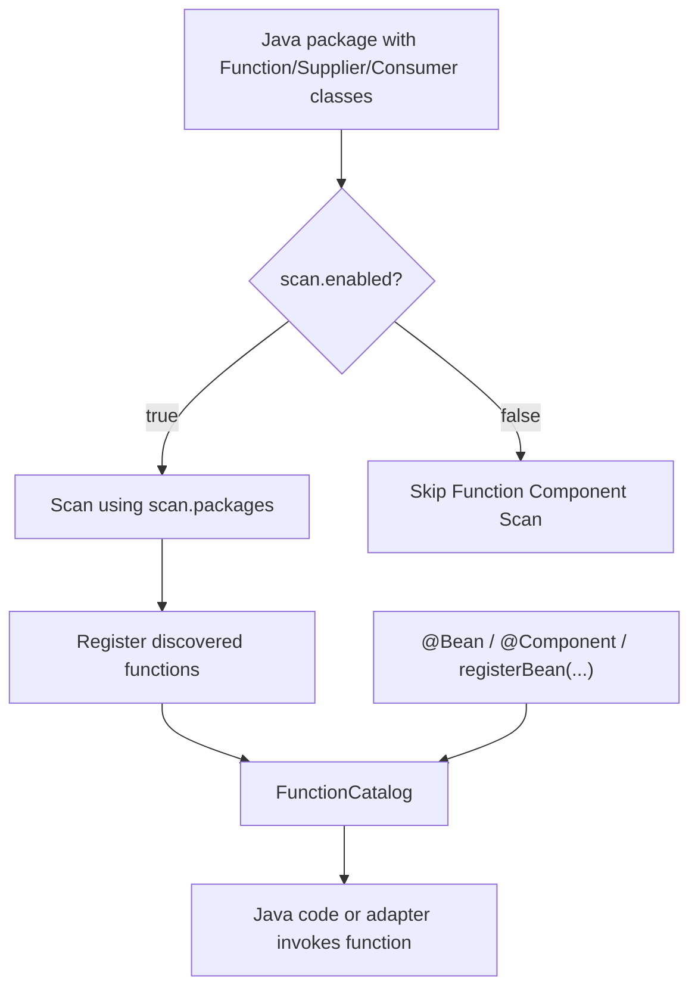

# Customizing `spring.cloud.function.scan.packages` and `scan.enabled`

## Objectives

In the **Bean Registration** chapter of **Spring Cloud Function**, an application can expose business logic as `Supplier`, `Function`, or `Consumer` by letting the framework **scan implementation classes** rather than writing `@Bean` for every function. Two properties you must master are:

- `spring.cloud.function.scan.packages`: specifies the Java package(s) where Spring Cloud Function searches for function classes.
- `spring.cloud.function.scan.enabled`: enables or disables this specialized function-scanning mechanism.

After this lesson, you will be able to move functions into a custom package, control scanning per environment, explain how it differs from Spring's `@ComponentScan`, verify results via `FunctionCatalog`, and troubleshoot cases where a function does not appear even though the class was compiled.

## 1. Distinguishing Function Registration, Scanning, and Invocation

Spring Cloud Function builds its programming model around three Java interfaces:

| Interface | Invocation Method | Meaning |
| --- | --- | --- |
| `Supplier<O>` | `O get()` | Produces data |
| `Function<I, O>` | `O apply(I input)` | Transforms input data into a result |
| `Consumer<I>` | `void accept(I input)` | Consumes data and performs an action |

A class with `implements Function<String, String>` is a **Java function**. It can only be invoked through `FunctionCatalog` after Spring Cloud Function recognizes or registers it into the context/catalog via a supported mechanism. Function Component Scan is one of those mechanisms.

Three steps to distinguish:

1. **Discovery:** scan packages to locate classes implementing `Supplier`, `Function`, or `Consumer`.
2. **Registration:** prepare matching beans/functions for lookup in `FunctionCatalog`.
3. **Invocation:** Java code, an HTTP adapter, a Spring Cloud Stream binder, or a serverless handler invokes the actual function.



**These two scan properties only govern the search for function classes.** They do not run functions periodically, open HTTP endpoints automatically, or configure brokers. Invocation via HTTP, events, or serverless depends on additional adapters/runtimes.

## 2. Default Value and Java Package Location

When Function Component Scan is enabled, Spring Cloud Function searches by default for function classes in the Java package named **`functions`** on the classpath.

Example structure:

```text
src/main/java/
├── com/acme/app/
│   └── DemoApplication.java
└── functions/
    ├── NormalizeText.java
    ├── SampleValue.java
    └── AuditValue.java
```

Inside `NormalizeText.java`:

```java
package functions;

import java.util.Locale;
import java.util.function.Function;

public final class NormalizeText implements Function<String, String> {

    @Override
    public String apply(String input) {
        return input.trim().toUpperCase(Locale.ROOT);
    }
}
```

With the appropriate scanning mechanism enabled, `NormalizeText` is a candidate class even **without `@Component`**. By standard convention, the published name from this class is `normalizeText`; a catalog lookup test will verify the actual name in your version.

This is a **Java package** declared with `package functions;`, not an arbitrary directory name. A class in `com.acme.functions` is **not in the same package** as `functions`; do not assume both are scanned when using only the default configuration.

Scanning occurs during application bootstrap. If you load additional classes or change configuration values in a file after the context is already running, do not assume Spring Cloud Function automatically re-scans immediately. Changing the set of published functions typically requires recreating the context or restarting according to your deployment workflow.

## 3. Customizing `spring.cloud.function.scan.packages`

As an application grows, placing all logic inside the root `functions` package can be inconvenient. You can group functions by domain, for example:

```text
src/main/java/
└── com/acme/
    ├── app/
    │   └── OrderApplication.java
    └── order/
        └── functions/
            ├── NormalizeOrderId.java
            └── ValidateOrder.java
```

Classes to be scanned declare:

```java
package com.acme.order.functions;
```

In `src/main/resources/application.properties`, set:

```properties
spring.cloud.function.scan.packages=com.acme.order.functions
```

Or in `application.yml`:

```yaml
spring:
  cloud:
    function:
      scan:
        packages: com.acme.order.functions
```

Spring Cloud Function then looks for function classes in the **specified package**. The configuration value must be a dot-separated Java package name; **do not use file paths** such as `src/main/java/com/acme/order/functions` or `.class` file paths.

### Keep the Scope Narrow Enough

Scan a package dedicated to functions you actually want exposed via `FunctionCatalog`. If you specify a package that is too broad—containing test classes or internal `Function` classes—the framework may recognize more functions than intended. This matters especially when web adapters or message binders act on the published set of functions.

For instance, if all service functions live under `com.acme.order.functions`, specify that exact package rather than unnecessarily scanning `com.acme`.

### What About Multiple Function Groups?

Some Spring Cloud Function configurations accept a list of packages, such as a comma-separated list in `application.properties`:

```properties
spring.cloud.function.scan.packages=com.acme.order.functions,com.acme.payment.functions
```

When using multiple packages, check the data format accepted by the scan configuration in your running version and verify **both** functions with an integration test. If you prefer a single configuration entry, a simpler approach is to organize classes under **one root package dedicated to functions** with subpackages underneath, then verify the actual scan scope.

## 4. Runnable Application Example with a Custom Package

This example is independent of the default `functions` package. We have an application that accepts an order ID and normalizes it before using it in HTTP, messaging, or serverless. The business class has no Spring dependencies.

Requirements: Java 17+, Spring Boot, and Spring Cloud Function Context in compatible versions. To expose HTTP, also add the Spring Cloud Function Web adapter and an HTTP server.

### 4.1. Function Class in `com.acme.order.functions`

File `src/main/java/com/acme/order/functions/NormalizeOrderId.java`:

```java
package com.acme.order.functions;

import java.util.Locale;
import java.util.function.Function;

public final class NormalizeOrderId implements Function<String, String> {

    @Override
    public String apply(String input) {
        if (input == null || input.isBlank()) {
            throw new IllegalArgumentException("Order ID is blank");
        }
        return input.trim().toUpperCase(Locale.ROOT);
    }
}
```

Do not add `@Component` to this class: the goal is to demonstrate that **Function Component Scan** discovers a plain Java class. The `Function<String, String>` signature preserves input and output type information for Spring Cloud Function.

### 4.2. Configuring Scan Enablement and Package Selection

File `src/main/resources/application.properties`:

```properties
spring.cloud.function.scan.enabled=true
spring.cloud.function.scan.packages=com.acme.order.functions
```

`scan.enabled=true` explicitly states the intent to enable scanning. When relying on the enabled default, you can omit this line; declaring it explicitly is helpful for testing enable/disable toggles.

### 4.3. Spring Boot Entry Point and Catalog Lookup Test

File `src/main/java/com/acme/app/OrderApplication.java`:

```java
package com.acme.app;

import java.util.function.Function;

import org.springframework.boot.ApplicationRunner;
import org.springframework.boot.SpringApplication;
import org.springframework.boot.autoconfigure.SpringBootApplication;
import org.springframework.cloud.function.context.FunctionCatalog;
import org.springframework.context.annotation.Bean;

@SpringBootApplication
public class OrderApplication {

    public static void main(String[] args) {
        SpringApplication.run(OrderApplication.class, args);
    }

    @Bean
    ApplicationRunner demo(FunctionCatalog catalog) {
        return args -> {
            Function<String, String> normalize =
                    catalog.lookup("normalizeOrderId");

            if (normalize == null) {
                throw new IllegalStateException(
                        "normalizeOrderId not found in FunctionCatalog");
            }

            System.out.println(normalize.apply("  ord-104  "));
        };
    }
}
```

Expected console output:

```text
ORD-104
```

In this example, `OrderApplication` belongs to `com.acme.app`; `NormalizeOrderId` lives in `com.acme.order.functions`, **not in a subpackage of `com.acme.app`**. As a result, when the catalog finds the unannotated function, we have clear evidence that Spring Cloud Function's own scan found it.

The `@Bean` in `OrderApplication` creates an `ApplicationRunner` for demonstration—**it does not create `NormalizeOrderId`**. The function appears only when the scanner or another registration mechanism discovers that class.

`ApplicationRunner` is great for practicing after Spring Boot initializes the context; in a continuously serving application, adapters typically trigger functions and you do not need a runner printing sample data.

## 5. Enabling or Disabling with `spring.cloud.function.scan.enabled`

In `application.properties`, set:

```properties
spring.cloud.function.scan.enabled=false
```

Effect: **Function Component Scan is disabled**. In the Section 4 example, if `NormalizeOrderId` is not registered via `@Bean`, `@Component`, or another mechanism, `catalog.lookup("normalizeOrderId")` is no longer expected to find the function via `scan.packages` alone.

To re-enable it:

```properties
spring.cloud.function.scan.enabled=true
```

| Property | Sample Value | Meaning |
| --- | --- | --- |
| `scan.packages` | `com.acme.order.functions` | Where Function Component Scan looks for function classes |
| `scan.enabled` | `true` | Allows scanning during bootstrap |
| `scan.enabled` | `false` | Skips the specialized function-scanning mechanism |
| `spring.cloud.function.definition` | `normalizeOrderId` | Selects an already-discovered function for an adapter to use; does not trigger the scanner |

### Does Disabling Scan Mean Disabling Spring Cloud Function?

**No.** This property only turns off discovering function classes via Function Component Scan. An application can still register:

- A `@Bean Function<String, String> normalizeOrderId()` method inside a `@Configuration` class.
- A `@Component("normalizeOrderId") implements Function<String, String>` class discovered by regular Spring component scanning.
- A `NormalizeOrderId` bean via `GenericApplicationContext.registerBean(...)` in an initializer.
- A `FunctionRegistration` declared with explicit name and types using your Spring Cloud Function version's API.

Once these beans/functions are picked up by Spring Cloud Function, the catalog can still locate them even when `scan.enabled=false`.

**Do not register the same function through multiple mechanisms unintentionally.** For example, scanning a plain Java class while also adding `@Component` or a `@Bean` with the same name can cause bean or function name conflicts.

### When Should You Disable Scanning?

Disable Function Component Scan when you want **every exposed function to be explicitly declared**, when you need tight control over the set of functions in a deployment environment, or when you do not want `Function`-implementing classes in a certain package to be discovered automatically.

For example, an integration application using multiple frameworks may set `scan.enabled=false` and register only its three officially supported business functions with `@Bean`. That way, adding a new `Function`-implementing class in the codebase will not automatically alter the list of functions discovered by the scanner.

## 6. Changing Configuration by Environment

These properties are read by Spring Boot from `Environment`, so they can be supplied through config files, profiles, or application arguments depending on your deployment setup.

### Profile Example

File `application-dev.properties`:

```properties
spring.cloud.function.scan.enabled=true
spring.cloud.function.scan.packages=com.acme.order.functions
```

File `application-prod.properties`:

```properties
spring.cloud.function.scan.enabled=false
```

In this example, the production configuration assumes the needed functions **are already explicitly registered via another mechanism**. Otherwise, turning off scanning may leave the catalog unable to find them and adapters with no function to invoke.

To run with a profile:

```bash
java -jar order-service.jar --spring.profiles.active=dev
```

### Overriding at Startup

You can pass properties as command-line arguments to Spring Boot:

```bash
java -jar order-service.jar \
  --spring.cloud.function.scan.enabled=true \
  --spring.cloud.function.scan.packages=com.acme.order.functions
```

In container environments, Spring Boot properties can also be mapped from environment variables, for example:

```text
SPRING_CLOUD_FUNCTION_SCAN_ENABLED=false
SPRING_CLOUD_FUNCTION_SCAN_PACKAGES=com.acme.order.functions
```

These environment variable examples follow Spring Boot's standard *relaxed binding* rules: uppercase letters and underscores correspond to property name segments. Make sure your deployment tooling actually passes these variables to the Java process.

**Configuration precedence:** if a property appears in multiple sources, Spring Boot applies its `PropertySource` precedence order. Therefore, do not look at a single `application.properties` file and assume it holds the final value. Command-line arguments, environment variables, profiles, and external configs can override it.

## 7. How Does `scan.packages` Differ from `@ComponentScan`?

Both mechanisms locate classes on the classpath, but **they differ in class selection criteria**.

| Aspect | Function Component Scan | Spring `@ComponentScan` |
| --- | --- | --- |
| Framework | Spring Cloud Function | Spring Framework / Spring Boot |
| Which classes it finds | Concrete classes implementing `Supplier`, `Function`, `Consumer` | Classes with `@Component` or matching stereotypes |
| Annotation needed on business class | Not necessarily | Typically required to be picked up by regular component scan |
| Scope configuration | `spring.cloud.function.scan.packages` | `@ComponentScan(basePackages = ...)` and related settings |
| Toggle property in this lesson | `spring.cloud.function.scan.enabled` | Not controlled by this property |
| Intended outcome | Functions recognizable by Spring Cloud Function | Spring beans in general |

Example: `com.acme.order.functions.NormalizeOrderId` has no `@Component`. If `@SpringBootApplication` is in `com.acme.app`, Spring's default component scan **does not automatically discover** that class. However, with Function Component Scan enabled and `scan.packages=com.acme.order.functions`, it becomes a function-scan candidate.

Conversely, if `NormalizeOrderId` carries `@Component` and falls within Spring component scan scope, when `spring.cloud.function.scan.enabled=false` it **can still become a bean**. Disabling the function scanner does not remove beans registered by other mechanisms.

## 8. Function Names and Relationship to `FunctionCatalog`

When scanning `NormalizeOrderId`, the name is normally derived using the class-to-bean-name convention, such as `normalizeOrderId`. Verify in practice with:

```java
Function<String, String> fn =
        catalog.lookup("normalizeOrderId");

if (fn == null) {
    throw new IllegalStateException(
            "normalizeOrderId not present in FunctionCatalog");
}
```

If an adapter must pick a function in an application with multiple functions, you can configure:

```properties
spring.cloud.function.definition=normalizeOrderId
```

**`spring.cloud.function.definition` is not a scanning property.** It specifies a name or composition expression for the runtime/adapter to select an existing function. If `scan.enabled=false` prevents the function from being registered and you have no other registration path, setting `definition=normalizeOrderId` cannot create the function on its own.

### Testing via HTTP

When the Spring Cloud Function Web adapter and a compatible HTTP server are configured, a route corresponding to the function name may be exposed:

```bash
curl -X POST http://localhost:8080/normalizeOrderId \
  -H 'Content-Type: text/plain' \
  --data-binary '  ord-104  '
```

Expected business result: `ORD-104`. The exact path also depends on the web adapter's mapping, such as path configuration if present. **Enabling scanning alone does not create an HTTP endpoint** when the application lacks the adapter.

With Spring Cloud Stream, the binder consumes messages and invokes the selected `Function`/`Consumer` from the catalog. With serverless, the platform's handler/launcher invokes the function. The name in `definition` and payload conversion must align with the actual `Function<I, O>` types.

## 9. Two Tests to Confirm Enable/Disable Configuration

A unit test calling `new NormalizeOrderId().apply(...)` only verifies Java logic. To test **scan configuration and the catalog**, you must build a Spring context.

The two tests below use **a minimal Spring Boot configuration without `ApplicationRunner`**. This is important because `OrderApplication` in Section 4 throws an exception if the catalog cannot find the function; when scanning is disabled, the runner's exception would fail the test before the `lookup` assertion could run.

File `src/test/java/com/acme/testconfig/ScanOnlyTestApplication.java`:

```java
package com.acme.testconfig;

import org.springframework.boot.SpringBootConfiguration;
import org.springframework.boot.autoconfigure.EnableAutoConfiguration;

@SpringBootConfiguration
@EnableAutoConfiguration
public class ScanOnlyTestApplication {
}
```

Combining `@SpringBootConfiguration` with `@EnableAutoConfiguration` loads the necessary Spring Cloud Function auto-configurations without component-scanning all of `com.acme.app`, avoiding accidentally loading the runner from the earlier example.

### 9.1. Testing When Scanning Is Enabled

With Spring Boot Test and Spring Cloud Function Context:

```java
package com.acme.app;

import static org.junit.jupiter.api.Assertions.assertEquals;
import static org.junit.jupiter.api.Assertions.assertNotNull;

import com.acme.testconfig.ScanOnlyTestApplication;
import java.util.function.Function;
import org.junit.jupiter.api.Test;
import org.springframework.beans.factory.annotation.Autowired;
import org.springframework.boot.test.context.SpringBootTest;
import org.springframework.cloud.function.context.FunctionCatalog;

@SpringBootTest(
        classes = ScanOnlyTestApplication.class,
        webEnvironment = SpringBootTest.WebEnvironment.NONE,
        properties = {
            "spring.cloud.function.scan.enabled=true",
            "spring.cloud.function.scan.packages=com.acme.order.functions"
        })
class EnabledFunctionScanTest {

    @Autowired
    FunctionCatalog catalog;

    @Test
    void findsFunctionInConfiguredPackage() {
        Function<String, String> fn = catalog.lookup("normalizeOrderId");
        assertNotNull(fn);
        assertEquals("ORD-104", fn.apply("  ord-104  "));
    }
}
```

This test proves the plain Java class in the custom package is found by the catalog in the configured context. It does not yet test HTTP adapters or message brokers.

### 9.2. Testing When Scanning Is Disabled

With a **separate test context** where no other mechanism registers `NormalizeOrderId`:

```java
package com.acme.app;

import static org.junit.jupiter.api.Assertions.assertNull;

import com.acme.testconfig.ScanOnlyTestApplication;
import org.junit.jupiter.api.Test;
import org.springframework.beans.factory.annotation.Autowired;
import org.springframework.boot.test.context.SpringBootTest;
import org.springframework.cloud.function.context.FunctionCatalog;

@SpringBootTest(
        classes = ScanOnlyTestApplication.class,
        webEnvironment = SpringBootTest.WebEnvironment.NONE,
        properties = {
            "spring.cloud.function.scan.enabled=false",
            "spring.cloud.function.scan.packages=com.acme.order.functions"
        })
class DisabledFunctionScanTest {

    @Autowired
    FunctionCatalog catalog;

    @Test
    void doesNotDiscoverClassSolelyByPackage() {
        assertNull(catalog.lookup("normalizeOrderId"));
    }
}
```

Testing with scanning disabled is only meaningful when **no `NormalizeOrderId` bean comes from `@Bean`, `@Component`, or an initializer**. The two tests use separate configurations and different `scan.enabled` values to verify Function Component Scan itself; neither needs to start an HTTP server.

## 10. Common Errors and How to Diagnose Them

| Symptom | Common Cause | How to Address |
| --- | --- | --- |
| `lookup("normalizeOrderId")` returns `null` | `scan.packages` does not match the Java package | Compare `package ...;`, configuration, and actual classpath |
| Package configured, yet function still does not appear | `scan.enabled=false` from a profile or higher-precedence config source | Inspect the resolved property value in Spring Boot's `Environment` |
| Accidentally scanning more classes than intended | Package is too broad or test function classes are in scope | Narrow the package or disable scanning and register explicitly |
| Scan disabled, yet catalog still finds the function | Function created via `@Bean`, `@Component`, initializer, or other registration | Audit all registration paths; scan properties do not disable those |
| `definition` set, yet adapter has no function | The name in `definition` does not exist in the catalog | Check `lookup` first, then compare function names |
| Duplicate bean or function name errors | Same class scanned and also registered via another mechanism | Use one primary registration mechanism per function name |
| JSON fails to convert to DTO | `Function<I, O>` lacks concrete types, or wrong adapter/content type | Declare explicit generics; check codec and payload before processing |
| HTTP 404 even though catalog test passes | Missing web adapter/server or route mismatch | Check HTTP dependencies, endpoint, and routing configuration |
| Works locally, but deployment cannot find the class | Class missing from artifact or different classloader | Inspect JAR contents and runtime classpath |
| Scan-disabled test fails at context startup | `ApplicationRunner` depends on the function whose scan is disabled | Use a minimal test configuration class without that runner |

Effective investigation order: **class on classpath → package configured properly → scan enabled → exact function name → catalog lookup succeeds → adapter configured properly**. This separates function discovery errors from protocol errors.

## 11. Exercises and Self-Check Questions

1. Create `com.acme.payment.functions.ValidatePayment implements Function<String, Boolean>` without `@Component`. Configure `scan.packages` so `FunctionCatalog` finds `validatePayment` and write the corresponding integration test.
2. Set `scan.enabled=false` while keeping `scan.packages`. If no other registration path exists, will `catalog.lookup("validatePayment")` still find the function via package scanning? **No.**
3. Explain why a `@Component("validatePayment")` class can still become a bean when Function Component Scan is disabled. **Because that uses Spring's component scan mechanism, which is independent of the specialized function scan settings.**
4. An adapter configures `spring.cloud.function.definition=validatePayment`, but `scan.enabled=false` and no bean registers the function. What needs to be fixed? **Enable scanning for the right package or register the function explicitly**; `definition` does not create beans.
5. When `application.properties` in source is updated, yet the deployed environment still sets `SPRING_CLOUD_FUNCTION_SCAN_ENABLED=false`, why might behavior differ from local runs? **Because the final value depends on Spring Boot's configuration precedence order.**
6. The function is found in the catalog, but HTTP calls fail. What is the next step? **Check the Spring Cloud Function Web adapter, HTTP server, routes, and payload conversion**, rather than only tweaking `scan.packages`.

## 12. Takeaways

**`spring.cloud.function.scan.packages` decides *where to scan*; `spring.cloud.function.scan.enabled` decides *whether to scan*.** These two properties control Function Component Scan, while beans registered via `@Bean`, `@Component`, and initializers follow their own mechanisms. Once functions are in `FunctionCatalog`, HTTP, event, or serverless adapters determine how they are invoked.

Refer to the official documentation: [Spring Cloud Function — Reference](https://docs.spring.io/spring-cloud-function/reference/), *Programming Model* and *Function Component Scan* sections. Verify against the specific Spring Cloud Function release line you use, as scanning details and configuration options may vary across releases.
