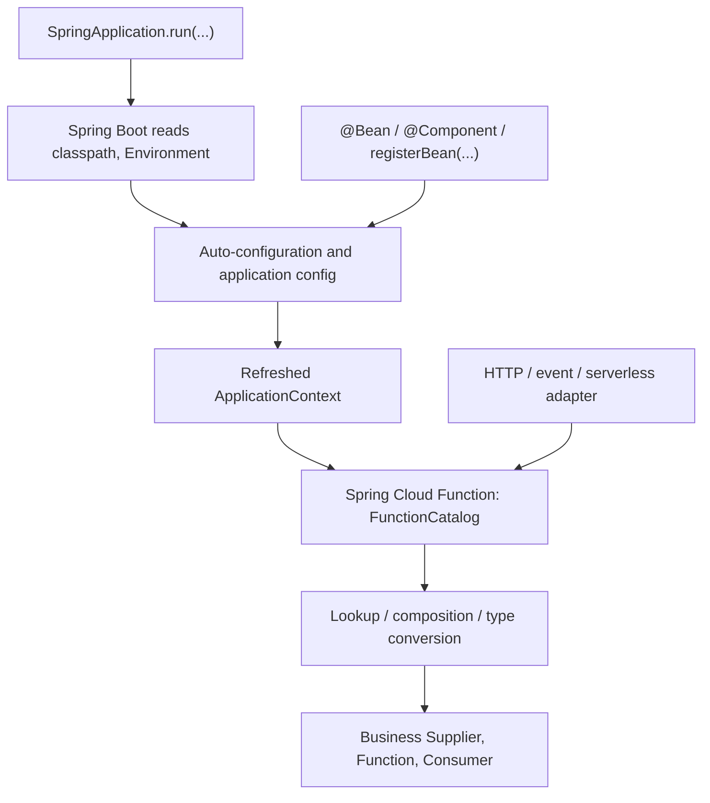
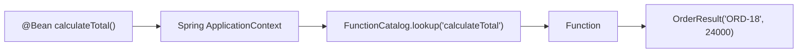

# Combining Bean Registration with Spring Boot Auto-Configuration

## Learning Objectives

In the **Bean Registration** chapter of **Spring Cloud Function**, it is important not only to write `Supplier`, `Function`, or `Consumer`, but also to understand how those functions become Spring beans and get used by `FunctionCatalog`. **Spring Boot auto-configuration** sets up the required infrastructure based on available libraries, configuration, and beans; the application still provides its own business logic.

After this lesson, you will be able to:

- Distinguish **function bean registration** from Spring Boot and Spring Cloud Function **auto-configuration**.
- Build a `@SpringBootApplication` containing a `@Bean Function<I, O>` and look up the function via `FunctionCatalog`.
- Explain why adding the Spring Cloud Function Web adapter is required to expose functions over HTTP, whereas message brokers and serverless require their corresponding adapters.
- Understand the role of conditions such as `@ConditionalOnClass`, `@ConditionalOnMissingBean`, and `@ConditionalOnProperty` when packaging functions in a library with auto-configuration.
- Identify errors caused by missing dependencies, missing functions, bean conflicts, lost generic types, and differences between Spring context tests and protocol tests.

## 1. How Do the Three Parts Work Together?

**Spring Boot** reads the classpath, `Environment`, application configuration, and auto-configurations supplied by libraries. During startup, Boot creates the `ApplicationContext`, loads bean definitions, and refreshes the context.

**Spring Cloud Function** adds the functional programming model and `FunctionCatalog` for looking up, converting data for, and optionally composing compatible functions. A `Function` already present in the Spring context can be recognized by Spring Cloud Function without you having to write an HTTP controller for it.

**The business application** supplies the functions that do the real work, such as `Function<OrderCommand, OrderResult>`, `Supplier<Order>`, or `Consumer<OrderResult>`.



The diagram illustrates responsibilities, not an exact list of every internal callback. Beans and auto-configurations may be instantiated or conditionally evaluated at different points during `refresh()`.

| Component | Primary Responsibility | What It Does **Not** Do Automatically |
| --- | --- | --- |
| `@SpringBootApplication` | Marks the application configuration class; enables component scanning and standard auto-configuration | Does not generate business functions; the process still needs a suitable launch entry point |
| `@Bean Function<I,O>` | Registers a specific function into the Spring context | Does not automatically create an HTTP endpoint or broker consumer |
| Spring Cloud Function Context | Supplies `FunctionCatalog` components when dependencies and configuration are appropriate | Does not create an unregistered business function on its own |
| Spring Cloud Function Web adapter | Connects HTTP to functions in the catalog when a suitable web environment exists | Does not replace the `Function`'s logic |
| Spring Cloud Stream / serverless adapter | Routes messages/events to selected functions | Does not turn an arbitrary bean into a complete broker/serverless app without configuration |

**Principle:** auto-configuration prepares **infrastructure and conditional defaults**; application beans provide **business behavior**. The two complement rather than exclude each other.

## 2. Why Does `@Bean Function` Work with Auto-Configuration?

Spring Boot typically uses `@SpringBootApplication`, an annotation combining key capabilities such as application configuration, component scanning, and enabling auto-configuration. In compatible Spring Cloud Function configurations, beans of type `Supplier`, `Function`, or `Consumer` are treated by the framework as discoverable functions.

Example:

```java
@Bean
public Function<String, String> normalizeText() {
    return value -> value.trim().toUpperCase(Locale.ROOT);
}
```

This snippet performs **business bean registration** under the name `normalizeText`. When the application has Spring Cloud Function Context and matching configuration, you can look it up:

```java
Function<String, String> fn = catalog.lookup("normalizeText");
```

You do not need to manually declare a `FunctionCatalog` bean if the Spring Cloud Function infrastructure is properly configured by Boot. However, **having only a standard Spring Boot Starter does not guarantee `FunctionCatalog` exists**: Spring Cloud Function must be present in a version and integration setup that creates the catalog.

### Note on Dependencies

In a Maven project **already managing compatible Spring Boot and Spring Cloud versions** (for example, Boot parent/BOM combined with the Spring Cloud BOM), the essential dependency for using the catalog is:

```xml
<dependency>
    <groupId>org.springframework.cloud</groupId>
    <artifactId>spring-cloud-function-context</artifactId>
</dependency>
```

If HTTP is needed, add the appropriate web runtime dependencies, for example:

```xml
<dependency>
    <groupId>org.springframework.cloud</groupId>
    <artifactId>spring-cloud-function-web</artifactId>
</dependency>
<dependency>
    <groupId>org.springframework.boot</groupId>
    <artifactId>spring-boot-starter-web</artifactId>
</dependency>
```

These are **illustrative dependency snippets**, not a complete `pom.xml` file. The project must also have managed version configuration, build plugins, and a compatible Java setup. Choose a Spring Cloud release train compatible with your Spring Boot version; do not mix versions arbitrarily.

Having additional libraries on the classpath changes which auto-configurations can activate. For example, when web infrastructure is present, Boot configures a web server and matching web components; when the Spring Cloud Function Web adapter is present, requests can be mapped to functions in the catalog. **Adding only `spring-cloud-function-context` does not open an HTTP port.**

## 3. Java Example: Registering a Function and Using `FunctionCatalog`

Scenario: a service receives an order and calculates the total price by quantity. The business function only handles Java data and has no idea whether calls originate from HTTP, Kafka, or a cloud function. This example uses Java 17+ with `record`.

Place the classes in package `example.order` so Spring Boot finds the configuration.

### 3.1. Defining Input and Output Types

File `OrderCommand.java`:

```java
package example.order;

public record OrderCommand(String orderId, int quantity) {
}
```

File `OrderResult.java`:

```java
package example.order;

public record OrderResult(String orderId, long totalCents) {
}
```

Separating them into two `public` records allows them to be used from tests, adapters, or other packages. In a real application, add validation at the ingestion boundary; this demo validates inside the function so readers can follow easily.

### 3.2. Creating a Spring Boot Application with `@Bean`

File `OrderFunctionApplication.java`:

```java
package example.order;

import java.util.function.Function;

import org.springframework.boot.SpringApplication;
import org.springframework.boot.autoconfigure.SpringBootApplication;
import org.springframework.context.annotation.Bean;

@SpringBootApplication
public class OrderFunctionApplication {

    public static void main(String[] args) {
        SpringApplication.run(OrderFunctionApplication.class, args);
    }

    @Bean
    public Function<OrderCommand, OrderResult> calculateTotal() {
        return command -> {
            if (command == null
                    || command.orderId() == null
                    || command.orderId().isBlank()
                    || command.quantity() <= 0) {
                throw new IllegalArgumentException("Invalid order");
            }

            long totalCents = Math.multiplyExact(
                    (long) command.quantity(), 12_000L);
            return new OrderResult(command.orderId(), totalCents);
        };
    }
}
```

Code walkthrough:

1. `main(...)` calls `SpringApplication.run(...)` so Boot builds the context and runs matching auto-configurations.
2. `@Bean` registers **a function bean named `calculateTotal`** in the application context.
3. The return type `Function<OrderCommand, OrderResult>` has explicit generics so Spring Cloud Function can recognize input/output types.
4. `calculateTotal` processes only business data; there is no `HttpServletRequest`, broker header, or serverless handler in the logic.
5. With quantity `2` and unit price `12_000` cents, the function returns `24_000` cents.

You do not need to implement `FunctionCatalog` or configure a separate controller just to call the function inside the same JVM: Spring Cloud Function Context supplies the catalog when the matching dependency/auto-configuration is loaded. The `calculateTotal` bean itself is still created by the application.

### 3.3. Looking Up the Function in Tests or Spring Components

Illustrative snippet (assuming a Spring-provided `catalog` variable is available):

```java
Function<OrderCommand, OrderResult> fn =
        catalog.lookup("calculateTotal");

if (fn == null) {
    throw new IllegalStateException("calculateTotal not found");
}

OrderResult result = fn.apply(new OrderCommand("ORD-18", 2));
// result: OrderResult[orderId=ORD-18, totalCents=24000]
```

`FunctionCatalog.lookup(...)` uses the function name. In this example, that name matches the `@Bean` method name. When using `@Bean(name = "...")` or other explicit registration mechanisms, look up **the actual published name**, rather than guessing from a class name arbitrarily.



## 4. From a Function Bean to an HTTP Endpoint

A very common misconception: **having a `@Bean Function` and a `FunctionCatalog` is not enough to serve HTTP**. You need a compatible web adapter and a running HTTP server.

When the Spring Cloud Function Web adapter is on the classpath and routing allows access to the function named `calculateTotal`, you can send for example:

```bash
curl -X POST http://localhost:8080/calculateTotal \
  -H 'Content-Type: application/json' \
  --data '{"orderId":"ORD-18","quantity":2}'
```

Expected business result (equivalent JSON format, depending on serializer/adapter configuration):

```json
{
  "orderId": "ORD-18",
  "totalCents": 24000
}
```

When that happens, a coordinated chain executes:

1. Spring Boot prepares the web server and matching infrastructure beans.
2. The Spring Cloud Function Web adapter receives the HTTP request and routes it to the published function.
3. Conversion logic based on content type and generic metadata can map JSON into `OrderCommand`.
4. `calculateTotal.apply(...)` processes the Java object.
5. The adapter converts `OrderResult` into an appropriate response.

Routes, error status codes, response formats, and serialization behavior depend on the adapter, configuration, and version. **Do not promise that merely adding a dependency makes every HTTP method/path available in one fixed form.**

### When You Need Events or Serverless

With Spring Cloud Stream, the application must have a matching binder and binding configuration; messages can then be delivered to `calculateTotal` per the function definition. With serverless, the platform's launcher/handler is responsible for creating or reusing the context and invoking the function via the catalog. There is not necessarily a call to `main` for every serverless event.

The main benefit is **not rewriting `calculateTotal`** for each protocol. The function still accepts `OrderCommand` and returns `OrderResult`, while the integration layer changes by environment.

## 5. Multiple `Function` Beans and Selecting Functions via `definition`

Spring Boot can load multiple `@Bean` functions in the same application context:

```java
@Bean
public Function<OrderResult, String> receiptLabel() {
    return result ->
            result.orderId() + ":" + result.totalCents();
}
```

Now the application has:

- `calculateTotal: OrderCommand -> OrderResult`.
- `receiptLabel: OrderResult -> String`.

`FunctionCatalog` can look up each function by name or look up a composition expression when types are compatible:

```java
Function<OrderCommand, String> pipeline =
        catalog.lookup("calculateTotal|receiptLabel");

String label = pipeline.apply(new OrderCommand("ORD-18", 2));
// ORD-18:24000
```

For adapters that need to select a function/binding, you can declare:

```properties
spring.cloud.function.definition=calculateTotal
```

Or, when the adapter supports compatible composition:

```properties
spring.cloud.function.definition=calculateTotal|receiptLabel
```

`spring.cloud.function.definition` is **not** a bean registration directive and does not generate functions on its own. It only identifies **an existing function or function pipeline** for the runtime to use. Names in the property must match functions lookable via the catalog.

When selecting multiple functions or compositions, verify type contracts between steps, message content types, and the routing/binding rules of the adapter in use. Spring Boot auto-configuring the context does not automatically guess which `Supplier`, `Function`, or `Consumer` to trigger in every situation.

## 6. When Does Boot Auto-Configuration Create Beans, and When Does It "Back Off"?

Many Spring Boot auto-configurations use **conditions** to decide whether to declare a default bean:

| Condition | Practical Meaning |
| --- | --- |
| `@ConditionalOnClass` | Applies configuration only when the required class or library is on the classpath |
| `@ConditionalOnBean` | Applies only when a matching bean exists |
| `@ConditionalOnMissingBean` | Skips the default definition if the application already provides a matching bean |
| `@ConditionalOnProperty` | Enables/disables configuration based on a property value in `Environment` |
| `@AutoConfiguration` | Marks a class providing auto-configuration for Boot to import via its registration mechanism |

Therefore, auto-configuration is **not** a rule that "always creates every bean whenever a library is present." It operates based on conditions, processing order, and existing bean definitions.

For instance, a library can provide a default `Function` while allowing applications to replace it. When an application declares a bean with the same name or type matching the library's condition, `@ConditionalOnMissingBean` lets the auto-configuration **back off** instead of forcing an override.

**Not every auto-configuration uses the exact same conditions.** Read the specific auto-configuration's conditions when investigating: do not assume every Spring Cloud Function bean has `@ConditionalOnMissingBean` or is created as soon as a class is present.

## 7. Advanced Example: Packaging a Function in an Auto-Configuration Library

Suppose a team builds a shared library for multiple services. Instead of requiring every application to write the same `@Bean`, the library can provide an auto-configuration that **conditionally registers a default `Function`**.

This example follows the Spring Boot 3+ API style (use a compatible release/version) in a **separate library**. When splitting code into independent JARs, the two records `OrderCommand` and `OrderResult` shown in Section 3 must live in a **shared contract module** referenced by both the library and the application; do not let an auto-configuration library depend backward on classes that exist only in the host application. The `example.order` package in the imports below is kept to connect with the learning example, assuming those types were moved into the shared module:

```java
package example.library.autoconfigure;

import java.util.function.Function;

import example.order.OrderCommand;
import example.order.OrderResult;
import org.springframework.boot.autoconfigure.AutoConfiguration;
import org.springframework.boot.autoconfigure.condition.ConditionalOnClass;
import org.springframework.boot.autoconfigure.condition.ConditionalOnMissingBean;
import org.springframework.boot.autoconfigure.condition.ConditionalOnProperty;
import org.springframework.cloud.function.context.FunctionCatalog;
import org.springframework.context.annotation.Bean;

@AutoConfiguration
@ConditionalOnClass(FunctionCatalog.class)
public class OrderFunctionsAutoConfiguration {

    @Bean
    @ConditionalOnMissingBean(name = "calculateTotal")
    @ConditionalOnProperty(
            prefix = "orders.function",
            name = "enabled",
            havingValue = "true",
            matchIfMissing = true)
    public Function<OrderCommand, OrderResult> calculateTotal() {
        return command -> {
            if (command.quantity() <= 0) {
                throw new IllegalArgumentException("Quantity must be positive");
            }
            return new OrderResult(
                    command.orderId(),
                    Math.multiplyExact((long) command.quantity(), 12_000L));
        };
    }
}
```

This snippet is independent of `@Bean calculateTotal()` in Section 3: **they are two separate options**. When using the library in an application that already declares its own `calculateTotal` bean, `@ConditionalOnMissingBean(name = "calculateTotal")` aims to avoid creating a duplicate default bean with the same name. How the condition behaves also depends on evaluation order and the actual set of bean definitions.

For Boot to load the auto-configuration from the library JAR using the modern mechanism, the JAR needs the file:

```text
META-INF/spring/org.springframework.boot.autoconfigure.AutoConfiguration.imports
```

Its contents list the fully qualified auto-configuration class name, one class per line:

```text
example.library.autoconfigure.OrderFunctionsAutoConfiguration
```

**Simply placing an `@AutoConfiguration` class inside a JAR does not make Boot find it via component scan.** It must be registered via the imports mechanism for the Spring Boot generation in use. Older Boot versions used a different registration mechanism; this lesson illustrates the Boot 3+ style.

To disable the default function from the library:

```properties
orders.function.enabled=false
```

With that setting, `@ConditionalOnProperty` in the example will not create the default `calculateTotal` bean. However, if the application provides its own bean with the same name, the application-provided bean **does not disappear** just because the library-specific property is `false`.

### When Should You Write Custom Auto-Configuration?

Writing auto-configuration makes sense when a library is shared across multiple applications, should activate automatically when matching dependencies are present, and should allow applications to override default beans. Conversely, for a single service with a few stable functions, `@Bean` inside `@Configuration` or `@SpringBootApplication` is usually simpler.

In environments using `ApplicationContextInitializer` and `GenericApplicationContext.registerBean(...)`, beans are added before `refresh()`; after that, auto-configurations also depend on the bootstrap type in use. A runtime using a **specialized functional bootstrap** may process annotation configuration differently from standard Spring Boot. Therefore, if you rely heavily on auto-configurations, verify they actually load under that bootstrap rather than assuming the two launch styles behave identically.

## 8. Generic Types and Message Conversion

Auto-configuration helps provide supporting beans, yet **input/output type information must still be accurate**. Consider:

```java
@Bean
public Function<OrderCommand, OrderResult> calculateTotal() {
    return command -> new OrderResult(
            command.orderId(),
            (long) command.quantity() * 12_000L);
}
```

Because the `@Bean` method signature specifies `Function<OrderCommand, OrderResult>`, Spring Cloud Function usually has enough generic metadata to identify payload types in adapters that perform data conversion.

Conversely:

```java
@Bean
@SuppressWarnings({"rawtypes", "unchecked"})
public Function calculateTotal() {
    return (Function<OrderCommand, OrderResult>) command ->
            new OrderResult(command.orderId(),
                    (long) command.quantity() * 12_000L);
}
```

This method only exposes the raw `Function` type on the bean definition; do not assume Spring will recover `OrderCommand` and `OrderResult` from the lambda after Java performs type erasure. When an adapter receives JSON, missing metadata can cause the DTO conversion step to fail.

Prefer a `@Bean` signature with explicit generics or a class with `implements Function<I, O>` specifying types clearly. For lambdas registered dynamically where the framework cannot infer types, you can use **`FunctionRegistration`** with explicit type metadata matching your Spring Cloud Function version's API.

Besides generics, content type, JSON mapper, message headers, adapter config, and DTO deserializability all affect the outcome. Do not blame every JSON error on auto-configuration or `FunctionCatalog` alone.

## 9. Testing the Spring Context and Registered Functions

A unit test calling `calculateTotal().apply(...)` directly only proves the Java logic. To verify **Spring Boot + Spring Cloud Function auto-configuration + bean registration**, you need an integration test that actually builds the context.

With JUnit 5 and Spring Boot Test:

```java
package example.order;

import static org.junit.jupiter.api.Assertions.assertEquals;
import static org.junit.jupiter.api.Assertions.assertNotNull;

import java.util.function.Function;
import org.junit.jupiter.api.Test;
import org.springframework.beans.factory.annotation.Autowired;
import org.springframework.boot.test.context.SpringBootTest;
import org.springframework.cloud.function.context.FunctionCatalog;

@SpringBootTest(
        classes = OrderFunctionApplication.class,
        webEnvironment = SpringBootTest.WebEnvironment.NONE)
class OrderFunctionCatalogTest {

    @Autowired
    FunctionCatalog catalog;

    @Test
    void discoversCalculateTotalBean() {
        Function<OrderCommand, OrderResult> function =
                catalog.lookup("calculateTotal");

        assertNotNull(function);
        assertEquals(
                new OrderResult("ORD-18", 24_000L),
                function.apply(new OrderCommand("ORD-18", 2)));
    }
}
```

This test confirms:

1. Spring Boot built the application context.
2. Spring Cloud Function Context provided `FunctionCatalog`.
3. The `calculateTotal` bean is looked up by name in the catalog.
4. The function processes `OrderCommand` and returns the expected result.

It is **not yet** an HTTP, message broker, or serverless integration test, because `WebEnvironment.NONE` does not start a web server. For a real JSON endpoint, add a dedicated test through the web adapter in use to evaluate routes, content types, and serialization.

### Testing Library Auto-Configuration Conditions

If you write `OrderFunctionsAutoConfiguration` from Section 7, add tests for these cases:

- Matching dependencies present, no user bean, and property enabled: default bean appears.
- Application provides its own `calculateTotal` bean: auto-configuration does not create a duplicate default bean with the same name.
- `orders.function.enabled=false`: auto-configuration does not create the default bean.

You can use Spring Boot Test's `ApplicationContextRunner` with the selected auto-configuration to test conditions in a minimal context, or `@SpringBootTest` in a sample application. What matters is initializing the actual conditions, not merely calling the factory method directly in Java.

## 10. Diagnosing Auto-Configuration and Bean Registration

| Symptom | Possible Cause | How to Check and Fix |
| --- | --- | --- |
| `NoSuchBeanDefinitionException: FunctionCatalog` | Missing dependency or Spring Cloud Function configuration not loaded | Check classpath, config, and Boot/Function compatibility |
| `catalog.lookup("calculateTotal")` returns `null` | Function bean not created, wrong name, or condition not met | Check bean name, `@Bean` method, properties, and catalog |
| `FunctionCatalog` exists, but HTTP returns 404 | Missing Spring Cloud Function Web adapter/server or wrong route | Check web module, port, context path, and HTTP mapping |
| Startup fails with two beans sharing the same name | Function declared in both application and library without a back-off condition | Use `@ConditionalOnMissingBean` properly or remove one registration path |
| Function disappears when toggling a property | `@ConditionalOnProperty` in auto-config no longer matches | Check the resolved property and all `Environment` config sources |
| Library has `@AutoConfiguration` yet Boot ignores it | Missing entry in `AutoConfiguration.imports` or wrong Boot generation | Check packaging metadata and Boot version |
| Boot auto-configures unexpected components | Dependencies on classpath alter condition evaluations | Inspect the auto-config/startup condition report with `--debug` or Actuator `conditions` if enabled |
| JSON fails to convert into `OrderCommand` | Missing generic metadata, wrong content type, or missing mapper | Keep `Function<OrderCommand,OrderResult>` and test adapter with real JSON |
| Multiple functions exist and adapter picks the wrong one | Missing or wrong `spring.cloud.function.definition` | Verify catalog name and function definition/binding config |
| Unit tests pass, yet application startup fails | Tests do not build the Boot context/auto-config | Add an integration test with real dependencies and configuration |

In Spring Boot, enabling the **condition evaluation report** is a helpful diagnostic tool: run with `--debug` or use the Actuator endpoint when enabled and secured. The report shows which auto-configuration conditions matched or failed to match; it does not replace testing `FunctionCatalog.lookup(...)`.

### A Short Verification Workflow

1. Confirm the application has compatible Spring Cloud Function dependencies and versions.
2. Verify the business bean `calculateTotal` is actually created; distinguish bean names from names in `definition`.
3. Look it up via `FunctionCatalog` in a network-free integration test.
4. If lookup succeeds yet external calls fail, inspect the adapter, route/binding, content type, and payload conversion.
5. If you suspect an auto-configuration was skipped, inspect conditions, properties, existing beans, and the condition evaluation report.

## 11. Exercises and Self-Check Questions

### Exercise 1 — Registering a `Consumer` Alongside the App

Add `@Bean Consumer<OrderResult> auditOrder()` to record order totals; verify `FunctionCatalog.lookup("auditOrder")` finds the bean. Explain why this consumer does not automatically receive broker events without a binder and binding configuration.

### Exercise 2 — Overriding the Library's Default Bean

Assume the library has `@ConditionalOnMissingBean(name = "calculateTotal")`. In the application, declare a new `calculateTotal` bean using a unit price of `15_000` cents. Test that the default bean is not registered with a duplicate name, and that for quantity `2`, the new result is `30_000` cents.

### Exercise 3 — Testing HTTP and JSON

Once the catalog test passes, add a compatible web adapter and send `OrderCommand` JSON to `calculateTotal`'s endpoint. If you encounter conversion errors, verify the generic signature, content type, serializer, and route before modifying business logic.

### Self-Check Answers

1. **Does `@SpringBootApplication` write `Function` beans for you?** No. The application must still supply function beans or a matching registration mechanism.
2. **Why is `@Bean Function<OrderCommand, OrderResult>` more useful than raw `@Bean Function`?** Because generics express the input/output types that the catalog/adapter may need for message conversion.
3. **Is having `FunctionCatalog` enough to test with cURL?** No; you also need the Spring Cloud Function Web adapter and a matching HTTP server/routing setup.
4. **What is `@ConditionalOnMissingBean` used for?** So auto-configuration can back off in favor of a bean already supplied by the application when the matching condition holds.
5. **Does `spring.cloud.function.definition` create the `calculateTotal` bean?** No; it selects an already-registered function or composition expression.
6. **Does a test calling `new FunctionClass().apply(...)` directly prove Boot auto-configuration works?** No; you must build the Spring context to verify beans and the catalog.

## 12. Summary

When combining Spring Cloud Function with **Spring Boot auto-configuration**, clearly separate the **business function**, **bean registration**, **Boot/framework-configured infrastructure**, and **protocol-specific adapters**. With `@Bean Function<I,O>` specifying clear generics, Spring Boot and Spring Cloud Function work together to build the context and expose functions via `FunctionCatalog`. Conditional auto-configuration lets libraries provide defaults that applications can still override, while HTTP, events, or serverless require their corresponding integration layers.

References: [Spring Cloud Function Reference](https://docs.spring.io/spring-cloud-function/reference/) and [Spring Boot Auto-configuration](https://docs.spring.io/spring-boot/reference/using/auto-configuration.html). When applying these patterns, verify APIs and auto-configuration mechanisms against your project's specific versions.
