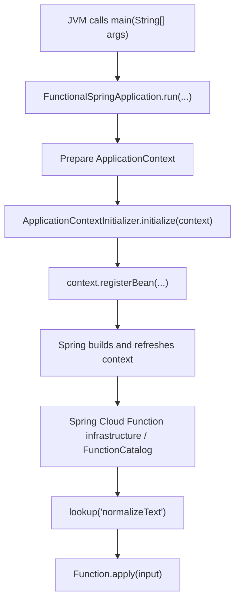
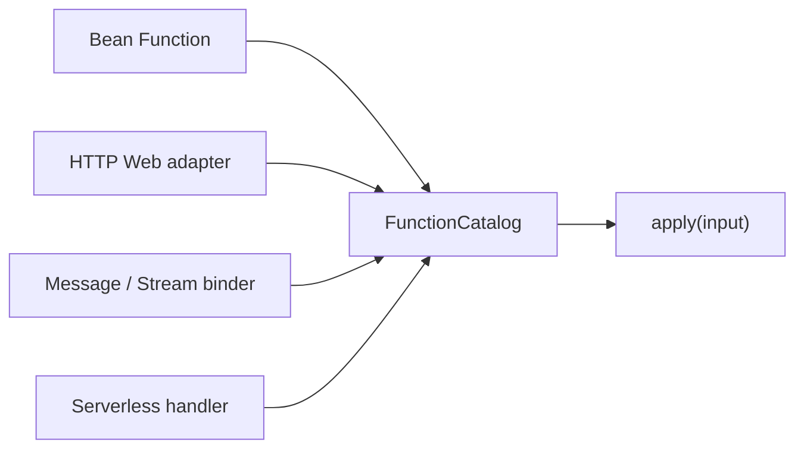

# `spring.functional.enabled` and the Limitations of Functional Mode

## Learning Objectives

In **Spring Cloud Function**, business logic is commonly expressed as `Supplier<O>`, `Function<I, O>`, and `Consumer<I>`. These functions can be invoked from Java, HTTP, events, or serverless environments when an appropriate integration layer is present. In the **Bean Registration** chapter, alongside `@Bean` and `@Component`, Spring Cloud Function also offers a **functional-style application initialization**: registering beans in Java code rather than relying primarily on annotation scanning and analysis.

The `spring.functional.enabled` property is tied to this functional mechanism in Spring Cloud Function release lines that support it. The property name sounds simple, yet must be understood accurately: **enabling functional mode does not create functions on its own, open endpoints automatically, or guarantee that all Spring Boot infrastructure will be configured the same way as before**.

After this lesson, you will be able to:

- Explain the roles of `spring.functional.enabled`, `FunctionalSpringApplication`, and `ApplicationContextInitializer<GenericApplicationContext>`.
- Register a `Function<I, O>` via a concrete Java implementation class and look it up through `FunctionCatalog`.
- Distinguish functional mode from standard Spring Boot mode and from `spring.cloud.function.scan.enabled`.
- Recognize limitations around annotation processing, component scanning, auto-configuration, dependency injection, generic types, and HTTP/message/serverless adapters.
- Choose the appropriate bootstrap style, design tests, and measure behavior rather than treating functional mode as an always-beneficial optimization.

## 1. What Problem Does Functional Mode Aim to Solve?

A typical Spring Boot application declares:

```java
@SpringBootApplication
public class Application {
    public static void main(String[] args) {
        SpringApplication.run(Application.class, args);
    }

    @Bean
    Function<String, String> uppercase() {
        return text -> text.toUpperCase(Locale.ROOT);
    }
}
```

Spring Boot locates application configuration, processes annotations, loads auto-configurations, and creates beans. Spring Cloud Function discovers the function bean and exposes it in `FunctionCatalog`.

With **functional bean registration**, you can write a plain Java function class and register it via Spring Framework's API:

```java
context.registerBean("uppercase", Uppercase.class);
```

`Uppercase` is a class implementing `Function<String, String>`; `context` is a `GenericApplicationContext` inside an initializer. You do not need to annotate the function class with `@Component` or write a separate `@Bean` method just to declare it.

The expected benefit is **explicit control over which beans enter the context**, potentially reducing unnecessary configuration processing in suitably structured applications. However, it is not a complete replacement for Spring Framework: you still have an `ApplicationContext`, bean lifecycles, dependencies, `FunctionCatalog`, and the required adapters.

| Aspect | Standard Spring Boot | Functional Style |
| --- | --- | --- |
| Typical entry point | `SpringApplication.run(...)` | `FunctionalSpringApplication.run(...)` when supported by the version |
| Common function declaration | `@Bean`, `@Component` | `ApplicationContextInitializer` and `registerBean(...)` |
| How beans are selected | Annotations, component scan, configuration, and conditions | Explicit bean registration in initializer; additional integrations depend on bootstrap |
| Function data types | Derived from `@Bean` signature or implementation class | Should come from a concrete implementation class or explicit type metadata |
| Auto-configuration | Can use the full Boot mechanism when conditions are met | **Do not assume** all auto-configurations load and behave the same as standard Boot |
| HTTP/event adapters | Still requires dependencies and configuration | Still requires dependencies and configuration, possibly with more explicit integration |

Which style to choose depends on application requirements, not merely the number of functions.

## 2. Understanding `spring.functional.enabled` Properly

`spring.functional.enabled` is a **property associated with Spring Cloud Function's functional mechanism in versions that support it**. When used by the corresponding bootstrap mechanism, `true` signals the intent to enable functional behavior; `false` disables that behavior along the corresponding conditional configuration branch.

It can be declared as:

```properties
spring.functional.enabled=true
```

Or in `application.yml`:

```yaml
spring:
  functional:
    enabled: true
```

Keep in mind that **this property does not replace the bootstrap API or function registration code**. An application that merely adds `spring.functional.enabled=true` without `Supplier`/`Function`/`Consumer` beans, an initializer, or an equivalent registration will not magically populate business functions in `FunctionCatalog`.

Likewise, **do not treat `spring.functional.enabled` as a core Spring Boot property that works identically across all versions**. Class names, where the property is read, and the scope of functional behavior can change across Spring Cloud Function generations. To know whether the setting takes effect in your project, check your version's API and test the actual context.

### Three Components That Must Be Distinguished

| Component | Role | Common Misconception |
| --- | --- | --- |
| `spring.functional.enabled` | Configuration flag for functional behavior in supported versions | Not a global on/off switch for all of Spring Cloud Function |
| `FunctionalSpringApplication` | Spring Cloud Function's specialized bootstrap when this API exists | Not a business function name or a per-request handler |
| `ApplicationContextInitializer<GenericApplicationContext>` | Place to register bean definitions in Java code before context refresh | Not a callback invoked for each HTTP request or message |

An initializer can also be used inside **standard Spring Boot** via `SpringApplication.addInitializers(...)`. Therefore, **programmatic bean registration** does not strictly require using `FunctionalSpringApplication` or setting `spring.functional.enabled=true`.

## 3. Initialization Lifecycle in the Functional Model

With startup using `FunctionalSpringApplication` and an initializer, the processing flow can be visualized as follows:



The diagram shows the conceptual order of responsibilities; internal details of bootstrapping, creating the catalog bean, and selecting auto-configurations depend on the version.

`initialize(...)` runs **before the context is refreshed**. Calling `registerBean(...)` declares a **bean definition**; Spring instantiates it according to lifecycle and scope rules. Do not treat `registerBean` as immediately executing the business `apply(...)` logic.

Furthermore, **`main` and the business function are two different entry points**. In an HTTP service, the server receives a request and the adapter looks up the function. In a serverless environment, the runtime may invoke a handler instead of running `main` for every event. The `Function.apply(...)` logic stays the same, while context initialization must follow the deployment environment's contract.

## 4. Complete Example: `FunctionalSpringApplication` and a `Function` Class

Suppose a system needs to normalize order IDs: trim leading/trailing whitespace and convert to uppercase before storing them. We isolate the function into a plain Java class for reuse across adapters.

This example illustrates **Spring Cloud Function versions that provide `org.springframework.cloud.function.context.config.FunctionalSpringApplication`**. The project must use Spring Boot and Spring Cloud Function Context versions compatible with that API. Before copying, verify these classes are actually on your classpath.

### Step 1 — Create the Business Function Class

File `src/main/java/example/function/NormalizeText.java`:

```java
package example.function;

import java.util.Locale;
import java.util.function.Function;

public final class NormalizeText implements Function<String, String> {

    @Override
    public String apply(String value) {
        if (value == null || value.isBlank()) {
            throw new IllegalArgumentException(
                    "Order ID must not be blank");
        }
        return value.trim().toUpperCase(Locale.ROOT);
    }
}
```

This class does not use `@Component` or any Spring API; it can be tested directly with `new NormalizeText().apply(" ord-58 ")`.

**Important note on types:** the concrete class declares `implements Function<String, String>`, giving Spring Cloud Function a basis to read generic information from the class. This helps payload conversion mechanisms in adapters.

### Step 2 — Create the Entry Point and Initializer

File `src/main/java/example/function/FunctionalOrderApplication.java`:

```java
package example.function;

import org.springframework.cloud.function.context.config.FunctionalSpringApplication;
import org.springframework.context.ApplicationContextInitializer;
import org.springframework.context.support.GenericApplicationContext;

public class FunctionalOrderApplication
        implements ApplicationContextInitializer<GenericApplicationContext> {

    public static void main(String[] args) {
        FunctionalSpringApplication.run(
                FunctionalOrderApplication.class, args);
    }

    @Override
    public void initialize(GenericApplicationContext context) {
        context.registerBean(
                "normalizeText",
                NormalizeText.class,
                NormalizeText::new);
    }
}
```

Here:

1. `FunctionalOrderApplication.main(...)` is the JVM entry point when running the JAR directly.
2. `FunctionalSpringApplication.run(...)` triggers Spring Cloud Function's functional-style bootstrap, if supported by your version.
3. `FunctionalOrderApplication` implements `ApplicationContextInitializer`, providing an early place to declare beans.
4. `context.registerBean("normalizeText", NormalizeText.class, NormalizeText::new)` registers a bean **named `normalizeText`** with class **`NormalizeText`**.
5. `NormalizeText::new` is the bean instance factory, **not a business `Supplier<String>`** used to generate events.

Do not annotate `NormalizeText` with `@Component("normalizeText")` while also registering the same name in the initializer without good reason: this can cause conflicts or duplicate registrations.

### Step 3 — Configure the Property When Supported by the Framework Version

In `src/main/resources/application.properties`:

```properties
spring.functional.enabled=true
```

Setting this property expresses the intent to use functional mode in framework lines that read this flag. **In this example, bean registration is still performed by the initializer; the property does not replace the initializer.** Some versions use `FunctionalSpringApplication` to choose the bootstrap path without requiring users to set the property manually; therefore, do not assume there is only one exact activation pattern across all versions.

### Step 4 — Look Up the Function After Context Initialization

A verification snippet can start the application and retrieve the catalog, such as inside an **integration test** (not code placed after `run(...)` in a production application):

```java
try (ConfigurableApplicationContext context =
        FunctionalSpringApplication.run(
                FunctionalOrderApplication.class,
                "--spring.main.web-application-type=none")) {

    FunctionCatalog catalog = context.getBean(FunctionCatalog.class);
    Function<String, String> fn = catalog.lookup("normalizeText");

    if (fn == null) {
        throw new IllegalStateException(
                "normalizeText not found in FunctionCatalog");
    }

    System.out.println(fn.apply("  ord-58  ")); // ORD-58
}
```

In this abbreviated snippet, import `ConfigurableApplicationContext` from `org.springframework.context`, `FunctionCatalog` from `org.springframework.cloud.function.context`, and `Function` from `java.util.function`. Closing the context with try-with-resources in a demo is suitable for a one-shot verification program; **do not close the context immediately inside `main` of a web service**, or the HTTP server may shut down right after starting.

When the matching Spring Cloud Function Context/auto-configuration is loaded, the expected output is `ORD-58`. If `FunctionCatalog` cannot be found, check dependencies and bootstrap/version compatibility before concluding that `NormalizeText` is broken.

## 5. How `spring.functional.enabled` Differs from Easily Confused Properties

The following configuration groups have completely distinct scopes:

| Configuration | What Does It Ask? | What Does It Not Replace? |
| --- | --- | --- |
| `spring.functional.enabled` | Should the functional behavior supported by this Spring Cloud Function version be used? | Does not register `Function` beans or expose HTTP endpoints |
| `spring.cloud.function.scan.enabled` | Should **Function Component Scan** run to auto-discover function classes in packages? | Does not enable/disable all of functional bootstrap |
| `spring.cloud.function.scan.packages` | Which Java package(s) should Function Component Scan search? | Does not change the nature of `FunctionalSpringApplication` |
| `spring.cloud.function.definition` | Which existing function or composition pipeline should the adapter/catalog select? | Does not create beans or trigger scanning |
| `spring.main.web-application-type=none` | Should the application start without a web server? | Does not switch Java functions into functional mode |

Example:

```properties
spring.functional.enabled=true
spring.cloud.function.scan.enabled=false
spring.cloud.function.definition=normalizeText
```

In this sample configuration, we intend to register `normalizeText` **explicitly** through an initializer without relying on scanning the `functions` package. `definition` can tell an adapter which registered function to pick; **it does not create functions**.

If a project uses standard `SpringApplication.run(...)` startup while wanting to register beans in Java code, it can use `SpringApplication.addInitializers(...)` without having to rely on `spring.functional.enabled`. That is a different approach from switching the entire bootstrap to `FunctionalSpringApplication`.

## 6. Important Limitations: Auto-Configuration and Annotations

### 6.1. Do Not Assume Every Spring Boot Feature Remains Intact

In standard Spring Boot, `@SpringBootApplication` typically brings in component scanning and matching auto-configurations. Functional mode emphasizes **programmatic bean registration**; depending on the version and bootstrap path, certain annotation processors, component scans, or auto-configurations may not activate the same way they do in a regular Boot app.

Avoid this flawed assumption:

> "I changed `SpringApplication.run(...)` to `FunctionalSpringApplication.run(...)`, so every `@Component`, `@Configuration`, `@Enable...`, and every auto-configuration still works identically."

In practice, you must **verify each dependency and infrastructure bean** your application relies on. Some integrations require dedicated annotation processors, importers, or auto-configurations; if those mechanisms are not loaded, the expected beans may not exist.

Pay particular attention to capabilities that heavily rely on Boot configuration:

- HTTP server, request mapping, JSON serialization, and validation.
- Database connections, transaction managers, and data repositories.
- Security filter chains, authentication, and authorization.
- Observability, metrics, tracing, and Actuator.
- Spring Cloud Stream binders or serverless adapters.

Not all of these are **disabled by default** in every functional version. The limitation is that **they are not guaranteed to work automatically**; you must verify them on your exact framework/runtime combination.

### 6.2. `@Component` Is Not Necessarily Scanned Automatically

A class like:

```java
@Component
public class OrderService {
    // ...
}
```

only becomes a Spring bean automatically if a suitable component scanning/registration mechanism is active. If a functional bootstrap is designed to skip annotation scanning, a class with only `@Component` may never be instantiated.

When you want to be certain a service exists in the context, register it explicitly:

```java
context.registerBean("orderService", OrderService.class);
```

This is an **alternative** to component scanning; do not intentionally register it via both paths. If the service has dependencies, use constructor injection or an appropriate factory.

### 6.3. `@Bean` Inside a `@Configuration` Class May Not Be Loaded

If a configuration class is not processed/imported by the active bootstrap, a method like:

```java
@Bean
Function<String, String> normalizeText() {
    return value -> value.trim().toUpperCase(Locale.ROOT);
}
```

will not automatically create a bean merely because the Java file is on the classpath. Likewise, a library's auto-configuration should not be assumed active until you verify it is actually loaded.

For applications relying heavily on annotations and multiple Spring Boot starters, **keeping standard Spring Boot bootstrap and adding an explicit initializer** is usually a safer path than replacing the entire entry point right away.

## 7. Hybrid Approach: Keep Spring Boot, Register Functions in Java

If you still need standard Spring Boot auto-configuration while keeping business functions free of annotations, you can register an initializer when constructing `SpringApplication`.

File `NormalBootApplication.java`:

```java
package example.function;

import org.springframework.boot.SpringApplication;
import org.springframework.boot.autoconfigure.SpringBootApplication;

@SpringBootApplication
public class NormalBootApplication {

    public static void main(String[] args) {
        SpringApplication app =
                new SpringApplication(NormalBootApplication.class);

        app.addInitializers(new NormalizeInitializer());
        app.run(args);
    }
}
```

File `NormalizeInitializer.java`:

```java
package example.function;

import org.springframework.context.ApplicationContextInitializer;
import org.springframework.context.support.GenericApplicationContext;

public final class NormalizeInitializer
        implements ApplicationContextInitializer<GenericApplicationContext> {

    @Override
    public void initialize(GenericApplicationContext context) {
        context.registerBean("normalizeText", NormalizeText.class);
    }
}
```

This is an **alternative application** to `FunctionalOrderApplication` in Section 4; do not run both entry points and register `normalizeText` twice in the same context.

In this hybrid setup:

1. `SpringApplication` uses the standard Spring Boot startup mechanism.
2. The initializer adds the `normalizeText` bean **before refresh**.
3. Spring Boot continues applying auto-configurations and annotations under normal conditions.
4. Spring Cloud Function can recognize the `Function<String,String>` bean via `FunctionCatalog` when matching dependencies are present.

**Note:** adding an initializer to a regular Boot app does not mean the two bootstrap styles have identical startup time, memory footprint, or auto-configuration behavior. It is an engineering choice when you want to preserve Boot integration while still registering functions programmatically.

## 8. Data Type Limitations: Functional Mode Does Not Eliminate Type Erasure

Consider registering a lambda with a raw type:

```java
context.registerBean(
        "normalizeText",
        Function.class,
        () -> (Function<String, String>) text ->
                text.trim().toUpperCase(Locale.ROOT));
```

Although the Java compiler knows the lambda's types in the cast expression, `Function.class` **contains no `<String,String>` information**. When Spring Cloud Function tries to convert a JSON message into a Java DTO, missing type metadata can lead to incorrect conversion.

Registering via a concrete implementation class:

```java
context.registerBean("normalizeText", NormalizeText.class);
```

makes generic analysis easier because `NormalizeText implements Function<String,String>`. For structured data types:

```java
public record OrderCommand(String id, int quantity) {}
public record OrderResult(String id, boolean accepted) {}
```

define a class:

```java
public final class ValidateOrder
        implements Function<OrderCommand, OrderResult> {

    @Override
    public OrderResult apply(OrderCommand order) {
        return new OrderResult(order.id(), order.quantity() > 0);
    }
}
```

Then the catalog and adapters have a basis to know `OrderCommand -> OrderResult`. For dynamic lambdas or composite types like `List<OrderCommand>`, `Message<OrderCommand>`, and reactive types, consider explicit type metadata via `FunctionRegistration` or the corresponding API in your version.

**Functional bootstrap does not replace serializers or content types.** JSON conversion still requires an adapter, codec, matching headers/content type, and a deserializable DTO.

## 9. Lifecycle, Dependency, and State Limitations

### An Initializer Is Not Where You Look Up All Beans

`ApplicationContextInitializer.initialize(...)` runs before `refresh()`. Therefore, avoid calling:

```java
OrderService service = context.getBean(OrderService.class);
```

directly inside `initialize(...)` if that bean is only registered or created later. Instead, register the bean with a suitable factory:

```java
context.registerBean(
        "validateOrder",
        ValidateOrderWithService.class,
        () -> new ValidateOrderWithService(
                context.getBean(OrderService.class)));
```

This snippet assumes `OrderService` is a Spring bean and `ValidateOrderWithService` has a constructor accepting `OrderService`. The factory is invoked by the container **when instantiating the bean**, not when merely recording the bean definition in the initializer.

### Business `Supplier` vs. Bean Creation Factory

```java
context.registerBean("normalizeText", NormalizeText.class,
        NormalizeText::new);
```

`NormalizeText::new` has the shape `Supplier<NormalizeText>`, but it is a **factory for the bean**. It does not become a business `Supplier<String>` whose `get()` method `FunctionCatalog.lookup("...")` invokes. When you want to declare a business `Supplier`, register an actual class with `implements Supplier<O>`.

### Singletons and Concurrency Still Need Design

Spring normally manages beans as singletons by default; the same `Function` may be invoked by multiple concurrent requests or messages. Functional mode does not guarantee thread safety automatically. Avoid storing per-request data in mutable bean fields, or protect shared state with proper synchronization.

For `Consumer` beans with side effects, account for idempotency when messages are retried or redelivered. For polling `Supplier` beans, invocation frequency belongs to the adapter/scheduler, **not `spring.functional.enabled`**.

## 10. HTTP, Events, and Serverless in Functional Mode

In Spring Cloud Function's architecture, adapters translate external calls into invocations on functions in the catalog:



Suppose `normalizeText` is recognized by the catalog. When the Spring Cloud Function Web adapter and HTTP server are installed with compatible versions/configuration, a typical route might accept:

```bash
curl -X POST http://localhost:8080/normalizeText \
  -H 'Content-Type: text/plain' \
  --data-binary '  ord-58  '
```

Expected business result: `ORD-58`. **This command works only when the web adapter/server is actually present and the route is mapped.** Some functional bootstrap paths may not load web auto-configuration as expected, so test HTTP at the system level rather than inferring it from `catalog.lookup(...)` succeeding.

With Spring Cloud Stream, you need a binder, bindings, and function selection configuration. With serverless, you need a platform-compatible handler/launcher, verifying how the context is initialized and when `main` is or is not invoked. Do not place connection setup or critical bean registration in code that only runs after `main` if the serverless adapter does not take that path.

`spring.cloud.function.definition=normalizeText` helps an adapter choose an already-existing function; this property **does not fix** an unexecuted initializer or a missing bean in the catalog.

## 11. Testing Functional Mode Without Misinterpreting Results

### 11.1. Unit Testing Java Logic

With JUnit 5:

```java
package example.function;

import static org.junit.jupiter.api.Assertions.assertEquals;
import org.junit.jupiter.api.Test;

class NormalizeTextTest {

    @Test
    void normalizesOrderCode() {
        NormalizeText fn = new NormalizeText();
        assertEquals("ORD-58", fn.apply("  ord-58  "));
    }
}
```

This test proves the Java function works, but **does not prove** the initializer ran, the bean is in the context, or functional mode is active.

### 11.2. Testing Bean Registration in Isolation

You can test the initializer with `GenericApplicationContext` without Spring Cloud Function auto-configuration:

```java
package example.function;

import static org.junit.jupiter.api.Assertions.assertEquals;
import static org.junit.jupiter.api.Assertions.assertTrue;

import org.junit.jupiter.api.Test;
import org.springframework.context.support.GenericApplicationContext;

class BeanDefinitionTest {

    @Test
    void initializerRegistersConcreteFunction() {
        try (GenericApplicationContext context =
                new GenericApplicationContext()) {

            new FunctionalOrderApplication().initialize(context);
            assertTrue(context.containsBeanDefinition("normalizeText"));

            context.refresh();
            NormalizeText fn =
                    context.getBean("normalizeText", NormalizeText.class);

            assertEquals("ORD-58", fn.apply("  ord-58  "));
        }
    }
}
```

This test checks **initializer + Spring bean lifecycle**. It does not load `FunctionCatalog`, test `spring.functional.enabled`, or verify auto-configuration.

### 11.3. Testing the Catalog Through the Real Bootstrap

With dependencies/versions that provide `FunctionalSpringApplication`:

```java
package example.function;

import static org.junit.jupiter.api.Assertions.assertEquals;
import static org.junit.jupiter.api.Assertions.assertNotNull;

import java.util.function.Function;
import org.junit.jupiter.api.Test;
import org.springframework.cloud.function.context.FunctionCatalog;
import org.springframework.cloud.function.context.config.FunctionalSpringApplication;
import org.springframework.context.ConfigurableApplicationContext;

class FunctionalBootstrapTest {

    @Test
    void discoversFunction() {
        try (ConfigurableApplicationContext context =
                FunctionalSpringApplication.run(
                        FunctionalOrderApplication.class,
                        "--spring.functional.enabled=true",
                        "--spring.main.web-application-type=none")) {

            FunctionCatalog catalog =
                    context.getBean(FunctionCatalog.class);
            Function<String, String> fn =
                    catalog.lookup("normalizeText");

            assertNotNull(fn);
            assertEquals("ORD-58", fn.apply("  ord-58  "));
        }
    }
}
```

If this test fails due to a missing `FunctionCatalog`, the issue likely lies in dependencies, the bootstrap mechanism, or version compatibility rather than the function itself. If it passes, it proves **bootstrap + registration + catalog** work under the current configuration—not automatically that the web server, message binder, or serverless handler works.

To compare `spring.functional.enabled=true` and `false`, test **two independent Spring contexts** with the same dependencies and matching bootstrap paths. Do not conclude anything from a unit test calling `new NormalizeText()`, nor assume setting the property to `false` deletes explicitly declared beans.

## 12. Diagnosing Common Issues

| Symptom | Possible Cause | How to Address |
| --- | --- | --- |
| `FunctionalSpringApplication` not found on classpath | Using a different Spring Cloud Function version or missing the artifact providing the API | Check dependencies and version-specific API docs; consider Boot + initializer |
| `spring.functional.enabled=true` set, yet catalog has no functions | Only the flag was set; no bean/initializer declared or initializer was not called | Register a function and test `lookup` in the context |
| `NoSuchBeanDefinitionException: FunctionCatalog` | Missing matching Spring Cloud Function infrastructure config | Check Spring Cloud Function Context, bootstrap, classpath, and version |
| `@Component` or `@Bean` does not appear | Functional bootstrap path may not process configuration/scanning like standard Boot | Register explicitly or switch back to Boot bootstrap with matching auto-configuration |
| Missing `DataSource`, security, or web beans | Some Boot auto-configurations did not load as expected | Verify the actual context and adapter config; do not assume functional matches Boot |
| Function exists in context, yet `lookup(...)` returns null | Name mismatch or catalog/metadata infrastructure not set up | Verify bean name, function type, `FunctionCatalog`, and `definition` config |
| JSON fails to convert to DTO | Raw `Function.class` lacks generics, or missing content type/codec | Use a concrete implementation class or compatible `FunctionRegistration` metadata |
| HTTP 404 while Java tests pass | Missing web adapter, HTTP server, route, or web auto-config not triggered | Test the actual adapter and web dependencies, not just the catalog |
| Duplicate bean name | Function both registered by initializer and scanned/registered another way | Use one registration mechanism per function name |
| Error fetching dependency inside initializer | Calling `getBean` before context refresh | Register a factory/constructor injection and let Spring create instances later |
| Startup does not improve, or gets slower | Main cost is in dependencies, I/O, adapters, or external connections | Measure cold start, memory, and workload on the actual deployment environment |

Follow this debugging sequence:

1. **Check version and APIs:** does the project actually support `FunctionalSpringApplication` and the properties used?
2. **Check bean definitions:** was the initializer called, and is `normalizeText` declared?
3. **Check the catalog:** does the `FunctionCatalog` bean exist, and does `lookup("normalizeText")` succeed?
4. **Check the adapter:** is the web/binder/serverless layer installed, initialized, routed, and converting payloads properly?
5. **Check configuration flags:** are you confusing `spring.functional.enabled` with `scan.enabled` or `spring.cloud.function.definition`?

## 13. When Should You Choose Functional Bootstrap?

| Scenario | Approach to Consider |
| --- | --- |
| Very lean app, mostly a handful of business functions; want explicit control over every loaded bean | Can try `FunctionalSpringApplication` with an initializer, then measure actual startup/memory |
| App depends heavily on Spring Boot starters, repositories, security, tracing, or web config | Usually better to start with standard Spring Boot, adding an initializer only if programmatic registration is needed |
| Same function must run across multiple adapters (HTTP, broker, serverless) | Keep the Java function protocol-independent; choose bootstrap/adapter per runtime and test each environment |
| Need dynamic functions or lambdas that do not preserve generics | Use explicit type metadata such as `FunctionRegistration` rather than expecting functional mode to infer everything |
| Optimizing cold start / serverless | Measure on the real deployment target; functional mode may reduce some overhead, but is not an unconditional guarantee |
| Migrating a large Boot app to functional | Proceed incrementally, verifying required auto-configurations and beans; consider Boot + `addInitializers` first |

Do not generalize from a minimal example to claim functional mode is always faster or uses less memory. Real cost depends on bean count, reflection, codecs, auto-configurations, external connections, hardware, and adapter type. For native image/AOT deployments, verify compatibility and reachability metadata for your version; **enabling a functional property alone does not guarantee native image builds or runs cleanly**.

## 14. Practice Exercises and Self-Check

**Exercise 1 — Explicit registration:** write `NormalizeCustomerId implements Function<String,String>`, register it as `normalizeCustomerId` via an initializer, and confirm `FunctionCatalog.lookup("normalizeCustomerId")` returns an invokable function.

**Exercise 2 — Compare bootstraps:** run the same `NormalizeText` class with two independent entry points: `FunctionalSpringApplication` and `SpringApplication + addInitializers`. Record created beans/auto-configurations, startup time, and memory footprint in the same environment rather than comparing only `apply(...)` output.

**Exercise 3 — Data types:** replace `String -> String` with `OrderCommand -> OrderResult` and register a class with `implements Function<OrderCommand,OrderResult>`. Compare with registering raw `Function.class` when using a JSON-converting adapter.

**Exercise 4 — Adapters:** once the catalog contains the function, test HTTP with an appropriate Web adapter and explain why a passing catalog test does not automatically prove the endpoint is ready. For serverless, identify the exact launcher/handler invoked by the runtime instead of assuming `main` runs on every request.

Self-check answers:

1. **Does `spring.functional.enabled=true` automatically create a `Function` bean?** No. The function still must be registered or discovered through an appropriate mechanism.
2. **Does functional mode necessarily load every `@Component` and auto-configuration like `@SpringBootApplication`?** Do not assume so; verify against your actual version and bootstrap.
3. **Does `spring.cloud.function.scan.enabled=false` disable all of Spring Cloud Function?** No. It disables specialized function package scanning without removing beans registered via other mechanisms.
4. **Why register `NormalizeText.class` instead of raw `Function.class`?** The concrete class preserves `Function<String,String>` generics that adapters may need.
5. **Does calling `registerBean` in an initializer execute `apply(...)` yet?** No. It registers the bean definition; it does not invoke the business function.
6. **Does switching to functional mode create an HTTP server automatically?** No; you need an adapter and a properly configured web server.
7. **What can you do if you want Boot auto-configuration while still registering functions in Java?** Keep `SpringApplication` and use `addInitializers(...)`.

## 15. Summary

**`spring.functional.enabled`** is tied to **Spring Cloud Function's** functional bootstrap/bean-registration style in versions that support it. To use it effectively, distinguish the **configuration flag**, **`FunctionalSpringApplication`**, **bean-registering initializers**, and **`FunctionCatalog`**. Functional registration lets you express protocol-independent Java functions cleanly, but **does not replace auto-configuration, dependencies, type metadata, or adapters**.

The pragmatic choice is to use functional mode when you need tight control over the context and have verified your integrations, and standard Spring Boot (optionally with an initializer) when you want the broad auto-configuration ecosystem. In either case, keep `Supplier`, `Function`, and `Consumer` logic independent of HTTP/messaging/serverless, and let adapters invoke them via the catalog.

Check version-specific APIs and behavior in the [Spring Cloud Function Reference](https://docs.spring.io/spring-cloud-function/reference/) and [Spring Boot Reference — Auto-configuration](https://docs.spring.io/spring-boot/reference/using/auto-configuration.html).
