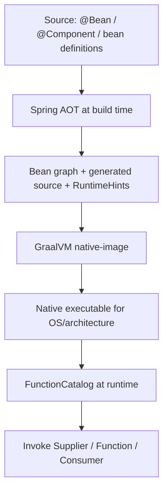
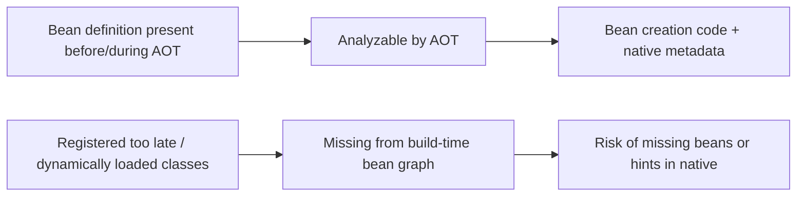

# Impact of Bean Registration Style on AOT and Native Images

## Learning Objectives

**Spring Cloud Function** lets you develop business logic with `Supplier<O>`, `Function<I, O>`, and `Consumer<I>`, and then reuse it via `FunctionCatalog`, composition, HTTP, events, or serverless. In the **Bean Registration** chapter, a seemingly minor choice—registering via `@Bean`, `@Component`, a concrete class, or a dynamic lambda/factory—can significantly affect **Ahead-of-Time (AOT)** analysis and packaging into a **GraalVM Native Image**.

By the end of this lesson, you will be able to:

- Distinguish **Spring AOT** from **GraalVM native-image** and from Spring Cloud Function's *functional bean registration*.
- Explain why **bean definitions must be visible during build-time AOT** and carry sufficiently accurate type information.
- Compare `@Bean`, `@Component`, `GenericApplicationContext.registerBean(...)`, `FunctionRegistration`, and dynamic registration approaches.
- Write a `Function<OrderCommand, OrderReceipt>` with a signature analyzable by Spring AOT, and verify it via `FunctionCatalog`.
- Recognize the limitations of lambda instance suppliers, `registerSingleton`, runtime classpath scanning, `@Profile`, and `@ConditionalOnProperty`.
- Add `RuntimeHints` when reflection, resources, or JSON bindings **are not inferred by AOT**; distinguish hints from function type metadata.
- Set up a testing workflow across JVM, AOT-processed JVM, and native image, including HTTP/message/serverless adapters.

## 1. How Do Spring AOT and Native Image Differ?

In a traditional JVM environment, Spring can scan the classpath, read annotations, evaluate conditions, and build many bean definitions while the application starts. This provides flexibility at the cost of startup time and memory.

**Spring AOT** shifts part of this discovery and configuration decision-making to **build time**. It analyzes the `ApplicationContext`, determines possible bean definitions, and generates Java source code, proxy bytecode, and metadata/hints for required runtime behaviors.

**GraalVM Native Image** compiles the application into an executable targeting a specific OS and architecture; static analysis relies on a *closed world* of known code and resources. For a Spring Boot native application, the Spring AOT step is a crucial part of the build pipeline; GraalVM itself also needs information about reflection, resources, serialization, and dynamic proxies.



| Concept | Primary Phase | Key Point |
| --- | --- | --- |
| Bean registration | When building the Spring context | Must identify which bean, under what name, and with what type |
| Spring AOT | **Build time** | Prepares the bean model and generated code/hints to minimize dynamic discovery |
| GraalVM Native Image | **Native build time** | Compiles into a closed-world executable, not running like a traditional JVM |
| `FunctionCatalog` | In the initialized application | Looks up, composes, and invokes published functions |
| HTTP / event / serverless adapter | Deployment runtime | Routes protocol payloads to functions; does not replace bean registration |

**Do not conflate three flags/mechanisms:** `spring.functional.enabled` relates to *functional bootstrap* behavior depending on the Spring Cloud Function version; `spring.aot.enabled` enables using **Spring AOT-generated code** on the JVM in supported versions; native image is a separate executable built by native build tooling. Setting a single property **does not build a native image**.

## 2. Why Does Bean Registration Timing Matter?

On a standard JVM, an application can register extra beans at startup or even attempt dynamic additions at runtime. During AOT analysis, only **bean definitions visible to the engine across supported processing phases** can fully contribute to the generated code and hints.



Common problems:

1. **Beans appearing too late:** a bean added from a runtime callback after the AOT model is finalized is unlikely to appear in generated code.
2. **Overly generic declared types:** `Function.class` or `Object.class` does not reveal `OrderCommand`, `OrderReceipt`, or constructors/lifecycle callbacks that need analysis.
3. **Reliance on runtime scanning:** native images do not provide JVM-style dynamic classpath scanning. Class scanning must happen at build time or be replaced with suitable explicit registration.
4. **Reliance on unforeseen reflection:** class names from strings, dynamic codecs, resources loaded by name, and proxies created on rarely analyzed branches may require hints.
5. **Changing the bean set via runtime config:** `@Profile` decisions or conditions affecting whether a bean exists are typically fixed during the AOT phase.

This is why **the exact same Java function may run fine on the JVM yet fail with missing beans or errors in a native executable**.

## 3. Comparing the Impact of Registration Approaches

| Registration Approach | What Does Spring See? | AOT/Native Consequences |
| --- | --- | --- |
| `@Bean PriceOrder priceOrder()` | Bean factory method and **concrete class** | Easy to analyze types, constructors, and lifecycle if the config is loaded at build time |
| `@Bean Function<OrderCommand, OrderReceipt> priceOrder()` | Clear input/output generics, though published bean type is an interface | Useful for `FunctionCatalog`/message conversion; AOT may not know every internal detail of a hidden implementation class |
| `@Component class PriceOrder implements Function<...>` | Concrete implementation class found by component scan | Works well when scanning runs in AOT and the class is in scope |
| `registerBean("priceOrder", PriceOrder.class)` | Bean definition with concrete class | Can work if the registration callback is executed/observed by AOT **early enough** |
| `registerBean(..., PriceOrder.class, PriceOrder::new)` | Bean definition with a **user-supplied instance supplier** | Use caution: per documented AOT limitations, lambda/method-reference instance suppliers **are not AOT-transformed like normal bean definitions** |
| `registerBean("priceOrder", Function.class, () -> lambda)` | Raw bean type + instance supplier | Both generic inference and AOT transformation are problematic; not preferred for native |
| `FunctionRegistration` with explicit name/types | Spring Cloud Function metadata for function name and types | Helps catalog/conversion, but **does not automatically solve** bean instantiation or native reflection limitations |
| `registerSingleton(..., instance)` | Pre-created instance, not a fully analyzable bean definition | Not a registration form Spring AOT transforms like normal bean definitions |
| Loading classes by string name after startup and registering dynamically | Classes/beans appear only at runtime | Not guaranteed to fit closed-world rules; requires dedicated registration/AOT contribution design |

**Do not assume "using functional registration" makes native builds automatically faster or easier.** Spring AOT supports the standard `@Configuration`/`@Bean` model very well. With programmatic registration, what matters is checking **the bean type, registration phase, and bean definition form**.

## 4. An AOT-Friendly Example: Registering a Concrete Implementation Class

Scenario: a service calculates order totals and reuses the function via HTTP or a message adapter. Uses Java 17+ and compatible **Spring Boot 3+/Spring Cloud Function** versions; in Spring Boot 4+ environments, also verify the corresponding starters/plugins and APIs.

Classes live in package `example.orders`.

### 4.1. Declaring DTOs with Clear Contracts

File `OrderCommand.java`:

```java
package example.orders;

public record OrderCommand(String id, int quantity) {
}
```

File `OrderReceipt.java`:

```java
package example.orders;

public record OrderReceipt(String id, long totalCents) {
}
```

Each `public record` must be placed in a Java file with the same name. Clear data types help readers and the framework determine input/output payloads; however, JSON serialization/deserialization in native still depends on codecs and corresponding reflection metadata.

### 4.2. Writing a Protocol-Independent `Function` Class

File `PriceOrder.java`:

```java
package example.orders;

import java.util.function.Function;

public final class PriceOrder
        implements Function<OrderCommand, OrderReceipt> {

    private static final long UNIT_PRICE_CENTS = 12_000L;

    @Override
    public OrderReceipt apply(OrderCommand command) {
        if (command == null || command.id() == null
                || command.id().isBlank() || command.quantity() <= 0) {
            throw new IllegalArgumentException("Invalid order");
        }

        long total = Math.multiplyExact(
                (long) command.quantity(), UNIT_PRICE_CENTS);
        return new OrderReceipt(command.id(), total);
    }
}
```

`PriceOrder` has no dependency on Spring, web controllers, or message headers. It has a simple default constructor, holds no mutable state, and directly declares `Function<OrderCommand, OrderReceipt>`.

### 4.3. Exposing the **Concrete Class** via a `@Bean` Method

File `OrderFunctionApplication.java`:

```java
package example.orders;

import org.springframework.boot.SpringApplication;
import org.springframework.boot.autoconfigure.SpringBootApplication;
import org.springframework.context.annotation.Bean;

@SpringBootApplication(proxyBeanMethods = false)
public class OrderFunctionApplication {

    public static void main(String[] args) {
        SpringApplication.run(OrderFunctionApplication.class, args);
    }

    @Bean
    PriceOrder priceOrder() {
        return new PriceOrder();
    }
}
```

Why is the `@Bean` return type `PriceOrder`?

- Spring AOT knows the **concrete bean class** to analyze required bean properties, instead of seeing only `Function.class`.
- Spring Cloud Function can still treat `PriceOrder` as a `Function<OrderCommand, OrderReceipt>` because the class implements that interface.
- The bean name `priceOrder` is unambiguous for `catalog.lookup("priceOrder")`.
- `proxyBeanMethods = false` is appropriate when bean methods do not need proxy-interception calls between each other; it is **not** an AOT toggle.

In an app needing only a simple lambda, `@Bean Function<OrderCommand, OrderReceipt>` with explicit generics remains valid. However, when targeting native AOT and wanting Spring to know the implementation class details, a **concrete** return type as shown helps reduce ambiguity.

### 4.4. Looking Up and Testing Logic via `FunctionCatalog`

When the matching version of Spring Cloud Function Context is included and its auto-configurations are active:

```java
Function<OrderCommand, OrderReceipt> function =
        catalog.lookup("priceOrder");

if (function == null) {
    throw new IllegalStateException("priceOrder not found");
}

OrderReceipt receipt =
        function.apply(new OrderCommand("ORD-21", 2));
// OrderReceipt[id=ORD-21, totalCents=24000]
```

This snippet assumes `catalog` was injected by Spring or retrieved from `ApplicationContext`. It tests Java/catalog logic, not HTTP adapters or native execution.

## 5. Programmatic Registration: Bean Definitions Must Be Visible at Build Time

You might want to use `ApplicationContextInitializer<GenericApplicationContext>` instead of `@Bean`. An illustrative setup:

```java
package example.orders;

import org.springframework.context.ApplicationContextInitializer;
import org.springframework.context.support.GenericApplicationContext;

public final class OrderInitializer
        implements ApplicationContextInitializer<GenericApplicationContext> {

    @Override
    public void initialize(GenericApplicationContext context) {
        context.registerBean("priceOrder", PriceOrder.class);
    }
}
```

To use the initializer in Spring Boot:

```java
SpringApplication app = new SpringApplication(OrderFunctionApplication.class);
app.addInitializers(new OrderInitializer());
app.run(args);
```

**This is an alternative to `@Bean PriceOrder priceOrder()` in the previous section**; do not add both registration paths with the same name to the same context.

With AOT, merely having `OrderInitializer` **is not enough to guarantee** the bean gets processed. You must verify the initializer actually runs during the bean-graph construction phase used by the AOT plugin. Spring Framework recommends registering bean definitions through mechanisms processed by AOT, such as `BeanDefinitionRegistry` combined with `ImportBeanDefinitionRegistrar` when building library infrastructure.

### Why Avoid Instance Suppliers in Native Examples?

In normal Spring programming, the API below creates a bean without trouble:

```java
context.registerBean(
        "priceOrder",
        PriceOrder.class,
        PriceOrder::new);
```

However, Spring Framework AOT documentation notes a limitation for **bean definitions whose instance supplier is a lambda or method reference** supplied this way. When targeting AOT/native, prefer `@Bean` methods analyzed by Spring or bean definitions with a clear class/constructor, and **run the AOT/native build to verify**. Do not confuse an application-supplied instance supplier on a bean definition with the `BeanInstanceSupplier` that **Spring AOT generates** in generated code.

Similarly, calling:

```java
context.getBeanFactory().registerSingleton(
        "priceOrder", new PriceOrder());
```

registers a pre-built **instance**, not the kind of bean definition AOT can normally transform into generated code. This is not a recommended primary registration path for native images.

### When Complex Programmatic Bean Configuration Is Needed

Library authors can implement `ImportBeanDefinitionRegistrar` or AOT extension points such as `BeanFactoryInitializationAotProcessor`/`BeanRegistrationAotProcessor` when genuinely required. These APIs are for infrastructure; **they are not** something you need to write for each business `Function`.

Conceptually, a simple registrar looks like:

```java
public final class OrderRegistrar implements ImportBeanDefinitionRegistrar {

    @Override
    public void registerBeanDefinitions(
            AnnotationMetadata importingClassMetadata,
            BeanDefinitionRegistry registry) {

        registry.registerBeanDefinition(
                "priceOrder",
                new RootBeanDefinition(PriceOrder.class));
    }
}
```

Here `ImportBeanDefinitionRegistrar` comes from `org.springframework.context.annotation`, `AnnotationMetadata` from `org.springframework.core.type`, and `BeanDefinitionRegistry` and `RootBeanDefinition` from `org.springframework.beans.factory.support`. You need `@Import(OrderRegistrar.class)` on an AOT-processed configuration so the registrar runs in the right phase. Use this mechanism only for library architecture needs, not to replace a simple `@Bean`.

## 6. `FunctionRegistration`: Catalog Metadata Is Not `RuntimeHints`

Spring Cloud Function provides `FunctionRegistration` to attach **a name and input/output type information** to a function. This is especially important when the target is a lambda or dynamically constructed function where reflection cannot infer full generics.

In versions supporting this API, an illustrative form is:

```java
Function<OrderCommand, OrderReceipt> target =
        new PriceOrder();

FunctionRegistration<Function<OrderCommand, OrderReceipt>> registration =
        new FunctionRegistration<>(target, "priceOrder")
                .type(PriceOrder.class);
```

This snippet only constructs the registration object; for the catalog to see it, you must **place the registration into the Spring context using a framework-supported mechanism**. Do not register `priceOrder` again alongside the direct bean from Section 4.

Why are metadata and AOT two separate concerns?

- `FunctionRegistration` tells Spring Cloud Function the **name, target, and business types** for lookup, composition, and payload conversion.
- **Spring AOT** needs to know **bean definitions and how beans are created** at build time.
- **GraalVM `RuntimeHints`** declares runtime accesses such as reflection, resources, JDK proxies, or serialization that static analysis cannot discover on its own.

Therefore, declaring `.type(PriceOrder.class)` **does not automatically ensure** every JSON library, dynamic proxy, or class loaded by name will work inside a native image. Conversely, adding reflection hints **will not fix** a wrong function name or a `Function` missing generic metadata.

In particular, avoid registering:

```java
context.registerBean(
        "priceOrder",
        Function.class,
        () -> (Function<OrderCommand, OrderReceipt>) new PriceOrder());
```

and treating it as an equivalent choice for native. The raw `Function.class` bean type and application-provided instance supplier make both type inference and AOT processing harder. Prefer a concrete class / typed `@Bean`, or a `FunctionRegistration` path verified on your framework version.

## 7. Conditional Configuration and Profiles Are Typically Fixed at AOT Build Time

Consider a function created only when a property is enabled:

```java
@Bean
@ConditionalOnProperty(
        name = "orders.pricing.enabled",
        havingValue = "true")
PriceOrder priceOrder() {
    return new PriceOrder();
}
```

In a standard JVM app, starting contexts with different properties can yield different sets of beans. With Spring AOT/native, conditions affecting **whether a bean exists** are evaluated at **build time**; you cannot expect toggling a property at runtime to materialize a bean that was omitted from the generated bean graph.

Similarly, `@Profile("prod")` must be selected appropriately for the AOT build environment. Do not build an image with the `dev` profile and expect switching to `prod` at runtime to summon beans that exist only in `prod`.

| Configuration Kind | Can It Change at Runtime? | Notes |
| --- | --- | --- |
| Pricing rates/URLs read by an existing bean | Usually yes, depending on how the app reads config | Runtime values can change without altering the bean set |
| `@ConditionalOnProperty` deciding whether `PriceOrder` is created | **Do not rely on runtime to change the bean graph** | Must be configured properly when Spring AOT runs |
| `@Profile` deciding which beans exist | Decision tied to the AOT build | Select the proper profile for the artifact |
| Dropping in a JAR with a new function after native build | Does not work like dynamic JVM classpaths | Requires rebuilding the artifact/native image or a dedicated plugin design |
| `spring.cloud.function.definition=priceOrder` | Selects an existing function name, per adapter | Does not create a missing bean inside a native image |

**Distinction:** adjusting configuration values read by a bean **already inside the image** is different from changing **the list of beans**. The latter is what faces the strictest AOT constraints.

## 8. Reflection, JSON DTOs, and `RuntimeHints`

A JVM program can use reflection to inspect constructors, methods, or fields of a class right when a message arrives. GraalVM Native Image must know in advance which elements the program accesses via reflection, or they must be supplied through appropriate metadata/hints.

Spring Boot and Spring Framework automatically generate many hints based on configuration, controller signatures, bindings, and supported integrations. **You do not need to manually register hints for every DTO** if AOT already infers them.

However, a `Function<OrderCommand, OrderReceipt>` invoked indirectly through a catalog/adapter can hit a JSON binding branch that the engine does not infer the same way it infers DTOs appearing directly on a controller signature. When a native image fails only at serialization/deserialization, check hints.

### 8.1. `@RegisterReflectionForBinding` When DTOs Are Not Inferred

In Spring Framework versions supporting this annotation, you can add it to an AOT-processed configuration class:

```java
package example.orders;

import org.springframework.aot.hint.annotation.RegisterReflectionForBinding;
import org.springframework.context.annotation.Configuration;

@Configuration(proxyBeanMethods = false)
@RegisterReflectionForBinding({
        OrderCommand.class,
        OrderReceipt.class
})
public class OrderBindingHintsConfiguration {
}
```

The goal is to register reflection needs for types used in data binding, including required record components. **Add it only when needed**, after confirming the engine did not generate sufficient metadata. This configuration class must actually be loaded by Spring AOT; placing the Java file on the classpath without importing or scanning it may leave the annotation ineffective.

### 8.2. `RuntimeHintsRegistrar` for Dynamic Resources

If a function reads `pricing/rules.json` from the classpath by string path, the app may need a resource hint:

```java
package example.orders;

import org.springframework.aot.hint.RuntimeHints;
import org.springframework.aot.hint.RuntimeHintsRegistrar;

public final class PricingResourceHints implements RuntimeHintsRegistrar {

    @Override
    public void registerHints(
            RuntimeHints hints, ClassLoader classLoader) {
        hints.resources().registerPattern("pricing/rules.json");
    }
}
```

Activate the registrar on an AOT-processed configuration class:

```java
@ImportRuntimeHints(PricingResourceHints.class)
@SpringBootApplication(proxyBeanMethods = false)
public class OrderFunctionApplication {
    // ...
}
```

`ImportRuntimeHints` belongs to `org.springframework.context.annotation`. This is a variant for apps with dynamic resources, not a replacement for the entire application class in Section 4.

**Hints do not add files to the source tree**: `pricing/rules.json` must actually exist in the build's resources. Likewise, a hint for a JDK proxy or reflection only grants access metadata; it does not make an incompatible dependency work.

### 8.3. Choosing the Right Troubleshooting Tool

| Error | Right Direction to Fix |
| --- | --- |
| Catalog cannot find `priceOrder` | Check **bean registration and name**; hints do not create beans |
| JSON DTO drops fields or reports missing constructor in native | Check generic metadata, codec, and reflection hints |
| Resource `rules.json` missing in native | Check resource packaging and resource hints |
| Dynamic proxy creation fails | Check AOT support and JDK/dynamic proxy hints for the exact interfaces |
| Function works only on JVM because it loads classes by name | Redesign so classes/registrations are known at build time or supply proper metadata if feasible |

## 9. Function Component Scan, Dynamic Functions, and Native Images

Spring Cloud Function supports auto-scanning `Supplier`, `Function`, and `Consumer` classes in packages (defaulting typically to `functions`), configurable via `spring.cloud.function.scan.packages` and `spring.cloud.function.scan.enabled`.

In a native application, **do not assume runtime classpath scanning always works**. Function classes must be discovered and turned into bean definitions during build-time AOT. If a scanner or custom scanner runs only at runtime, AOT may lack the information needed to generate code and hints.

When reliable native support is required, the easiest-to-verify options are:

1. Use `@Bean` returning a **concrete implementation class** or a `@Component` clearly discovered by Spring AOT.
2. For programmatic configuration, use a bean definition registration path **processed by AOT at build time**.
3. Keep generics explicit; verify `FunctionCatalog.lookup(...)` on both AOT JVM and native.
4. Avoid patterns like "on every startup, scan plugin JARs from an external folder and create `Function` beans" unless you have a dedicated native AOT design.

`FunctionCatalog` can support composition, such as `"priceOrder|receiptToText"` if both functions exist and their chained types match. However, **composition does not invent new classes or beans outside what the build/native image already supports**. A function name appearing only in a runtime config file cannot substitute for build-time bean registration.

### Does Functional Bootstrap Mean Native-Friendly?

**No.** `FunctionalSpringApplication`, `ApplicationContextInitializer`, and `spring.functional.enabled` are concepts tied to how bootstrap/bean registration works in compatible Spring Cloud Function versions. **Spring AOT** is the build-time analysis and code-generation process. The two can be combined, but they are not synonymous.

An application using `FunctionalSpringApplication` must still check:

- Are the initializer and bean definitions visible to Spring AOT?
- Are lambda/method-reference instance suppliers being used?
- Are auto-configurations needed for JSON, HTTP, security, databases, and messaging actually loaded?
- Do the adapters/handlers work in a native image and have the needed metadata?

If a project relies heavily on Spring Boot auto-configuration, keeping `@SpringBootApplication` with clearly typed `@Bean` methods is usually a more reliable starting point before optimizing with functional bootstrap.

## 10. Build and Test Workflow for Native Images

**Prerequisites:** the project already has the Spring Boot plugin, compatible dependency version management, GraalVM Native Build Tools, and a JDK/GraalVM matching the Spring Boot release line in use. The commands below are sample workflows **for a project already configured for native builds**; simply pasting commands will not compile an unconfigured project.

### 10.1. Start with Standard JVM Tests

```bash
./mvnw test
```

Or:

```bash
./gradlew test
```

Ensure you first have a test that creates the Spring context and checks `catalog.lookup("priceOrder")`. Plain Java tests calling `new PriceOrder().apply(...)` do not prove registration/catalog or AOT works.

### 10.2. Run the JVM App with Generated AOT Code

With Maven and AOT-capable Spring Boot configuration:

```bash
./mvnw -Pnative package
java -Dspring.aot.enabled=true -jar target/<artifact-name>.jar
```

This is an **AOT-processed JVM** run—it still runs on the JVM and requires an artifact containing generated AOT code. It is not a native executable. The JAR name and `native` profile depend on your Maven setup.

### 10.3. Compile to Native

With Maven configured with the proper profile/plugins:

```bash
./mvnw -Pnative native:compile
```

With Gradle configured with the GraalVM Native Build Tools plugin and Spring Boot plugin:

```bash
./gradlew nativeCompile
```

Then run the generated executable in `target/` or `build/native/nativeCompile/` (exact name and path depend on build configuration). Or use `spring-boot:build-image`/`bootBuildImage` if you want to build a **native container image** as supported by your version.

**Do not confuse "build succeeded" with "application is correct."** A native image may finish compiling and still fail only when receiving JSON, loading a rarely used resource, initializing a binder, or invoking an infrequently hit function.

### 10.4. Test an HTTP Call If a Web Adapter Is Present

With the **Spring Cloud Function Web adapter** and a running server, matching routes/serialization may support:

```bash
curl -X POST http://localhost:8080/priceOrder \
  -H 'Content-Type: application/json' \
  --data '{"id":"ORD-21","quantity":2}'
```

Expected business result (exact formatting may depend on the adapter):

```json
{"id":"ORD-21","totalCents":24000}
```

Verify routes, port, content type, JSON codec, authentication, and web adapter version. **`spring-cloud-function-context` alone does not start an HTTP server.**

For serverless deployments (such as AWS Lambda), a native executable cannot simply be loaded like a JAR in a managed Java runtime. You must package it according to the **native custom runtime and bootstrap** required by the platform, in addition to integrating the right Spring Cloud Function adapter.

## 11. Multi-Layer AOT and Native Testing

### 11.1. Spring-Independent Logic Unit Tests

```java
package example.orders;

import static org.junit.jupiter.api.Assertions.assertEquals;
import org.junit.jupiter.api.Test;

class PriceOrderTest {

    @Test
    void calculatesReceipt() {
        PriceOrder function = new PriceOrder();
        OrderReceipt result =
                function.apply(new OrderCommand("ORD-21", 2));

        assertEquals(new OrderReceipt("ORD-21", 24_000L), result);
    }
}
```

This tests the algorithm, not Spring beans.

### 11.2. Spring Context + `FunctionCatalog`

```java
package example.orders;

import static org.junit.jupiter.api.Assertions.assertEquals;
import static org.junit.jupiter.api.Assertions.assertNotNull;

import java.util.function.Function;
import org.junit.jupiter.api.Test;
import org.springframework.beans.factory.annotation.Autowired;
import org.springframework.boot.test.context.SpringBootTest;
import org.springframework.cloud.function.context.FunctionCatalog;

@SpringBootTest(
        classes = OrderFunctionApplication.class,
        webEnvironment = SpringBootTest.WebEnvironment.NONE)
class PriceOrderCatalogTest {

    @Autowired
    FunctionCatalog catalog;

    @Test
    void catalogFindsRegisteredFunction() {
        Function<OrderCommand, OrderReceipt> function =
                catalog.lookup("priceOrder");

        assertNotNull(function);
        assertEquals(
                new OrderReceipt("ORD-21", 24_000L),
                function.apply(new OrderCommand("ORD-21", 2)));
    }
}
```

This test requires compatible Spring Boot Test and Spring Cloud Function dependencies. It confirms the name, types, and catalog behavior on a regular JVM; it does not yet prove native works.

### 11.3. AOT and Native Smoke Tests

To verify actual deployability, run a staged pipeline:

1. Run logic and catalog tests on the JVM.
2. Generate AOT sources and watch for warnings when a bean definition or constructor cannot be processed.
3. Run the AOT-processed JVM (if supported by the build) to catch bean-graph issues early.
4. Compile the native image and start the real executable.
5. Send JSON through the web adapter or run real message/serverless flows; check responses, conversion errors, required resources, and proxies.
6. In framework versions supporting native test integration, consider native test tasks (`nativeTest`) or dedicated tests; never treat a JVM `@SpringBootTest` as proof that native works.

If you use a `RuntimeHintsRegistrar`, you can add unit tests with `RuntimeHintsPredicates` to verify hints are registered properly. However, **a passing hint unit test still does not replace a native smoke test**.

## 12. Typical Errors and How to Diagnose Them

| Symptom | Possible Cause | How to Address |
| --- | --- | --- |
| Runs on JVM, yet Spring AOT build reports unsupported bean definition | Using an instance supplier, singleton instance, or overly dynamic bean definition | Switch to `@Bean` / concrete bean class; use an AOT-compatible registrar when needed |
| Native starts, yet `catalog.lookup("priceOrder")` returns `null` | Bean not present in the AOT model or name mismatch | Check build-time bean set, bean names, and auto-configuration |
| Running with a different profile drops a `Function` | Bean was conditional and not selected during the AOT build | Configure the proper profile/properties when building the artifact |
| `ClassNotFoundException` / plugin not found at runtime | Class resolved via dynamic classpath after build | Include it in the closed-world build or redesign the plugin mechanism |
| Native fails JSON binding with DTO | Missing reflection metadata, codec, or generics | Check `Function<I,O>` types and add binding hints only when genuinely missing |
| Cannot read `rules.json` in native | Resource not packaged or missing hint | Check resources and `RuntimeHintsRegistrar` |
| Dynamic proxy fails to be created | Proxy types not recognized/hinted completely by AOT | Check interface/proxy hints and library support |
| `FunctionRegistration` has `.type(...)`, yet native still fails reflection | Function type metadata differs from `RuntimeHints` | Check reflection, resources, and serialization separately |
| Native build succeeds, yet HTTP returns 404 | Missing web adapter/server or wrong route | Check HTTP integration, not just bean registration |
| Works on JVM, yet native binder/serverless fails | Adapter/runtime has specific packaging, JNI, reflection, or bootstrap requirements | Verify native support for the binder/launcher and deployment target |
| Native startup is not faster in small benchmarks | I/O, external connections, init classes, build flags, and workloads differ | Measure cold start and memory on identical infrastructure rather than inferring from technical labels |

Recommended debugging order: **build-time bean definitions → generated AOT code → native build → `FunctionCatalog` → payload conversion → adapter/binder → auxiliary resources/reflection**. If the catalog is missing the function, blindly adding `reflect-config.json` usually does not fix the root cause.

## 13. Guidelines for Choosing a Project's Registration Approach

| Context | Good Starting Choice |
| --- | --- |
| A few stable business functions, deployed on JVM with native plans | `@Bean` returning a **concrete class** or `@Component` clearly scanned by AOT |
| Function is a simple lambda, `@Bean Function<I,O>` with full generics | Keep the generic signature; test metadata and native rather than assuming lambdas always fail |
| Must register beans programmatically | Use bean definitions with precise classes and ensure callbacks run during AOT |
| Need special registration of target/name/types into `FunctionCatalog` | `FunctionRegistration` and version-appropriate metadata; test AOT separately |
| Plugin system loading classes from new JARs at runtime | Consider another architecture or AOT extensions; native lacks JVM-style dynamic classpaths |
| Optimizing startup only | Compare standard JVM, AOT JVM, and native on the same workload; do not switch registration styles before measuring |
| Integrating multiple databases, security, messaging | Verify native support of each integration and auto-configuration, not just `Function` code |

**A low-risk rollout path:** start with `@SpringBootApplication` and clearly typed beans, enable AOT/native builds, verify the catalog and adapters, and switch to functional bootstrap or custom registrars only when you have a measurable engineering reason.

## 14. Exercises and Self-Check Questions

### Exercise 1 — Changing How a Bean Is Exposed

Given `PriceOrder implements Function<OrderCommand, OrderReceipt>`, compare these two bean definitions:

```java
@Bean
PriceOrder priceOrder() {
    return new PriceOrder();
}
```

and:

```java
context.registerBean("priceOrder", Function.class,
        () -> (Function<OrderCommand, OrderReceipt>)
                new PriceOrder());
```

Explain why the first has more accurate type information and does not rely on an application-supplied instance supplier; test both in an AOT pipeline before deciding, rather than relying only on JVM unit tests.

### Exercise 2 — Build-Time Conditions

A bean with `@ConditionalOnProperty(name="orders.pricing.enabled", havingValue="true")` is excluded at build time because the property was `false`. If you only pass `orders.pricing.enabled=true` when running the native executable, will the bean appear on its own? **Do not expect it to**: the bean set was fixed during AOT. Fix the AOT build configuration and rebuild the artifact.

### Exercise 3 — Missing Hint or Missing Registration?

You see `catalog.lookup("priceOrder") != null` in native, yet POSTing JSON fails to instantiate `OrderCommand`. Check codecs, content types, generic metadata, and reflection hints; **do not** re-register `PriceOrder` just because JSON failed. Conversely, if the catalog returns `null`, inspect the bean graph and names first.

### Self-Check Answers

1. **Is Spring AOT the same as GraalVM native-image?** No. Spring AOT prepares code and hints; GraalVM compiles the native executable.
2. **Is `@Bean` forbidden in native images?** No. It is a declaration style supported by Spring AOT.
3. **Why is registering beans after startup risky?** Because AOT may not see them at build time to generate code and hints.
4. **Does `FunctionRegistration.type(...)` replace `RuntimeHints`?** No; they handle two different kinds of metadata.
5. **Does setting `spring.functional.enabled=true` build a native executable?** No.
6. **Can you switch `@Profile` at runtime to change the bean list in a native image?** Not freely as on a normal JVM; bean-graph decisions are tied to the AOT build.
7. **Is a successful native build enough to conclude the app works over HTTP or a broker?** Not yet. You must test the actual adapters and real data flows.

## 15. Summary and References

**The biggest impact of bean registration style on AOT/native is whether Spring sees *the right bean definitions, at the right time, with sufficiently accurate types*.** `@Bean` returning a concrete class or an explicit bean definition processed by AOT is usually an easy-to-verify starting point. Conversely, registering too late, providing only raw `Function.class`, using incompatible instance suppliers, or loading classes dynamically can all break native builds or runtime execution.

In Spring Cloud Function, further distinguish **`FunctionCatalog` business metadata** from **GraalVM `RuntimeHints`**. First make sure the catalog sees the right function; then verify JSON, reflection, resources, and HTTP, messaging, or serverless adapters. Native image is a deployment option with specific constraints, not a configuration flag that replaces sound bean design.

Official references to check for your version:

- [Spring Framework — Ahead of Time Optimizations](https://docs.spring.io/spring-framework/reference/core/aot.html): limitations, bean definitions, programmatic registration, and `RuntimeHints`.
- [Spring Boot — Introducing GraalVM Native Images](https://docs.spring.io/spring-boot/reference/packaging/native-image/introducing-graalvm-native-images.html): closed-world model, build-time bean graph, and differences from the JVM.
- [Spring Boot — Advanced Native Images Topics](https://docs.spring.io/spring-boot/reference/packaging/native-image/advanced-topics.html): binding, `RuntimeHints`, reflection, and diagnostics.
- [Spring Cloud Function — Functional Bean Definitions](https://docs.spring.io/spring-cloud-function/reference/functional.html): functional bootstrap, `FunctionRegistration`, and limitations with Spring Boot auto-configuration.
- [Spring Cloud Function — AWS Lambda](https://docs.spring.io/spring-cloud-function/reference/adapters/aws-intro.html): notes on custom runtimes when deploying native executables on AWS Lambda.

**Version note:** API names, plugins, AOT mechanics, and per-adapter native support can vary across Spring Boot, Spring Framework, Spring Cloud Function, and GraalVM releases. Build commands and examples in this lesson should be verified against your actual version combination before production use.
