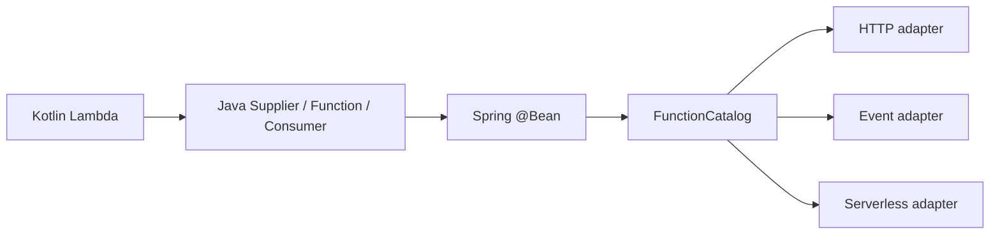

# Mapping Kotlin Lambdas to `Supplier`, `Function`, and `Consumer`

## 1. Why Map Kotlin Lambdas?

In Kotlin, business logic can be expressed as a lambda or a regular function: `() -> T`, `(T) -> R`, `(T) -> Unit`. This syntax is concise, but **Kotlin function types are not identical to the Java functional interfaces** that Spring Cloud Function uses as its execution contracts: `java.util.function.Supplier`, `java.util.function.Function`, and `java.util.function.Consumer`.

Spring Cloud Function allows you to register logic as beans, look them up via `FunctionCatalog`, compose compatible functions, and expose the same logic to adapters such as HTTP, event systems, or serverless environments. Therefore, when writing in Kotlin, you need to pick the right Java interface corresponding to the input and output of each lambda.

| Purpose | Closest Kotlin Lambda Type | Java Interface Used with Spring Cloud Function | Execution Method |
| --- | --- | --- | --- |
| Produce data when invoked | `() -> T` | `Supplier<T>` | `get(): T` |
| Transform data | `(T) -> R` | `Function<T, R>` | `apply(T): R` |
| Process data, return no result | `(T) -> Unit` | `Consumer<T>` | `accept(T): void` |

In the table, `T` is the input type or the type of data produced; `R` is the transformed result type. Kotlin's `Unit` denotes an expression without a meaningful result, whereas Java's `accept` method returns `void`. **Do not use `Function<T, Unit>` in place of `Consumer<T>`** when the business contract only needs side effects.

## 2. Converting Lambdas with SAM Conversion

All three Java interfaces above are *Single Abstract Method* (SAM) interfaces: each interface has exactly one abstract method to implement. Kotlin supports **SAM conversion**: by passing a lambda to the Java interface constructor, the compiler generates an object implementing the corresponding method.

```kotlin
import java.util.function.Consumer
import java.util.function.Function
import java.util.function.Supplier

val supplier: Supplier<String> = Supplier { "Hello" }
val transform: Function<String, String> = Function { input ->
    input.trim().uppercase()
}
val consume: Consumer<String> = Consumer { input ->
    println("Received: $input")
}

println(supplier.get())             // Hello
println(transform.apply("  kotlin  ")) // KOTLIN
consume.accept("New event")       // Received: New event
```

The mappings above have three key differences:

1. `Supplier` takes no arguments; the last expression in the lambda produces the return value.
2. `Function` takes one value and returns another value (which may be of the same type).
3. `Consumer` takes one value to process; it does not provide a result to the next function composition step.

An existing Kotlin lambda can also be **explicitly wrapped** into a Java `Function`:

```kotlin
val normalizeText: (String) -> String = { raw -> raw.trim().lowercase() }

// The type on the left is java.util.function.Function, not a Kotlin function type.
val normalizeFunction: Function<String, String> =
    Function { raw -> normalizeText(raw) }

println(normalizeFunction.apply("  HELLO  ")) // hello
```

Pay attention to the name `Function`: Kotlin has its own function type system (`(T) -> R` and `Function1<T, R>`), so when reading or writing Spring Cloud Function code, always check the imports. If there are multiple `Function` names in a project that could cause confusion, you can use an import alias:

```kotlin
import java.util.function.Function as JavaFunction

val uppercase: JavaFunction<String, String> = JavaFunction { it.uppercase() }
```

## 3. Registering Lambdas as Spring Cloud Function Beans

Here is an example configuration containing the three function forms and an additional function to demonstrate composition:

```kotlin
import org.slf4j.LoggerFactory
import org.springframework.context.annotation.Bean
import org.springframework.context.annotation.Configuration
import java.util.function.Consumer
import java.util.function.Function
import java.util.function.Supplier

@Configuration(proxyBeanMethods = false)
class KotlinFunctionConfig {
    private val logger = LoggerFactory.getLogger(KotlinFunctionConfig::class.java)

    @Bean
    fun greeting(): Supplier<String> = Supplier {
        "Hello from Spring Cloud Function"
    }

    @Bean
    fun normalize(): Function<String, String> = Function { raw ->
        raw.trim().uppercase()
    }

    @Bean
    fun emphasize(): Function<String, String> = Function { text ->
        "$text!"
    }

    @Bean
    fun audit(): Consumer<String> = Consumer { text ->
        logger.info("Processed message: {}", text)
    }
}
```

The default bean name is the `@Bean` method name: `greeting`, `normalize`, `emphasize`, `audit`. When Spring starts the application, Spring Cloud Function discovers beans of these functional interfaces and registers them in `FunctionCatalog`. Each lambda contains only processing logic, independent of any specific invocation protocol.

For Kotlin applications using `@Configuration`, Spring Boot projects typically enable the `kotlin("plugin.spring")` plugin so that Spring classes/methods requiring proxies are not blocked by Kotlin's default `final` modifier. The example above uses `proxyBeanMethods = false` because the bean methods do not call one another.

### Execution Flow



Adapters require dependencies and configuration appropriate for the deployment environment. Declaring a `@Bean` by itself does not create a connection to an event broker or deploy a serverless function automatically.

## 4. Looking Up and Composing Functions with `FunctionCatalog`

`FunctionCatalog` is the lookup point for functions by bean name and is where Spring Cloud Function handles composition. Assuming the beans in the previous section are registered:

```kotlin
import org.springframework.cloud.function.context.FunctionCatalog
import org.springframework.stereotype.Service
import java.util.function.Function

@Service
class TextService(private val catalog: FunctionCatalog) {
    fun process(input: String): String {
        val pipeline: Function<String, String> =
            catalog.lookup("normalize|emphasize")

        return pipeline.apply(input)
    }
}

// process("  hello  ") returns "HELLO!"
```

The expression `normalize|emphasize` runs two functions sequentially: `String -> String -> String`. In Spring Cloud Function configuration, you can also specify the function definition via a property:

```properties
spring.cloud.function.definition=normalize|emphasize
```

This property gives the adapter a specific function or function chain to invoke, especially when multiple function beans exist. The configured value must be compatible with the routing/binding mechanism of the adapter in use; do not assume that every adapter uses the same endpoint naming convention.

Important composition rules:

| Composition | When Is It Valid? | Logical Result |
| --- | --- | --- |
| `Function<A, B> | Function<B, C>` | Output type of the preceding function matches input type of the next function | `Function<A, C>` |
| `Supplier<A> | Function<A, B>` | Next function accepts the data produced by the supplier | `Supplier<B>` |
| `Function<A, B> | Consumer<B>` | Consumer receives the result from the preceding function | Processes input, ends with a side effect |
| `Consumer<A> | Function<...>` | Consumer produces no value for the next step | Not a valid transformation chain |

For example, `normalize|audit` can be used when you want to normalize before logging or publishing an event. Conversely, `audit|emphasize` has no output data from `audit` to pass forward.

## 5. Triggering the Same Logic over HTTP

When the application includes the Spring Cloud Function Web adapter, function beans can be invoked over HTTP without manually writing controllers for data conversion in simple examples:

```kotlin
// build.gradle.kts — dependency version is managed by a compatible BOM.
dependencies {
    implementation("org.springframework.cloud:spring-cloud-starter-function-web")
}
```

To test each bean by name in a Web application, you can send the following requests after starting the local server on port `8080`:

```bash
# Function: transform text
curl -X POST http://localhost:8080/normalize \
  -H "Content-Type: text/plain" \
  --data '  kotlin spring  '
# Typical response: KOTLIN SPRING

# Supplier: fetch data produced by the supplier
curl http://localhost:8080/greeting

# Consumer: send data for processing, without expecting response content
curl -X POST http://localhost:8080/audit \
  -H "Content-Type: text/plain" \
  --data 'order-created'
```

The paths above illustrate how the Web adapter maps bean names when exposing individual functions. If the application configures a default function definition, custom routing, security, or a separate context path, use the exact route exposed by the actual adapter. A `Consumer` completes its processing work; the HTTP status code and response body are decided by the adapter, not by the lambda's return value.

For event-driven systems, you can combine Spring Cloud Stream with an appropriate binder to feed messages into a `Function`/`Consumer` or emit results from a `Supplier`. For serverless environments, use the adapter for the target deployment platform. The Kotlin logic in section 3 remains the exact same beans; the integration layer changes in dependencies, configuration, and invocation mechanism.

## 6. Preserving Data Types and Metadata During Message Conversion

In real-world business logic, data is usually a DTO instead of a `String`. You can directly map `Function<Request, Response>`:

```kotlin
data class GreetingRequest(val name: String)
data class GreetingResponse(val message: String)

@Bean
fun greetUser(): Function<GreetingRequest, GreetingResponse> = Function { request ->
    GreetingResponse(message = "Hello, ${request.name.trim()}")
}
```

This snippet is a `@Bean` method to be placed **inside** the `@Configuration` class along with the imports from the previous example. When receiving JSON from HTTP or a message broker, an appropriate adapter/message converter is needed; for Kotlin data classes, ensure the project supports Kotlin deserialization (such as the Jackson Kotlin module when using Jackson). Keeping generic types explicit gives the adapter enough type information to convert the payload.

If the logic needs to read or add headers, use `org.springframework.messaging.Message<T>`:

```kotlin
import org.springframework.messaging.Message
import org.springframework.messaging.support.MessageBuilder
import java.util.function.Function

@Bean
fun normalizeMessage(): Function<Message<String>, Message<String>> =
    Function { incoming ->
        MessageBuilder.withPayload(incoming.payload.trim().uppercase())
            .copyHeaders(incoming.headers)
            .setHeader("processedBy", "normalizeMessage")
            .build()
    }
```

With the `Message` variant, the lambda actively preserves incoming headers and adds a new header. Distinguish `Function<String, String>` (which only cares about the business payload) from `Function<Message<String>, Message<String>>` (which can work with metadata). The actual format of incoming/outgoing headers also depends on the adapter, content type, and binder.

## 7. Testing Logic Independently of Protocols

One benefit of this design is that you can test lambdas without starting an HTTP server or connecting to a broker:

```kotlin
import org.junit.jupiter.api.Assertions.assertEquals
import org.junit.jupiter.api.Test

class KotlinFunctionConfigTest {
    private val functions = KotlinFunctionConfig()

    @Test
    fun `normalize removes surrounding spaces and uppercases`() {
        val result = functions.normalize().apply("  spring cloud  ")
        assertEquals("SPRING CLOUD", result)
    }

    @Test
    fun `emphasize appends an exclamation mark`() {
        val result = functions.emphasize().apply("KOTLIN")
        assertEquals("KOTLIN!", result)
    }
}
```

After unit tests, you should have at least one integration test with the Spring context if the project relies on bean lookup by name, `FunctionCatalog`, composition, or JSON conversion. Unit tests only verify the transformation inside the lambda; they do not verify that the adapter routes and deserializes properly.

## 8. Common Errors

| Symptom | Common Cause | Resolution |
| --- | --- | --- |
| Lambda works when called directly but cannot be looked up in the catalog | Bean is declared with Kotlin's `(String) -> String` type, or not registered by Spring | Declare `@Bean` with `java.util.function.Function<String, String>` and check component scanning |
| Compiler does not recognize the right `Function` type | Confusing Kotlin function type with the Java interface or wrong import | Use `import java.util.function.Function` or an alias `JavaFunction` |
| Function composition fails | Output type of the previous step does not match input type of the next step | Check the `A -> B -> C` chain and the generic types of each bean |
| Mistakenly choosing `Function<T, Unit>` for a logging-only task | Treating `Unit` like `void` | Use `Consumer<T>` for tasks that produce no result value |
| HTTP/event receiving a DTO fails | Missing converter or unsuitable content type/serializer configuration | Declare DTO with explicit types and configure an appropriate JSON/message converter |
| A lambda produces different results across concurrent calls | Lambda holds shared mutable state, e.g., an unsynchronized counter | Prefer pure functions; if state is required, manage thread safety |
| Consumer processes duplicate events when broker redelivers | Task has side effects without duplicate handling | Design idempotency and retry mechanisms according to broker/binder characteristics |

## 9. Checklist for Building Reusable Kotlin Functions

1. Determine whether the function **produces**, **transforms**, or **consumes** data; choose `Supplier`, `Function`, or `Consumer` respectively.
2. Put logic in a simple lambda with concrete input/output types; avoid mixing HTTP- or broker-dependent code into the function body unless necessary.
3. Wrap the lambda with a Java SAM interface and register it as a bean with a clear name.
4. When there are multiple beans, configure the appropriate function definition or composition, and check type compatibility at the boundaries.
5. Test transformations with unit tests; additionally test catalog lookup, message conversion, and adapters at the integration layer.

This example demonstrates the practical value of Spring Cloud Function in Kotlin: the same business expression, once mapped to `java.util.function.*`, can be managed by Spring and invoked through different integration mechanisms without rewriting the processing algorithm.
