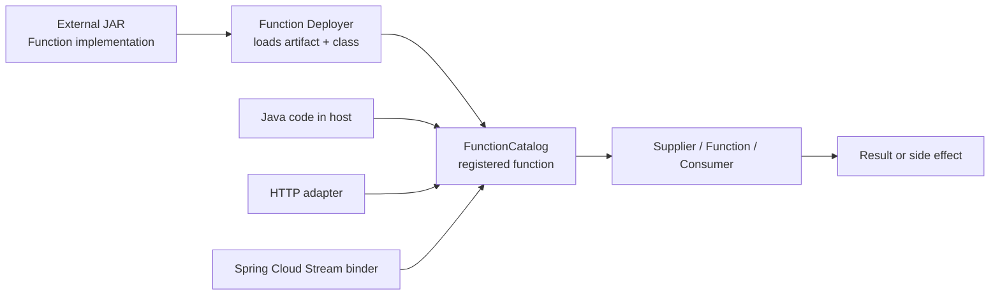
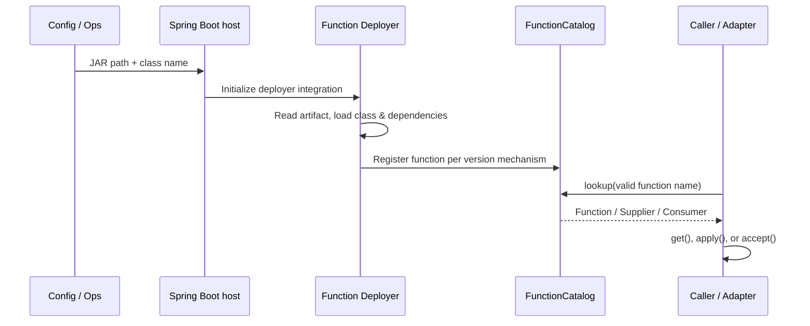

# Role of spring-cloud-function-deployer

## 1. The Problem: Using a Function Located in an External JAR

Suppose a development team has a Spring Boot application that receives requests to normalize order IDs. The normalization rule was originally written as a `Function<String, String>`, but another business team needs to provide its own version of the rule as a JAR library. The operations team wants a **host application** to load the function from a specified JAR, instead of copying source code into the host application every time the library changes.

This is the context of **`spring-cloud-function-deployer`** in the **Spring Cloud Function** (`SPRING_CLOUD_FUNCTION`) ecosystem. This module is aimed at **deploying/loading a function packaged in an external JAR into a running Spring Cloud Function environment**, so the framework can access the function via its registration and lookup mechanisms. From there, components like `FunctionCatalog` and the appropriate adapters can invoke the function according to its contract.

Within the scope of this learning module, we still develop business logic using `Supplier<T>`, `Function<T, R>`, and `Consumer<T>`, learn `FunctionCatalog`, composition, and message conversion, while aiming to reuse logic across HTTP, events, or serverless. What is new in the **JAR loading** section is: **the function definition code does not necessarily reside on the initial classpath of the host application**.

It is important not to confuse *function deployer* with an infrastructure deployment tool. It does not create a Kubernetes container, an AWS Lambda, or a broker on its own. Its primary function resides **inside the running Java/Spring process**.

## 2. Distinguishing the Five Components in the Model

| Component | Role | Example |
| --- | --- | --- |
| **Function-containing JAR** | Packages bytecode and, depending on the packaging approach, the required resources/dependencies of the function. | `normalize-function-1.0.0.jar`. |
| **Host application** | Starts the JVM and Spring ApplicationContext, and provides configuration and necessary adapters. | Spring Boot host. |
| **`spring-cloud-function-deployer`** | Reads information about the artifact and function class to load; integrates the external function into Spring Cloud Function mechanisms according to the version's capabilities. | Deployer module in the host. |
| **`FunctionCatalog`** | Central point to look up a registered function by name/definition and support framework capabilities. | `catalog.lookup(...)`. |
| **Adapter** | Connects the catalog/function to a specific trigger mechanism. | HTTP Web adapter, Spring Cloud Stream binder, serverless adapter. |



The arrow from the JAR to the deployer represents **the code loading process**; the arrow from the adapter to the catalog represents **the function selection/invocation process**. These two processes are distinct. A function may have loaded successfully yet not be invoked by HTTP or Stream if there is no corresponding adapter, binding, or call site.

## 3. What Does the Deployer Solve and What Does It Not Solve?

### What it helps accomplish

1. **Decoupling the function release source from the host application:** an artifact containing logic can be built independently of the host.
2. **Specifying the function to load via configuration:** the host does not necessarily have to import implementation classes from every function provider at compile time.
3. **Bringing the function into Spring Cloud Function's registration and invocation mechanism:** the application can access the function via the catalog by its registered name/definition.
4. **Providing a foundation for adapter reuse:** once the function is in the catalog, connecting HTTP, messaging, or serverless still follows the integration mechanism of each environment.
5. **Supporting a plugin-style technical organization:** the logic is packaged separately, while the host application is responsible for operating and selecting the function.

### What it does not do on its own

- It does not automatically turn an arbitrary JAR into a valid `Function`.
- It does not automatically build REST controllers, Kafka topics, or cloud triggers.
- It does not replace dependency management, Java versions, binary compatibility, and input/output types.
- It does not guarantee hot reload or **zero-downtime** function replacement when overwriting a JAR.
- It is not a secure sandbox mechanism for untrusted code.
- It does not replace application deployment systems such as CI/CD, Kubernetes, Spring Cloud Data Flow, or AWS Lambda.

**In summary:** the deployer focuses on **loading functions from external artifacts**; the catalog focuses on **finding/invoking functions**; the adapter focuses on **receiving and returning data across the runtime environment**.

## 4. Comparison with Other Ways of Introducing Logic into an Application

| Deployment approach | How is the function code present? | Benefits | Limitations |
| --- | --- | --- | --- |
| **`@Bean Function` bean in host** | Compiled and packaged together with the host application. | Simple, clear dependencies, easy for IDEs to analyze. | Changing logic usually requires building/deploying the host. |
| **Library JAR on host classpath** | Declared as a Maven/Gradle dependency or placed on the classpath at startup. | Familiar version management, easy integration testing. | Artifacts are usually decided at build/startup time. |
| **`spring-cloud-function-deployer`** | The host is configured to load functions from external JARs using the deployer mechanism. | Decouples the function artifact from the host application; suits certain plugin models. | Requires careful management of classloaders, dependencies, contracts, and loading/upgrading versions. |
| **Running a separate executable Spring Boot JAR** | Each JAR is an independent process/app. | Process-level lifecycle and resource isolation. | Not loading a `Function` into a host; inter-app communication requires separate mechanisms. |
| **Deploying a JAR to serverless** | The platform launches the runtime/handler per event. | Resources and triggers follow the FaaS model. | Depends on handler, event, IAM, and packaging configuration; not the role of an internal deployer. |

In architectural decisions, **loading a JAR into an existing JVM** and **running a JAR as a new process** are two options with different failure, security, and operational boundaries.

## 5. Step 1: Write an Independent Java Function

To keep the example manageable, we create an order ID normalization function that accepts `String` and returns `String`. There are no HTTP requests, Kafka records, or cloud API types in the signature.

File `NormalizeOrderId.java` in the **function library project**:

```java
package demo.functions;

import java.util.Locale;
import java.util.Objects;
import java.util.function.Function;

public final class NormalizeOrderId
        implements Function<String, String> {

    public NormalizeOrderId() {
        // Public no-arg constructor for a simple example.
    }

    @Override
    public String apply(String input) {
        Objects.requireNonNull(input, "orderId");
        String normalized = input.strip()
                .toUpperCase(Locale.ROOT);
        if (normalized.isEmpty()) {
            throw new IllegalArgumentException(
                    "Order ID must not be blank");
        }
        return normalized;
    }
}
```

Expected results:

```text
apply("  od-204 ")  ->  "OD-204"
apply("  ")         ->  IllegalArgumentException
```

The `Function<String, String>` signature means: one input, one output, and no side effects in this example. It can be invoked in plain Java:

```java
Function<String, String> normalize =
        new NormalizeOrderId();

String result = normalize.apply("  od-204 ");
// result.equals("OD-204")
```

With explicit class loading, a **public class implementing `Function` that can be appropriately instantiated** is a simple illustrative approach. One should not assume that every JAR containing Spring `@Configuration` or any arbitrary class will be automatically discovered by the deployer: how a function is identified must match the version and supported packaging style.

## 6. Step 2: Package as a Library JAR

In this example project, the function code only depends on JDK interfaces; therefore, a Spring Boot application class is not needed just to produce the artifact. With Maven, a minimal illustrative `pom.xml`:

```xml
<?xml version="1.0" encoding="UTF-8"?>
<project xmlns="http://maven.apache.org/POM/4.0.0"
         xmlns:xsi="http://www.w3.org/2001/XMLSchema-instance"
         xsi:schemaLocation="http://maven.apache.org/POM/4.0.0 https://maven.apache.org/xsd/maven-4.0.0.xsd">
    <modelVersion>4.0.0</modelVersion>
    <groupId>demo.functions</groupId>
    <artifactId>normalize-function</artifactId>
    <version>1.0.0</version>
    <properties>
        <maven.compiler.release>17</maven.compiler.release>
        <project.build.sourceEncoding>UTF-8</project.build.sourceEncoding>
    </properties>
</project>
```

Save `NormalizeOrderId.java` at:

```text
src/main/java/demo/functions/NormalizeOrderId.java
```

Build the artifact:

```bash
mvn package
```

An expected result is `target/normalize-function-1.0.0.jar` containing `demo/functions/NormalizeOrderId.class`. You can inspect the JAR contents with:

```bash
jar tf target/normalize-function-1.0.0.jar
```

**Important distinction:** this is a **library JAR** containing the function implementation class, not by default a **Spring Boot executable/fat JAR** with a `BOOT-INF` structure. Packaging approaches with complex dependencies require examining how the deployer loads artifacts and dependencies in the release being used. Do not assume that every JAR runnable via `java -jar` is suitable for the deployer to load a function class from.

## 7. Step 3: Prepare the Host Application with the Deployer

The host application is a standard Spring Boot application. In Spring Cloud Function releases that still provide this module, the central Maven dependency is:

```xml
<dependency>
    <groupId>org.springframework.cloud</groupId>
    <artifactId>spring-cloud-function-deployer</artifactId>
</dependency>
```

Spring Boot and Spring Cloud Function modules must use **compatible versions**, managed consistently via a BOM/dependency management. Do not copy independent versions from different examples into the same project.

Example entry point:

```java
package demo.host;

import org.springframework.boot.SpringApplication;
import org.springframework.boot.autoconfigure.SpringBootApplication;

@SpringBootApplication
public class FunctionHostApplication {
    public static void main(String[] args) {
        SpringApplication.run(FunctionHostApplication.class, args);
    }
}
```

If the host **only tests calling the function inside the JVM**, no web server is needed. When you want to expose HTTP endpoints via Spring Cloud Function, add a compatible web adapter:

```xml
<dependency>
    <groupId>org.springframework.cloud</groupId>
    <artifactId>spring-cloud-starter-function-web</artifactId>
</dependency>
```

To connect to Kafka or RabbitMQ, you need **Spring Cloud Stream** and the corresponding binder, along with bindings. The deployer does not automatically add Kafka to the application just because it loaded a JAR containing a function.

## 8. Step 4: Configure the JAR Location and Function Class

Documentation/versions supporting Function Deployer use a configuration group aimed at specifying the **artifact location** and **function class name**. An illustrative configuration for this mechanism:

```yaml
spring:
  cloud:
    function:
      location: "file:///opt/functions/normalize-function-1.0.0.jar"
      function-class: "demo.functions.NormalizeOrderId"
```

This can be expressed equivalently using properties:

```properties
spring.cloud.function.location=file:///opt/functions/normalize-function-1.0.0.jar
spring.cloud.function.function-class=demo.functions.NormalizeOrderId
```

**Cross-check with the version of `spring-cloud-function-deployer` in use:** this module and its capabilities for recognizing URIs, artifacts, classes, bean instantiation, and registration names can vary across release lines. The two properties above describe the traditional Function Deployer configuration mechanism; do not assume they apply to every current Spring Cloud Function version without checking the corresponding dependency and documentation.

Explanation:

- `location` points to the artifact containing the function to load. In the example, it is a **file URI** accessible from the host's runtime environment.
- `function-class` specifies the fully qualified Java class name of the implementation that the deployer should load via its supported mechanism.
- Rules for **catalog registration names**, naming/aliasing mechanisms, and multi-function support must be verified on the specific version; do not equate the JAR filename, class name, and bean name.

In a container environment, `/opt/functions/...` is a path **inside the filesystem visible to the Java process**, not a path on the developer's machine if the two machines/containers differ. The artifact must actually be mounted, copied, or provided according to the chosen release workflow.

## 9. Lifecycle from Function Loading to Invocation

To distinguish the phases, consider an illustrative flow:



The conceptual workflow consists of:

1. The host starts a Spring ApplicationContext with the deployer dependency.
2. The deployer reads configuration info and accesses the JAR.
3. The implementation class is loaded/instantiated according to the deployer version's capabilities and related dependencies.
4. The function is added to the registration system so other components can find it through the catalog.
5. A caller or adapter looks up the appropriate function and invokes it according to its signature.

**Successful loading does not mean a message has been processed.** There must be an appropriate Java caller, HTTP endpoint, Stream binding, or handler. **Invoking the function also does not guarantee that the output message was acknowledged by the broker** or that an HTTP response was sent successfully.

## 10. Using FunctionCatalog After Loading the JAR

`FunctionCatalog` is a convenient boundary between **function registration** and **the application wanting to invoke the function**. After verifying that the function name has been registered in the catalog in the host version, a Spring component can execute:

```java
import java.util.function.Function;
import org.springframework.cloud.function.context.FunctionCatalog;

// Illustrative snippet inside a bean/service with FunctionCatalog catalog injected.
// registeredName must be the actual name registered by the deployer.
Function<String, String> fn = catalog.lookup(registeredName);

if (fn == null) {
    throw new IllegalStateException(
            "Function not found: " + registeredName);
}

String normalized = fn.apply("  od-204 ");
// Expects "OD-204" if the NormalizeOrderId class was loaded properly.
```

**Do not guess the function name.** The class name `demo.functions.NormalizeOrderId`, the JAR filename `normalize-function-1.0.0.jar`, and the registration name used by `lookup(...)` are not necessarily the same. Check startup logs, the list of functions/definitions exposed by the host version, or naming configuration if supported.

When writing integration tests, verify all of the following:

- Whether the function is found (`lookup` does not return `null`).
- Correct input/output types and results on standard data.
- Error handling on invalid input and exception wrapping behavior.
- Whether any other function/bean in the host has a duplicate name or causes ambiguity.

The catalog may also return a **wrapper** for composition or message conversion; do not rely on the looked-up object being the exact raw instance from the original classloader.

## 11. What Happens When Using HTTP, Messaging, or Serverless?

The deployer only handles **bringing the function implementation into the system**. Once the function is validly registered, other adapters decide how it is triggered.

| Call site | What else is needed? | Outcome |
| --- | --- | --- |
| **Internal Java** | Service/runner injects the catalog or uses a host-supported invocation method. | `apply()` receives/returns Java objects. |
| **HTTP** | Spring Cloud Function Web adapter, compatible routes, and message conversion. | HTTP payload is converted to input and the result to response. |
| **Messaging** | Spring Cloud Stream, binder, appropriate `spring.cloud.function.definition`, and bindings. | Input/output messages flow through the broker. |
| **Serverless** | Runtime adapter/handler, event source, packaging, and platform permissions. | The function is invoked according to the invocation contract. |

**Spring Cloud Stream** example (applies only when confirmed that the function name `normalizeOrderId` actually exists in the catalog and is selected as the definition):

```yaml
spring:
  cloud:
    function:
      definition: normalizeOrderId
    stream:
      bindings:
        normalizeOrderId-in-0:
          destination: raw-order-ids
          group: normalizer
          content-type: text/plain
        normalizeOrderId-out-0:
          destination: normalized-order-ids
          content-type: text/plain
```

This deployment also requires an appropriate binder and broker connection configuration. The binding names in the example illustrate the case where the function definition name matches `normalizeOrderId`; **do not infer** that the deployer automatically names functions this way for every version/class type. In real problems, choose the registered name and adjust bindings before running.

When using HTTP, JSON/string serialization and HTTP status codes also depend on the adapter. A `Function<String, String>` does not automatically get an endpoint just because `NormalizeOrderId.class` was loaded.

When using serverless, **function-deployer is not a Lambda handler**. A serverless application requires the corresponding adapter/runtime, entry point configuration, packaging, IAM, and event source. The same Java implementation can be reused; there is no guarantee you can drop a plugin JAR onto every cloud without modifying the deployment workflow.

## 12. Differences Between a Library JAR and a Spring Boot Executable JAR

This is a common design mistake when working with JAR loading mechanisms:

| Characteristic | Library JAR | Spring Boot executable JAR |
| --- | --- | --- |
| Primary goal | Contains classes and resources to be loaded by another application. | Starts a standalone application with Boot's launcher. |
| Typical structure | Java packages directly at the archive root. | `BOOT-INF/classes` and `BOOT-INF/lib` per standard Boot packaging. |
| How it is used | Placed on the classpath or read by an appropriate loader mechanism. | Usually started with `java -jar`. |
| What the deployer needs | Find and load the function class according to the supported mechanism. | Does not by default understand all launcher/nested JAR structures as a function library. |

For the `NormalizeOrderId` example, a simple library JAR is usually easiest to control. If the function has external dependencies, you must decide how dependencies are packaged, provided on the classpath, or supported by the loader. **Do not assume** that nested JARs inside an executable Boot JAR are handled by the deployer the same way as when running a Boot application.

## 13. Classloaders and Dependencies: Benefits Come with Risks

When loading classes from an external JAR into the JVM, Java needs a classloader to resolve:

- **The function class:** is `demo.functions.NormalizeOrderId` actually in the artifact?
- **Shared interfaces:** are `java.util.function.Function` and the data types shared between host and function compatible?
- **Function dependencies:** are JSON libraries, HTTP clients, database drivers, or helper classes loaded in the right versions?
- **Resources:** are config files, templates, or resources read by the function on a valid path?
- **Lifecycle boundaries:** are classloaders, file handles, and resources properly managed upon shutdown/restart?

Some function deployer mechanisms use an isolated loader to access the artifact. Classloader isolation can reduce certain conflicts, **but it does not mean** every library will be automatically isolated completely. Two versions of the same class name or API objects passed across different classloaders can still cause `ClassCastException`, `LinkageError`, or `NoSuchMethodError`.

For example, if a `Function<OrderRequest, OrderDecision>` is loaded from an external JAR, but the host and JAR package **two different definitions** of `OrderRequest`, passing Java objects between the two sides can fail even though the package and class name look identical. A shared contract should be versioned and provided in a way that the host and function are genuinely compatible with.

**Recommendation:** start with a standard-type function like `Function<String, String>` to validate the loading path. Only then add DTOs, dependencies, and converters, testing each boundary.

## 14. Configuration Does Not Mean Hot Reload or Hot Swap

Saying "dynamic" can easily lead learners to think they can overwrite `normalize-function-1.0.0.jar` on disk and new calls will immediately use the new bytecode. **Do not rely on this assumption.**

JAR loading mechanisms typically set up classloaders and register functions at a specific point in the application lifecycle. Swapping loaded classes, unloading old classloaders, handling in-flight requests, and refreshing the catalog are separate problems. There is no default guarantee that:

- the deployer watches JAR file changes and reloads automatically;
- classes can be replaced in the JVM without operational actions;
- in-flight invocations transition versions without disruption;
- state, threads, connection pools, or schedulers created by the old function will stop safely on their own.

In production, design a workflow of **releasing immutable artifacts, updating configuration, and performing controlled host restarts/rollouts** if that is what your deployment version supports. Use health checks, readiness probes, and appropriate rollbacks when a function fails. If zero-downtime version replacement is mandatory, verify an explicitly supported mechanism and test it rather than guessing from the word *deployer*.

## 15. Security: External JARs Are Code Executed Inside the Host

This is the most critical limitation of plugin/JAR loading mechanisms: **a JAR contains executable bytecode**, not just data. A loaded function can run with the Java process's permissions and access dependencies, resources, and data permitted to the host.

Therefore:

1. **Load only trusted artifacts.** Govern release sources, approvers, and JAR modification permissions.
2. **Use immutable artifacts.** Apply versioning, checksums, or signatures/integrity verification appropriate to your release pipeline.
3. **Control paths and URIs.** Do not allow untrusted input to arbitrarily determine location/class; avoid loading artifacts from uncontrolled sources.
4. **Manage dependencies and vulnerabilities.** Use inventories/SBOMs, scan libraries, and update when issues are discovered.
5. **Restrict host permissions.** Configure secrets, network, filesystem, and database access following the principle of least privilege.
6. **Separate processes when untrusted.** A classloader is not a security sandbox; if running logic from uncontrolled third parties, consider container/process-level isolation and clear API contracts.
7. **Restrict exposed functions.** Do not let external callers arbitrarily pick a function name that leads to invoking a `Consumer` with dangerous side effects.

Reusing the same function over HTTP or messaging also requires authentication, authorization, validation, rate limiting, and input checks suited to the calling environment. The deployer does not provide these layers of protection automatically.

## 16. Understanding Limitations on Function Types and Side Effects

The deployer can serve the function types supported by Spring Cloud Function in the relevant release line:

| Function type | Meaning after loading | Operational points to note |
| --- | --- | --- |
| `Supplier<T>` | Can produce values when invoked. | The deployer does not schedule it automatically; a poller/adapter decides when to call `get()`. |
| `Function<T, R>` | Receives input, returns output. | No guarantee the transformation is pure or non-blocking. |
| `Consumer<T>` | Receives input and performs an action. | Side effects require handling retries/idempotency/transactions depending on the call source. |

A `Function` can throw exceptions or use a database. A `Consumer` returning `void` does not mean the broker has acknowledged the message. When invoked from multiple environments, the same code must still account for retries and I/O errors of those environments.

**Being able to load a function** does not mean it is ready for production: you must verify concurrency, timeouts, dependencies, memory footprint, logging/tracing, and side effects accordingly.

## 17. Common Errors and How to Diagnose Them

| Symptom | Likely cause | How to check |
| --- | --- | --- |
| JAR not found | Wrong `location`, file not mounted, or host lacks read permission. | Verify the path in the runtime environment, URI, and file permissions. |
| `ClassNotFoundException` | Wrong `function-class` name, class not inside the JAR, or missing dependency. | Check the fully qualified name, archive contents, and dependencies. |
| `NoClassDefFoundError` | Dependent class missing at runtime. | Check transitive dependencies and how the loader resolves them. |
| `NoSuchMethodError` / `LinkageError` | Binary incompatibility or version conflict. | Audit Java, Spring, library versions, and contracts. |
| `ClassCastException` | Incompatible DTO types across two classloaders or wrong converter. | Check classloader boundaries, generic types, and mappings. |
| `FunctionCatalog.lookup(...)` returns `null` | Function not registered, wrong name, or loading failed. | Check deployer logs, actual registered name, and configuration. |
| HTTP returns an error even though Java `apply()` works | Wrong route, content type, converter, or validation in the adapter. | Test the HTTP contract separately; inspect payload and response. |
| Messages not received/sent | Binder not installed, wrong function definition, binding, or broker. | Check Stream config, group, destination, and connectivity. |
| Class loads but invocation fails | Wrong input type, business error, or I/O dependency failure. | Unit test the function; inspect stack traces, tracing, and run integration tests. |
| JAR updated but results remain stale | Runtime still uses loaded classes, config points to old artifact, or host not restarted. | Check version/checksum, rollout workflow, and lifecycle. |

You should verify **in order**: artifact exists → class can be loaded → function is registered → catalog lookup succeeds → Java invocation works → adapter works → data and errors in production match the contract. This layered approach avoids confusing classloader errors with HTTP or Kafka errors.

## 18. Testing a Function Loaded from a JAR

A three-layer testing strategy:

### 18.1. Unit tests inside the JAR project

No Spring needed:

```java
package demo.functions;

import static org.junit.jupiter.api.Assertions.assertEquals;
import static org.junit.jupiter.api.Assertions.assertThrows;
import org.junit.jupiter.api.Test;

class NormalizeOrderIdTest {
    private final NormalizeOrderId function = new NormalizeOrderId();

    @Test
    void normalizesId() {
        assertEquals("OD-204",
                function.apply("  od-204 "));
    }

    @Test
    void rejectsBlankId() {
        assertThrows(IllegalArgumentException.class,
                () -> function.apply("   "));
    }
}
```

The test example requires the JUnit dependency in the project when running tests. There is no compelling reason to load a JAR just to test the normalization algorithm.

### 18.2. Integration tests of the host/deployer

With the **built JAR artifact**, start the host using the location/function-class configuration on a supported version; inspect loading logs, actual registered name, `FunctionCatalog.lookup(...)`, and `apply()`. These verify the **JAR loading mechanism** rather than just the Java function.

For custom DTOs, test payloads and shared API versions on both sides. Also test missing artifacts, wrong class names, incompatible dependencies, and duplicate registry name cases.

### 18.3. Adapter contract tests

If using the web adapter, send real HTTP requests or run web integration tests with valid and invalid content types. With Stream, test bindings, converters, output destinations, and retries. With serverless, verify the event source/handler contract, timeouts, and failure semantics. **Adapters can fail even when the function has loaded and `apply()` runs properly.**

## 19. When Should and Shouldn't You Use Function Deployer?

| Scenario | Assessment |
| --- | --- |
| The host needs to receive Java functions from controlled artifacts with a shared contract and independent releases. | **May be suitable**, after confirming the deployer version's capabilities and operational workflow. |
| The same set of functions needs to be registered for the host/adapter to select via configuration. | **Useful** if the registry and external JAR loading genuinely reduce coupling. |
| The application has a few fixed `Function` beans and is always deployed together. | **Usually unnecessary**; `@Bean` or Maven dependencies are simpler. |
| The goal is to run multiple independent services on Kubernetes. | An internal deployer **does not replace** application/container deployment tools. |
| The goal is to deploy a function to AWS Lambda. | Requires an appropriate Lambda adapter and package; the deployer **is not** the Lambda service. |
| JARs come from untrusted sources or require secure isolation between plugins. | **Should not be used as a sandbox**; prefer process/container-level isolation. |
| Zero-downtime code hot-swap and instant rollback are required. | Consider only when the deployment version has explicitly supported/tested mechanisms; do not assume it. |

The greatest benefit usually appears when **the function release lifecycle differs from the host application release lifecycle**, while compatibility and operational requirements within a shared JVM remain acceptable. Without that need, dynamic loading can introduce unnecessary overhead.

## 20. Pre-Production Checklist

1. **Verify availability and compatibility:** does the release in use include `spring-cloud-function-deployer` and support the intended configuration style?
2. **Package the artifact properly:** the JAR contains clear implementation classes, appropriate dependencies, and a compatible Java version.
3. **Manage artifacts:** immutable versions, controlled paths/URIs, checksums/signatures per policy.
4. **Configure the host:** include the deployer dependency, FunctionCatalog, and required adapters; specify location/class explicitly.
5. **Check the registration name:** do not guess the function name from the class name or JAR filename.
6. **Verify invocation:** the catalog finds the function; inputs, outputs, and errors match the contract.
7. **Check classloader boundaries:** shared DTOs, libraries, and resources are compatible.
8. **Test integration:** HTTP, Stream, or serverless runtimes are configured and tested separately.
9. **Operational monitoring:** loading logs, errors, latency, memory, retries, concurrency, and artifact provenance.
10. **Define an upgrade workflow:** concrete rollout/restart/rollback steps; do not rely on assumed hot reload.

## 21. Conclusion

**`spring-cloud-function-deployer` acts as a bridge between an external function-containing JAR and Spring Cloud Function's registration mechanism inside the host application.** It is useful when you want to decouple business logic artifacts from the host build process and load a specified implementation, thereby accessing the function via `FunctionCatalog` and appropriate adapters.

Three tasks must be kept distinct: **loading code from a JAR**, **looking up/invoking the function**, and **triggering via protocol/runtime**. The deployer handles the first part; the catalog organizes the second; HTTP/Stream/serverless adapters along with the execution infrastructure handle the third. Constraints regarding versions, classloaders, dependencies, security, retries, and deployment lifecycles must still be designed and tested separately.

Therefore, when learning JAR loading in Spring Cloud Function, the goal is not merely "being able to read a `.jar` file", but **turning a separately packaged `Supplier`, `Function`, or `Consumer` implementation into an invocable part of the application, with a clear data contract and operational model**.
