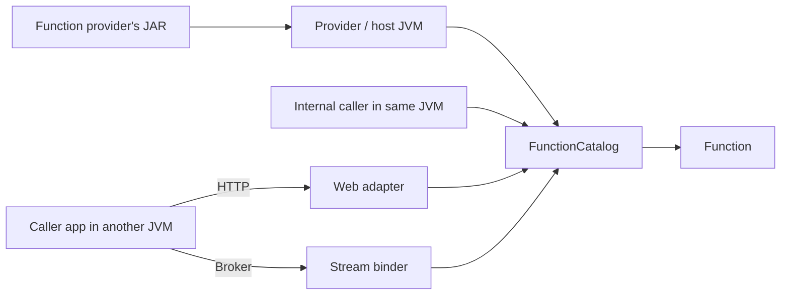
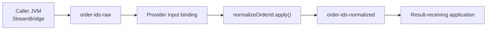

# Decoupling the Function Application from the Caller Application

## 1. The Problem: Releasing One Rule, Calling It from Multiple Applications

Suppose a sales platform needs to normalize order IDs before storing them and processing events. The business team maintains the rule; the API team handles HTTP requests; the integration team processes messages. Copying the logic into every controller, Kafka listener, or cloud handler makes it easy for different parties to end up using different versions of the rule.

In **Spring Cloud Function** (`SPRING_CLOUD_FUNCTION`), logic can be expressed as `Supplier<T>`, `Function<T,R>`, or `Consumer<T>`, registered via `FunctionCatalog`, chained via composition, and triggered by adapters over HTTP, messaging, or serverless. The **JAR loading** topic adds an important requirement: **decoupling where function code is packaged/released from where the function is consumed**.

First, we must distinguish **two levels of decoupling**:

1. **Decoupling code and artifact:** one team releases a JAR containing the function, and a host application loads the JAR using `spring-cloud-function-deployer` or uses it as a dependency. If the host invokes the function after loading it, the code still executes **within the same JVM**; no network call or new process automatically appears.
2. **Decoupling processes:** the provider runs the function as an independent service; a caller in another application invokes it via HTTP or a message broker. Both sides have separate deployments, resources, timeouts, lifecycles, and transport failures.

The two approaches can be combined: the provider uses the deployer to load a JAR and then accepts calls from other callers. However, **the deployer is not a network client**; and **decoupling provider/caller across processes does not require using the deployer**.

## 2. Four Roles to Keep Distinct

| Component | Responsibility | Example |
| --- | --- | --- |
| **Function library** | Holds the business rule and data type contract. | `OrderIdNormalizer implements Function<String,String>`. |
| **Function artifact** | Packages bytecode, resources, and release version. | `normalize-order-id-1.0.0.jar`. |
| **Host/provider** | Runs Spring Boot, registers functions, provides `FunctionCatalog` and required adapters. | Web function service or host with deployer. |
| **Caller** | Decides when to invoke, sends input, handles output and errors. | Java service, HTTP client, message producer. |



The **JAR → host** arrow is code loading; **remote caller → adapter** is communication over a protocol. The catalog manages functions **within a single Spring context**, not as a remote lookup service across JVMs.

## 3. Three Ways to Organize the System

### Approach A — Function and caller compiled together

```text
Spring Boot application
  ├── @Bean Function<String,String>
  ├── FunctionCatalog
  └── Java service calling apply()
```

Simple, minimal configuration, easy to debug. Changing function code usually requires rebuilding/redeploying the application.

### Approach B — External JAR, same host JVM

```text
normalize-order-id-1.0.0.jar
           |
           v
Spring Boot host (single JVM)
  ├── spring-cloud-function-deployer
  ├── FunctionCatalog
  └── Runner / Web adapter / Stream binder
```

Useful when you want to manage and release logic as a separate artifact. However, the loaded code still shares CPU, heap, permissions, and lifecycle with the host JVM; a separate classloader is not a sandbox.

### Approach C — Provider and caller in two JVMs

```text
Provider JVM A                      Caller JVM B
  Function bean                        HTTP client
  FunctionCatalog       <--HTTP---     / StreamBridge
  HTTP / Stream adapter  --output-->   Result handling
```

Enables independent scaling and rollouts, but requires solving timeouts, networking, authentication, schemas, retries, and observability.

| Criterion | A: co-built | B: external JAR | C: separate-process service |
| --- | --- | --- | --- |
| Function code released separately | Not required | Yes | Possible |
| Number of JVMs between caller and function | One | One | Two or more |
| Calling `apply()` directly | Yes | Yes, after load/lookup | No, must use a protocol |
| Network serialization | No | No if internal caller | Yes |
| Process-level fault isolation | No | No | To a certain degree |
| Primary cost | Build-time coupling | Loader, dependencies, rollout | Protocol, network failures, tracing |

There is no single best approach for every system. The required degree of independence must be balanced against operational overhead.

## 4. Function Contract Example

To stay focused on JAR loading, use a pure Java transformation with standard types:

```text
Input  : "  od-204 "
Output : "OD-204"
Empty input after strip: validation error
```

Choosing `Function<String,String>` avoids having to solve DTO sharing across multiple classloaders for now. Distinguish the Java class name, JAR filename, catalog function name, HTTP route, and binding name:

| Name type | Example | Where it is used |
| --- | --- | --- |
| Java class | `demo.functions.OrderIdNormalizer` | Class to load |
| JAR | `normalize-order-id-1.0.0.jar` | Artifact location |
| Catalog name | Could be `normalizeOrderId` | `FunctionCatalog.lookup(...)` after verification |
| HTTP path | `/normalizeOrderId` | Provider's web adapter |
| Stream binding | `normalizeOrderId-in-0` | Spring Cloud Stream |

**Do not guess** the catalog name registered by the deployer from the JAR name or class name. When using the deployer, verify the naming rules on the actual release.

## 5. Function Project: Building a Library JAR

File `src/main/java/demo/functions/OrderIdNormalizer.java`:

```java
package demo.functions;

import java.util.Locale;
import java.util.Objects;
import java.util.function.Function;

public final class OrderIdNormalizer
        implements Function<String, String> {

    public OrderIdNormalizer() {}

    @Override
    public String apply(String input) {
        Objects.requireNonNull(input, "orderId");
        String normalized =
                input.strip().toUpperCase(Locale.ROOT);
        if (normalized.isEmpty()) {
            throw new IllegalArgumentException(
                    "orderId must not be blank");
        }
        return normalized;
    }
}
```

The function knows nothing about HTTP, Kafka, or AWS. Unit test directly:

```java
package demo.functions;

import static org.junit.jupiter.api.Assertions.assertEquals;
import static org.junit.jupiter.api.Assertions.assertThrows;
import org.junit.jupiter.api.Test;

class OrderIdNormalizerTest {
    private final OrderIdNormalizer fn = new OrderIdNormalizer();

    @Test
    void normalizes() {
        assertEquals("OD-204", fn.apply("  od-204 "));
    }

    @Test
    void rejectsBlank() {
        assertThrows(IllegalArgumentException.class,
                () -> fn.apply("   "));
    }
}
```

The test snippet requires JUnit Jupiter in the test project's dependencies. A simple Maven `pom.xml` for the JAR part:

```xml
<project xmlns="http://maven.apache.org/POM/4.0.0"
         xmlns:xsi="http://www.w3.org/2001/XMLSchema-instance"
         xsi:schemaLocation="http://maven.apache.org/POM/4.0.0 https://maven.apache.org/xsd/maven-4.0.0.xsd">
    <modelVersion>4.0.0</modelVersion>
    <groupId>demo.functions</groupId>
    <artifactId>normalize-order-id</artifactId>
    <version>1.0.0</version>
    <properties>
        <maven.compiler.release>17</maven.compiler.release>
        <project.build.sourceEncoding>UTF-8</project.build.sourceEncoding>
    </properties>
</project>
```

Illustrative commands to run in the library project:

```bash
mvn package
jar tf target/normalize-order-id-1.0.0.jar
```

The expected output includes `demo/functions/OrderIdNormalizer.class`. This is a **library JAR**, not by default an executable Spring Boot JAR containing `BOOT-INF`. If the function has its own dependencies, you must choose how to supply them along a loading path supported by the deployer release.

## 6. Host: Loading the JAR with spring-cloud-function-deployer

In Spring Cloud Function lines that still support this module and configuration style, the Spring Boot host can use:

```xml
<dependency>
    <groupId>org.springframework.cloud</groupId>
    <artifactId>spring-cloud-function-deployer</artifactId>
</dependency>
```

Host entry point:

```java
package demo.host;

import org.springframework.boot.SpringApplication;
import org.springframework.boot.autoconfigure.SpringBootApplication;

@SpringBootApplication
public class FunctionHostApplication {
    public static void main(String[] args) {
        SpringApplication.run(FunctionHostApplication.class, args);
    }
}
```

**Illustrative** configuration for versions that support Function Deployer using the traditional property group:

```yaml
spring:
  cloud:
    function:
      location: "file:///opt/functions/normalize-order-id-1.0.0.jar"
      function-class: "demo.functions.OrderIdNormalizer"
```

**Important:** this is not a configuration template guaranteed to work on every release. You must verify compatible Spring Boot/Spring Cloud Function versions, deployer module availability, URI types, instantiation mechanisms, and catalog registration names. `/opt/functions/...` is a file path **inside the host environment**, not on another machine. A container must have the artifact mounted or copied into it.

### 6.1. Calling the function in the host after loading

Example host runner looking up a name taken from an **application-defined** configuration property:

```java
package demo.host;

import java.util.function.Function;
import org.springframework.beans.factory.annotation.Value;
import org.springframework.boot.ApplicationRunner;
import org.springframework.cloud.function.context.FunctionCatalog;
import org.springframework.context.annotation.Bean;
import org.springframework.context.annotation.Configuration;

@Configuration
public class LoadedFunctionRunner {
    @Bean
    ApplicationRunner verifyLoaded(
            FunctionCatalog catalog,
            @Value("${demo.lookup-name}") String name) {
        return args -> {
            Function<String, String> fn = catalog.lookup(name);
            if (fn == null) {
                throw new IllegalStateException(
                        "Function not registered: " + name);
            }
            System.out.println(fn.apply("  od-204 "));
        };
    }
}
```

Only set `demo.lookup-name` to the real name after checking the deployer version's logs/registration—for example `normalizeOrderId` if that name actually exists. The property `demo.lookup-name` **is not a framework property**; it only serves the runner code above.

The `fn.apply(...)` call here executes in the **same JVM as the host**. There is no HTTP request or Kafka message. The deployer brings code from an external artifact into the host; it does not create a process or RPC service on its own.

## 7. When the Caller Is in Another JVM: An Adapter Is Required

To make another caller truly independent of the provider's runtime, a remote connection path is needed. There are two ways to build the provider:

- **The provider loads an external JAR** using the deployer and then exposes the function via a web/Stream adapter if supported by the version.
- **The provider adds the JAR as a Maven dependency** and declares a regular function bean, then exposes it via a web/Stream adapter. This does not require the deployer while still separating the **provider JVM** from the **caller JVM**.

The HTTP/messaging examples below use **the second approach** so as not to depend on automatic naming behavior across deployer releases. This is an **alternative** implementation option, not a requirement to use both loading paths simultaneously in one provider.

## 8. Provider: Registering the Function and Exposing Over HTTP

The provider declares dependencies on the function artifact and the web adapter:

```xml
<dependency>
    <groupId>demo.functions</groupId>
    <artifactId>normalize-order-id</artifactId>
    <version>1.0.0</version>
</dependency>
<dependency>
    <groupId>org.springframework.cloud</groupId>
    <artifactId>spring-cloud-starter-function-web</artifactId>
</dependency>
```

Spring Boot application on the provider:

```java
package demo.provider;

import java.util.function.Function;
import demo.functions.OrderIdNormalizer;
import org.springframework.boot.SpringApplication;
import org.springframework.boot.autoconfigure.SpringBootApplication;
import org.springframework.context.annotation.Bean;

@SpringBootApplication
public class FunctionProviderApplication {
    public static void main(String[] args) {
        SpringApplication.run(FunctionProviderApplication.class, args);
    }

    @Bean
    Function<String, String> normalizeOrderId() {
        return new OrderIdNormalizer();
    }
}
```

Example provider using its own port:

```yaml
server:
  port: 8081
```

Once the web adapter is properly configured, test the endpoint by function name:

```bash
curl -X POST http://localhost:8081/normalizeOrderId \
  -H "Content-Type: text/plain" \
  --data "  od-204 "
```

The expected business payload is `OD-204`. Verify the route, HTTP method, and content type conversion on the actual adapter/version. The remote caller **does not need to import the provider's Java classes**; both sides agree on an HTTP contract.

## 9. Caller: Sending Requests from Another Spring Boot App

Spring Framework 6.1+ provides `RestClient` (used with a compatible Spring Boot version); other HTTP clients can also be used:

```java
package demo.caller;

import org.springframework.beans.factory.annotation.Value;
import org.springframework.http.MediaType;
import org.springframework.stereotype.Service;
import org.springframework.web.client.RestClient;

@Service
public class OrderIdClient {
    private final RestClient client;

    public OrderIdClient(
            RestClient.Builder builder,
            @Value("${order-function.base-url}") String baseUrl) {
        this.client = builder.baseUrl(baseUrl).build();
    }

    public String normalize(String rawOrderId) {
        return client.post()
                .uri("/normalizeOrderId")
                .contentType(MediaType.TEXT_PLAIN)
                .body(rawOrderId)
                .retrieve()
                .body(String.class);
    }
}
```

Example caller configuration:

```yaml
order-function:
  base-url: "http://localhost:8081"
```

Inside a container, `localhost` points to the caller container itself, not a separate provider container. When deploying, use an actually reachable DNS/service name/gateway and configure timeouts and authentication. The caller invokes the provider over the network; it **cannot inject or look up the provider JVM's `FunctionCatalog`**.

If the provider releases a new logic version while maintaining a compatible HTTP contract, the caller may not need to be redeployed. In return, the caller must handle connection errors, HTTP errors, timeouts, and retries according to the contract.

## 10. Decoupling Caller and Provider with Messaging

HTTP fits when the caller needs an immediate response. If an application emits a request and can receive the result later, using **Spring Cloud Stream** with a Kafka or RabbitMQ binder may make more sense:



Still using the `normalizeOrderId` bean in the provider, a Stream deployment is a **separate adapter option** from the web application in section 8. It requires Spring Cloud Stream and the corresponding binder dependency, such as `org.springframework.cloud:spring-cloud-stream-binder-kafka`.

### 10.1. Provider-side configuration

```yaml
spring:
  cloud:
    function:
      definition: normalizeOrderId
    stream:
      bindings:
        normalizeOrderId-in-0:
          destination: order-ids-raw
          group: order-id-normalizers
          content-type: text/plain
        normalizeOrderId-out-0:
          destination: order-ids-normalized
          content-type: text/plain
      kafka:
        binder:
          brokers: localhost:9092
```

When a message with payload `"  od-204 "` arrives at the input binding, the binder/converter converts the payload to `String` and calls `Function.apply()`. The value `"OD-204"` is the expected payload of the output message. In practice, check encoding, content type, and serializers on your binder/version.

`normalizeOrderId-in-0` and `normalizeOrderId-out-0` are **default binding names** in the single-function model named `normalizeOrderId`. If you use composition or change the definition, binding names can differ. Kafka destinations and consumer groups must be configured properly for the broker; `FunctionCatalog` does not create a working connection when a binder is missing.

### 10.2. Caller sending messages with StreamBridge

The caller does not need to know the provider's Java implementation. A service in the caller publishes messages as follows:

```java
package demo.caller;

import org.springframework.cloud.stream.function.StreamBridge;
import org.springframework.stereotype.Service;

@Service
public class OrderIdPublisher {
    private final StreamBridge streamBridge;

    public OrderIdPublisher(StreamBridge streamBridge) {
        this.streamBridge = streamBridge;
    }

    public boolean publish(String rawOrderId) {
        return streamBridge.send(
                "rawOrderIds-out-0", rawOrderId);
    }
}
```

The caller uses its own binder and output binding:

```yaml
spring:
  cloud:
    stream:
      output-bindings: rawOrderIds-out-0
      bindings:
        rawOrderIds-out-0:
          destination: order-ids-raw
          content-type: text/plain
      kafka:
        binder:
          brokers: localhost:9092
```

The two YAML files in this section describe **two independent applications**; do not merge them into a single `application.yml`. Broker addresses depend on the deployment network; `localhost:9092` is only illustrative for local learning.

The `boolean` return value of `StreamBridge.send(...)` **is not the normalized business result**. Nor does it prove that the provider has processed the message or that the final recipient has received the output. If the caller needs to know which result corresponds to which request, you must design correlation IDs, a result topic, timeouts, status tracking, and idempotency when needed.

### 10.3. When to choose HTTP vs. messaging?

| Aspect | HTTP | Messaging |
| --- | --- | --- |
| How caller gets the result | Usually within the same request/response. | Usually via a separate event/result stream. |
| Namespace | HTTP URL, method, status. | Topic/destination, binding, group, and message headers. |
| Provider temporarily down | Caller sees timeouts, 5xx, or connection errors. | Broker can retain messages for later processing depending on config and durability. |
| Duplicate handling | Client/gateway may resend requests. | Broker may redeliver, retry, or reprocess. |
| Authentication needed | API authentication/TLS. | Broker ACLs and publish/subscribe permissions. |
| Best fit | Interactions needing immediate decisions. | Event streams and asynchronous service decoupling. |

Spring Cloud Function keeps the `apply()` logic unchanged; rules for delivery and errors must still be designed separately for each adapter.

## 11. Classloader Boundaries vs. Network Boundaries

When loading a JAR with the deployer, **multiple classloaders** can exist in the same JVM. Two classes with the same Java name loaded by two incompatible classloaders can become **two distinct Java types**. This becomes noticeable when input/output types are not `String`:

```java
record OrderRequest(String id, long amountVnd) {}
record OrderDecision(String id, boolean approved) {}

Function<OrderRequest, OrderDecision>
```

If the host and external JAR package separate `OrderRequest` definitions that do not share the same class identity, an object from the host may not be castable to the function's DTO type. Symptoms can include `ClassCastException` or conversion errors. You must establish a shared API and compatible class/dependency loading mechanism, or use a translation layer at the appropriate boundary.

With **two processes over HTTP**, Java objects **do not cross the network**. The caller serializes data to text/JSON; the provider deserializes according to the schema. The two applications can use two different languages as long as they honor the protocol contract.

| Decoupling approach | What must be agreed upon |
| --- | --- |
| Same JVM, using Java types | Generic signatures, class identity, dependency/binary compatibility. |
| Two JVMs over HTTP | URL/method, payload schema, version, HTTP status codes, and error formats. |
| Two JVMs over a broker | Topic, key, payload schema, headers, content type, and delivery semantics. |
| Serverless adapter | Event envelope, handler, response/failure contract, and trigger configuration. |

Avoid putting JPA entities, HTTP request objects, Kafka `ConsumerRecord`, or cloud SDK contexts into the business contract without a clear reason; small, well-versioned DTOs with explicit data fields are easier to maintain.

## 12. Choosing the Function Type When Decoupling Provider and Caller

Spring Cloud Function supports three different functional shapes:

| Type | Within the same host JVM | With a remote caller |
| --- | --- | --- |
| `Supplier<T>` | Caller or poller calls `get()` when data is needed. | Web adapter can return data; Stream poller can emit a source. |
| `Function<T,R>` | Caller calls `apply(T)` and receives `R`. | HTTP response or Stream output message per contract. |
| `Consumer<T>` | Caller calls `accept(T)` to perform side effects. | Adapter receives request/message; no return value `R` from logic, though protocol completion/ack exists. |

`Supplier` is not a scheduler: invocation intervals belong to a poller, API request, or runtime. `Consumer.accept()` returning `void` does not mean the broker has acknowledged or the database has committed. `Function.apply()` returning an object in the host does not mean the output message was sent successfully.

If you want to compose registered beans via `FunctionCatalog.lookup("normalize|validate")`, the output of the preceding step must be compatible with the input of the next step. **Composition happens within the same function invocation system**, not by automatically spawning a workflow across multiple JVMs. Linking multiple services requires explicit HTTP calls, broker topologies, or orchestration.

## 13. Version Management During Independent Releases

Decoupling source code is only genuinely helpful when paired with a **contract and versioning workflow**:

- **Artifact version:** `normalize-order-id-1.0.0.jar` and `1.1.0.jar` are two bytecode versions.
- **Provider version:** image/JAR of the application running adapters and declaring beans.
- **Contract version:** normalization behavior, input/output fields, error schema, or topic names.
- **Caller version:** client code, result expectations, and converters.

Even when the signature remains `String → String`, changing a rule that strips hyphens can be a **semantic breaking change**. Callers might rely on the old format for database lookups. Do not judge compatibility solely by whether Java compiles or HTTP still returns `200`.

A suggested release workflow:

1. The provider team publishes an **immutable** JAR version, along with release provenance and checksums if required by process.
2. Run unit tests and contract tests with boundary inputs.
3. The provider selects an approved artifact version; verify JVM, Spring, and dependency compatibility.
4. Deploy the provider or host to staging; run adapter integration tests before opening traffic.
5. Roll out via canary/rolling deployment and monitor errors, latency, payloads, and consumer lag.
6. Let callers migrate to the new contract as needed; avoid forcing all applications to upgrade simultaneously when compatibility mechanisms exist.
7. Maintain rollback procedures for both artifacts and configuration/contracts.

**Replacing a JAR file is not automatically a hot swap.** Already loaded classes may continue to be used by the JVM. Unless your deployer version advertises a verified safe reload mechanism, perform controlled host restarts/rollouts. Artifact independence does not mean bytecode can be swapped mid-flight.

## 14. Operational Risks in the Two Decoupling Styles

### 14.1. Loading external JARs in the same JVM

- **Dependency conflicts:** missing classes, incompatible library versions, `NoSuchMethodError`, `LinkageError`.
- **Classloader boundaries:** same class name without the same identity, `ClassCastException` on DTOs.
- **Resource sharing:** the function consumes the host's CPU, heap, connections, and threads.
- **Security:** bytecode runs with the host process's permissions; a classloader is not a sandbox.
- **Lifecycle:** stopping/unloading functions, upgrading versions, or releasing resources requires a verified mechanism.

### 14.2. Caller/provider in separate processes

- **Network failures:** DNS, TLS, timeouts, dropped connections, or unavailable brokers.
- **Version mismatches:** payload schema or semantics change before the caller updates.
- **Redelivery/retries:** the same input may be processed multiple times; side effects require idempotency.
- **Backpressure and capacity:** the provider can become overloaded when caller traffic spikes.
- **Distributed observability:** logs from a single JVM are insufficient; correlation IDs, tracing, and metrics are required.
- **Authentication/authorization:** permissions to call APIs or publish/consume topics must be explicit.

Spring Cloud Function provides function abstractions, **but it does not eliminate distributed failures**. Each environment needs its own policies for timeouts, retries, idempotency, and transactions.

## 15. Distinguishing Business Results from Transport Errors

In the example, `OrderIdNormalizer` receives a blank string and throws `IllegalArgumentException`. How this error surfaces depends on the invocation method:

| Method | Error manifestation | What needs to be designed |
| --- | --- | --- |
| Java calling `apply("  ")` | Synchronous exception. | Caller distinguishes input errors from system errors. |
| Catalog lookup | May encounter function not found, wrapper/converter exceptions, or function errors. | Verify name, types, and error handling. |
| HTTP | Can become an HTTP error per adapter/handler. | Clear 4xx/5xx status codes and error body; do not assume it always defaults to 400. |
| Kafka/RabbitMQ | Message may be retried, redelivered, or sent to a DLQ per binder. | Invalid input should not be retried infinitely; define a poison message policy. |
| Serverless | Runtime receives success/failure according to event type. | Handler, retries, batch failures, and timeouts. |

If a `Consumer` mutates database state, a timeout does not prove the transaction did not occur. Caller retries could cause duplicate updates. Use idempotency keys, event IDs, or transactions/outbox patterns suited to the business logic.

## 16. Security When Other Teams Supply JARs or Call Remotely

Separating development teams does not mean code and requests are automatically trustworthy:

1. **Load only trusted JARs:** control storage locations, authorized publishers, checksums/signatures, dependencies, and vulnerabilities.
2. **Do not let users arbitrarily specify JAR URIs/classes:** this grants bytecode execution inside the host, not just reading a data file.
3. **Restrict exposed functions:** whitelist functions/definitions; prevent external clients from invoking a `Consumer` with sensitive side effects.
4. **Secure HTTP:** TLS/mTLS where appropriate, authentication/authorization, payload validation, size limits, and rate limiting.
5. **Secure messaging:** broker ACLs, topic-level publish/subscribe permissions, schema validation, and producer input checks.
6. **Keep secrets out of artifacts:** supply secrets to the runtime via secure mechanisms; apply least privilege to filesystem, database, network, and IAM.
7. **Choose isolation according to trust level:** if a function comes from an untrusted source or requires strong isolation, use separate processes/containers instead of treating a classloader as a sandbox.

## 17. Testing at the Right Boundaries

### 17.1. Testing the function library

Unit test `OrderIdNormalizer` directly with normal, blank/null, lowercase, whitespace, and Unicode cases if required by the contract. The goal is to verify logic, not Spring or Kafka.

### 17.2. Testing the host/deployer

Start the host on a Spring Cloud Function version supporting JAR loading configuration; verify the JAR exists, classloading succeeds, the name is registered in the catalog, `lookup(...)` is non-null, and `apply()` produces the right output. Also test missing JARs, wrong URIs, wrong class names, incompatible dependencies, classloader conflicts, and host restarts across version changes.

### 17.3. Testing the HTTP caller/provider

Send requests with `Content-Type: text/plain`, verify the `OD-204` body, routes, validation errors, 404/415, timeouts, authentication, and URLs when running across two containers. Also test how the caller behaves when the provider is stopped or returns 5xx.

### 17.4. Testing messaging

Verify input/output destinations, serialization, consumer groups, correlation IDs, retries, DLQs, and duplicates. `StreamBridge.send(...)` returning true does not replace testing the provider's output. When result correlation is required, run end-to-end tests through the result consumer.

### 17.5. Testing independent rollouts

Keep the caller on the old version, upgrade the provider/artifact to the new version, and verify contract and output semantics. Reverse it: upgrade the caller first while the old provider is still running. This is the real verification of the **independently deployable** promise.

## 18. Diagnosing in Order from JAR to Caller

| Symptom | Suspected layer | What to check |
| --- | --- | --- |
| `ClassNotFoundException` | Artifact/deployer. | Check JAR, class name, location, and file permissions. |
| `NoClassDefFoundError` or `NoSuchMethodError` | Dependency/binary compatibility. | Libraries and host Java/Spring versions. |
| `FunctionCatalog.lookup(...)` returns `null` | Catalog/registration. | Loading logs, actual name, duplicate beans/functions. |
| JVM `apply()` works but HTTP returns 404 | Web routing/adapter. | Starter, endpoint, port, HTTP method. |
| Connection refused or timeout | Network/provider process. | DNS, service URL, port, firewall, health. |
| HTTP 415 or deserialization failure | Content type/payload. | Converters, JSON/text schema, DTO contract. |
| Kafka does not receive input | Binder or destination. | Broker, topic, group, ACLs, binding name. |
| Input arrives but no result received | Output/correlation. | Result topic, consumer lag, correlation ID. |
| JAR updated but old logic still runs | Lifecycle/version. | Checksum, image/volume, restart and rollout. |
| Duplicate writes after retries | Idempotency/transactions. | Event ID, key, transaction/outbox. |

A sensible diagnostic order: **Java logic → JAR → classloader/deployer → catalog → adapter → transport → caller**. Do not debug `FunctionCatalog` because of a wrong DNS entry, and do not debug Kafka when the root cause is an unloaded class.

## 19. Choosing the Right Architecture

| Need | Preferred direction |
| --- | --- |
| Only one app uses the logic, changing in the same release. | Regular bean or service; no deployer needed. |
| Function code released separately, but shared JVM is acceptable. | Library JAR; consider deployer only if loading from artifacts via config is genuinely needed. |
| Must scale and roll back the provider without affecting callers. | Provider runs in a separate process with a stable HTTP/message contract. |
| Caller needs an immediate result. | HTTP request/response or an appropriate synchronous protocol. |
| Caller dispatches requests asynchronously. | Spring Cloud Stream and a broker, plus a result/correlation contract if needed. |
| Untrusted or resource-heavy function. | Process/container isolation; do not load into a shared JVM without strict controls. |
| Running in a serverless environment. | Cloud runtime handler/adapter; do not confuse with Function Deployer. |

When a function lives in a separate JAR, you can **include the artifact as a Maven dependency** or **load it dynamically via the deployer**; these are two distinct options. Separating provider and caller over HTTP/messaging is yet another decision and does not inherently require using `spring-cloud-function-deployer`.

## 20. Hands-On Exercise and Conclusion

Build a mini-project with **three separate artifacts/applications**:

1. **Function library:** a JAR containing `OrderIdNormalizer implements Function<String,String>` with unit tests and version `1.0.0`.
2. **Provider/host:** choose *one* option: load the external JAR with a compatible deployer or add the JAR as a dependency and declare `@Bean normalizeOrderId`. Verify the function can be invoked in the host. If you want a remote API, add an HTTP/Stream adapter and test the contract.
3. **Caller:** a Spring Boot app using only `RestClient` or `StreamBridge`; do not import `OrderIdNormalizer`. Verify input `"  od-204 "` produces `"OD-204"`.

Next, try stopping the provider, upgrading the artifact from `1.0.0` to `1.1.0`, and sending invalid input. Record the **deployment lifecycle**, retry/timeout outcomes, and which steps must change when the contract becomes incompatible. If using the deployer, verify the **actual catalog name** and whether that version supports swapping JARs while the host is running rather than assuming it.

**Conclusion:** Decoupling the function application from the caller application can mean **separating source JARs while staying in the same JVM**, or **fully separating provider and caller over a protocol**. `spring-cloud-function-deployer` helps load implementations from external JARs in supported releases; `FunctionCatalog` manages lookup and composition; HTTP/Stream/serverless adapters connect functions to the outside world. Recognizing these boundaries accurately keeps business rules reusable while keeping versions, errors, security, and operations clearly managed.
