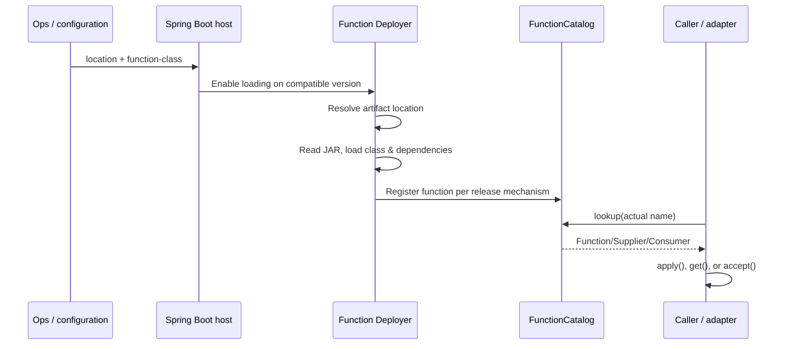

# spring.cloud.function.location and Artifact Location

## 1. Why Is the JAR Path a Crucial Part of the Function Loading Architecture?

Suppose an order system has an order ID normalization rule released by the business team as `normalize-order-id-1.0.0.jar`. The operations team does not want to bundle the rule's source code into the request-receiving application; they need to tell the **host application** where the JAR is located so the function can be loaded and invoked.

In the **Spring Cloud Function** (`SPRING_CLOUD_FUNCTION`) module, logic is organized as `Supplier<T>`, `Function<T,R>`, or `Consumer<T>`, can be looked up via `FunctionCatalog`, chained via composition, and connected to HTTP, messaging, or serverless. For **external JAR loading**, a key concept is the **`spring.cloud.function.location`** configuration: it describes **the location of the artifact containing the implementation** that the `spring-cloud-function-deployer` mechanism of supported versions needs to access.

The issue is not just spelling the filename correctly. An artifact might exist on a developer machine yet not exist inside the container; the JAR might be readable yet lack dependencies; the class might load yet not be registered under the right name in the catalog; or the catalog might have the function yet the web/broker layer is not configured to invoke it.

**Lesson scope:** explains the meaning of `spring.cloud.function.location`, how to reason about artifact location from the host's perspective, how to package/inspect an illustrative JAR, and which operational boundaries need verification. Syntax and support for Function Deployer can vary by release: the examples below use the traditional configuration model and **do not claim every current Spring Cloud Function version supports the exact same behavior**.

## 2. Which Question Does `location` Answer?

Consider four distinct pieces of information:

| Information | Question it answers | Example |
| --- | --- | --- |
| **Artifact location** | *Where* can the JAR containing the code be read? | `spring.cloud.function.location=file:///opt/functions/normalize-order-id-1.0.0.jar` |
| **Implementation class** | *Which class* in the artifact is selected as the function? | `spring.cloud.function.function-class=demo.functions.OrderIdNormalizer` in supported mechanisms. |
| **Registered function name** | *Which name* is looked up via `FunctionCatalog`? | An actual name registered by the deployer; must be verified. |
| **Trigger path** | *Who invokes* the function and through what? | Java runner, HTTP endpoint, Stream binding, or serverless handler. |

**`location` is not a function name**, not an HTTP endpoint, and not a Kafka topic name. It only specifies where to find the **artifact** for the code loading step in the corresponding Function Deployer configuration.

Example:

```properties
spring.cloud.function.location=file:///opt/functions/normalize-order-id-1.0.0.jar
spring.cloud.function.function-class=demo.functions.OrderIdNormalizer
```

These two lines are interpreted as: the host needs to read the JAR at an accessible location and locate a specific Java class within the loading mechanism supported by the version. Under **which name** the function is registered and over **which protocol** it is exposed are separate steps.

A name like `normalizeOrderId` in adapter configuration is only valid when the catalog **actually contains** that definition. You should not infer the lookup name from the JAR filename or the class name.

## 3. Artifact Location Is Always Viewed from the Executing Process

Consider three environments:

| Host runtime environment | Where is the artifact placed? | Illustrative `location` value |
| --- | --- | --- |
| Linux VM or physical machine | `/opt/functions/normalize-order-id-1.0.0.jar` on the same host machine. | `file:///opt/functions/normalize-order-id-1.0.0.jar` |
| Docker container | `/opt/functions/normalize-order-id-1.0.0.jar` **inside the container**. | `file:///opt/functions/normalize-order-id-1.0.0.jar` |
| Windows JVM | `C:\functions\normalize-order-id-1.0.0.jar` on the machine running the JVM. | `file:///C:/functions/normalize-order-id-1.0.0.jar` |

In the examples, `file:` denotes a **file URI** rather than an HTTP path. URIs use forward slashes `/`, even in the Windows example. Paths with spaces or special characters must be represented as valid URIs (percent-encoded when needed), not concatenated arbitrarily.

A common mistake:

```text
Developer machine:
  C:\Users\developer\Downloads\normalize-order-id-1.0.0.jar

Container running host:
  /opt/functions/normalize-order-id-1.0.0.jar

If the configuration inside the container still points to C:\Users\...,
the host cannot see the file just because it exists on the laptop.
```

**Rule:** always answer the question "Where is the host application's JVM currently running, and which filesystem/mounts/network does it see?" before setting `location`.

### 3.1. Relative or absolute paths?

Java/Spring resource-reading mechanisms may resolve relative paths under different rules. Do not assume `./plugins/my.jar` resolves from the directory containing the host JAR; the process's working directory can differ. When using an **absolute file URI** for JAR loading examples, the location is usually explicit and easier to verify.

```yaml
spring:
  cloud:
    function:
      location: "file:///opt/functions/normalize-order-id-1.0.0.jar"
```

If a relative path is needed, use it only when the **specific deployer version** supports it and you have clearly determined which directory it resolves relative to. The working directory can change when running in an IDE, service manager, Docker, or Kubernetes, causing a seemingly valid path to fail at deployment time.

### 3.2. Can HTTP, Maven repository, or S3 URIs be used?

**Do not assume every scheme is supported just because the property is named `location`.** Support for reading `file:`, `http:`, `https:`, artifact repositories, or other locator types depends on the implementation, classloader, resolver, and version of `spring-cloud-function-deployer`.

In this lesson, **`file:///...` is the baseline example**. If you need artifacts from a Maven repo/HTTP/object storage, use your deployment pipeline to **download or mount the artifact to a controlled path**, or choose a remote URI only when the documentation for your exact release confirms support. The fact that Spring generally has a `Resource` abstraction does not mean the deployer supports loading JARs from every `Resource` type.

## 4. Lifecycle from URI to Function Invocation



There are **five independent checkpoints**:

1. **Artifact exists:** the host finds and has read permissions for `location`.
2. **Valid format:** the artifact contains classes in the right structure compatible with how the deployer reads it.
3. **Code loads:** class, Java runtime, dependencies, and constructor/instantiation are compatible.
4. **Function registers:** the catalog has a name/definition for callers to look up.
5. **Trigger works:** Java code or an adapter actually invokes the function and handles results/errors per protocol.

Passing checkpoint 1 does not prove checkpoint 3; passing checkpoint 4 does not prove the HTTP/Stream adapter is working. Layering diagnostics prevents fixing the wrong component.

## 5. Creating an Illustrative JAR Containing a Pure Java Function

A simple, self-contained, easy-to-load Java class is `Function<String,String>`. File `src/main/java/demo/functions/OrderIdNormalizer.java` in the **function project**:

```java
package demo.functions;

import java.util.Locale;
import java.util.Objects;
import java.util.function.Function;

public final class OrderIdNormalizer
        implements Function<String, String> {

    public OrderIdNormalizer() {
        // Public no-arg constructor to illustrate class loading.
    }

    @Override
    public String apply(String input) {
        Objects.requireNonNull(input, "orderId");
        String normalized = input.strip()
                .toUpperCase(Locale.ROOT);
        if (normalized.isEmpty()) {
            throw new IllegalArgumentException(
                    "orderId must not be blank");
        }
        return normalized;
    }
}
```

This function contains no HTTP headers, Kafka consumer records, AWS SDK calls, or Spring bean logic. When a Java caller invokes it:

```java
Function<String, String> fn = new OrderIdNormalizer();
String output = fn.apply("  od-204 ");
// output = "OD-204"
```

The function can be tested immediately before building the artifact, separating input-handling bugs from JAR-loading bugs. Example using JUnit Jupiter:

```java
package demo.functions;

import static org.junit.jupiter.api.Assertions.assertEquals;
import static org.junit.jupiter.api.Assertions.assertThrows;
import org.junit.jupiter.api.Test;

class OrderIdNormalizerTest {
    private final OrderIdNormalizer fn =
            new OrderIdNormalizer();

    @Test
    void normalizes() {
        assertEquals("OD-204", fn.apply("  od-204 "));
    }

    @Test
    void rejectsBlank() {
        assertThrows(IllegalArgumentException.class,
                () -> fn.apply("   "));
    }
}
```

Running tests requires declaring the JUnit Jupiter dependency and appropriate build/test configuration. In this lesson, build commands are for learners to practice; do not assume the artifact has already been built at any real path.

## 6. Packaging the Right Artifact Type

Minimal illustrative `pom.xml` producing a **library JAR** containing the function class:

```xml
<?xml version="1.0" encoding="UTF-8"?>
<project xmlns="http://maven.apache.org/POM/4.0.0"
         xmlns:xsi="http://www.w3.org/2001/XMLSchema-instance"
         xsi:schemaLocation="http://maven.apache.org/POM/4.0.0 https://maven.apache.org/xsd/maven-4.0.0.xsd">
    <modelVersion>4.0.0</modelVersion>
    <groupId>demo.functions</groupId>
    <artifactId>normalize-order-id</artifactId>
    <version>1.0.0</version>
    <properties>
        <maven.compiler.release>17</maven.compiler.release>
        <project.build.sourceEncoding>UTF-8</project.build.sourceEncoding>
    </properties>
</project>
```

Illustrative commands:

```bash
mvn package
jar tf target/normalize-order-id-1.0.0.jar
```

The `jar tf` output should contain the class:

```text
demo/functions/OrderIdNormalizer.class
```

**A library JAR differs from an executable Spring Boot JAR.** Library JARs usually hold classes directly under package directories in the archive; Spring Boot executable JARs may contain `BOOT-INF/classes` and nested JARs in `BOOT-INF/lib`. Do not assume the deployer can load an executable JAR as a function library, or automatically resolve all nested dependencies.

| Artifact check | Why does it matter? |
| --- | --- |
| Correct version `1.0.0` | Prevents the host from loading the wrong old/new version. |
| Contains exact class `demo.functions.OrderIdNormalizer` | `function-class` must point to an existing class. |
| Compiled for a Java level the host can run | Avoids `UnsupportedClassVersionError`. |
| Required dependencies are accessible | Avoids `NoClassDefFoundError` or conflicts. |
| JAR structure matches the loader | Avoids class-not-found errors due to archive layout. |
| Artifact has clear provenance and checksum | Reduces risk of unintended tampering. |

If the function uses an SDK or another business library, clearly establish how accompanying dependencies are loaded **on the chosen deployer version**, instead of assuming pointing to a single JAR is enough.

## 7. Host Application and `spring.cloud.function.location` Configuration

Example host running Spring Boot with a Spring Cloud Function release line **that still supports the deployer module**:

```xml
<dependency>
    <groupId>org.springframework.cloud</groupId>
    <artifactId>spring-cloud-function-deployer</artifactId>
</dependency>
```

Choose a compatible Spring Boot and Spring Cloud BOM to manage versions; do not copy independent versions from guides targeting different releases.

Example entry point:

```java
package demo.host;

import org.springframework.boot.SpringApplication;
import org.springframework.boot.autoconfigure.SpringBootApplication;

@SpringBootApplication
public class FunctionHostApplication {
    public static void main(String[] args) {
        SpringApplication.run(FunctionHostApplication.class, args);
    }
}
```

In the traditional configuration supported by compatible versions:

```yaml
spring:
  cloud:
    function:
      location: "file:///opt/functions/normalize-order-id-1.0.0.jar"
      function-class: "demo.functions.OrderIdNormalizer"
```

Conceptually equivalent when expressed in `application.properties`:

```properties
spring.cloud.function.location=file:///opt/functions/normalize-order-id-1.0.0.jar
spring.cloud.function.function-class=demo.functions.OrderIdNormalizer
```

**The values above are conditional illustrative examples.** Before practicing, verify the `spring-cloud-function-deployer` module, property names, URI resolution support, class instantiation requirements, and function naming behavior on your specific release. Do not claim this property is a universal JAR loading mechanism for every application that merely uses Spring Cloud Function context.

`spring.cloud.function.location` indicates **where the bytecode lives**. `spring.cloud.function.function-class`, when supported, helps select the **implementation class**. `spring.cloud.function.definition` is a different concept: it selects a **registered function/pipeline** for the appropriate adapter, and does not download JARs on its own.

A host without a web adapter may load a function successfully yet expose no HTTP endpoint. A host without a Stream binder may load a function successfully yet receive zero Kafka messages. Install the right adapters separately for your operational needs.

## 8. Parameterizing `location` by Environment

Hardcoding `/opt/functions/...` may be fine during local experimentation, but applications released across environments need to know **which artifact was approved and where it is placed**.

### 8.1. Passing location via environment variables

Spring Boot supports mapping properties via standard *relaxed binding* rules. Example of changing the location at application startup via environment variables:

```bash
export SPRING_CLOUD_FUNCTION_LOCATION="file:///opt/functions/normalize-order-id-1.0.0.jar"
export SPRING_CLOUD_FUNCTION_FUNCTION_CLASS="demo.functions.OrderIdNormalizer"
java -jar function-host.jar
```

These two variables correspond to the property names `spring.cloud.function.location` and `spring.cloud.function.function-class` in standard Spring Boot configuration; whether the deployer uses them also depends on the **release**. Never turn a client-supplied URI into host configuration: that grants control over which code gets executed.

In Windows PowerShell, setting environment variables for the current process can be written as:

```powershell
$env:SPRING_CLOUD_FUNCTION_LOCATION = "file:///C:/functions/normalize-order-id-1.0.0.jar"
$env:SPRING_CLOUD_FUNCTION_FUNCTION_CLASS = "demo.functions.OrderIdNormalizer"
java -jar function-host.jar
```

The Windows value is valid only when the host JVM runs on Windows and the file actually exists on drive `C:`. A JVM inside a Linux Docker container on a Windows machine **does not use** `C:` drive paths inside the container.

### 8.2. Profile-based configuration

The host can use separate configurations for development and staging. Example:

```yaml
# application-dev.yml
spring:
  cloud:
    function:
      location: "file:///home/dev/functions/normalize-order-id-1.0.0.jar"
      function-class: "demo.functions.OrderIdNormalizer"
```

```yaml
# application-prod.yml
spring:
  cloud:
    function:
      location: "file:///opt/functions/normalize-order-id-1.0.0.jar"
      function-class: "demo.functions.OrderIdNormalizer"
```

These are **two examples for two profiles**, not two configurations to activate simultaneously. Filenames, paths, and artifact versions must be managed consistently by the release team; do not rely on matching filenames alone to conclude two environments run the same bytecode.

### 8.3. What should be included in startup logs?

When the host loads a function, it can log operational metadata **containing no secrets**: the vetted artifact URI or path, version, checksum, class name, actual function name, and initialization check results. Do not log credentials inside URIs (if a remote mechanism uses them) or sensitive data.

A log saying "File exists" is not enough; also observe whether the function is registered and executes successfully on test input.

## 9. Docker: Paths Inside the Image and Volume Mounts

When the host runs in a container, there are two common strategies:

1. **Copy the JAR into the host image at build time:** the artifact is part of the image, aiding reproducibility and rollback via image digest.
2. **Mount the JAR from a volume:** the artifact is managed separately from the image; you must ensure the volume/mount exists on **every replica** with consistent read permissions.

### 9.1. Example packaging the artifact into the image

The illustrative Dockerfile assumes `function-host.jar` and `normalize-order-id-1.0.0.jar` already exist in the build context:

```dockerfile
FROM eclipse-temurin:17-jre
WORKDIR /app
COPY function-host.jar /app/function-host.jar
COPY normalize-order-id-1.0.0.jar /opt/functions/normalize-order-id-1.0.0.jar
ENV SPRING_CLOUD_FUNCTION_LOCATION=file:///opt/functions/normalize-order-id-1.0.0.jar
ENV SPRING_CLOUD_FUNCTION_FUNCTION_CLASS=demo.functions.OrderIdNormalizer
ENTRYPOINT ["java", "-jar", "/app/function-host.jar"]
```

This is a **packaging example**, not validation of a specific deployer version. Directory and file permissions must match the container user; `COPY` does not automatically fix Java/classloader compatibility issues.

### 9.2. Example mounting the JAR at runtime

Instead of copying the JAR into the image, you can mount a directory that already holds the artifact:

```bash
docker run --rm \
  -v /srv/functions:/opt/functions:ro \
  -e SPRING_CLOUD_FUNCTION_LOCATION=file:///opt/functions/normalize-order-id-1.0.0.jar \
  -e SPRING_CLOUD_FUNCTION_FUNCTION_CLASS=demo.functions.OrderIdNormalizer \
  function-host:demo
```

The command above illustrates a Linux host with `/srv/functions`; the image `function-host:demo` must actually exist from a separate build step. `:ro` mounts in read-only mode, reducing the risk of accidentally modifying the artifact inside the container. On other environments, Docker mount syntax and host paths may need adjustment.

A classic mistake: the command mounts the right directory, yet the actual artifact is named `normalize-order-id-1.1.0.jar` while `location` points to `1.0.0`. The host will fail to read the file or continue running a different version than expected; the solution is to verify **name, version, checksum, and actual location**, not just the volume.

## 10. Kubernetes: Same Path Across Every Replica

When running multiple Pods, every Pod must see a **compatible, approved** artifact at its configured path. You can use an image containing the artifact, a volume, an init container, or another release workflow suited to your environment.

Conceptual example using a pre-populated volume:

```yaml
apiVersion: apps/v1
kind: Deployment
metadata:
  name: function-host
spec:
  replicas: 2
  selector:
    matchLabels:
      app: function-host
  template:
    metadata:
      labels:
        app: function-host
    spec:
      containers:
        - name: app
          image: example/function-host:1.0.0
          env:
            - name: SPRING_CLOUD_FUNCTION_LOCATION
              value: "file:///opt/functions/normalize-order-id-1.0.0.jar"
            - name: SPRING_CLOUD_FUNCTION_FUNCTION_CLASS
              value: "demo.functions.OrderIdNormalizer"
          volumeMounts:
            - name: function-artifacts
              mountPath: /opt/functions
              readOnly: true
      volumes:
        - name: function-artifacts
          persistentVolumeClaim:
            claimName: function-artifacts-pvc
```

This manifest **assumes the PVC already exists, contains the JAR at the right path, and has an access mode compatible with two replicas**. It is not a self-contained production deployment example and does not guarantee every storage class allows multiple Pods to mount the same volume.

If reproducible deployments are required, packaging the artifact into an **immutable image** usually makes version verification easier than using a mutable JAR file on a shared volume. If using a PVC/init container, ensure **checksums, read permissions, readiness, and rollouts** are properly designed.

**Avoid overwriting an in-use artifact and expecting the host to swap bytecode automatically:** JAR loading is not automatically hot reload. Upgrading versions usually requires a controlled rollout/restart cycle unless your release has a verified safe function replacement mechanism.

## 11. Reading the JAR Does Not Mean Loading the Class Succeeds

For example, `location` points to an existing JAR, yet `function-class` is `demo.functions.NormalizeOrderId` while the archive contains `demo.functions.OrderIdNormalizer`. The deployer cannot infer this as a valid alias.

Further issues can appear:

| Stage | Failure symptom | Typical cause |
| --- | --- | --- |
| Resolving `location` | File not found/unreadable. | Wrong mount, wrong permissions, wrong URI, or path belongs to another machine. |
| Reading archive | Corrupt JAR/unsuitable format. | Damaged file, wrong artifact, or archive layout unsupported by loader. |
| Loading class | `ClassNotFoundException`. | Wrong `function-class` or class not inside archive. |
| Linking dependencies | `NoClassDefFoundError` / `NoSuchMethodError`. | Missing library or version conflict. |
| Instantiating function | Constructor/initialization error. | Class incompatible with deployer mechanism or dependency initialization fails. |
| Registration | Lookup returns `null`. | Not registered, different name than expected, or mismatched definition config. |
| Calling `apply()` | Data type or business error. | Wrong input type, bad converter, validation failure. |

### 11.1. Classloaders and DTO identity

With `Function<String,String>`, the example only uses JDK types so it stays simple. When moving to custom types:

```java
record OrderRequest(String orderId, long amountVnd) {}
record OrderDecision(String orderId, boolean approved) {}

Function<OrderRequest, OrderDecision>
```

the host and JAR must agree on how shared types are viewed. In Java, **the same package/class name loaded by two incompatible classloaders can be two distinct types**. This causes `ClassCastException` or mapping errors even when both the artifact and class name are right.

You need a versioned Java/API contract and compatible dependency resolution at the loader boundary, or have the adapter convert from an intermediate payload into the type the function actually expects. `spring.cloud.function.location` does not automatically solve class identity issues.

### 11.2. JDK and artifact dependencies

If the function JAR was compiled for Java 21 while the host runs Java 17, the JVM may throw `UnsupportedClassVersionError`. If the JAR references a library not provided in a way the loader supports, you may see `NoClassDefFoundError`. If a library has the same class names but a different binary API, you may hit `NoSuchMethodError` or `LinkageError`.

Thus, **location** is only one prerequisite for successful loading. Choosing the right **artifact/version/runtime** completes the full check.

## 12. From Artifact to FunctionCatalog: Verifying the Registered Name

After the deployer loads the implementation, callers inside the host can look it up via `FunctionCatalog`. The lookup name must come from **actual registration**, not guesses from the path:

```java
package demo.host;

import java.util.function.Function;
import org.springframework.beans.factory.annotation.Value;
import org.springframework.boot.ApplicationRunner;
import org.springframework.cloud.function.context.FunctionCatalog;
import org.springframework.context.annotation.Bean;
import org.springframework.context.annotation.Configuration;

@Configuration
public class FunctionLookupCheck {
    @Bean
    ApplicationRunner verifyFunction(
            FunctionCatalog catalog,
            @Value("${demo.function.lookup-name}") String lookupName) {
        return args -> {
            Function<String, String> fn =
                    catalog.lookup(lookupName);
            if (fn == null) {
                throw new IllegalStateException(
                        "Function is missing: " + lookupName);
            }
            String value = fn.apply("  od-204 ");
            System.out.println("Function output = " + value);
        };
    }
}
```

In the example, `demo.function.lookup-name` is a property **defined by the host application itself**, not a deployer property. Its value must be determined from the registered function name. If the running version registers under `orderIdNormalizer`, you can configure:

```yaml
demo:
  function:
    lookup-name: orderIdNormalizer
```

However, there is no guarantee this name applies to every release. If lookup returns `null`, inspect framework logs/registrations and adjust the name rather than randomly changing `location`.

The runner snippet above acts as a **startup smoke test**. In production, whether to run this check on every startup depends on operational requirements; if used, it should fail clearly so readiness probes do not mark a host missing its function as ready to serve.

## 13. `location` Does Not Replace HTTP, Stream, or Serverless Adapters

Once the JAR is loaded and the function is found, **how it is invoked** still depends on the adapter:

| Entry point type | Required components | Outside the scope of `location` |
| --- | --- | --- |
| Java runner/service | `FunctionCatalog` or callable bean inside host. | Does not schedule runs or generate calls on its own. |
| HTTP | Spring Cloud Function Web adapter or controller, port/route, converter. | Does not create HTTP endpoints automatically. |
| Messaging | Spring Cloud Stream, binder, function definition, and bindings/destinations. | Does not register Kafka consumers or topics automatically. |
| Serverless | Handler/runtime adapter, deployment, triggers, IAM, and event conversion. | Does not deploy AWS Lambda or cloud functions automatically. |

For example, if the **actual function name** in the catalog is `orderIdNormalizer` and the host has an appropriate Stream binder:

```yaml
spring:
  cloud:
    function:
      definition: orderIdNormalizer
    stream:
      bindings:
        orderIdNormalizer-in-0:
          destination: raw-order-ids
          group: normalizer
          content-type: text/plain
        orderIdNormalizer-out-0:
          destination: normalized-order-ids
          content-type: text/plain
```

This is an **illustrative Stream configuration for a confirmed name**, not a claim that the deployer automatically registers `orderIdNormalizer`. It also requires a binder, broker, and real connection settings. `spring.cloud.function.definition` selects which function the adapter binds to; it **does not replace `spring.cloud.function.location`** at the artifact-loading step.

Similarly, if a supported web adapter exposes an endpoint by function name, an HTTP request still passes through a body converter before calling `apply()`. With `Function<String,String>`, confirm the right content type and payload format; not every JSON object converts into a `String` the way a sender expects.

When running in serverless, you must also decode the event envelope (e.g., API Gateway body or SQS record) and report results/errors according to the trigger contract. The function JAR's location **does not handle** that envelope conversion.

## 14. Managing Immutable Artifacts, Versions, and Rollbacks

A `location` pointing only to `/opt/functions/normalize-order-id.jar` gives little visibility into the **exact bytecode**. When a file with the same name is overwritten, it becomes hard to tell which version a replica started with and whether all replicas run the same rule.

Apply these principles:

1. **Clear names/versions:** `normalize-order-id-1.0.0.jar`, `normalize-order-id-1.1.0.jar` instead of overwriting `latest.jar` while the system is running.
2. **Controlled release source:** artifact repository, build pipeline, and approval roles/processes.
3. **Checksums or signatures:** verify the mounted/copied artifact matches the approved build; store SHA-256 hashes in release manifests.
4. **Ship configuration and artifact together:** change `location`, image, or mount in a tracked deployment with rollback capability.
5. **Do not rely on implicit hot reload:** once classes are loaded, replacing a file on disk does not automatically replace running code.
6. **Canary/rolling rollouts:** observe loading errors, latency, memory, and outputs/side effects before shifting all traffic.

Example releasing two versions via two explicit URIs:

```text
file:///opt/functions/normalize-order-id-1.0.0.jar
file:///opt/functions/normalize-order-id-1.1.0.jar
```

If the normalization formula changes between two versions, keeping the same `Function<String,String>` signature **is not enough to prove business compatibility**. Callers may depend on the old semantics. Therefore, manage **contract versions** alongside artifact versions.

## 15. Security at the `location` Boundary

A JAR loaded into the JVM is **executable code**, not merely data. If an attacker controls `spring.cloud.function.location` or can replace the file at that path, they can influence what code the host loads under supported mechanisms.

Required safeguards:

- **Never accept `location` from untrusted input** such as HTTP requests or messages and feed it directly into loading configuration.
- **Load only vetted artifacts** with versioning, provenance, and checksums/signatures per release policy.
- **Prefer read-only mounts** or immutable images; restrict write access to the function JAR directory.
- **Limit host permissions** for filesystem, network, databases, and secrets; code inside the JAR can leverage the process's permissions.
- **Do not treat a classloader as a sandbox.** If untrusted code must run, consider process/container isolation with an API contract.
- **Expose only permitted functions** via web/Stream adapters; a consumer with side effects should not be triggerable merely because it exists in the catalog.
- **Avoid placing credentials in URIs/logs or inside JARs**; use infrastructure secret management mechanisms.

Scan dependencies for vulnerabilities, retain SBOMs if required by policy, and ensure you can restore a clean artifact when an incident occurs.

## 16. Diagnosing Failures Layer by Layer

| Symptom | Check first | Do not do |
| --- | --- | --- |
| Host cannot see the JAR | URI, mount, host filesystem, read permissions. | Randomly guess function names in the catalog. |
| File exists but class fails to load | `jar tf`, `function-class`, archive layout. | Only edit the HTTP endpoint. |
| Class loads but `NoClassDefFoundError` occurs | Dependencies visible to loader, versions, and classloader. | Assume a valid location is enough. |
| `UnsupportedClassVersionError` | Java release used to build the JAR vs. host JRE. | Change the URI without changing bytecode/JRE. |
| Function loaded but `lookup(...)` returns `null` | Function registration, actual name, configuration. | Infer the lookup name from the filename. |
| Lookup succeeds but HTTP returns 404/415 | Adapter, route, content type. | Blame the file URI. |
| Stream neither consumes nor produces messages | Definition, binding, binder, broker, group. | Change function-class without evidence. |
| After rollout, old logic still runs | Image/volume, checksum, Pod/host restart, artifact version. | Expect the JVM to reload classes when a file changes. |
| `ClassCastException` with custom DTOs | Class identity, shared API, converter. | Only check whether the file exists. |

A practical diagnostic sequence follows this order:

```text
[1] Does the host read the right location?
    |
    v
[2] Is the JAR the right version and does the class exist?
    |
    v
[3] Can the loader instantiate the class and dependencies?
    |
    v
[4] Which name does the catalog register, and does lookup return the function?
    |
    v
[5] Does apply/get/accept run properly inside the host?
    |
    v
[6] Does the HTTP/Stream/serverless adapter receive and return the right data?
```

Do not confuse **file-opening errors**, **class-initialization errors**, **registry errors**, and **transport errors**: they require completely different fixes.

## 17. Testing from Artifact to Runtime

### 17.1. Unit testing the logic

Test `new OrderIdNormalizer().apply(...)` with normal, blank, null, and Unicode cases matching the contract. Unit tests do not require Spring and do not prove the JAR can be loaded via the deployer.

### 17.2. Artifact tests

Verify the JAR has the right version and `OrderIdNormalizer.class` is at the expected path; confirm Java version, dependencies, and checksum. In a build pipeline, this runs before publishing the artifact to a host environment.

### 17.3. Integration tests with Function Deployer

Use a supported release and a real `location` readable by the host. Start the host, inspect loading logs, identify the registered name, call `FunctionCatalog.lookup(...)`, and run `apply("  od-204 ")` to confirm output `OD-204`.

Test negative cases:

| Test case | Behavior to verify |
| --- | --- |
| Missing JAR | Host reports a clear error instead of silently running with a missing function. |
| Wrong `function-class` | Diagnosable class-loading error. |
| Wrong read permissions | Error at the artifact-access step. |
| Missing dependency | Class-linking error caught before opening traffic. |
| Wrong lookup name | Catalog does not return the function and does not invoke another function by mistake. |
| Changing artifact version | Rollout/restart actually executes the expected bytecode. |

### 17.4. Adapter/contract tests

If using a web adapter, test HTTP methods, paths, content types, payloads, responses, and error mappings. If using Stream, test destinations, converters, retries, groups, and outputs. If using serverless, verify the event envelope, handler, and failure semantics per runtime. These are **protocol tests**, distinct from `location` tests.

## 18. When Should You Use `location` Instead of a Classpath Dependency?

| Need | Usually appropriate direction |
| --- | --- |
| Function and host always build/deploy together in the same version | `@Bean Function` or a normal Maven dependency. |
| Host needs separately released implementations at an ops-configured path | Consider Function Deployer and `spring.cloud.function.location` if supported by the release. |
| Multiple services need independent process-level deployments | Use provider/caller over HTTP or messaging; deployer is not required. |
| Deploying a function to AWS Lambda | Choose Lambda runtime adapter and packaging; `location` does not create triggers. |
| Running untrusted third-party code | Do not treat JAR loading as a sandbox; consider process isolation. |
| Zero-downtime hot swap needed | Use only if explicitly supported and tested by the release; do not infer from `location`. |

Once the host has loaded the JAR, `FunctionCatalog` enables lookup by name and composition among registered functions. Still, reusability over HTTP, events, or serverless depends on separate adapters and data contracts. This separation of responsibilities is core to the function model.

## 19. Hands-On Exercise

Conduct an experiment with **one function-containing JAR** and **one Spring Boot host**:

1. Create `OrderIdNormalizer implements Function<String,String>`; write unit tests for `"  od-204 "`, blank input, and null.
2. Build library JAR version `1.0.0`, inspect `jar tf`, and record the artifact checksum.
3. Choose a Spring Cloud Function version **that supports the deployer**; configure `location` pointing to an absolute file URI along with `function-class`.
4. Start the host; confirm the artifact is readable, the class loads, and a name is registered in `FunctionCatalog`.
5. Call the function from a host runner to verify output `OD-204`.
6. Change `location` to a non-existent URI to observe the error; restore the valid file.
7. If using Docker, mount/copy the artifact into `/opt/functions` and repeat. Explain why a path on your laptop cannot be used directly inside the container.
8. Release `1.1.0`, point to the new artifact location, and perform a rollout/restart per your verified mechanism. Compare checksums and results between the two versions.
9. If you installed a Web or Stream adapter, configure the function name **actually registered by the catalog** and run contract tests over that protocol.

**Completion criteria:** distinguish between "file missing", "class failed to load", "catalog did not find function", and "adapter failed to process payload"; explain that `location` points to the **artifact in the host's runtime environment**, not by default to a path on the developer's machine.

## 20. Conclusion

**`spring.cloud.function.location` locates the artifact so Spring Cloud Function Deployer's JAR loading mechanism can access an external implementation in supported releases.** The property value must be interpreted from the filesystem/URI visible to the **host** JVM. It differs from `function-class` used to choose the class, the registered name used by `FunctionCatalog.lookup(...)`, and `spring.cloud.function.definition` used to select the function/pipeline for an adapter.

To use it safely, control **the right JAR, right Java/dependencies, right mount/path, right registered name, right adapter, and right operational policy**. The file existing does not mean the function is ready; loading the function does not mean HTTP, messaging, or serverless is automatically configured.

An effective model is to **release `Supplier`/`Function`/`Consumer` logic as clearly versioned artifacts, load them through a release-supported mechanism, verify via `FunctionCatalog`, and only then wire them to the desired invocation channel**. That keeps business logic reusable while keeping artifact locations, data contracts, and operational responsibilities transparent.
