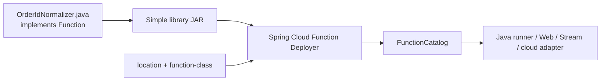
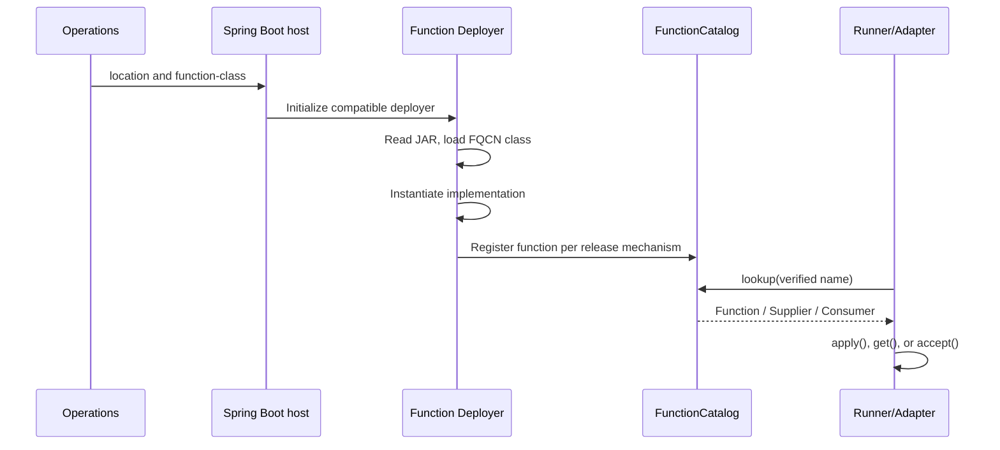

# Loading a Simple JAR Using spring.cloud.function.function-class

## 1. Goal: Loading a Java Function Class from a Non-Spring-Boot JAR

An order management service team wants to normalize order IDs from multiple channels. The business team only releases **a small library JAR containing the Java class that implements the rule**, while the operations team maintains a Spring Boot host capable of receiving HTTP requests or events. When the normalization rule changes, the goal is to release a separate artifact instead of copying business conditionals into controllers, Kafka listeners, or cloud handlers.

In **Spring Cloud Function** (`SPRING_CLOUD_FUNCTION`), logic is expressed as `Supplier<T>`, `Function<T,R>`, and `Consumer<T>`. `FunctionCatalog` supports looking up registered functions; composition chains compatible steps; adapters connect HTTP, messaging, or serverless. In the **JAR Loading** chapter, function code can reside outside the host application's initial classpath.

This topic focuses on **`spring.cloud.function.function-class`**: in the **Spring Cloud Function Deployer** mechanism of supported versions, this property helps specify the **function implementation class** to load from the artifact. For a *simple JAR*, the class is typically a `public class` directly implementing a Java functional interface.

**Keep distinct:** `function-class` **selects the class**, `location` specifies **where the JAR is**, `FunctionCatalog` lets you **find the registered function**, and the adapter/caller decides **when and how to invoke it**. None of these properties on its own turns a JAR into a complete HTTP service.

> **Version limitation:** `spring-cloud-function-deployer` and the properties illustrated here belong to the JAR loading mechanism of release lines that support the corresponding feature. Do not assume every current Spring Cloud Function version supports the exact same properties, URIs, instantiation behavior, and naming rules. Before applying them, verify your actual Spring Boot/Spring Cloud Function release and deployer module.

## 2. How a Simple JAR Differs from a Spring Boot Application

In this lesson, a **simple JAR** is a standard Java library JAR:

- Contains the `.class` file of a `Function`, `Supplier`, or `Consumer` implementation.
- Does not necessarily have `main()`, `@SpringBootApplication`, controllers, or its own Spring context.
- May use only the JDK; if it has external dependencies, you must ensure the loader can supply dependencies per the supported release.
- For simple class-loading examples, a public class with a no-arg constructor and no complex injection dependencies is used.
- Not identical to a **Spring Boot executable/fat JAR** using Boot's launcher and `BOOT-INF` layout.

Example artifact:

```text
normalize-order-id-1.0.0.jar
└── demo/
    └── functions/
        └── OrderIdNormalizer.class
```



The JAR → deployer arrow represents **code loading**. The catalog → caller arrow is **lookup and invocation**. When a runner invokes the function inside the host, the code executes in the **same JVM**, even though the artifact was released separately.

## 3. Distinguishing `function-class`, `location`, and `definition`

| Property | Question | Example | What it does not do on its own |
| --- | --- | --- | --- |
| `spring.cloud.function.location` | **Where** is the JAR relative to the host? | `file:///opt/functions/normalize-order-id-1.0.0.jar` | Does not select the exact class inside the JAR. |
| `spring.cloud.function.function-class` | Which **Java class** is selected to load? | `demo.functions.OrderIdNormalizer` | Does not open endpoints or set topics. |
| `spring.cloud.function.definition` | Which **registered function/pipeline** does the adapter use? | e.g., `normalizeOrderId` | Does not download JARs or fix missing-class errors. |

Example in `application.yml` following the traditional deployer model:

```yaml
spring:
  cloud:
    function:
      location: "file:///opt/functions/normalize-order-id-1.0.0.jar"
      function-class: "demo.functions.OrderIdNormalizer"
```

Expressed in `application.properties`:

```properties
spring.cloud.function.location=file:///opt/functions/normalize-order-id-1.0.0.jar
spring.cloud.function.function-class=demo.functions.OrderIdNormalizer
```

`demo.functions.OrderIdNormalizer` is the **fully qualified class name (FQCN)**, consisting of the package and class name. `normalize-order-id-1.0.0.jar` is only the filename. Meanwhile, `normalizeOrderId` is an **illustrative** catalog name; do not infer it from the filename or class name without confirming actual registration on the host version.

## 4. Writing the Implementation Class in the Right Shape

File `src/main/java/demo/functions/OrderIdNormalizer.java` in the library project:

```java
package demo.functions;

import java.util.Locale;
import java.util.Objects;
import java.util.function.Function;

public final class OrderIdNormalizer
        implements Function<String, String> {

    // Public no-arg constructor for the simple JAR example.
    public OrderIdNormalizer() {}

    @Override
    public String apply(String rawOrderId) {
        Objects.requireNonNull(rawOrderId, "rawOrderId");

        String normalized = rawOrderId.strip()
                .toUpperCase(Locale.ROOT);
        if (normalized.isEmpty()) {
            throw new IllegalArgumentException(
                    "Order ID must not be blank");
        }
        return normalized;
    }
}
```

Results:

```text
apply("  od-204 ")  -> "OD-204"
apply(" ab-01 ")   -> "AB-01"
apply("   ")       -> IllegalArgumentException
apply(null)        -> NullPointerException
```

The `Function<String,String>` signature is the standard `java.util.function` interface, not an HTTP or cloud event specification. The class uses no Spring, HTTP, broker, or serverless SDK. Thus it can be invoked in plain Java, tested independently, and wired to different adapters through the host.

### 4.1. Why use a public class and a default constructor?

A `public` class has a clear Java name to declare in `function-class`; a public no-arg constructor illustrates direct instantiation. However, how a deployer release actually instantiates the class—including whether it supports constructor injection or bean dependencies—must be verified on that release.

An implementation requiring a repository via constructor:

```java
public OrderIdNormalizer(OrderRepository repository) {
    this.repository = repository;
}
```

cannot be assumed loadable just because `spring.cloud.function.function-class` is set. Such a class needs an appropriate dependency management approach; the simple example intentionally **requires no injection**.

### 4.2. Do not choose hidden runtime classes of Java lambdas

A bean like the following can be completely appropriate **when placed inside a properly configured Spring application**:

```java
@Bean
Function<String, String> normalizeOrderId() {
    return raw -> raw.strip().toUpperCase(Locale.ROOT);
}
```

However, a Java lambda has a runtime implementation class handled by the JVM; the generated class name is not a stable API to put into `function-class`. The distinction here is **loading an implementation class that has an FQCN** versus **Spring creating a bean from a `@Bean` method**.

## 5. Plain Java Testing Before Building

File `src/test/java/demo/functions/OrderIdNormalizerTest.java`:

```java
package demo.functions;

import static org.junit.jupiter.api.Assertions.assertEquals;
import static org.junit.jupiter.api.Assertions.assertThrows;
import org.junit.jupiter.api.Test;

class OrderIdNormalizerTest {
    private final OrderIdNormalizer normalize =
            new OrderIdNormalizer();

    @Test
    void normalizesCaseAndWhitespace() {
        assertEquals("OD-204",
                normalize.apply("  od-204 "));
    }

    @Test
    void rejectsBlankInput() {
        assertThrows(IllegalArgumentException.class,
                () -> normalize.apply("   "));
    }

    @Test
    void rejectsNullInput() {
        assertThrows(NullPointerException.class,
                () -> normalize.apply(null));
    }
}
```

The POM sample in section 6 declares JUnit Jupiter and Maven Surefire to run the illustrative tests. Unit tests verify the rule; they **do not prove** the JAR is packaged properly, the loader can find the class, or `FunctionCatalog` has registered the function.

## 6. Packaging a Simple JAR with Maven

A minimal `pom.xml` for the library project:

```xml
<?xml version="1.0" encoding="UTF-8"?>
<project xmlns="http://maven.apache.org/POM/4.0.0"
         xmlns:xsi="http://www.w3.org/2001/XMLSchema-instance"
         xsi:schemaLocation="http://maven.apache.org/POM/4.0.0 https://maven.apache.org/xsd/maven-4.0.0.xsd">
    <modelVersion>4.0.0</modelVersion>
    <groupId>demo.functions</groupId>
    <artifactId>normalize-order-id</artifactId>
    <version>1.0.0</version>
    <properties>
        <maven.compiler.release>17</maven.compiler.release>
        <project.build.sourceEncoding>UTF-8</project.build.sourceEncoding>
    </properties>
    <dependencies>
        <dependency>
            <groupId>org.junit.jupiter</groupId>
            <artifactId>junit-jupiter</artifactId>
            <version>5.10.2</version>
            <scope>test</scope>
        </dependency>
    </dependencies>
    <build>
        <plugins>
            <plugin>
                <groupId>org.apache.maven.plugins</groupId>
                <artifactId>maven-compiler-plugin</artifactId>
                <version>3.13.0</version>
            </plugin>
            <plugin>
                <groupId>org.apache.maven.plugins</groupId>
                <artifactId>maven-surefire-plugin</artifactId>
                <version>3.2.5</version>
            </plugin>
        </plugins>
    </build>
</project>
```

Illustrative build and inspection steps for hands-on practice:

```bash
mvn package
jar tf target/normalize-order-id-1.0.0.jar
```

The archive must contain `demo/functions/OrderIdNormalizer.class`. If tests are included, build/test requires the appropriate JUnit dependency. This is a **library JAR**, not by default an executable Spring Boot JAR.

| Check | Simple library JAR | Common executable Spring Boot JAR |
| --- | --- | --- |
| Purpose | Provides classes for a host to load. | Runs a standalone application. |
| Where classes typically live | Package paths directly in the JAR. | `BOOT-INF/classes`. |
| Dependencies | Per classpath/loader mechanism. | May sit in nested `BOOT-INF/lib`. |
| Has `main()`? | Not needed. | Usually has an entry point. |
| Guaranteed readable by deployer? | Still must verify release/config. | Not by default; depends on loader/layout. |

**Do not assume every JAR runnable via `java -jar` is a simple JAR suitable for `function-class`.** If the code depends on external libraries, you must address both dependencies and classloaders; simply setting a class name in configuration does not supply missing dependencies.

## 7. Placing the Artifact Where the Host Can Read It

For example, the JAR file is placed on a Linux filesystem:

```text
/opt/functions/normalize-order-id-1.0.0.jar
```

Then the illustrative absolute URI is:

```text
file:///opt/functions/normalize-order-id-1.0.0.jar
```

`location` must be where **the host JVM sees the file**, not the path on the builder's laptop. Inside a container, the host only sees the container filesystem and mounted volumes.

Example mounting a read-only directory:

```bash
docker run --rm \
  -v /srv/functions:/opt/functions:ro \
  -e SPRING_CLOUD_FUNCTION_LOCATION=file:///opt/functions/normalize-order-id-1.0.0.jar \
  -e SPRING_CLOUD_FUNCTION_FUNCTION_CLASS=demo.functions.OrderIdNormalizer \
  example/function-host:demo
```

The command assumes the image is already built and `/srv/functions` contains the JAR. On Windows/other container setups, adjust paths and mount syntax. A correct filename alone is insufficient if the JVM lacks read permissions.

Do not assume every `http:`, `https:`, or Maven repository scheme is accepted by the deployer just because the property is named `location`. URI resolution capabilities depend on the release's implementation; the safest approach for practice is to **place a trusted artifact at a controlled file URI**.

## 8. Creating a Spring Boot Host with Function Deployer

The host application differs from the library JAR: it includes the Spring Boot runtime and Spring Cloud Function dependencies. In releases that still support this module, the dependency is:

```xml
<dependency>
    <groupId>org.springframework.cloud</groupId>
    <artifactId>spring-cloud-function-deployer</artifactId>
</dependency>
```

Select a compatible Spring Boot and Spring Cloud BOM; do not mix arbitrary versions from guides targeting different releases.

Example entry point:

```java
package demo.host;

import org.springframework.boot.SpringApplication;
import org.springframework.boot.autoconfigure.SpringBootApplication;

@SpringBootApplication
public class FunctionHostApplication {
    public static void main(String[] args) {
        SpringApplication.run(FunctionHostApplication.class, args);
    }
}
```

Illustrative `application.yml` for a host running **without a web server**:

```yaml
spring:
  main:
    web-application-type: none
  cloud:
    function:
      location: "file:///opt/functions/normalize-order-id-1.0.0.jar"
      function-class: "demo.functions.OrderIdNormalizer"
```

`spring.main.web-application-type: none` is only for the console example. To expose HTTP, you need an appropriate web adapter/runtime and must remove this setting that disables the web server. To consume Kafka, you need Spring Cloud Stream/binder and bindings configuration. Setting `function-class` alone does not cause an endpoint or consumer to appear automatically.

To let environments change paths without modifying source code, pass them through Spring Boot environment variables:

```bash
export SPRING_CLOUD_FUNCTION_LOCATION="file:///opt/functions/normalize-order-id-1.0.0.jar"
export SPRING_CLOUD_FUNCTION_FUNCTION_CLASS="demo.functions.OrderIdNormalizer"
java -jar function-host.jar
```

How Spring Boot's binder reads properties and how the deployer uses the final values must still be verified in your chosen version. `function-class` is ops-controlled configuration; do not accept arbitrary class names from external requests.

## 9. Loading a Class Does Not Mean It Registers Under the Name You Guess

A class named `demo.functions.OrderIdNormalizer` may load successfully, yet **the function name in the catalog** must be confirmed according to how the deployer registers it. Names like `orderIdNormalizer` or `normalizeOrderId` are only illustrative suggestions, **not guaranteed naming rules** across all releases.

You can create a runner that uses a name from the host's own configuration:

```java
package demo.host;

import java.util.function.Function;
import org.springframework.beans.factory.annotation.Value;
import org.springframework.boot.ApplicationRunner;
import org.springframework.cloud.function.context.FunctionCatalog;
import org.springframework.context.annotation.Bean;
import org.springframework.context.annotation.Configuration;

@Configuration
public class LoadedFunctionSmokeTest {

    @Bean
    ApplicationRunner verifyLoaded(
            FunctionCatalog catalog,
            @Value("${demo.function.lookup-name}") String lookupName) {
        return args -> {
            Function<String, String> fn = catalog.lookup(lookupName);
            if (fn == null) {
                throw new IllegalStateException(
                        "Function not registered: " + lookupName);
            }
            String result = fn.apply("  od-204 ");
            System.out.println("Normalized ID: " + result);
        };
    }
}
```

Set in configuration **after confirming the actual registered name**:

```yaml
demo:
  function:
    lookup-name: orderIdNormalizer
```

`demo.function.lookup-name` is a **custom example property**, not a `spring-cloud-function-deployer` property. Do not try to invoke when `catalog.lookup(...)` returns `null`; inspect loading logs, catalog/definition names, and classloaders first.

## 10. Verification Diagram from FQCN to Invocation



A verification process must separate six checkpoints:

1. **The JAR exists and is readable** from the host JVM.
2. **The class with the right FQCN** is inside the archive.
3. **Dependencies and JDK are compatible**, with no classloader linkage errors.
4. **The class can be instantiated** by the deployer's supported mechanism.
5. **The function is registered** under a lookable name/definition.
6. **The caller can invoke it** with matching data types and contract.

Passing step 1 does not prove step 4; passing step 5 does not automatically enable an HTTP endpoint. Record each status clearly in the host's logs and readiness/health checks.

## 11. Choosing the Right Class Type: Supplier, Function, Consumer

The `function-class` property is used in the context of the function loading module, so do not think only of `Function<T,R>`. The three Java interfaces have different shapes:

| Interface | Method | Input / output | When used by an adapter |
| --- | --- | --- | --- |
| `Supplier<T>` | `get()` | No input; produces a value `T`. | Caller or poller decides when to pull data. |
| `Function<T,R>` | `apply(T)` | One input to one output. | HTTP request/response or Stream input/output bindings. |
| `Consumer<T>` | `accept(T)` | Receives input; returns no business result. | Typically a sink for receiving data and performing side effects. |

### 11.1. Supplier class example

```java
package demo.functions;

import java.util.function.Supplier;

public final class PolicyVersion
        implements Supplier<String> {

    public PolicyVersion() {}

    @Override
    public String get() {
        return "order-policy-v1";
    }
}
```

If the JAR contains this class and the deployer release supports loading the corresponding type, `function-class` must point to `demo.functions.PolicyVersion`. However, `Supplier` does not schedule itself. In messaging, a poller or trigger source must decide when to call `get()`; in internal Java, a runner can call it directly.

### 11.2. Consumer class example

```java
package demo.functions;

import java.util.function.Consumer;

public final class AuditDecision
        implements Consumer<String> {

    public AuditDecision() {}

    @Override
    public void accept(String decision) {
        System.out.println("AUDIT: " + decision);
    }
}
```

This is only a side-effect example illustrating the signature. In production, logging, audit storage, transactions, and idempotency must be designed per business requirements; `accept()` returning `void` does not guarantee the broker has acknowledged the message.

### 11.3. What if the JAR contains multiple function classes?

```text
demo/functions/OrderIdNormalizer.class
demo/functions/PolicyVersion.class
demo/functions/AuditDecision.class
```

When multiple classes are present, **the FQCN in `function-class` becomes even more critical**. Do not expect the deployer to guess the "right function" just from the JAR filename. How multiple functions or class lists are declared, if supported by the release, must be checked against the exact version's documentation; this exercise intentionally chooses **one simple JAR and one specific class** to avoid ambiguity.

## 12. Selecting `function-class` vs. Spring Component Scanning

In a standard Spring Boot application, a developer might declare:

```java
@Configuration
class Functions {
    @Bean
    Function<String, String> normalizeOrderId() {
        return input -> input.strip();
    }
}
```

Spring scans or imports this configuration, calls the `@Bean` method, and registers a function bean. **This is exposing beans via the Spring context**, and does not require `spring.cloud.function.function-class`.

Conversely, with a simple JAR containing `OrderIdNormalizer implements Function`, the host can use the deployer to load the implementation from an external JAR. Both models share the trait that functions can appear in `FunctionCatalog`, yet **how instances are created** and **the scope of dependency injection** differ.

Do not rely on the following assumptions:

- Simply annotating a class with `@Component` in an external JAR makes the host scan it automatically.
- Simply having `@Configuration` creates every `@Bean` in the JAR without proper importing/scanning.
- Simply setting `function-class` automatically provides all constructor dependencies.
- A bean name from `@Bean` and a class name from the deployer are guaranteed to produce the same catalog name.

If the goal is to use many Spring beans with complex lifecycles and injection, a **deliberately configured/imported Spring library** or a separate provider service may be easier to reason about than forcing everything through single simple-class loading.

## 13. Generic Types and Data Conversion

A successfully loaded function can still receive the wrong payload type at invocation time. For example, `OrderIdNormalizer` expects `String`; if an HTTP adapter sends a JSON object without an appropriate converter, converting it to `String` may not behave as intended.

In plain Java:

```java
Function<String, String> fn = new OrderIdNormalizer();
String value = fn.apply(" od-204 ");
```

No JSON or message converter is needed because the caller already has a `String`. In HTTP/Stream, the adapter may need to decode bytes/text/JSON, determine the content type, and map to the right input. Spring Cloud Function supports message conversion in integrated framework contexts, **but does not guarantee arbitrary payloads will be accepted**.

With custom DTOs:

```java
record OrderRequest(String orderId, long amountVnd) {}
record OrderDecision(String orderId, boolean approved) {}

Function<OrderRequest, OrderDecision>
```

you must account for schemas, generic type metadata, and classloader issues. Two classes with the same FQCN loaded by two incompatible classloaders can be **two different types** in the JVM; this leads to `ClassCastException` or conversion errors even when the code looks identical.

### 13.1. When should `Message` be used?

If the function needs metadata such as a correlation ID, you can design:

```java
Function<Message<OrderRequest>, Message<OrderDecision>>
```

`Message<T>` belongs to `org.springframework.messaging`, not `java.util.function`. When using this type in a JAR, you must manage dependencies and loader boundaries. If the rule only needs domain inputs, `Function<OrderRequest,OrderDecision>` is usually easier to reuse across internal Java, HTTP, messaging, and serverless.

### 13.2. Do not use raw `Function` when accurate type metadata is needed

A class implementing raw `Function` loses input/output type information important for adapters/converters. Declare full generics like `Function<String,String>`. Still, accurate metadata does not replace verifying real payloads, schema evolution, and content types at the protocol layer.

## 14. Using the Loaded Function via HTTP, Messaging, and Serverless

**Successfully loading a simple JAR does not mean the host already has an endpoint.** To expose over HTTP, you need the Spring Cloud Function Web adapter or a controller that invokes the function. Example Maven dependency in the **host application**, not the function JAR:

```xml
<dependency>
    <groupId>org.springframework.cloud</groupId>
    <artifactId>spring-cloud-starter-function-web</artifactId>
</dependency>
```

If supported by the adapter and the actual registered name is `orderIdNormalizer`, the host can expose a route under that name. An illustrative request:

```bash
curl -X POST http://localhost:8080/orderIdNormalizer \
  -H "Content-Type: text/plain" \
  --data "  od-204 "
```

The expected business result is `OD-204`. Route, HTTP method, body conversion, and status codes must be verified on the web adapter version in use. Do not claim `orderIdNormalizer` is the automatic name for every deployer.

For **Spring Cloud Stream**, the host needs a Kafka/RabbitMQ binder and a function definition present in the catalog. Example **only when the actual name is `orderIdNormalizer`**:

```yaml
spring:
  cloud:
    function:
      definition: orderIdNormalizer
    stream:
      bindings:
        orderIdNormalizer-in-0:
          destination: raw-order-ids
          group: normalize-workers
          content-type: text/plain
        orderIdNormalizer-out-0:
          destination: normalized-order-ids
          content-type: text/plain
      kafka:
        binder:
          brokers: localhost:9092
```

At runtime, the input message is processed by converters, `apply()` runs, and the output is emitted by the binder. Returning a `String` from the function does not by itself guarantee the broker persisted the message or that the downstream consumer processed it successfully.

With **serverless**, deployment requires a platform-specific adapter/handler, event source, permissions, and response contract. `function-class` used in JAR loading is not a Lambda handler or a property that replaces cloud trigger declarations. You can reuse the same Java implementation without forcing every deployment to use Function Deployer.

## 15. Error Categories When `function-class` Is Incorrect

| Symptom | Possible cause | How to diagnose |
| --- | --- | --- |
| JAR cannot be opened | Wrong `location`, missing mount/read permission, or unsupported URI. | Check path from host JVM, file permissions, and release support. |
| `ClassNotFoundException` | `function-class` has wrong FQCN or class missing from archive. | Check package/class in source and `jar tf`. |
| `NoClassDefFoundError` | Dependent class not supplied by the loader. | Check function dependencies and loading path. |
| `UnsupportedClassVersionError` | Bytecode newer than the running JRE. | Check JAR build Java release and host JRE. |
| `NoSuchMethodError` or `LinkageError` | Dependency conflict or binary incompatibility. | Inspect classloaders and library versions. |
| Instance initialization error | Constructor/dependencies incompatible with deployer mechanism. | Start with a `public` no-arg class and verify release requirements. |
| Lookup returns `null` | Registration failed or wrong catalog name queried. | Check logs/actual definitions; do not guess from FQCN. |
| `ClassCastException` | Input/DTO type mismatch or classloader identity issue. | Check generic types, shared APIs, and converters. |
| HTTP 404 despite catalog having function | Web adapter missing or wrong URL. | Check route, port, starter, and function name. |
| Kafka not running | Wrong or missing binder/binding/broker. | Check `spring.cloud.function.definition` and Stream config. |

A sound troubleshooting workflow always follows the order: **artifact → class → instance → catalog → caller/adapter**. If `function-class` has a typo, tweaking Kafka topics will not load the class. If the catalog lookup succeeds yet HTTP returns 404, randomly changing `location` is not the first step either.

## 16. Versions, Dependencies, and Classloader Boundaries

With a JDK-only simple JAR, this exercise carries minimal risk. In real projects, functions may use JSON libraries, HTTP clients, repositories, or domain modules. Then you must resolve:

1. **JDK compatibility:** a JAR built for Java 21 will not run on Java 17.
2. **Related libraries:** a thin JAR does not bundle transitive dependencies; you must ensure the loader can access them.
3. **Binary API:** do not mix incompatible library versions where methods/fields disappear.
4. **Class identity:** the same class name across two different classloaders does not guarantee safe casting.
5. **Spring lifecycle:** loaded code must initialize/close resources cleanly; do not spawn threads or schedulers expecting the host to always clean them up properly.
6. **Instance concurrency:** if the function holds mutable state, concurrent requests or messages can corrupt results.

**`function-class` only selects the class; it does not solve dependency injection, transactions, or side-effect boundaries.** If the implementation writes to a database, you must design transactions, retries, and idempotency for the trigger environment. A `Consumer` returning `void` does not prove the emitter will not resend the event.

### 16.1. Artifact versioning does not mean hot swapping

`normalize-order-id-1.0.0.jar` and `1.1.0.jar` can exist at two different paths. Changing `location` or overwriting the file while the JVM is running **does not automatically** replace already loaded bytecode. Before permitting hot reload, verify the deployer has a safe classloader/registry/in-flight management mechanism on your exact release. An operational workflow that is usually easier to control is **immutable artifacts + deliberate host rollout/restart**.

## 17. Security When Selecting a Class from an External JAR

The `function-class` property selects **executable Java code**, not data. A loaded JAR can use the host process's permissions to read files, open network connections, access secrets, or spawn threads.

Therefore:

- Allow only **trusted artifacts** to be released and loaded; verify provenance/versions/checksums where appropriate.
- Never accept `location` or `function-class` directly from untrusted requests/queue messages and apply them as configuration.
- Restrict write access to the JAR directory; use immutable images or read-only mounts where appropriate.
- Apply **least privilege** to the host: filesystem, network, IAM, and databases.
- Do not treat a classloader as a **security sandbox**. If logic comes from untrusted sources, consider process/container isolation with strict communication contracts.
- Restrict which function names are exposed over HTTP/Stream, especially `Consumer`s with side effects.
- Do not put secrets in URIs, artifacts, or logs; manage credentials via runtime tooling.

Security concerns do not vanish just because a function is written using `java.util.function.Function`. A functional interface cannot restrict the system calls an implementation can perform.

## 18. End-to-End Testing Checklist

| Stage | What to verify |
| --- | --- |
| Unit test | `OrderIdNormalizer.apply("  od-204 ")` returns `OD-204`; blank/null inputs throw expected errors. |
| Artifact | `jar tf` shows the exact class; JAR has the right version and Java bytecode. |
| Path | Host can read `file:///...` at the mounted/copied location. |
| Class selection | `function-class` uses the **exact FQCN** and the instance initializes. |
| Registration | Catalog contains the actual name; `lookup(...)` does not return null. |
| Invocation | Java input/output are correct when invoked from the runner. |
| HTTP | If Web is enabled, route, content type, body conversion, and errors match the API contract. |
| Messaging | If Stream is enabled, binding, destination, group, converter, retry, and output work properly. |
| Deployment | Every replica has the right artifact/checksum; rollout and rollback work cleanly. |

Several key negative test cases:

```text
Test 1: change function-class to demo.functions.DoesNotExist
       -> must see an appropriate class loading or registration error, not silent success.

Test 2: change location to a non-existent file
       -> must see an artifact reading error on the host.

Test 3: restore valid location, lookup using an unregistered name
       -> catalog returns null; check the actual registered name.

Test 4: Java apply() works yet HTTP returns an error
       -> diagnose adapter, route, and payload; do not blindly edit the JAR.
```

These tests verify each system boundary individually, instead of treating one successful `apply()` call as proof that the entire JAR loading and adapter integration pipeline is sound.

## 19. Exercise: Swapping Classes While Keeping the Same Host

Build a mini-project consisting of a **function library** and a **host**:

1. Create `OrderIdNormalizer implements Function<String,String>` in package `demo.functions` with a public no-arg constructor.
2. Use Maven to build simple JAR version `1.0.0` and verify `demo/functions/OrderIdNormalizer.class`.
3. Select a Spring Cloud Function release **that supports Function Deployer** and verify the `spring.cloud.function.function-class` property.
4. Place the JAR in `/opt/functions` of the host environment; configure both `location` and `function-class` with concrete values.
5. Start the host, verify the actual function name registered by the catalog, and call `apply("  od-204 ")`.
6. Intentionally misspell the FQCN to observe the failure; restore the correct class name.
7. Add a second class `PolicyVersion implements Supplier<String>` to a new JAR. Change only `function-class` to the Supplier class name and verify the registered function type; note this is a **new functional example**, not the old `Function<String,String>`.
8. When HTTP or Kafka is needed, configure the separate adapter and contract; do not mistakenly change `function-class` just to fix route/binding errors.
9. Release version `1.1.0`, update `location` to the new artifact, and roll out the host via your verified mechanism; do not rely on implicit hot swapping.

**Completion criteria:** explain the difference between **selecting a JAR**, **selecting a class in the JAR**, **registering a function in the catalog**, and **triggering the function through an adapter**; show evidence from Java output and logs that the right implementation is being invoked.

## 20. Summary

**`spring.cloud.function.function-class` specifies the Java class implementing the function in Spring Cloud Function Deployer's simple JAR loading mechanism in supported versions.** It must be combined with artifact location (`spring.cloud.function.location`), a loadable/instantiable class with an accurate FQCN, and a registration check through `FunctionCatalog`. Class name, JAR name, catalog function name, and endpoint/binding are not the same concept.

Simple JARs are useful because business code can be separated from the Spring Boot host: an independent `Supplier`, `Function`, or `Consumer` is packaged and reused. However, that does not exempt you from managing **dependencies, generic types, classloaders, security, concurrency, retries, and versioning**. To expose over HTTP, messaging, or serverless, the host/runtime also needs the corresponding adapters and data contracts.

The guiding principle is to **start with a `public` class implementing `Function<String,String>` and a thin library JAR, verify each step from artifact to catalog, and only then increase complexity in data types, dependencies, and protocols**. This approach keeps class-loading bugs separate from business bugs and transport bugs, while keeping Spring Cloud Function's core goal clear: reusable logic not tightly coupled to a single invocation protocol.
