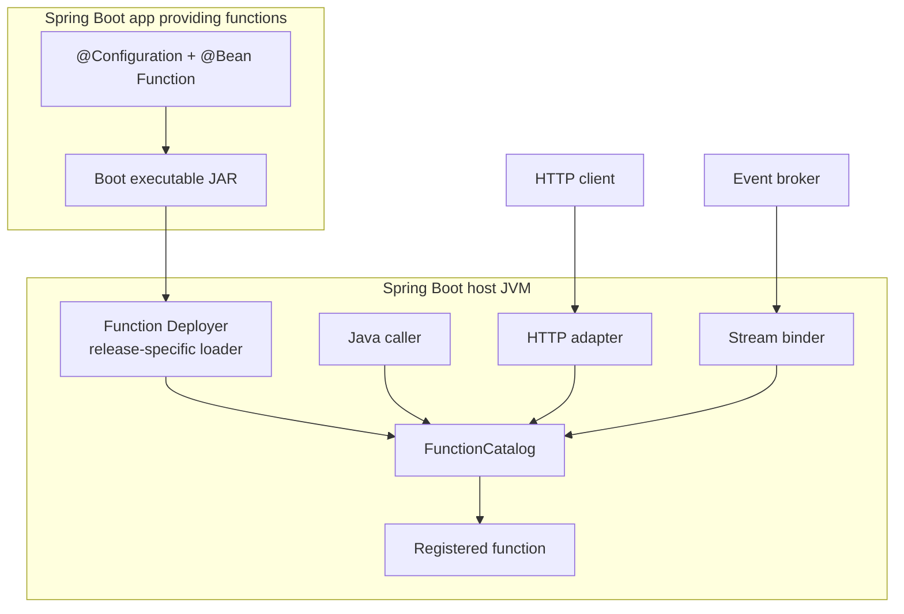

# Loading a Spring Boot JAR and Applications with Functional Beans

## 1. The Problem: Loading an Entire Application That Declares Functions, Not Just a Single Java Class

A shipping fee calculation team builds a Spring Boot application in which business logic is already declared as a `Function<ShippingRequest, ShippingQuote>` bean. The operations team wants to use this capability from another **host application**—potentially via `FunctionCatalog`, HTTP, or an event system—instead of copying the bean code into the host.

This is a form of JAR loading in **Spring Cloud Function** (`SPRING_CLOUD_FUNCTION`). The module lets you express logic via `Supplier<T>`, `Function<T,R>`, and `Consumer<T>`, look them up via `FunctionCatalog`, chain functions (*composition*), and, when adapters are present, invoke the same logic via HTTP, messaging, or serverless. What makes this lesson distinct is that **the source artifact is already a Spring Boot application with a Spring context and functional beans**, rather than just a library JAR containing a single class that `implements Function`.

Two ways of using the artifact must be distinguished immediately:

1. **Running the Boot application standalone:** started with `java -jar`. The application creates its own Spring ApplicationContext, discovers beans, and uses adapters located inside **that same application**.
2. **Loading the application JAR into a host with Function Deployer:** the host uses the `spring-cloud-function-deployer` mechanism of a **supported release line** to access the artifact, create/integrate the required context, discover functional beans, and expose function invocation within the host environment.

The two mechanisms are not equivalent. `java -jar` creates a **new application process**; Function Deployer loads code through a mechanism inside the host process, and does not automatically turn each JAR into a separate microservice.

> **Compatibility limit:** `spring-cloud-function-deployer` and loading Spring Boot executable JARs should not be assumed as default capabilities across every Spring Cloud Function version. JAR structure, APIs, and deployer properties depend on the release. Before applying illustrative configurations, verify your Spring Boot/Spring Cloud Function versions and the documentation for the exact deployer module in use.

## 2. Participating Components

| Component | Role | Points to note |
| --- | --- | --- |
| **Function-containing application** | Spring Boot application defining functional beans. | Beans have clear names and generic types. |
| **Spring Boot executable JAR** | Artifact packaging application classes, resources, and usually nested dependency JARs. | Structure differs from a simple library JAR. |
| **Host application** | A Spring Boot process with its own runtime environment; may use the deployer. | Host and function application can have different release lifecycles. |
| **Function Deployer** | Artifact loader that integrates functions from external JARs via a release-supported mechanism. | Not a cloud/container deployment tool. |
| **FunctionCatalog** | Looks up registered functions by name or definition; supports composition/appropriate wrappers. | Actual registered name must be verified. |
| **Adapter** | Triggers functions from HTTP, Stream, or serverless. | Requires separate dependencies and routes/bindings/handlers. |



The diagram is a **conceptual model**: the loading environment may use a separate context/classloader or wrapper depending on the implementation. Do not assume every bean in the source application is imported as a directly injectable bean in the host's parent context. What must be proven is that **the target function is brought into the lookup/invocation mechanism supported by the release**.

## 3. Comparison with Loading a Simple JAR via function-class

| Aspect | Simple JAR with a Function class | Spring Boot JAR with functional beans |
| --- | --- | --- |
| Source code | A `public` class that `implements Function`. | `@SpringBootApplication`, `@Configuration`, and `@Bean` (or supported bean registration). |
| Artifact format | Library JAR; classes usually at root package path. | Executable JAR, usually with `BOOT-INF/classes` and `BOOT-INF/lib`. |
| How the function is identified | Deployer mechanism may use `function-class` pointing to FQCN. | Requires discovering functional beans in the loaded application's application context. |
| Dependencies | Per the JAR's classloader and library provisioning. | May be packaged as nested dependencies; loader must understand the layout. |
| Application entry point | No `main()` required. | Usually has `main()` for standalone execution. |
| Basic testing | Call `new FunctionClass().apply(...)`. | Spring context test to verify bean + catalog; plus domain unit tests. |
| Typical risks | Wrong FQCN, constructor, or missing dependency. | Incompatible Boot JAR layout, bean discovery, context, or classloader/dependencies. |

**Do not use `function-class` to guess the name of a `@Bean` method.** Those are two different abstractions: one selects an **implementation class**, while the other registers a **Spring-created function instance**. Deployer mechanisms that support loading Spring Boot applications can discover beans without specifying a separate implementation class, though this must be verified on the exact release.

## 4. Building a Boot Application with a Function Bean

We use a shipping fee calculation rule:

- Order ID must have a value.
- Region `INNER` has a base fee of 20,000 VND; `OUTER` has a fee of 40,000 VND.
- Orders of 500,000 VND or more receive free shipping.
- Invalid data must be explicitly rejected; do not fall back to a default region.

The example uses **Java 17 or higher**, with the following Java files.

### 4.1. Request and result types

```java
// src/main/java/demo/shipping/ShippingRequest.java
package demo.shipping;

import java.math.BigDecimal;

public record ShippingRequest(
        String orderId,
        String region,
        BigDecimal subtotalVnd) {}
```

```java
// src/main/java/demo/shipping/ShippingQuote.java
package demo.shipping;

import java.math.BigDecimal;

public record ShippingQuote(
        String orderId,
        BigDecimal feeVnd,
        String tariffCode) {}
```

DTOs contain no `HttpServletRequest`, Kafka records, or AWS event types. That is precisely what allows reusing the business logic across multiple adapters.

### 4.2. Independent Java business core

```java
// src/main/java/demo/shipping/ShippingPolicy.java
package demo.shipping;

import java.math.BigDecimal;
import java.util.Locale;
import java.util.Objects;

public final class ShippingPolicy {
    private static final BigDecimal FREE_LIMIT =
            new BigDecimal("500000");
    private static final BigDecimal INNER_FEE =
            new BigDecimal("20000");
    private static final BigDecimal OUTER_FEE =
            new BigDecimal("40000");

    public ShippingQuote quote(ShippingRequest input) {
        Objects.requireNonNull(input, "input");
        if (input.orderId() == null ||
                input.orderId().isBlank()) {
            throw new IllegalArgumentException("Missing orderId");
        }

        BigDecimal subtotal = input.subtotalVnd();
        if (subtotal == null || subtotal.signum() < 0) {
            throw new IllegalArgumentException("Invalid subtotalVnd");
        }
        if (input.region() == null) {
            throw new IllegalArgumentException("Missing region");
        }

        String region = input.region().strip()
                .toUpperCase(Locale.ROOT);
        BigDecimal baseFee = switch (region) {
            case "INNER" -> INNER_FEE;
            case "OUTER" -> OUTER_FEE;
            default -> throw new IllegalArgumentException(
                    "Unsupported region: " + region);
        };

        if (subtotal.compareTo(FREE_LIMIT) >= 0) {
            return new ShippingQuote(
                    input.orderId(), BigDecimal.ZERO, "FREE");
        }
        return new ShippingQuote(
                input.orderId(), baseFee, region);
    }
}
```

`BigDecimal` compares currency amounts in VND without binary floating-point rounding errors. Given the same input and policy, the function returns the same result; the example has no I/O or mutable state.

### 4.3. Creating functional beans

```java
// src/main/java/demo/shipping/ShippingFunctions.java
package demo.shipping;

import java.util.function.Function;
import org.springframework.context.annotation.Bean;
import org.springframework.context.annotation.Configuration;

@Configuration
public class ShippingFunctions {
    @Bean
    ShippingPolicy shippingPolicy() {
        return new ShippingPolicy();
    }

    @Bean
    Function<ShippingRequest, ShippingQuote> quoteShipping(
            ShippingPolicy policy) {
        return policy::quote;
    }
}
```

The default Spring bean name is `quoteShipping`. The signature has concrete generic types, helping the framework infer input/output types when adapters need to convert payloads. The bean itself does not yet create an endpoint or broker subscription.

### 4.4. Spring Boot entry point

```java
// src/main/java/demo/shipping/ShippingFunctionApplication.java
package demo.shipping;

import org.springframework.boot.SpringApplication;
import org.springframework.boot.autoconfigure.SpringBootApplication;

@SpringBootApplication
public class ShippingFunctionApplication {
    public static void main(String[] args) {
        SpringApplication.run(
                ShippingFunctionApplication.class, args);
    }
}
```

Because `ShippingFunctions` shares the root package `demo.shipping`, Spring Boot can discover the configuration under standard layout. To run the source application **without a web server** if used only for console tests or function packaging, you can configure:

```yaml
spring:
  main:
    web-application-type: none
```

This is a **configuration for the non-web case**. If you want the source application to serve HTTP itself, it needs the web adapter dependency and must not disable the web server. When another host loads the artifact, the host's web server setting and how the artifact's context is created must be considered separately, not implicitly decided by this single config file.

## 5. Registering Multiple Beans: Benefits and Potential Ambiguity

An application can also contain a `Supplier` and a `Consumer`:

```java
@Bean
Supplier<String> policyVersion() {
    return () -> "shipping-policy-v1";
}

@Bean
Consumer<ShippingQuote> auditQuote() {
    return quote -> System.out.println(
            "AUDIT " + quote.orderId()
                    + " / fee=" + quote.feeVnd());
}
```

These are two **additional methods inside an appropriate `@Configuration`**, with imports `java.util.function.Supplier` and `Consumer`; they are not part of the mandatory core source of the example. `System.out.println` is only an illustrative side effect and does not replace production audit storage.

| Bean | Signature | Purpose |
| --- | --- | --- |
| `policyVersion` | `Supplier<String>` | Provides information when a caller/poller invokes it. |
| `quoteShipping` | `Function<ShippingRequest,ShippingQuote>` | Calculates fee from request to quote. |
| `auditQuote` | `Consumer<ShippingQuote>` | Receives quote and performs a side effect. |

When multiple functional beans exist, an adapter cannot infer **which business target** the user wants to invoke simply from Spring having instantiated them. `spring.cloud.function.definition` is used in supported contexts to **select a registered function or pipeline**:

```yaml
spring:
  cloud:
    function:
      definition: quoteShipping
```

This property **is not a JAR locator** and does not load beans from another application by itself. If you configure composition like `normalize|quoteShipping`, both step names must exist in the catalog and their input/output types must be compatible. With Spring Cloud Stream, the function definition also affects input/output binding names. When loading a Boot JAR via the deployer, verify the **actual function names registered** in the host environment.

## 6. Packaging as a Spring Boot Executable JAR

### 6.1. Required dependencies

The source project uses a Spring Boot `pom.xml` with dependency management compatible with the selected Spring Cloud release line. Core dependencies can be represented as follows:

```xml
<!-- Excerpt from pom.xml with an appropriate Spring Boot parent and Spring Cloud BOM -->
<dependencies>
    <dependency>
        <groupId>org.springframework.boot</groupId>
        <artifactId>spring-boot-starter</artifactId>
    </dependency>
    <dependency>
        <groupId>org.springframework.cloud</groupId>
        <artifactId>spring-cloud-function-context</artifactId>
    </dependency>
    <dependency>
        <groupId>org.springframework.boot</groupId>
        <artifactId>spring-boot-starter-test</artifactId>
        <scope>test</scope>
    </dependency>
</dependencies>
```

The XML snippet above is a **partial POM**, excluding parent/versions, dependency management, coordinates, and full plugins. Choose **a compatible Spring Boot and Spring Cloud Function pair**. Do not copy arbitrary versions from different releases and conclude the Boot executable JAR will be loadable.

Boot packaging plugin:

```xml
<build>
    <plugins>
        <plugin>
            <groupId>org.springframework.boot</groupId>
            <artifactId>spring-boot-maven-plugin</artifactId>
            <executions>
                <execution>
                    <goals>
                        <goal>repackage</goal>
                    </goals>
                </execution>
            </executions>
        </plugin>
    </plugins>
</build>
```

With a valid POM and properly configured build, learners can run:

```bash
mvn test
mvn package
java -jar target/shipping-functions-1.0.0.jar
```

The final filename is accurate only if the project's Maven coordinates are set to `shipping-functions:1.0.0`; substitute your actual artifact name.

### 6.2. Inspecting the archive structure

```bash
jar tf target/shipping-functions-1.0.0.jar
```

A **Spring Boot executable JAR** typically has this conceptual structure:

```text
META-INF/
BOOT-INF/
  classes/
    demo/shipping/ShippingFunctionApplication.class
    demo/shipping/ShippingFunctions.class
    demo/shipping/ShippingPolicy.class
    demo/shipping/ShippingRequest.class
    demo/shipping/ShippingQuote.class
  lib/
    spring-boot-....jar
    spring-cloud-function-....jar
    ...
org/springframework/boot/loader/...
```

This is an illustrative layout, not the exact output of every Boot release. `BOOT-INF/classes` and `BOOT-INF/lib` differ from the layout of a **simple library JAR** whose classes live directly under package paths in the archive root.

**Why does this difference matter?** A JDK classloader used as for a regular library JAR does not by default know how to locate classes and nested dependencies inside a Spring Boot executable archive. A deployer intending to load a Boot JAR must **support this layout/context** in the release being used. There is no guarantee that a `function-class` configuration meant for a simple JAR will automatically resolve nested JARs in every Spring Boot artifact.

## 7. Running the Boot JAR Standalone Before Attempting to Load It

You should verify the function-containing application standalone before integrating it into a host. When started via:

```bash
java -jar target/shipping-functions-1.0.0.jar
```

Spring Boot creates the context, discovers `ShippingFunctions`, creates the `quoteShipping` bean, and registers it via Spring Cloud Function context mechanisms when required dependencies are present.

**Common misconception:** if the application is configured with `spring.main.web-application-type: none` and has no server/runner/poller keeping the JVM alive, the program can exit right after initialization. That does not mean the `Function` bean is broken. A bean does not run on its own or keep the process alive. To verify via console, add a deliberate `ApplicationRunner`; to receive HTTP requests, add the web adapter and configure a web runtime.

### 7.1. Creating a verification runner in the source application

This is a **development-only option** that can be placed in its own class and enabled only under a test profile:

```java
package demo.shipping;

import java.math.BigDecimal;
import java.util.function.Function;

import org.springframework.boot.ApplicationRunner;
import org.springframework.context.annotation.Bean;
import org.springframework.context.annotation.Configuration;
import org.springframework.context.annotation.Profile;
import org.springframework.cloud.function.context.FunctionCatalog;

@Configuration
@Profile("smoke")
public class ShippingSmokeCheck {
    @Bean
    ApplicationRunner checkQuote(FunctionCatalog catalog) {
        return args -> {
            Function<ShippingRequest, ShippingQuote> fn =
                    catalog.lookup("quoteShipping");
            if (fn == null) {
                throw new IllegalStateException(
                        "quoteShipping not registered");
            }
            ShippingQuote quote = fn.apply(
                    new ShippingRequest(
                            "ORD-305", "INNER",
                            new BigDecimal("450000")));
            System.out.println(quote);
        };
    }
}
```

If enabling the `smoke` profile:

```bash
java -jar target/shipping-functions-1.0.0.jar \
  --spring.profiles.active=smoke
```

Expected business output is `feeVnd=20000`, `tariffCode=INNER`. Do not treat the runner printing output as proof that the host's deployer loaded the Boot JAR: this is only **testing the source application running standalone**.

If you want to use the artifact in a host without startup side effects, do not configure a production `ApplicationRunner` that writes to a database, sends messages, or generates data merely because the Spring context is created. Also watch out for `CommandLineRunner`, `@PostConstruct`, schedulers, and message listeners in the source application: when a loading mechanism creates a context, initialization components can trigger unexpected side effects depending on the release's integration model.

## 8. Host Loading a Spring Boot Executable JAR via Function Deployer

### 8.1. Host dependencies

The host application differs from the source artifact; it is responsible for selecting the artifact and providing appropriate invocation entry points. For a **Spring Cloud Function line that supports the deployer module and Boot JAR artifacts**, the host declares:

```xml
<dependency>
    <groupId>org.springframework.cloud</groupId>
    <artifactId>spring-cloud-function-deployer</artifactId>
</dependency>
```

Do not assume an application with only `spring-cloud-function-context` will read `spring.cloud.function.location` and load an executable JAR. **`FunctionCatalog` manages registered functions**, whereas reading external JARs is the responsibility of the deployer/loader.

Host entry point:

```java
// src/main/java/demo/host/FunctionHostApplication.java
package demo.host;

import org.springframework.boot.SpringApplication;
import org.springframework.boot.autoconfigure.SpringBootApplication;

@SpringBootApplication
public class FunctionHostApplication {
    public static void main(String[] args) {
        SpringApplication.run(
                FunctionHostApplication.class, args);
    }
}
```

In an example host that does not yet need a web server, `spring.main.web-application-type: none` can be used. If the host needs an HTTP server, add the web adapter and do not disable web mode like this.

### 8.2. Configuring the Boot JAR location

Suppose the source artifact is placed at a path visible to the host:

```text
/opt/functions/shipping-functions-1.0.0.jar
```

Illustrative configuration when the **deployer release supports loading a Spring Boot packaged application**:

```yaml
spring:
  main:
    web-application-type: none
  cloud:
    function:
      location: "file:///opt/functions/shipping-functions-1.0.0.jar"
```

This is **not** a configuration guaranteed to run on every release. How Boot JARs are loaded and how beans/definitions inside the application are discovered can vary by version. When discovering functional beans of a Boot application, **do not manually set `spring.cloud.function.function-class` to `ShippingFunctions` or method name `quoteShipping`**: those are not the FQCN of a class that `implements Function` as in a simple JAR. If your deployer version requires additional properties or metadata, follow that release's contract.

With `application.properties`, the corresponding idea is:

```properties
spring.cloud.function.location=file:///opt/functions/shipping-functions-1.0.0.jar
```

`location` is the **artifact address**, not a bean name in the catalog. The `file:` URI is resolved from the **host JVM's** filesystem, not from the build machine or the client machine sending requests.

### 8.3. Loading inside a container

Example where the host runs in Docker and the artifact resides on a Linux machine at `/srv/functions`:

```bash
docker run --rm \
  -v /srv/functions:/opt/functions:ro \
  -e SPRING_CLOUD_FUNCTION_LOCATION=file:///opt/functions/shipping-functions-1.0.0.jar \
  example/function-host:demo
```

This is an illustrative command once a host image and real JAR file exist. `:ro` is a read-only mount. **If the container sees `/opt/functions` while the developer machine has the file at `C:\Users\...`, the two paths are not automatically equivalent.** The artifact must be copied, mounted, or distributed through a controlled infrastructure workflow.

Paths with spaces/special characters must be encoded into valid URIs. Do not assume the deployer can load from every `https:`, Maven coordinate, or cloud storage scheme: use only what your exact loader/release confirms.

## 9. Spring ApplicationContext and Bean Discovery Boundaries

When running a Boot JAR standalone, `@SpringBootApplication` creates/initializes the application's own context. When a host attempts to load an external Boot JAR, several questions must be resolved:

- Are `ShippingFunctionApplication` and `ShippingFunctions` found in `BOOT-INF/classes`?
- Are the dependencies in `BOOT-INF/lib` supported by the loader?
- From **which context** are the `quoteShipping`, `policyVersion`, and `auditQuote` beans created?
- Are those beans exposed through the catalog/wrapper mechanism so callers in the host can look them up?
- How are configuration, environment/properties, bean lifecycles, and resources shared or isolated?
- If the source application also has web/server/listeners/schedulers, are they started unexpectedly?

Do not equate **"Spring Boot JAR containing functional beans"** with **"every bean in the JAR automatically becomes a bean of the host"**. The loading mechanism may need to create a separate context or use a different integration model. What must be observed is that **the desired function is properly registered and invoked** via APIs supported by the deployer/catalog, rather than relying on guesses about internal structure.

Another mistake is adding multiple Spring Boot, Spring Framework, or Spring Cloud Function libraries to both the host and JAR without checking compatibility. The same class name across different classloaders may not be the same Java type; version conflicts can cause `NoSuchMethodError`, `LinkageError`, or initialization failures.

## 10. Inspecting FunctionCatalog in the Host

After verifying the deployer has registered the function, the host can test looking it up **by its actual name**:

```java
// src/main/java/demo/host/LoadedFunctionCheck.java
package demo.host;

import java.math.BigDecimal;
import java.util.function.Function;

import org.springframework.beans.factory.annotation.Value;
import org.springframework.boot.ApplicationRunner;
import org.springframework.cloud.function.context.FunctionCatalog;
import org.springframework.context.annotation.Bean;
import org.springframework.context.annotation.Configuration;

@Configuration
public class LoadedFunctionCheck {
    @Bean
    ApplicationRunner verifyLoadedFunction(
            FunctionCatalog catalog,
            @Value("${demo.lookup-name}") String name) {
        return args -> {
            Function<Object, Object> function =
                    catalog.lookup(name);
            if (function == null) {
                throw new IllegalStateException(
                        "Function not found: " + name);
            }
            // Use input matching the actual registered/converted type.
            System.out.println("Found function: " + name);
        };
    }
}
```

This runner **only verifies lookup**; it does not call `apply()`. It deliberately does not construct `ShippingRequest` from the JAR's source inside the host: a host loading an external JAR may not have the DTO class on its compile classpath, or the DTO may live in a different classloader. For custom inputs/outputs, choose a conversion approach matching the loader/catalog API supported by your release, or use a verified shared payload/serializer contract. Do not cast Java types blindly assuming there is no classloader mismatch.

Example property **defined by the host application**:

```yaml
demo:
  lookup-name: quoteShipping
```

The value `quoteShipping` should only be used **after confirming that name is actually registered in the catalog** on the version being tested. If the name differs, adjust the property; do not infer it from `shipping-functions-1.0.0.jar`. `demo.lookup-name` is not a framework property.

### 10.1. Distinguishing lookup by name from selecting a definition

| Concept | Example value | Meaning |
| --- | --- | --- |
| `@Bean` name in source | `quoteShipping` | Spring bean name in the source application. |
| Catalog name in host | Must be checked; may correspond to the bean name. | Actual name available for lookup. |
| `spring.cloud.function.definition` | `quoteShipping` | Adapter selects a function/pipeline **already** in the catalog. |
| `spring.cloud.function.location` | `file:///opt/functions/shipping-functions-1.0.0.jar` | Deployer locates the JAR artifact. |

If the host defines additional functions of its own, name collisions or ambiguity can occur. Distinguish loaded functions from host-defined functions and verify duplicate-name/alias handling rules for your release, rather than relying on silent startup logs.

## 11. Composition When a Boot Application Contains Multiple Functional Beans

Suppose you want to normalize the shipping region before calculating the fee:

```java
@Bean
Function<ShippingRequest, ShippingRequest> normalizeRegion() {
    return request -> new ShippingRequest(
            request.orderId(),
            request.region() == null
                    ? null : request.region().strip(),
            request.subtotalVnd());
}
```

This is a method placed in `ShippingFunctions` or another `@Configuration` inside the source application. When both `normalizeRegion` and `quoteShipping` are registered in the corresponding catalog, you can look up a composition:

```java
// catalog is injected and both function names exist
Function<ShippingRequest, ShippingQuote> pipeline =
        catalog.lookup("normalizeRegion|quoteShipping");
```

Order runs from left to right. The `ShippingRequest` output of the normalization step matches the `ShippingRequest` input of `quoteShipping`. An application or adapter supporting selection can use:

```yaml
spring:
  cloud:
    function:
      definition: "normalizeRegion|quoteShipping"
```

**Constraints:** composition does not download new JARs, does not replace Boot application loading, does not create transactions automatically, and does not link two JVMs over the network. For beans in different contexts/classloaders, verify that the catalog actually permits composing them and that data types across the boundary are compatible. An exception thrown by `normalizeRegion` prevents `quoteShipping` from running; error handling depends on the caller and adapter.

## 12. Exposing the Same Functional Bean Over HTTP, Messaging, and Serverless

Loading a Spring Boot JAR containing a `Function` bean is the **code provisioning step**. The adapter decides when it runs and how data is converted.

### 12.1. If the source application runs standalone with HTTP

Add the web adapter dependency to the **source application**:

```xml
<dependency>
    <groupId>org.springframework.cloud</groupId>
    <artifactId>spring-cloud-starter-function-web</artifactId>
</dependency>
```

When the source application runs as a server on port 8080 without web disabled, and `quoteShipping` is exposed via an appropriate adapter mechanism, for example:

```bash
curl -X POST http://localhost:8080/quoteShipping \
  -H "Content-Type: application/json" \
  -d '{"orderId":"ORD-305","region":"INNER","subtotalVnd":450000}'
```

Expected business result:

```json
{
  "orderId": "ORD-305",
  "feeVnd": 20000,
  "tariffCode": "INNER"
}
```

This is the **model of running the Boot JAR as a standalone application**, not proof that a host with the deployer exposes the exact same URL. If the host loads the JAR, the web adapter must run inside the host environment and route names must be verified separately.

### 12.2. If the provider uses Spring Cloud Stream

A Boot application can use the `quoteShipping` bean with a Kafka binder to process events. Example configuration when the function definition is indeed `quoteShipping`:

```yaml
spring:
  cloud:
    function:
      definition: quoteShipping
    stream:
      bindings:
        quoteShipping-in-0:
          destination: shipping-requests
          group: shipping-calculators
          content-type: application/json
        quoteShipping-out-0:
          destination: shipping-quotes
          content-type: application/json
      kafka:
        binder:
          brokers: localhost:9092
```

The application needs `spring-cloud-stream-binder-kafka` and a real broker. The binder receives payloads, converts them to `ShippingRequest`, invokes the function, and emits `ShippingQuote`. Unlike HTTP, results typically go to **another topic**, not as a synchronous response to the producer.

When a host loads a function from a Boot JAR, do not assume binders and settings inside the source application are automatically used properly by the host. Test adapter behavior in the **actual deployment** and verify registered function/binding names.

### 12.3. With serverless

A runtime such as AWS Lambda has its own handler/trigger/event envelope. Spring Cloud Function provides appropriate adapters to reuse bean logic, but `spring-cloud-function-deployer` **does not create Lambda functions or IAM/event source mappings**. To run a Spring Boot JAR on FaaS, build/package/configure handlers for the target runtime; SQS/API Gateway events may require decoding envelopes before reaching `ShippingRequest`.

### 12.4. What stays the same and what must change

| Component | Preserved when changing adapters? |
| --- | --- |
| `ShippingPolicy.quote()` | Usually yes, as it is a protocol-independent domain rule. |
| `Function<ShippingRequest,ShippingQuote>` signature | Yes, if the domain contract does not change. |
| `FunctionCatalog`/bean registration | Mechanism and names must be verified per environment. |
| HTTP routes and JSON conversion | No; depends on web adapter/provider. |
| Topics/bindings, retries, acknowledgments | No; depends on Stream binder/broker. |
| Serverless handler/event envelope/timeouts | No; depends on cloud runtime. |
| Executable JAR packaging style | May differ across standalone, deployer, or serverless runs. |

## 13. Loading Failures and How to Handle Them

Diagnose by **the layer where the failure occurs**, instead of changing multiple properties at once:

| Symptom | Layer likely failing | How to check |
| --- | --- | --- |
| `shipping-functions-1.0.0.jar` not found | Artifact location | Check `spring.cloud.function.location`, URI, mount, and host read permissions. |
| JAR at right path but loader cannot find `ShippingFunctionApplication` | Boot JAR layout / loader | Check `jar tf`, `BOOT-INF/classes`, and executable JAR support in the deployer release. |
| `UnsupportedClassVersionError` | JVM/bytecode | Compare the Java version used to compile the JAR against the host JRE. |
| `NoClassDefFoundError` | Dependencies | Inspect nested `BOOT-INF/lib`, classloaders, and Spring/third-party versions. |
| `NoSuchMethodError` / `LinkageError` | Binary compatibility | Inspect stack traces and loaded Boot/Spring Cloud library versions. |
| Context initialization fails | Spring auto-configuration / bean lifecycle | Check `@Configuration`, constructors, required properties, and side-effecting beans. |
| Boot JAR runs standalone yet host fails to load it | Execution mechanism difference | Do not infer from `java -jar` succeeding that the host deployer supports the same layout/dependencies. |
| Context has bean yet lookup returns `null` | FunctionCatalog / naming/registry | Check exposed bean names, catalog behavior, selected definition, and deployer version. |
| Multiple functional beans, unclear which one runs | Definition / ambiguity | Set the right `spring.cloud.function.definition` in a supported adapter. |
| Lookup succeeds yet applying payload throws `ClassCastException` | Classloader / conversion | Check DTO class identity, generic types, and wrappers/converters. |
| HTTP returns 404 or 415 | Web adapter | Check starter, route, port, content type, and JSON format. |
| No Kafka messages seen | Stream adapter | Check binder, destination, group, definition, and broker connection. |
| JAR replaced yet old results still returned | Deployment lifecycle | Check image/volume, checksum, host restart/rollout, and loaded JAR. |

### 13.1. Common mistake: setting `function-class` to a `@Bean` name

Conceptually wrong example:

```properties
spring.cloud.function.function-class=quoteShipping
```

`quoteShipping` in the source example is a **method/bean name**, not the FQCN of a class that `implements Function` to load via the simple JAR path. Similarly:

```properties
spring.cloud.function.function-class=demo.shipping.ShippingFunctions
```

`ShippingFunctions` is the `@Configuration` class containing bean methods; **it is not the `Function<ShippingRequest,ShippingQuote>` object itself**. If the deployer is operating in Boot-application loading mode and discovering functional beans, use that version's corresponding mechanism instead of forcing configuration intended for simple classes. If a release supports another way to select a class/bean, consult that exact release's contract.

### 13.2. Common mistake: duplicate names in the catalog

The host has an internal `quoteShipping` bean; the external Boot JAR also has a bean with the same name. You must determine:

- How does the deployer expose names from the external context?
- Are there namespaces/aliases or precedence rules?
- Which version does the adapter pick when `definition: quoteShipping`?
- Can you verify the artifact provenance of the function actually invoked?

Do not resolve this merely by checking that the application started without errors. **Test with distinguishing data** and verify the exact implementation/version.

### 13.3. Common mistake: different classloaders for Java DTOs

`ShippingRequest` from an executable JAR and a `demo.shipping.ShippingRequest` class packaged by the host itself are not guaranteed to be the same Java class if loaded by two different classloaders. Two classes with the same package/name across different loaders can fail when objects are passed.

Therefore, the host should not instantiate same-named objects on its own and cast `Function<Object,Object>` to `Function<ShippingRequest,ShippingQuote>` without knowing the release's API-sharing and classloader mechanics. You can use framework-supported message conversion contracts or extract DTOs into a consistently supplied shared API artifact; still verify with integration tests.

## 14. Testing at Each Boundary

### 14.1. Unit tests for business logic

No Spring context is needed to test the shipping fee rule:

```java
package demo.shipping;

import static org.junit.jupiter.api.Assertions.assertEquals;
import static org.junit.jupiter.api.Assertions.assertThrows;
import java.math.BigDecimal;
import org.junit.jupiter.api.Test;

class ShippingPolicyTest {
    private final ShippingPolicy policy = new ShippingPolicy();

    @Test
    void appliesInnerFeeBelowLimit() {
        var result = policy.quote(new ShippingRequest(
                "ORD-305", "INNER", new BigDecimal("450000")));
        assertEquals(new BigDecimal("20000"), result.feeVnd());
        assertEquals("INNER", result.tariffCode());
    }

    @Test
    void givesFreeShippingAtLimit() {
        var result = policy.quote(new ShippingRequest(
                "ORD-306", "OUTER", new BigDecimal("500000")));
        assertEquals(BigDecimal.ZERO, result.feeVnd());
        assertEquals("FREE", result.tariffCode());
    }

    @Test
    void rejectsUnknownRegion() {
        assertThrows(IllegalArgumentException.class,
                () -> policy.quote(new ShippingRequest(
                        "ORD-307", "UNKNOWN",
                        new BigDecimal("100000"))));
    }
}
```

You should also add tests for null/empty `orderId`, negative/null amounts, regions with whitespace, and the 499,999/500,000 VND boundaries. This unit test only verifies the **rule**, not JAR loading.

### 14.2. Spring context test of the source application

An integration test in the **function-containing Boot project** can verify the bean and catalog:

```java
package demo.shipping;

import static org.junit.jupiter.api.Assertions.assertNotNull;
import static org.junit.jupiter.api.Assertions.assertEquals;

import java.math.BigDecimal;
import java.util.function.Function;

import org.junit.jupiter.api.Test;
import org.springframework.beans.factory.annotation.Autowired;
import org.springframework.boot.test.context.SpringBootTest;
import org.springframework.cloud.function.context.FunctionCatalog;

@SpringBootTest(
        properties = "spring.main.web-application-type=none")
class ShippingCatalogTest {
    @Autowired
    FunctionCatalog catalog;

    @Test
    void findsAndInvokesShippingFunction() {
        Function<ShippingRequest, ShippingQuote> fn =
                catalog.lookup("quoteShipping");
        assertNotNull(fn);

        var result = fn.apply(new ShippingRequest(
                "ORD-305", "INNER", new BigDecimal("450000")));
        assertEquals(new BigDecimal("20000"), result.feeVnd());
    }
}
```

The test relies on `spring-boot-starter-test` and compatible Spring Cloud Function context dependencies; choose a test stack version compatible with Boot. It confirms the source app discovers the bean properly within **its own context**.

### 14.3. Integration test loading the Boot JAR from the host

This is what actually tests **the JAR loading topic**:

1. Build a real Spring Boot executable JAR with the layout supported by the deployer release.
2. Place the artifact at a `location` accessible from the host, not a path existing only on the build machine.
3. Start the host with the matching deployer module version; verify JAR loading and context/registry logs.
4. Look up the **actual registered name** via `FunctionCatalog`.
5. Invoke a test input using the loader's supported API/conversion and confirm the output.
6. Test wrong URIs, missing files, wrong Java versions, missing dependencies, or non-functional beans.
7. Intentionally swap the JAR version and verify output/metadata of the new version after rollout.

**Do not substitute step 14.3 with the source app's `@SpringBootTest`.** Source-side tests only show the application can build its own context; they do not prove the host's deployer understands the Boot JAR layout.

### 14.4. Contract tests for adapters

| Adapter | Questions to verify |
| --- | --- |
| HTTP | Are endpoint/method right, does JSON → `ShippingRequest` work, and are HTTP error schema and timeouts right? |
| Spring Cloud Stream | Are function definition/bindings, broker, serialization, group, retry/DLQ, and output right? |
| Serverless | Do handler, event envelope, and batch/timeout/failure semantics match the cloud trigger? |
| Internal Java | Do lookups/object passing across classloader boundaries preserve exact types? |

A successfully loaded function can still fail over HTTP or Kafka if content types, schemas, or brokers are misconfigured. **Separate test results for code, packaging, loading, and adapters.**

## 15. Operational and Security Limits

### 15.1. Code from a Boot JAR is executable code

The deployer is not a sandbox: a Spring Boot JAR can contain initialization code, auto-configurations, schedulers, threads, database clients, or logic with side effects. When loaded into the host process via a supported mechanism, it can affect host resources and behavior. **Load only trusted artifacts.**

Key safeguards:

- Govern artifact sources, publishers, versions, checksums/signatures, and dependency vulnerabilities.
- Use ops-controlled URIs/paths; never let HTTP clients arbitrarily specify which JAR the host should load.
- Prefer immutable images/artifacts or read-only volumes; do not overwrite in-use JAR files.
- Apply least privilege to the host's filesystem, secrets, databases, network, and IAM.
- Restrict which functions are exposed through adapters; avoid exposing a `Consumer` that triggers unintended sensitive actions.
- Monitor memory, threads, connections, startup time, latency, and side effects during context initialization.
- If third-party code is untrusted, consider **process/container isolation** and call via an API instead of loading into the same JVM.

### 15.2. No default hot reload when swapping JARs

Changing `shipping-functions-1.0.0.jar` to `1.1.0.jar` or updating `spring.cloud.function.location` in a config file **does not automatically replace already loaded classes in the JVM**. The deployer needs a dedicated lifecycle mechanism to hot-swap safely while invocations are in flight.

When the release does not provide/verify such a mechanism, follow standard procedures: immutable versioned artifact → update location/image → restart/rolling deployment → health/readiness checks → monitor and roll back if needed.

### 15.3. No automatic transaction or exactly-once guarantees

`Supplier` does not schedule itself; `Function.apply()` does not guarantee the output message was persisted by the broker; `Consumer.accept()` returning `void` does not mean the event will never be redelivered. When a function has side effects like database writes, design idempotency, retries, transactions, and error handling per adapter. Spring Cloud Function helps **keep business signatures stable**, not erase distributed system failures.

### 15.4. Context overhead and latency

A Boot application can load many more auto-configurations, libraries, and connections than a simple JAR. Artifact size, Spring context startup time, memory footprint, and dependency conflicts can affect host startup time or cold starts in serverless environments. Before choosing executable JAR loading, compare it against lighter options like putting a library JAR on the classpath or running a separate provider service.

## 16. When Should You Use a Boot JAR Containing Functional Beans?

| Scenario | Appropriate direction |
| --- | --- |
| The app already has Spring config, functional beans, lifecycle, and must run standalone. | Package as a Spring Boot executable JAR and run with `java -jar` if a separate service/process is required. |
| Host needs functional beans from an independently released Boot artifact. | Consider `spring-cloud-function-deployer` **when the release confirms Boot JAR support**; test loader/context. |
| Only a simple Java function with no Spring dependencies is needed. | Simple library JAR + `implements Function` class is usually easier to manage. |
| Multiple apps need the same logic and can share build dependencies. | Maven library + `@Bean Function` can be simpler than the deployer. |
| Provider and caller must be independent in process, resources, and rollback. | Run a separate provider over HTTP/Stream; deployer is not required. |
| JAR contains unvetted code or complex dependencies. | Avoid loading into a shared JVM when strong isolation is needed; consider process/container isolation. |
| Tasks require long-running timers, checkpoints, and compensation. | Functions can be business steps, while a workflow/batch engine manages lifecycle. |

There is no requirement that **every functional bean must be loaded by the deployer**. If code is already a host dependency or a provider service runs stably on its own, adding an external JAR loading layer may only increase operational cost.

## 17. Hands-On Exercise

Create two projects: **`shipping-functions`** and **`function-host`**.

1. In `shipping-functions`, create `ShippingRequest`, `ShippingQuote`, `ShippingPolicy`, and the `quoteShipping` bean as in section 4.
2. Write unit tests covering shipping fee boundaries and test `FunctionCatalog.lookup("quoteShipping")` inside the source app.
3. Configure the Maven Boot plugin to produce an executable JAR; inspect `BOOT-INF/classes` and `BOOT-INF/lib` with `jar tf`.
4. Run `java -jar` with the `smoke` profile to verify the source app's Spring context creates the bean and produces the right output.
5. Choose a `spring-cloud-function-deployer` version **that supports loading Spring Boot executable JARs** and point `location` to a real artifact readable by the host.
6. Start the host; observe logs and verify the bean/function name exposed in the host's catalog. If no corresponding loading capability exists in your release, note the limitation instead of forcing simple JAR configuration.
7. Invoke the function through the catalog/API supported by the loader, avoiding casting DTOs across classloaders; verify the business result.
8. Add `policyVersion` or `normalizeRegion`; determine how definition/composition selection works and observe multi-bean considerations.
9. Optionally enable an HTTP/Stream adapter in an appropriate deployment; verify JSON schema, status/output bindings, and error handling.
10. Upgrade artifact `1.0.0` to `1.1.0` via a controlled rollout; verify the code/version actually loaded.

**Completion criteria:** explain the differences between (a) a standalone Boot app, (b) a host loading a Boot JAR containing functional beans, and (c) a host loading a simple JAR by class name; demonstrate with evidence **which artifact, which bean, which catalog, and which adapter** participated in each execution path.

## 18. Conclusion

**Loading a Spring Boot JAR containing functional beans** is the problem of integrating **a packaged Spring application** into a function invocation environment, distinct from loading a single `implements Function` class in a simple library JAR. `Supplier`, `Function`, and `Consumer` beans are already declared in the source application's Spring context; an appropriate deployer mechanism must understand the executable JAR structure and bring them into the lookup/invocation path according to the release's capabilities.

`spring.cloud.function.location` specifies the **artifact location**; `spring.cloud.function.definition` selects a **registered function or composition** for supported adapters; `FunctionCatalog` is the **lookup/invocation** point. Do not assume `function-class` applies to a `@Bean` method, do not infer the lookup name solely from the filename, and do not assume HTTP/Kafka/Lambda works merely because the JAR loaded.

The practical workflow is **build an easily testable Java business core → register clearly typed beans → build a proper Boot executable JAR → verify the source application → verify host loader/context/catalog → only then test HTTP, messaging, or serverless**. Following these boundaries enables logic reuse while keeping dependencies, classloaders, configuration, security, and deployment lifecycles under control.
