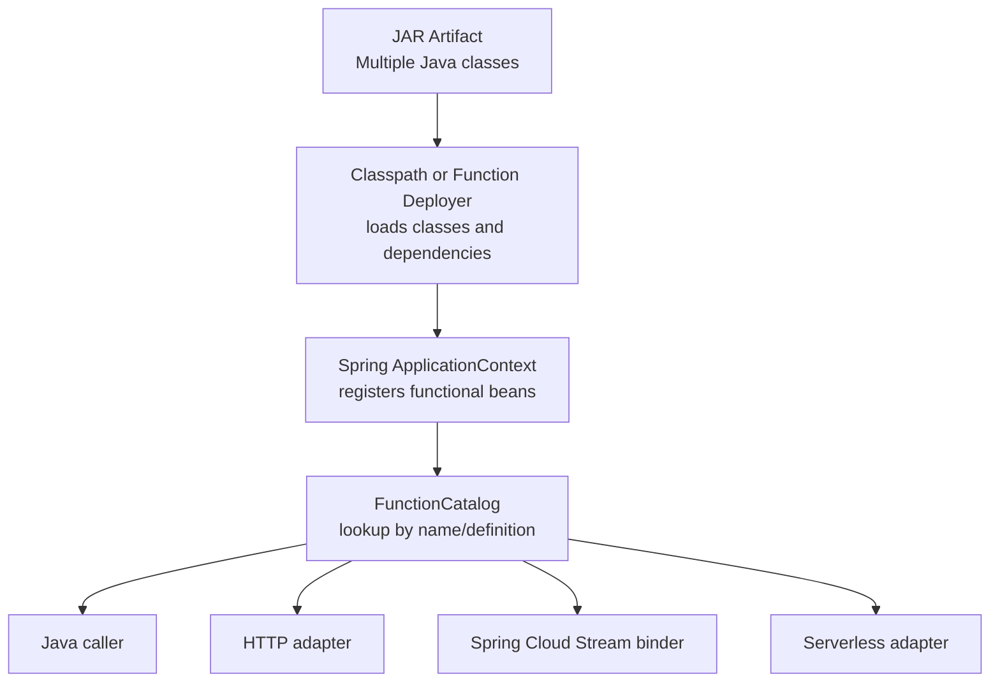
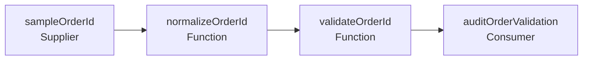

# Loading Multiple Function Classes and Naming Rules

## 1. The Problem: One JAR Contains Multiple Functions, the Calling Application Must Pick the Right One

An order-processing platform wants to reuse four operations: generating a sample order ID, normalizing an ID, validating ID format, and logging the audit result. The business team releases them in a single artifact; the operations team has a Spring Boot application receiving HTTP requests or events. When there is only one function, picking the function is sometimes easy to infer. When there are **multiple functions**, questions arise immediately:

- Does a JAR file containing four Java classes mean all four functions will be registered automatically?
- Is `NormalizeOrderId` the **class** name, or the name to pass to `FunctionCatalog.lookup(...)`?
- If two JARs have beans with the same name `normalizeOrderId`, which one must the host invoke?
- Which function does `spring.cloud.function.definition` select, and does it load additional classes from the JAR?
- With what data types does composition `normalizeOrderId|validateOrderId` work?
- Must the HTTP endpoint, Kafka binding, and function name be identical?

In the **Spring Cloud Function** (`SPRING_CLOUD_FUNCTION`) module, business logic can be expressed as `Supplier<T>`, `Function<T,R>`, and `Consumer<T>`, looked up via `FunctionCatalog`, chained with composition, and executed via internal Java, HTTP, messaging, or serverless adapters. The **JAR Loading** section adds another layer of responsibility: **bringing external implementations into the execution environment** without losing the ability to select functions by name.

**Core point:** *a class present in the JAR* differs from *a registered function*; *a registered function* differs from *the function selected for invocation*. When loading multiple function classes, all three must be made explicit.

## 2. Model from Artifact to Invoked Function



This is a **responsibility diagram**, not a guarantee that every Function Deployer version implements the exact same context/classloader structure. Some versions support loading a Boot JAR with functional beans; loading a simple JAR via `function-class` is a different flow. Confirm the behavior of your **actual release** before configuring multi-class loading.

| Step | What is determined | Example |
| --- | --- | --- |
| **Packaging** | Which classes exist in the artifact? | `NormalizeOrderId.class`, `ValidateOrderId.class`. |
| **Loading** | Can the loader/host access and instantiate the code? | File URI, classloader, dependencies, Boot context. |
| **Registration** | Which functions have names in the catalog? | `normalizeOrderId`, `validateOrderId`. |
| **Selection** | Which function or composition does the caller/adapter invoke? | `prepareOrderId` or `normalizeOrderId|validateOrderId`. |
| **Triggering** | Through which channel does data arrive? | Java method, HTTP request, Kafka message. |

Adding a new class to a JAR only solves the first step; it does not automatically create a Web endpoint, add a Kafka binding, or guarantee that the class is registered in the catalog.

## 3. Three Strategies When One Artifact Has Multiple Function Classes

| Strategy | How the function list is managed | When to use? |
| --- | --- | --- |
| **Spring Boot application with multiple functional beans** | Register each `@Bean` with an explicit name. | Want multiple functions sharing a context, dependency injection, composition, and stable names. |
| **Simple JAR with multiple `implements Function` classes** | Requires a mechanism to select/register classes per the deployer version in use. | Library contains only plain Java and should not depend on Spring in source. |
| **Host declares beans itself from a library JAR** | Host adds the JAR dependency and creates explicit `@Bean`/factory definitions. | Want full control over names without depending on dynamic loading mechanisms. |

A **simple JAR containing multiple `.class` files** does not mean `spring.cloud.function.function-class` can accept a list of FQCNs separated by commas, semicolons, or arbitrary delimiters. **Do not invent multi-class syntax.** If a release supports selecting multiple classes, verify against that release's documentation/tests. To have an exercise with clear naming rules, we use the strategy of **multiple plain Java classes registered as multiple named beans in a Spring Boot application**.

## 4. Designing a Set of Functions with Explicit Inputs/Outputs

We build five functional beans from four Java classes:

| Bean | Java signature | Purpose |
| --- | --- | --- |
| `sampleOrderId` | `Supplier<String>` | Supplies sample ID `od-204` when called. |
| `normalizeOrderId` | `Function<String,String>` | Converts `"  od-204 "` to `"OD-204"`. |
| `validateOrderId` | `Function<String,OrderValidation>` | Validates the `AA-999` format. |
| `auditOrderValidation` | `Consumer<OrderValidation>` | Logs an illustrative audit record. |
| `prepareOrderId` | `Function<String,OrderValidation>` | Stable named function for `normalize` then `validate`. |

`prepareOrderId` is composed from **two other beans** yet has its own name so clients do not have to know the internal step chain. This is a useful pattern when you want to keep a stable public contract while changing how the pipeline is implemented.

### 4.1. Result DTO

```java
// src/main/java/demo/orders/OrderValidation.java
package demo.orders;

public record OrderValidation(
        String orderId,
        boolean valid,
        String reason) {}
```

A valid ID will have `valid=true` and `reason="OK"`. A malformed ID that is still a valid input string can be returned as a **negative validation result**, rather than throwing an exception. Only `null` or blank inputs violate the contract.

### 4.2. NormalizeOrderId class

```java
// src/main/java/demo/orders/NormalizeOrderId.java
package demo.orders;

import java.util.Locale;
import java.util.function.Function;

public final class NormalizeOrderId
        implements Function<String, String> {

    @Override
    public String apply(String input) {
        if (input == null || input.isBlank()) {
            throw new IllegalArgumentException(
                    "orderId must not be blank");
        }
        return input.strip().toUpperCase(Locale.ROOT);
    }
}
```

This function does not depend on HTTP, a broker, or Spring; the **class** name is `NormalizeOrderId`, distinct from the **bean** name to be declared as `normalizeOrderId`.

### 4.3. ValidateOrderId class

```java
// src/main/java/demo/orders/ValidateOrderId.java
package demo.orders;

import java.util.function.Function;
import java.util.regex.Pattern;

public final class ValidateOrderId
        implements Function<String, OrderValidation> {

    private static final Pattern ID_PATTERN =
            Pattern.compile("[A-Z]{2}-[0-9]{3}");

    @Override
    public OrderValidation apply(String orderId) {
        if (orderId == null || orderId.isBlank()) {
            throw new IllegalArgumentException(
                    "orderId must not be blank");
        }
        boolean valid = ID_PATTERN.matcher(orderId).matches();
        return new OrderValidation(
                orderId, valid, valid ? "OK" : "INVALID_FORMAT");
    }
}
```

For example, `validateOrderId.apply("OD-204")` returns `OrderValidation("OD-204", true, "OK")`. If called directly with `" od-204 "`, it returns `valid=false` because it **does not normalize on its own**. Thus, composition order matters.

### 4.4. AuditOrderValidation class

```java
// src/main/java/demo/orders/AuditOrderValidation.java
package demo.orders;

import java.util.Objects;
import java.util.function.Consumer;

public final class AuditOrderValidation
        implements Consumer<OrderValidation> {

    @Override
    public void accept(OrderValidation result) {
        Objects.requireNonNull(result, "result");
        System.out.println("AUDIT order=" + result.orderId()
                + " valid=" + result.valid());
    }
}
```

`System.out.println` only illustrates a side effect; real auditing may need durable storage, idempotency, and permission controls. `Consumer.accept()` returning `void` does not confirm a Kafka message was processed by the broker or backed by an atomic transaction.

### 4.5. SampleOrderId class

```java
// src/main/java/demo/orders/SampleOrderId.java
package demo.orders;

import java.util.function.Supplier;

public final class SampleOrderId
        implements Supplier<String> {

    @Override
    public String get() {
        return " od-204 ";
    }
}
```

`Supplier` takes no input, but that does not mean the framework calls it periodically on its own. A runner, poller, or runtime adapter must decide when to invoke `get()`.

## 5. Registering Multiple Classes as Multiple Beans with Stable Names

This is the most important distinction between **existing in the artifact** and **being present in FunctionCatalog**.

```java
// src/main/java/demo/orders/OrderFunctionConfiguration.java
package demo.orders;

import java.util.function.Consumer;
import java.util.function.Function;
import java.util.function.Supplier;

import org.springframework.beans.factory.annotation.Qualifier;
import org.springframework.context.annotation.Bean;
import org.springframework.context.annotation.Configuration;

@Configuration(proxyBeanMethods = false)
public class OrderFunctionConfiguration {

    @Bean("sampleOrderId")
    Supplier<String> sampleOrderId() {
        return new SampleOrderId();
    }

    @Bean("normalizeOrderId")
    Function<String, String> normalizeOrderId() {
        return new NormalizeOrderId();
    }

    @Bean("validateOrderId")
    Function<String, OrderValidation> validateOrderId() {
        return new ValidateOrderId();
    }

    @Bean("auditOrderValidation")
    Consumer<OrderValidation> auditOrderValidation() {
        return new AuditOrderValidation();
    }

    @Bean("prepareOrderId")
    Function<String, OrderValidation> prepareOrderId(
            @Qualifier("normalizeOrderId")
            Function<String, String> normalize,
            @Qualifier("validateOrderId")
            Function<String, OrderValidation> validate) {
        return normalize.andThen(validate);
    }
}
```

`@Bean("normalizeOrderId")` sets an **explicit bean name** rather than relying on method names during refactoring. `@Qualifier` on `prepareOrderId` eliminates ambiguity among multiple beans sharing the raw `Function` type.

Inside the **source application's ApplicationContext**, beans registered this way have the corresponding names. When a compatible Spring Cloud Function context discovers functional beans, `FunctionCatalog` can allow lookup by name/definition. If the application **is loaded as an external JAR via the deployer**, the names exposed to the **host catalog** must be verified per the deployer mechanism of the version in use; do not assume every Spring bean name in a child context always appears identically in the host context.

### 5.1. Why not share the same name?

You cannot safely register both functions below under the same name and expect the catalog to distinguish them by generics:

```java
Function<String, String> normalizeOrderId;
Function<String, OrderValidation> validateOrderId;
```

`FunctionCatalog.lookup("someName")` is **name/definition-based lookup**, not Java method overloading by `Function<String,R>`. When bean names collide in a Spring context, registration can be rejected or one definition can be overridden if configuration permits, leading to uncontrolled behavior.

**Rule:** each exposed function needs **a clear, unique name within the runtime catalog scope**. Avoid relying on bean overriding behavior to select versions.

## 6. Spring Boot Application Containing Multiple Functional Beans

To package as a Boot JAR application, create an entry point:

```java
// src/main/java/demo/orders/OrderFunctionsApplication.java
package demo.orders;

import org.springframework.boot.SpringApplication;
import org.springframework.boot.autoconfigure.SpringBootApplication;

@SpringBootApplication
public class OrderFunctionsApplication {
    public static void main(String[] args) {
        SpringApplication.run(OrderFunctionsApplication.class, args);
    }
}
```

`@SpringBootApplication` in `demo.orders` allows Spring to discover `OrderFunctionConfiguration` in the same package via standard component scanning rules. The business class sources still have no Spring dependencies; only the bean registration class and application class depend on Spring Boot.

The Maven project needs a **Spring Boot parent or dependency management**, Spring Cloud Function context, and packaging plugin. Example dependencies section:

```xml
<!-- POM excerpt; choose a compatible Spring Boot / Spring Cloud combination -->
<dependencies>
    <dependency>
        <groupId>org.springframework.boot</groupId>
        <artifactId>spring-boot-starter</artifactId>
    </dependency>
    <dependency>
        <groupId>org.springframework.cloud</groupId>
        <artifactId>spring-cloud-function-context</artifactId>
    </dependency>
    <dependency>
        <groupId>org.springframework.boot</groupId>
        <artifactId>spring-boot-starter-test</artifactId>
        <scope>test</scope>
    </dependency>
</dependencies>
```

Maven Boot plugin to create an executable JAR (in a full POM):

```xml
<build>
    <plugins>
        <plugin>
            <groupId>org.springframework.boot</groupId>
            <artifactId>spring-boot-maven-plugin</artifactId>
            <executions>
                <execution>
                    <goals>
                        <goal>repackage</goal>
                    </goals>
                </execution>
            </executions>
        </plugin>
    </plugins>
</build>
```

The XML snippets are **excerpts**, not a standalone buildable POM: you must still declare project coordinates, parent or Spring Boot version, compatible Spring Cloud BOM/dependency management, and other build settings. Do not mix versions copied from different releases.

An example layout when building the application:

```text
order-functions-1.0.0.jar
  BOOT-INF/classes/demo/orders/OrderFunctionsApplication.class
  BOOT-INF/classes/demo/orders/OrderFunctionConfiguration.class
  BOOT-INF/classes/demo/orders/NormalizeOrderId.class
  BOOT-INF/classes/demo/orders/ValidateOrderId.class
  BOOT-INF/classes/demo/orders/AuditOrderValidation.class
  BOOT-INF/classes/demo/orders/SampleOrderId.class
  BOOT-INF/classes/demo/orders/OrderValidation.class
  BOOT-INF/lib/...
```

This is a **Spring Boot executable JAR**; multiple classes reside in one archive, yet `@Bean` declarations in `OrderFunctionConfiguration` are what define the specific functional beans. Do not confuse it with a simple library JAR that has classes directly at the root package path.

## 7. Starting and Verifying Bean Names in the Source Application

To run the source Boot application without a web server:

```yaml
spring:
  main:
    web-application-type: none
```

Without a runner/poller or service keeping the application alive, a non-web Boot application can exit after initialization. That does not mean the catalog lacks beans. Use a context test or an intentional runner to verify.

```java
// src/main/java/demo/orders/CatalogSmokeRunner.java
package demo.orders;

import java.util.function.Function;

import org.springframework.boot.ApplicationRunner;
import org.springframework.cloud.function.context.FunctionCatalog;
import org.springframework.context.annotation.Bean;
import org.springframework.context.annotation.Configuration;
import org.springframework.context.annotation.Profile;

@Configuration
@Profile("smoke")
public class CatalogSmokeRunner {

    @Bean
    ApplicationRunner verify(FunctionCatalog catalog) {
        return args -> {
            Function<String, OrderValidation> fn =
                    catalog.lookup("prepareOrderId");
            if (fn == null) {
                throw new IllegalStateException(
                        "prepareOrderId not registered");
            }
            System.out.println(fn.apply("  od-204 "));
        };
    }
}
```

When running `java -jar order-functions-1.0.0.jar --spring.profiles.active=smoke`, expected output includes `OrderValidation[orderId=OD-204, valid=true, reason=OK]`.

**Enable the smoke runner only for test environments.** A runner that logs output may be acceptable, whereas a `Consumer` writing to a database or a self-starting scheduler inside a JAR loaded into a host can cause unwanted side effects. Function names and lifecycles must be managed from the design stage.

## 8. Loading Multiple Classes When Only a Simple JAR Exists

Suppose instead of a Spring Boot executable JAR, the provider builds a **simple library JAR** with four classes directly implementing JDK interfaces:

```text
order-functions-lib-1.0.0.jar
  demo/orders/NormalizeOrderId.class
  demo/orders/ValidateOrderId.class
  demo/orders/AuditOrderValidation.class
  demo/orders/SampleOrderId.class
  demo/orders/OrderValidation.class
```

With direct class loading in `spring-cloud-function-deployer` versions that support it, configuring **one specific class** might take the illustrative form:

```yaml
spring:
  cloud:
    function:
      location: "file:///opt/functions/order-functions-lib-1.0.0.jar"
      function-class: "demo.orders.NormalizeOrderId"
```

These two properties answer **JAR location** and **the class to load**. They **do not imply** registering `ValidateOrderId`, `AuditOrderValidation`, and `SampleOrderId` simultaneously just because those classes also exist in the archive.

If you want **multiple functions in the same catalog**, practical paths are:

1. **Package a Spring Boot application** with multiple explicitly named functional beans, then use the Boot JAR loading mode supported by the deployer release.
2. **Add the library JAR to the host's classpath** and create separate `@Bean` definitions for each implementation. This is not dynamic loading, yet names are clearly controlled by the host.
3. **Use the release's specific multi-class/function mechanism** if documentation and integration tests genuinely confirm support; do not apply guessed `function-class` list syntax.
4. **Split into multiple providers/hosts** if per-function isolation of lifecycle, resources, and rollback is required.

A JAR containing multiple classes is not yet a registry. Which names are exposed is a **registration decision**, not merely the list of files printed by `jar tf`.

### 8.1. Host declaring multiple beans from a library JAR

If putting the library JAR on the **host's classpath at build time** is acceptable, the host can create explicit beans without the deployer. For example, the following configuration belongs to **a separate host**, and should not be used simultaneously with `OrderFunctionConfiguration` from section 5 in the same context to avoid duplicate bean names:

```java
package demo.host;

import demo.orders.NormalizeOrderId;
import demo.orders.OrderValidation;
import demo.orders.ValidateOrderId;
import java.util.function.Function;
import org.springframework.context.annotation.Bean;
import org.springframework.context.annotation.Configuration;

@Configuration(proxyBeanMethods = false)
public class HostFunctionBeans {
    @Bean("normalizeOrderId")
    Function<String, String> normalizeOrderId() {
        return new NormalizeOrderId();
    }

    @Bean("validateOrderId")
    Function<String, OrderValidation> validateOrderId() {
        return new ValidateOrderId();
    }
}
```

This is not **dynamic JAR loading via `location`**; Maven/Gradle placed the library artifact on the classpath so host code can import `demo.orders.*`. In exchange, both function names are explicitly declared and easy to verify via `FunctionCatalog`. If the actual requirement is selecting an **external artifact at startup** without importing implementations at build time, use a loader/deployer with the appropriate capability and verify multi-class registration on the target release.

## 9. Naming Rules: Distinguishing Six Scopes

When deploying multiple functions, "name" carries at least six meanings:

| Scope | Example | Who uses it? |
| --- | --- | --- |
| **Java class name (FQCN)** | `demo.orders.NormalizeOrderId` | Classloader or class-based implementation selection. |
| **Artifact/version name** | `order-functions-1.0.0.jar` | CI/CD, host locator, release management. |
| **Spring bean name** | `normalizeOrderId` | BeanFactory, `@Qualifier`, and function metadata. |
| **FunctionCatalog name/definition** | `normalizeOrderId`, `prepareOrderId` | `lookup(...)`, composition, and adapter selection. |
| **HTTP route** | e.g., `/prepareOrderId` | Web adapter/API consumers per provider contract. |
| **Messaging binding/destination** | `prepareOrderId-in-0` and `order-requests` | Spring Cloud Stream and broker. |

In a regular source Boot application, functional beans can be recognized by the catalog using their bean names. When **loading from an external JAR**, the actual names seen by the host catalog also depend on how the deployer registers/exposes functions. **Verify on the target runtime; do not guess names solely from the FQCN or JAR filename.**

Therefore, naming conventions should separate:

- **Internal implementation names:** `NormalizeOrderId`, packages, method names; can change during refactoring.
- **Exposed function names:** `normalizeOrderId`, `prepareOrderId`; should have clear ownership, uniqueness, and a stable contract.
- **External application names:** HTTP routes or topics; have their own versioning/compatibility policies.

There is no rule forcing URLs and bean names to match if a dedicated routing layer creates aliases. However, the **default web adapter** typically derives routes from the selected function name. To keep URLs stable while renaming beans, you can use a controller/adapter with fixed routes or a well-designed, tested bean alias/wrapper.

## 10. Naming Practices to Avoid Collisions and Breaking Refactors

A pragmatic convention for the order module:

| Rule | Recommended example | Example to avoid |
| --- | --- | --- |
| Clear business meaning | `normalizeOrderId`, `validateOrderId` | `function1`, `handler`, `processor`. |
| Distinguishable input/output | `prepareOrderId` returns `OrderValidation` with clear contract | `process` with unclear side effects. |
| Unique in the runtime catalog | `orderNormalizeV2` when parallel versions must coexist | Two beans both named `normalizeOrderId`. |
| Stable public names | Keep `prepareOrderId`, swap implementation behind it | Changing URLs whenever a class is renamed. |
| Keep infrastructure out of core names | `validateOrderId` | `kafkaValidateOrderId` for the same rule just because the binder changed. |

You can namespace by domain when multiple teams publish together: `orderNormalize`, `invoiceNormalize` instead of both using `normalize`. When multiple versions must live side by side, use clear versioned names/routes or separate deployments; add `V2` only when versioning policy genuinely requires it, not as a suffix to mask unmanaged collisions.

**Naming is part of the API contract** whenever callers configure `spring.cloud.function.definition` or rely on routes derived from function names. Renaming a bean is no longer a purely internal refactor if that name is consumed outside the module.

## 11. Looking Up Multiple Functions in FunctionCatalog

`FunctionCatalog` is the interface provided by Spring Cloud Function to locate functions registered in the Spring environment. With the source application having five beans in section 5, you can test **individual names** and **a composition**.

```java
// Code running inside a Spring bean with FunctionCatalog catalog injected.
Function<String, String> normalize =
        catalog.lookup("normalizeOrderId");

Function<String, OrderValidation> validate =
        catalog.lookup("validateOrderId");

Function<String, OrderValidation> pipeline =
        catalog.lookup("normalizeOrderId|validateOrderId");

Supplier<String> sample =
        catalog.lookup("sampleOrderId");

Consumer<OrderValidation> audit =
        catalog.lookup("auditOrderValidation");

if (normalize == null || validate == null ||
        pipeline == null || sample == null || audit == null) {
    throw new IllegalStateException("Missing registered function");
}

String rawId = sample.get();            // " od-204 "
String cleaned = normalize.apply(rawId); // "OD-204"
OrderValidation direct = validate.apply(cleaned);
OrderValidation composed = pipeline.apply(rawId);

// Illustrative side effect only; do not put directly in a production smoke test.
audit.accept(composed);
```

Both `direct` and `composed` are expected to return `OrderValidation("OD-204", true, "OK")`. `FunctionCatalog.lookup(...)` itself may return a **wrapper** for type conversion/composition; do not depend on the returned instance being the raw `new NormalizeOrderId()` object or cast it to the implementation class.

**Important when loading external JARs:** the snippet above assumes **all names have been verified to exist in the catalog of the context being queried**. A standalone Boot JAR and a host loading a Boot JAR may have different context/classloader boundaries. The host's catalog does not automatically contain every bean from another context unless the loader exposes them in a release-supported manner.

### 11.1. Wrong names and null returns

```java
Function<String, String> missing =
        catalog.lookup("normalizeOrderID"); // Case mismatch.
if (missing == null) {
    // Check the actual registered name instead of calling apply().
}
```

Do not use approximate names, auto-pick "the first function", or rely on bean creation order to guess which function will be called. In a multi-function deployment, invoking the wrong function can be worse than a `null` error, especially for a data-writing `Consumer`.

## 12. Composition: Matching Types and Order

The chain:

```text
String
  |
  v
normalizeOrderId : Function<String, String>
  |
  v
validateOrderId  : Function<String, OrderValidation>
  |
  v
OrderValidation
```

is expressed by name as:

```java
Function<String, OrderValidation> pipeline =
        catalog.lookup("normalizeOrderId|validateOrderId");
```

The `|` character is used in Spring Cloud Function composition syntax; **order runs left to right**. The input to the next step must be compatible with the output of the previous step. `FunctionCatalog` supports composition, but cannot fix the logic of a type-mismatched pipeline.

**Type-incompatible** example:

```text
validateOrderId|normalizeOrderId

validateOrderId: String -> OrderValidation
normalizeOrderId: String -> String

Output of step 1 is OrderValidation,
while step 2 expects String.
```

Do not wait until a production request arrives to discover wrong pipeline ordering. Verify at startup or write integration tests with `catalog.lookup(...)` and realistic inputs.

### 12.1. When should you use a dedicated named bean for a pipeline?

The `prepareOrderId` bean in section 5:

```java
return normalize.andThen(validate);
```

gives a name to a two-step pipeline. This is helpful when callers do not need to know internally there are two functions, or when you want to change processing while keeping the **public name** stable:

| Approach | Strength | What must be managed |
| --- | --- | --- |
| `lookup("normalizeOrderId|validateOrderId")` | Configuration selects the pipeline directly from steps. | Both step names and their order become part of the config contract. |
| `lookup("prepareOrderId")` | One public name; implementation can change in source. | Bean must exist; test semantics of the public name. |

If a composition includes `Supplier` or `Consumer`, pipeline head/tail behavior and wrapper characteristics depend on interface types, release composition capabilities, and adapter triggers. Start with two type-compatible `Function`s as above and verify before expanding. `FunctionCatalog` does not itself provide workflows with timers, checkpoints, distributed transactions, or sagas.

## 13. `spring.cloud.function.definition` Selects a Function; It Does Not Load Classes

For applications containing multiple functional beans, adapters like Spring Cloud Stream typically require an explicit selection:

```yaml
spring:
  cloud:
    function:
      definition: prepareOrderId
```

This selects **one registered bean**. To select a pipeline formed from existing functions:

```yaml
spring:
  cloud:
    function:
      definition: "normalizeOrderId|validateOrderId"
```

The `|` character is composition syntax, not a Java class name; quoting the string keeps configuration unambiguous. All referenced functions/steps must be lookable in the catalog inside the adapter runtime.

Distinction:

| Property | Target of effect |
| --- | --- |
| `spring.cloud.function.location` | JAR artifact to load via a supported deployer mechanism. |
| `spring.cloud.function.function-class` | Implementation class selected in the corresponding simple JAR loading path. |
| `spring.cloud.function.definition` | **Already registered** function or composition used by the adapter. |

`definition` **is not a list of classes for the deployer to open from files**. If the JAR is missing, the class is broken, or the bean is unregistered, changing `definition` will not fix those errors.

### 13.1. What if multiple adapters need different functions?

Do not assume `spring.cloud.function.definition` can expose all beans using an arbitrary string of names. Selecting one or multiple functions, delimiters, and generated bindings can differ across Spring Cloud Stream versions. You can:

- Run two provider deployments selecting two different definitions.
- Put multiple beans into one Spring context and configure **multiple functional bindings** using the syntax supported and tested for your Spring Cloud Stream version.
- Build separate adapters/endpoints, each calling an **approved catalog name**.

In Stream releases supporting multiple independent definitions, the definition delimiter syntax (such as `;` in supported lines) must be verified; **`;` is not equivalent to `|`**. `|` is for a composition piping the previous step's output into the next step's input.

## 14. Exposing Multiple Functions Over HTTP: Route Names Are Public Contracts

In a Spring Boot application with `spring-cloud-starter-function-web` and compatible web runtime configuration, the web adapter can expose invocation routes by supported function name.

Example with the `normalizeOrderId` bean:

```bash
curl -X POST http://localhost:8080/normalizeOrderId \
  -H "Content-Type: text/plain" \
  --data "  od-204 "
```

Expected business content:

```text
OD-204
```

With the `prepareOrderId` bean:

```bash
curl -X POST http://localhost:8080/prepareOrderId \
  -H "Content-Type: text/plain" \
  --data "  od-204 "
```

Expected result after appropriate serialization:

```json
{
  "orderId": "OD-204",
  "valid": true,
  "reason": "OK"
}
```

These are examples **when the adapter supports such routing and the function names are genuinely exposed**; check routes, methods, body content types, HTTP statuses/errors, and limits on your running web adapter version.

**Do not expose the entire catalog unintentionally.** `auditOrderValidation` is a `Consumer` with side effects, so in real systems you must specify who is allowed to call it, plus authentication, authorization, and validation. If you only want to expose `prepareOrderId`, use a controller/gateway with an allowlist of routes or appropriate exposure configuration, rather than trusting that every bean in the JAR is safe to call from the internet.

### 14.1. If you rename a bean, are URLs affected?

If endpoints are built by the web adapter from function names, changing `@Bean("prepareOrderId")` to `@Bean("prepareOrder")` can change the route and break existing clients. To change the implementation while keeping the URL stable, keep the public bean name/alias `prepareOrderId`, or place a controller with a stable versioned route that delegates to the underlying service/function.

**Renaming an internal class** is not necessarily a breaking change; **renaming a function already consumed by callers** is usually a contract change that must be managed.

## 15. Function Selection in Spring Cloud Stream

With the `prepareOrderId : Function<String,OrderValidation>` example, an application with `spring-cloud-stream-binder-kafka` and a real broker can define a flow from an input topic to an output topic:

```yaml
spring:
  cloud:
    function:
      definition: prepareOrderId
    stream:
      bindings:
        prepareOrderId-in-0:
          destination: raw-order-ids
          group: order-id-checkers
          content-type: text/plain
        prepareOrderId-out-0:
          destination: validated-order-ids
          content-type: application/json
      kafka:
        binder:
          brokers: localhost:9092
```

When a record containing `"  od-204 "` is converted to an appropriate `String`, the binder calls `prepareOrderId` and serializes `OrderValidation` into the output message. The two topics serve **two different roles**; `prepareOrderId-in-0` and `prepareOrderId-out-0` are default binding names generated by the functional binding model for the single definition `prepareOrderId`, not necessarily the Kafka topic names.

| Name | Meaning |
| --- | --- |
| `prepareOrderId` | Selected function definition. |
| `prepareOrderId-in-0` | Input binding name generated by the functional model. |
| `raw-order-ids` | Actual input destination/topic. |
| `prepareOrderId-out-0` | Output binding name. |
| `validated-order-ids` | Actual output destination/topic. |
| `order-id-checkers` | Consumer group used in the example. |

**Note:** When using a composition `normalizeOrderId|validateOrderId` as the definition, default binding names can reflect the whole composition and contain the `|` character; verify the exact binding names on your Stream release. If you want ops-friendly broker/binding names, use a pipeline bean with a stable name such as `prepareOrderId`.

### 15.1. Two independent functions are not a pipeline

If the host has `normalizeOrderId` and `validateOrderId`, running them **independently** differs from choosing `normalizeOrderId|validateOrderId`. When independent, each function has its own input/output contract and bindings; they **do not automatically pass messages from one function's output to the other's input** without a broker topology or explicit composition.

With multiple function definitions in the same app, configuration syntax and binding counts depend on the Spring Cloud Stream version in use. Do not assume a list like `normalizeOrderId,validateOrderId` will always work or automatically wire two functions together. When in doubt, deploy each function as a separate instance or write an explicit adapter and test an accurate topology.

## 16. Loading Multiple JARs: Name Collisions and Classloaders

Suppose the host loads **two artifacts**:

```text
order-functions-1.0.0.jar
  bean normalizeOrderId

partner-functions-2.0.0.jar
  bean normalizeOrderId
```

A catalog call `lookup("normalizeOrderId")` cannot express intent to pick version A or version B if two sources register the same name into the **same namespace**. The outcome depends on the registry/deployer mechanism and the release's collision handling; never rely on loading order.

Design options:

1. **Unique domain/provider names** when coexisting in one catalog, e.g., `internalNormalizeOrderId` and `partnerNormalizeOrderId`.
2. **Explicit public names/aliases** in the host for approved implementations, instead of letting callers invoke every version arbitrarily.
3. **Separate deployments** if you need isolation for versions, classloaders, resources, and rollbacks.
4. **Do not enable uncontrolled bean overriding** so one bean accidentally shadows another.
5. **Record artifact provenance/checksums and smoke test results** when exposed names are registered.

### 16.1. Same-named classes are not guaranteed to be the same type

Inside one JVM, Java type identity depends on **class name and classloader**. If two JARs—or the host and a JAR—contain different copies of `demo.orders.OrderValidation`, objects with the same FQCN from different classloaders may not be castable. Typical failures are `ClassCastException`, `LinkageError`, or converter errors.

To mitigate:

- Extract a stable, clearly versioned **shared API contract**, avoiding bundling incompatible copies.
- Use JSON/message schema DTOs at adapter boundaries where appropriate.
- Check classloader and dependency paths of your deployer version.
- Start with standard types like `String` in smoke tests before introducing custom DTOs.

### 16.2. Loading multiple artifacts is not automatically hot swapping

When upgrading `order-functions-1.0.0.jar` to `1.1.0.jar`, replacing the file or changing `location` does not automatically guarantee the JVM unloads the old classloader and re-registers the same name safely. A host may continue using the old implementation or retain resources. You need an explicit lifecycle/rollout workflow and must verify both outputs and artifact provenance; if hot reload is not supported by the release, perform controlled restarts/rolling deploys.

## 17. Message Conversion and Schemas When Multiple Functions Are Exposed

When a Java runner calls `Function<String,OrderValidation>`, the caller passes a `String` object directly and receives a Java record. However, HTTP and messaging also involve serialization:

```json
{
  "orderId": "OD-204",
  "valid": true,
  "reason": "OK"
}
```

This is an **output payload**, not the raw `OrderValidation` object sent verbatim over the wire. Recipients must understand the schema, content type, semantics of `valid`, versions, and error formats.

| Error | Possible cause | Where to verify |
| --- | --- | --- |
| Sending a JSON object to a `String`-accepting function yields unexpected results | Unsuitable converter or body contract. | HTTP/Stream adapter. |
| Function expects `OrderValidation` yet input is only `"OD-204"` | Wrong contract type or missing conversion step. | Definition/composition, payload schema. |
| Message has wrong content type | Unable to pick the right converter. | Binding/headers/config. |
| Changing `reason` from text to object | Breaking schema change. | Contract versioning and consumer tests. |
| Correct payload yet `ClassCastException` in host | Incompatible classloaders or shared DTOs. | Loader/API contract. |

If correlation IDs or headers are needed, you can design `Function<Message<T>, Message<R>>` (from `org.springframework.messaging`). However, this introduces messaging abstractions into the signature and complicates the JAR's dependencies; use it only when business logic genuinely needs that metadata.

**Loading multiple classes does not automatically create converters for every payload type.** Preserving full generic types, versioning DTOs, and testing each adapter's contract remain separate responsibilities.

## 18. Side Effects, Suppliers, and Multi-Function Invocation Models

A system with multiple functions does not consist solely of pure data transformations. `sampleOrderId` is a source, and `auditOrderValidation` is a sink with side effects:



The diagram represents the **desired business chain**, not a guarantee that Spring Cloud Function will automatically schedule or wire beans inside the JAR at startup. You need a caller, adapter, or supported, properly configured composition.

When a `Consumer` writes to a database or emits messages, you must answer:

- If an HTTP client retries a request after a timeout, will the action execute twice?
- If a broker redelivers the same message, is there an idempotency key or event ID?
- If data processing succeeds yet publishing output fails, how does retry behave?
- If the function is loaded on multiple replicas, is in-memory state consistent across replicas?

`FunctionCatalog` does not automatically provide distributed transactions, exactly-once processing, or durable workflows. `Consumer.accept()` returning `void` is only a Java signature; broker acknowledgments, transaction commits, and DLQs are the responsibility of adapters and infrastructure per configuration.

For `Supplier`, you must also choose the invocation cadence: cron/job, Stream poller, or caller invocation. `Supplier.get()` takes no input, yet has no built-in scheduler. If multiple instances emit concurrently, you need a work-partitioning or deduplication strategy.

## 19. Security: Do Not Let Callers Arbitrarily Pick Sensitive Function Names

When an application has multiple functions, a new risk emerges: **dynamic dispatch**—the caller supplies a name string and the application passes it to catalog lookup.

Dangerous design example:

```java
// Do not do this with untrusted input.
String requestedFunction = externalRequest.getFunctionName();
Function<?, ?> selected = catalog.lookup(requestedFunction);
```

If the host contains `auditOrderValidation` or a consumer that cancels orders or deletes data, letting clients pass arbitrary names/definitions can expose unintended actions. Composition strings must also be controlled; never concatenate `"|"` with unvalidated user-supplied name segments.

**Safer approach:** maintain an allowlist of exposed functions and map external names to controlled internal definitions:

```java
// Allowlist managed by the application, not editable by clients.
Map<String, String> publicFunctions = Map.of(
        "normalize-v1", "normalizeOrderId",
        "prepare-v1", "prepareOrderId");

String internalName = publicFunctions.get(publicAction);
if (internalName == null) {
    throw new IllegalArgumentException("Unsupported action");
}

Function<?, ?> fn = catalog.lookup(internalName);
if (fn == null) {
    throw new IllegalStateException(
            "Configured function is unavailable");
}
```

This is a **conceptual pattern**: authentication/authorization, input type checks, and actual invocation still need proper implementation in the adapter code. A public API should only expose approved functions; use a gateway/controller or appropriate exposure configuration rather than relying solely on naming conventions.

Additionally, external JARs contain **executable bytecode**, not data:

- Load only artifacts from trusted sources with controlled release permissions.
- Manage versions, checksums/signatures, and dependency vulnerabilities.
- Never allow untrusted input to choose `spring.cloud.function.location` or `function-class`.
- Restrict the host's permissions for secrets, filesystem, network, and databases.
- Do not treat a classloader as a sandbox for malicious code or unvetted plugins.
- When strong fault/permission isolation is required, consider separate provider processes/containers instead of loading into the same JVM.

## 20. Testing Naming, Lookup, and Composition

### 20.1. Unit testing each Java class

The implementations in section 4 do not depend on Spring, so test them independently:

```java
package demo.orders;

import static org.junit.jupiter.api.Assertions.assertEquals;
import static org.junit.jupiter.api.Assertions.assertFalse;
import static org.junit.jupiter.api.Assertions.assertThrows;
import static org.junit.jupiter.api.Assertions.assertTrue;

import org.junit.jupiter.api.Test;

class OrderFunctionsUnitTest {
    private final NormalizeOrderId normalize =
            new NormalizeOrderId();
    private final ValidateOrderId validate =
            new ValidateOrderId();

    @Test
    void normalizesAndValidates() {
        String id = normalize.apply("  od-204 ");
        assertEquals("OD-204", id);

        OrderValidation result = validate.apply(id);
        assertEquals("OD-204", result.orderId());
        assertTrue(result.valid());
        assertEquals("OK", result.reason());
    }

    @Test
    void rejectsBlankAndFlagsWrongFormat() {
        assertThrows(IllegalArgumentException.class,
                () -> normalize.apply("   "));

        OrderValidation invalid = validate.apply("X-123");
        assertFalse(invalid.valid());
        assertEquals("INVALID_FORMAT", invalid.reason());
    }
}
```

Unit tests verify the logic is right, yet do not prove bean or catalog names exist. Separate tests for `AuditOrderValidation` should replace stdout/logging with a testable abstraction if used in practice, instead of relying on `System.out` in production.

### 20.2. Integration testing bean names and FunctionCatalog

In the **source Spring Boot project** with compatible `spring-boot-starter-test` and `spring-cloud-function-context` dependencies:

```java
package demo.orders;

import static org.junit.jupiter.api.Assertions.assertEquals;
import static org.junit.jupiter.api.Assertions.assertNotNull;
import static org.junit.jupiter.api.Assertions.assertTrue;

import java.util.function.Function;

import org.junit.jupiter.api.Test;
import org.springframework.beans.factory.annotation.Autowired;
import org.springframework.boot.test.context.SpringBootTest;
import org.springframework.cloud.function.context.FunctionCatalog;

@SpringBootTest(
        properties = "spring.main.web-application-type=none")
class OrderFunctionCatalogTest {

    @Autowired
    FunctionCatalog catalog;

    @Test
    void findsNamedFunctionsAndComposition() {
        Function<String, String> normalize =
                catalog.lookup("normalizeOrderId");
        Function<String, OrderValidation> compose =
                catalog.lookup("normalizeOrderId|validateOrderId");
        Function<String, OrderValidation> named =
                catalog.lookup("prepareOrderId");

        assertNotNull(normalize);
        assertNotNull(compose);
        assertNotNull(named);
        assertEquals("OD-204", normalize.apply(" od-204 "));

        OrderValidation fromComposition =
                compose.apply(" od-204 ");
        OrderValidation fromNamed =
                named.apply(" od-204 ");
        assertTrue(fromComposition.valid());
        assertEquals(fromComposition, fromNamed);
    }
}
```

This test verifies three independent facts: `normalizeOrderId` has the right name, `normalizeOrderId|validateOrderId` composes compatibly by type, and `prepareOrderId` produces identical semantics. If `validateOrderId` is removed/renamed, the composition test must fail rather than silently calling another implementation by mistake.

### 20.3. Testing when loading external JARs

A `@SpringBootTest` running inside the **source project** does not prove the host can load the JAR. Testing a deployer release requires:

1. Build a real JAR containing the right classes and `@Bean` definitions.
2. Configure `location` on the host using the mechanism supported by the deployer version.
3. Inspect classloader/context behavior and registration outcomes.
4. Verify the **actual names in the host catalog**, not just names in the source Spring context.
5. Invoke each exposed function; verify `Supplier`, `Function`, and `Consumer` per their respective semantics.
6. Test name collisions, wrong dependencies, missing JARs, unsupported artifact types, and non-existent function names.
7. Test composition among loaded functions and check input/output types across the loader boundary.

### 20.4. Adapter contract tests

| Invocation surface | Key tests |
| --- | --- |
| HTTP | Right route name, method, content type, status/error schema, authorization. |
| Spring Cloud Stream | Definition, input/output bindings, topic, consumer group, serialization, retry/DLQ. |
| Serverless | Handler, event envelope, failure response, timeout, and IAM. |
| Internal Java | Lookup, generic types, wrappers, concurrency, and exception handling. |

Having `apply()` tests pass alone does not prove an application with **multiple functions** will select the right definition in production runtime.

## 21. Diagnosing Common Errors

| Symptom | Typical cause | How to handle |
| --- | --- | --- |
| `jar tf` shows four classes yet catalog sees only one function | Classes exist in JAR but are unregistered, or deployer selects only one implementation. | Verify registration strategy; do not guess multi-class syntax. |
| `lookup("NormalizeOrderId")` returns `null` | Confusing class name with bean/catalog name. | Check `@Bean("normalizeOrderId")` and the actual registry. |
| Source bean exists yet host does not see its name | Context/loader does not expose beans as assumed. | Check deployer release, context initialization, and registered names. |
| `BeanDefinitionOverrideException` or bean collision | Two sources register the same name. | Rename or separate namespaces/deployments; do not enable override arbitrarily. |
| `ClassNotFoundException` | Wrong FQCN or class missing from artifact. | Check `jar tf`, `location`, and the fully qualified class name. |
| `NoClassDefFoundError` or `NoSuchMethodError` | Incompatible dependencies/classloader/Java version. | Check transitive dependencies, BOM, loader, and binary API. |
| Composition throws type error | `validateOrderId|normalizeOrderId` wrong order or incompatible DTOs. | Trace the `T→R` type flow and fix the pipeline. |
| HTTP 404 despite bean existing | Wrong route, adapter, config, or exposed name. | Verify mapping and web adapter version. |
| HTTP body fails to convert to target type | Unsuitable content type or converter. | Check schema, headers, and generic types. |
| Stream receives no messages | Wrong `definition` or misconfigured binding/broker. | Check function name and `*-in-0`, destination, broker. |
| Stream sends results to wrong topic | Confusing binding name with destination. | Inspect both input/output bindings and actual topics. |
| `Consumer` executes side effect twice | HTTP retry or message redelivery. | Idempotency, transactions, and retry policies. |
| JAR replaced yet results unchanged | Host still uses already loaded artifact/classes. | Version/checksum, rollout/restart; do not assume hot reload. |

When diagnosing, proceed from **artifact → loader/context → bean → catalog → definition/composition → adapter → network/payload**. Do not edit Kafka topics just because a bean name wasn't registered; and do not change `function-class` if the root cause is a wrong HTTP route.

## 22. Renaming and Upgrading Multiple Functions Without Breaking Old Callers

A common scenario: the business team switches `NormalizeOrderId` to a new implementation, yet the public API must continue accepting `POST /prepareOrderId`.

**Low-impact upgrade approach:**

1. Keep the public bean name `prepareOrderId` stable, updating the logic or internal steps behind it.
2. Maintain input/output unit tests and contract tests for the public name.
3. Release JARs with immutable versions, recording checksums and dependency versions.
4. When incompatible schema or semantic changes are required, publish a **V2 contract** (route/topic/public bean per boundary) and maintain a transition period.
5. While two versions run together, ensure **catalog names do not collide** or split them into separate deployments.
6. Perform controlled rollouts; never overwrite a JAR actively used by the host assuming classes already swapped in the JVM.
7. Monitor metrics per function name, artifact version, and adapter errors; keep a clear rollback plan.

Do not look solely at the same `Function<String,OrderValidation>` generic signature and conclude compatibility. Changing the rule from `[A-Z]{2}-[0-9]{3}` to a new format can cause existing callers to receive `valid=false` differently even when the JSON payload still matches the schema.

### 22.1. Is a catalog name an implementation detail or an API?

| Caller usage | Impact of renaming a bean |
| --- | --- |
| A Java service injecting by type without using names | May have no impact if wiring stays unambiguous; multiple beans of the same type can cause ambiguity. |
| `FunctionCatalog.lookup("prepareOrderId")` | May lose the function; the name is a contract. |
| Web adapter deriving routes from names | May change the exposed URL. |
| Spring Cloud Stream definition | May change selection and default binding names. |
| Controller/gateway with routes independent of bean names | Can keep URLs stable if mapping to the new implementation is tested. |

This explains why **naming and name governance** carry greater weight when loading multiple functions from independent artifacts.

## 23. Hands-On Exercise: One JAR, Multiple Functions, and Multiple Names

Create an `order-functions` project and carry out the following steps:

1. Create the four Java classes `NormalizeOrderId`, `ValidateOrderId`, `AuditOrderValidation`, `SampleOrderId`, and the `OrderValidation` record as in section 4.
2. Declare five `@Bean` methods in `OrderFunctionConfiguration`; assign explicit names and use `@Qualifier` on `prepareOrderId`.
3. Write unit tests for normalize/validate; write a Spring context test verifying `catalog.lookup("normalizeOrderId")`, `catalog.lookup("prepareOrderId")`, and `catalog.lookup("normalizeOrderId|validateOrderId")`.
4. Build the Spring Boot JAR, verify the archive contains all classes under `BOOT-INF/classes`, and run the `smoke` profile to observe a valid `OrderValidation`.
5. With a **deployer release that supports Boot JAR loading**, configure `location` pointing to this JAR in the host. Verify each actual catalog name visible to the host; if unsupported, document the limitation instead of guessing syntax.
6. Test a **simple JAR** containing the Java classes and configure `function-class` pointing to `demo.orders.NormalizeOrderId`. Explain why that **does not automatically register all remaining classes**.
7. Intentionally rename `@Bean("normalizeOrderId")` to `@Bean("normalizeId")`; observe how composition tests and related definitions break or change.
8. Create another function also named `normalizeOrderId` and observe the error/collision in the context or registry mechanism; resolve it with distinct names rather than enabling bean overriding arbitrarily.
9. Configure Stream to select `prepareOrderId`; send `"  od-204 "` to `raw-order-ids` and inspect the JSON record arriving on `validated-order-ids`.
10. If HTTP is enabled, expose only approved functions; do not allow clients to trigger `auditOrderValidation` arbitrarily.
11. Release version `1.1.0` with a rule change; verify contract compatibility and the rollout/rollback workflow.

**Completion criteria:** identify **which class is in the JAR, which bean name is in the context, which function name is looked up in the catalog, which definition is selected by the adapter, and which destination receives data**. You must also explain why setting `function-class` for one implementation does not prove all function classes in the artifact were loaded simultaneously.

## 24. Conclusion

**Loading multiple function classes** is not as simple as putting multiple `.class` files into the same JAR: it requires mechanisms for **loading**, **registering multiple functional beans**, **assigning unique names**, **looking up/composing functions**, and **selecting the exact name triggered by adapters**. With a Spring Boot application containing multiple `@Bean Supplier`/`Function`/`Consumer` definitions, explicit names and `@Qualifier` keep contracts clear; `FunctionCatalog` handles lookup and composition; `spring.cloud.function.definition` selects existing functions and does not replace artifact loading.

When using `spring-cloud-function-deployer`, distinguish loading a **simple JAR by class FQCN** from loading a **Spring Boot JAR with multiple functional beans** according to the release's capabilities. Do not assume an arbitrary `function-class` list can load multiple classes or that source app bean names always appear verbatim in the host catalog. Class name, JAR name, catalog name, HTTP route, and message binding are distinct layers.

The practical principle is to **choose clear function boundaries, register stable names, verify each name through the catalog, test type-safe composition, and tightly control exposure to HTTP/messaging/serverless**. That lets the same business logic be reused without sacrificing version control, security, or operational clarity.
