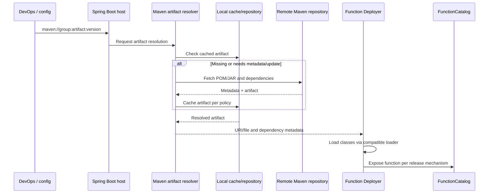
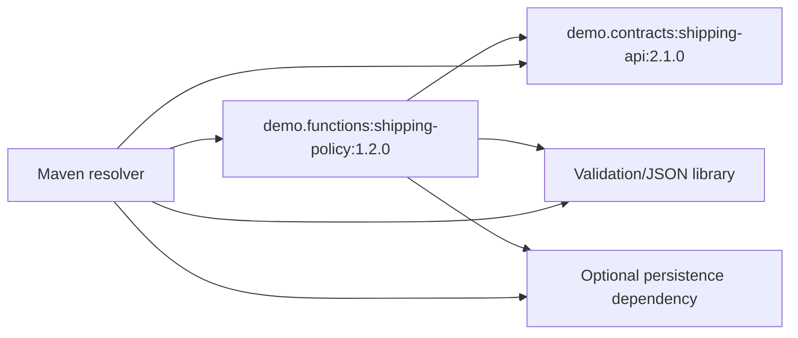
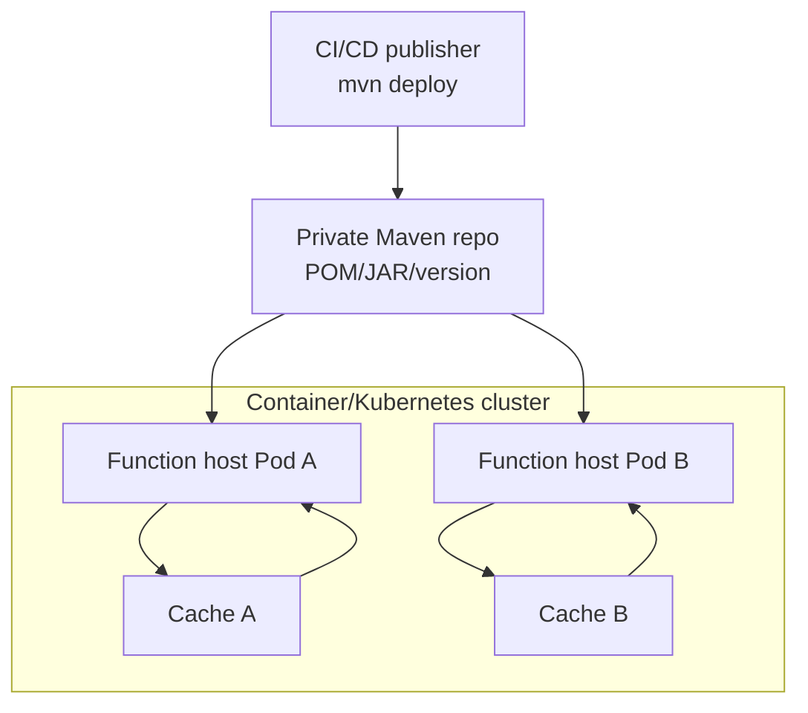

# Maven Artifact Lookup and Customizing Artifact Repositories

## 1. The Problem: Where Is a Function JAR Published So the Host Can Find It?

A business team builds an order ID normalization function and packages it as a JAR. The team publishes version `1.0.0` to an internal Maven repository. Another Spring Boot application acts as the **host**: at startup, it must fetch the right JAR along with its required dependencies, load the implementation, and bring the function into **Spring Cloud Function**'s invocation mechanism.

If only a path like `/opt/functions/order-id-normalizer.jar` is known, operations must manually copy the file onto each machine or container. When artifacts are managed by Maven coordinates, the host can **look them up by artifact identifier**, while the repository handles version storage and file distribution. This is why the `maven:`/`maven://` mechanism exists for `spring.cloud.function.location` in **`spring-cloud-function-deployer`** lines that support Maven artifact resolution.

Within the **`SPRING_CLOUD_FUNCTION`** module, we continue using `Supplier`, `Function`, and `Consumer` to decouple business logic from protocols; `FunctionCatalog` for lookup and composition; and adapters to invoke the same logic via Java, HTTP, messaging, or serverless. This topic focuses on the **link before function invocation**: locating and resolving JARs from a Maven repository, customizing repositories, and verifying the artifact was loaded properly.

**Three distinct operations must not be conflated:**

1. **Publish:** build and push the JAR/POM to a Maven repository under coordinates and version.
2. **Resolve/load:** the host uses Maven coordinates in deployer configuration to locate the artifact, download/read from cache, and load classes/dependencies.
3. **Register/invoke:** after loading succeeds, `FunctionCatalog` looks up the registered function; only then does a Java caller or adapter trigger `get()`, `apply()`, or `accept()`.

> **Version note:** Spring Cloud Function documentation describes Maven URIs and the `MavenProperties` bean under *Deploying a Packaged Function*. Exact API/syntax names depend on the Spring Cloud Function/Deployer/Resource Resolver version in use. These examples are guides for **supported releases**, and do not mean every application that merely includes `spring-cloud-function-context` can automatically download Maven artifacts.

## 2. What Are Maven Coordinates?

A Maven artifact typically has the identifier:

```text
groupId:artifactId:version
```

Example:

```text
demo.functions:order-id-normalizer:1.0.0
```

| Part | Example | Role |
| --- | --- | --- |
| `groupId` | `demo.functions` | Organization/publishing team namespace; avoids name collisions with other projects. |
| `artifactId` | `order-id-normalizer` | Name of the function library package. |
| `version` | `1.0.0` | Published bytecode and dependency metadata version. |
| `packaging` | `jar` | Artifact format, usually specified in the POM. |
| `classifier` if any | e.g., `exec` | Distinguishes artifact variants; use only when the resolver/release supports the syntax. |

On a standard-layout Maven repository, the example JAR typically lives at:

```text
demo/
  functions/
    order-id-normalizer/
      1.0.0/
        order-id-normalizer-1.0.0.pom
        order-id-normalizer-1.0.0.jar
```

**The POM matters just as much as the JAR** when the function has dependencies: the POM provides metadata so the resolver can identify required libraries via its supported mechanism. However, downloading dependencies does not automatically guarantee classloader compatibility, Java version alignment, or input/output contract compatibility.

### 2.1. A Maven coordinate is not a Java class name

`demo.functions:order-id-normalizer:1.0.0` is not an FQCN like `demo.functions.OrderIdNormalizer`. Both are needed in the simple JAR example:

- **Coordinate** tells **which artifact** to find.
- **`function-class`** tells **which class** in the artifact is selected as the function.
- **Name in `FunctionCatalog`** tells which string callers use to look up **the registered function**.

Do not pass the JAR name or coordinate as the argument to `catalog.lookup(...)` unless the runtime itself registered a matching name under a verified contract.

## 3. `spring.cloud.function.location` with a Maven URI

Spring Cloud Function's packaged function deployment docs show a location example like:

```properties
spring.cloud.function.location=maven://demo.functions:order-id-normalizer:1.0.0
spring.cloud.function.function-class=demo.functions.OrderIdNormalizer
```

Equivalently in YAML:

```yaml
spring:
  cloud:
    function:
      location: "maven://demo.functions:order-id-normalizer:1.0.0"
      function-class: "demo.functions.OrderIdNormalizer"
```

**`maven://...` is a URI for Function Deployer's Maven artifact resolver**, not an HTTP URL downloaded directly via `maven://` in a browser. The resolver needs to find `groupId:artifactId:version` in its configured local repository/cache or remote repositories.

Comparing two ways to point to the same implementation:

| Location | How the artifact is found | Prerequisites |
| --- | --- | --- |
| `file:///opt/functions/order-id-normalizer-1.0.0.jar` | Reads a JAR from the host JVM's filesystem. | File exists, is mounted/copied, and has read permissions. |
| `maven://demo.functions:order-id-normalizer:1.0.0` | Resolves Maven coordinates to JAR and metadata via the resolver. | Artifact is published/cached, repo is reachable, and resolver is properly configured. |

A valid Maven URI **does not confirm** the artifact has been published or that the host has access. Resolution failures occur before class loading; do not edit `FunctionCatalog` names when the real error is a 404/401 from the repository.

### 3.1. When should `definition` be used instead of `function-class`?

For a **simple library JAR** with a public class that `implements Function`, examples use `function-class` to pick the FQCN. For a **Spring Boot packaged application** with `@Bean` functional beans, supported deployer mechanisms typically use `spring.cloud.function.definition` to select an **already registered** bean/pipeline rather than assuming a bean method name is a directly instantiable class:

```yaml
# Example for a Boot application artifact containing the quoteShipping bean
spring:
  cloud:
    function:
      location: "maven://demo.functions:shipping-boot-app:1.0.0"
      definition: quoteShipping
```

The Boot JAR configuration above is only meaningful **when the chosen deployer version genuinely supports resolving that artifact and loading a Spring Boot application**. In particular, a Boot executable JAR has a `BOOT-INF` layout unlike a simple library JAR; packages with classifiers or nested dependencies must be verified on your specific release.

## 4. Maven Artifact Lookup Flow in Function Deployer



The diagram is a **conceptual model**: caching behavior, metadata queries, repository selection, and network timing depend on the resolver library/version/configuration. An existing local cache does not necessarily prove the runtime will always work offline; `SNAPSHOT` metadata or uncached dependencies may still need the network.

**Separate diagnostic checkpoints**:

1. Does the host have repo access and resolve the right Maven coordinates?
2. Can it download/read both the JAR **and** required metadata/dependencies?
3. Can the classloader load the implementation along with dependencies?
4. Is the function registered under the right name in the catalog?
5. Can the HTTP, messaging, or serverless adapter select/invoke the function per contract?

## 5. Creating a Simple Function JAR to Publish

We use an implementation with no Spring or infrastructure dependencies for illustration:

```java
// src/main/java/demo/functions/OrderIdNormalizer.java
package demo.functions;

import java.util.Locale;
import java.util.function.Function;

public final class OrderIdNormalizer
        implements Function<String, String> {

    public OrderIdNormalizer() {}

    @Override
    public String apply(String rawOrderId) {
        if (rawOrderId == null || rawOrderId.isBlank()) {
            throw new IllegalArgumentException(
                    "orderId must not be blank");
        }
        return rawOrderId.strip()
                .toUpperCase(Locale.ROOT);
    }
}
```

Examples:

```text
apply("  od-204 ")  -> "OD-204"
apply(" ab-07 ")   -> "AB-07"
apply("    ")      -> IllegalArgumentException
```

`Function<String,String>` has clear inputs/outputs and is easy to unit test in plain Java. Maven lookup **does not change business logic**; it only changes how classes reach the host. Once looked up from the catalog, the function still uses `apply()` just as when loaded from a JAR file at `file:///...`.

### 5.1. POM of the function artifact

A minimal standalone `pom.xml`, using Maven to build a JAR on Java 17:

```xml
<?xml version="1.0" encoding="UTF-8"?>
<project xmlns="http://maven.apache.org/POM/4.0.0"
         xmlns:xsi="http://www.w3.org/2001/XMLSchema-instance"
         xsi:schemaLocation="http://maven.apache.org/POM/4.0.0 https://maven.apache.org/xsd/maven-4.0.0.xsd">
    <modelVersion>4.0.0</modelVersion>
    <groupId>demo.functions</groupId>
    <artifactId>order-id-normalizer</artifactId>
    <version>1.0.0</version>
    <packaging>jar</packaging>
    <properties>
        <maven.compiler.release>17</maven.compiler.release>
        <project.build.sourceEncoding>UTF-8</project.build.sourceEncoding>
    </properties>
    <build>
        <plugins>
            <plugin>
                <groupId>org.apache.maven.plugins</groupId>
                <artifactId>maven-compiler-plugin</artifactId>
                <version>3.13.0</version>
            </plugin>
        </plugins>
    </build>
</project>
```

This POM can produce a library JAR containing `demo/functions/OrderIdNormalizer.class`. It does not yet include unit test dependencies or remote repository distribution. If the project needs to run JUnit 5, add JUnit Jupiter and compatible Surefire/test configuration.

Illustrative commands to practice in the **function source project**:

```bash
mvn package
jar tf target/order-id-normalizer-1.0.0.jar
```

The file appearing in `target` **does not mean it has been published** to any Maven repository.

## 6. Distinguishing `package`, `install`, and `deploy` in Maven

| Maven command | Primary effect | Does a host on another machine see the artifact automatically? |
| --- | --- | --- |
| `mvn package` | Compiles/packages the JAR in the project's `target` directory. | No. |
| `mvn install` | Places the artifact and metadata into the **local Maven repository of the machine running the command**. | No, if the host uses a different filesystem/repository. |
| `mvn deploy` | Uploads the artifact/POM to the remote repository configured for the project. | Potentially yes, **if** the host can reach that repository and has download permissions. |

```bash
# On the build machine or in the learner's hands-on exercise
mvn install
```

With the standard Maven CLI, the default local repo usually resides under `~/.m2/repository`. However, **Function Deployer's resolver has its own `MavenProperties` configuration**, so do not assume it uses a developer's personal local repo. Especially inside containers, each replica can have its own filesystem/cache.

If you only run `mvn install` on a laptop, a host in Kubernetes **cannot** resolve from the laptop unless they share that repository. A serious release workflow needs a remote artifact repository with controlled access permissions and clear version history.

### 6.1. Configuring where `mvn deploy` uploads artifacts

In the POM of the **function-publishing project**, you can declare `distributionManagement`:

```xml
<distributionManagement>
    <repository>
        <id>company-releases</id>
        <url>https://repo.example.invalid/repository/function-releases/</url>
    </repository>
    <snapshotRepository>
        <id>company-snapshots</id>
        <url>https://repo.example.invalid/repository/function-snapshots/</url>
    </snapshotRepository>
</distributionManagement>
```

This is a **snippet inserted into a POM**, not a standalone XML file. `repo.example.invalid` is an illustrative placeholder, not a real service. Project version `1.0.0` uses the releases repository; `1.1.0-SNAPSHOT` typically uses the snapshots repository per Maven plugin/repository rules.

Illustrative command:

```bash
mvn deploy
```

**`distributionManagement` only tells the Maven CLI where the project publishes**. It **does not automatically configure remote repositories for the Spring Boot host**: the resolver on the host needs its own repository config, credentials, and network connectivity. Both sides may use the same Maven coordinates while having different credential systems and access times.

## 7. Private, Public, Local Maven Repositories, and Caches

| Repository type | Role | Risks / considerations |
| --- | --- | --- |
| **Local repository/cache** | Holds artifacts downloaded or installed via `mvn install` on a specific machine/container. | Not automatically shared across hosts; can fail due to missing versions or stale metadata. |
| **Maven Central/public repo** | Distributes public artifacts aligned with project policy. | Unsuitable for proprietary logic not approved for public release. |
| **Nexus/Artifactory/private Maven-compatible repo** | Publishes internal artifacts, manages permissions, stores versions and metadata. | Requires authentication, TLS, availability, retention policies, and resolver configuration. |
| **Repository mirror/proxy** | Caches or routes requests to approved upstream sources. | May restrict available upstream repos, permissions, or artifact types. |

An internal repository might be named `company-releases` in the Maven CLI, while the host uses a key like `companyFunctions` in `MavenProperties`'s repositories map. **Resolver map key**, **repository ID**, and **Maven `groupId`** are not the same concept; establish clear conventions when configuring credentials, mirrors, and logs.

When an application is deployed across multiple containers, each container can download into its own cache. Caching speeds up subsequent startups, yet should not be treated as the **source of truth** for versions and provenance. Pin exact versions, enforce artifact retention policies in the repository, and verify checksums upon release.

## 8. Customizing `MavenProperties` in the Host Application

According to Spring Cloud Function's *Deploying a Packaged Function* documentation, the resolver uses `MavenProperties` with default settings for common Maven resources. When you need to change the **local repository location**, **list of remote repositories**, or connection/account properties, the host can declare a `MavenProperties` bean on releases that support this integration.

```java
// src/main/java/demo/host/MavenArtifactConfiguration.java
package demo.host;

import java.util.LinkedHashMap;
import java.util.Map;

import org.springframework.cloud.deployer.resource.maven.MavenProperties;
import org.springframework.context.annotation.Bean;
import org.springframework.context.annotation.Configuration;

@Configuration(proxyBeanMethods = false)
public class MavenArtifactConfiguration {

    @Bean
    public MavenProperties mavenProperties() {
        MavenProperties properties = new MavenProperties();

        // Cache path where the host JVM has read/write permissions.
        properties.setLocalRepository("/var/cache/function-maven");

        Map<String, MavenProperties.RemoteRepository> repos =
                new LinkedHashMap<>();
        repos.put("companyFunctions",
                new MavenProperties.RemoteRepository(
                        "https://repo.example.invalid/repository/function-releases/"));
        properties.setRemoteRepositories(repos);

        return properties;
    }
}
```

`repo.example.invalid` is a **placeholder**, not a live service from which artifacts can be downloaded. The snippet illustrates the `MavenProperties` and `RemoteRepository` APIs used in compatible Spring Cloud Deployer Resource lines; **verify imports, constructors, setters, and dependencies on your actual release**.

### 8.1. Changing the local repository

```java
// A minimal alternative example when only changing the local cache path.
@Bean
MavenProperties mavenProperties() {
    MavenProperties properties = new MavenProperties();
    properties.setLocalRepository("/var/cache/function-maven");
    return properties;
}
```

This is an **alternative variant**; do not declare it alongside the previous `mavenProperties()` bean in the same context. The directory must exist or be creatable, with read/write permissions for the user running the JVM. For containers with read-only root filesystems, mount a controlled writable cache volume.

**Changing the local repository does not configure remote repositories.** If the artifact or dependencies are not yet cached, the host must still reach an appropriate remote source.

### 8.2. Configuring multiple remote repositories

Snippet adapted inside the **bean factory method in section 8**:

```java
Map<String, MavenProperties.RemoteRepository> repos =
        new LinkedHashMap<>();
repos.put("companyFunctions",
        new MavenProperties.RemoteRepository(
                "https://repo.example.invalid/repository/function-releases/"));
repos.put("companySnapshots",
        new MavenProperties.RemoteRepository(
                "https://repo.example.invalid/repository/function-snapshots/"));
properties.setRemoteRepositories(repos);
```

Repo IDs in the map are internal labels to configure/identify sources. **Do not assume map insertion order is a fixed priority policy across every Maven resolver.** Verify how your resolver release handles releases/SNAPSHOTs, authentication, mirrors, and errors.

If a custom map replaces the default repository list, ensure **public dependencies** can still be found in an approved repository or an internal Maven group/proxy repository. A main JAR might resolve while class loading still fails because external dependencies cannot be fetched.

### 8.3. Can `maven.*` properties be used instead of a bean?

Some applications using Spring Cloud Deployer Resource have property bindings like `maven.local-repository` and `maven.remote-repositories.<id>.url`. **Do not claim a host using Spring Cloud Function Deployer automatically binds those properties merely because `MavenProperties` is on the classpath.** Function Deployer docs explicitly describe **providing a `MavenProperties` bean**. If you want pure properties configuration, verify that the host actually enables the corresponding binding.

Illustrative example only when **binding has been verified**:

```properties
maven.local-repository=/var/cache/function-maven
maven.remote-repositories.companyFunctions.url=https://repo.example.invalid/repository/function-releases/
```

Do not mix both configuration styles without checking which bean is active, which source provides the effective configuration, and whether default repositories were disabled.

## 9. Private Repositories: Authentication, TLS, and Secrets

With an internal Maven repository (Nexus, Artifactory, or another Maven-compatible service), distinguish the types of permissions:

| Component | Required permission | Action |
| --- | --- | --- |
| **CI/CD publisher** | Write/publish to releases or snapshots. | `mvn deploy` and uploading JAR/POM. |
| **Spring Cloud Function host** | **Read/resolve** artifacts and dependencies. | Downloads JAR/POM at startup or per deployer lifecycle. |
| **HTTP/Kafka caller** | Call APIs or publish/subscribe messages. | Needs no knowledge of Maven repository tokens. |

A token with publish permissions should never be placed into a host that only reads artifacts. Apply **least privilege** separately to publishers and resolvers.

### 9.1. Maven `settings.xml` for publishers

The Maven CLI typically looks up credentials by `<server><id>` in `settings.xml`. Example snippet for the **build/publisher machine**:

```xml
<settings xmlns="http://maven.apache.org/SETTINGS/1.2.0">
    <servers>
        <server>
            <id>company-releases</id>
            <username>${env.MAVEN_PUBLISH_USER}</username>
            <password>${env.MAVEN_PUBLISH_TOKEN}</password>
        </server>
    </servers>
</settings>
```

This snippet uses environment variable names as placeholders and **contains no real credentials**. The Maven CLI must be configured to read them from CI secrets. Never commit real passwords to POMs, `settings.xml` in source control, application YAML, or logs.

**Do not assume the host's `MavenProperties` automatically reads the Maven CLI's `settings.xml`, `<server><id>`, or tokens.** Check the authentication API of `MavenProperties.RemoteRepository` on your resolver version; inject **read-only** credentials via a controlled secret manager/Kubernetes Secret/environment mechanism.

### 9.2. HTTPS, proxies, and certificates

- Use TLS, trusted CA chains, and hostname verification instead of disabling SSL verification to "fix" artifact download failures.
- If going through a corporate proxy, configure the proxy actually used by the Maven resolver/runtime; Maven CLI settings on a build machine are not automatically used by the host.
- Never embed `username:password@repo-host` in URIs because it can leak into logs, exceptions, or traces.
- If the repository redirects to another storage domain, the host's DNS, firewall, and truststore must permit that target too.
- Distinguish **401** (missing/invalid authentication), **403** (insufficient authorization), TLS errors, DNS failures, and network timeouts.

### 9.3. A Maven URI can become a code execution path

`maven://group:artifact:version` **is not just an ordinary config string**: it dictates which bytecode the host loads. If an HTTP client is allowed to pick `spring.cloud.function.location` arbitrarily, the application may inadvertently grant arbitrary code execution inside the JVM.

Allow only vetted artifacts from trusted repositories, pin versions, verify provenance, and restrict process permissions. **A classloader is not a security sandbox.** If untrusted plugins must run, consider separate processes/containers with explicit API contracts and isolated permissions.

## 10. Choosing Versions: Releases, SNAPSHOTs, and Reproducibility

### 10.1. Release artifacts

```text
maven://demo.functions:order-id-normalizer:1.0.0
```

In a controlled release pipeline, `1.0.0` is an **immutable release version**: never overwrite the same coordinate with new bytecode. If overwritten, two hosts with different caches can run different code while logs still report the exact same version.

### 10.2. SNAPSHOT artifacts

```text
maven://demo.functions:order-id-normalizer:1.1.0-SNAPSHOT
```

SNAPSHOTs can rely on metadata and timestamped artifacts to identify newer builds, depending on publishing behavior and resolver update policies. **Do not use SNAPSHOTs in production requiring exact reproducibility** unless snapshot versions/digests are locked and cache/update behavior has been thoroughly tested.

### 10.3. Version ranges and aliases

Do not assume Function Deployer's Maven resolver supports `LATEST`, `RELEASE`, or ranges like `[1.0,2.0)`. Even though the Maven ecosystem defines these concepts, **the syntax and semantics of `maven:` URIs must be verified per release**. For production, **pin exact versions** for clear traceability and rollback.

### 10.4. Artifact version vs. business contract version

If `1.1.0` changes normalization rules while keeping `Function<String,String>`, callers can suffer **semantic** breakage even though the type signature didn't change. Manage these in parallel:

- **Artifact version** — specific bytecode/POM.
- **Contract/schema version** — data meaning, response/error structure, rule semantics.
- **Function/catalog name** — definition selected by callers/adapters.
- **Deployment version** — actual running image/config/repository coordinate.

## 11. Transitive Dependencies and Classloaders During Maven Resolution

A simple JAR using only `java.util.function` and the JDK may have no external dependencies. Real-world business JARs, however, may require shared APIs, validation, JSON libraries, or database clients.



The POM lets Maven dependency resolution locate matching dependencies, yet **`maven://...` does not guarantee every dependency can be loaded at runtime**:

1. Both the JAR and POM must be fully published under the right coordinates.
2. The host's repository must supply dependencies with proper authentication.
3. Dependency scopes/exclusions must be accurate; `test` and `provided` are not automatically present at runtime.
4. The host JDK must understand the bytecode and APIs of the JAR and its dependencies.
5. The deployer's loader must resolve classloader identity and classpath ordering properly.
6. For Spring Boot executable JARs, the `BOOT-INF/classes`/`BOOT-INF/lib` layout must be supported by the loader/deployer.

| Symptom | Likely cause |
| --- | --- |
| Main JAR resolves, transitive dependency returns 404 | POM references a library absent from configured repositories. |
| `NoClassDefFoundError` | Loader cannot see the dependent class. |
| `NoSuchMethodError` | Same class name, incompatible library API version. |
| `ClassCastException` | Host and JAR pass DTOs across incompatible classloaders. |
| `UnsupportedClassVersionError` | JAR or dependency compiled for a newer Java version than the host JVM. |

**Do not fix errors by blindly adding every library onto the host's classpath.** Doing so can introduce version conflicts and defeat loader isolation. Inspect the POM, dependency graph, artifact type, Spring/Java versions, and loader first.

## 12. Spring Boot Host Resolution and Verifying `FunctionCatalog`

### 12.1. Dependencies in the host

In release lines where Function Deployer supports Maven URIs, the primary dependency is:

```xml
<dependency>
    <groupId>org.springframework.cloud</groupId>
    <artifactId>spring-cloud-function-deployer</artifactId>
</dependency>
```

Use appropriate dependency management to pick **compatible** Spring Boot, Spring Cloud Function, and Spring Cloud Deployer Resource versions. Do not mix versions copied from examples targeting different releases.

Example entry point:

```java
package demo.host;

import org.springframework.boot.SpringApplication;
import org.springframework.boot.autoconfigure.SpringBootApplication;

@SpringBootApplication
public class MavenFunctionHostApplication {
    public static void main(String[] args) {
        SpringApplication.run(
                MavenFunctionHostApplication.class, args);
    }
}
```

`application.yml` configuration for a **simple function JAR**:

```yaml
spring:
  main:
    web-application-type: none
  cloud:
    function:
      location: "maven://demo.functions:order-id-normalizer:1.0.0"
      function-class: "demo.functions.OrderIdNormalizer"
```

`spring.main.web-application-type: none` is only to illustrate a **console/non-web** host. If you want HTTP endpoints, add the web adapter and do not disable the web server. Resolving a Maven JAR **does not start an HTTP server automatically**.

### 12.2. Looking up by the actual registered name

The class name `demo.functions.OrderIdNormalizer` does not guarantee the catalog name is `orderIdNormalizer` across every release. Check startup logs/registry or the registration contract before looking it up.

A smoke runner placed in the host:

```java
package demo.host;

import java.util.function.Function;
import org.springframework.beans.factory.annotation.Value;
import org.springframework.boot.ApplicationRunner;
import org.springframework.cloud.function.context.FunctionCatalog;
import org.springframework.context.annotation.Bean;
import org.springframework.context.annotation.Configuration;

@Configuration
public class CatalogSmokeCheck {
    @Bean
    ApplicationRunner verifyFunction(
            FunctionCatalog catalog,
            @Value("${demo.function.lookup-name}") String name) {
        return args -> {
            Function<String, String> function = catalog.lookup(name);
            if (function == null) {
                throw new IllegalStateException(
                        "Function not found: " + name);
            }

            String result = function.apply("  od-204 ");
            if (!"OD-204".equals(result)) {
                throw new IllegalStateException(
                        "Unexpected result: " + result);
            }
            System.out.println("Resolved artifact/function OK: " + name);
        };
    }
}
```

`demo.function.lookup-name` is a **host-defined custom property**, not a Spring Cloud Function property. Use the following name only after confirming the corresponding registration:

```yaml
demo:
  function:
    lookup-name: orderIdNormalizer
```

On a compatible runtime, calling `apply()` happens inside the host process after the resolver finds the artifact and the deployer places the implementation into the catalog. If inputs/outputs are custom DTOs, verify types/classloaders and message conversion before casting Java objects.

### 12.3. Do not confuse Maven coordinates with function definitions

| Configuration | Meaning |
| --- | --- |
| `spring.cloud.function.location=maven://demo.functions:order-id-normalizer:1.0.0` | **Locate the artifact** to load. |
| `spring.cloud.function.function-class=demo.functions.OrderIdNormalizer` | **Select the implementation class** in a simple JAR via the supported mechanism. |
| `spring.cloud.function.definition=orderIdNormalizer` | **Select an existing function** for an adapter or pipeline. |
| `demo.function.lookup-name=orderIdNormalizer` | Property of our custom smoke runner, not a framework API. |

`definition` does not download artifacts; changing `definition` will not solve a 404/401 from a Maven repo. Conversely, downloading the artifact does not guarantee a bean/function has the right name for an adapter to use.

## 13. Maven Lookup and Multiple Functional Bean Types

A JAR can contain different implementation shapes:

```java
Supplier<String> produceOrderId;
Function<String, String> normalizeOrderId;
Consumer<String> auditOrderId;
```

With a simple JAR and `function-class`, the class selection mechanism must fit the function type. With a Boot JAR containing multiple `@Bean`s, `definition` selects a **registered** function/pipeline per release support.

| Type | When invoked | What Maven lookup does not do on its own |
| --- | --- | --- |
| `Supplier<T>` | `get()` produces data. | Does not schedule a poller. |
| `Function<T,R>` | `apply(T)` transforms input into result. | Does not handle JSON/HTTP or define Kafka topics automatically. |
| `Consumer<T>` | `accept(T)` performs a side effect. | Does not guarantee transactions, idempotency, or broker acknowledgments. |

For compositions like `normalizeOrderId|validateOrderId`, functions must have **registered names** and compatible output/input types. The Maven resolver can supply the artifact containing the classes, **but does not automatically wire all functions into a pipeline**; use `FunctionCatalog`/definitions and test the runtime separately.

### 13.1. HTTP, messaging, and serverless are separate layers

Once the function is in the catalog:

- The HTTP adapter converts requests into inputs and results into responses; requires web/runtime config, routes, and content types.
- The Spring Cloud Stream binder connects the function definition to input/output destinations, serializers, retries, and consumer groups.
- The serverless adapter/handler handles cloud event envelopes and platform-specific deployment/IAM.

Resolving a JAR from a repository does not automatically create an HTTP endpoint. A `Consumer` function with side effects can still be redelivered by a broker; Maven repositories do not affect delivery semantics.

## 14. Hosts in Docker/Kubernetes and Artifact Download Permissions

In container environments, the **host runtime** is where the Maven artifact resolver runs. A laptop's artifact cache does not automatically appear inside containers, and CI networking can differ from Pod networking.

A deployment diagram:



### 14.1. Before letting Pods receive traffic

- Pods have DNS/egress network access to the repository and required dependency endpoints.
- Runtime has CA/truststore and **read-only** credentials if the repo is private.
- Local cache directory has permissions and disk space sized for multiple dependencies.
- JAR has resolved, classloader/beans are registered, and smoke tests have run; **readiness** should not report ready when critical functions are missing.
- Every replica pins the exact same artifact version and exposes observable checksum/metadata.
- Repository enforces release retention policies so artifacts referenced by active deployments are never deleted.

If a cluster blocks egress completely, a new Pod with an empty cache may **fail to start** when trying to download JARs/dependencies. In such cases, consider baking/preloading artifacts into the image, mounting a trusted cache, or using `file:///...` with JARs placed into the container during build/init steps.

### 14.2. A local cache is not a source of truth

A shared `/var/cache/function-maven` cache can speed up downloads, yet requires evaluating concurrency, file permissions, cache corruption, cleanup, and runtime differences. Use a shared writable volume across multiple Pods only with a safe supporting mechanism. In many cases, **per-Pod caches** paired with an immutable repository are easier to control.

### 14.3. Version rollouts

To upgrade `1.0.0` to `1.1.0`:

1. Publish the `1.1.0` JAR/POM and required dependencies.
2. Test the resolver in a production-like environment (repo, certificates, auth, proxy).
3. Update `spring.cloud.function.location` to coordinate `1.1.0` and trigger a controlled rollout/restart.
4. Verify the function name, test results, and actual version/checksum on every replica.
5. Monitor loading errors, latency, resources, and anomalous messages; roll back to `1.0.0` if needed.

**Changing coordinates in a config file does not automatically hot-swap loaded bytecode**. Unless the deployer version has a verified safe classloader/registry replacement mechanism, treat a version bump as a new host deployment.

## 15. Diagnosing When a Maven Artifact Cannot Be Found

One scenario has many failure modes: the host logs that it cannot load the function. Determine **which step failed** instead of changing class name, version, and repository all at once.

| Symptom / exception | Likely cause | How to check |
| --- | --- | --- |
| Artifact not found, HTTP **404** from repository | Wrong `groupId:artifactId:version`, unpublished, or repo lacks that version. | Query POM/JAR using host credentials; check releases vs. SNAPSHOT repository. |
| HTTP **401** | Missing or invalid token/username. | Check how `MavenProperties` receives credentials, secret injection, token expiration. |
| HTTP **403** | Identity authenticated yet lacks read permission. | Check repository ACLs/permissions, groups, and artifact path. |
| DNS/Connect timeout | Host cannot reach the repository. | Container DNS, egress firewall/network policy, proxy, port. |
| TLS handshake/PKIX error | CA, certificate, or hostname verification mismatch. | Inspect truststore, certificate chain, and URL. |
| Maven resolver cannot find transitive dependency | Missing/broken POM, dependency absent from repo, wrong scope or policy. | Analyze dependency metadata and actual configured repositories. |
| `ClassNotFoundException` | JAR downloaded yet lacks the FQCN, wrong package, or layout. | `jar tf`, `function-class`, and artifact structure. |
| `NoClassDefFoundError` | Dependent class not loaded into the loader. | Inspect dependencies and classloader rather than only repo URLs. |
| `UnsupportedClassVersionError` | Host JDK is older than the JDK used to compile bytecode. | Compare Java compiler release and runtime. |
| `FunctionCatalog.lookup(...)` returns `null` | Function not registered or wrong lookup name. | Check loading/registration logs, actual catalog name, definition. |
| Lookup succeeds yet HTTP returns 404 | Web adapter/route missing or misconfigured. | Check web dependencies, mappings, port, function exposure. |
| Kafka receives no messages | Stream binder/binding/definition misconfigured. | Check topic, group, broker, converter, and consumer status. |

### 15.1. Suggested fault-isolation path

```text
Maven coordinate correct?
   |
   +-- No --> Fix groupId / artifactId / version
   |
   v
Host reaches remote/local repository?
   |
   +-- No --> Check 401/403, DNS, proxy, CA, credentials
   |
   v
JAR/POM and dependencies resolve?
   |
   +-- No --> Check metadata, scopes, repository policy
   |
   v
Classloader loads implementation?
   |
   +-- No --> Check FQCN, packaging, JDK, dependencies
   |
   v
FunctionCatalog looks up the right name?
   |
   +-- No --> Check bean/registration/definition
   |
   v
Adapter invokes function and converts payloads properly?
```

**Do not change `spring.cloud.function.function-class` because of a repository 401**, and do not rotate Maven tokens when the real error is a misspelled HTTP endpoint. Layer-by-layer isolation keeps diagnostics clear.

## 16. Common Misconceptions

| Misconception | Accurate explanation |
| --- | --- |
| "`mvn package` succeeded, so the Maven URI can download it." | `package` only builds output inside the project; it must be installed into the right machine's local repo or deployed to a host-accessible repo. |
| "I ran `mvn install` on my laptop, so the Pod will definitely see it." | Local repositories are not shared across environments by default. |
| "POM `distributionManagement` configures where the host downloads from." | It primarily serves the **publisher**; the host resolver has its own configuration. |
| "Having `spring-cloud-function-context` automatically resolves `maven://`." | Requires the corresponding **Function Deployer/resource resolver** mechanism. |
| "`maven://` always uses Maven Central." | Local/remote repository lists depend on `MavenProperties` and release defaults. |
| "Changing the JAR version in config immediately swaps running code." | Already loaded classloaders/code do not hot reload by default. |
| "Downloading the JAR means the function is registered." | Classloading, bean discovery, and catalog registration still must succeed. |
| "A function in a Maven repo is a public HTTP API." | Maven repos distribute **artifacts**; HTTP adapters expose **permitted functions**. |
| "SNAPSHOTs behave like immutable releases." | Snapshot metadata/artifacts can change per build/policy. |
| "The Maven resolver uses the Maven CLI's account." | Host credentials/settings must be configured and verified separately. |
| "Hiding the repo URL is enough for security." | TLS, access controls, checksums/provenance, restricting loaded code, and host permissions are all required. |

## 17. Testing at Each Boundary

### 17.1. Unit testing the implementation

Test logic before packaging:

```java
package demo.functions;

import static org.junit.jupiter.api.Assertions.assertEquals;
import static org.junit.jupiter.api.Assertions.assertThrows;
import org.junit.jupiter.api.Test;

class OrderIdNormalizerTest {
    private final OrderIdNormalizer fn = new OrderIdNormalizer();

    @Test
    void normalizesOrderId() {
        assertEquals("OD-204", fn.apply("  od-204 "));
    }

    @Test
    void rejectsBlankInput() {
        assertThrows(IllegalArgumentException.class,
                () -> fn.apply("   "));
    }
}
```

The test example requires JUnit Jupiter and a test runner in the project. Unit tests verify the **business rule**, not the repository or deployer.

### 17.2. Artifact repository testing

After building/publishing from CI:

1. Verify both the JAR and POM for version `1.0.0` actually exist in the repository.
2. Use the **host's read-only credentials** to resolve the artifact, instead of CI's publish token.
3. Verify version, checksums, and dependency availability; test with a cold cache too.
4. Verify `SNAPSHOT` policies if the environment actually uses them.
5. Verify secrets are never printed in logs/exceptions and permission boundaries are respected.

Maven CLI downloading an artifact on a laptop does not prove the resolver inside a Pod can download it: the Pod has different networking, proxies, truststores, and `MavenProperties`.

### 17.3. Integration testing Function Deployer

In a host running a **release supporting Maven URIs**:

- Configure `location=maven://demo.functions:order-id-normalizer:1.0.0`.
- Verify the `MavenProperties` bean is present if using an internal repo and that the resolver uses that configuration.
- Start the host with an empty local cache against a test repository where the JAR was published.
- Confirm the artifact resolves and `OrderIdNormalizer` loads and instantiates cleanly.
- Confirm the **actual catalog name** and verify `apply("  od-204 ")` returns `OD-204`.
- Test wrong coordinates, wrong FQCNs, missing dependencies, and 401/404 repo errors.
- Verify two hosts/replicas run the exact same artifact version and produce identical results.

Do not treat `FunctionCatalog.lookup(...)` returning `null` as the same failure class as HTTP 401: inspect logs from the Maven resolver and classloader stages to locate the root cause.

### 17.4. Adapter contract tests

If adding a web adapter, test HTTP methods, routes, content types, outputs, and error mappings. If using Spring Cloud Stream, test bindings/destinations, broker access, conversions, consumer groups, and retries/DLQs. If using serverless, test handlers, event envelopes, timeouts, and failure semantics.

**Using the same implementation JAR does not mean all adapters behave identically.** Function Deployer only solves **code loading**; HTTP/broker/serverless runtimes each have their own contracts.

## 18. Hands-On Exercise: From Maven Repository to FunctionCatalog

The goal is to build **one function library**, **one host**, and **one test repository**.

1. Create `OrderIdNormalizer implements Function<String,String>` and write unit tests for `"  od-204 "` and blank input.
2. Build JAR `demo.functions:order-id-normalizer:1.0.0`; use `jar tf` to verify `demo/functions/OrderIdNormalizer.class`.
3. Run `mvn install` on your practice machine; explain why the local repository applies only to that environment.
4. Configure `distributionManagement` with a test Maven repository and run `mvn deploy` once you have publish rights; confirm both JAR and POM exist.
5. Create a Spring Boot host with a compatible `spring-cloud-function-deployer` version. Configure `spring.cloud.function.location=maven://demo.functions:order-id-normalizer:1.0.0` along with `function-class`.
6. When using a private repo, configure a `MavenProperties` bean for local cache and remote repo. Verify the host can download the artifact with read-only credentials.
7. Verify the actual name in `FunctionCatalog` and use a Java runner to call `apply("  od-204 ")`.
8. Safely clear the cache in the **test environment** and test cold resolution; never wipe repositories shared by other services.
9. Intentionally change `version` to a non-existent one to observe the resolution error; restore the valid coordinate.
10. Intentionally configure a repo without read permissions and distinguish 401/403 errors from 404 errors.
11. Release `1.1.0`, update the Maven coordinate in the host, and perform a controlled rollout/restart; verify the new version is loaded.
12. Optionally add an HTTP/Stream adapter with an approved payload contract and test routes/bindings separately.

**Completion criteria:** identify **which repo holds the artifact, which coordinate was resolved, which bytecode version is actually running, which name was registered in the catalog, and which adapter triggers the function**. Repository errors and function registration errors must be diagnosed separately.

## 19. Operational Checklist

Before using Maven lookup for production functions, verify:

1. Spring Cloud Function Deployer and the Maven resource resolver **support the exact URI/API** on your chosen release.
2. `groupId`, `artifactId`, and `version` are confirmed; the artifact has a valid POM and complete dependencies.
3. The remote repository is well governed with SLAs, retention, backups, and read-only runtime credentials.
4. HTTPS, DNS, proxies, truststores, and Kubernetes network policies allow host access.
5. Credentials are injected through proper secret mechanisms, never embedded in POMs, URIs, or logs.
6. Local cache has proper permissions and disk capacity; cold starts never depend on a laptop-only cache.
7. Release artifacts are immutable, versions are pinned, and checksums/provenance are verified.
8. Classloaders, Java versions, and dependencies are compatible; DTOs have clear contracts.
9. Functions are registered under verified names rather than guessed from JAR filenames.
10. HTTP/Stream/serverless adapters have independent tests covering serialization, retries, security, and error behavior.
11. Proper health/readiness checks and monitoring exist for repository failures, startup, and function invocations.
12. Rollout/rollback procedures exist for new coordinates without relying on implicit hot reload.

## 20. References and Applicability Limits

Official documentation to cross-check against your runtime version:

- [Spring Cloud Function — Deploying a Packaged Function](https://docs.spring.io/spring-cloud-function/reference/spring-cloud-function/deploying-a-packaged.html): describes `spring-cloud-function-deployer`, Maven URIs in `location`, `function-class` examples, `FunctionCatalog`, and the `MavenProperties` bean.
- [Spring Cloud Function — Reference Documentation](https://docs.spring.io/spring-cloud-function/reference/): concepts covering catalog, adapters, composition, and packaging.
- [Apache Maven — Introduction to Repositories](https://maven.apache.org/guides/introduction/introduction-to-repositories.html): foundational knowledge on local/remote repositories, artifact resolution, and how Maven organizes metadata.

These URLs serve as places to **consult up-to-date documentation**, not a guarantee that your running deployer supports every example. When working across different release lines, verify the specific Java/package/API/configuration details on that release line.

## 21. Conclusion

**Maven artifact lookup in Spring Cloud Function Deployer lets a host load a function JAR by `groupId:artifactId:version` identifier instead of relying solely on fixed file paths.** On supported releases, `spring.cloud.function.location=maven://...` enables the resolver to locate artifacts across local caches and remote Maven repositories; a `MavenProperties` bean customizes lookup sources and cache locations via the corresponding API.

However, **publish**, **resolve/load**, and **invoke** are three separate stages. `mvn deploy` uploads the JAR/POM to a repository; the host's Maven resolver downloads artifacts according to runtime permissions and configuration; Function Deployer loads classes/beans; `FunctionCatalog` registers and looks up functions; HTTP, messaging, or serverless adapters decide how data is invoked and returned.

The guiding design rule is to **pin immutable artifact versions, govern repositories and secrets with least privilege, verify step by step from coordinates to catalog, and test adapters independently**. This allows `Supplier`, `Function`, and `Consumer` implementations to be released independently and reused across protocols while keeping code provenance, dependencies, security, and operational lifecycles under control.
