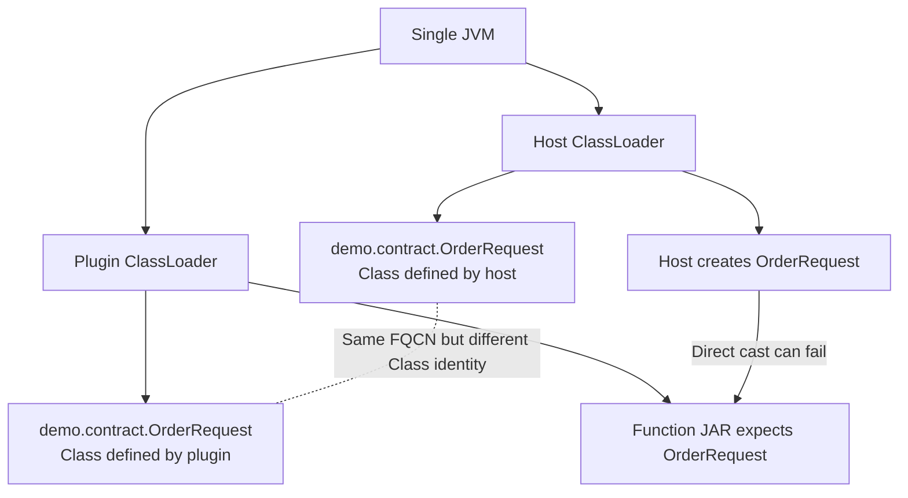
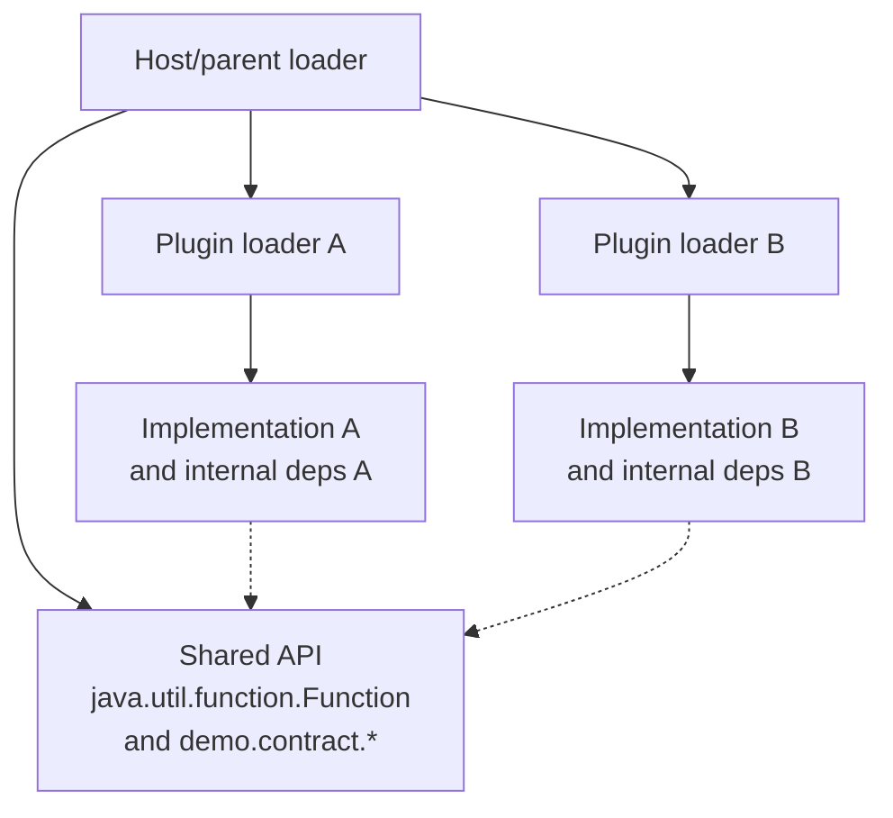
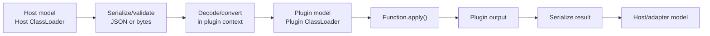
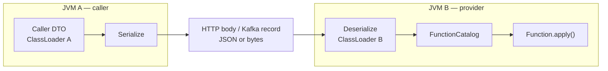
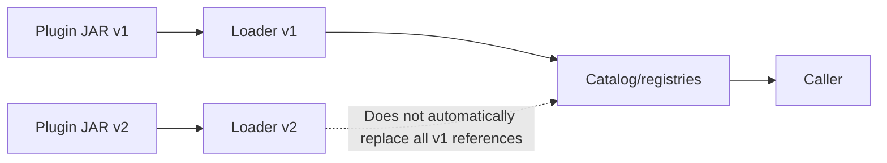

# Isolated ClassLoaders and Type Boundaries Between Applications

## 1. The Problem: Same Class Name, Yet Objects Cannot Be Shared

A shipping fee calculation system has a Spring Boot **host application** responsible for receiving HTTP requests or Kafka events. The business team releases a `Function<OrderRequest, OrderQuote>` function in a separate JAR, and the host uses **Spring Cloud Function**'s JAR loading mechanism to register and invoke the function. Both the host application and the external JAR define a class named `demo.contract.OrderRequest`.

In source code, both sides see the exact same package, class name, and fields. However, when loading the artifact with an **isolated ClassLoader**, an error like the following can still appear:

```text
java.lang.ClassCastException:
  class demo.contract.OrderRequest cannot be cast to
  class demo.contract.OrderRequest
```

The message looks absurd, yet it has a clear cause: **Java does not identify a reference type solely by class name; the ClassLoader that defined the class is also part of the type's identity.**

In the `SPRING_CLOUD_FUNCTION` module, we learn how to isolate logic into `Supplier<T>`, `Function<T,R>`, and `Consumer<T>`; register and look up via `FunctionCatalog`, compose, convert messages, and trigger via HTTP, events, or serverless environments. This topic explains **Java type boundaries between code units** when logic is loaded from an external JAR, and clarifies the difference between:

1. **Two classloaders inside the same JVM** (host and externally loaded function JAR).
2. **Two Spring ApplicationContexts** that may relate to the host and an application containing functional beans.
3. **Two independent applications/processes** calling each other over HTTP or a broker.

These three boundaries are not equivalent: a ClassLoader handles class loading/identity inside a JVM; a Spring context handles beans/lifecycles; a network contract handles data exchanged between processes.

> **Version scope:** `spring-cloud-function-deployer` has different packaged-function loading mechanisms depending on the Spring Cloud Function version. Examples use `URLClassLoader` to illustrate **standard JVM rules**, and do not claim that every deployer release uses `URLClassLoader` itself or the same parent/child delegation policy. When running against a specific release, verify the actual loader, JAR format, catalog registration, and artifact load/unload support.

## 2. What Does a ClassLoader Do?

A `ClassLoader` locates and loads bytecode so the JVM can use Java classes. In modern Java, you commonly encounter:

| Loader / concept | Typical role | Notes |
| --- | --- | --- |
| **Bootstrap class loader** | Loads foundational classes like `java.lang.String`, `java.util.function.Function`. | In Java APIs, `String.class.getClassLoader()` typically returns `null` to represent the bootstrap loader. |
| **Platform class loader** | Loads certain Java platform modules. | Accessible via `ClassLoader.getPlatformClassLoader()`. |
| **Application/System class loader** | Loads application code per runtime configuration. | Accessible via `ClassLoader.getSystemClassLoader()`, though classpath/module details depend on how the app is launched. |
| **Custom/plugin class loader** | Loads classes from plugin or dynamic module JARs/paths. | Delegation policies and class visibility scopes can vary. |
| **Thread context class loader (TCCL)** | Loader reference for frameworks/APIs that look up classes or resources per thread context. | Not a new ClassLoader by itself; it is a property of a thread. |

**A ClassLoader is not equivalent to a Spring ApplicationContext.** One Spring context can hold beans loaded by multiple loaders; two contexts can also share one loader. Thus, seeing `@Bean` in a context does not prove Java types are compatible across the plugin boundary.

## 3. Type Identity: Class Name and Defining ClassLoader

A practical way to understand a **reference type** in the JVM:

```text
Type identity ≈ (binary name, defining ClassLoader)
```

Given two loaders `L1` and `L2` that each define a class with binary name `demo.contract.OrderRequest`:

```text
("demo.contract.OrderRequest", L1)
    !=
("demo.contract.OrderRequest", L2)
```

Therefore, even when the source code of the two classes is identical:

- Their `Class<?>` objects are two distinct instances.
- `Class.isInstance(...)` returns `false` across the two sides.
- Standard casts throw `ClassCastException`.
- Reflective invocation of a method expecting `OrderRequest` from loader A while passing an object from loader B can throw `IllegalArgumentException: argument type mismatch`.
- Framework APIs that inspect by class name while ignoring loader identity can falsely report compatibility.

Conversely, **two different loaders do not necessarily create two different types**. If both delegate and receive the **same class defined by a parent loader**, identity remains one. What matters is the **defining loader**, not merely the classloader on which `loadClass()` was called.

### 3.1. Diagram of two types with the same name in one JVM



This is the **duplicate class definition scenario**, not the default outcome of every plugin loader. If the host supplies the API contract in the parent and the plugin loader delegates that class properly, both sides can safely share one type.

## 4. Plain Java Experiment: Two URLClassLoaders Loading the Same JAR

Before examining Spring Cloud Function, let us prove the rule with Java SE. Suppose we have a **simple JAR** containing only:

```java
// src/main/java/demo/plugin/OrderRequest.java
package demo.plugin;

public record OrderRequest(String orderId) {}
```

Build the library JAR from a Java 17 Maven project (or using `javac`/`jar`) so you have:

```text
plugins/contracts-demo-1.0.0.jar
└── demo/plugin/OrderRequest.class
```

The test program below lives in **another host project**. One crucial condition: **`demo.plugin.OrderRequest` must not appear on the host's classpath**; it resides only in the plugin JAR.

```java
package demo.host;

import java.net.URL;
import java.net.URLClassLoader;
import java.nio.file.Path;

public class ClassIdentityDemo {
    public static void main(String[] args) throws Exception {
        Path jar = Path.of("plugins/contracts-demo-1.0.0.jar");
        URL[] urls = { jar.toUri().toURL() };

        // Both loaders use the platform parent to avoid the host
        // accidentally supplying demo.plugin.OrderRequest.
        try (URLClassLoader loaderA = new URLClassLoader(
                    urls, ClassLoader.getPlatformClassLoader());
             URLClassLoader loaderB = new URLClassLoader(
                    urls, ClassLoader.getPlatformClassLoader())) {

            Class<?> typeA = Class.forName(
                    "demo.plugin.OrderRequest", true, loaderA);
            Class<?> typeB = Class.forName(
                    "demo.plugin.OrderRequest", true, loaderB);

            Object requestA = typeA
                    .getDeclaredConstructor(String.class)
                    .newInstance("OD-204");

            System.out.println(typeA.getName().equals(typeB.getName()));
            System.out.println(typeA == typeB);
            System.out.println(typeB.isInstance(requestA));
            System.out.println(typeA.getClassLoader() == loaderA);

            try {
                typeB.cast(requestA);
            } catch (ClassCastException error) {
                System.out.println("Cast failed across loaders");
            }
        }
    }
}
```

Expected output:

```text
true
false
false
true
Cast failed across loaders
```

Explanation:

- `getName()` of both classes is identical, so the first line is `true`.
- `typeA == typeB` returns `false`: two distinct class definitions.
- `requestA` is only an instance of `typeA`, not `typeB`.
- Loader B cannot cast an object created by loader A's class definition.

Using the **platform parent** in this experiment controls the loading path and is not a default recommendation for all plugin apps. A function using Spring or a shared API usually needs a **parent that can see the appropriate interfaces/contracts**. The experiment simply demonstrates the identity rule.

### 4.1. Condition that changes the result

If `demo.plugin.OrderRequest` is also on the **parent loader's** classpath and the loader uses a parent-first policy, both `loaderA` and `loaderB` can return the **same class from the parent**. Then:

```java
typeA == typeB // Can be true.
```

Saying "every ClassLoader always creates a separate copy of every class" is false. You must inspect **which loader defined the class**, delegation policy, classpath order, and prioritized packages.

## 5. Parent-First, Child-First, and the Shared API Zone

A custom ClassLoader can be:

1. **Parent-first:** try the parent loader first, then search the child's own repository if the parent lacks the class.
2. **Child-first for certain packages:** try bytecode in the plugin first to isolate dependencies; still must protect Java platform packages and handle shared contracts carefully.
3. **Hybrid/selective:** use the parent for shared APIs, while the plugin loads its own implementation or isolated libraries.

Standard classloaders like `URLClassLoader` typically follow **parent delegation**. Plugin frameworks may implement different policies. Spring Cloud Function Deployer must also be verified on your **actual release**, rather than assuming it is always child-first or always isolates every dependency.



**Design goal:** ensure types appearing in the host–function communication signature are defined and shared from one consistent source, while implementations and specific dependencies can be isolated as needed.

### 5.1. Which classes usually need to be shared?

| Class category | How to handle it? | Reason |
| --- | --- | --- |
| `java.util.function.Function`, `Supplier`, `Consumer` | Use JDK classes. | Interfaces share identity via the bootstrap loader. |
| `java.lang.String`, `BigDecimal` | Use JDK classes. | Easy to pass at Java boundaries; no plugin DTO needed. |
| DTO/API `demo.contract.OrderRequest` | Place in a **shared contract artifact** supplied by parent if passing objects directly. | Prevents two loaders from defining two types with the same FQCN. |
| `demo.plugin.ShippingPolicy` | Can be loaded by the plugin loader. | Implementation is an internal detail. |
| JSON/validation client libraries | Consistently choose sharing/isolation per runtime. | Prevents conflicts without introducing type identity conflicts on public APIs. |
| Spring context/framework types | Must align closely with Spring/loader version. | Bean reflection/proxies, annotations, and conversions may depend on loader/framework versions. |

Good packaging is not just "having all the JARs"; it means knowing **which loader owns each package** and whether API-facing classes are packaged redundantly.

## 6. Boundaries of `Supplier`, `Function`, and `Consumer`

Even though `Function`/`Supplier`/`Consumer` are JDK interfaces shared by host and plugin, the **generic types and objects passed through them** can still be incompatible.

| Functional interface | Boundary point | Risk if classloaders differ |
| --- | --- | --- |
| `Supplier<OrderQuote>` | `get()` returns an `OrderQuote` object. | Host does not recognize the returned object's class if using another DTO copy. |
| `Function<OrderRequest,OrderQuote>` | `apply(OrderRequest)` receives and returns objects. | Input from host cannot cast to plugin DTO; output cannot cast to host DTO. |
| `Consumer<OrderEvent>` | `accept(OrderEvent)` receives an object and causes side effects. | Adapter converts to wrong loader's DTO; runtime errors and retries can duplicate side effects. |

Risky design example:

```text
Host:   Function<host-loader::OrderRequest,
                 host-loader::OrderQuote>
Plugin: Function<plugin-loader::OrderRequest,
                 plugin-loader::OrderQuote>
```

The Java compiler sees the same `OrderRequest` name in both projects, yet **the JVM does not consider them the same type** if defining loaders differ. If the plugin class implements `Function<OrderRequest,OrderQuote>` and `apply(OrderRequest)` has a synthetic bridge method from generic erasure, the bridge performs a runtime cast to the DTO seen by the plugin. When the host passes a DTO from another loader, failure can strike inside that bridge method.

### 6.1. Why test JAR loading with `Function<String,String>` first?

With JDK types like `String`, custom plugin DTO issues are greatly reduced:

```java
package demo.plugin;

import java.util.Locale;
import java.util.function.Function;

public final class NormalizeOrderId
        implements Function<String, String> {

    public NormalizeOrderId() {}

    @Override
    public String apply(String value) {
        if (value == null || value.isBlank()) {
            throw new IllegalArgumentException("Missing orderId");
        }
        return value.strip().toUpperCase(Locale.ROOT);
    }
}
```

For input `" od-204 "`, output is `"OD-204"`. If a smoke test with this type passes yet switching to a custom DTO hits `ClassCastException`, investigate **classloader boundaries and message conversion** before suspecting the normalization logic.

## 7. FunctionCatalog Helps Invoke Functions, Not Erase ClassLoader Boundaries

In **Spring Cloud Function**, `FunctionCatalog` provides lookup by name and composition for registered function beans/wrappers, for example:

```java
Function<String, String> normalize =
        catalog.lookup("normalizeOrderId");
String normalized = normalize.apply(" od-204 ");
```

This snippet assumes `catalog` is injected in a Spring context with the function **registered under the actual name** `normalizeOrderId`. If the function comes from an external JAR, verify the catalog name published by the deployer; **do not guess names from class/JAR names**.

`FunctionCatalog` may return a **wrapper** rather than the raw `new NormalizeOrderId()` instance. The wrapper may handle message conversion, type metadata, or composition. This **is not magic** that makes all classloader conflicts disappear:

- If the host passes matching JDK types or shared DTOs, the call can work.
- If the host passes a same-named DTO defined by another loader, casts can fail.
- If routed through appropriate conversion (e.g., JSON/text → the input type the plugin actually expects), the object boundary may be handled differently.
- If type metadata is incomplete, the converter may not know which class to instantiate, or may instantiate it in an unintended loader.

**Do not cast the return value from catalog to the plugin's implementation class.** Looking up via the `Function` interface is more stable; type contracts must be designed and tested separately.

### 7.1. Commonly confused names

| Name | Example | Meaning |
| --- | --- | --- |
| Artifact name | `shipping-rules-1.0.0.jar` | File containing code. |
| FQCN | `demo.plugin.NormalizeOrderId` | Class name for the loader. |
| Spring bean name | `normalizeOrderId` | Bean registered in the context. |
| Name in `FunctionCatalog` | `normalizeOrderId` if confirmed | Name accepted by `lookup(...)`. |
| Function definition | `normalizeOrderId|validateOrderId` | Selects or composes functions already in the catalog. |
| HTTP route / broker binding | `/normalizeOrderId`, `normalizeOrderId-in-0` | Entry point per adapter and configuration. |

Changing `spring.cloud.function.location` to swap artifacts, `spring.cloud.function.function-class` when using simple JAR class selection, and `spring.cloud.function.definition` to pick a function/pipeline are **three separate responsibilities**. They do not replace designing type boundaries.

## 8. Solution A: A Shared API JAR Supplied by the Parent Loader

If the host needs to **pass Java objects directly** to the function and get Java objects back, design a **shared contract artifact**. A typical structure:

```text
shipping-contract-api.jar
    demo.contract.ShippingRequest
    demo.contract.ShippingQuote
            ^
            | same Class identity via parent loader
            |
  +---------+------------+
  |                      |
Host application       Function plugin JAR
  creates DTO            implements Function<DTO, DTO>
  calls Function          uses shared API classes
```

The shared API must be **loaded/defined once along a path shared by both sides**, usually by the plugin's parent loader. Simply having the same Maven coordinate in two JARs does not guarantee shared class identity: if the plugin shades/bundles an extra copy or has a child-first rule for contract packages, type duplication can still occur.

### 8.1. Project `shipping-contract-api`

Create Java 17 records:

```java
// shipping-contract-api/src/main/java/demo/contract/ShippingRequest.java
package demo.contract;

import java.math.BigDecimal;

public record ShippingRequest(
        String orderId,
        String region,
        BigDecimal subtotalVnd) {}
```

```java
// shipping-contract-api/src/main/java/demo/contract/ShippingQuote.java
package demo.contract;

import java.math.BigDecimal;

public record ShippingQuote(
        String orderId,
        BigDecimal feeVnd) {}
```

Suppose the API JAR has Maven coordinates:

```text
demo.contracts:shipping-contract-api:1.0.0
```

Versions must be governed and both sides must agree on field semantics. `BigDecimal` belongs to the JDK, so it adds no extra classloader identity issues for currency values.

### 8.2. Function project implementing the shared contract

The function JAR depends on the **API artifact** to compile without defining the records itself:

```java
// shipping-rule-plugin/src/main/java/demo/plugin/QuoteShipping.java
package demo.plugin;

import demo.contract.ShippingQuote;
import demo.contract.ShippingRequest;
import java.math.BigDecimal;
import java.util.function.Function;

public final class QuoteShipping
        implements Function<ShippingRequest, ShippingQuote> {

    public QuoteShipping() {}

    @Override
    public ShippingQuote apply(ShippingRequest input) {
        if (input == null || input.orderId() == null ||
                input.orderId().isBlank()) {
            throw new IllegalArgumentException("Missing orderId");
        }
        BigDecimal subtotal = input.subtotalVnd();
        if (subtotal == null || subtotal.signum() < 0) {
            throw new IllegalArgumentException("Invalid subtotal");
        }
        if (input.region() == null) {
            throw new IllegalArgumentException("Missing region");
        }

        BigDecimal fee = switch (input.region().strip()
                .toUpperCase(java.util.Locale.ROOT)) {
            case "INNER" -> new BigDecimal("20000");
            case "OUTER" -> new BigDecimal("40000");
            default -> throw new IllegalArgumentException(
                    "Unsupported region");
        };
        if (subtotal.compareTo(new BigDecimal("500000")) >= 0) {
            fee = BigDecimal.ZERO;
        }
        return new ShippingQuote(input.orderId(), fee);
    }
}
```

`QuoteShipping` can load as a class implementing `Function` from a simple JAR **if your deployer supports the corresponding mechanism**. How non-JDK dependencies of the function are loaded, how the parent supplies the API, and what function name is registered must be verified on that release.

One way to declare the Maven API dependency in the **plugin's POM**:

```xml
<dependency>
    <groupId>demo.contracts</groupId>
    <artifactId>shipping-contract-api</artifactId>
    <version>1.0.0</version>
    <scope>provided</scope>
</dependency>
```

`provided` tells the plugin compiler the contract API is visible, while **the runtime must supply that API by other means**. In this model, the host/parent loader actively provides the contract. **`provided` does not automatically configure Function Deployer's classloader**, nor guarantee the resolver automatically shares classes from host to plugin. This is a deployment requirement that must be verified. If using a mechanism without parent API sharing, consider communicating via serialized payloads instead of passing DTOs directly.

### 8.3. Host also uses the exact same API artifact

The host declares the **same contract** `shipping-contract-api:1.0.0` on its compile/runtime classpath. It does not need to import `demo.plugin.QuoteShipping` if loading the plugin at runtime.

Example Java caller in the host **when the plugin genuinely shares the API with the host**:

```java
import demo.contract.ShippingRequest;
import demo.contract.ShippingQuote;
import java.math.BigDecimal;
import java.util.function.Function;

// catalog is injected and the function name has been verified.
Function<ShippingRequest, ShippingQuote> quote =
        catalog.lookup("quoteShipping");
if (quote == null) {
    throw new IllegalStateException("quoteShipping missing");
}
ShippingQuote result = quote.apply(
        new ShippingRequest(
                "ORD-204", "INNER", new BigDecimal("450000")));
// result.feeVnd() = 20000
```

This snippet is a **conditional integration sample**, not a claim that the deployer automatically names it `quoteShipping` or shares parent APIs. To run it, verify two things first: the lookup name exists, and the `ShippingRequest.class` used by the plugin is genuinely defined by the same loader as the host.

### 8.4. Checking class identity, not just package name

In tests, when you can inspect the actual classes in use:

```java
Class<?> hostType = ShippingRequest.class;
ClassLoader hostLoader = hostType.getClassLoader();

System.out.println("Host DTO: " + hostType.getName());
System.out.println("Host loader: " + hostLoader);
```

To compare against the plugin, retrieve the `Class<?>` **of the type the plugin actually uses**—for example via the implementation's method signature and appropriate classloader—rather than calling `Class.forName(...)` with the host loader and assuming it is the plugin type.

If both sides use the same class:

```java
hostType == pluginInputType // true
```

That is more direct proof than two classes sharing `getName()`. Also verify object instances actually satisfy `hostType.isInstance(...)` and that catalog conversions/wrappers do not create unexpected types.

## 9. Parent Sharing Experiment with Java URLClassLoader

You can demonstrate the principle before using Spring by arranging:

```text
Host classpath:
  shipping-contract-api-1.0.0.jar
  host-demo.jar

Plugin JAR:
  shipping-rule-plugin-1.0.0.jar
  (contains only demo.plugin.QuoteShipping, without bundling contract classes)
```

Then the host creates a plugin loader whose **parent is the loader that loaded the API contract**:

```java
import demo.contract.ShippingQuote;
import demo.contract.ShippingRequest;
import java.math.BigDecimal;
import java.net.URL;
import java.net.URLClassLoader;
import java.nio.file.Path;
import java.util.function.Function;

Path jar = Path.of("plugins/shipping-rule-plugin-1.0.0.jar");
URL[] urls = { jar.toUri().toURL() };

try (URLClassLoader pluginLoader = new URLClassLoader(
        urls, ShippingRequest.class.getClassLoader())) {

    Class<?> implementation = Class.forName(
            "demo.plugin.QuoteShipping", true, pluginLoader);
    Object instance = implementation
            .getDeclaredConstructor().newInstance();

    if (!(instance instanceof Function<?, ?>)) {
        throw new IllegalStateException("Not a Function");
    }

    // Conditional cast: shared API contract provided by parent.
    @SuppressWarnings("unchecked")
    Function<ShippingRequest, ShippingQuote> fn =
            (Function<ShippingRequest, ShippingQuote>) instance;

    ShippingQuote result = fn.apply(new ShippingRequest(
            "ORD-204", "OUTER", new BigDecimal("600000")));
    System.out.println(result.feeVnd()); // 0
}
```

**Mandatory condition:** the plugin JAR must not define `demo.contract.*` itself, and its loader must genuinely delegate that package to the parent. When `QuoteShipping` references `ShippingRequest`, the JVM resolves it to the class defined in the parent. Thus, objects created by the host can cross the `Function` interface.

This experiment uses **JDK `URLClassLoader`**, not a guide to replacing `spring-cloud-function-deployer` in production. `@SuppressWarnings("unchecked")` only silences compiler warnings for the generic cast; **it does not verify the contract at runtime**. If generic signatures mismatch or the loader resolves differently, `ClassCastException` can still occur. Test with real inputs/outputs.

## 10. Solution B: Converting Data at the Boundary Instead of Sharing DTOs

Sharing `ShippingRequest.class` between host and plugin is not always desirable. For example:

- The plugin has its own version lifecycle and needs a model different from the host's.
- The host is a multi-tenant platform loading many plugins with different schemas.
- There is risk of conflicting Java API dependency versions.
- Callers actually arrive via HTTP or a broker, so data is already serialized.

One option is to define a **data transfer contract** as JSON, text, Avro, Protobuf, or a suitable schema, and convert explicitly on each side.



Example JSON request payload:

```json
{
  "orderId": "ORD-204",
  "region": "INNER",
  "subtotalVnd": 450000
}
```

Result:

```json
{
  "orderId": "ORD-204",
  "feeVnd": 20000
}
```

These JSON documents **carry no Java ClassLoader identity**. The serializer/deserializer inside the host or plugin determines which class is instantiated. When communicating over HTTP/Kafka, that is the natural communication style: no raw `ShippingRequest` Java object crosses the network.

### 10.1. Distinguishing "converting to JSON" from "casting"

Merely casting:

```java
ShippingRequest request = (ShippingRequest) pluginObject;
```

**does not convert data** and will fail if `pluginObject` is an instance of a same-named class from another loader. By contrast, a data mapping step:

```text
plugin OrderRequest → JSON bytes → host OrderRequest
```

can construct a **new object** of the right host class. In exchange, you must manage schemas, validation, serialization formats, backward compatibility, and conversion overhead. Do not assume `ObjectMapper.convertValue(...)` automatically solves all classloader errors; the mapper still depends on target `Class` objects, module configs, and how the framework selects loaders.

### 10.2. Using simple types before custom DTOs

In JAR loading experiments, `Function<String,String>` or `Function<Map<String,Object>,Map<String,Object>>` can reduce certain class identity issues, yet `Map` also carries an implicit schema: keys, value types, currency units, nulls, and data units must all be specified. Do not skip validation or contract testing simply because "there is no DTO".

## 11. Spring Cloud Function and `Message` Conversion

Spring Cloud Function has a **wrapper/converter** concept during function registration and lookup. In some adapters, inputs arrive as payloads and message headers; the framework converts them into the input type required by the function.

Business signature example:

```java
Function<ShippingRequest, ShippingQuote>
```

and a signature that preserves metadata:

```java
Function<Message<ShippingRequest>, Message<ShippingQuote>>
```

In the second example, `Message` belongs to `org.springframework.messaging`, not `java.util.function`. Plugin and host must use compatible Spring dependency versions; across multiple classloaders, the identity of `Message` and DTOs must also be controlled.

A function can use `Message` to read a correlation ID and build a new message:

```java
import java.util.function.Function;
import org.springframework.messaging.Message;
import org.springframework.messaging.support.MessageBuilder;

public class ForwardHeader implements
        Function<Message<String>, Message<String>> {
    @Override
    public Message<String> apply(Message<String> input) {
        return MessageBuilder.withPayload(
                    input.getPayload().strip())
                .copyHeaders(input.getHeaders())
                .build();
    }
}
```

This example uses Spring Messaging only at the boundary and copies headers verbatim; sensitive headers, delivery metadata, or mutable metadata must still be evaluated before forwarding to another system.

### 11.1. Watch out for generic type metadata

`FunctionCatalog.lookup("quoteShipping")` returns a function with the generic signature the caller **declares at compile time**, yet **there is no full generic type check at runtime** due to type erasure:

```java
Function<String, String> wrongType =
        catalog.lookup("quoteShipping");
// Compiles cleanly, but at invocation time it will not
// turn QuoteShipping<ShippingRequest,ShippingQuote>
// into a valid Function<String,String>.
```

The declaration above illustrates a **contract mismatch**: do not call `apply("...")` assuming a wrapper will convert an arbitrary string into a valid Java request object. Conversion works only when the framework has sufficient type metadata and the right converter/schema. You may hit runtime errors or unexpected results.

**Advice:** keep generic signatures explicit, test function lookup with real inputs, and if transporting data via messages, verify content types, converters, and DTO loaders on both input and output.

## 12. Composition Can Expose ClassLoader Boundaries

Consider two functions:

```text
normalizeOrderId : Function<String, String>
validateOrderId  : Function<String, OrderValidation>
```

If both use JDK `String`, a pipeline:

```java
Function<String, OrderValidation> pipeline =
        catalog.lookup("normalizeOrderId|validateOrderId");
```

can work when both functions are registered and the adapter supports composition properly. However, if `normalize` returns a DTO from loader A and `validate` expects a same-named DTO from loader B, composition **does not merge two types into one**.

```text
Plugin A:
  normalize : String → pluginA.OrderRequest

Plugin B:
  validate  : pluginB.OrderRequest → OrderValidation

The name "OrderRequest" looks matching,
yet A's output is not automatically B's input.
```

The pipeline junction must take one of two options:

1. Use a **shared API type** that both genuinely resolve from the same defining loader; or
2. Insert an **explicit conversion/serialization step** from A's output to B's input.

**Catalog composition does not create HTTP/Kafka communication between two processes.** It chains lookable functions within the corresponding runtime/context. Orchestrating across multiple services requires separate routing/message topologies or workflows.

### 12.1. Why do errors sometimes appear only at invocation time?

Due to Java generic erasure and wrapper mechanics, a pipeline can be built and looked up without casting intermediate objects yet. Failures surface only when:

- Function A actually produces an output object.
- Function B or a converter attempts to use that object as an input class from another loader.
- The JVM executes `checkcast` or framework reflection/conversion checks types.

Therefore, **testing that lookup is non-null is insufficient**: invoke the pipeline with representative data and verify outputs/side effects.

## 13. Spring ApplicationContext Differs from ClassLoader Boundaries

With a Spring Boot executable JAR containing functional beans, loading a packaged application may require handling context, dependencies, and bean lifecycles per the specific deployer mechanism:

```text
Host Spring ApplicationContext
  ├─ Host FunctionCatalog / adapters / services
  └─ Functions exposed from external artifact (loader-dependent)

Spring Boot artifact has:
  ├─ @SpringBootApplication
  ├─ @Configuration and @Bean Functions
  ├─ Dependencies in BOOT-INF/lib
  └─ Possibly its own context/initialization per runtime mechanism
```

Do not equate two statements:

- **"The `quoteShipping` bean exists in the source Spring Boot application."**
- **"The host catalog loading the JAR registered `quoteShipping` with a valid type."**

To confirm the second, **verify inside the host on the exact deployer version**. Bean scopes, proxies, auto-configuration, resource lifecycles, converters, and classloaders can differ from running the source application with `java -jar`.

### 13.1. Typical context and loader errors

| Error | Possible cause |
| --- | --- |
| `NoSuchBeanDefinitionException` | Bean exists only in another context or was not imported/scanned/registered. |
| `ClassCastException` on a proxy | Proxy/interface or DTO was loaded by a different loader than the caller's type. |
| `NoSuchMethodError` | Spring/framework versions between plugin and host are incompatible. |
| `BeanCreationException` | Source artifact config/constructor/dependency or auto-configuration failed. |
| `FunctionCatalog` lookup returns `null` | Registered name/definition differs from expectation; or loading failed earlier. |

A Spring context starting cleanly does not prove **every bean** can be invoked from the host. When the framework isolates contexts, use only functions exposed through supported APIs.

## 14. Passing Data Over HTTP or Messaging: Not Same-JVM Objects

Here we must distinguish **ClassLoader isolation** from **process isolation**. When a host runs a plugin JAR inside the same JVM, functions can be invoked directly as Java objects; when the caller lives in another application, **no Java object crosses the wire verbatim** like a normal `apply()` call.



**Two JVMs always have separate memory/classloaders**, yet that does not trigger a Java `ClassCastException` between caller and provider: the caller **never passes Java references directly** to the provider. The real contract is **wire format**, schemas, headers, error statuses, and delivery semantics.

| Call environment | What crosses the boundary? | Primary checkpoints |
| --- | --- | --- |
| Host calls plugin in same JVM | Java references/objects, possibly wrapped. | Class identity, generic types, loaders, and converters. |
| HTTP between two apps | Request/response bytes, typically JSON/text. | URL, method, schema, content type, statuses/errors, auth. |
| Kafka/RabbitMQ between two apps | Serialized message payloads and headers. | Schema, keys, partitions, consumer groups, retry/DLQ. |
| Serverless handler | Event envelope and runtime-deserialized data. | Triggers, event types, handlers, timeouts, and failure semantics. |

### 14.1. Is using the same DTO name on two JVMs acceptable?

Yes, if exchanging data via a compatible schema:

```text
Caller JVM A:  demo.client.OrderRequest
                         |
                     JSON bytes
                         |
Provider JVM B: demo.provider.ShippingRequest
```

The two classes do not need the same FQCN or even the same language runtime. A Java app can call a Go/Node.js service as long as both honor the HTTP/message contract. Thus, **a shared Java API JAR is not mandatory in distributed architectures**; sometimes it even creates unnecessary coupling.

### 14.2. Avoid defaulting to native Java serialization

Java `Serializable`/`ObjectInputStream` is not a good default communication contract between services. It couples both sides to class definitions and serialization compatibility, introduces security risks when deserializing untrusted sources, and makes cross-language schema evolution difficult. For HTTP/messaging, prefer published formats and schemas with clear versioning and validation.

## 15. JAR Formats: Simple Library JAR vs. Boot Executable JAR

A common cause of class-loading failures has nothing to do with DTOs: **the loader does not understand how the artifact is packaged**.

| Artifact style | Typical structure | Consequence |
| --- | --- | --- |
| Simple library JAR | `demo/plugin/NormalizeOrderId.class` directly at package path. | Suitable for illustrating standard JAR class loading. |
| Spring Boot executable JAR | `BOOT-INF/classes`, `BOOT-INF/lib/*.jar`, and launcher. | Requires release-supported mechanisms to read Boot archives/nested dependencies. |
| Shaded/uber JAR | Classes and dependencies merged into one archive, sometimes with relocation. | Can accidentally bundle the shared API, creating duplicate classes or version conflicts. |
| Modular JAR / JPMS | May contain `module-info.class` and use module layers. | Requires checking module readability/access beyond ClassLoader identity. |

If the function JAR only needs `Function<String,String>`, a simple library JAR with an explicit constructor is usually the best learning step. For apps with `@Bean` definitions and Spring config, you may need a Function Deployer mechanism supporting **packaged Spring Boot applications**, rather than putting a bean method name into `function-class` hoping the loader finds it.

Example `location`/`function-class` config for **deployer lines supporting simple JAR loading**:

```yaml
spring:
  cloud:
    function:
      location: "file:///opt/functions/normalize-order-id-1.0.0.jar"
      function-class: "demo.plugin.NormalizeOrderId"
```

This is a **release-dependent illustrative configuration**, not a claim that every Spring Cloud Function runtime supports this loading style. The JAR must exist on the filesystem visible to the **host JVM**, not solely on the developer's machine.

If the function source is a Spring Boot JAR with `@Bean Function` beans, the host must use a loader mechanism compatible with **Boot layout and bean discovery**. Running the source application with `java -jar` does not prove the host can load the same artifact via `location`.

## 16. Version and Dependency Conflicts Between Host and Plugin

When loading multiple JARs in one JVM, each plugin may rely on a different version of a library:

```text
Host:
  Spring Framework vA
  shipping-contract-api 1.0
Plugin A:
  validation-library v1
Plugin B:
  validation-library v2
```

An isolated loader can let two implementations use different internal dependency versions. Yet the **shared API/framework boundary** must remain compatible. Common failures:

| Error / symptom | Likely cause |
| --- | --- |
| `NoClassDefFoundError` | Dependency absent from any visible classloader. |
| `ClassNotFoundException` | Wrong class name, missing JAR, or loader cannot access artifact. |
| `NoSuchMethodError` | Plugin compiled against a different API version than what the loader provides at runtime. |
| `LinkageError` or loader constraint violation | Incompatible type definitions meet in a method signature/call. |
| `ClassCastException` | Object and target type lack the same class identity. |
| `ServiceConfigurationError` | `ServiceLoader` finds a provider with the wrong loader or the provider does not implement the caller-visible interface. |
| Reflection/module access error | Java Module System or visibility/access rules, not necessarily class identity. |

**Shading/relocation must be deliberate.** You can relocate an internal JSON library to prevent conflicts, **but never relocate or bundle a private copy of shared DTOs/APIs** if the host intends to pass them directly.

### 16.1. Maven dependency scope is only build metadata

`provided` in a function's POM means the dependency is assumed supplied by the runtime environment; **it does not automatically bind the API into the deployer's parent loader**. Conversely, `compile` and artifact resolution may bring extra dependencies into the plugin loader without guaranteeing matching identity. You must understand how your **release's actual loader** resolves classes, not just read `pom.xml`.

### 16.2. API version mismatches at the boundary

Suppose plugin A was compiled against `shipping-contract-api:1.0.0`, and plugin B against `2.0.0`. Even if both delegate to a parent, they may not be binary compatible if `2.0.0` changed constructors, record components, or method signatures.

A shared API JAR in the parent only solves **identity** when both use the exact same class; it does not make **version mismatches** vanish. For breaking changes, consider versioned contracts, adapter conversions, or splitting functions into independent processes.

## 17. Thread Context ClassLoader and Hard-to-Reproduce Bugs

Some Java APIs and frameworks do not rely solely on the calling class's defining loader; they also consult `Thread.currentThread().getContextClassLoader()`, commonly called **TCCL**. Examples include `ServiceLoader`, resource lookups, and certain serialization/provider discovery mechanisms.

Diagnostic snippet for debugging:

```java
ClassLoader definingLoader =
        NormalizeOrderId.class.getClassLoader();
ClassLoader contextLoader =
        Thread.currentThread().getContextClassLoader();

System.out.println("Defining loader: " + definingLoader);
System.out.println("Thread context loader: " + contextLoader);
```

These two values **can differ**, which is not an error by itself. However, if a plugin expects TCCL to point to its own loader while the request thread uses the host loader, providers/resources may fail to be discovered.

### 17.1. Changing TCCL must restore it

If a **framework/plugin container designed to manage loaders** needs to set TCCL during invocation, the minimum rule is **restoring TCCL in `finally`**:

```java
Thread thread = Thread.currentThread();
ClassLoader previous = thread.getContextClassLoader();
try {
    thread.setContextClassLoader(pluginLoader);
    // Call APIs that genuinely need the plugin context loader.
    invokePlugin();
} finally {
    thread.setContextClassLoader(previous);
}
```

This is a **conceptual pattern**, assuming `pluginLoader` and `invokePlugin()` are defined by the application. Do not manually wrap every `FunctionCatalog` call with TCCL swaps unless required by the loader/framework: overwriting the context loader at the wrong moment can break host libraries or leak loaders onto other requests.

### 17.2. Bugs with thread pools and async execution

With executors, Reactor, Kafka listeners, or `CompletableFuture` tasks, execution can hop onto another thread; TCCL is not automatically propagated like request-scoped attributes. If a plugin spawns its own threads holding a reference to the loader in `Thread.contextClassLoader`, that loader can stay pinned after the function is unloaded. Design lifecycles, propagation, and cleanup explicitly.

## 18. Swapping JARs, Class Unloading, and ClassLoader Lifecycle

A false assumption: "Replace the JAR file on disk, and the next function call will use the new class." In Java:

- A class already defined by a loader **is not automatically redefined** just because the JAR file changed.
- `URLClassLoader.close()` closes resources managed by the loader, yet **does not force the JVM to immediately unload all loaded classes**.
- Unloading is normally possible only when the loader and all associated classes/instances become unreachable under GC/runtime rules.
- With Spring function registries, bean references, converter caches, thread locals, thread pools, listeners, and static registries can keep old loaders alive.



**An isolated ClassLoader does not automatically provide safe hot reload.** With `spring-cloud-function-deployer`, swapping artifacts/re-registering classes, draining in-flight invocations, and tearing down contexts must be explicitly supported by your release. Otherwise, choose **host rolling restarts/rollouts** with immutable artifact versions and post-startup smoke tests.

### 18.1. References that easily cause classloader leaks

| Live reference source | Consequence |
| --- | --- |
| Static registry/bean cache holding plugin instances | Loader/plugin classes cannot be garbage-collected. |
| Unstopped threads created by the plugin | Pins the classloader via stack or TCCL; can cause memory leaks. |
| `ThreadLocal` inside a thread pool | Retains plugin objects/classes after requests finish. |
| Loggers/metrics/listeners registered on the host | Can hold references to plugin classes/objects. |
| Scheduled tasks or active subscriptions/reactive streams | Keep running old code and holding resources. |
| Converter/serializer caches keyed by `Class<?>` | Retain classes from the old loader. |

If reload is needed, the workflow must **stop accepting new calls → drain in-flight invocations → unregister listeners/tasks → close contexts/resources → drop references → load new version → test readiness** per framework support. Never build production hot-swap solely out of `close()` and `System.gc()`.

## 19. Security: Separating ClassLoaders Is Not a Sandbox

A plugin loaded into the JVM is **executable bytecode running with the process's permissions**. A ClassLoader helps organize dependencies and versions, yet does not inherently prevent code from:

- Reading files or secrets accessible to the JVM.
- Opening network connections to other hosts.
- Spawning threads that consume CPU/memory.
- Calling side-effecting APIs or mutating global state.
- Crashing the host via severe resource exhaustion.

If the host lets users arbitrarily pick `spring.cloud.function.location`, Maven coordinates, `function-class`, or a package containing untrusted code, the system becomes an arbitrary-code loading vector. **Load only approved artifacts** with controlled provenance, version/digest checks, repository access controls, dependency scanning, and rollback workflows.

For **strong permission/resource isolation**, run a **separate provider process/container** behind restricted HTTP/messaging APIs instead of treating a ClassLoader as a security boundary.

### 19.1. Do not expose every function in the catalog

`FunctionCatalog` can hold internal functions and side-effecting `Consumer`s. Never allow external callers to pass arbitrary function names for dynamic invocation. Use an allowlist of functions, action-level authorization, payload validation, and rate limiting. In particular, matching classloader identity **never replaces** authentication or authorization.

## 20. Layer-by-Layer Fault Diagnosis: Code, Loader, Contract, or Adapter?

A "function cannot be invoked" failure can originate at many layers. Analyze systematically:

| Symptom | First suspect | How to inspect |
| --- | --- | --- |
| File/JAR not found | `location`, volume mount, Maven resolver, or filesystem. | Check the JAR in the **host's** runtime environment, not just the build machine. |
| `ClassNotFoundException` | Wrong FQCN, wrong JAR layout, or loader cannot see class. | `jar tf`, package, `function-class`, loader search paths. |
| `NoClassDefFoundError` | Direct/transitive dependency missing. | POM, `BOOT-INF/lib`, loader, Maven repositories, and dependency scopes. |
| `UnsupportedClassVersionError` | JAR built for a newer JDK than the runtime. | Bytecode release vs. JRE runtime. |
| `NoSuchMethodError` | Library version / binary API conflict. | Stack trace, dependency versions, defining loader. |
| `ClassCastException` with identical class names | Duplicate class identity. | Compare `Class<?> == Class<?>` and actual `getClassLoader()`. |
| `IllegalArgumentException: argument type mismatch` via reflection | Argument object does not match the method's `Class<?>`. | `Method.getParameterTypes()` and `isInstance(...)`. |
| `ServiceConfigurationError` | SPI/provider discovery or wrong TCCL. | `ServiceLoader`, TCCL, and resource visibility. |
| Bean exists yet catalog returns `null` | Context/registry/name differs from expectation. | Source beans, host registry, deployer logs. |
| Catalog returns function yet `apply()` fails | Generic/type conversion or business error. | Actual input, class identity, headers/content type, stack trace. |
| Java caller works, HTTP returns 415 | Wrong content type/converter. | Web adapter, payload schema. |
| Java caller works, Kafka retries endlessly | Conversion, side effects, or binder error policy. | Definition, broker, DLQ, headers, schema. |
| JAR replaced yet old version still runs | Loader/registry unchanged, cache/version mismatch. | Artifact checksum, host rollout, live references/caches. |

### 20.1. Code for diagnosing ClassLoader identity

In integration tests, when holding objects and `Class<?>` from both sides:

```java
static void inspect(String label, Class<?> type) {
    ClassLoader loader = type.getClassLoader();
    System.out.println(label + " name=" + type.getName());
    System.out.println(label + " loader=" + loader);
    System.out.println(label + " module=" + type.getModule());
}

inspect("host", ShippingRequest.class);

// pluginLoader is the loader that actually holds the implementation.
Class<?> pluginType = Class.forName(
        "demo.contract.ShippingRequest", false, pluginLoader);
inspect("plugin", pluginType);

System.out.println(
        "Same Class object? " + (ShippingRequest.class == pluginType));
```

**Explanation:** `Class.forName(..., pluginLoader)` requests the class via the plugin loader, yet if it delegates to the parent, the result is still the **parent's Class**. That is the desired outcome for shared contracts. When debugging deeply, also inspect the implementation's method signature to confirm the function **actually uses** the contract class you are comparing against.

You can inspect `getProtectionDomain().getCodeSource()` to trace bytecode origins **when that metadata exists and is reliable at runtime**, though many class/loader/module setups lack a simple location; do not treat a single URL as sole proof.

### 20.2. Decision-tree diagnostic workflow

```text
[1] Is the artifact the right version and readable by the host?
    |
    +-- No --> Fix location/repository/mount/read permissions.
    |
    v
[2] Did the loader load the class and dependencies cleanly?
    |
    +-- No --> Check layout, FQCN, JDK, classpath.
    |
    v
[3] Is the function/bean registered in the right FunctionCatalog?
    |
    +-- No --> Check context, name, definition.
    |
    v
[4] Does calling with String/JDK types work?
    |
    +-- No --> Analyze implementation and wrapper.
    |
    v
[5] Does calling with DTOs have matching Class identity or converters?
    |
    +-- No --> Use shared parent API or explicit mapping.
    |
    v
[6] Does the HTTP/Stream/serverless adapter have the right contract?
    |
    +-- No --> Check schema, content type, bindings, event envelope.
```

Most importantly, **do not edit configuration for a layer that is not causing the failure**. For instance, an HTTP 404 does not prove `URLClassLoader` is broken; a `ClassCastException` during an internal Java call is unlikely to be a Kafka serialization bug.

## 21. Testing ClassLoader Boundaries with JUnit

### 21.1. Negative test: same FQCN but different Class identity

After creating the fixture JAR `plugins/contracts-demo-1.0.0.jar` containing record `demo.plugin.OrderRequest` as in section 4, you can write:

```java
package demo.host;

import static org.junit.jupiter.api.Assertions.assertEquals;
import static org.junit.jupiter.api.Assertions.assertFalse;
import static org.junit.jupiter.api.Assertions.assertNotSame;
import static org.junit.jupiter.api.Assertions.assertThrows;

import java.net.URL;
import java.net.URLClassLoader;
import java.nio.file.Path;
import org.junit.jupiter.api.Test;

class ClassLoaderBoundaryTest {

    @Test
    void sameNameDoesNotImplySameClass() throws Exception {
        Path jar = Path.of("plugins/contracts-demo-1.0.0.jar");
        URL[] urls = { jar.toUri().toURL() };

        try (URLClassLoader a = new URLClassLoader(
                    urls, ClassLoader.getPlatformClassLoader());
             URLClassLoader b = new URLClassLoader(
                    urls, ClassLoader.getPlatformClassLoader())) {

            Class<?> ta = Class.forName(
                    "demo.plugin.OrderRequest", true, a);
            Class<?> tb = Class.forName(
                    "demo.plugin.OrderRequest", true, b);

            Object request = ta.getConstructor(String.class)
                    .newInstance("OD-204");
            assertEquals(ta.getName(), tb.getName());
            assertNotSame(ta, tb);
            assertFalse(tb.isInstance(request));
            assertThrows(ClassCastException.class,
                    () -> tb.cast(request));
        }
    }
}
```

This test **depends on the pre-built fixture JAR**, so it is not a fully self-contained unit test unless the archive is prepared. It demonstrates a verifiable JVM boundary, **not testing Spring Cloud Function Deployer directly**.

### 21.2. Positive test: contract from parent

In a host with `shipping-contract-api` on the classpath, using `shipping-rule-plugin` without a bundled copy of the contract:

- Create the plugin loader with a parent that sees `ShippingRequest.class`.
- Load `demo.plugin.QuoteShipping`.
- Verify the object is a `Function<?,?>` and invoke it with `new ShippingRequest(...)` from the host.
- Verify `ShippingQuote.feeVnd()` matches the business rule.
- Verify `Class.forName("demo.contract.ShippingRequest", false, pluginLoader) == ShippingRequest.class`.

If the positive test fails, never drop a copy of `ShippingRequest` into the plugin to "silence `ClassNotFoundException`"; that turns the bug into **two definitions with the same name**. Check parent delegation and shared API provisioning first.

### 21.3. Integration tests in the Spring Cloud Function host

With a compatible `spring-cloud-function-deployer` version:

1. Load a `Function<String,String>` from a simple JAR via the supported `location`/`function-class` mechanism.
2. Verify the function registers under its **actual name**, look it up via `FunctionCatalog`, and invoke it with `" od-204 "`.
3. Load a function using shared API DTOs or a Boot JAR with functional beans per release support.
4. Verify class identity, input/output contracts, wrappers, and JSON/message conversion; invoke with realistic data.
5. Test a plugin bundling a duplicate same-named DTO to confirm failures are caught clearly rather than silently misbehaving.
6. Test two functions with different dependency versions and composition via `FunctionCatalog`.
7. Test how startup failures, restarts/rollouts, and resource cleanup are handled.

These are **tests plain Java unit tests cannot replace**: `apply()` passing in isolation does not mean deployer/classloader/catalog behavior in production works.

### 21.4. Adapter contract tests

| Test layer | What to verify |
| --- | --- |
| Internal Java | Loader identity, `FunctionCatalog.lookup`, and exceptions/inputs/outputs. |
| HTTP | JSON → function input, JSON response, status codes, schema errors, authentication. |
| Kafka/RabbitMQ | Bindings, content types, converters, keys/headers, retries/DLQ, idempotency. |
| Serverless | Handlers, event envelopes, serialization, timeouts, and failure contracts. |
| Rollout/plugin lifecycle | Versions/digests, readiness, classloader resource cleanup, concurrency. |

## 22. Choosing a Strategy Across Type Boundaries

| Actual need | More suitable strategy | Trade-off |
| --- | --- | --- |
| Simple function using only `String`/`BigDecimal` | Use shared JDK types in the signature. | Cannot strongly express every domain contract. |
| Host and plugin must pass Java objects directly | Shared API JAR from parent; control delegation. | Coupling to API/versions and loader policy. |
| Multiple plugins using different DTOs/versions | Serialized payloads + explicit adapter conversion. | Codec/schema and validation overhead. |
| Host wants to isolate implementation dependencies | ClassLoader isolation per release/plugin framework. | Complexity around class identity, lifecycle, caching, and debugging. |
| Untrusted plugin or strict resource limits | Separate provider process/container with clear APIs. | Network latency, RPC/broker failures, and distributed ops. |
| Updating versions while running | Use hot reload only if supported and tested by loader/framework; otherwise rolling restarts. | Managing draining/in-flight calls and rollbacks. |
| Multi-step pipeline with differing DTOs | Shared contract or explicit conversion between steps. | Must test every composition edge. |

**A shared API in the parent is not always the best answer.** In platforms where plugins must evolve independently, schema-based communication reduces Java binary compatibility coupling. Conversely, inside a single JVM managed by one team, a simple, well-tested shared API can be more efficient than serializing to JSON between every call.

## 23. Three-Level Hands-On Exercise

### Level 1 — Observing the class identity error

1. Create simple JAR `contracts-demo-1.0.0.jar` containing record `demo.plugin.OrderRequest`.
2. Create a host application **without** that class on its classpath.
3. Create two `URLClassLoader`s with the same JAR and platform parent; load the class via `Class.forName(...)`.
4. Print `getName()`, `getClassLoader()`, `typeA == typeB`, and `typeB.isInstance(requestA)`.
5. Document why the cast fails despite identical names.

### Level 2 — Sharing a single contract API properly

1. Create project `shipping-contract-api` containing `ShippingRequest` and `ShippingQuote`.
2. Place the API JAR on the host classpath; create plugin `QuoteShipping implements Function<ShippingRequest,ShippingQuote>`.
3. Do not bundle copies of the API classes inside the plugin JAR.
4. Use a plugin loader whose parent sees the API; verify `ShippingRequest.class == pluginContractType`.
5. Call `apply(...)` and confirm a 20,000 VND fee for `INNER` below the threshold, and free shipping from 500,000 VND.
6. Intentionally shade/bundle an API copy in a test setup with appropriate loader isolation, and explain when the identity conflict appears.

### Level 3 — Bringing it into Spring Cloud Function

1. Choose a release supporting simple JAR or Boot JAR loading via Function Deployer.
2. Load a `Function<String,String>` first; verify `FunctionCatalog` lookup and output.
3. Move to `Function<ShippingRequest,ShippingQuote>`; verify shared API/classloader and converters.
4. Build a composition with a type-compatible normalization step; verify both lookup and actual invocation.
5. If using an HTTP adapter, send JSON requests and verify output/error schemas; if using a Stream binder, test serialization, retries, and DLQ.
6. Upgrade the JAR via rollout, verify loader/registry state, and ensure no old version remains active unintentionally.
7. Write a table distinguishing three error types: **class not found**, **class present with wrong identity**, and **class right with wrong converter/transport**.

**Completion criteria:** not just getting one input to pass, but explaining *which loader defines which type*, *why a function registers yet fails when called with a DTO*, and *why HTTP/Kafka requires schemas instead of passing raw Java objects*.

## 24. Summary

In Java, **class identity is not just package and class name: it also depends on the defining ClassLoader**. When Spring Cloud Function loads functions from external JARs, host and implementation may use different loaders. This allows more independent artifact, dependency, and version organization, yet introduces risks of `ClassCastException`, `LinkageError`, dependency conflicts, and complexities when swapping JARs.

For `Supplier`, `Function`, and `Consumer`, the types in input/output signatures form the **communication boundary**. There are two main strategies to manage that boundary inside one JVM: **sharing an API contract genuinely defined by the parent** or **explicitly converting data across intermediate schemas/payloads**. `FunctionCatalog` handles lookup and composition, but cannot turn two same-named classes from two loaders into a single valid Java type.

Finally, **isolating ClassLoaders inside one JVM differs from separating two applications over HTTP or messaging**. At network boundaries, objects are serialized and deserialized per contract; at internal JVM boundaries, Java type identity remains in force. Proper JAR packaging, verifying classloaders and catalogs, testing conversions, managing dependencies/versions, and refusing to treat a loader as a sandbox preserve Spring Cloud Function's core goal: **reusing business logic across multiple protocols with explicit type and operational boundaries**.
