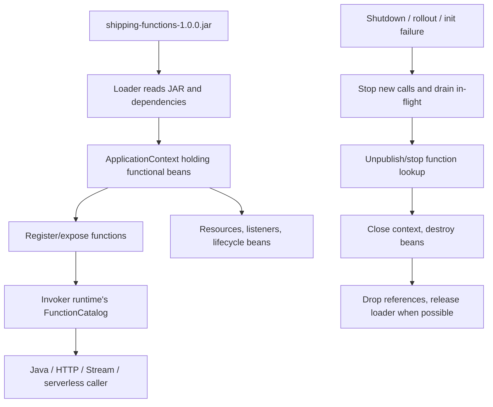
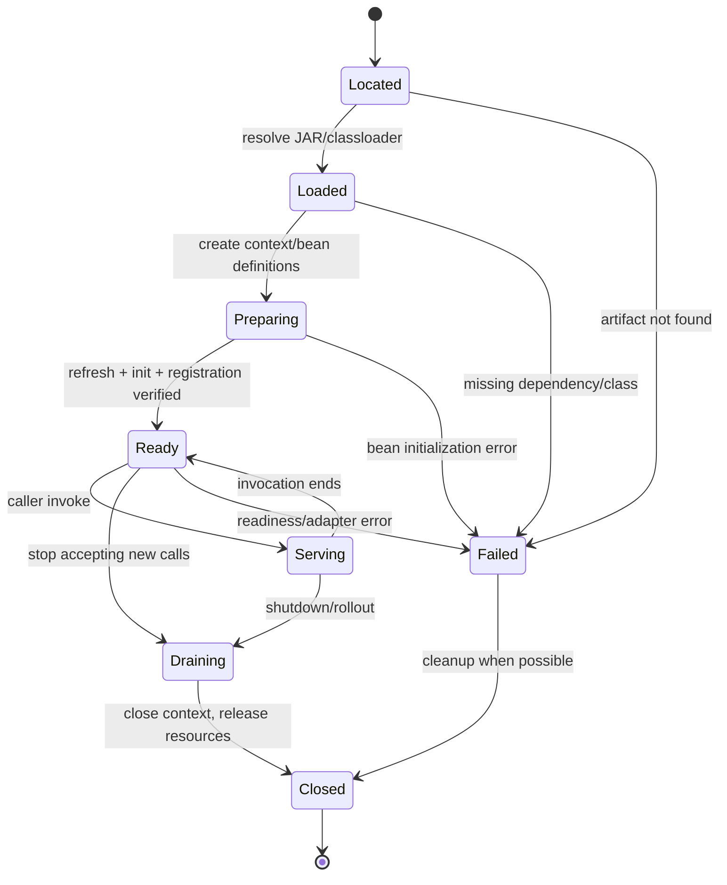
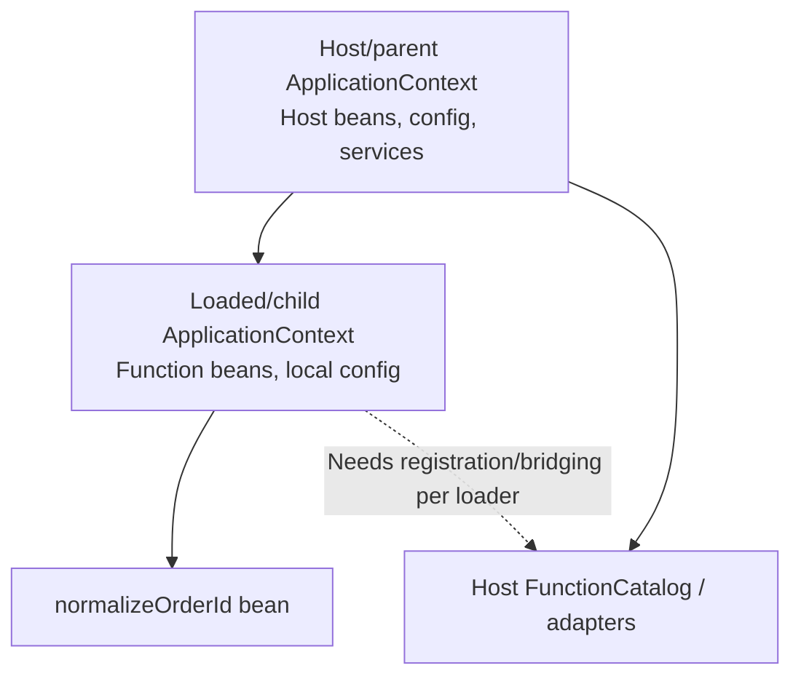
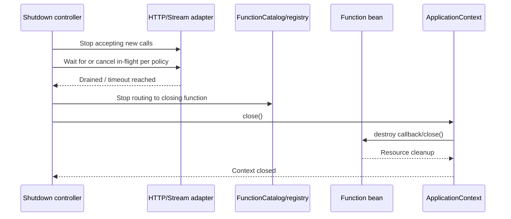
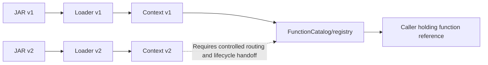

# ApplicationContext Lifecycle of a Loaded Package

## 1. The Problem: The JAR Is Loaded, But Who Initializes and Closes the Beans Inside?

Suppose a business team releases `shipping-functions-1.0.0.jar`. This JAR is a Spring Boot application containing a `Function<ShippingRequest,ShippingQuote>` bean along with configuration, dependencies, and an external connection resource. The operations team has a Spring Boot **host** that wants to load the artifact, look up the function via `FunctionCatalog`, and let an HTTP client or Kafka binder invoke the function.

During test runs, the business logic returns the right output. However, when updating the JAR or stopping the host, other issues surface: old connections remain open, background threads keep running, an `ApplicationRunner` triggers unintended side effects, the old function is still called even after swapping the artifact, or a `@Bean` exists in the source application yet never appears in the host's catalog.

These issues belong to the **`ApplicationContext` lifecycle of the loaded package**, not just `Function.apply()` logic.

In the **Spring Cloud Function** (`SPRING_CLOUD_FUNCTION`) module, business rules are expressed via `Supplier<T>`, `Function<T,R>`, or `Consumer<T>`, can be looked up and composed via `FunctionCatalog`, converted via adapters, and invoked from HTTP, messaging, or serverless. This topic clarifies how Spring components are initialized, operated, and released **when functions are distributed as JARs and loaded into a host**.

**Key point:** three lifecycles must be distinguished:

1. **Artifact/ClassLoader:** locating the JAR, loading classes and dependencies, holding or releasing references to code.
2. **Spring ApplicationContext:** creating bean definitions, refreshing, initializing singletons, publishing events, and closing the context.
3. **Invocation:** caller queries the catalog, starts/completes `get()`, `apply()`, or `accept()`, handles errors and transport.

Closing a context does not automatically purge class bytecode from the JVM; loading a class does not automatically initialize Spring beans; a function existing does not mean anything has invoked it yet.

> **Version scope:** `spring-cloud-function-deployer` and the ability to load a *packaged Spring Boot application* depend on the release. How contexts are organized (external context, separate context, parent–child relationship, catalog bridging, and classloaders) must be verified on the actual deployer release. The Spring examples below describe the **standard ApplicationContext lifecycle** and the conditions to check, without claiming every Function Deployer version automatically creates child contexts under a single fixed model.

## 2. Four Components and Lifecycle Ownership

| Component | What does it own? | Who must manage it? |
| --- | --- | --- |
| **Artifact/JAR** | Bytecode, resources, metadata, and release version. | Build/repository system and the host's loading workflow. |
| **ClassLoader** | Class namespace, visibility of dependencies/resources. | The loader/framework that loaded the artifact; may have its own lifecycle. |
| **ApplicationContext** | BeanFactory, singleton beans, bean post-processors, event listeners, bean lifecycle, and environment. | The code/runtime that created the context is responsible for closing it. |
| **FunctionCatalog and adapters** | Function registration/lookup, wrappers, composition, and trigger paths. | Spring Cloud Function context and the corresponding host/adapters. |

**Two easily confused points:**

- One `ClassLoader` can serve multiple `ApplicationContext`s; one context can also use classes defined by multiple loaders. Therefore **a context is not identical to a classloader**.
- Two Spring contexts inside **one JVM** still share CPU, heap, and process permissions. Separating contexts organizes beans/namespaces, **not as a security sandbox or process isolation**.



The diagram depicts the **desired operational workflow**. How a deployer handles unregistration, draining, closing, and releasing classloaders **must not be assumed automatic** unless verified on that release.

## 3. Lifecycle States of a Package with Functional Beans

A conceptual state model:



These states are a **model for design and testing**, not a built-in Spring Cloud Function enum API. In practice, Spring's `ApplicationContext.refresh()` and `close()` have their own rules; deployment/readiness, discovery/registration, and invocation all require additional verification.

| Phase | Questions to verify |
| --- | --- |
| **Resolve** | Is the JAR at `file:///...` or the repository genuinely reachable from the host? |
| **Load** | Does the classloader read the simple/Boot JAR layout, Java version, and dependencies properly? |
| **Create context** | Which environment, bean definitions, and configurations are used? |
| **Refresh/init** | Which singletons are created and execute init callbacks? |
| **Register** | Which function beans are exposed in the catalog and under what names? |
| **Serve** | Which adapter sends input, and are converters and error contracts accurate? |
| **Stop** | Are new invocations blocked and in-flight calls handled? |
| **Close** | Are destruction callbacks invoked, threads/clients closed, and registrations removed? |
| **Reload** | Does it truly use the new artifact without retaining old classloaders/resources unintentionally? |

## 4. Simple JARs and Spring Boot JARs Have Different Lifecycle Requirements

| Attribute | Simple library JAR | Spring Boot executable JAR with functional beans |
| --- | --- | --- |
| Contents | Usually has a class implementing `Function`/`Supplier`/`Consumer`. | Has `@SpringBootApplication`, `@Configuration`, `@Bean`, and dependencies. |
| Spring context in JAR | Not required. | Spring configuration is usually an essential part of the application. |
| How implementations are created | Can instantiate class via the release's loader mechanism. | Needs a mechanism to discover/instantiate functional beans in a suitable context. |
| Layout | Classes usually sit along package paths at archive root. | Classes usually sit in `BOOT-INF/classes`; dependencies in `BOOT-INF/lib`. |
| Spring callbacks | Do not apply by default if the instance is not managed as a Spring bean. | May include init/destroy, events, runners, scheduling depending on how Spring starts the context. |
| Risks | Wrong FQCN, constructor, classloader. | Adds auto-configuration, bean dependencies, startup side effects, and resource lifecycles. |

**Do not assume loading a Java class via `function-class` is equivalent to running an entire Spring Boot application.** With a simple JAR, a directly instantiated implementation may not receive Spring callbacks that the class author expected to run. With a Boot JAR, the loader must understand Spring configuration/context and archive layout per the supported version.

### 4.1. Running a Boot JAR standalone vs. loading the JAR into a host

```text
Case A: java -jar shipping-functions-1.0.0.jar
  → Separate JVM/process
  → SpringApplication creates a context for the application itself
  → Application manages its own adapters and shutdown

Case B: Spring Boot host using Function Deployer
  → JAR is resolved inside the host process via a supported loader
  → Context/bean registration follows the deployer release's mechanism
  → Host invokes functions through catalog/adapters
  → Package context/resources must be managed through that mechanism
```

When running Case B, do not assume the source application's `SpringApplication.main` runs as a separate process, or that all standalone Spring Boot events appear in the host. **Any guarantees must be observed from the host on the running release.**

## 5. Inside `ApplicationContext.refresh()`

In a standard Spring `ConfigurableApplicationContext`, calling `refresh()` involves multiple phases of work:

1. **Prepare the environment and bean factory** with appropriate property sources, profiles, and settings.
2. **Process bean definitions**, `@Configuration` classes, and `BeanFactoryPostProcessor`/`BeanDefinitionRegistryPostProcessor` beans.
3. **Register `BeanPostProcessor`s**, conversion services, event multicasting/handlers, and supporting infrastructure.
4. **Instantiate non-lazy singleton beans**, resolving constructors/dependencies, post-processing, init callbacks, and proxying.
5. **Finish refresh**, activating matching lifecycle components and publishing `ContextRefreshedEvent`.

This is a conceptual summary. Detailed callback/dependency ordering can vary by bean configuration, proxying, lazy loading, and Spring release. Specifically, **not every bean is instantiated immediately**: `@Lazy` beans or non-singleton scopes may only be created on demand.

### 5.1. Common callbacks

| Mechanism | Typical timing | What to avoid |
| --- | --- | --- |
| Bean constructor | When the bean is actually constructed. | Performing I/O or spawning hard-to-clean threads in constructors. |
| `BeanPostProcessor` | Before/after init along Spring's processor chain. | Assuming bean references are always raw implementations rather than proxies. |
| `@PostConstruct` | During initialization of a managed bean. | Writing non-idempotent side effects merely because the context refreshes. |
| `InitializingBean.afterPropertiesSet()` | Bean init callback phase. | Combining multiple init mechanisms that trigger duplicate side effects. |
| `@Bean(initMethod="open")` | Calls the init method if the bean is created. | Assuming it runs merely upon reading the JAR file. |
| `ContextRefreshedEvent` | When a context finishes refreshing. | Treating the event as "the entire system is already taking traffic." |
| `SmartLifecycle.start()` | Lifecycle processor starts components by phase/autoStartup. | Auto-starting unauthorized consumers/pollers. |
| `@Bean(destroyMethod="close")` / `@PreDestroy` | When Spring destroys eligible managed beans. | Relying on JVM class unloading to close connections automatically. |

In Spring Boot 3+, `@PostConstruct` and `@PreDestroy` use `jakarta.annotation`; older Boot 2 apps typically use `javax.annotation`. Throughout this lesson, examples choose `@Bean(initMethod,destroyMethod)` so sample code does not depend on a specific annotation package.

## 6. Self-Contained Example: A Functional Bean with Explicit Lifecycle

The illustrative function normalizes an order ID, needing no HTTP or broker in its core. We add state solely to **observe lifecycle**, not as mutable business state to hold inside a function.

### 6.1. OrderIdNormalizer class

```java
// src/main/java/demo/functions/OrderIdNormalizer.java
package demo.functions;

import java.util.Locale;
import java.util.concurrent.atomic.AtomicBoolean;
import java.util.function.Function;

public final class OrderIdNormalizer
        implements Function<String, String>, AutoCloseable {

    private final AtomicBoolean active = new AtomicBoolean(false);

    // Init method invoked by Spring when the bean is created.
    public void open() {
        if (!active.compareAndSet(false, true)) {
            throw new IllegalStateException("Already opened");
        }
        System.out.println("OrderIdNormalizer OPEN");
    }

    @Override
    public String apply(String orderId) {
        if (!active.get()) {
            throw new IllegalStateException("Function not active");
        }
        if (orderId == null || orderId.isBlank()) {
            throw new IllegalArgumentException("Missing orderId");
        }
        return orderId.strip().toUpperCase(Locale.ROOT);
    }

    public boolean isActive() {
        return active.get();
    }

    @Override
    public void close() {
        if (active.getAndSet(false)) {
            System.out.println("OrderIdNormalizer CLOSE");
        }
    }
}
```

In the example, `open()` and `close()` make lifecycle observable. `AtomicBoolean` enables checking state across threads, **but does not automatically drain in-flight invocations**. A call could pass the `active` check right before shutdown begins; dedicated coordination policies are required when processing must not be dropped.

### 6.2. Registering the bean with an explicit name

```java
// src/main/java/demo/functions/FunctionConfiguration.java
package demo.functions;

import org.springframework.context.annotation.Bean;
import org.springframework.context.annotation.Configuration;

@Configuration(proxyBeanMethods = false)
public class FunctionConfiguration {

    @Bean(
        name = "normalizeOrderId",
        initMethod = "open",
        destroyMethod = "close"
    )
    OrderIdNormalizer normalizeOrderId() {
        return new OrderIdNormalizer();
    }
}
```

`OrderIdNormalizer` implements `Function<String,String>`; thus it is a functional bean of the application. `@Bean` assigns the **name `normalizeOrderId`** and lets the **Spring context** take responsibility for calling the two lifecycle methods.

If you instantiate `new OrderIdNormalizer()` outside Spring without calling `open()`, `apply()` reports it is inactive; if you only load the class with a ClassLoader without creating a Spring bean, this `@Bean` configuration is never applied. This is the intuitive difference between **loading bytecode** and **managing beans**.

### 6.3. Source Spring Boot application

```java
// src/main/java/demo/functions/PackagedFunctionApplication.java
package demo.functions;

import org.springframework.boot.SpringApplication;
import org.springframework.boot.autoconfigure.SpringBootApplication;

@SpringBootApplication
public class PackagedFunctionApplication {
    public static void main(String[] args) {
        SpringApplication.run(PackagedFunctionApplication.class, args);
    }
}
```

Because `FunctionConfiguration` shares the `demo.functions` package, Spring discovers it via standard Boot component scanning. There is no need to start an HTTP server just to test bean lifecycle:

```yaml
spring:
  main:
    web-application-type: none
```

`web-application-type: none` applies when **running the source application in console/test mode**. To run it as a standalone HTTP provider, it needs the web adapter and must not disable web mode. When loaded as a packaged function in a host, how the loader creates contexts and inherits configuration must be checked on the specific deployer release.

## 7. A Spring Bean Managing Resources

A real-world function may need an API client, connection pool, cache, or subscription. In that case, separate **pure logic** from **resource lifecycle**:

```java
// src/main/java/demo/functions/FunctionResources.java
package demo.functions;

import java.util.concurrent.atomic.AtomicBoolean;

public final class FunctionResources implements AutoCloseable {
    private final AtomicBoolean opened = new AtomicBoolean();

    public void open() {
        if (!opened.compareAndSet(false, true)) {
            throw new IllegalStateException("Resource already open");
        }
        // Illustrative: open a real client/pool when needed.
    }

    public boolean isReady() {
        return opened.get();
    }

    @Override
    public void close() {
        if (opened.getAndSet(false)) {
            // Illustrative: close the client/pool and release resources.
        }
    }
}
```

```java
// Snippet that can be added to a dedicated @Configuration in the source app:
@Bean(initMethod = "open", destroyMethod = "close")
FunctionResources functionResources() {
    return new FunctionResources();
}

@Bean("checkResource")
Function<String, Boolean> checkResource(
        FunctionResources resources) {
    return ignored -> resources.isReady();
}
```

Both snippets are **optional patterns**; `@Bean` methods must reside inside a `@Configuration` with appropriate `java.util.function.Function` imports. `checkResource` only illustrates dependency injection between beans; it is not a production health endpoint and should not be exposed freely outside.

For resources holding sensitive data, never log secrets during init/close. For clients that can fail, design cleanup even when initialization only partly succeeds, instead of assuming `close()` will always be called on every failure path.

## 8. Verifying Lifecycle When Running the Source Application Standalone

Before passing the JAR to Function Deployer, verify the application **running on its own** creates and destroys beans properly. A simple tool is an `ApplicationRunner` enabled only in a test profile:

```java
// src/main/java/demo/functions/CatalogSmokeRunner.java
package demo.functions;

import java.util.function.Function;

import org.springframework.boot.ApplicationRunner;
import org.springframework.cloud.function.context.FunctionCatalog;
import org.springframework.context.annotation.Bean;
import org.springframework.context.annotation.Configuration;
import org.springframework.context.annotation.Profile;

@Configuration(proxyBeanMethods = false)
@Profile("smoke")
public class CatalogSmokeRunner {
    @Bean
    ApplicationRunner verifyFunction(FunctionCatalog catalog) {
        return args -> {
            Function<String, String> fn =
                    catalog.lookup("normalizeOrderId");
            if (fn == null) {
                throw new IllegalStateException(
                        "Function not registered: normalizeOrderId");
            }
            String result = fn.apply("  od-204 ");
            if (!"OD-204".equals(result)) {
                throw new IllegalStateException(
                        "Unexpected result: " + result);
            }
            System.out.println("Catalog smoke PASS");
        };
    }
}
```

Assuming a POM with Spring Boot starter, Spring Cloud Function context, and Maven Boot plugin at compatible versions, when packaged and run:

```bash
mvn package
java -jar target/shipping-functions-1.0.0.jar \
  --spring.profiles.active=smoke
```

The final artifact name is **illustrative**, depending on the actual Maven project's `artifactId`/`version`. Without a web server or non-daemon threads keeping the JVM alive, the application may exit after startup. When the Spring context closes normally, we expect initialization/check/resource-closing messages (order depends on bean dependencies):

```text
OrderIdNormalizer OPEN
Catalog smoke PASS
OrderIdNormalizer CLOSE
```

**Test limitation:** `ApplicationRunner` belongs to the lifecycle when **`SpringApplication.run(...)`** executes full Boot bootstrap. A deployer loading a Boot JAR into an isolated context does not necessarily run `SpringApplication` along the same path, so **do not assume runners in the source JAR always execute when a host loads the artifact**. Testing the source application does not replace testing the host's loader/context.

### 8.1. Difference between bean init and function invocation

`@Bean(initMethod="open")` can run during singleton initialization; it **does not call `Function.apply()`**. `ApplicationRunner` in the example is the code explicitly querying the catalog and invoking the function. After creating a function, Spring has no business reason to call `apply()` on its own without a runner, request, or adapter.

Similarly, `Supplier.get()` does not execute automatically on context refresh merely because a `Supplier` bean is registered. To emit data periodically, you need a poller/scheduler or another trigger with clear lifecycle and permissions.

## 9. Spring Events Must Be Understood Within Their Exact Scope

Spring and Spring Boot have distinct startup/shutdown events. The following events **are not interchangeable**:

| Event / callback | What it signals | Limitations |
| --- | --- | --- |
| `ContextRefreshedEvent` | **An** ApplicationContext finished refreshing. | Does not prove all remote dependencies, adapters, and traffic are ready. |
| `ApplicationStartedEvent` (Spring Boot) | Boot application started and context refreshed, before `ApplicationRunner`/`CommandLineRunner` run. | Applies only when bootstrapped via `SpringApplication` under that lifecycle. |
| `ApplicationReadyEvent` (Spring Boot) | `SpringApplication` completed runners and indicates readiness per Boot lifecycle. | Does not prove function plugins and every downstream dependency are healthy without readiness checks. |
| `ApplicationFailedEvent` (Spring Boot) | Boot bootstrap failed. | Not every context-loading error via custom APIs publishes this event. |
| `ContextClosedEvent` | ApplicationContext is closing. | Usually fires **before** bean destruction finishes; does not mean all in-flight calls have drained. |
| `ContextStartedEvent` | `ConfigurableApplicationContext.start()` was called. | **Not** an alias for `ApplicationStartedEvent` in Spring Boot. |

An observer listener:

```java
package demo.functions;

import org.springframework.context.ApplicationListener;
import org.springframework.context.event.ContextClosedEvent;
import org.springframework.context.event.ContextRefreshedEvent;
import org.springframework.context.annotation.Bean;
import org.springframework.context.annotation.Configuration;

@Configuration(proxyBeanMethods = false)
public class LifecycleEventConfiguration {

    @Bean
    ApplicationListener<ContextRefreshedEvent> refreshed() {
        return event -> System.out.println(
                "Refreshed: " + event.getApplicationContext().getId());
    }

    @Bean
    ApplicationListener<ContextClosedEvent> closing() {
        return event -> System.out.println(
                "Closing: " + event.getApplicationContext().getId());
    }
}
```

The example above is a **learning-aid observer listener**, not a production logging solution. In a **parent–child context**, certain application events from the child can propagate to the parent; inspect `event.getApplicationContext()` and avoid duplicate processing. Do not assume the listener exists in every deployer-created context if that configuration is not loaded.

### 9.1. Risks of using startup events for side effects

For example, logic that sends batches of messages inside `@EventListener(ContextRefreshedEvent.class)` carries risks:

- Contexts recreated during reloads or tests may resend data.
- Running multiple replicas causes every replica to emit the event.
- Events may fire for multiple contexts in a hierarchy.
- Opening external connections/dependencies before readiness can break startup.
- Shutdown/retries may lack transactions with recipients.

If long-lived background tasks are needed, use a scheduler/job/Stream poller with clear idempotency and ownership. Do not treat a refresh event as an authorized business invocation.

## 10. `SmartLifecycle` and Background Beans

`SmartLifecycle` lets Spring manage components with a running state and explicit start/stop ordering. It differs from `@Bean(initMethod)`: an init method may simply set up resources, whereas `SmartLifecycle` is for components needing controlled start/stop.

Skeleton example **without auto-starting a poller**:

```java
package demo.functions;

import java.util.concurrent.atomic.AtomicBoolean;
import org.springframework.context.SmartLifecycle;

public final class FunctionPollerLifecycle implements SmartLifecycle {
    private final AtomicBoolean running = new AtomicBoolean();

    @Override
    public void start() {
        // Start polling only after deployment permits it.
        running.set(true);
    }

    @Override
    public void stop() {
        running.set(false);
        // Stop accepting new work and clean up poller resources if any.
    }

    @Override
    public void stop(Runnable callback) {
        try {
            stop();
        } finally {
            callback.run();
        }
    }

    @Override
    public boolean isRunning() {
        return running.get();
    }

    @Override
    public boolean isAutoStartup() {
        return false;
    }

    @Override
    public int getPhase() {
        return 0;
    }
}
```

This illustrates the **lifecycle protocol**, with no actual polling yet. `isAutoStartup()=false` means Spring is not asked to call `start()` automatically upon refresh; coordinator code must explicitly start it when desired. For beans with `isAutoStartup()=true`, refresh can trigger them immediately when the host loads the context, causing side effects.

With `SmartLifecycle`, Spring orders phases: **starts from lowest phase to highest, stops in reverse** within the lifecycle sequence. With asynchronous stop, `stop(Runnable)` must invoke the callback when truly done; otherwise Spring may wait until the shutdown timeout expires.

### 10.1. `@Scheduled`, listeners, and subscriptions are not just passive beans

A JAR containing `@EnableScheduling` and `@Scheduled` can spawn jobs when the context refreshes. A `@KafkaListener` or binder can spawn consumers when the context starts and corresponding components are configured. If the same JAR is loaded into two hosts, the task risks running **twice**—not because `FunctionCatalog` is broken, but because **lifecycles of non-function components started up**.

When designing packaged functions, separate:

- **Business beans:** relatively pure functions invoked when inputs arrive.
- **Resource beans:** open/close clients along the Spring lifecycle.
- **Source/consumer adapters:** listeners, schedulers, pollers, web handlers; enabled only in deployments that truly need them.

Do not let a source JAR open a Kafka consumer just to serve a function the host intends to invoke via HTTP. If bundling them together is unavoidable, use profiles/conditions and test that contexts do not start unintended adapters.

## 11. Parent–Child ApplicationContext and Bean Visibility

When a host integrates code from a packaged Spring Boot application, multiple contexts may exist. **The actual relationship is determined by the loader/deployer**, yet Spring's parent–child model helps explain common behaviors.



If a **genuine parent–child relationship exists**:

- The child can typically resolve beans in the parent via bean hierarchy lookup if no local bean has the same name/type.
- The parent **does not automatically enumerate all child beans** merely because the child holds a parent reference.
- Local beans in the child can shadow same-named beans in the parent depending on lookup/registration rules.
- Properties/environments may be configured, inherited, or overridden; verify how contexts are constructed.
- Application events from the child may propagate to the parent; listeners must check the event source.

None of these **guarantee** Spring Cloud Function Deployer uses a parent–child hierarchy in every release. A deployer may use a different mechanism to expose functions into the host's catalog.

### 11.1. Plain Spring experiment on bean visibility

The example below is solely a **Spring Framework ApplicationContext demo**, not a mandatory implementation pattern of Function Deployer:

```java
import org.springframework.context.annotation.AnnotationConfigApplicationContext;

try (AnnotationConfigApplicationContext parent =
        new AnnotationConfigApplicationContext()) {

    parent.registerBean("sharedLabel", String.class,
            () -> "HOST");
    parent.refresh();

    try (AnnotationConfigApplicationContext child =
            new AnnotationConfigApplicationContext()) {
        child.setParent(parent);
        child.registerBean("loadedLabel", String.class,
                () -> "PLUGIN");
        child.refresh();

        System.out.println(child.getBean("sharedLabel"));
        // HOST — child sees parent bean through hierarchy.

        System.out.println(child.getBean("loadedLabel"));
        // PLUGIN — child's own bean.

        System.out.println(parent.containsBean("loadedLabel"));
        // false — parent does not look downward into child automatically.
    }
}
```

This pattern uses `AnnotationConfigApplicationContext` where `registerBean` can precede `refresh()`. Never call `refresh()` twice on the same `AnnotationConfigApplicationContext`; context closing is shown via `try-with-resources`.

**Important:** `parent.containsBean("loadedLabel")` returns `false` in the experiment because the bean was registered solely in the child. A deployer may **explicitly bridge/export** functions to the host catalog; when the catalog sees a function, **that does not mean the parent BeanFactory automatically contains all raw beans from the child**.

## 12. ClassLoader vs. ApplicationContext

Contexts manage beans; ClassLoaders define classes. When loading multiple packaged functions, a host may have both kinds of boundaries:

```text
Host JVM
  ├─ Host ClassLoader
  │    ├─ FunctionCatalog
  │    └─ Shared API classes
  ├─ Plugin ClassLoader (if loader creates a separate one)
  │    ├─ Function implementation
  │    └─ Plugin-only dependencies
  ├─ Host ApplicationContext
  └─ Loaded ApplicationContext (if runtime creates a separate one)
```

Do not infer "every Spring context always has its own ClassLoader" or "every JAR always has its own context". Loaders and contexts may be shared or created differently depending on the loading mechanism.

### 12.1. Risk of duplicate DTOs between host and JAR

If both host and plugin contain `demo.contract.OrderRequest`, yet each loader defines its own class:

```text
(demo.contract.OrderRequest, HostLoader)
    !=
(demo.contract.OrderRequest, PluginLoader)
```

A function accepting `Function<OrderRequest,OrderQuote>` may work inside the plugin's context yet throw `ClassCastException` when the host calls it with an object created from another classloader. A perfectly functioning Spring context **cannot fix Java type identity**.

Two solutions:

1. **Shared API JAR** seen by both sides from the same defining loader, with compatible dependencies/versions.
2. **Explicit conversion** via JSON/message schemas/bytes at the boundary, instantiating the right class where needed.

When the caller is **another application/process** over HTTP/Kafka, Java objects do not pass as raw references across the network. Then protocol and schema form the primary boundary, without forcing two JVMs to share a `Class<?>`.

## 13. Bean Name, FunctionCatalog, and When Functions Are Exposed

In the source application:

```java
@Bean(name = "normalizeOrderId", initMethod = "open",
      destroyMethod = "close")
OrderIdNormalizer normalizeOrderId() {
    return new OrderIdNormalizer();
}
```

Spring names the bean `normalizeOrderId`. With compatible Spring Cloud Function context dependencies, the functional bean can be looked up in `FunctionCatalog` by name/definition:

```java
Function<String, String> fn =
        catalog.lookup("normalizeOrderId");
```

**Separate three events:**

1. **Bean definition exists:** Spring knows how to create the function when needed.
2. **Bean is initialized:** init callbacks have executed if non-lazy and context refreshed (or upon first invocation).
3. **Function is exposed in catalog:** callers in the right runtime/context can look up the function name.

Do not assume every bean in a source Boot JAR **is imported verbatim into the host ApplicationContext**. When Function Deployer loads a packaged application, registration behavior and catalog names in the **host** must be verified per release. `FunctionCatalog.lookup(...)` may return a **wrapper** rather than the raw bean. Wrappers, converters, and compositions have lifecycles tied to their respective contexts/caches.

### 13.1. `definition` selects a function; it does not create a context

```yaml
spring:
  cloud:
    function:
      definition: normalizeOrderId
```

`spring.cloud.function.definition` is typically used by adapters/Stream to pick an **already registered** function or pipeline. It does not initialize an unloaded Boot application, nor close contexts when the name changes.

In packaged function loading, `spring.cloud.function.location` specifies the artifact location in supported releases, while `spring.cloud.function.function-class` can be used for selecting a class from a **simple JAR**. Never put a `@Bean` method name into `function-class` expecting it to replace Boot context bean discovery.

### 13.2. Lazy initialization affects when a function is "ready"

If a bean is `@Lazy`, context refresh can finish **before the bean/function is actually instantiated**. The first catalog lookup or invocation can trigger initialization and expose dependency/constructor failures after startup.

For functions that must be ready before accepting traffic, pick a verified approach: eager init, permitted smoke lookup/invocation, explicit warm-up, or readiness checks aligned with lifecycle. Never invoke a side-effecting `Consumer` to "warm up" if doing so mutates real data.

## 14. Which Context Owns Configuration, Environment, Profiles, and Secrets?

A bean can read properties via constructor, `@Value`, or `@ConfigurationProperties`. Yet the values received depend on the **Environment and property sources of the context that actually creates the bean**, not simply an `application.yml` file inside the archive.

Example function depending on policy version configuration:

```java
package demo.functions;

import java.util.function.Supplier;
import org.springframework.beans.factory.annotation.Value;
import org.springframework.context.annotation.Bean;
import org.springframework.context.annotation.Configuration;

@Configuration(proxyBeanMethods = false)
public class PolicyVersionFunctions {
    @Bean("policyVersion")
    Supplier<String> policyVersion(
            @Value("${shipping.policy.version:v1}") String version) {
        return () -> version;
    }
}
```

When the source application runs standalone, properties can come from `application.yml`, environment variables, or CLI flags. When **the host loads the JAR**:

- The host context and loaded context **may** share, inherit, or receive distinct property sources depending on the loader/release.
- Do not assume `application.yml` inside the Boot JAR applies identically to `java -jar`.
- A profile enabled on the host may not mean the same profile is enabled in the source context unless confirmed by the initialization mechanism.
- Overly generic property names easily **collide** between two plugins or between plugin and host.

Use specific namespaces like `shipping.policy.version`, verify effective values **without leaking secrets** at startup, and separate **business logic** config from **web/broker adapter** config.

### 14.1. Do not assume host beans are available inside a child context

Suppose a function needs `OrderRepository` via its constructor. If the loader builds a separate context **without a parent relationship** or dependency bridging, injection fails. Even with a parent hierarchy, a bean from the parent might use API types defined by a different classloader.

Better options depending on your goal:

1. Provide the dependency inside the context managing the function in a loader-supported way.
2. Place contract interfaces in a shared API and control classloader identity if host beans must be injected.
3. Split the function into an independent provider service over HTTP/broker if version/resource isolation is needed.
4. Keep the core function pure Java and move I/O to deployment-level adapters/services.

**Do not fix missing beans by copying all host classes and dependencies into the plugin** without understanding classloaders; that can cause `ClassCastException` or `LinkageError` instead of fixing injection.

### 14.2. Managing secrets during refresh

A bean creating a database client may require secrets immediately at init time. If a token is expired or lacks permissions, startup can fail before the function registers. Distinguish **configuration/credential** errors from **function implementation** errors. Never log tokens, JDBC passwords, API keys, or secret contents in unfiltered exception messages.

## 15. When Initialization Fails Midway

Suppose a context has three beans:

```text
shippingConfig      → created successfully
shippingClient      → opened connection successfully
shippingFunction    → bean creation failed due to missing dependency
```

Spring normally attempts to clean up singletons **already managed and successfully initialized** when refresh aborts, yet cannot guarantee automatic reclamation of resources opened **outside bean management** or inside an init method that fails partway through.

### 15.1. Init methods need exception safety

Pseudo-code example for an external resource:

```java
public void open() {
    ExternalClient candidate = createClient();
    try {
        candidate.configure();
        candidate.checkConnection();
        this.client = candidate;
    } catch (RuntimeException failure) {
        candidate.close();
        throw failure;
    }
}
```

`ExternalClient`, `createClient()`, and field `client` above **merely represent an application-defined client class**. The critical idea is: if opening a client succeeds and subsequent init steps fail, code must close what was already allocated inside `catch` rather than expecting Spring to invoke a destroy callback on a bean that never finished initializing.

### 15.2. Do not expose a function before it is ready

A host should expose functions or let adapters accept traffic only when:

- The artifact and its dependencies have resolved.
- The context has refreshed and required functional beans have initialized.
- The name in `FunctionCatalog` is lookable.
- A **non-side-effecting** contract check passes if needed.
- Required adapters are configured and critical downstream dependencies are ready per policy.

If any step fails, mark not-ready and clean up resources. **Do not keep serving with half a new context and half an old function** unless the runtime has a clear, tested fallback/versioned routing policy.

### 15.3. Logging failures at the right boundary

| Startup error | Typical symptom | Where to inspect |
| --- | --- | --- |
| JAR does not exist | `file:///...` or `maven://...` resolution fails. | Artifact path, repo, permissions. |
| `ClassNotFoundException` | Loader cannot find implementation. | FQCN, simple vs. Boot JAR layout. |
| `NoClassDefFoundError` | Dependent class unavailable. | Dependency scopes, classloaders, Maven metadata. |
| `BeanCreationException` | Constructor, config, init callback, or bean dependency fails. | Root cause, properties, secrets, startup I/O. |
| Function lookup returns `null` | Unregistered or wrong catalog name. | Context/registry, definition, deployer release. |
| Bean active yet adapter fails | Wrong HTTP route/converter or Stream binding/broker. | Inspect adapter separately. |

Do not blame every startup failure on `ApplicationContext.refresh()`: repository resolution or classloader failures can occur **before any context is created**.

## 16. Concurrent Invocations and Ordered Shutdown

A singleton function bean can be invoked concurrently by multiple threads. `FunctionCatalog` and web/Stream adapters do not make mutable fields inside implementations thread-safe. In the `OrderIdNormalizer` example, `AtomicBoolean` only tracks an active flag; string normalization logic holds no mutable business state.

If a function uses a client resource while the context starts shutting down, this race can happen:

```text
Thread A: Function.apply() is processing an order.
Thread B: Host decides to stop or reload the function.
Thread B: close() closes the database/HTTP client.
Thread A: continues operating on the newly closed client.
```

**Closing the context does not automatically guarantee all in-flight calls have finished.** The adapter/host itself must manage stopping new traffic, draining in-flight calls, timeouts, retries, and cleanup.

### 16.1. Desired shutdown sequence



This is an **operational design that must be implemented and verified**, not an automatic sequence across every deployer version. For Stream, stopping consumer containers/binders and managing acknowledgments/offsets before closing clients can be critical. For HTTP, graceful shutdown and flipping readiness to not-ready before cutting off acceptance reduces failed requests.

### 16.2. In-flight call counting pattern

```java
// Illustrative component inside an actively coordinating adapter.
AtomicInteger inFlight = new AtomicInteger();

String invoke(Function<String, String> function, String input) {
    inFlight.incrementAndGet();
    try {
        return function.apply(input);
    } finally {
        inFlight.decrementAndGet();
    }
}
```

This snippet only illustrates **counting synchronous invocations**; you must declare the `inFlight` field in the class and import `AtomicInteger` and `Function`. It is **insufficient for complete graceful shutdown**: you still need atomic rejection of new requests, wait/cancel policies, and handling asynchronous `Mono`/`Flux` pipelines that outlive the method return. A reactive function can return a publisher immediately while real work happens after subscription.

Therefore, in production apps, prefer official server/binder graceful shutdown mechanisms and track in-flight work across the full request/message lifecycle rather than merely wrapping a method call in `try/finally`.

## 17. What Do `close()` and Destruction Callbacks Guarantee?

On a properly operating `ConfigurableApplicationContext`, `close()` will:

- Publish `ContextClosedEvent`.
- Trigger the lifecycle processor to stop running components per Spring rules.
- Destroy singleton beans managed by the context and invoke matching destruction callbacks.
- Release internal resources managed by the context.

**Do not infer:**

- Spring automatically stops manually created threads without lifecycle registration.
- Spring automatically closes resources created with `new` that are unmanaged by beans and lack cleanup hooks.
- `prototype` beans are automatically destroyed by the context like singletons after being handed to callers.
- `close()` always runs when the process receives `SIGKILL`, the JVM crashes, or infrastructure terminates abruptly.
- Closing the context immediately unloads classes, clears JAR caches, or aborts all external invocations.

### 17.1. Singleton, prototype, and `@Lazy`

| Scope or mode | Init | Destroy |
| --- | --- | --- |
| **Regular singleton** | Usually created at refresh unless lazy. | Spring invokes destruction callbacks during normal context close. |
| **Lazy singleton** | Created when first requested. | If created and managed, destroy callbacks run upon close. |
| **Prototype** | Created each time requested per scope semantics. | After supplying the instance, Spring normally does not manage destruction; caller must clean up resources. |
| **Request/session scope** | Depends on web context and scope lifecycle. | Do not assume availability in a non-web function host. |

A function holding a connection pool should not casually switch to `prototype` to solve state/thread-safety issues; that can spawn multiple pools without clear cleanup ownership.

### 17.2. Two contexts must not arbitrarily close each other

If the host owns a parent context while the loader has a separate child context, closing the child **must not imply closing the parent**. Conversely, when the host shuts down, the framework must manage every context/bean it created. Never call `parent.close()` from a function bean inside a child merely because it is being unloaded.

An `AutoCloseable` contract on resources and contexts clarifies ownership: **whichever component creates/manages a resource is responsible for closing it**. When a plugin requests "deactivation", the host must know which context actually owns the bean to avoid shutting down the entire application by mistake.

## 18. Reloading a JAR Does Not Automatically Refresh the Context Properly

Suppose the host is running `shipping-functions-1.0.0.jar` and wants to upgrade to `1.1.0.jar`. Simply changing a URI or overwriting a file **does not automatically** guarantee:

- The old loader stops defining classes for callers.
- The old context closes and calls `close()` on resources.
- `FunctionCatalog` removes old function names and publishes the new version.
- In-flight invocations transition or complete cleanly.
- Threads, static registries, `ThreadLocal`s, listeners, and converter caches stop retaining the old classloader.
- Callers holding references to old wrappers/functions stop calling them.



### 18.1. A safer rollout cycle

1. **Publish** an immutable v2 artifact; verify checksums/dependencies.
2. **Resolve/load** the new version in staging or new instances/pods.
3. **Refresh and smoke-test** the v2 context/functional beans; verify types, schemas, names, adapters.
4. **Put the new version into service** via a tested rollout/routing mechanism.
5. **Stop sending traffic to the old version** and drain in-flight calls within timeout.
6. **Close the old context and resources** via runtime-supported mechanisms.
7. **Remove old references** from registries/caches/listeners; watch memory/threads/connections.
8. **Roll back** to artifact v1 on failure using an explicit deployment procedure.

If the deployer release does not provide safe **hot replacement** and lifecycle management, perform upgrades via **host restarts/rolling deployments**. `URLClassLoader.close()` (if used by the loader) does not force the JVM to unload classes immediately, and `System.gc()` is no guarantee a plugin is gone.

### 18.2. Reference sources that cause leaks

| Retained reference | Risk when unloading context |
| --- | --- |
| `FunctionCatalog`/adapter caches holding old wrappers | Continues invoking closed beans or pinning the old loader. |
| Plugin's own thread pool/threads | JVM pins tasks/loader/TCCL or keeps executing old logic. |
| `ThreadLocal` inside worker threads | Retains plugin classes/objects beyond context lifetime. |
| Schedulers/subscriptions/listeners registered globally | Continues receiving events and holding references to old beans. |
| Static registries/metrics/serializer caches | Holds `Class<?>`/instances from the previous loader. |
| Unclosed connection pools | Leaks sockets, threads, and database resources. |

**A cleanly closed context is not enough to conclude there are no classloader leaks.** Check resources and cross-context references, especially in long-lived hosts loading multiple JAR versions.

## 19. Context Lifecycles When Invoked Over HTTP, Messaging, and Serverless

Spring Cloud Function lets you reuse the same business function across different adapters, yet **adapters have their own lifecycles**. The loaded package's context does not directly dictate how HTTP requests, broker messages, or cloud events are dispatched.

| Invocation style | What starts/closes | What to verify |
| --- | --- | --- |
| **Internal Java** | Host app/runner calls `FunctionCatalog.lookup(...)` then `apply()`. | Do not hold references to functions after the owning context closes. |
| **HTTP** | Web server/Function Web adapter or controller manages routes and requests. | Readiness, routes, converters, graceful shutdown, and in-flight HTTP calls. |
| **Spring Cloud Stream** | Binder, bindings, listener containers, broker connections. | Consumer stop, acknowledgments/offsets, retries/DLQ, and in-flight messages. |
| **Serverless** | Cloud runtime/handler receives events and manages containers/instances. | Cold starts, context reuse, timeouts, event retries, and unguaranteed cleanup. |

### 19.1. HTTP: an active context does not guarantee the endpoint is ready

If the host has a compatible Web adapter and the function named `normalizeOrderId` is registered, an endpoint may be exposed per the version's routing mechanism:

```bash
curl -X POST http://localhost:8080/normalizeOrderId \
  -H "Content-Type: text/plain" \
  --data " od-204 "
```

Expected business result is `OD-204`. However, HTTP 404 can occur because the route doesn't exist, the server isn't enabled, or the function name differs—**not necessarily because the bean wasn't initialized**. HTTP 415/400 can stem from content types or payload contracts, not ClassLoaders.

When preparing to stop the host, transition readiness out of service before closing resources. With a supported Spring Boot web server, graceful shutdown settings can be used:

```yaml
server:
  shutdown: graceful
spring:
  lifecycle:
    timeout-per-shutdown-phase: 20s
```

This is an **illustrative configuration for Boot/supported runtimes**, not a replacement for managing catalog/loaded contexts. If the host closes a function's context while the HTTP server still accepts requests, the function can be called after its resources have closed. Shutdown timeouts must match real business processing times.

### 19.2. Spring Cloud Stream: input bindings can start with the context

Example **on a provider app selecting the right function name**:

```yaml
spring:
  cloud:
    function:
      definition: normalizeOrderId
    stream:
      bindings:
        normalizeOrderId-in-0:
          destination: raw-order-ids
          group: order-normalizers
          content-type: text/plain
        normalizeOrderId-out-0:
          destination: normalized-order-ids
          content-type: text/plain
```

This configuration requires Spring Cloud Stream and a corresponding binder to work. It **does not load JARs automatically** and does not confirm the host sees the `normalizeOrderId` bean from an external artifact.

When the binder starts the input consumer, messages can begin flowing immediately; readiness and converter behavior must be verified. On shutdown, stop consumers/bindings and wait for in-flight processing per delivery policy before closing beans/resources. `Consumer.accept()` returning `void` does not guarantee business transactions and broker acknowledgments reached a consistent state.

### 19.3. Serverless: cold starts and warm invocations

In serverless, the Spring context may initialize during a **cold start**, then be retained by the runtime to serve subsequent invocations on that instance. This has two consequences:

1. Init callbacks and bean construction **do not necessarily run per event**; never rely on them to reset per-request business state.
2. The runtime can freeze or terminate the instance **without guaranteeing `@PreDestroy`/`close()` callbacks run like a normal shutdown**. Never place critical business work like "flush final results" solely in destroy callbacks.

Serverless also has its own handlers, event envelopes, timeouts, and IAM. A Boot JAR with functional beans does not automatically become a Lambda/function deployment just because `FunctionCatalog` finds the function; choose adapters and packaging suited to the cloud runtime.

## 20. Transactions, Retries, and Lifecycles Do Not Replace Each Other

Especially when a function has side effects:

```java
@Bean
Consumer<OrderEvent> storeOrder(OrderRepository repository) {
    return event -> repository.save(mapToEntity(event));
}
```

This is an **illustrative snippet**, assuming `OrderEvent`, `OrderRepository`, and `mapToEntity` belong to the application; the method must sit inside a `@Configuration` with appropriate imports. Putting a `Consumer` into a Spring context **does not automatically guarantee** repository transactions, event idempotency, or exactly-once delivery.

### 20.1. Bean lifecycle vs. transaction lifecycle

| Lifecycle | When does it start? | When does it end? |
| --- | --- | --- |
| Singleton bean | When the context creates the bean. | When the context closes normally and destruction callbacks run. |
| One `Consumer.accept()` call | When adapter/caller passes input to the function. | When processing returns/errors synchronously or reactively. |
| Database transaction | Per transaction manager/proxy and declared boundaries. | Commit/rollback per transaction rules. |
| Broker message delivery | When the broker delivers a message to the consumer. | Per acknowledgment/offset/retry policy. |

A bean can live for hours and process millions of transactions. `@PreDestroy` is not where per-message transactions commit. When using Spring `@Transactional`, check **proxies, transaction managers, contexts, and how the function is invoked**; do not assume method annotations in an external JAR always apply when loaded through another loader.

### 20.2. Ensuring safety when stopping mid-processing

Suppose a message wrote to the database yet the consumer stopped before acknowledging to the broker. The broker may redeliver the message to another instance. You need **idempotency keys/event IDs**, transaction/outbox patterns, or deduplication policies; closing the Spring context cleanly does not eliminate this scenario.

With reactive `Function<Flux<T>,Flux<R>>` or functions returning `Mono<R>`, when the Java method call returns can differ from when the pipeline is subscribed to and completes. Drain policies must measure **actual subscription/completion**, not just `apply()` returning.

## 21. Observing Lifecycles: Logs, Metrics, Readiness

In a host loading packaged functions, observe **which package**, **which context**, and **which function** are serving:

| Observable signal | Example value | Purpose |
| --- | --- | --- |
| Artifact identity | `shipping-functions:1.0.0` / checksum | Confirms actual running code version. |
| Context identity | `applicationContext.getId()` | Distinguishes host context from loaded context. |
| Function name | `normalizeOrderId` | Shows which function catalog/adapters invoke. |
| Load/refresh duration | Time to resolve JAR, refresh context | Diagnoses slow startup/cold starts. |
| Bean init/close result | Success or resource failure | Detects incomplete startup/cleanup. |
| In-flight invocations | Count of unfinished requests/messages | Draining and capacity management. |
| Error category | Resolve / bean / catalog / conversion / adapter | Classifies errors by layer. |
| Thread/connection metrics | Pool, thread, socket counts | Detects leaks across multiple reloads. |

Never put raw order IDs, payloads, or tokens into metric labels; those values cause high cardinality and leak sensitive data.

### 21.1. Readiness better than just checking "JVM is alive"

A health endpoint may return `UP` because the Spring Boot host is alive, while the packaged function is unregistered or its resources have closed. For critical functions, readiness should verify **safe, low-cost** conditions:

1. The loader has finished bringing the artifact into the runtime.
2. Context/functional beans are in an active, healthy state.
3. `FunctionCatalog.lookup(...)` finds the right name.
4. A dependency check, if required, is designed without excessive side effects.
5. Necessary adapters have the right routes/bindings/configs for the target.

Do not invoke a database-writing `Consumer` inside a health endpoint. Likewise, for a `Supplier` that creates work or messages, do not call `get()` arbitrarily just to report ready.

### 21.2. Distinguishing loaded, registered, and serving

A dashboard with three distinct signals is more useful than a single "loaded successfully" flag:

```text
ARTIFACT_RESOLVED = true
FUNCTION_REGISTERED = true
FUNCTION_SERVING   = false

→ JAR and catalog are healthy, yet adapter/traffic is not ready.
```

These are **application-defined status names**, not standard Spring Cloud Function metrics. They help operations pinpoint the exact failing layer.

## 22. Security and Resource Isolation Between Host and Loaded Package

A Spring Boot JAR does not hold just a lambda: it can contain auto-configurations, init callbacks, `@Scheduled` tasks, thread factories, network clients, or code running during class initialization. Therefore, loading an external artifact **permits bytecode execution inside the host**, not merely reading a data file.

Necessary safeguards:

- **Load only vetted JARs**, verifying provenance, checksums/signatures, and dependencies.
- Never take `spring.cloud.function.location`, Maven coordinates, or `function-class` directly from untrusted input and load arbitrarily.
- Restrict the host process's permissions for filesystem, secrets, network, databases, and IAM.
- Do not treat parent–child contexts or custom ClassLoaders as a **security sandbox**.
- Audit the packaged app's auto-configurations and background tasks to avoid opening unintended sensitive adapters/connections.
- Restrict which functions are exposed over HTTP/Stream; never expose a side-effecting `Consumer` merely because it is in the catalog.
- Maintain audit trails of who/which version published artifacts and who triggered rollouts.

If artifacts come from untrusted sources or require strong resource/permission isolation, **running a separate provider process/container** behind HTTP/messaging APIs is the better choice. Isolating contexts inside one JVM does not prevent plugin code from using the process's permissions.

## 23. When Should Each Architecture Be Chosen?

| Need | Option worth considering | Main operational risk |
| --- | --- | --- |
| One app needs a few functions deployed together | Functional beans in a single Spring Boot context. | Lifecycle coupling during shared builds/deploys. |
| Pure Java function with no Spring dependencies | Simple JAR + explicit bean registration, or deployer class loading on supported releases. | Constructors/dependencies and catalog names. |
| Packaged Spring Boot app with functional beans loaded from outside | Function Deployer **when the release supports** Boot JARs/contexts. | Nested dependencies, context lifecycle, and background tasks. |
| Multiple functions sharing connections in one context | Singleton resource bean with clear owner/lifecycle. | Shared resource closed while calls are still in flight. |
| Multiple versions needing dependency/lifecycle isolation | Separate instances/hosts or tested loader isolation. | Class identity and reload cleanup. |
| Continuous upgrades without dropping requests | Rolling deployment or hot swap **genuinely supported by the framework**. | Draining, stale catalog wrappers, classloader leaks. |
| Untrusted code or independent CPU/heap limits | Separate process/container/service. | Network failures, serialization, timeouts, monitoring. |
| Long-running workflows with retries/compensation | Function as a step; workflow/job engine manages lifecycle. | State, idempotency, and recovery. |

**Do not choose dynamic loading just because functions are written with `java.util.function.Function`.** If a Maven library dependency and regular beans already meet your needs, adding a dynamic context/loader layer increases complexity without improving real release velocity.

## 24. Testing ApplicationContext Lifecycle

### 24.1. Testing bean initialization and closing without the deployer

This is a Java/Spring Framework test for `FunctionConfiguration` from section 6. It proves the bean is Spring-managed, unlike merely calling `new OrderIdNormalizer()`:

```java
// src/test/java/demo/functions/FunctionLifecycleTest.java
package demo.functions;

import static org.junit.jupiter.api.Assertions.assertEquals;
import static org.junit.jupiter.api.Assertions.assertFalse;
import static org.junit.jupiter.api.Assertions.assertThrows;
import static org.junit.jupiter.api.Assertions.assertTrue;

import org.junit.jupiter.api.Test;
import org.springframework.context.annotation.AnnotationConfigApplicationContext;

class FunctionLifecycleTest {
    @Test
    void initializesAndDestroysManagedFunction() {
        OrderIdNormalizer function;

        try (AnnotationConfigApplicationContext context =
                new AnnotationConfigApplicationContext(
                        FunctionConfiguration.class)) {

            function = context.getBean(
                    "normalizeOrderId", OrderIdNormalizer.class);
            assertTrue(function.isActive());
            assertEquals("OD-204", function.apply(" od-204 "));
        }

        // Context has closed; destroyMethod callback ran.
        assertFalse(function.isActive());
        assertThrows(IllegalStateException.class,
                () -> function.apply(" od-204 "));
    }
}
```

The test uses JUnit Jupiter and Spring Context. `AnnotationConfigApplicationContext` is sufficient to instantiate Spring beans and invoke init/destroy; **it does not test Function Deployer, HTTP, Kafka, or full Boot startup**. `OrderIdNormalizer` intentionally exposes `isActive()` to verify state after close; in production, holding references to beans post-close is strictly for debugging/testing, not an operational pattern.

### 24.2. Testing `FunctionCatalog` of the source Spring Boot application

With `spring-cloud-function-context` and a matching Spring Boot test stack:

```java
// src/test/java/demo/functions/FunctionCatalogContextTest.java
package demo.functions;

import static org.junit.jupiter.api.Assertions.assertEquals;
import static org.junit.jupiter.api.Assertions.assertNotNull;

import java.util.function.Function;
import org.junit.jupiter.api.Test;
import org.springframework.beans.factory.annotation.Autowired;
import org.springframework.boot.test.context.SpringBootTest;
import org.springframework.cloud.function.context.FunctionCatalog;

@SpringBootTest(
    classes = PackagedFunctionApplication.class,
    properties = "spring.main.web-application-type=none"
)
class FunctionCatalogContextTest {

    @Autowired
    FunctionCatalog catalog;

    @Test
    void findsNamedFunctionAndInvokesIt() {
        Function<String, String> fn =
                catalog.lookup("normalizeOrderId");
        assertNotNull(fn);
        assertEquals("OD-204", fn.apply(" od-204 "));
    }
}
```

The test verifies the **source Boot ApplicationContext** has a functional bean recognized by the catalog. It does not prove **the host loaded the executable JAR** and exposed that same function. In the source app, bean name `normalizeOrderId` is explicitly set; in the host loader, registration must be verified separately if context loading mechanics differ.

### 24.3. Testing artifact/loader/context from the host

In a **Spring Cloud Function line supporting Function Deployer** and the chosen JAR type, a realistic integration test needs:

1. Build a **simple JAR** or **Spring Boot executable JAR** in the layout supported by the loader.
2. Place the artifact at `spring.cloud.function.location` in the host's filesystem or appropriate repository; verify version and checksum.
3. Start the host with a compatible deployer module; verify resolve/classloading logs and context creation if used by the mechanism.
4. Observe bean init callbacks and events of the **actually created** context.
5. Query the function name **actually registered in the host catalog**; do not infer names from the JAR filename.
6. Invoke a safe input and confirm output before letting adapters accept traffic.
7. Close/roll out the host; verify destroy callbacks and reclamation of clients/pools/threads.
8. Verify across multiple rollouts that memory, threads, and connections do not climb continuously.

With loaded contexts, do not test only `lookup(...) != null`. A wrapper may be returned before the function truly runs; verify `apply()` with real inputs and catch converter/classloader errors in a test environment.

### 24.4. Intentional failure tests

| Test case | Expected behavior to verify |
| --- | --- |
| Wrong `location` | Artifact not found; unloaded function is never exposed. |
| Wrong Boot JAR layout/dependencies | Clear loader error; previously opened resources cleaned up. |
| `initMethod="open"` throws exception | Startup fails safely; partially allocated resources cleaned up. |
| `@Lazy` bean fails on first call | Readiness/warm-up detects failure before live traffic if critical. |
| Host catalog lacks function name | Adapter does not silently fall back to calling another function. |
| Multiple contexts with duplicate listeners | No duplicate side effects from event propagation. |
| `apply()` in flight during shutdown | Drain/timeout policy prevents closing resources prematurely. |
| Reload v1 → v2 | Catalog/routes point to right version; v1 beans closed properly. |
| Serverless instance terminates abruptly | Correctness does not depend on destroy callbacks always running. |
| Prototype bean creates resource | Caller is responsible for closing resources, not confused with singleton lifecycle. |

### 24.5. Separate adapter tests

If using Spring Cloud Function Web adapter, test routes, methods, content types, and HTTP shutdown; if using Spring Cloud Stream, test binder start/stop, retries, DLQs, and stopping consumers mid-message. Serverless requires testing cold starts, warm invocations, and event envelope/failure contracts. Those tests **complement**, not replace, lifecycle tests inside the context.

## 25. Three Real-World Scenarios and How to Analyze Them

### Scenario A — Bean init runs yet there is no HTTP endpoint

Host logs show `OrderIdNormalizer OPEN` and `FunctionCatalog.lookup("normalizeOrderId")` succeeded, yet the HTTP client receives 404.

**Analysis:** Bean lifecycle and catalog may be working fine, while the Web adapter is missing, the HTTP route is not exposed, or the host has `web-application-type: none`. Fix **adapter/routing** instead of randomly reloading the JAR. If HTTP is intended, remove the web-disabling setting and add the appropriate adapter dependency.

### Scenario B — Loading a Boot JAR runs a task twice

The source JAR contains a `@Scheduled` job emitting periodic messages. Two host replicas load it, resulting in duplicate messages.

**Analysis:** Schedulers/listeners are **components with their own lifecycles**; two active contexts across two replicas will both run them. `FunctionCatalog` is not broken. Business-appropriate fixes: move scheduling to a separately managed service/poller, use leader election/distributed locking when truly appropriate, or design event idempotency. If the host only needs the function, disable unintended schedulers via proper configuration/profiles.

### Scenario C — After reloading the plugin, old connections remain in use

The host switches `shipping-functions-1.0.0.jar` to `1.1.0.jar`. The new context refreshes cleanly, yet connection pool counts keep climbing and some requests still see v1 rules.

**Analysis:** References to old wrappers/functions were likely not cleared from routing, the old context never closed, threads/subscriptions still pin the old loader, or the old pool lacked a destruction callback. Inspect **ownership, unregistration, in-flight calls, close, and resource leaks**, not just the v2 file checksum. If the runtime lacks proper hot replacement, use rolling host deployments to restore clean lifecycle boundaries.

## 26. Hands-On Exercise with Completion Criteria

Prepare two projects: **`packaged-functions`** containing bean `normalizeOrderId` and **`function-host`** containing the loader/adapters (if supported by your chosen Spring Cloud Function line).

1. Create `OrderIdNormalizer` and `FunctionConfiguration` per section 6. Write Java unit tests for `" od-204 "` and blank input.
2. Write `FunctionLifecycleTest` using `AnnotationConfigApplicationContext`. Prove `open()` runs when the bean is created and `close()` runs when the context closes.
3. Add `PackagedFunctionApplication`, Spring Cloud Function context, and test `FunctionCatalog.lookup("normalizeOrderId")`.
4. Run the source Boot application with the `smoke` profile; record the callbacks/events observed. Note this is standalone Boot startup.
5. Package an appropriate JAR: simple library JAR or Spring Boot executable JAR. Use `jar tf` to check package paths or `BOOT-INF`; explain why the loader must support the exact artifact type.
6. Choose a `spring-cloud-function-deployer` release supporting that JAR type; load the artifact via `location` in the host environment and observe the actual context/registry.
7. Verify the name registered in the host's `FunctionCatalog`, invoke the function once, and check output. If Boot JAR loading is unsupported in your release, note the limitation instead of forcing simple JAR settings.
8. Add `FunctionResources` with `open()`/`close()`. Verify cleanup on context close and simulate a mid-init failure.
9. Test `@Lazy` on the function to see init timing shift; build safe readiness to catch errors before live traffic.
10. Test two plain Spring parent–child contexts as in section 11 to observe bean visibility; **do not assume this is the deployer's mandatory internal structure**.
11. Create a slow invocation in a test environment, shut down the host, and measure whether any in-flight invocation is interrupted; add an appropriate draining policy.
12. Deploy v2 with explicit checksum/version naming using rolling restarts or a release-verified reload mechanism; watch v1's close callbacks, threads, and connections.
13. Optionally add HTTP/Stream adapters; test 404/415 errors, conversions, binder start/stop, retries, and idempotency.

**Completion criteria:** distinguish between **loaded class**, **initialized bean**, **refreshed context**, **registered function**, **serving adapter**, and **released resources**. You must identify which callbacks Spring manages, which callbacks are not guaranteed on abrupt process termination, and why closing a context does not mean bytecode is unloaded.

## 27. Conclusion

**The `ApplicationContext` lifecycle of a loaded package determines when functional beans are created, initialized, exposed to the catalog, invoked, and destroyed.** It differs from the lifecycle of the JAR file, the ClassLoader, and individual requests/messages. A Spring Boot application with `@Bean Function` running standalone via `SpringApplication.run(...)` does not necessarily follow the exact same lifecycle chain when loaded into a host by a Function Deployer version; context and registration mechanics must be verified on the real runtime.

With `Supplier`, `Function`, and `Consumer`, the right architecture is to **keep business cores protocol-agnostic**, manage resources via beans with clear ownership, distinguish names/definitions in `FunctionCatalog`, and let HTTP, messaging, or serverless adapters own transport lifecycles. Successful initialization does not guarantee the right function is selected or requests are processed; normal context closing does not by itself guarantee all in-flight calls and external dependencies are safe.

A reliable workflow is **resolve artifact → create/refresh context → verify beans/catalog → open traffic → drain invocations → close context/resources → drop stale references and roll out new versions**. When each of those steps is tested independently, Spring Cloud Function achieves its goal of reusing business logic across execution environments while keeping **lifecycles, classloaders, versions, security, and operations** under control.
