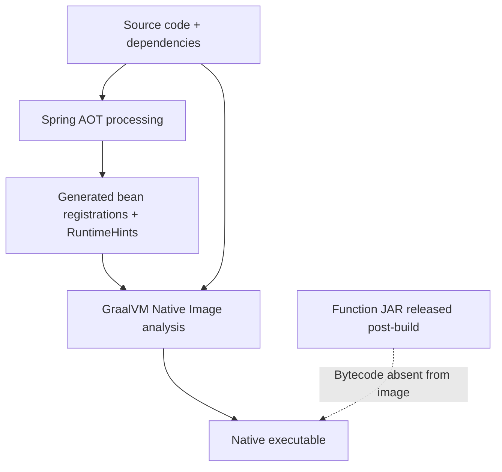
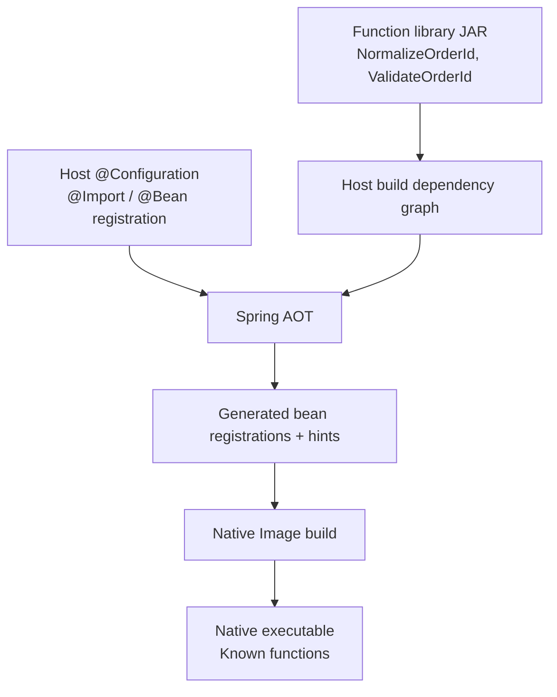
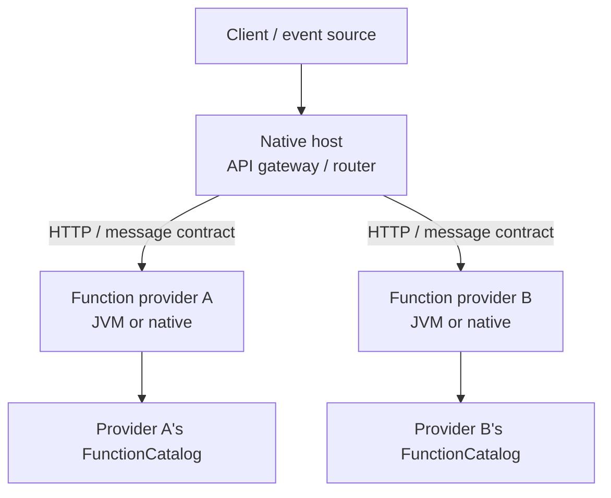

# Dynamic Loading Limits When Using AOT or Native Images

## 1. The Problem: A Function JAR Loads on the JVM Yet Fails to Run in a Native Image

An order platform has a Spring Boot **host** and several independently released function JARs. When the host runs on the JVM, the deployer mechanism can resolve artifacts, create appropriate classloaders, load implementations, and wire functions into **Spring Cloud Function**'s invocation path. The operations team wants to reduce startup time and memory usage by building the host as a **native executable** with GraalVM Native Image.

After switching to a native image, several capabilities stop working as before:

- The host cannot load a function JAR released **after the native executable was built**.
- `Class.forName` or reflection cannot find a required constructor/method/field.
- A resource such as a JSON schema or template file is missing from the executable.
- Dynamic proxies or serializers fail due to missing metadata.
- `FunctionCatalog` lacks functions that operations expected to be downloaded from a repository at startup.

This is not merely a JAR configuration mistake. **AOT and native images change when the framework analyzes the application and how the runtime knows which classes can be used.**

In the **Spring Cloud Function** (`SPRING_CLOUD_FUNCTION`) module, business logic is expressed via `Supplier<T>`, `Function<T,R>`, and `Consumer<T>`, looked up via `FunctionCatalog`, composed, message-converted, and deployed over HTTP, events, or serverless. This topic clarifies the limits of **loading code post-build** when migrating applications to AOT/native, how to keep functional beans runnable, and alternative architectures when functions must update independently.

**Distinguish before starting:**

1. **Spring AOT on the JVM:** the framework processes application structure at build time and generates startup-assisting code/metadata; the application still runs on the JVM.
2. **GraalVM Native Image:** produces a native executable from code and reachability sets determined at build time; the runtime does not behave like a JVM able to freely load new JAR bytecode.
3. **Dynamic function deployment:** the host finds and loads artifacts/functions at runtime. This model can fit the JVM, yet conflicts with native image's closed-world assumption if code was absent from the build set.

## 2. AOT and Native Image Are Related Concepts, Not Synonyms

| Aspect | Spring AOT running on the JVM | GraalVM Native Image |
| --- | --- | --- |
| Analysis time | Build time; Spring processes bean definitions, configuration conditions, and generates optimized code/metadata. | Build time; `native-image` analyzes reachability and builds an executable for a target environment. |
| Runtime | Still the JVM; bytecode and JVM classloading mechanisms remain. | Runs a native executable; lacks full capability to load arbitrary new bytecode like a standard JVM. |
| Class on runtime classpath but absent during AOT? | JVM can still load the class; however, the Spring AOT-generated context does not automatically know new beans or configs. Reflection/hints depend on access path. | Classes omitted from image/reachability metadata generally cannot be loaded and used arbitrarily at runtime. |
| Plugin JAR released post-build | JVM can load classes if a loader is designed to support it; Spring bean/catalog registration must be handled separately. | Cannot by default download and execute new bytecode post-build. |
| Reflection/resources/proxies | Broadly supported by JVM; AOT may still need metadata to optimize contexts or match certain frameworks. | Must declare reachability/hints for operations not discovered by static analysis. |
| Primary goal | Reduce startup work and optimize context creation. | Reduce footprint, start up fast, package runtime into a native executable. |

**Do not say "AOT forbids all dynamic class loading."** When an AOT application still runs on the JVM, the Java ClassLoader remains part of the runtime. Restrictions usually appear in the **pre-processed Spring context**: beans/configurations discovered after the AOT phase do not automatically get generated bean registrations. Native image imposes an even stronger limit because the code/reachability set is closed at build time.

## 3. The Closed-World Assumption of Native Images

Native Image performs static analysis to determine what code can be reached from entry points and inferable paths. Required classes/methods/resources must be **reachable** or declared with appropriate metadata/hints.

Conceptual model:



For example, the host is built into a native image today with `NormalizeOrderId` and `ValidateOrderId`. Next week, the business team publishes `ShippingDiscountV2.class` in a new Maven artifact. If that class **was not in the code set when the native executable was built**, merely adding `maven://...` to configuration cannot turn the executable into a full JVM capable of loading new bytecode.

### 3.1. Reachability does not mean "every file in a JAR is packaged"

A dependency appearing in the Maven graph does not mean every class, reflection member, and resource of that dependency enters the native executable. Static analysis can prune parts not recognized as reachable. Dynamic access paths require extra metadata:

- Reflection invoking constructors, methods, or accessing fields.
- Dynamic proxies created from runtime interfaces.
- Serialization/deserialization relying on class metadata.
- Loading resources by computed names/paths.
- JNI or native libraries.
- Service provider discovery and resource metadata.

A class may already sit in the image yet lack reflection registration for a needed method/constructor; conversely, a resource present in the source JAR yet not included may be missing from the executable runtime.

### 3.2. Hints extend reachability; they do not turn the runtime into a JVM plugin host

Spring AOT `RuntimeHints` and GraalVM reachability metadata declare **what is known at build time yet cannot be inferred by static analysis**. Hints can declare that a DTO needs reflection, a resource must be bundled, or an interface needs a dynamic proxy.

Hints **do not**:

- Add bytecode from an arbitrary JAR downloaded after the native executable was built.
- Automatically generate bean definitions for unknown plugins.
- Guarantee a function JAR matches the Spring/Java versions inside the image.
- Turn a classloader into a sandbox or runtime compiler.

## 4. Why JVM Dynamic JAR Loading Does Not Port Directly to Native

On the JVM, a loader can open a JAR from the filesystem:

```java
URL jarUrl = Path.of("/opt/functions/order-normalizer.jar")
        .toUri().toURL();
try (URLClassLoader loader = new URLClassLoader(
        new URL[] { jarUrl },
        Thread.currentThread().getContextClassLoader())) {
    Class<?> type = Class.forName(
            "demo.plugin.OrderIdNormalizer", true, loader);
    Object instance = type.getDeclaredConstructor().newInstance();
}
```

This snippet illustrates **JVM dynamic class loading**. It is not a complete production function-loading setup: you still need constructor checks, interface identity, dependencies, function registration, lifecycle, and loader cleanup. More importantly, **you cannot carry this assumption into a native executable** expecting `URLClassLoader` to load arbitrary bytecode.

### 4.1. Comparing the two points in time

| Scenario | Standard JVM | Native image |
| --- | --- | --- |
| Class on app classpath at build time | Can be loaded when needed. | Can be included in the image if reachable/hints are right. |
| JAR on filesystem at startup, absent at build time | Can load if supported by loader. | Not loaded as new executable code by native runtime by default. |
| JAR released after app is already running | Can create a new loader and load if designed for it. | Cannot treat a native executable like a JVM to load new code. |
| Adding a Spring bean from a new class at runtime | JVM can register manually, though AOT context/lifecycle need handling. | Bean/class must be known and supported at build time; cannot arbitrarily add new plugins post-build. |
| Switching `spring.cloud.function.definition` among packaged functions | Can select within the registered catalog. | Can select within functions already built into the image and supported by AOT; verify per version. |

**Practical rule:** if you must swap functions by publishing a new JAR without rebuilding the host, treat that as a dynamic deployment requirement. Native image fits a model with a **known, pre-packaged set of functions**, or a separate-process provider service.

## 5. Function Deployer, Maven URIs, and `function-class` in Native Images

In Spring Cloud Function versions supporting the deployer on the JVM, a host can use a conceptual configuration:

```yaml
spring:
  cloud:
    function:
      location: "maven://demo.functions:order-id-normalizer:1.0.0"
      function-class: "demo.functions.OrderIdNormalizer"
```

Or use `file:///...` for a JAR on the host filesystem. These mechanisms require a **Maven/resource resolver, loader, and runtime class loading capability**.

When the host is a native executable:

- The resolver might still reach repositories/networks as compiled code allows, yet **downloading a JAR file does not mean executing bytecode inside it**.
- `function-class` is a configured class name; if the implementation class was not built into the native image at build time, that name will not make the class materialize.
- A native executable cannot automatically construct a complete Spring ApplicationContext from a Boot JAR downloaded post-build like a regular JVM host.
- Beans/functions packaged from the start can still be processed by Spring AOT and registered in framework-supported ways.

**Do not conclude all Maven resolver features fail to run in native images.** Resolvers may still be useful for fetching metadata/resources or pre-known workflows; the core limit is **executing new classes absent from the image**, not that all network access is forbidden.

### 5.1. Simple JAR vs. Boot executable JAR

| Artifact | JVM host with supported deployer | Native image |
| --- | --- | --- |
| Simple JAR, class selected via `function-class` | Can load if version/dependencies/loader align. | Feasible only if the class and dependencies were built into the image; do not rely on loading new JARs at runtime. |
| Spring Boot JAR with `@Bean Function` | Appropriate deployer can load packaged application/context per release. | Beans and configs must be processed at build/AOT; cannot build contexts from new Boot JARs at runtime by default. |
| Maven artifact published after host build | Can resolve and load if host/runtime supports it. | Cannot inject new bytecode into a running image via Maven URI. |

If a project requires native image, **bring all required function implementations into the host's build graph** or move them into independent providers. Do not use `function-class` as an arbitrary runtime plugin-swapping mechanism in native production.

## 6. How Does Spring Boot AOT Process ApplicationContext?

Spring AOT analyzes bean definitions and configuration during build time, then generates artifacts needed to initialize the application context more efficiently. For native images, AOT output also feeds into `native-image` analysis and runtime hints.

Activities typically handled:

- Component scanning, `@Configuration`, and `@Bean` definitions discovered during build.
- Conditional configuration/profiles affecting the set of beans created.
- Constructor binding and property metadata.
- Reflection, serialization, resource, proxy, and JNI hints when needed.
- Bean post-processors or dynamic registration mechanisms must have corresponding AOT support.

**AOT is not a carbon copy of normal JVM startup.** Runtime-only behaviors like scanning a plugin directory, loading new classes, or registering beans by names read from requests may not be reflected in the generated context.

### 6.1. Functional beans known at build time

Example host pre-packaging two functions:

```java
package demo.host.functions;

import java.util.Locale;
import java.util.function.Function;
import org.springframework.context.annotation.Bean;
import org.springframework.context.annotation.Configuration;

@Configuration(proxyBeanMethods = false)
public class OrderFunctions {

    @Bean("normalizeOrderId")
    Function<String, String> normalizeOrderId() {
        return input -> input.strip().toUpperCase(Locale.ROOT);
    }

    @Bean("addOrderPrefix")
    Function<String, String> addOrderPrefix() {
        return input -> "ORD-" + input;
    }
}
```

Both beans are declared in source configuration and included in build inputs. Spring AOT can analyze these bean definitions per the version's support. `FunctionCatalog` can look up the registered functions:

```java
Function<String, String> normalize =
        catalog.lookup("normalizeOrderId");
Function<String, String> prefix =
        catalog.lookup("addOrderPrefix");
```

What must be verified in the native image is that **both beans exist in the generated context and the catalog registered their exact names**. No new plugin JAR at runtime is needed for this example.

### 6.2. `definition` can select within the packaged function set

Configuration example:

```yaml
spring:
  cloud:
    function:
      definition: normalizeOrderId|addOrderPrefix
```

This is a composition of **two already registered functions**; input/output types must be compatible. In a native build, definition selection may depend on how properties are supplied and when AOT analyzes them. If properties change at runtime, verify your release's adapter/catalog supports selecting from pre-packaged beans. **Do not confuse selecting existing function names with loading new classes from a JAR.**

## 7. Common Dynamic Mechanisms and AOT/Native Compatibility

| Mechanism in application | Non-AOT JVM | Spring AOT on JVM | Native image |
| --- | --- | --- | --- |
| Invoking `@Bean` function beans | Usually works. | Works when beans/configs are AOT-supported. | Works if reachable and needed hints exist. |
| `FunctionCatalog.lookup` on registered names | Usually works. | Works for AOT-processed/registered functions. | Works within pre-packaged, supported functions; test on real binary. |
| Composing known functions | Usually works if types match. | Depends on processed catalog/definition. | Feasible if functions and composition code are reachable; verify. |
| `Class.forName` for a class in the image | Usually works. | JVM still supports it; Spring context won't gain new beans automatically. | Works only if required class/metadata entered the image. |
| Reflection on constructors/methods/fields | Broad JVM support. | Usually still works on JVM; hints may help for native. | Requires appropriate reflection metadata. |
| Reading resources by fixed name | Usually works if on classpath. | Runtime hints/AOT may be needed depending on access. | Resource must be included. |
| `URLClassLoader` loading unknown JARs | Can be supported. | JVM can still load code; generated Spring context won't auto-discover new beans. | Cannot rely on loading new JAR bytecode. |
| Runtime proxy/subclass generation | Depends on API/library. | May require AOT support. | Proxies/interfaces must be registered/supported; runtime codegen is restricted. |
| `ServiceLoader` provider discovery | Can work. | May need metadata/resource hints. | Providers and `META-INF/services` files must be properly included in image/metadata. |
| Downloading Maven artifacts at runtime | Can resolve and load via deployer. | JVM can download files; bean discovery/AOT is separate. | Downloading a file does not make new bytecode executable in the image. |

This table is **directional guidance**, not an official compatibility matrix for every release. Check Spring Boot/Spring Cloud Function/GraalVM docs for your exact version and test the real native executable.

## 8. `RuntimeHints`: Declaring Known Dynamic Accesses

When using Spring AOT/native, certain access paths cannot be fully inferred by static analysis. **`RuntimeHints`** declare which components already present in the build need runtime access via reflection, resource lookups, proxies, or serialization.

Common hint categories:

| Hint group | When needed |
| --- | --- |
| **Reflection** | Framework uses reflection to call constructors, methods, or access fields. |
| **Resources** | Reading files by paths/names that static analysis cannot deduce. |
| **JDK proxies** | Creating dynamic proxies for a known set of interfaces. |
| **Serialization** | Serializing/deserializing types via mechanisms requiring metadata. |
| **JNI** | Calling native methods or native libraries where supported. |

### 8.1. Registering reflection and resources with `RuntimeHintsRegistrar`

Example Spring Framework AOT API on lines supporting `RuntimeHints`:

```java
package demo.host.hints;

import demo.contract.OrderRequest;
import org.springframework.aot.hint.MemberCategory;
import org.springframework.aot.hint.RuntimeHints;
import org.springframework.aot.hint.RuntimeHintsRegistrar;
import org.springframework.context.annotation.ImportRuntimeHints;
import org.springframework.context.annotation.Configuration;

public class FunctionRuntimeHints implements RuntimeHintsRegistrar {
    @Override
    public void registerHints(
            RuntimeHints hints, ClassLoader classLoader) {

        hints.reflection().registerType(
                OrderRequest.class,
                MemberCategory.INVOKE_DECLARED_CONSTRUCTORS,
                MemberCategory.INVOKE_PUBLIC_METHODS,
                MemberCategory.DECLARED_FIELDS);

        hints.resources().registerPattern(
                "schemas/order-request.json");
    }
}

@Configuration(proxyBeanMethods = false)
@ImportRuntimeHints(FunctionRuntimeHints.class)
class NativeFunctionConfiguration {
}
```

The example assumes `OrderRequest` and the schema **already exist in build inputs**. Exact imports/APIs and member categories to register must match your Spring Framework/Boot version. Do not register every field/method out of habit; expose only the members converters/frameworks truly need.

### 8.2. Hints for binding DTOs

A shorter declaration in supported Spring versions:

```java
import demo.contract.OrderRequest;
import demo.contract.OrderQuote;
import org.springframework.aot.hint.annotation.RegisterReflectionForBinding;
import org.springframework.context.annotation.Configuration;

@Configuration(proxyBeanMethods = false)
@RegisterReflectionForBinding({
        OrderRequest.class,
        OrderQuote.class
})
class FunctionBindingHints {
}
```

`@RegisterReflectionForBinding` registers reflection metadata needed for types known at build time, especially for binding/conversion. It **does not inject a new DTO from a plugin JAR absent from the build into the native image**. If a type is not in build inputs, no annotation on a non-existent class can generate bytecode.

### 8.3. Proxy hints

If the application needs a JDK dynamic proxy for a known interface:

```java
hints.proxies().registerJdkProxy(
        OrderPolicy.class,
        java.io.Serializable.class);
```

This snippet goes inside `registerHints(...)`, with `OrderPolicy` already in the build. Proxy types/interfaces must match the exact interface list and classloader/runtime used by the framework. Hints for JDK proxies **do not solve** libraries generating runtime subclasses via Byte Buddy/CGLIB or runtime bytecode generation.

### 8.4. Hints do not replace code generation or runtime dependencies

| Need | What hints can do | What hints cannot do |
| --- | --- | --- |
| Reflection on a known DTO | Exposes required constructors/methods/fields. | Cannot create a new class absent from the image. |
| Reading a JSON schema | Includes the resource in the image. | Cannot auto-update schemas by loading new files if logic doesn't support it. |
| Known JDK proxy interface | Registers proxy configuration. | Cannot build arbitrary implementation classes from external JARs. |
| Serializing a known type | Supplies metadata for serializers. | Cannot turn arbitrary unknown objects into compatible payloads. |
| Known service provider | Preserves required metadata/providers. | Cannot load new plugin providers released post-build. |

## 9. Reflection, `Class.forName`, and `ServiceLoader` in Native Images

### 9.1. `Class.forName` is not a command to "stuff classes into the executable"

`Class.forName("demo.plugin.OrderIdNormalizer")` merely asks the runtime to look up a class by that name through a loader. In a native image, the class must belong to the set built into the executable and have proper metadata if accessed reflectively. If the class exists only inside a JAR placed on the filesystem post-build, `Class.forName` cannot add the JAR's bytecode into the image.

Example for **a class known at build time**:

```java
Class<?> type = Class.forName(
        "demo.host.functions.NormalizeOrderId");
Object instance = type.getDeclaredConstructor().newInstance();
```

In a native image, this code needs appropriate reachability/reflection support; moreover, instantiating objects manually like this **bypasses the Spring bean lifecycle**, dependency injection, and `FunctionCatalog` registration. If the function is a Spring bean, let Spring manage the bean instead of manually instantiating via reflection.

### 9.2. `ServiceLoader`

`ServiceLoader` typically finds providers via `META-INF/services` metadata or module descriptors. In a native image, providers/resources and implementations must be discovered/registered at build time or via corresponding metadata. A new plugin JAR appearing post-build will not automatically add providers to the native executable.

If Spring Cloud Function or a library depends on SPI, check the native build report/reachability metadata to confirm the provider entered the image. Do not just verify that the plugin JAR has a `META-INF/services` file on disk.

### 9.3. Proxies, serializers, and resources

Common failures not necessarily tied to `FunctionCatalog`:

- JSON converter needs constructor/field access yet lacks reflection hints.
- Proxy interface is created via reflection yet lacks a proxy hint.
- Serializer looks up a type by name yet the type is unreachable.
- Schema/resource exists in the source JAR yet was omitted from the image.
- SPI provider was not included in the executable.

Analyze the **stack trace and native-image build report** to pinpoint missing metadata; add tightly scoped hints rather than opening reflection across all packages.

## 10. Bean Registration and `FunctionCatalog` in AOT

`FunctionCatalog` is a lookup mechanism for registered functions; it is not an independent plugin scanner able to read arbitrary JARs at runtime. When building for AOT/native, let Spring discover functional beans **during application analysis**.

### 10.1. Explicit function declarations

```java
package demo.host.functions;

import java.util.function.Function;
import org.springframework.context.annotation.Bean;
import org.springframework.context.annotation.Configuration;

@Configuration(proxyBeanMethods = false)
public class NativeFunctions {
    @Bean("normalizeOrderId")
    Function<String, String> normalizeOrderId() {
        return value -> value == null
                ? null : value.strip().toUpperCase();
    }

    @Bean("validateOrderId")
    Function<String, Boolean> validateOrderId() {
        return value -> value != null
                && value.matches("[A-Z]{2}-[0-9]{3}");
    }
}
```

These beans are part of **source configuration** and are discovered at build time. After building native, the catalog can look up these names if supported by your Spring Cloud Function version and bean registrations/hints are complete.

### 10.2. Lookup and composition among packaged functions

Java caller example:

```java
Function<String, String> normalize =
        catalog.lookup("normalizeOrderId");
Function<String, Boolean> validate =
        catalog.lookup("validateOrderId");

if (normalize == null || validate == null) {
    throw new IllegalStateException("Function not registered");
}

String value = normalize.apply(" od-204 ");
Boolean valid = validate.apply(value);
```

Or composition:

```java
Function<String, Boolean> pipeline =
        catalog.lookup("normalizeOrderId|validateOrderId");
```

The `String` output of `normalize` matches the `String` input of `validate`. Whether composition runs inside the native executable must be verified via a **real native test**, not solely JVM tests. The functions and wrapper code must exist in the build/reachability graph.

### 10.3. `definition` is selection, not plugin discovery

```yaml
spring:
  cloud:
    function:
      definition: normalizeOrderId|validateOrderId
```

This definition selects two **already registered** functions and requires them to be compatible. It does not read repositories, load a new class, or create any bean definition after the native image is built.

If you want to switch `definition` per environment, verify when the property is read and how AOT/native supports that configuration in your target release. Changing configuration cannot put a function absent from the executable into the catalog.

## 11. Conditional Beans, Profiles, and Build-Time Configuration

Spring AOT evaluates conditions and profiles during build time according to the version's mechanics. Keep in mind:

- Beans enabled by `@Profile` or `@ConditionalOnProperty` may depend on the **environment during AOT processing**.
- Enabling a profile only when running the native executable does not guarantee the generated context includes beans omitted at build time.
- A classpath-based condition cannot see dependencies downloaded only post-build.
- Configuring function definitions selects existing beans; it does not alter the reachability graph.

Example:

```java
@Bean
@Profile("shipping")
Function<String, String> normalizeOrderId() {
    return String::strip;
}
```

If the AOT build omitted the `shipping` profile and the bean was excluded from the generated context, setting `spring.profiles.active=shipping` at runtime **does not guarantee** the function appears in the native executable. Exact behavior depends on the Spring Boot release's profile handling/AOT mode; verify by building and testing each profile.

### 11.1. Which configuration properties can change at runtime?

| Configuration type | Runtime modifiability |
| --- | --- |
| Endpoints, credentials, topics, timeouts of packaged beans | Usually configurable at runtime if the bean/config supports it and wasn't fixed by AOT. |
| Choosing a definition among existing functions | Can work; verify adapter/catalog and property read timing. |
| Enabling a profile to materialize an AOT-excluded bean | Not by default; depends on build-time conditions and generated context. |
| Changing `function-class` to an FQCN absent from the image | Not possible via properties alone. |
| Changing Maven URI to a JAR containing new bytecode | Cannot turn that JAR into executable code inside the native image. |
| Changing a resource path to an already included resource | Possible if runtime lookup/hints and the resource exist. |

## 12. Resource Hints for Functions

Functions may read schemas, templates, rule tables, or dedicated config files. On the JVM, classpath/resource lookup is usually flexible; in a native image, resources must be included via build mechanisms.

Registration example:

```java
@Override
public void registerHints(
        RuntimeHints hints, ClassLoader classLoader) {
    hints.resources().registerPattern(
            "shipping/rules/*.json");
}
```

This snippet assumes `shipping/rules/*.json` files exist in build resources. Keep patterns narrow; registering the entire filesystem or every dependency resource bloats the executable and retains unnecessary data.

### 12.1. Resources outside the image

If business rules require changing **rule data** frequently, you do not always need to package them as plugin code:

- Read external config files from a managed path, if permitted by runtime and policy.
- Fetch rule JSON from an object store/database or config service.
- Deliver rules as versioned messages/configuration.

This differs from loading new Java classes: **data with a fixed schema can change at runtime** without needing the native image to contain new bytecode. Still validate provenance, schemas, versions, fallbacks, and access permissions.

## 13. Serialization and DTOs in Native Images

A Spring Cloud Function can deserialize `OrderRequest` from JSON and return `OrderQuote`. The native image needs sufficient metadata for converters/serializers used by adapters.

Example:

```java
package demo.contract;

import java.math.BigDecimal;

public record OrderRequest(
        String orderId,
        BigDecimal amountVnd) {}

public record OrderQuote(
        String orderId,
        BigDecimal shippingFeeVnd) {}
```

For types requiring reflection-based binding, you can declare:

```java
@RegisterReflectionForBinding({
        OrderRequest.class,
        OrderQuote.class
})
@Configuration(proxyBeanMethods = false)
class FunctionJsonConfiguration {
}
```

Test converters **inside the native executable**, because JVM tests often succeed using reflection without metadata. If using Jackson, Protobuf, Avro, or other serializers, check the library's native support/hints and the exact types serialized/deserialized.

### 13.1. Contracts should not depend on classes loaded post-build

If plugin v2 adds a DTO `OrderQuoteV2` after native image v1 was built, native image v1 will not understand that type automatically. Options:

1. Include both the DTO and function v2 in a new build.
2. Keep payload schemas stable and version via data contracts.
3. Run provider v2 as an independent service.

Simply adding `@RegisterReflectionForBinding(OrderQuoteV2.class)` to source code after the executable is built **does not alter the existing executable**; a rebuild is required.

## 14. Putting the Function JAR into the Build Graph Instead of Loading Post-Build

If you want to run a native image while still sharing code via Maven artifacts, the right approach is to **add the function library to the dependency graph before AOT/native compilation**.



In this model, the artifact can still be released independently via Maven and selected by version in the host **at build time**. After upgrading the function library, the host builds a new native image to include the new bytecode and metadata.

### 14.1. Declaring the Maven dependency

In the host's `pom.xml`:

```xml
<dependency>
    <groupId>demo.functions</groupId>
    <artifactId>order-id-normalizer</artifactId>
    <version>1.1.0</version>
</dependency>
```

This dependency must resolve **before AOT/native build**. Dropping the JAR into a runtime folder does not replace the Maven compile/runtime dependency graph.

### 14.2. Registering beans via build-time configuration

Suppose the library provides class `demo.plugin.NormalizeOrderId`:

```java
package demo.host;

import demo.plugin.NormalizeOrderId;
import java.util.function.Function;
import org.springframework.context.annotation.Bean;
import org.springframework.context.annotation.Configuration;

@Configuration(proxyBeanMethods = false)
public class ImportedFunctionConfiguration {

    @Bean("normalizeOrderId")
    Function<String, String> normalizeOrderId() {
        return new NormalizeOrderId();
    }
}
```

The host **creates an explicit bean registration**. If the library already provides an importable `@Configuration`, the host can also `@Import` that configuration; ensure AOT processing sees the class/configuration at build time.

```java
package demo.host;

import demo.plugin.PluginFunctionConfiguration;
import org.springframework.context.annotation.Configuration;
import org.springframework.context.annotation.Import;

@Configuration(proxyBeanMethods = false)
@Import(PluginFunctionConfiguration.class)
class IncludedPluginConfiguration {
}
```

These two approaches are **alternatives**; do not declare duplicate bean names. Whenever the dependency library bumps versions, the build pipeline must rerun AOT/native and test the catalog. This is **build-time extensibility**, not a runtime plugin system.

### 14.3. Version upgrade workflow

```text
Publish function library 1.2.0
        |
        v
Host bumps Maven dependency 1.1.0 -> 1.2.0
        |
        v
Maven resolve + compile
        |
        v
Spring AOT processing
        |
        v
GraalVM Native Image build
        |
        v
Test native executable + FunctionCatalog
        |
        v
Publish new image and roll out
```

If the host must update functions **without rebuilding/redeploying the host**, do not use this workflow as a dynamic-loading workaround; choose an independent provider service or a JVM plugin host.

## 15. Building Spring Boot AOT and Native Executables

The exact build steps depend on Spring Boot, Spring Cloud Function, GraalVM, and build plugins. A Boot 3.x project typically needs:

- Compatible dependency/version management for Spring Boot and Spring Cloud Function.
- Spring Boot Maven/Gradle plugin with matching AOT processing.
- GraalVM Native Build Tools or compatible buildpacks/builders to produce native executables.
- Required `RuntimeHints` and dependency metadata.
- CI builds on the target environment (OS/architecture/libc).

### 15.1. Illustrative Maven plugin configuration

This is a **configuration excerpt**; versions and executions must align with your project parent/BOM:

```xml
<build>
    <plugins>
        <plugin>
            <groupId>org.springframework.boot</groupId>
            <artifactId>spring-boot-maven-plugin</artifactId>
        </plugin>
        <plugin>
            <groupId>org.graalvm.buildtools</groupId>
            <artifactId>native-maven-plugin</artifactId>
            <extensions>true</extensions>
        </plugin>
    </plugins>
</build>
```

Some Spring Boot parent/BOM setups provide a preconfigured `native` profile and plugin settings; other projects must declare them explicitly. Never copy isolated plugin versions without checking GraalVM JDK, Boot plugin, and Native Build Tools compatibility.

### 15.2. Reference build commands

Once the POM configures the native profile/toolchain:

```bash
mvn -Pnative clean package
```

Or with a configured `native-maven-plugin` goal:

```bash
mvn -Pnative native:compile
```

These are **reference commands**, not guaranteed to work on every POM. Some projects use `spring-boot:build-image` with native-capable builders; others use Maven/Gradle native plugins. Follow your project's actual build profile and inspect the output executable.

### 15.3. Running AOT processing separately from native compile

You can observe the Spring AOT phase independently (if your Boot plugin/version provides the goal):

```bash
mvn spring-boot:process-aot
```

This command helps surface bean analysis/registration issues before running `native-image`. However, AOT processing succeeding **does not prove** native compilation or runtime invocation will succeed. Test each stage.

## 16. JVM Tests and Native Executable Tests Must Be Separate

A unit test running on the JVM can succeed thanks to reflection, classpaths, and classloaders that are more permissive than a native runtime. Therefore, maintain at least three test layers:

| Test layer | What it proves | What it does not prove |
| --- | --- | --- |
| Java unit tests | `Function.apply()` logic, validation, and business rules. | AOT bean registration or native reachability. |
| Spring context/AOT tests on JVM | Bean definitions, `FunctionCatalog`, conversions, and AOT processing. | That the native executable has sufficient reflection/resource/proxy metadata. |
| Native executable integration tests | Native startup, catalog lookup, function invocation, and needed adapters. | Ability to load a new function JAR absent from the image. |

### 16.1. Unit testing the function

```java
package demo.host.functions;

import static org.junit.jupiter.api.Assertions.assertEquals;
import demo.plugin.NormalizeOrderId;
import org.junit.jupiter.api.Test;

class NativeFunctionsTest {
    private final NormalizeOrderId function =
            new NormalizeOrderId();

    @Test
    void normalizesOrderId() {
        String result = function.apply(" od-204 ");
        assertEquals("OD-204", result);
    }
}
```

This test calls the real implementation from the function library. Package/import names must match your actual project; if the implementation is created as a Spring bean with lifecycle or dependency injection, add context tests rather than only instantiating directly.

### 16.2. Context test with `FunctionCatalog`

```java
import static org.junit.jupiter.api.Assertions.assertEquals;
import static org.junit.jupiter.api.Assertions.assertNotNull;
import java.util.function.Function;
import org.junit.jupiter.api.Test;
import org.springframework.beans.factory.annotation.Autowired;
import org.springframework.boot.test.context.SpringBootTest;
import org.springframework.cloud.function.context.FunctionCatalog;

@SpringBootTest
class NativeFunctionCatalogTest {
    @Autowired
    FunctionCatalog catalog;

    @Test
    void findsBuildTimeFunction() {
        Function<String, String> fn =
                catalog.lookup("normalizeOrderId");
        assertNotNull(fn);
        assertEquals("OD-204", fn.apply(" od-204 "));
    }
}
```

This is a **Spring test on the JVM**. It confirms the function bean is registered in the test context, not replacing a native executable test.

### 16.3. Running the real native executable

After building native, run the generated executable and invoke it via a Java runner/HTTP test/broker integration. Verify:

1. Startup succeeds on the target OS/architecture.
2. `FunctionCatalog` looks up every function built into the image.
3. Composition among known functions works properly.
4. JSON/message conversion works with real DTOs.
5. Reflection, proxies, resources, and serialization lack no hints.
6. Configured HTTP/Stream/serverless adapters can receive/send payloads.
7. Shutdown and resource cleanup behave per runtime expectations.

**Do not use a passing JVM test to conclude a native image is ready.**

### 16.4. Deliberately testing dynamic loading limits

In a lab environment:

1. Build the native executable with only `NormalizeOrderId`.
2. After building, place `ValidateOrderId` in a new JAR on the filesystem or repository.
3. Try configuring `location`/`function-class` to load the new class.
4. Observe the actual error/limitation of the native runtime and deployer release.
5. Add `ValidateOrderId` to build inputs, register the bean explicitly, and rebuild.
6. Confirm the new native executable includes both functions and their composition.

The goal of this experiment is to prove **being able to download a JAR does not mean new bytecode can execute inside a native image**, not to try bypassing closed-world rules with reflection hints.

## 17. Functions Changing Independently: Moving to Provider Services

If the business requirement is **publishing new functions without rebuilding the host**, the more natural approach is splitting functions into separate services/processes. The native host calls providers over HTTP or messaging; each provider can be built as a JVM app or its own native executable.



In this model:

- Each provider loads the functional beans included in **its own build**.
- The host does not need plugin bytecode; it only knows endpoints/topics and schemas.
- Upgrading function A can rebuild/deploy provider A without touching the host if the contract stays compatible.
- Host and provider can use different Java versions, dependencies, or runtimes as long as the protocol matches.

In exchange, you must handle **network latency, timeouts, retries, authentication, service discovery, circuit breakers, schema evolution, and distributed failures**. A fast, synchronous in-process function call becomes a distributed call that can time out even after the server finished processing.

### 17.1. Example function provider using Spring Cloud Function Web

A provider can declare:

```java
@Configuration(proxyBeanMethods = false)
class ShippingFunctions {
    @Bean("quoteShipping")
    Function<ShippingRequest, ShippingQuote> quoteShipping(
            ShippingPolicy policy) {
        return policy::quote;
    }
}
```

If the provider uses a compatible Spring Cloud Function Web adapter, it can expose the function over HTTP per a tested contract. Native image **can be an option** for the provider if dependencies/adapters/versions support it and native tests pass; this differs from loading a new JAR into a native host.

### 17.2. Keeping internal function names decoupled from external wire contracts

A service can swap its internal bean from `quoteShipping` to a new implementation while preserving the external API route/JSON contract using a controller/gateway or managed alias. Avoid forcing external callers to depend on Spring bean names unnecessarily. **`FunctionCatalog` names and HTTP routes are two distinct contract layers**.

## 18. Architectural Options and Trade-Offs

| Need | Option to consider | Primary trade-off |
| --- | --- | --- |
| Fast startup / small footprint; functions rarely change | Native image with all functions packaged at build time. | Every code change requires building and rolling out a new image. |
| Loading independent plugin JARs after host is built | Standard JVM host with supported Function Deployer/loader. | JVM footprint plus dependency/classloader/lifecycle complexity. |
| Host needs AOT optimization yet still runs on the JVM | Spring AOT on JVM, with known or separately managed artifacts/plugins. | Generated context does not auto-discover build-unknown beans; registration must be designed. |
| Functions change often, native host stays stable | Independent provider services; native host calls over HTTP/messaging. | RPC/broker reliability, latency, security. |
| Functions vary by config within a finite code set | Bundle all functions into the image; select via catalog/definition. | Larger image size and all variants must be tested. |
| Business rules change often while algorithm stays stable | Load rule/schema data from config/database/object store. | Data validation, versioning, and fallback handling. |
| Multiple plugin versions needing strong isolation | Separate processes/containers per provider. | Increased operational overhead and network boundaries. |

**Do not use dynamic classloading to solve a problem that only needs data updates.** If execution logic stays fixed while fee tables/thresholds/rules change, storing well-schemaed data lets the native executable stay immutable.

## 19. Release Workflow for a Native Host with Multiple Functions

When all functions are built into one native image:

1. **Select versions** of function libraries and contract APIs in the Maven dependency graph.
2. **Compile/test** code on the JVM, including unit tests for `Supplier`/`Function`/`Consumer`.
3. **Spring AOT:** verify bean conditions, profiles, and catalog registrations.
4. **RuntimeHints:** declare required reflection/resource/proxy/serialization hints for known code.
5. **Native compile:** build for the target OS/architecture/libc and keep the build report.
6. **Native integration tests:** startup, lookup, composition, JSON/message conversion, and required adapters.
7. **Publish immutable artifact/image** with version and checksum.
8. **Roll out** the new image; readiness checks verify mandatory functions.
9. **Observe/roll back** based on invocation errors, memory, latency, and contract compatibility.

Whenever a new function is added, steps 3–6 must rerun. Never just update `spring.cloud.function.location` and expect the executable to contain the code.

## 20. Readiness and Observability in a Native Function Host

A native executable can start very fast, yet **fast startup does not mean every function is ready**. In a host with multiple functions, readiness should reflect critical names:

| Signal | What to check |
| --- | --- |
| Application started | Native process and Spring context started. |
| Required functions registered | `FunctionCatalog.lookup(name)` returns non-`null` for mandatory names. |
| Function smoke result | Safe test input yields expected output. |
| Adapters ready | HTTP routes or Stream bindings are created and critical dependencies are ready. |
| External dependencies ready | Required databases/APIs/brokers are reachable. |
| Build identity | Native image, function library, and contract versions are clearly logged/metered. |

Do not invoke side-effecting `Consumer`s in readiness checks. For data-producing `Supplier`s, do not call `get()` if doing so consumes sequences or emits messages. Create dedicated, idempotent, low-cost health checks.

Also monitor native images for:

- Startup duration and baseline memory.
- Function invocation counts/latency/errors by **function name**.
- Conversion/serialization and reflection failures.
- Executable size, native build time, and dependency footprint.
- Actual contract/function library versions in the build.

## 21. Common Errors When Migrating a Dynamic Function Host to AOT/Native

| Symptom | Possible cause | How to handle |
| --- | --- | --- |
| JVM host loads new JAR, native host fails | Bytecode is absent from the native image. | Put plugin into build graph or split into a provider service. |
| Maven resolver downloads JAR yet function never appears | Downloading a file is not equivalent to loading code/registering beans in the image. | Verify closed-world limits and deployer native support; don't just rename catalog lookups. |
| `ClassNotFoundException` / unreachable class | Class was not included in the image. | Add dependency/source before native build and verify reachability. |
| Reflection reports missing constructor/method | Missing `RuntimeHints` or metadata. | Register the right members on known classes. |
| JSON converter fails to deserialize DTO | DTO lacks binding/reflection hints or serializer lacks native support. | Register types; check converter/native metadata. |
| Resource not found | File was not included in the image. | Add resource hints or build resource config. |
| Proxy creation fails | Missing JDK proxy hint or incompatible runtime codegen library. | Register known proxies; pick AOT-compatible libraries. |
| SPI provider does not appear | Service metadata/provider unreachable. | Check `META-INF/services` and native metadata. |
| Bean exists on JVM yet missing in native | AOT condition/profile or config wasn't processed at build time. | Inspect generated context, build profiles, and AOT reports. |
| Runtime `definition` changes yet function not found | Bean/function wasn't packaged or property evaluated at a different time. | Pick from built functions; test per release. |
| Native compile succeeds yet invocation fails | Missing metadata exposed only at runtime or wrong converter/adapter. | Run native integration tests with realistic inputs. |
| Want to update JAR without rebuilding image | Dynamic plugin requirement incompatible with native executables. | Use a JVM plugin host or remote function provider. |

### 21.1. Ordered diagnostic flow

```text
Is the function in the build dependency/source graph?
   |
   +-- No --> Native image cannot execute new classes.
   |
   v
Does Spring AOT see the bean/configuration?
   |
   +-- No --> Fix @Import/@Bean/profiles/conditions.
   |
   v
Does the native image have enough reachability/hints?
   |
   +-- No --> Add reflection/resource/proxy/serialization metadata.
   |
   v
Does FunctionCatalog register the right name?
   |
   +-- No --> Check bean type/name and Function context.
   |
   v
Do adapters/converters run properly on native?
   |
   +-- No --> Test HTTP/Stream/serverless with real payloads.
```

## 22. Decision Checklist Before Choosing Native Image

Before building a Spring Cloud Function host as native:

1. Can the function set be known **before build time**?
2. Is there a requirement to load new JAR classes after the native executable is released?
3. Are function beans explicitly declared with `@Bean`/configurations recognized by AOT?
4. Which profiles/conditions must be active during AOT processing?
5. Are there reflection, resource, proxy, serialization, or SPI usages needing hints?
6. Do all adapters and dependencies have native support on the chosen version?
7. Are there native integration tests for `FunctionCatalog`, composition, and payloads?
8. If functions must update often, can they be split into separate services/providers?
9. If only rule data changes, can rules be stored outside the executable instead of loading new code?
10. Are builds/rollouts reproducible across versions, checksums, OS/architecture, and rollbacks?

If the answer to question 2 is **yes**, native image should not be chosen as a dynamic JAR plugin host. Change the architecture or keep the host running on the JVM.

## 23. Hands-On Exercise

### Level 1 — Distinguishing AOT from native image

1. Create a Spring Boot app with two `Function<String,String>` beans declared with `@Bean`.
2. Run on standard JVM and verify `FunctionCatalog.lookup`.
3. Enable Spring AOT while still running on the JVM; inspect generated artifacts and verify the functions.
4. Build a native executable with compatible GraalVM Native Build Tools.
5. Run the native executable, test lookup/invocation, and compare startup time and memory.

### Level 2 — Runtime hints

1. Add `OrderRequest` and `OrderQuote` DTOs used by a JSON converter.
2. Run native tests to uncover any missing reflection metadata.
3. Register `@RegisterReflectionForBinding` or a tightly scoped `RuntimeHintsRegistrar`.
4. Add a JSON schema resource and declare a resource hint.
5. Test serialization/resources inside the executable, not just on the JVM.

### Level 3 — Proving dynamic loading limits

1. Build a native image containing only `NormalizeOrderId`.
2. After building, publish a new function JAR containing `ValidateOrderId`.
3. Configure `spring.cloud.function.location`/`function-class` pointing to the new JAR and observe the limitation.
4. Add the new function as a host dependency/source, register its bean explicitly, and rebuild the native image.
5. Verify `FunctionCatalog` has both functions and composition works.
6. Compare against a separate JVM provider invoked over HTTP; document network/lifecycle trade-offs.

**Completion criteria:** explain why **a JVM can load new bytecode**, why **Spring AOT does not auto-discover beans appearing post-build**, why **native images require reachability/hints**, and why **`RuntimeHints` cannot inject new plugin bytecode into an executable**.

## 24. References

When implementing in practice, verify against your exact version:

- [Spring Boot — Ahead-of-Time Processing](https://docs.spring.io/spring-boot/reference/packaging/aot.html): how Spring Boot processes applications and generates AOT artifacts.
- [Spring Boot — GraalVM Native Images](https://docs.spring.io/spring-boot/reference/packaging/native-image/index.html): building/running native images and caveats to note.
- [Spring Framework — AOT processing and Runtime Hints](https://docs.spring.io/spring-framework/reference/core/aot.html): `RuntimeHints`, reflection, resources, and AOT mechanics.
- [GraalVM Native Image — Reachability Metadata](https://www.graalvm.org/latest/reference-manual/native-image/metadata/): supplying metadata for reflection, resources, proxies, and dynamic accesses.
- [Spring Cloud Function Reference](https://docs.spring.io/spring-cloud-function/reference/): function model, catalog, composition, and adapters.

Exact Maven/Gradle goal names, API packages, hint declarations, and native support of each adapter depend on the release. The URLs above are starting points to check your version; do not treat examples in this lesson as a compatibility matrix for every combination.

## 25. Conclusion

**AOT/native images optimize applications by shifting analysis work to build time and bounding the set of code and resources usable at runtime.** Spring AOT generates registrations/info for known application structures; GraalVM Native Image packages reachable code into an executable. Consequently, a function JAR appearing only after a native image is built **cannot be arbitrarily loaded and executed as in a JVM host with dynamic ClassLoaders**.

That does not mean Spring Cloud Function cannot use native images. `Supplier`, `Function`, and `Consumer` beans packaged at build time, explicitly registered, and handled by AOT/reachability can run in a native executable when versions, adapters, dependencies, and hints align. `FunctionCatalog` can still look up and compose **within the set of functions included in the image**; it is not a plugin downloader.

Choose according to update needs: for a **stable function set**, package at build time and test natively; for **independently changing plugin JARs**, use a JVM host with an appropriate loader mechanism; when **the host needs native yet functions change independently**, split providers into HTTP/messaging services; when **only rule data changes**, externalize data from the executable behind a clear schema. Separating build time, runtime, class reachability, and function registration lets you leverage AOT/native without confusing a Maven download with the ability to load new bytecode.
