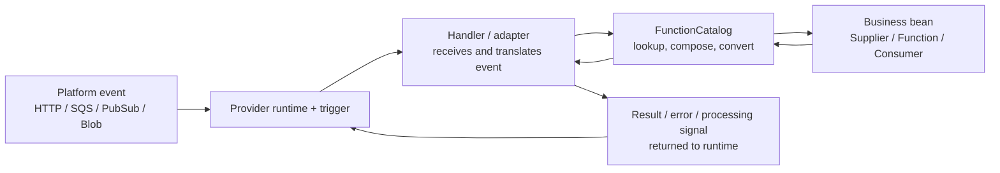
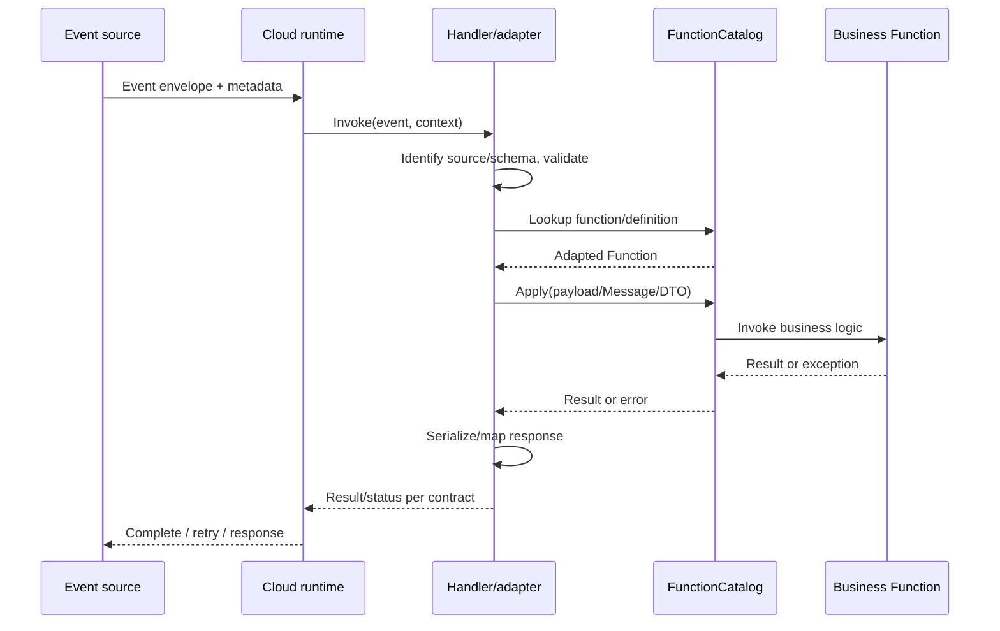
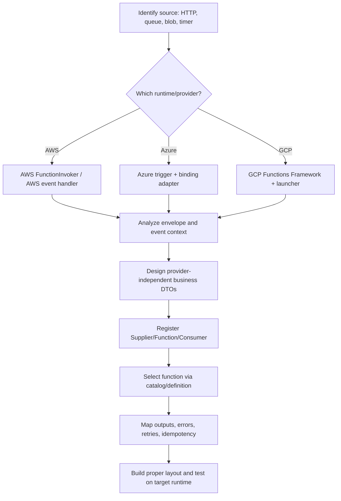

# Role of the Adapter Between Platform Events and Business Functions

> **Chapter:** Serverless  
> **Module:** SPRING_CLOUD_FUNCTION  
> **Focus:** Understand the adapter as the boundary that translates invocations, data, metadata, and results between serverless runtimes and Spring Cloud Function's `Supplier`, `Function`, and `Consumer` beans.  
> **Reference baseline:** November 24, 2026. Examples use Java 21, Spring Boot 4.2.0, and the Spring Cloud 2026.0.0 release train (Spring Cloud Function 5.1.0). For real deployments, verify the exact adapter and runtime documentation for your provider version.

## 1. Why Does a Spring Cloud Function Application Need a Serverless Adapter?

An ideal Java business function only knows about **inputs, processing rules, and outputs**:

```java
Function<String, String> normalizeCode =
        text -> text.trim().toUpperCase(Locale.ROOT);
```

However, serverless platforms deliver data in different ways:

- **AWS Lambda:** the runtime invokes a handler, passing the event payload and an execution context object; the trigger source may be API Gateway, SQS, S3, or another service.
- **Azure Functions:** triggers and bindings are described via annotations/configuration; the Java worker invokes a handler method with parameters matching the trigger type.
- **Google Cloud Functions:** the runtime/Functions Framework uses an entrypoint and an HTTP or event contract corresponding to the deployed function type.

A payload carrying the same meaning of "order code" might live in an HTTP body, the `body` field of a queue record, or an encoded field inside a pub/sub event. If you place all event-parsing code, SDK initialization, and metadata translation inside the business bean, that function becomes **platform-dependent**, making it hard to reuse across HTTP, event streams, and another cloud.

An **adapter** is the layer that bridges these two worlds: it understands the **platform's invocation contract** and knows how to feed data into the **application's function contract**. Spring Cloud Function provides `FunctionCatalog` and provider adapters to perform part of this work, depending on the runtime and event type.

### 1.1. Invocation Flow Diagram



This flow illustrates **responsibility boundaries**; it does not assert that every provider produces an HTTP response or automatically acknowledges events in a single way. For synchronous requests, the result may be returned directly to the caller. For queues/streams, success or failure may lead to retries, message redelivery, a dead-letter queue, or batch responses according to the event source's rules.

### 1.2. Learning Objectives

After this lesson, you will be able to:

1. Distinguish between an **event envelope**, **business payload**, **execution context**, and **message headers**.
2. Explain what an adapter does before and after invoking `FunctionCatalog`.
3. Place order-normalization logic inside a `Function` independent of SDKs/providers.
4. Write a simulated adapter to verify event extraction and result construction.
5. Identify how Spring Cloud Function integrates with AWS Lambda, Azure Functions, and Google Cloud Functions.
6. Understand why choosing `spring.cloud.function.definition`, data conversion, packaging, and error design still need verification on each platform.
7. Plan testing, security, retries, and idempotency for serverless systems.

## 2. Distinguishing the Event Envelope from Business Data

### 2.1. An Event Typically Has Multiple Data Layers

Suppose a system sends a notification to process the code `" od-123 "`. A **hypothetical application-defined event envelope** might look like this:

```json
{
  "eventId": "evt-42",
  "source": "orders.created",
  "time": "2026-11-24T08:30:00Z",
  "attributes": {
    "correlationId": "corr-7",
    "contentType": "text/plain"
  },
  "payload": " od-123 "
}
```

This is an **illustrative fixture**, not a standard format that applies verbatim to AWS, Azure, or GCP. Each field serves a different role:

| Component | Example | Should it go straight into business logic? |
| --- | --- | --- |
| **Event ID** | `evt-42` | May be needed for idempotency/audit. |
| **Event source** | `orders.created` | May be used to select rules/handlers, but do not let clients invoke arbitrary functions. |
| **Event timestamp** | ISO-8601 timestamp | May matter for expiration rules or ordering checks. |
| **Correlation ID** | `corr-7` | Useful for tracing; typically metadata. |
| **Content type** | `text/plain` | Guides payload conversion, not business data itself. |
| **Payload** | `" od-123 "` | Direct input for normalization logic. |
| **Execution context** | Request ID, deadline, logger | Belongs to runtime/provider; pass into business logic only when genuinely needed. |

**Event envelope ≠ business DTO**. A function `Function<OrderCommand, OrderResult>` expects an `OrderCommand`; it does not inherently understand the entire JSON of SQS, API Gateway, or Pub/Sub. Before invoking the function, the adapter or a mapping layer must locate the exact field holding the order code.

### 2.2. Real Events Across Different Providers

| Trigger source | Typical data | Specific constraints |
| --- | --- | --- |
| **Directly invoked AWS Lambda** | Caller-supplied JSON payload; plus Lambda `Context` in the handler. | Structure depends on the invocation contract defined by the caller. |
| **AWS SQS → Lambda** | Envelope containing a `Records` collection; each record has a message ID, body, and attributes. | A single invocation can contain multiple records; must consider per-record processing and partial batch failures. |
| **AWS S3 → Lambda** | Object/bucket metadata, event name, and key. | The function may need to fetch the object before obtaining the business payload. |
| **Azure Queue/Blob/HTTP trigger** | Java handler receives parameters per annotations and bindings. | Method signature, annotations, and metadata are dictated by the Azure worker/trigger. |
| **Google Cloud Pub/Sub** | Message data and attributes inside an event structure. | Payload may be encoded; representation depends on the runtime/trigger generation. |
| **Google Cloud HTTP** | HTTP request body, headers, URL. | Synchronous semantics differ from background events. |

These entries represent scenario categories, **not complete provider JSON templates**. When writing a real function, capture a sample event from the exact source, runtime version, and configured trigger, then inspect its schema.

### 2.3. Not Every Event Is a Single Business Command

Consider an SQS event with 10 records, where each record contains an order JSON. If a function accepts `Function<OrderCommand, OrderResult>` while the raw input is the entire SQS envelope, there is no basis to assume the framework will automatically extract each `body` and invoke the function 10 times according to business rules.

There are at least three design approaches:

1. The business function accepts a **single command**; an adapter/mapper splits the batch into multiple commands and invokes it individually.
2. The function accepts a **provider event type** (such as `SQSEvent`) and processes records directly. This is convenient when partial batch responses are needed, at the cost of coupling the function signature to AWS.
3. Use an **anti-corruption layer** to translate the provider envelope into an application-defined neutral batch type before calling business logic.

The choice depends on batch requirements, delivery semantics, performance, and reuse goals. Spring Cloud Function's adapter helps connect the runtime to the function, but it **cannot infer arbitrary business extraction rules on its own**.

## 3. Five Core Responsibilities of an Adapter

### 3.1. Receiving Invocations per the Runtime Contract

The runtime requires a specific entrypoint: a Lambda handler, an Azure annotated method, or a Google Functions Framework entrypoint. The adapter bridges that entrypoint to the Spring context/catalog.

This is the place to hold knowledge about event/provider types—not the place for rules like "an order code must match `AA-999`".

### 3.2. Initializing and Using the Spring Context / `FunctionCatalog`

Spring Cloud Function discovers `Supplier`, `Function`, and `Consumer` beans. `FunctionCatalog` provides a standardized lookup mechanism and adds capabilities such as type conversion, message conversion, and composition.

For example:

```java
Function<String, String> function =
        catalog.lookup("normalizeCode");

String result = function.apply("  od-123 ");
```

When multiple beans exist, the adapter needs to know which one to select. You can use:

```properties
spring.cloud.function.definition=normalizeCode
```

And for composition:

```properties
spring.cloud.function.definition=normalizeCode|validateCode
```

The `|` symbol expresses execution order, not a delimiter inside an event envelope. Configuring a definition **does not create a cloud trigger** and does not replace configuring the event source in the cloud console or IaC.

### 3.3. Converting Inputs and Outputs

An adapter may need to:

- Decode the request/event at the runtime boundary.
- Choose an appropriate `MessageConverter` or `ConversionService` based on function signature, metadata, and content type.
- Convert data into a `String`, DTO, `Message<T>`, or provider-specific event type.
- Serialize the result into an object, byte stream, or HTTP response according to the environment's contract.

For example, `Function<OrderCommand, OrderResult>` can receive JSON converted into a DTO. However, if the actual JSON is an SQS envelope, the converter cannot automatically know that `Records[0].body` is the command you intend to process.

### 3.4. Preserving and Propagating Necessary Metadata

Some metadata can be mapped to `MessageHeaders` without altering the business payload. Fields such as correlation ID, content type, source, trace ID, or provider-specific context are handled differently depending on the adapter.

**Do not assume every header passes intact through every adapter.** Some internal headers must not be sent outward, some headers are reserved by the provider, and critical data should be modeled explicitly in the DTO.

### 3.5. Mapping Results, Errors, and Invocation Completion

The adapter returns results according to the provider's contract. Depending on the trigger, the output may be:

- HTTP status/body/headers for HTTP functions.
- A JSON value or byte stream for synchronous Lambda invocations.
- No business response for asynchronous events; the runtime relies on handler status or its own mechanism to decide on retries.
- A specialized batch response if the event source supports partial success/failure reporting.

**The adapter does not guarantee exactly-once delivery on its own.** Retry semantics, acknowledgement, timeouts, and dead-lettering depend on the trigger/provider and application design.

### 3.6. What an Adapter Should Not Decide on Its Own

| Responsibility | Appropriate owner |
| --- | --- |
| Receiving events, selecting triggers, reading execution context | Provider runtime/handler/adapter. |
| Unwrapping provider schema, mapping fields | Adapter or boundary mapping layer. |
| Selecting the function/composition and appropriate conversion | Spring Cloud Function/`FunctionCatalog` with the adapter. |
| Order code normalization and validation rules | Business `Function` bean. |
| Idempotency key decisions, transactions, and side effects | Application/use-case logic and persistence layer. |
| Retries, DLQ, timeouts, event source permissions | Cloud/IaC configuration coordinated with the application. |
| Logs, traces, metrics, correlation | Observability infrastructure and relevant application layers. |

Clear boundaries prevent a "one function knows everything" design while preserving the ability to deploy the same business logic over HTTP, event streams, and serverless runtimes.

## 4. End-to-End Flow When Processing an Event

To visualize each step, consider an event containing the code `od-123`:



Key details:

1. **Initialization / cold start:** When the runtime creates a new execution environment, the Spring application context may need to initialize before the first call. Subsequent invocations may reuse the environment while the provider keeps it alive.
2. **Function selection:** With multiple beans, use an explicit definition to avoid routing to the wrong handler. Spring Cloud Function supports dynamic routing, but exposing arbitrary routing to external input introduces security risks.
3. **Type conversion:** Conversion only works within the bounds of configured converters and metadata; schema errors must be detected before or during function invocation.
4. **Error handling:** Exceptions must be mapped accurately per synchronous/asynchronous contracts. Never turn a processing failure into a fake success if the runtime needs to retry.
5. **Completion:** For HTTP, callers inspect status and body; for queues, focus on acknowledgement, batch results, and retries.

A well-designed adapter layer never silently drops failed records, swallows exceptions without recording them, or leaks sensitive data in logs.

## 5. Platform-Independent Business Example

### 5.1. Defining a Neutral Java Contract

We want to receive an order code and return the normalized code while retaining `eventId` to correlate the call. Two DTOs use Java records:

```java
public record OrderCommand(String eventId, String code) {}

public record OrderResult(String eventId, String normalizedCode) {}
```

These two records **illustrate the data types**; in the complete project below, they are declared **nested inside the application class**, so you do not need to create two separate top-level `public record` files.

### 5.2. Spring Boot Application with Two Function Beans

Create `src/main/java/vn/example/serverless/ServerlessDemoApplication.java`:

```java
package vn.example.serverless;

import java.util.Locale;
import java.util.function.Function;

import org.springframework.boot.SpringApplication;
import org.springframework.boot.autoconfigure.SpringBootApplication;
import org.springframework.context.annotation.Bean;

@SpringBootApplication
public class ServerlessDemoApplication {

    public static void main(String[] args) {
        SpringApplication.run(ServerlessDemoApplication.class, args);
    }

    public record OrderCommand(String eventId, String code) {}

    public record OrderResult(String eventId, String normalizedCode) {}

    // Shared business rule; independent of AWS/Azure/GCP.
    private static String normalize(String raw) {
        if (raw == null || raw.isBlank()) {
            throw new IllegalArgumentException("Code must not be empty");
        }

        String normalized = raw.trim().toUpperCase(Locale.ROOT);
        if (!normalized.matches("[A-Z]{2}-[0-9]{3}")) {
            throw new IllegalArgumentException(
                    "Code must match pattern AA-999: " + normalized);
        }
        return normalized;
    }

    @Bean
    public Function<String, String> normalizeCode() {
        return ServerlessDemoApplication::normalize;
    }

    @Bean
    public Function<OrderCommand, OrderResult> normalizeOrder() {
        return command -> {
            if (command == null) {
                throw new IllegalArgumentException("Missing command");
            }

            return new OrderResult(
                    command.eventId(),
                    normalize(command.code()));
        };
    }
}
```

In this class:

- `normalizeCode` accepts and returns a `String`, convenient for testing over HTTP or events with a plain-string payload.
- `normalizeOrder` accepts and returns a neutral DTO containing the code and event ID.
- The normalization rule lives in a `private static` method shared by both beans **without calling any cloud API**.
- Because there are two Function beans, deploying to serverless requires selecting the appropriate definition or handler to avoid routing ambiguity.

Input and output of `normalizeOrder`:

```json
{
  "eventId": "evt-42",
  "code": "  od-123 "
}
```

```json
{
  "eventId": "evt-42",
  "normalizedCode": "OD-123"
}
```

This is the **business JSON contract** assuming the payload is actually passed by the adapter/converter as `OrderCommand`. It should **not** be treated as the raw shape of every AWS/Azure/GCP event.

### 5.3. Selecting the Function for Deployment

If the deployment processes JSON shaped like `OrderCommand`, the configuration can be:

```properties
spring.cloud.function.definition=normalizeOrder
```

If the deployment only receives a String:

```properties
spring.cloud.function.definition=normalizeCode
```

This property selects the **function**, but it does not specify the **event source**, does not indicate which envelope field holds the JSON, and does not provision IAM or bindings. Those belong to the adapter and infrastructure.

### 5.4. Minimal Maven Setup to Test the Catalog and Simulated Adapter

To turn the Java example in sections 5–6 into a Spring Boot project that can run `@SpringBootTest`, create `pom.xml` as follows:

```xml
<?xml version="1.0" encoding="UTF-8"?>
<project xmlns="http://maven.apache.org/POM/4.0.0"
         xmlns:xsi="http://www.w3.org/2001/XMLSchema-instance"
         xsi:schemaLocation="http://maven.apache.org/POM/4.0.0
           https://maven.apache.org/xsd/maven-4.0.0.xsd">
    <modelVersion>4.0.0</modelVersion>

    <parent>
        <groupId>org.springframework.boot</groupId>
        <artifactId>spring-boot-starter-parent</artifactId>
        <version>4.2.0</version>
        <relativePath/>
    </parent>

    <groupId>vn.example</groupId>
    <artifactId>serverless-adapter-boundary-demo</artifactId>
    <version>0.0.1-SNAPSHOT</version>

    <properties>
        <java.version>21</java.version>
        <spring-cloud.version>2026.0.0</spring-cloud.version>
    </properties>

    <dependencyManagement>
        <dependencies>
            <dependency>
                <groupId>org.springframework.cloud</groupId>
                <artifactId>spring-cloud-dependencies</artifactId>
                <version>${spring-cloud.version}</version>
                <type>pom</type>
                <scope>import</scope>
            </dependency>
        </dependencies>
    </dependencyManagement>

    <dependencies>
        <dependency>
            <groupId>org.springframework.boot</groupId>
            <artifactId>spring-boot-starter</artifactId>
        </dependency>
        <dependency>
            <groupId>org.springframework.cloud</groupId>
            <artifactId>spring-cloud-function-context</artifactId>
        </dependency>
        <dependency>
            <groupId>org.springframework.boot</groupId>
            <artifactId>spring-boot-starter-test</artifactId>
            <scope>test</scope>
        </dependency>
    </dependencies>

    <build>
        <plugins>
            <plugin>
                <groupId>org.springframework.boot</groupId>
                <artifactId>spring-boot-maven-plugin</artifactId>
            </plugin>
        </plugins>
    </build>
</project>
```

Place `ServerlessDemoApplication.java` and `BoundaryAdapter.java` in the same `vn.example.serverless` package; put the tests from section 14 in `src/test/java/vn/example/serverless/`. You can then run `mvn test` (or `./mvnw test` **if the project already includes Maven Wrapper**).

This project only verifies **the Spring context, catalog, business logic, and simulated adapter**. It is **not yet** a deployable AWS/Azure/GCP package. When choosing a provider, add the provider-specific dependency and packaging plugin per the adapter documentation, then run corresponding runtime tests. Do not treat a passing `mvn test` as proof of cloud deployment readiness.

## 6. Building a Simulated Adapter to Understand the Boundary

Before using a real SDK, let's build an **illustrative application-written adapter**. It receives a neutral event (not an AWS/Azure/GCP class), unwraps the payload, builds an `OrderCommand`, invokes `FunctionCatalog`, and constructs a response.

### 6.1. Neutral Event and Response

Suppose `PlatformEvent` has an ID, source, payload carrying the order code, and attributes. `PlatformResponse` returns the event ID, normalized code, and some output metadata.

Place this in `src/main/java/vn/example/serverless/BoundaryAdapter.java`:

```java
package vn.example.serverless;

import java.util.Map;
import java.util.function.Function;

import org.springframework.cloud.function.context.FunctionCatalog;
import org.springframework.stereotype.Component;

import vn.example.serverless.ServerlessDemoApplication.OrderCommand;
import vn.example.serverless.ServerlessDemoApplication.OrderResult;

@Component
public class BoundaryAdapter {

    public record PlatformEvent(
            String id,
            String source,
            String payload,
            Map<String, String> attributes) {}

    public record PlatformResponse(
            String id,
            String normalizedCode,
            Map<String, String> attributes) {}

    private final Function<OrderCommand, OrderResult> businessFunction;

    public BoundaryAdapter(FunctionCatalog catalog) {
        this.businessFunction = catalog.lookup("normalizeOrder");

        if (businessFunction == null) {
            throw new IllegalStateException(
                    "Function normalizeOrder is not registered");
        }
    }

    public PlatformResponse handle(PlatformEvent event) {
        if (event == null || event.id() == null ||
                event.id().isBlank()) {
            throw new IllegalArgumentException("Missing event ID");
        }

        // Boundary: convert envelope into business command.
        OrderCommand command =
                new OrderCommand(event.id(), event.payload());

        // Business logic executes via FunctionCatalog.
        OrderResult result = businessFunction.apply(command);

        // Boundary: map result to the simulated runtime contract.
        return new PlatformResponse(
                result.eventId(),
                result.normalizedCode(),
                Map.of("correlationId", event.id()));
    }
}
```

**Note:** This is a **learning simulation adapter**, not a Spring Cloud Function AWS/Azure/GCP adapter class and not a Lambda handler you can upload directly. This approach is useful because provider-specific mapping can be tested without a cloud account.

### 6.2. Line-by-Line Responsibility Breakdown

| Section in `BoundaryAdapter` | Responsibility |
| --- | --- |
| `PlatformEvent` | Simulated event contract at the boundary. |
| Checking `event.id()` | Minimal metadata validation at the boundary. |
| Creating `OrderCommand` | Extracting the business DTO from the envelope. |
| `catalog.lookup("normalizeOrder")` | Retrieving the function adapted by Spring Cloud Function. |
| `businessFunction.apply(command)` | Executing business logic through the catalog. |
| Creating `PlatformResponse` | Mapping the result to the external contract. |

Sample event:

```java
var event = new BoundaryAdapter.PlatformEvent(
        "evt-42",
        "orders.created",
        "  od-123 ",
        Map.of("correlationId", "corr-7"));
```

The expected result when calling `handle` is a response with `normalizedCode="OD-123"`. The simulation intentionally uses `event.id()` as the output correlation ID for simplicity; a real system may need to prefer the original `correlationId`, distinguish event IDs from request IDs, and forward only allowed attributes.

### 6.3. Keep Provider SDKs Strictly at the Boundary

In a real deployment, replace the simulated input with runtime/SDK types. For example, an AWS SQS mapping layer can accept `SQSEvent`, iterate `Records`, parse each `body` into a command, and invoke `FunctionCatalog`. `normalizeOrder` itself requires no changes.

Do not attempt to convert `SQSEvent` to a `String` by calling `toString()` on the event and expecting it to be the order code: `toString()` may return a debug representation with no business meaning.

## 7. AWS Lambda: `FunctionInvoker` Connects Events to the Catalog

### 7.1. Role of the AWS Adapter

Spring Cloud Function provides the dependency:

```xml
<dependency>
    <groupId>org.springframework.cloud</groupId>
    <artifactId>spring-cloud-function-adapter-aws</artifactId>
</dependency>
```

This adapter enables a Spring Cloud Function application to run under the AWS Lambda model. Rather than writing custom SDK handlers for every simple function, Spring documentation recommends the generic handler:

```text
org.springframework.cloud.function.adapter.aws.FunctionInvoker::handleRequest
```

`FunctionInvoker` implements the Lambda handler contract, connects AWS invocations to registered functions, and supports type conversion within documented limits.

**Do not confuse them:** `FunctionInvoker` is the entrypoint for the AWS runtime; `FunctionCatalog` is the Spring function registry/invocation mechanism; the `normalizeOrder` bean is the business logic.

### 7.2. With Direct Invocation, JSON Can Resemble the Business DTO

If a caller invokes Lambda directly with the payload:

```json
{
  "eventId": "evt-42",
  "code": "  od-123 "
}
```

and the adapter is configured to select `normalizeOrder`, type conversion can map the payload into the `OrderCommand` record according to the function signature and configured converters. The output carries:

```json
{
  "eventId": "evt-42",
  "normalizedCode": "OD-123"
}
```

This is the **expected input/output contract for the example**, not proof that a Lambda has been successfully deployed. You must still smoke-test the real serializer/converter in the AWS artifact.

### 7.3. With SQS/S3, Events Differ from Direct Invocation

AWS Lambda receives different payloads depending on the event source:

- **SQS:** envelope containing a list of records, body, message ID, and attributes; may require a partial batch response.
- **S3:** bucket/object metadata, event name, and object key; business data may need to be fetched from S3.
- **API Gateway:** HTTP request structure and metadata per API integration type.
- **Kafka / event source mapping:** batch/partition/offset and broker/provider processing semantics.

Therefore, do not assume `Function<OrderCommand,OrderResult>` can handle every envelope directly. If processing AWS objects directly, Spring Cloud Function supports signatures such as `Function<SQSEvent, SQSBatchResponse>` or `Function<S3Event, ...>`; the advantage is full access to provider-specific fields, at the cost of coupling the function to the AWS SDK. Another approach is using a mapping layer to convert the event into a neutral DTO as in section 6.

### 7.4. Packaging and Configuration Cannot Be Skipped

A Spring Boot JAR executed with `java -jar` is not necessarily a valid artifact for AWS Lambda. You must verify:

1. The `spring-cloud-function-adapter-aws` dependency resolves properly with the Spring Cloud BOM.
2. The JAR is built using the AWS layout described in the adapter documentation (for example, shading/packaging configuration and dedicated artifact classifiers).
3. The Lambda Java runtime supports the compiled bytecode version.
4. The handler is set to `FunctionInvoker::handleRequest`.
5. `spring.cloud.function.definition` or routing selects the intended function when multiple beans exist.
6. Event source, trigger, IAM permissions, timeout, memory, and environment variables are configured properly.
7. Real **trigger events** are tested and logs/metrics are observed, rather than only unit-testing `apply`.

Official documentation: https://docs.spring.io/spring-cloud-function/reference/adapters/aws-intro.html

### 7.5. A Single Generic Handler Can Still Route Across Multiple Functions

Spring Cloud Function provides `RoutingFunction` (catalog name `functionRouter`) and routing mechanisms via configuration or metadata. In AWS Lambda, the generic `FunctionInvoker` can use routing to pick the target bean when an application defines multiple functions.

However, do not allow untrusted event sources to choose arbitrary functions via headers or expressions. Use a static definition or a controlled routing allowlist/callback, and apply permissions following the **least privilege** principle.

## 8. Azure Functions: Handlers and Bindings Form the Boundary Layer

### 8.1. Azure Uses Annotations to Define Triggers

In Azure Functions Java, a handler declares `@FunctionName` alongside triggers such as `@HttpTrigger`, queue trigger, or blob trigger. The Azure Maven/Gradle plugin processes these annotations to generate binding configuration and runtime-compatible artifacts.

Spring Cloud Function integrates via:

```xml
<dependency>
    <groupId>org.springframework.cloud</groupId>
    <artifactId>spring-cloud-function-adapter-azure</artifactId>
</dependency>
```

The Azure adapter supports Spring dependency injection in handlers; to leverage Spring Cloud Function features like composition and type conversion, a handler can inject `FunctionCatalog`.

### 8.2. Illustrative Handler Invoking a Java Bean

The example below illustrates the boundary idea for an Azure HTTP trigger; **it is not a complete Azure project**:

```java
// Required imports include FunctionCatalog, Function, @Component,
// @FunctionName, @HttpTrigger, HttpMethod, AuthorizationLevel,
// HttpRequestMessage, ExecutionContext, and Optional.

@Component
public class NormalizeAzureHandler {

    private final Function<String, String> normalize;

    public NormalizeAzureHandler(FunctionCatalog catalog) {
        this.normalize = catalog.lookup("normalizeCode");
    }

    @FunctionName("normalize")
    public String execute(
            @HttpTrigger(
                    name = "request",
                    methods = {HttpMethod.POST},
                    authLevel = AuthorizationLevel.FUNCTION)
            HttpRequestMessage<Optional<String>> request,
            ExecutionContext context) {

        String body = request.getBody()
                .orElseThrow(() ->
                        new IllegalArgumentException("Missing body"));

        return normalize.apply(body);
    }
}
```

Place this class in an Azure project with the Azure Java Functions SDK dependency, plugin, and proper build configuration. When a request arrives, the **Azure handler** extracts the String body and `FunctionCatalog` invokes the `normalizeCode` bean. If you need `ExecutionContext` inside `Message<?>`, the adapter provides `AzureFunctionUtil.enhanceInputIfNecessary` to enrich message headers with the context as documented.

Design takeaway: the handler deals with the **Azure protocol**, without needing trim/uppercase rules. `normalizeCode` remains usable in other runtimes.

### 8.3. Azure Web Adapter Is a Separate Case

Spring also provides `spring-cloud-function-adapter-azure-web` for running the Spring Web model on top of an Azure HTTP trigger. This is a distinct option from the standard Azure adapter that uses annotated handlers. Do not mix the two approaches without a clear architectural reason.

**Packaging warning:** Azure Functions' application layout differs from a default Spring Boot uber JAR. You need Azure plugins to generate `function.json`, `host.json`, and the corresponding deployment layout; simply copying a locally runnable JAR to Azure does not prove the system works.

Official documentation: https://docs.spring.io/spring-cloud-function/reference/adapters/azure-intro.html

## 9. Google Cloud Functions: Entrypoint and Functions Framework

### 9.1. What Does the GCP Adapter Do?

Spring Cloud Function provides:

```xml
<dependency>
    <groupId>org.springframework.cloud</groupId>
    <artifactId>spring-cloud-function-adapter-gcp</artifactId>
</dependency>
```

The Google Functions Framework for Java receives HTTP requests/events and invokes the application's entrypoint. Spring Cloud Function's adapter provides the launcher:

```text
org.springframework.cloud.function.adapter.gcp.GcfJarLauncher
```

The launcher connects the Google runtime to the Spring context/`FunctionCatalog`. The documentation examples explain build plugin setup, local testing via Functions Framework, and packaging in the layout expected by GCP.

### 9.2. HTTP Triggers and Event Triggers Have Different Payloads

**HTTP function:** has request/response with HTTP semantics. A `Function<String,String>` bean can directly demonstrate string transformation when the adapter receives an appropriate body.

**Event/background function:** receives events from Pub/Sub, Cloud Storage, or other sources, each with its own envelope and metadata. A Pub/Sub message may contain an encoded `data` field and attributes; you must verify the exact event format for the Cloud Functions / Cloud Run functions generation you are using.

A business bean `Function<OrderCommand,OrderResult>` must not be assumed to parse every Pub/Sub event automatically. Use an adapter or converter aware of the event structure prior to invocation.

### 9.3. What to Verify When Building/Deploying

- The GCP artifact has the layout and entrypoint expected by the adapter.
- Build plugins may require configuring the adapter as a dependency of `spring-boot-maven-plugin` or the Functions Framework plugin per documentation.
- The Java runtime, trigger type, and generation must be supported by GCP at deployment time.
- Pub/Sub/Storage/HTTP permissions and network access must be configured separately.
- Local testing via Functions Framework does not replace testing with real cloud events.

Some older docs/samples reference Java runtimes that are outdated relative to current provider versions. **Do not copy `--runtime` flags or deployment parameters from old samples without checking the currently supported runtime list.**

Official documentation: https://docs.spring.io/spring-cloud-function/reference/adapters/gcp-intro.html

## 10. Comparing Serverless Adapters with Web Adapters and Stream Binders

Each integration style can invoke function beans, yet **they do not operate at the same communication layer**.

| Technology | Trigger source | External contract | Binding to `FunctionCatalog` | Best suited for |
| --- | --- | --- | --- | --- |
| **Spring Cloud Function Web** | HTTP requests to a Spring Boot Web app | URL, method, headers, body, HTTP status | Endpoint mapping by name/definition | Simple APIs running as a web service. |
| **Spring Cloud Stream + binder** | Broker events via Kafka/RabbitMQ... | Message, destination, consumer group, retry | Functional binding by definition | Continuous stream/event processing in long-running apps. |
| **AWS Lambda adapter** | AWS invocation and event sources | Handler + AWS event/context | `FunctionInvoker` and routing/catalog | Short-lived functions driven by AWS requests/events. |
| **Azure Functions adapter** | Azure triggers/bindings | Annotated handler, execution context | Spring injection/`FunctionCatalog` | HTTP, queue, blob, and timer workloads on Azure. |
| **Google Cloud Functions adapter** | Google HTTP/event runtime | Functions Framework entrypoint | `GcfJarLauncher`/catalog | HTTP and event workloads on Google Cloud. |

**Do not confuse a Java function with a cloud function:** `Function<T,R>` is a Java interface; an AWS Lambda / Azure / GCP Function is an **infrastructure resource**. Adapters bridge the two concepts, while the infrastructure resource still needs to be provisioned and managed.

### 10.1. Is One Function Truly Portable Everywhere?

Logic is reusable when:

1. Input/output types are clearly defined.
2. Events/HTTP requests can be mapped onto that contract.
3. The function avoids provider APIs when unnecessary.
4. Side effects, transactions, and retries are designed for the target environment.
5. The provider adapter supports the chosen Java, Boot, and Spring Cloud versions.

**It does not mean** swapping a single Maven dependency makes a deployment work automatically. Packaging, handlers, triggers, credentials, and infrastructure still differ.

### 10.2. `Supplier` and `Consumer` in Serverless

| Functional bean | Java semantics | Questions the adapter/runtime must answer |
| --- | --- | --- |
| `Supplier<T>` | `T get()`, produces a value. | What triggers `get`? Schedule/timer or request? Where does the output go? |
| `Function<T,R>` | `R apply(T)`, takes and returns a value. | How is input converted? Where are outputs/exceptions returned? |
| `Consumer<T>` | `void accept(T)`, returns no result. | When does the runtime consider processing complete? How are retries and duplicate side effects handled? |

For example, a `Consumer` writing to a database may be invoked again if the provider redelivers the same event. A `void` signature does not imply "processed exactly once."

## 11. Message Conversion and Metadata: A Boundary Easy to Misunderstand

### 11.1. `MessageConverter` and `ConversionService`

Spring Cloud Function relies on Spring mechanisms for input conversion:

- `MessageConverter` is used when input is a `Message<?>` whose payload needs conversion based on target type and content type.
- `ConversionService` supports cases where data does not carry a `Message<?>` wrapper.
- `FunctionCatalog` can return a wrapper supporting conversion and composition in the configured context.

The signature `Function<OrderCommand,OrderResult>` provides essential metadata so the framework knows the **target type**. `contentType` and the adapter determine which converter runs, but they cannot fix malformed JSON schemas or extract unspecified business fields automatically.

### 11.2. When to Use `Message<T>`?

If business logic genuinely needs to read metadata, you can declare a bean such as:

```java
@Bean
public Function<Message<String>, Message<String>> normalizeWithMetadata() {
    return input -> {
        String normalized = input.getPayload()
                .trim()
                .toUpperCase(Locale.ROOT);

        return MessageBuilder.withPayload(normalized)
                .copyHeaders(input.getHeaders())
                .setHeader("normalized", true)
                .build();
    };
}
```

This snippet requires importing `org.springframework.messaging.Message`, `MessageBuilder`, `Function`, and `Locale`, and placing it in a Spring configuration class. It is an **illustrative variant**, not mandatory for the `normalizeOrder` app in section 5.

**Note:** Spring's `MessageHeaders` do not map 1-to-1 with every AWS Lambda, Azure, or GCP header. Adapters may place certain metadata into headers, without promising that every provider attribute is preserved or automatically copied to response headers.

### 11.3. Protecting Data at the Boundary

Do not log entire raw events if they contain tokens, personal data, or secrets. When tracing is needed, prefer permitted identifiers and metadata. For JSON from untrusted sources, enforce size, nesting depth, and element-count limits; never enable arbitrary class deserialization from input data.

Spring Cloud 2026.0.0 includes security patches related to Spring Cloud Function; therefore, do not force an older Function module onto a newer release train. Dependency hygiene and payload validation go hand in hand.

## 12. Errors, Retries, Batches, and Idempotency

### 12.1. Classifying Errors by Origin

| Error class | Example | Who should handle it? |
| --- | --- | --- |
| **Trigger/runtime** | Events not arriving, wrong handler name, startup timeout. | Infrastructure configuration and adapter. |
| **Event mapping** | Envelope missing `body`, corrupted base64, invalid JSON. | Boundary adapter/converter. |
| **Routing/catalog** | Definition points to missing bean or incompatible composition types. | Spring Cloud Function config and catalog tests. |
| **Business validation** | Code `AB-12` does not match `AA-999`. | Business function; adapter maps the error to the external contract. |
| **Side effect** | DB timeout, API call failure, redelivered record. | Application + provider retry/DLQ. |
| **Output mapping** | DTO fails to serialize or batch response violates schema. | Adapter/serializer and contract tests. |

Do not blindly turn all errors into successes just to "stop retries," as that can silently lose messages. Conversely, do not let deterministic validation errors cause infinite retry loops: distinguish **transient errors** from **permanent errors**, then configure backoff, DLQs, or dedicated error handling.

### 12.2. At-Least-Once Mindset and Idempotency

Many serverless event pipelines can redeliver the same event—for example, when an invocation times out after writing to the database and the provider retries. If a `Consumer` debits an account or creates an order without duplicate checks, the side effect can occur twice.

A safe design typically requires:

1. Selecting a stable **idempotency key**, such as event ID or business operation ID.
2. Recording processed keys in durable storage using atomic checks or unique constraints.
3. Using transactions or an equivalent mechanism to tie the idempotency record to the side effect.
4. Handling retries and partial failures according to the event source contract.

`FunctionCatalog` and adapters do not automatically provide exactly-once guarantees for all backends. That is a business and infrastructure responsibility.

### 12.3. Batches Need Dedicated Policies

When a single invocation receives multiple records, ask:

- Should the entire batch fail if one record fails?
- Does the source support **partial batch failure responses**?
- Do ordering, partitions, or offsets matter?
- Does each record have its own idempotency key?
- Could parallel processing alter ordering or introduce race conditions?

For SQS Lambda, AWS defines a specific batch response format for failed items; with `Function<SQSEvent,SQSBatchResponse>`, business logic can return the appropriate result. If you build a neutral custom adapter, that layer must translate failed records into the exact AWS format. Do not mistake an arbitrary `List<Result>` for a partial batch response recognized by the runtime.

### 12.4. Synchronous, Asynchronous, and Completion Semantics

An HTTP caller receives an immediate response; an SQS event source mapping may mark a batch successful once the handler finishes; Azure and GCP event triggers have their own retry/acknowledgement rules. **Do not treat HTTP 200, Lambda invocation success, and message acknowledgement as identical concepts.**

## 13. Security, Operations, and Runtime Optimization

### 13.1. Permissions and Secrets Configuration

- Use IAM / managed identities / service accounts with least privilege to read event sources and write to target resources.
- Never hardcode credentials in Java beans or event payloads; use provider-recommended secret management.
- Authenticate HTTP event sources, signatures, or invocation permissions appropriately.
- Restrict which functions/routes can be selected from external data; be especially cautious with routing expressions and SpEL.

### 13.2. Cold Starts and Environment Reuse

A new execution environment may need to load JARs, boot the Spring Boot context, and initialize `FunctionCatalog` and SDK clients. This time contributes to **cold start** latency; subsequent invocations may reuse the environment, though providers do not guarantee any instance stays alive indefinitely.

Minimize unnecessary dependencies, avoid recreating network clients repeatedly, measure latency across cold and warm invocations, and size memory and timeouts appropriately. Never store required state across invocations in static fields or singleton beans, as the environment can be recycled at any time.

### 13.3. End-to-End Observability

For every event, record when possible:

- Event ID and correlation/trace ID.
- Invoked function/definition name.
- Trigger type and schema version.
- Processing outcome or error category (without logging sensitive payloads).
- Adapter, conversion, and business latencies where measurable.
- Retry counts, batch failures, and DLQ/poison events.

A request ID issued by AWS/Azure/GCP does not always equal the business event ID; distinguish them clearly in logs and traces.

### 13.4. Verifying Compatibility Before Upgrading

Spring Boot, Spring Cloud Function, adapters, provider runtimes, and SDKs each have independent release lifecycles. Before upgrading:

1. Choose a compatible Boot–Cloud pair.
2. Let the Spring Cloud BOM manage Function modules; avoid ad-hoc version overrides.
3. Verify the adapter supports your target Java runtime / Functions Framework / worker version.
4. Review changes affecting serialization, routing, header mapping, and packaging.
5. Run unit, integration, and smoke tests against the **built artifact**, not only source code.

## 14. Testing Across Every Layer the Adapter Traverses

### 14.1. Business Unit Tests Without Cloud Dependencies

Write a JUnit test for the Java function. Because `normalizeOrder()` returns a `Function`, you can invoke the factory method without starting Spring:

```java
package vn.example.serverless;

import static org.junit.jupiter.api.Assertions.assertEquals;
import static org.junit.jupiter.api.Assertions.assertThrows;

import org.junit.jupiter.api.Test;
import vn.example.serverless.ServerlessDemoApplication.OrderCommand;

class BusinessFunctionTest {

    @Test
    void normalizesOrder() {
        var fn = new ServerlessDemoApplication().normalizeOrder();

        var output = fn.apply(
                new OrderCommand("evt-42", "  od-123 "));

        assertEquals("evt-42", output.eventId());
        assertEquals("OD-123", output.normalizedCode());
    }

    @Test
    void rejectsInvalidCode() {
        var fn = new ServerlessDemoApplication().normalizeOrder();

        assertThrows(IllegalArgumentException.class,
                () -> fn.apply(
                        new OrderCommand("evt-42", "??")));
    }
}
```

This is a plain Java test. It proves business logic, **not** `FunctionCatalog`, event mapping, or the cloud handler.

### 14.2. Integration Testing the Catalog and Simulated Adapter

Once the project includes `spring-boot-starter-test` and `spring-cloud-function-context`, you can test the Spring context:

```java
package vn.example.serverless;

import static org.junit.jupiter.api.Assertions.assertEquals;
import static org.junit.jupiter.api.Assertions.assertNotNull;

import java.util.Map;
import java.util.function.Function;

import org.junit.jupiter.api.Test;
import org.springframework.beans.factory.annotation.Autowired;
import org.springframework.boot.test.context.SpringBootTest;
import org.springframework.cloud.function.context.FunctionCatalog;

import vn.example.serverless.ServerlessDemoApplication.OrderCommand;
import vn.example.serverless.ServerlessDemoApplication.OrderResult;

@SpringBootTest
class AdapterBoundaryTest {

    @Autowired FunctionCatalog catalog;
    @Autowired BoundaryAdapter boundary;

    @Test
    void catalogFindsFunctionByName() {
        Function<OrderCommand, OrderResult> fn =
                catalog.lookup("normalizeOrder");

        assertNotNull(fn);
        var result = fn.apply(
                new OrderCommand("evt-42", " od-123 "));
        assertEquals("OD-123", result.normalizedCode());
    }

    @Test
    void eventEnvelopeIsMappedToBusinessCommand() {
        var event = new BoundaryAdapter.PlatformEvent(
                "evt-42",
                "orders.created",
                " od-123 ",
                Map.of("correlationId", "corr-7"));

        var response = boundary.handle(event);

        assertEquals("evt-42", response.id());
        assertEquals("OD-123", response.normalizedCode());
        assertEquals("evt-42",
                response.attributes().get("correlationId"));
    }
}
```

This test verifies that the **application-simulated boundary** and catalog work, but it **does not verify** Lambda handlers, Azure bindings, or GCP entrypoints. Additional tests with real provider event fixtures are required.

### 14.3. Contract Testing for Events and Runtimes

| Test layer | Input | What to verify |
| --- | --- | --- |
| Unit test | Plain Java `OrderCommand` | Business logic accuracy, clear validation. |
| Spring catalog test | Bean/function definition | Catalog discovers and invokes the function. |
| Boundary mapping test | `PlatformEvent` or provider fixture | Correct extraction of payload, metadata, and result mapping. |
| Serializer/converter test | JSON with headers/content type | DTO parses and serializes per schema. |
| Provider emulator / local runtime test | Real trigger-shaped event | Handler/entrypoint, SDK, config, and packaging correctness. |
| Cloud integration test | Event sent through real source | Permissions, retries, logs, DLQ, batching, and operational behavior. |

A **smoke test** only verifies the happy path. Before production, add tests for errors, batches, timeouts, large payloads, retries, and security.

## 15. Process for Choosing an Adapter for a Serverless Use Case



**Step 1 — Identify the event source.** Document the trigger, schema, synchronous vs. asynchronous behavior, single vs. batch delivery, metadata, and retry behavior.

**Step 2 — Choose the corresponding adapter/handler.** AWS `FunctionInvoker`, Azure annotated handler/adapter, or GCP launcher; for complex events, decide whether a provider-specific DTO or a dedicated conversion layer is needed.

**Step 3 — Design the business contract.** Include only necessary data in `OrderCommand`, avoiding exposing all raw event fields to business functions unnecessarily.

**Step 4 — Register beans and definitions.** Use `FunctionCatalog` for lookup/composition; with multiple beans, specify `spring.cloud.function.definition` explicitly and restrict dynamic routing.

**Step 5 — Define error policies.** Specify transient vs. permanent errors, batch responses, DLQ, side effects, and idempotency.

**Step 6 — Package and verify.** Build the artifact per adapter instructions, run provider-specific tests, and observe logs/traces in the target environment.

## 16. End-of-Lesson Exercises

### Exercise 1 — Classify Responsibilities

Given the hypothetical event:

```json
{
  "eventId": "evt-42",
  "source": "orders.created",
  "payload": " od-123 ",
  "attributes": {"correlationId": "corr-7"}
}
```

Determine which operations belong to the adapter and which belong to the business function:

1. Checking that `eventId` is present.
2. Extracting `payload` from the envelope.
3. Trimming whitespace and uppercasing the code.
4. Using `FunctionCatalog` to invoke `normalizeOrder`.
5. Building the response according to the provider contract.
6. Deciding whether to retry the event on a transient DB error.

**Hint:** 1–2–4–5 belong to the boundary/integration layer, 3 belongs to business logic, and 6 is a coordinated policy between the application and provider. Persisting an idempotency key belongs to the business workflow and persistence layer, not solely the adapter.

### Exercise 2 — Test the Simulated Adapter

Using `ServerlessDemoApplication` and `BoundaryAdapter` from sections 5–6, add tests for:

- Valid event returns `OD-123` and preserves event ID.
- Event missing an ID throws a meaningful exception.
- Payload `"??"` is rejected by business validation.
- Attributes with a correlation ID different from the event ID: decide the desired mapping policy.
- Two invocations with duplicate event IDs: explain why the current code **does not yet** prevent duplicate side effects (currently a pure function without persistence).

### Exercise 3 — Compare Three Event Sources

Keep the `normalizeOrder` business function. Describe how to construct the command from:

1. An HTTP body containing `{"eventId":"evt-42","code":"od-123"}`.
2. An SQS message whose `body` is order JSON, nested inside a `Records` list.
3. A Pub/Sub event with `data` and `attributes` requiring decoding/parsing per schema.

For each case, indicate **where provider schema knowledge is required**, where conversion happens, where business logic runs, and how errors are reported.

### Exercise 4 — Built-in Adapter vs. Custom Mapping

Choose the appropriate approach for each scenario:

| Scenario | Approach |
| --- | --- |
| Direct Lambda invocation with JSON matching DTO | Try `FunctionInvoker` and conversion based on the function signature. |
| Lambda SQS batch needing partial failures | Use AWS event/response types or a mapping layer producing the exact batch response. |
| Azure HTTP trigger needing composition | Inject `FunctionCatalog` into the Azure annotated handler. |
| GCP HTTP function | Use the GCP adapter/`GcfJarLauncher` and matching packaging. |
| Same logic shared across HTTP, Kafka, and Lambda | Keep the business function; give each environment its own adapter/binder, schema, and tests. |

### Exercise 5 — Design a Release Checklist

Create a pre-deployment checklist for a `Consumer<OrderCommand>` that writes data to a DB:

- Compatible Java runtime + Boot/Cloud/adapter versions.
- Correct trigger, handler/entrypoint, packaging, and IAM/identity.
- Accurate event schema, size limits, content type, and metadata.
- Retry policy, dead-letter queue, batch semantics, and idempotency key.
- Observability and logs free of sensitive data.
- Tests for success, validation errors, temporary failures, duplicate events, and timeouts.

## 17. Summary and References

**An adapter is not the place to rewrite business logic.** It bridges platform events/handlers and Spring Cloud Function's `Supplier`, `Function`, and `Consumer` invocations. `FunctionCatalog` handles function registration, lookup, composition, and type/message conversion, while provider adapters manage runtime ingress and egress.

Key takeaways:

- Separate the **event envelope** from the **business payload**; never assume events from SQS, S3, Azure triggers, or Pub/Sub always match `Function<OrderCommand,OrderResult>` directly.
- Choose the right **function definition**, **adapter**, **handler/entrypoint**, and **packaging** for the runtime.
- Do not equate synchronous invocation results with asynchronous event acknowledgement.
- Design **idempotency**, **retries**, **batch failures**, **security**, and **cold starts** as real serverless concerns.
- Test across every layer from plain Java to the provider runtime; a unit test or local `java -jar` run does not prove a cloud deployment will succeed.

**Official references for practice:**

1. Spring Cloud Function — Programming Model, FunctionCatalog, message conversion, and routing: https://docs.spring.io/spring-cloud-function/reference/spring-cloud-function/programming-model.html
2. Spring Cloud Function — AWS Lambda adapter and `FunctionInvoker`: https://docs.spring.io/spring-cloud-function/reference/adapters/aws-intro.html
3. Spring Cloud Function — Azure Functions adapter, handlers/bindings, and Azure Web adapter: https://docs.spring.io/spring-cloud-function/reference/adapters/azure-intro.html
4. Spring Cloud Function — Google Cloud Functions adapter and `GcfJarLauncher`: https://docs.spring.io/spring-cloud-function/reference/adapters/gcp-intro.html
5. Spring Cloud Function — Function composition: https://docs.spring.io/spring-cloud-function/reference/spring-cloud-function/function-composition.html
6. Spring Cloud Stream — connecting functions to brokers: https://docs.spring.io/spring-cloud-stream/reference/
7. Spring Cloud 2026.0.0 GA (November 20, 2026), compatible with Spring Boot 4.2.0: https://spring.io/blog/2026/11/20/spring-cloud-2026-0-0-has-been-released/
8. AWS Lambda Java handlers and event sources: https://docs.aws.amazon.com/lambda/latest/dg/java-handler.html
9. Azure Functions Java developer guide: https://learn.microsoft.com/en-us/azure/azure-functions/functions-reference-java
10. Google Cloud Functions Framework for Java: https://github.com/GoogleCloudPlatform/functions-framework-java
