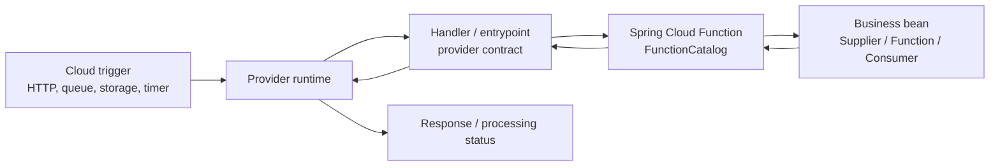
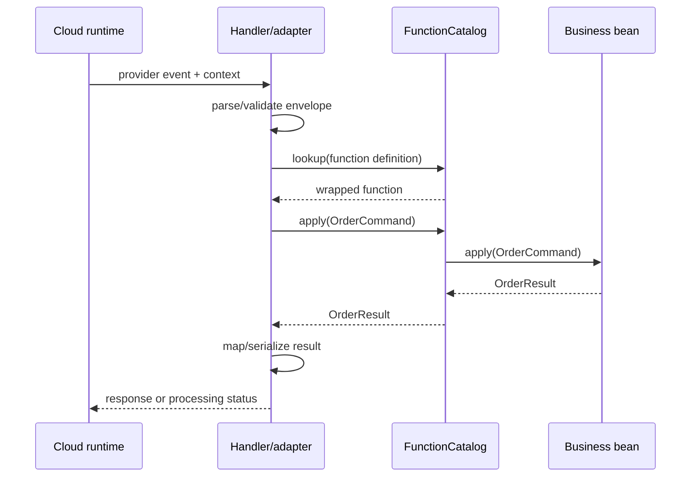
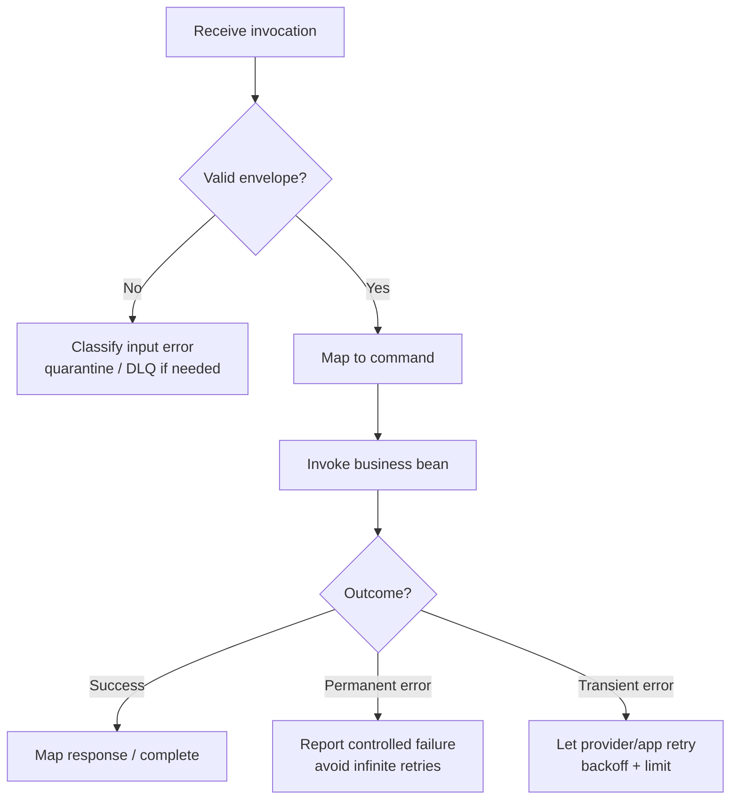

# Distinguishing Platform Entry Handlers from Business Beans

> **Chapter:** Serverless  
> **Module:** SPRING_CLOUD_FUNCTION  
> **Objective:** Clearly distinguish between **handlers invoked by the serverless platform** and **Spring-managed `Supplier`/`Function`/`Consumer` beans**; design the boundary between events, `FunctionCatalog`, and business logic so it can be reused across HTTP, event streams, and serverless environments.  
> **Reference baseline:** November 24, 2026. Baseline examples use Java 21, Spring Boot 4.2.0, and the Spring Cloud 2026.0.0 release train (Spring Cloud Function 5.1.0). SDK, plugin, and target Java runtime compatibility must be re-verified before deployment.

## 1. Two Concepts Commonly Called "Function"

When building serverless applications with Spring Cloud Function, the word **function** appears at two different layers:

- **Cloud function:** a resource deployed on AWS Lambda, Azure Functions, or Google Cloud Functions. The provider controls invocation timing, runtime, triggers, execution limits, permissions, and event formats.
- **Java/Spring function:** a Java object implementing `java.util.function.Function<T,R>`, `Supplier<T>`, or `Consumer<T>`, typically registered via `@Bean` in Spring. It holds business rules, such as normalizing an order code.

Between those two layers sits the **handler/entrypoint**: the entrypoint whose signature, annotations, or class name the provider runtime knows how to invoke.

For example, a Lambda receives JSON containing an order code and returns the normalized result. The business code might simply be:

```java
@Bean
public Function<String, String> normalizeCode() {
    return raw -> raw.trim().toUpperCase(Locale.ROOT);
}
```

However, AWS Lambda does not automatically "see" this Java bean name as a standalone handler. The Lambda runtime requires an **entry handler**, such as `org.springframework.cloud.function.adapter.aws.FunctionInvoker::handleRequest` from the Spring Cloud Function AWS adapter. The handler accepts the invocation and routes it to the selected function in the catalog.

### 1.1. Responsibility Diagram



Many applications only need the **generic handler** supplied by the adapter; Azure applications using annotated handlers may write a very thin handler class to invoke the bean. Both preserve the same core idea: **the handler handles the protocol boundary; the bean handles business logic**.

### 1.2. Learning Outcomes

After this lesson, you will be able to:

1. State the difference between Java's `Function.apply(...)` and a handler method invoked by the cloud runtime.
2. Point to the right place for handling **event envelopes, runtime context, payload conversion, business validation, and response mapping**.
3. Register a `Function<OrderCommand,OrderResult>` bean independent of AWS/Azure/GCP.
4. Invoke the bean via `FunctionCatalog` from a bridge class (*handler bridge*) to study the execution flow.
5. Explain when AWS can use `FunctionInvoker`, when Azure requires `@FunctionName`, and when GCP uses `GcfJarLauncher`.
6. Distinguish business errors from runtime, packaging, routing, and message-conversion errors.
7. Design layered tests before deploying to a real provider.

## 2. What Is a Handler? What Is a Business Bean?

### 2.1. A Handler Belongs to the Runtime Contract

A **handler** is the entrypoint discovered and invoked by the runtime when a trigger fires. It must satisfy platform requirements, which may include:

- Class/method name or entrypoint declared at deployment time.
- Parameter signatures for events, context, or request/response objects.
- Annotations describing triggers and bindings.
- Conventions for returning values, signaling errors, and completing an invocation.
- Packaging rules, build plugins, Java runtime, and classpath layout.

A handler can be **prebuilt adapter code** (AWS `FunctionInvoker`) or **a method you declare** (Azure `@FunctionName`). Having a handler invoked **does not mean** it should contain business rules.

### 2.2. A Business Bean Belongs to the Spring Model

A business bean is an object registered in the `ApplicationContext`, for example:

```java
@Bean
public Function<OrderCommand, OrderResult> normalizeOrder() {
    return input -> new OrderResult(
            input.eventId(), normalize(input.code()));
}
```

This bean:

- Is created and managed by Spring under Spring's lifecycle and scope rules.
- Accepts Java types chosen by the application.
- Can be unit tested via `apply(...)` without any cloud runtime.
- Can be looked up through `FunctionCatalog.lookup("normalizeOrder")`.
- Can be invoked by HTTP, broker, or serverless adapters as long as inputs/outputs are mapped properly.

It does **not** declare a Lambda trigger, an Azure queue binding, IAM permissions, or a Google Cloud entrypoint on its own.

### 2.3. Comparison Across Dimensions

| Dimension | Platform handler/entrypoint | Spring Cloud Function business bean |
| --- | --- | --- |
| Who invokes it? | AWS/Azure/GCP runtime upon a trigger. | Handler, adapter, `FunctionCatalog`, or Spring code. |
| Who owns the contract? | Cloud provider and the corresponding adapter. | Java application: `Supplier`, `Function`, `Consumer`. |
| Typical input | Event envelope, request, runtime context, headers. | Domain types such as `OrderCommand` or `String`. |
| Output | Response/ack/status per platform contract. | `R` of `Function<T,R>`; no return value for `Consumer`. |
| Where declared | Handler class, annotations, deployment entrypoint. | `@Bean`, component, or functional bean registration. |
| Requires provider SDK? | Often yes in custom handlers; generic adapters can hide this. | No, if the domain is designed independently. |
| Reusable on another provider? | Usually must be replaced or reconfigured. | Usually stays unchanged if the data contract fits. |
| How to unit test | Event fixtures and handler/adapter contracts. | Call `apply` directly or test domain methods. |
| How to integration test | Emulator/provider runtime and packaged artifact. | `@SpringBootTest` with `FunctionCatalog`. |
| Retry handling role | Coordinates with the event source contract. | Business logic must tolerate retries and duplicate side effects. |

**Design rule:** If switching from Azure to AWS forces you to rewrite your pricing or code-normalization algorithm, provider details have likely leaked too deeply into your business logic.

## 3. Running Example: Normalizing Order Codes

Let's define a simple domain contract: receive an unnormalized code and an event ID, and return the normalized code. Rules:

1. Reject `null` or blank codes.
2. Trim leading and trailing whitespace.
3. Uppercase using `Locale.ROOT` so behavior does not depend on the runtime locale.
4. Validate the `AA-999` format (two A–Z letters, a hyphen, and three digits).
5. Return the event ID alongside the result.

Examples:

| Input | Business result |
| --- | --- |
| `eventId="evt-42", code="  od-123 "` | `eventId="evt-42", normalizedCode="OD-123"` |
| `eventId="evt-43", code=" ab-12 "` | `IllegalArgumentException`: invalid format |
| `eventId="evt-44", code=""` | `IllegalArgumentException`: empty code |

The **Event ID** is included in the domain command in this example for correlation. In production systems, distinguish between business event IDs, runtime request IDs, and idempotency keys; they are not necessarily the same thing.

### 3.1. Business Payload Is Not the Entire Event

An input sent directly to the function might look like:

```json
{
  "eventId": "evt-42",
  "code": "  od-123 "
}
```

However, another event source might use an envelope:

```json
{
  "id": "evt-42",
  "source": "orders.created",
  "attributes": {
    "correlationId": "corr-7"
  },
  "payload": {
    "code": "  od-123 "
  }
}
```

The second JSON is a **lesson-defined illustrative format**, not a standard AWS, Azure, or GCP event. An adapter/boundary mapping must convert that envelope into `OrderCommand("evt-42", "  od-123 ")` before calling business logic.

Do not assume `FunctionCatalog` or a JSON converter automatically knows which `payload.code` field carries business meaning. They work only when **signatures, converters, metadata, and schemas** align.

## 4. Writing Business Beans Completely Independent of Providers

Create `src/main/java/vn/example/handler/OrderFunctionApplication.java`:

```java
package vn.example.handler;

import java.util.Locale;
import java.util.function.Function;

import org.springframework.boot.SpringApplication;
import org.springframework.boot.autoconfigure.SpringBootApplication;
import org.springframework.context.annotation.Bean;

@SpringBootApplication
public class OrderFunctionApplication {

    public static void main(String[] args) {
        SpringApplication.run(OrderFunctionApplication.class, args);
    }

    // Both records are business types, not AWS/Azure/GCP events.
    public record OrderCommand(String eventId, String code) {}
    public record OrderResult(String eventId, String normalizedCode) {}

    private static String normalize(String raw) {
        if (raw == null || raw.isBlank()) {
            throw new IllegalArgumentException("Order code must not be empty");
        }

        String code = raw.trim().toUpperCase(Locale.ROOT);
        if (!code.matches("[A-Z]{2}-[0-9]{3}")) {
            throw new IllegalArgumentException(
                    "Order code must match pattern AA-999: " + code);
        }

        return code;
    }

    @Bean
    public Function<OrderCommand, OrderResult> normalizeOrder() {
        return input -> {
            if (input == null) {
                throw new IllegalArgumentException("Missing OrderCommand");
            }

            return new OrderResult(
                    input.eventId(),
                    normalize(input.code()));
        };
    }

    @Bean
    public Function<String, String> normalizeCode() {
        return OrderFunctionApplication::normalize;
    }
}
```

Here there are **two business beans**:

- `normalizeOrder` uses a neutral DTO, suited for events mapped into a command.
- `normalizeCode` accepts and returns a String, convenient for HTTP handlers or direct invocations with string payloads.

Both beans share the `normalize(...)` method so rules are not duplicated across cloud handlers.

### 4.1. Why Is `@Bean` Not a Handler?

`@Bean` simply tells Spring to register the object. When Spring starts, it calls `normalizeOrder()` to obtain a lambda; only when real input arrives does the caller invoke `apply(...)`.

No annotation in this example creates an Azure trigger or tells AWS which entry method to call. Running serverless requires a separate adapter and deployment configuration.

### 4.2. Do Not Leak Provider `Context` into the Domain Unnecessarily

Avoid writing:

```java
// Avoid: domain becomes coupled to the AWS Lambda runtime.
Function<SomeAwsEvent, SomeAwsResponse> normalizeOrder = event -> {
    // Now it also has to understand SQS/S3/API Gateway envelopes...
    return ...;
};
```

This is **pseudo-code illustrating an anti-pattern**; there are no `SomeAwsEvent`/`SomeAwsResponse` classes in the JDK. There are valid cases for accepting a provider event directly in a function (such as manipulating an SQS batch response), but choose that deliberately rather than mixing cloud and business contracts by accident.

## 5. Minimal Maven Setup to Test Beans and the Catalog

A learning project can verify **the Spring Cloud Function core without deploying to the cloud**. Here is a Maven configuration matching the reference baseline:

```xml
<?xml version="1.0" encoding="UTF-8"?>
<project xmlns="http://maven.apache.org/POM/4.0.0"
         xmlns:xsi="http://www.w3.org/2001/XMLSchema-instance"
         xsi:schemaLocation="
             http://maven.apache.org/POM/4.0.0
             https://maven.apache.org/xsd/maven-4.0.0.xsd">
    <modelVersion>4.0.0</modelVersion>

    <parent>
        <groupId>org.springframework.boot</groupId>
        <artifactId>spring-boot-starter-parent</artifactId>
        <version>4.2.0</version>
        <relativePath/>
    </parent>

    <groupId>vn.example</groupId>
    <artifactId>handler-vs-business-demo</artifactId>
    <version>0.0.1-SNAPSHOT</version>

    <properties>
        <java.version>21</java.version>
        <spring-cloud.version>2026.0.0</spring-cloud.version>
    </properties>

    <dependencyManagement>
        <dependencies>
            <dependency>
                <groupId>org.springframework.cloud</groupId>
                <artifactId>spring-cloud-dependencies</artifactId>
                <version>${spring-cloud.version}</version>
                <type>pom</type>
                <scope>import</scope>
            </dependency>
        </dependencies>
    </dependencyManagement>

    <dependencies>
        <dependency>
            <groupId>org.springframework.boot</groupId>
            <artifactId>spring-boot-starter</artifactId>
        </dependency>
        <dependency>
            <groupId>org.springframework.cloud</groupId>
            <artifactId>spring-cloud-function-context</artifactId>
        </dependency>
        <dependency>
            <groupId>org.springframework.boot</groupId>
            <artifactId>spring-boot-starter-test</artifactId>
            <scope>test</scope>
        </dependency>
    </dependencies>

    <build>
        <plugins>
            <plugin>
                <groupId>org.springframework.boot</groupId>
                <artifactId>spring-boot-maven-plugin</artifactId>
            </plugin>
        </plugins>
    </build>
</project>
```

**Distinguishing the dependencies:**

- The Spring Boot starter provides the application foundation.
- `spring-cloud-function-context` provides `FunctionCatalog` and functional bean integration.
- `spring-cloud-dependencies` only manages **versions**; it does not add Function modules to the classpath by itself.
- `spring-boot-starter-test` supports testing.
- Without `spring-cloud-starter-function-web`, a Kafka binder, or an AWS/Azure/GCP adapter, **there is no HTTP endpoint or cloud handler yet**.

Minimum Java requirements and Boot–Cloud compatibility pairs evolve across releases. Before using in production, check the compatibility matrix at https://spring.io/projects/spring-cloud/ and each version's support lifecycle.

### 5.1. Source Structure

```text
handler-vs-business-demo/
├── pom.xml
└── src/
    ├── main/
    │   └── java/
    │       └── vn/example/handler/
    │           ├── OrderFunctionApplication.java
    │           └── HandlerBridge.java
    └── test/
        └── java/
            └── vn/example/handler/
                └── HandlerBridgeTest.java
```

In this example, `OrderCommand` and `OrderResult` are nested records inside `OrderFunctionApplication`. If you move them to top-level public records, place them in separate Java files according to language rules.

## 6. Creating a "Handler Bridge" to Understand the Boundary

To separate handlers from business logic clearly without a cloud SDK, we create a class that **simulates the adapter part**. It receives a hypothetical envelope, creates a command, invokes `FunctionCatalog`, and builds a response. This is a learning-purpose application class—**not** an AWS Lambda handler or Azure/GCP entrypoint you can deploy directly.

### 6.1. `HandlerBridge.java` Code

```java
package vn.example.handler;

import java.util.function.Function;

import org.springframework.cloud.function.context.FunctionCatalog;
import org.springframework.stereotype.Component;

import vn.example.handler.OrderFunctionApplication.OrderCommand;
import vn.example.handler.OrderFunctionApplication.OrderResult;

@Component
public class HandlerBridge {

    // Lesson fixture, not a provider event format.
    public record IncomingEvent(
            String id,
            String source,
            String body,
            String correlationId) {}

    public record OutgoingEvent(
            String id,
            String normalizedCode,
            String correlationId) {}

    private final Function<OrderCommand, OrderResult> businessFunction;

    public HandlerBridge(FunctionCatalog catalog) {
        this.businessFunction = catalog.lookup("normalizeOrder");
        if (this.businessFunction == null) {
            throw new IllegalStateException(
                    "Function normalizeOrder not found");
        }
    }

    public OutgoingEvent handle(IncomingEvent event) {
        if (event == null || event.id() == null ||
                event.id().isBlank()) {
            throw new IllegalArgumentException("Missing event ID");
        }

        // Boundary layer knows the event envelope.
        OrderCommand command =
                new OrderCommand(event.id(), event.body());

        // Business bean only knows OrderCommand.
        OrderResult result = businessFunction.apply(command);

        // Boundary layer maps domain result back to external contract.
        return new OutgoingEvent(
                result.eventId(),
                result.normalizedCode(),
                event.correlationId());
    }
}
```

### 6.2. Who Is Responsible on Each Line?

| Component | Role | Why it belongs here |
| --- | --- | --- |
| `IncomingEvent` | Describes the envelope received by the boundary. | Only the outer layer needs to know event source and correlation ID. |
| Checking `event.id()` | Minimal metadata validation. | Missing-ID errors should be caught before calling the domain. |
| Creating `OrderCommand` | Translates external contract to domain contract. | Domain does not need to parse provider envelopes. |
| `catalog.lookup("normalizeOrder")` | Finds the registered function. | Connects Spring Cloud Function to the caller. |
| `businessFunction.apply(command)` | Executes business logic. | Signature and logic are cloud-independent. |
| Creating `OutgoingEvent` | Translates result/metadata to external contract. | Responses belong to the adapter or integration boundary. |

**Key academic point:** the `handle(...)` method of `HandlerBridge` is still **ordinary Java code**, not an AWS/Azure/GCP entrypoint. It only simulates what a real handler/adapter must do. When moving to a provider, you replace the event-receiving and response-mapping layer; `normalizeOrder` can remain unchanged.

### 6.3. Distinguishing Event ID, Request ID, and Correlation ID

- **Event ID** identifies an event within the business system.
- **Request/invocation ID** is typically generated by the provider per execution attempt.
- **Correlation ID** links multiple steps within a transaction or trace.

During retries, the same event may go through **multiple invocation IDs**. If you use invocation ID as your idempotency key, you can miss redeliveries of the same business event. For operations with side effects, choose a stable key tied to the actual business operation/event.

## 7. Testing Beans, Catalog, and Handler Bridge Separately

### 7.1. Unit Testing the Bean Without Spring

```java
package vn.example.handler;

import static org.junit.jupiter.api.Assertions.assertEquals;
import static org.junit.jupiter.api.Assertions.assertThrows;

import org.junit.jupiter.api.Test;

import vn.example.handler.OrderFunctionApplication.OrderCommand;

class PureBusinessTest {

    @Test
    void normalizesCommand() {
        var function = new OrderFunctionApplication().normalizeOrder();

        var result = function.apply(
                new OrderCommand("evt-42", "  od-123 "));

        assertEquals("evt-42", result.eventId());
        assertEquals("OD-123", result.normalizedCode());
    }

    @Test
    void rejectsWrongFormat() {
        var function = new OrderFunctionApplication().normalizeOrder();

        assertThrows(IllegalArgumentException.class,
                () -> function.apply(
                        new OrderCommand("evt-43", "ab-12")));
    }
}
```

This proves the domain algorithm works, but does not prove Spring registered the bean or that handler mapping is correct.

### 7.2. Integration Testing Spring and the Handler Bridge

Create `src/test/java/vn/example/handler/HandlerBridgeTest.java`:

```java
package vn.example.handler;

import static org.junit.jupiter.api.Assertions.assertEquals;
import static org.junit.jupiter.api.Assertions.assertNotNull;
import static org.junit.jupiter.api.Assertions.assertThrows;

import java.util.function.Function;

import org.junit.jupiter.api.Test;
import org.springframework.beans.factory.annotation.Autowired;
import org.springframework.boot.test.context.SpringBootTest;
import org.springframework.cloud.function.context.FunctionCatalog;

import vn.example.handler.OrderFunctionApplication.OrderCommand;
import vn.example.handler.OrderFunctionApplication.OrderResult;

@SpringBootTest
class HandlerBridgeTest {

    @Autowired
    FunctionCatalog catalog;

    @Autowired
    HandlerBridge bridge;

    @Test
    void catalogFindsBusinessBean() {
        Function<OrderCommand, OrderResult> function =
                catalog.lookup("normalizeOrder");

        assertNotNull(function);
        assertEquals(
                "OD-123",
                function.apply(
                        new OrderCommand("evt-42", " od-123 "))
                        .normalizedCode());
    }

    @Test
    void bridgeMapsEventAndResponse() {
        var event = new HandlerBridge.IncomingEvent(
                "evt-42",
                "orders.created",
                "  od-123 ",
                "corr-7");

        var response = bridge.handle(event);

        assertEquals("evt-42", response.id());
        assertEquals("OD-123", response.normalizedCode());
        assertEquals("corr-7", response.correlationId());
    }

    @Test
    void bridgeRejectsMissingEventId() {
        var event = new HandlerBridge.IncomingEvent(
                null, "orders.created", "od-123", "corr-7");

        assertThrows(IllegalArgumentException.class,
                () -> bridge.handle(event));
    }
}
```

Run the tests with Maven (if the project has a wrapper, use `./mvnw`):

```bash
mvn clean test
```

**Do not conflate verification levels:** catalog and `HandlerBridge` tests do not prove the artifact is packaged properly for AWS Lambda, that Azure annotations generated bindings, or that the GCP runtime can locate the entrypoint. This is the Java/Spring core verification step prior to provider-specific testing.

### 7.3. Testing Matrix

| Test | Requires cloud SDK? | What does it verify? |
| --- | --- | --- |
| Unit test `normalizeOrder` | No | Business rules and exceptions. |
| `@SpringBootTest` + catalog | No | Bean registration and `FunctionCatalog`. |
| `HandlerBridge` test | No | Fixture mapping: event → domain → response. |
| AWS/Azure/GCP handler test | Possibly | Real event types, runtime/SDK behavior. |
| Running local provider runtime | Usually yes | Entrypoint, triggers, serialization, packaging. |
| Cloud integration test | Yes | IAM, network, retries, timeouts, event sources, and observability. |

## 8. AWS Lambda: Generic Prebuilt Handler, Application-Owned Beans

### 8.1. Handler and Dependency Configuration

Spring Cloud Function provides the adapter:

```xml
<dependency>
    <groupId>org.springframework.cloud</groupId>
    <artifactId>spring-cloud-function-adapter-aws</artifactId>
</dependency>
```

For AWS Lambda, Spring documentation recommends the generic handler:

```text
org.springframework.cloud.function.adapter.aws.FunctionInvoker::handleRequest
```

**This is the AWS handler**, not the bean name `normalizeOrder` or `normalizeCode`. `FunctionInvoker` integrates with the Lambda runtime, boots or locates the Spring application context, and invokes the function through the catalog.

Meanwhile, your `@Bean` functions remain in `OrderFunctionApplication`. You do not need to write a `NormalizeCodeLambdaHandler` class solely to forward calls to `normalizeCode` if the generic `FunctionInvoker` satisfies your event source's contract.

### 8.2. Configuring Bean Selection

Because the example defines two beans, you must specify which function to invoke:

```properties
spring.cloud.function.definition=normalizeCode
```

Or configure an environment variable in the deployment (following Spring Boot rules):

```text
SPRING_CLOUD_FUNCTION_DEFINITION=normalizeCode
```

The AWS handler remains `FunctionInvoker::handleRequest`; changing the definition only switches **which bean is selected**, not the runtime entrypoint.

For another Lambda expecting a DTO:

```properties
spring.cloud.function.definition=normalizeOrder
```

The Lambda input must convert into `OrderCommand` under the configured converters and JSON/event contract. If the event is an SQS or S3 envelope, do not assume the entire envelope matches the DTO. You need explicit mapping or the appropriate provider event type.

### 8.3. Why Not Set the Bean Name as the AWS Handler?

If you enter `normalizeOrder` in the AWS Lambda Handler field, the runtime does not recognize it as a class/method implementing the AWS contract. Bean names only have meaning **after the Spring context initializes** and registers them in `FunctionCatalog`.

The difference is:

```text
AWS deployment configuration:
  Handler = org.springframework.cloud.function.adapter.aws.FunctionInvoker::handleRequest

Spring application/runtime configuration:
  spring.cloud.function.definition = normalizeOrder
```

The first line selects the **runtime entrypoint**; the second selects the **business logic**.

### 8.4. When a Handler May Need Provider Events in Specialized Cases

For instance, SQS can deliver a batch with multiple `Records`. If you require a partial batch failure response, you must satisfy AWS's `SQSEvent`/`SQSBatchResponse` contract or an equivalent mapping layer. A pure `Function<OrderCommand,OrderResult>` bean cannot decide on its own how to report failed records or construct a batch response.

If you need deeper provider context (request ID, remaining time, stream records), use the adapter's mechanisms or write a dedicated handler. However, **never pull the AWS SDK into your business algorithm simply because the handler receives AWS events**.

### 8.5. Packaging Differs from a Standard Boot JAR

A JAR executed with `java -jar` on a VM does not necessarily satisfy Lambda's layout requirements. Verify:

1. The artifact is packaged according to the AWS adapter guide (typically a Lambda-specific JAR via Maven Shade/Gradle configuration).
2. The Lambda Java runtime matches the Java 21 bytecode.
3. The handler is `FunctionInvoker::handleRequest`.
4. `spring.cloud.function.definition` selects the intended bean when multiple functions exist.
5. Real events and serializers/converters match the input type.
6. IAM permissions, timeout, memory, event source mapping, and logging are configured.

Documentation: https://docs.spring.io/spring-cloud-function/reference/adapters/aws-intro.html

## 9. Azure Functions: `@FunctionName` Method Is the Handler; Beans Sit Behind It

### 9.1. Azure Identifies Handlers via Annotations and Bindings

Unlike AWS's generic `FunctionInvoker`, the Azure Java model typically declares methods annotated with `@FunctionName` alongside triggers like `@HttpTrigger`, `@QueueTrigger`, or `@BlobTrigger`. The Azure Functions build plugin scans those annotations and generates binding and packaging artifacts.

Spring Cloud Function provides `spring-cloud-function-adapter-azure`, allowing Spring to manage handler classes as `@Component` beans, inject beans or `FunctionCatalog`, and delegate to business functions behind them.

### 9.2. Illustrative Azure HTTP Handler

In a **fully configured Azure Functions Java project with the SDK, Azure plugin, and Spring adapter**, a handler might look like:

```java
package vn.example.handler;

import java.util.Optional;
import java.util.function.Function;

import com.microsoft.azure.functions.AuthorizationLevel;
import com.microsoft.azure.functions.ExecutionContext;
import com.microsoft.azure.functions.HttpMethod;
import com.microsoft.azure.functions.HttpRequestMessage;
import com.microsoft.azure.functions.annotation.FunctionName;
import com.microsoft.azure.functions.annotation.HttpTrigger;

import org.springframework.cloud.function.context.FunctionCatalog;
import org.springframework.stereotype.Component;

@Component
public class NormalizeAzureHandler {

    private final Function<String, String> normalizeCode;

    public NormalizeAzureHandler(FunctionCatalog catalog) {
        this.normalizeCode = catalog.lookup("normalizeCode");
        if (this.normalizeCode == null) {
            throw new IllegalStateException(
                    "Bean normalizeCode not found");
        }
    }

    @FunctionName("normalizeCodeHttp")
    public String run(
            @HttpTrigger(
                name = "req",
                methods = {HttpMethod.POST},
                authLevel = AuthorizationLevel.FUNCTION)
            HttpRequestMessage<Optional<String>> request,
            ExecutionContext context) {

        String body = request.getBody().orElseThrow(
                () -> new IllegalArgumentException("Missing request body"));

        return normalizeCode.apply(body);
    }
}
```

This example contains **three distinct names**:

| Name | Which layer? | Purpose |
| --- | --- | --- |
| `normalizeCodeHttp` | Azure `@FunctionName` | How Azure identifies the deployed function. |
| `run` | Java method on handler class | Invoked by the Azure worker per the binding. |
| `normalizeCode` | Spring Cloud Function bean | `FunctionCatalog` looks up the business logic. |

Renaming the bean to `canonicalCode` does not automatically rename the Azure function. Conversely, renaming `@FunctionName("normalizeCodeHttp")` does not rename the bean in the catalog.

**Snippet scope:** this illustrates how an Azure handler is written, not a deployable project from this single Java file alone. You still need the Azure Java SDK and adapter dependencies, binding-generation plugins, host configuration, worker/runtime setup, and proper authentication/HTTP response handling.

### 9.3. Why Inject `FunctionCatalog` Instead of the Bean Directly?

You can inject `Function<String,String>` directly like a regular Spring component if you know the exact bean. However, `FunctionCatalog` unlocks Spring Cloud Function features such as:

- Lookup by bean name.
- Composition via `lookup("normalizeCode|validateCode")` across compatible beans.
- Framework-supported conversion/wrapping based on signatures and message types.

For example, the handler can do:

```java
Function<String, String> pipeline =
        catalog.lookup("normalizeCode|validateCode");
```

Even so, when the input is `HttpRequestMessage<Optional<String>>`, **the handler must still extract and validate the body** before calling the catalog. `FunctionCatalog` does not replace Azure trigger annotations.

### 9.4. Azure Web Adapter Is a Different Deployment Option

`spring-cloud-function-adapter-azure-web` brings the Spring Web programming model onto an Azure HTTP trigger and hides the boilerplate of annotated handlers. Do not confuse "not writing an annotated handler method yourself" with "having no handler": the Azure runtime still invokes an entrypoint provided by the adapter at the integration layer.

Documentation: https://docs.spring.io/spring-cloud-function/reference/adapters/azure-intro.html

## 10. Google Cloud Functions: Entrypoint Is Not the Bean Name

### 10.1. Adapter and Launcher

Spring Cloud Function provides `spring-cloud-function-adapter-gcp`. Per the GCP adapter documentation, the entrypoint for a Spring Cloud Function app is configured as:

```text
org.springframework.cloud.function.adapter.gcp.GcfJarLauncher
```

`GcfJarLauncher` is the **entrypoint connecting the Functions Framework to Spring Cloud Function**. It is not the name of the `normalizeOrder` bean. The bean stays in the Spring context and is selected via definitions/catalog lookup.

### 10.2. Separating Three Configuration Layers

```text
Google Cloud deployment:
  entry point / target = GcfJarLauncher

Spring Cloud Function configuration:
  spring.cloud.function.definition = normalizeCode

Application business logic:
  @Bean Function<String, String> normalizeCode()
```

If the entrypoint is wrong, Functions Framework cannot invoke the app properly. If the entrypoint is right but the definition does not match a bean, the runtime may start and fail upon invocation. If both are right but the input is a non-String Pub/Sub event envelope, event conversion is needed.

### 10.3. Do Not Copy Runtimes from Outdated Examples

Some older GCP docs show deploy commands with Java 11 or previous-generation background function models. At deployment time, check the **currently supported GCP Java runtimes**, Cloud Functions / Cloud Run functions generation, trigger type, Functions Framework, and adapter packaging instructions. Never copy a runtime version from a historical sample assuming it is still valid.

Documentation: https://docs.spring.io/spring-cloud-function/reference/adapters/gcp-intro.html

## 11. Why Handler Signatures and Bean Signatures Do Not Have to Match

### 11.1. Handlers Accept "Platform Types"; Beans Accept "Business Types"

An Azure handler might accept:

```java
HttpRequestMessage<Optional<String>> request,
ExecutionContext context
```

while the business bean is:

```java
Function<String, String> normalizeCode
```

An AWS Lambda adapter may accept `InputStream`, `OutputStream`, and `Context` at the entrypoint while the application function is `Function<OrderCommand,OrderResult>`. The bridge between them is the **boundary layer translating data and orchestrating the invocation**.



This diagram shows responsibilities, **not** an assertion that every runtime runs a lookup per event: generic adapters may cache the function/bean after startup.

### 11.2. When Should a Bean Signature Accept a Provider Event?

Valid scenarios exist:

- An SQS batch requiring partial batch failure reporting.
- An S3 event needing bucket/key/version details.
- A Cloud Storage/Pub/Sub event with attributes/headers that must be preserved.
- A handler needing provider-specific context for logging or deadlines.

In those cases, `Function<SQSEvent,SQSBatchResponse>` at the integration layer can be the right choice. Even then, keep the **business algorithm** in a domain/use-case class accepting neutral DTOs so only the adapter/integration layer depends on the provider SDK.

Using an AWS type is not inherently "wrong"; what you want to avoid is tying **core business rules** to the SDK unnecessarily.

### 11.3. When to Use `Message<T>`?

If you need to keep some metadata without putting everything into the DTO, Spring Cloud Function can accept `Message<T>`:

```java
@Bean
public Function<Message<String>, Message<String>> normalizeMessage() {
    return message -> MessageBuilder
            .withPayload(
                    message.getPayload().trim()
                            .toUpperCase(Locale.ROOT))
            .copyHeaders(message.getHeaders())
            .setHeader("normalized", true)
            .build();
}
```

This is an **additional bean**, requiring imports for `Message`, `MessageBuilder`, `Function`, and `Locale` inside a Spring configuration class. It is not required for the main example.

Remember: Spring's `MessageHeaders` do not automatically equate to AWS `Context`, Azure `ExecutionContext`, or HTTP headers. The adapter decides which metadata gets mapped; do not assume every header forwards across protocols.

## 12. Who Handles JSON, Content Types, Validation, and Errors?

### 12.1. Converting JSON and Event Envelopes

With direct invocations whose JSON matches `OrderCommand`, the right converter can instantiate the DTO based on `Function<OrderCommand,OrderResult>`. But if the input is:

```json
{
  "Records": [
    {
      "messageId": "m-1",
      "body": "{\"eventId\":\"evt-42\",\"code\":\"od-123\"}"
    }
  ]
}
```

this is an **illustrative SQS-shaped fixture**, not the entire AWS event schema. You cannot assume the converter will automatically extract `Records[0].body` into an `OrderCommand`. Either the boundary layer must parse/map it, or the bean must accept the provider event type.

`Content-Type` and function generic types guide converters, but they do not solve envelope extraction or business schema validation on their own.

### 12.2. Where Does Validation Live?

| Check | Appropriate place |
| --- | --- |
| Does the event envelope have valid `body`/`Records`? | Handler/adapter or event parser. |
| Is the trigger authorized from this source? | IAM/identity/gateway/provider. |
| Does the JSON parse into the DTO? | Serializer/converter/boundary. |
| Does the order code match `AA-999`? | Business bean / domain validation. |
| Is order creation permitted in the current state? | Business use-case / authorization logic. |
| Which HTTP status or batch failure does the response need? | Handler/adapter aligned with provider contract. |

A "thin" handler does not mean **doing nothing**. It must still perform necessary boundary checks and avoid pushing transport concerns into domain functions.

### 12.3. Java Exceptions and Runtime Errors Are Not Equivalent

Suppose the bean throws `IllegalArgumentException` for a bad code. When called directly in Java, a test catches the exception. At runtime:

- **HTTP:** the adapter/error layer determines HTTP status and body; it does not automatically default to 400.
- **Queue/event:** an exception can mark the invocation failed and trigger retries per source policy; you must separate permanent from transient errors.
- **Batch:** one bad record can fail the entire batch unless partial batch results are supported and returned properly.
- **Serverless timeout:** the provider terminates/marks the invocation timed out even while code is waiting on I/O.

Never swallow every exception in the handler and return a fake success, which risks silent data loss. Nor should deterministic data errors retry forever: classify failures, cap retries, and route to a DLQ or quarantine when appropriate.

## 13. Handlers, Spring Context, and Serverless Lifecycle

### 13.1. Cold Starts Differ from Bean Invocation Time

When a cloud runtime spins up a new execution environment, it may need to:

1. Download the artifact and launch the Java runtime.
2. Instantiate the handler/adapter.
3. Boot the Spring `ApplicationContext`, register beans, and build `FunctionCatalog`.
4. Resolve the function by definition.
5. Convert the first event and invoke `apply(...)`.

Subsequent invocations may reuse the environment when the provider allows it. However, **there is no guarantee an instance lives forever**. Never store required business state across invocations in static fields or singletons just because local runs retain them.

### 13.2. Singleton Beans and Concurrency Safety

`@Bean` objects default to singleton scope in the Spring context. A handler/serverless runtime can reuse beans and execute multiple calls under provider-defined concurrency models. Therefore:

- Prefer **stateless**, easily testable functions.
- Never hold a mutable `ArrayList` as "transaction memory" without synchronization and persistence.
- Reuse HTTP/DB clients appropriately instead of opening new connections per event.
- Clean up resources via Spring lifecycle hooks where applicable.
- Make side effects idempotent whenever the source can retry.

### 13.3. Optimizing Cold Starts Does Not Mean Abandoning Spring

Depending on latency targets, you can trim dependencies, tune initialization, adjust memory, optimize packaging, or evaluate native images when supported by the adapter/runtime. Never sacrifice the handler–business boundary just to shave a few lines of code. Measure both **cold** and **warm** invocations under realistic load and target runtimes first.

## 14. Duplicate Events, Retries, and Invocation Completion

### 14.1. Handlers Do Not Guarantee Exactly-Once Delivery

A queue event can be redelivered if an invocation times out or errors after writing to the database but before the provider records completion. If a `Consumer<OrderCommand>` creates orders without duplicate checks, the same business operation can execute twice.

A practical solution is idempotency:

1. Pick a stable idempotency key tied to the business operation or event ID.
2. Persist processed state in a DB with unique constraints or conditional writes.
3. Tie the idempotency record to the side effect using a transaction or equivalent consistency mechanism.
4. Ensure retries do not trigger duplicate side effects.

Handlers can pass the event ID into the domain, but **the "already processed?" check belongs to the application/domain workflow and persistence**, not a boolean field in the handler.

### 14.2. Completion Semantics Differ Across Providers

| Source | What matters when reporting success |
| --- | --- |
| Synchronous HTTP | Response status/body sent to the caller. |
| AWS Lambda direct invoke | Payload/error per the Lambda invocation contract. |
| SQS → Lambda | Full batch success or partial batch response per event source mapping. |
| Azure queue/blob trigger | Handler outcome and trigger-specific retry/dead-letter policies. |
| Google Pub/Sub event | Retry/ack semantics for the corresponding trigger and generation. |

Do not assume "Java `apply` returned a String" means the message was acknowledged or that a consumer's side effects executed exactly once.

### 14.3. Error-Handling Flowchart



This is a **policy design diagram**, not automatic behavior of every adapter. You must report errors and partial failures in a form the **real runtime understands**.

## 15. Packaging: Having the Right Bean Is Not Enough to Deploy

| Platform | Entry handler / target | Additional configuration required |
| --- | --- | --- |
| **AWS Lambda** | `FunctionInvoker::handleRequest` or custom handler per AWS contract. | AWS adapter, properly structured Lambda artifact, Java runtime, event source, IAM, timeout. |
| **Azure Functions** | `@FunctionName` annotated method + trigger/binding or Azure Web adapter. | Azure Java SDK/adapter, Maven/Gradle plugin, binding files, worker/runtime, auth. |
| **Google Cloud Functions** | `GcfJarLauncher` for GCP Spring Cloud Function adapter. | GCP adapter, Functions Framework/packaging, entrypoint, trigger, runtime, IAM. |
| **Standard Spring Boot HTTP** | Web adapter mapping URLs from functions. | `spring-cloud-starter-function-web`, web server, port, security. |
| **Spring Cloud Stream** | Binder / functional binding by function definition. | Broker, binder dependency, destination, content type, retries. |

Common pattern: the business function can be a single shared bean, while **adapters/handlers and artifacts** must match the target environment.

### 15.1. Pre-Deployment Checklist

- [ ] Select compatible Java, Spring Boot, Spring Cloud BOM, and adapter versions.
- [ ] Lock down the handler/entrypoint name per provider documentation.
- [ ] Set `spring.cloud.function.definition` when multiple beans exist.
- [ ] Verify the event schema against the Java function signature.
- [ ] Package with the provider's layout/plugin—not just an artifact that runs via `java -jar`.
- [ ] Configure least-privilege IAM/managed identity, triggers, and network access.
- [ ] Test valid payloads, invalid payloads, exceptions, timeouts, retries, and batches.
- [ ] Define idempotency keys, DLQ policies, and observability.
- [ ] Smoke-test the actual artifact on the target runtime.

### 15.2. Why Not Bundle Every Adapter into One JAR?

Each adapter brings its own classpath, SDKs, bootstrap configuration, and packaging rules. Adding AWS, Azure, GCP, and Web adapters together without reason increases complexity and conflict risk. Split **domain function modules** from **provider-specific packaging modules** when supporting multiple environments. Deployment packages can differ while referencing the same shared Java logic.

## 16. Common Errors When Confusing Handlers and Beans

| Symptom | Likely confusion / root cause | Resolution |
| --- | --- | --- |
| AWS reports handler not found | Using bean name `normalizeOrder` as AWS handler. | Use `FunctionInvoker::handleRequest` or a valid custom handler; check packaging. |
| Azure runtime finds no functions | Only `@Bean` exists without `@FunctionName`/bindings or Azure Web adapter. | Add proper annotated handler/adapter and run the Azure packaging plugin. |
| GCP cannot invoke app | Using bean name instead of `GcfJarLauncher` or wrong artifact layout. | Verify target, layout, runtime, and trigger. |
| Spring context starts but lookup fails | Wrong bean name, missing Function context, or bad definition. | Check `@Bean`, BOM, `FunctionCatalog.lookup(...)`, and logs. |
| Handler receives SQS envelope but bean expects `OrderCommand` | Missing mapping for `Records[].body`. | Parse/convert at boundary or design a provider-specific adapter. |
| Input JSON has `code` but `apply` gets unexpected String | Converter/content type/schema mismatch. | Check generic types, request payload, and converters. |
| Domain unit tests pass but deploy fails | Handlers, plugins, IAM, entrypoint, or runtime were never tested. | Add provider emulator and cloud integration tests. |
| Bean retains data across calls and loses state | Relying on singleton/static state when environments recycle. | Use durable storage; design stateless functions. |
| Duplicate execution creates two records | Provider redelivery/retry without idempotency. | Enforce unique keys/atomic writes and proper retry/DLQ policies. |
| Handler catches all exceptions and returns success | Hides errors and breaks retry/quarantine mechanics. | Classify errors and report per trigger contract. |
| `FunctionCatalog.lookup` returns unexpected function | Single-function fallback or ambiguous definition. | Use exact names; set explicit definition with multiple beans; test catalog. |
| Renamed `@FunctionName` but `lookup` still misses bean | Azure function name differs from Spring bean name. | Inspect and fix the corresponding naming layer. |

### 16.1. Layered Debugging Workflow

1. **Domain:** call Java `Function.apply` directly with a DTO.
2. **Spring:** verify with `@SpringBootTest` and `FunctionCatalog.lookup`.
3. **Boundary:** pass real event fixtures into the handler bridge or adapter.
4. **Local runtime:** run the appropriate provider emulator / Functions Framework / Core Tools.
5. **Cloud:** inspect artifact, handler, logs, permissions, triggers, retries, and metadata.

If domain tests pass but cloud invocation fails, check **entrypoint and packaging** before rewriting business algorithms.

## 17. Exercises

### Exercise 1 — Identify the Layer of Each Name

Given the Azure configuration:

```java
@FunctionName("normalizeCodeHttp")
public String run(
        @HttpTrigger(
            name = "req",
            methods = {HttpMethod.POST},
            authLevel = AuthorizationLevel.FUNCTION)
        HttpRequestMessage<Optional<String>> request,
        ExecutionContext context) {
    return catalog.lookup("normalizeCode")
            .apply(request.getBody().orElseThrow());
}
```

This is a **condensed pseudo-snippet**: it assumes `catalog` is injected and generic function types are properly typed, so do not copy it directly as a standalone project.

Questions:

1. What is `normalizeCodeHttp` the name of?
2. What is `run`?
3. What is `normalizeCode` the name of?
4. If you change the Azure URL while keeping the bean, which layer changes?
5. If you rename the bean to `canonicalCode` while keeping the Azure function name, which layer changes?

**Hint:** the three names belong to three separate roles: Azure function name, Java handler method name, and catalog bean name. Changing one layer affects only references tied to that layer.

### Exercise 2 — Choosing the Right AWS Handler

A project has two beans: `normalizeCode` and `normalizeOrder`. Write down:

- The AWS Lambda Handler value.
- The `spring.cloud.function.definition` value for `normalizeCode`.
- The definition value for `normalizeOrder`.
- The input/output constraints to verify if Lambda receives SQS batches instead of direct JSON invocations.

**Guided answer:** Handler uses `org.springframework.cloud.function.adapter.aws.FunctionInvoker::handleRequest`. Beans are chosen via definition. For SQS batches, handle `Records`, per-record retries/partial batch responses, and do not assume automatic conversion into a single `OrderCommand`.

### Exercise 3 — Fixing an Anti-Pattern

A handler is written as:

```java
// Pseudo-code: HTTP/AWS types only illustrate the problem.
public AwsResponse handle(AwsEvent event) {
    String code = event.body().trim().toUpperCase();
    if (!code.matches("[A-Z]{2}-[0-9]{3}")) {
        throw new IllegalArgumentException("Invalid");
    }
    return new AwsResponse(code);
}
```

Propose a redesigned structure:

1. Create a bean/domain function accepting `OrderCommand` or `String`.
2. Move `AwsEvent` parsing into the handler/boundary.
3. Invoke the bean via `FunctionCatalog` or dependency injection.
4. Map the result to `AwsResponse` inside the handler.
5. Test domain logic and provider mapping separately.

**Note:** this is pseudo-code for architectural analysis, not code compiled against the AWS SDK; in real projects use actual AWS classes.

### Exercise 4 — Adding Tests for Error Events

Using `HandlerBridge` from section 6, write tests ensuring:

- A valid event returns `OD-123` and preserves `correlationId`.
- An event missing an ID is rejected before calling the bean.
- A body of `"??"` triggers a business exception.
- Two events with different IDs and the same code yield the same normalized result.
- Two invocations with the same event ID are not assumed to be exactly-once.

### Exercise 5 — Deciding How to Reuse Logic

A system starts with HTTP, then adds SQS and Pub/Sub. Partition the code into:

- Domain module: `OrderCommand`, `OrderResult`, normalization/validation rules.
- Spring Function module: bean registration and `FunctionCatalog`.
- HTTP adapter: request/response mapping.
- AWS adapter: SQS envelope / partial batch responses if needed.
- GCP adapter: Pub/Sub event parsing and Functions Framework entrypoint.

Draw a dependency diagram where cloud modules **depend on the domain**, while the domain **has zero dependencies on provider SDKs**.

### Completion Criteria

| Competency | Evidence |
| --- | --- |
| Distinguish handlers from beans | Correctly explains AWS handler, Azure annotated method, and Spring `@Bean`. |
| Understand catalog's role | Looks up `normalizeOrder` and invokes `apply`. |
| Separate events from domain | Implements `HandlerBridge` and neutral DTOs. |
| Layered testing | Has business unit tests, catalog tests, and a runtime test plan. |
| Understand lifecycle and errors | Explains cold starts, retries, batching, and idempotency. |
| Responsible deployment | Selects proper entrypoint, artifact, runtime, permissions, and triggers. |

## 18. Summary and Official Documentation

**A handler is the door the platform knows how to knock on; a business bean is what the application does once the door opens.** Spring Cloud Function bridges both layers through `FunctionCatalog`, composition, type/message conversion, and provider adapters.

Key points to remember:

- `@Bean Function<T,R>` is **not** automatically an AWS/Azure/GCP handler.
- AWS can use generic `FunctionInvoker`; Azure commonly uses `@FunctionName`/trigger methods; GCP uses `GcfJarLauncher` as the entrypoint per adapter docs.
- Handlers/adapters know events, runtime context, and response contracts. Beans know DTOs and business rules.
- `spring.cloud.function.definition` selects the bean/pipeline in the catalog; it **does not** replace the provider's handler or trigger.
- Separating the boundary allows the same logic to run via HTTP, Spring Cloud Stream, or serverless, while each environment still needs dedicated packaging, runtime setup, serialization, retry handling, and security.
- Java unit tests or `@SpringBootTest` do not prove a cloud deployment works; verify the built artifact with real provider events.

**Official documentation:**

1. Spring Cloud Function — Programming Model, `FunctionCatalog`, composition, and conversion: https://docs.spring.io/spring-cloud-function/reference/spring-cloud-function/programming-model.html
2. Spring Cloud Function — AWS Lambda adapter, `FunctionInvoker`, and packaging: https://docs.spring.io/spring-cloud-function/reference/adapters/aws-intro.html
3. Spring Cloud Function — Azure adapter, `@FunctionName`, injection, and Azure Web adapter: https://docs.spring.io/spring-cloud-function/reference/adapters/azure-intro.html
4. Spring Cloud Function — Google Cloud Functions adapter, `GcfJarLauncher`: https://docs.spring.io/spring-cloud-function/reference/adapters/gcp-intro.html
5. Spring Cloud Function — Overview: https://docs.spring.io/spring-cloud-function/reference/
6. Spring Cloud Stream — using functions with brokers: https://docs.spring.io/spring-cloud-stream/reference/
7. Spring Cloud — compatibility matrix and release train support: https://spring.io/projects/spring-cloud/
8. AWS Lambda — Java handler: https://docs.aws.amazon.com/lambda/latest/dg/java-handler.html
9. Azure Functions — Java developer guide: https://learn.microsoft.com/en-us/azure/azure-functions/functions-reference-java
10. Google Functions Framework for Java: https://github.com/GoogleCloudPlatform/functions-framework-java
