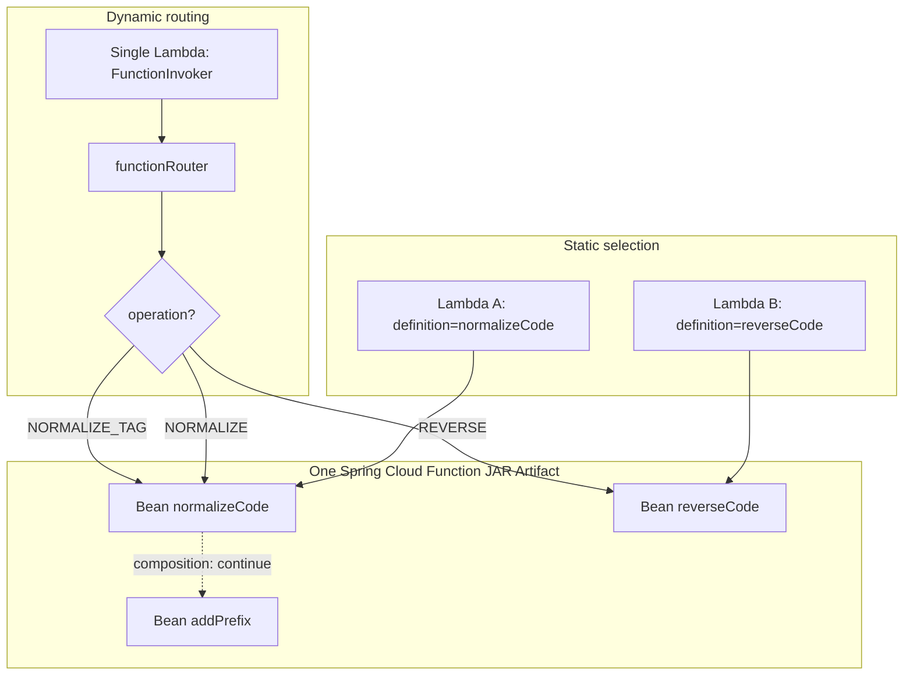
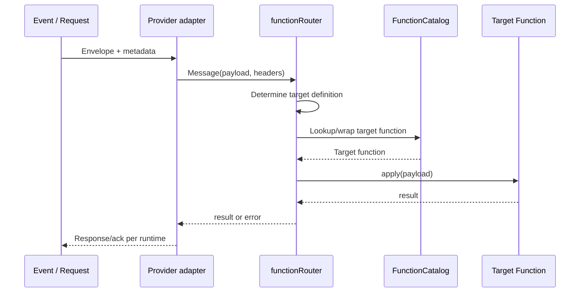
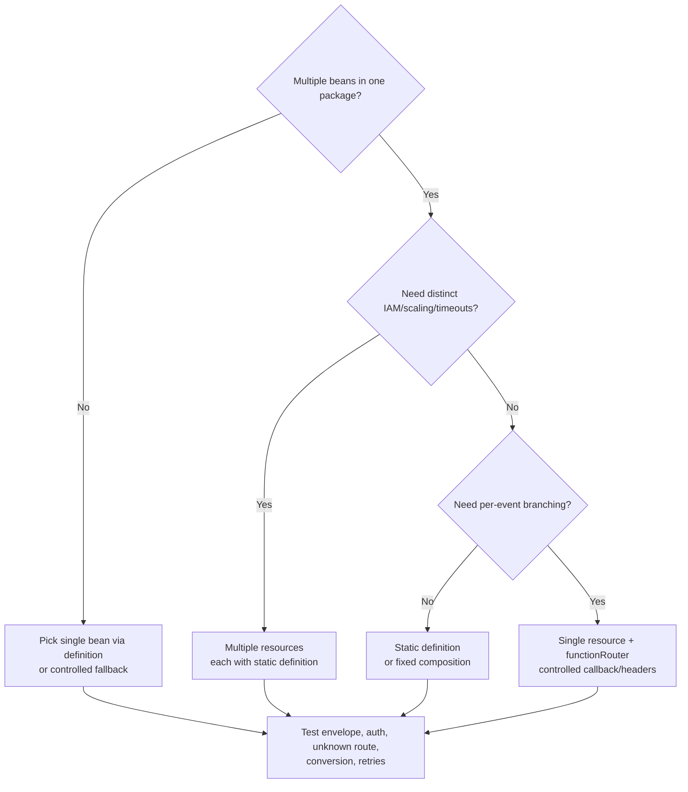
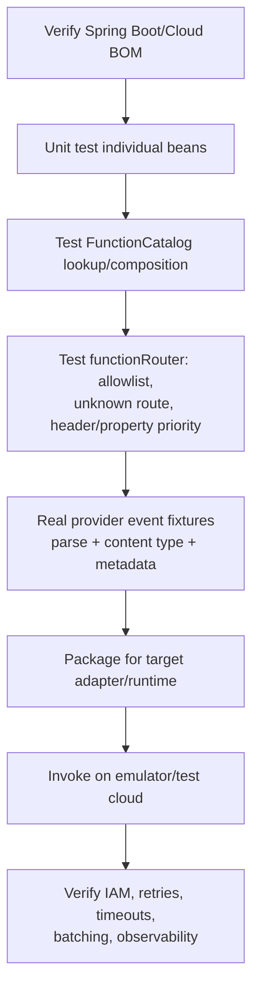

# Selecting One Function or Routing Multiple Functions in a Single Package

> **Chapter:** Serverless  
> **Module:** SPRING_CLOUD_FUNCTION  
> **Focus:** Choose a fixed functional bean per deployment or use `functionRouter` to route across multiple `Supplier`, `Function`, and `Consumer` beans within a single Spring Cloud Function package.  
> **Illustrative baseline (November 24, 2026):** Java 21, Spring Boot 4.2.0, Spring Cloud BOM 2026.0.0, Spring Cloud Function 5.1.0. Verify supported runtimes and documentation before deploying.

## 1. The Problem: One JAR File Containing Multiple Functions

A Spring Cloud Function application can declare multiple business beans:

```java
@Bean
public Function<String, String> normalizeCode() { /* ... */ }

@Bean
public Function<String, String> reverseCode() { /* ... */ }

@Bean
public Function<String, String> addPrefix() { /* ... */ }
```

Each bean simply follows Java's `Function<T, R>`. Spring Cloud Function discovers them, registers them in `FunctionCatalog`, and lets you compose them into pipelines. Yet when a JAR containing all three beans is deployed to AWS Lambda, Azure Functions, or Google Cloud Functions, a question arises:

**Which bean should the runtime invoke when an event arrives?**

There are three fundamental approaches:

1. **Statically select one function:** each cloud function resource shares the same code/JAR but defines its own `spring.cloud.function.definition`. For example, Lambda A runs `normalizeCode` while Lambda B runs `reverseCode`.
2. **Dynamically route within one cloud function resource:** the runtime invokes a generic handler; `functionRouter` selects the target bean from message metadata, a configured expression, or a `MessageRoutingCallback`.
3. **Compose multiple functions into one pipeline:** a single invocation runs `normalizeCode` followed by `addPrefix` via the definition `normalizeCode|addPrefix`. That is **composition**, not branching among alternatives.

What you must avoid is confusing **multiple beans in one JAR** with **multiple cloud resources**, or confusing **routing** with **composition**.

### 1.1. The Three Models Visually



This diagram illustrates **configuration possibilities**, not an assertion that three live Lambdas exist. The dashed composition edge applies only when the definition is `normalizeCode|addPrefix`.

### 1.2. Learning Objectives

After this lesson, you will be able to:

1. Explain the relationship among **Spring beans**, **FunctionCatalog**, **FunctionInvoker**, **functionRouter**, and **cloud function resources**.
2. Configure `spring.cloud.function.definition` to select a single function or static composition.
3. Look up `FunctionCatalog.lookup("functionRouter")` and route based on messages.
4. Compare the three routing sources—`MessageRoutingCallback`, message headers, and application properties—and state their precedence order.
5. Design a **routing allowlist** instead of letting external payloads choose arbitrary bean names or SpEL expressions.
6. Distinguish deploying multiple Lambdas from one artifact versus a single Lambda with multiple branches.
7. Test business logic, selection, and routing independently of the cloud, then plan adapter/provider tests.

## 2. Four Layers Often Confused with Each Other

| Component | Created/managed by | Role | Example |
| --- | --- | --- | --- |
| **Functional bean** | Spring `ApplicationContext` | Business processing rules | `@Bean Function<String,String> normalizeCode` |
| **FunctionCatalog** | Spring Cloud Function context | Registration/lookup, wrapping, composition, and type conversion | `catalog.lookup("normalizeCode")` |
| **Handler/adapter** | Spring Cloud Function and cloud platform | Receives events per provider contract, feeds catalog, returns results | AWS `FunctionInvoker` |
| **Cloud function resource** | AWS/Azure/GCP/IaC | Runtime, trigger, IAM, memory, timeout, scaling, monitoring | `NormalizeLambda` |

**A JAR with multiple beans does not automatically create multiple cloud function resources.** Conversely, **two Lambda resources can point to the exact same JAR** while having separate handlers, triggers, environments, and IAM roles. The Java logic remains unchanged as long as the input payloads are compatible.

### 2.1. A Handler Is Not a Bean Name

For AWS Lambda, handler configuration uses the generic adapter:

```text
org.springframework.cloud.function.adapter.aws.FunctionInvoker::handleRequest
```

In the application, the property:

```properties
spring.cloud.function.definition=normalizeCode
```

only selects **the bean in the catalog**; it does not change the handler. Never set `normalizeCode` directly as the Lambda handler when it is merely a Spring-managed `Function` bean.

With Azure, you can write a `@FunctionName` method using `FunctionCatalog`; with GCP, the adapter provides the `GcfJarLauncher` entrypoint. Those entrypoints remain distinct from business bean names.

### 2.2. Defaults You Should Not Rely On

If only one functional bean exists, Spring Cloud Function supports *single-function fallback* so lookups without a name can still resolve that single bean. When multiple beans exist, omitting a function name can fall back to adapter-specific defaults (AWS `FunctionInvoker` may fall back to the router). However, **never rely on implicit defaults when multiple business choices exist**.

To enforce strict bean-name lookup, set:

```properties
spring.cloud.function.single-function-fallback-enabled=false
```

In multi-function systems, always **choose statically and explicitly or build a controlled routing policy**.

## 3. Three Different Meanings of Definition Separators

### 3.1. Selecting One Bean by Name

```properties
spring.cloud.function.definition=normalizeCode
```

This static definition selects the `normalizeCode` function for the active adapter. When a deployment serves only one business capability, this is the simplest, easiest-to-monitor, and lowest-risk approach.

### 3.2. Composition via `|` or `,`

```properties
spring.cloud.function.definition=normalizeCode|addPrefix
```

This value creates **a single pipeline**, running two steps in sequence: normalize, then add prefix. You may also write `normalizeCode,addPrefix` using Spring Cloud Function's composition syntax.

Given input `"  od-123  "`:

```text
normalizeCode   : "  od-123  " -> "OD-123"
addPrefix       : "OD-123"     -> "ORDER:OD-123"
composition     : "  od-123  " -> "ORDER:OD-123"
```

The `|` symbol never means choosing one of two functions dynamically; it always denotes a **processing chain**.

### 3.3. A List of Definitions via `;`

```properties
spring.cloud.function.definition=normalizeCode;reverseCode
```

The `;` separator lists **multiple independent definitions** in integrations that support multiple functions, such as function filtering in the Web adapter or multiple functional bindings in Spring Cloud Stream. It is not a conditional expression and **does not turn `functionRouter` into a dynamic router**.

In serverless deployments with **one** entrypoint receiving events, do not just add `;` expecting the provider to guess which bean handles which event. Use a routing mechanism supported by the runtime/adapter, or deploy separate cloud resources with individual definitions.

### 3.4. Summary Comparison Table

| Configuration | Meaning | Routes each event dynamically? |
| --- | --- | --- |
| `definition=normalizeCode` | Single static function. | **No** |
| `definition=normalizeCode\|addPrefix` | Single fixed pipeline. | **No** |
| `definition=normalizeCode;reverseCode` | Two independent definitions per adapter rules. | **No** |
| `functionRouter` + controlled route header | Router selects a bean per imperative message. | **Yes**, when the adapter supplies messages and valid directives |
| `routing-expression` in application properties | Expression choosing route when the router runs. | **Depends on expression and input type**; does not execute merely because the property exists |
| `MessageRoutingCallback` | Java code deciding target definition from message. | **Yes**, when `functionRouter` handles the invocation |

**Do not confuse property names with infrastructure actions:** `spring.cloud.function.definition` or `routing-expression` does not create AWS event sources, HTTP endpoints, or triggers; you still need the appropriate adapter and runtime.

## 4. Complete Java Project to Experiment with Selection and Routing

This lesson designs **two separate modes** within one project:

- **Default mode:** no `MessageRoutingCallback` registered; uses `FunctionCatalog` and static definitions.
- **`dynamic-routing` profile:** enables `MessageRoutingCallback` and a bridge validating operation names; when `functionRouter` is invoked, it selects the target per message.

Keeping both modes separate prevents learners from accidentally letting a high-priority callback **override** headers/properties during static-definition tests.

### 4.1. Maven `pom.xml`

Complete local configuration using `spring-cloud-function-context` without requiring HTTP or AWS adapters yet:

```xml
<?xml version="1.0" encoding="UTF-8"?>
<project xmlns="http://maven.apache.org/POM/4.0.0"
         xmlns:xsi="http://www.w3.org/2001/XMLSchema-instance"
         xsi:schemaLocation="
             http://maven.apache.org/POM/4.0.0
             https://maven.apache.org/xsd/maven-4.0.0.xsd">
    <modelVersion>4.0.0</modelVersion>

    <parent>
        <groupId>org.springframework.boot</groupId>
        <artifactId>spring-boot-starter-parent</artifactId>
        <version>4.2.0</version>
        <relativePath/>
    </parent>

    <groupId>vn.example</groupId>
    <artifactId>serverless-routing-demo</artifactId>
    <version>0.0.1-SNAPSHOT</version>

    <properties>
        <java.version>21</java.version>
        <spring-cloud.version>2026.0.0</spring-cloud.version>
    </properties>

    <dependencyManagement>
        <dependencies>
            <dependency>
                <groupId>org.springframework.cloud</groupId>
                <artifactId>spring-cloud-dependencies</artifactId>
                <version>${spring-cloud.version}</version>
                <type>pom</type>
                <scope>import</scope>
            </dependency>
        </dependencies>
    </dependencyManagement>

    <dependencies>
        <dependency>
            <groupId>org.springframework.boot</groupId>
            <artifactId>spring-boot-starter</artifactId>
        </dependency>
        <dependency>
            <groupId>org.springframework.cloud</groupId>
            <artifactId>spring-cloud-function-context</artifactId>
        </dependency>
        <dependency>
            <groupId>org.springframework.boot</groupId>
            <artifactId>spring-boot-starter-test</artifactId>
            <scope>test</scope>
        </dependency>
    </dependencies>

    <build>
        <plugins>
            <plugin>
                <groupId>org.springframework.boot</groupId>
                <artifactId>spring-boot-maven-plugin</artifactId>
            </plugin>
        </plugins>
    </build>
</project>
```

`spring-cloud-dependencies` is a version-management **BOM**; it does not add modules unless you declare them as dependencies. `spring-cloud-function-context` supplies `FunctionCatalog`. When deploying to AWS, add `spring-cloud-function-adapter-aws` and configure packaging per the AWS adapter guide; **the JAR built by this Maven example is not yet an AWS Lambda artifact ready for direct upload**.

Directory structure:

```text
serverless-routing-demo/
├── pom.xml
└── src/
    ├── main/
    │   ├── java/
    │   │   └── vn/example/routing/
    │   │       ├── RoutingApplication.java
    │   │       ├── DynamicRoutingConfiguration.java
    │   │       └── TrustedEventBridge.java
    │   └── resources/
    │       └── application.properties
    └── test/
        └── java/
            └── vn/example/routing/
                ├── StaticSelectionTest.java
                └── DynamicRoutingTest.java
```

### 4.2. Three Business Beans in One Application

Create `src/main/java/vn/example/routing/RoutingApplication.java`:

```java
package vn.example.routing;

import java.util.Locale;
import java.util.function.Function;

import org.springframework.boot.SpringApplication;
import org.springframework.boot.autoconfigure.SpringBootApplication;
import org.springframework.context.annotation.Bean;

@SpringBootApplication
public class RoutingApplication {

    public static void main(String[] args) {
        SpringApplication.run(RoutingApplication.class, args);
    }

    @Bean
    public Function<String, String> normalizeCode() {
        return value -> value.trim().toUpperCase(Locale.ROOT);
    }

    @Bean
    public Function<String, String> reverseCode() {
        return value -> new StringBuilder(value.trim())
                .reverse()
                .toString();
    }

    @Bean
    public Function<String, String> addPrefix() {
        return value -> "ORDER:" + value;
    }
}
```

These beans share the `Function<String, String>` signature so they can accept the same input and return a String, making name-based routing tests straightforward. In real production apps, beans may accept distinct DTOs; in that case, carefully evaluate conversion capabilities and event contracts before placing them behind one router.

Expected outputs:

| Function/pipeline | Input | Output |
| --- | --- | --- |
| `normalizeCode` | `"  od-123  "` | `OD-123` |
| `reverseCode` | `"  od-123  "` | `321-do` |
| `addPrefix` | `"OD-123"` | `ORDER:OD-123` |
| `normalizeCode\|addPrefix` | `"  od-123  "` | `ORDER:OD-123` |

`reverseCode` only reverses characters after `trim()`; **it does not uppercase them**. Hence `"od-123"` reverses to `"321-do"`, not `"321-DO"`.

### 4.3. Default Configuration

Create `src/main/resources/application.properties`:

```properties
spring.application.name=serverless-routing-demo
spring.main.web-application-type=none
spring.cloud.function.single-function-fallback-enabled=false
```

There is no Web server here because `spring-cloud-function-context` only provides the catalog. Disabling fallback ensures an invalid lookup name fails rather than silently returning a single bean.

To test static selection per deployment, we will supply `spring.cloud.function.definition` via environment variables or tests rather than hardcoding it into the shared config file used by both modes.

## 5. Approach A: Selecting One Static Function per Deployment

### 5.1. Selecting `normalizeCode`

Runtime configuration:

```properties
spring.cloud.function.definition=normalizeCode
```

This tells the adapter which function handles invocations. When calling the catalog directly, you can still look it up by name:

```java
Function<String, String> fn = catalog.lookup("normalizeCode");
String result = fn.apply("  od-123  "); // OD-123
```

**Distinction:** `lookup("normalizeCode")` is an explicit Java call. The `spring.cloud.function.definition` property is read by the adapter/integration to determine which function the deployment uses; it does not call `apply(...)` by itself at startup.

### 5.2. Selecting a Fixed Composition

You can select a pipeline instead of a single bean:

```properties
spring.cloud.function.definition=normalizeCode|addPrefix
```

When an invocation converts to the String `"  od-123  "`, the pipeline is expected to return `ORDER:OD-123`.

This fits well when every invocation to the resource must pass through the exact same two steps. Unlike routing, **there is no conditional branching**.

### 5.3. Static Configuration via Environment Variables

With Spring Boot, you can use the corresponding environment variable to set the definition. In the AWS Lambda example below, Spring Cloud Function docs illustrate:

```text
spring_cloud_function_definition=normalizeCode
```

This naming respects AWS environment variable character limits and maps via Spring Boot to `spring.cloud.function.definition`. Elsewhere, `SPRING_CLOUD_FUNCTION_DEFINITION` is also common under relaxed binding; verify how your provider injects environment variables and what config the app actually resolves.

If testing a standalone Java app briefly from a shell:

```bash
SPRING_CLOUD_FUNCTION_DEFINITION=normalizeCode \
  java -jar target/serverless-routing-demo-0.0.1-SNAPSHOT.jar
```

This command only boots a **Spring application without Web/serverless handlers**, so it exposes no endpoint. It illustrates passing configuration, not deploying to AWS.

## 6. Same Artifact, Deploying Two Lambda Resources

A common serverless pattern with Spring Cloud Function: **build one JAR**, then create two AWS Lambda function resources pointing to that artifact.

| Lambda resource | AWS Handler | Spring Definition | Trigger |
| --- | --- | --- | --- |
| `NormalizeLambda` | `FunctionInvoker` | `normalizeCode` | Trigger A |
| `ReverseLambda` | `FunctionInvoker` | `reverseCode` | Trigger B |

Here a single JAR contains both beans; **each resource specifies its selected function via its own environment variable**. Both resources can have distinct IAM policies, memory, timeouts, reserved concurrency, and event source mappings.

### 6.1. Illustrative AWS SAM Configuration

Once packaged as a **compatible AWS artifact** per the `spring-cloud-function-adapter-aws` guide, an AWS SAM template might look like:

```yaml
AWSTemplateFormatVersion: '2010-09-09'
Transform: AWS::Serverless-2016-10-31

Resources:
  NormalizeLambda:
    Type: AWS::Serverless::Function
    Properties:
      Runtime: java21
      Handler: org.springframework.cloud.function.adapter.aws.FunctionInvoker
      CodeUri: target/serverless-routing-demo-0.0.1-SNAPSHOT-aws.jar
      MemorySize: 512
      Environment:
        Variables:
          spring_cloud_function_definition: normalizeCode

  ReverseLambda:
    Type: AWS::Serverless::Function
    Properties:
      Runtime: java21
      Handler: org.springframework.cloud.function.adapter.aws.FunctionInvoker
      CodeUri: target/serverless-routing-demo-0.0.1-SNAPSHOT-aws.jar
      MemorySize: 512
      Environment:
        Variables:
          spring_cloud_function_definition: reverseCode
```

**This is an architectural learning template, not a complete deployment template.** The `CodeUri` path assumes you configured Maven Shade / AWS packaging to produce a `-aws.jar` artifact. The `pom.xml` in section 4 **does not** include that step yet; do not run this template expecting the artifact to appear automatically. Triggers, IAM, logging, timeouts, and policies must also be added for your use case.

The AWS Lambda adapter documentation also shows Lambda console configurations specifying a method-style handler:

```text
org.springframework.cloud.function.adapter.aws.FunctionInvoker::handleRequest
```

Handler notation in the console or IaC may differ from SAM examples using only the class name; follow your provider and adapter guidance in real deployments.

### 6.2. When Should You Use Two Lambda Resources?

Choose multiple resources, even when sharing one JAR, when:

- One function reads S3 while another writes DynamoDB, requiring **different IAM permissions**.
- Triggers/queues, retries, reserved concurrency, memory, timeouts, or scaling profiles differ.
- You want independent deployment metrics and monitoring per endpoint/branch.
- You want to limit the blast radius of a single event source.
- Separate security controls or release lifecycles are needed.

Trade-off: even with separate resource configs, if they share **the exact same artifact version**, updating shared code can affect both. Split builds/modules or pin artifact versions per resource when strong isolation is required.

### 6.3. When Does a Single Resource Make More Sense?

A single Lambda resource with multiple branches may fit when the functions:

- Belong to the same business domain, access permissions, and data layer.
- Share similar memory, timeout, and concurrency profiles.
- Share authentication, observability, and change-management lifecycles.
- Require one entrypoint that dispatches based on request action.

However, one resource means **one IAM role and one set of runtime limits** apply across every branch. Never combine a read-only action and a sensitive delete action into the same resource just to reduce Lambda count if they require different privileges.

## 7. Approach B: Dynamic Routing via `functionRouter`

### 7.1. What Is the Router in Spring Cloud Function?

Spring Cloud Function registers a `RoutingFunction` in the catalog under the special name:

```text
functionRouter
```

You can also reference the constant `RoutingFunction.FUNCTION_NAME`. Conceptually, the router is a `Function<Object,Object>`: it determines a target function definition and invokes it.



This diagram shows the logical flow; Spring may cache wrappers/lookups rather than performing a fresh catalog lookup on every invocation.

### 7.2. The Router Does Not Magically Read Every Envelope

If a caller sends JSON:

```json
{
  "operation": "NORMALIZE",
  "code": "  od-123  "
}
```

`functionRouter` **does not automatically infer** that `operation` should become a Spring Message header and `code` should become a String payload. An adapter/converter or mapping layer must unwrap the envelope and construct a suitable `Message<String>`.

That is why the upcoming example introduces **`TrustedEventBridge`**: it converts an application-defined event into a validated payload plus controlled headers. Do not treat this bridge as a directly deployable AWS/Azure/GCP handler.

### 7.3. Invoking the Router Directly with a Message

Once proper routing metadata is attached, you can invoke the router like this:

```java
Function<Message<String>, String> router =
        catalog.lookup("functionRouter");

Message<String> message = MessageBuilder
        .withPayload("  od-123  ")
        .setHeader("operation", "NORMALIZE")
        .build();

String output = router.apply(message);
```

With the `MessageRoutingCallback` from section 8 enabled, the expected output is `OD-123`. `functionRouter` is available under that special bean name even though you never explicitly declared a `@Bean` with that name.

### 7.4. Routing Differs from Composition

A message with `operation=NORMALIZE` routes to `normalizeCode`; a message with `operation=REVERSE` routes to `reverseCode`. That is **branch selection**.

Another route may select the definition `normalizeCode|addPrefix`. In that case the router selects **a pipeline**, which executes two steps. Thus routing and composition combine naturally:

```text
router:
  NORMALIZE      -> normalizeCode
  REVERSE        -> reverseCode
  NORMALIZE_TAG  -> normalizeCode|addPrefix
```

Important constraint: input/output types across functions in a composition must be compatible.

## 8. Practicing Routing with `MessageRoutingCallback`

### 8.1. Why Use a Callback Instead of Reading Raw Bean Names from Headers?

Letting an external request send `route=deleteEverything` and passing that name straight into the catalog is a security risk. Spring Cloud Function can resolve many beans/definitions in the catalog; callers **must never be allowed to invoke arbitrary beans they are unauthorized to call**.

A safer strategy is:

1. Accept only allowed **business operations**: `NORMALIZE`, `REVERSE`, or `NORMALIZE_TAG`.
2. Authenticate/authorize the event source at the adapter.
3. Map the operation against a **fixed allowlist** of permitted definitions.
4. Reject unknown operations; never silently "fall back" to a function with side effects.

`MessageRoutingCallback` lets you express this mapping in Java, which is ideal when routing rules are richer than a short configuration expression.

### 8.2. `DynamicRoutingConfiguration.java`

Create `src/main/java/vn/example/routing/DynamicRoutingConfiguration.java`:

```java
package vn.example.routing;

import org.springframework.cloud.function.context.MessageRoutingCallback;
import org.springframework.context.annotation.Bean;
import org.springframework.context.annotation.Configuration;
import org.springframework.context.annotation.Profile;
import org.springframework.messaging.Message;

@Configuration(proxyBeanMethods = false)
@Profile("dynamic-routing")
public class DynamicRoutingConfiguration {

    @Bean
    public MessageRoutingCallback operationRoutingPolicy() {
        return new MessageRoutingCallback() {
            @Override
            public String routingResult(Message<?> message) {
                Object operation = message.getHeaders().get("operation");

                if (!(operation instanceof String action)) {
                    throw new IllegalArgumentException(
                            "Missing valid operation");
                }

                return switch (action) {
                    case "NORMALIZE" -> "normalizeCode";
                    case "REVERSE" -> "reverseCode";
                    case "NORMALIZE_TAG" -> "normalizeCode|addPrefix";
                    default -> throw new IllegalArgumentException(
                            "Unsupported operation: " + action);
                };
            }
        };
    }
}
```

This code selects a route **from three controlled values** instead of echoing a caller-supplied bean name. `@Profile("dynamic-routing")` ensures the callback is only active in dynamic-routing tests, leaving static tests unaffected.

**Version note:** in Spring Cloud Function 5.1.0, `MessageRoutingCallback` defines `String routingResult(Message<?> message)`. Very old Spring Cloud Function examples used different return types; never copy snippets from older versions without checking the active API.

### 8.3. Bridge Feeding Events into the Router

Create `src/main/java/vn/example/routing/TrustedEventBridge.java`:

```java
package vn.example.routing;

import java.util.function.Function;

import org.springframework.cloud.function.context.FunctionCatalog;
import org.springframework.context.annotation.Profile;
import org.springframework.messaging.Message;
import org.springframework.messaging.support.MessageBuilder;
import org.springframework.stereotype.Component;

@Component
@Profile("dynamic-routing")
public class TrustedEventBridge {

    public record IncomingEvent(String kind, String code) {}

    private final Function<Message<String>, String> router;

    public TrustedEventBridge(FunctionCatalog catalog) {
        this.router = catalog.lookup("functionRouter");

        if (this.router == null) {
            throw new IllegalStateException(
                    "functionRouter not found");
        }
    }

    public String handle(IncomingEvent event) {
        if (event == null || event.kind() == null ||
                event.code() == null) {
            throw new IllegalArgumentException("Invalid event");
        }

        // Boundary layer recognizes only three business actions.
        String operation = switch (event.kind()) {
            case "order.normalize" -> "NORMALIZE";
            case "order.reverse" -> "REVERSE";
            case "order.normalize-and-tag" -> "NORMALIZE_TAG";
            default -> throw new IllegalArgumentException(
                    "Disallowed event kind: " + event.kind());
        };

        // Business payload is narrowed down to the code string.
        Message<String> message = MessageBuilder
                .withPayload(event.code())
                .setHeader("operation", operation)
                .build();

        return router.apply(message);
    }
}
```

Examples:

```java
bridge.handle(new TrustedEventBridge.IncomingEvent(
        "order.normalize", "  od-123  "));  // OD-123

bridge.handle(new TrustedEventBridge.IncomingEvent(
        "order.reverse", "  od-123  "));    // 321-do

bridge.handle(new TrustedEventBridge.IncomingEvent(
        "order.normalize-and-tag", "  od-123  "));
        // ORDER:OD-123
```

**Not a complete cloud handler:** `TrustedEventBridge` receives a simulated `IncomingEvent`; AWS SQS, API Gateway, Azure queues, or Pub/Sub have their own envelopes and serialization. In real runtimes, you must feed the proper payload and metadata into the bridge or build a provider-specific adapter while enforcing invocation authorization.

### 8.4. Why Have Two Layers of Allowlisting?

There are **two distinct information sources** easy to conflate:

- `kind` on the event: external input, potentially spoofable if the source is unauthenticated.
- `operation` on the Spring Message: internal mapped value restricted to the application's permitted set.

The bridge rejects unsupported event kinds, and the callback rejects invalid operations. This provides *defense in depth*, though **it does not replace** IAM or API authentication/authorization. If two operations carry different privileges, check permissions against caller identity rather than relying solely on the operation string.

## 9. Alternative Routing: Message Headers and Application Properties

### 9.1. Headers Selecting a Static Function per Message

When **no `MessageRoutingCallback` is present**, `functionRouter` can read a function or composition name from the `spring.cloud.function.definition` message header:

```java
Function<Message<String>, String> router =
        catalog.lookup("functionRouter");

Message<String> message = MessageBuilder
        .withPayload("  od-123  ")
        .setHeader("spring.cloud.function.definition", "normalizeCode")
        .build();

String result = router.apply(message); // OD-123
```

With composition:

```java
Message<String> message = MessageBuilder
        .withPayload("  od-123  ")
        .setHeader(
            "spring.cloud.function.definition",
            "normalizeCode|addPrefix")
        .build();
```

**Security warning:** this snippet demonstrates the routing API; it is not an endorsement to pass raw headers from untrusted HTTP clients verbatim. If clients control the function name, they may attempt to invoke functions never meant to be exposed. Enforce authorization/allowlisting before passing headers into `functionRouter`.

### 9.2. Routing Expressions with SpEL

Spring Cloud Function supports `spring.cloud.function.routing-expression`, using Spring Expression Language (SpEL) to compute the target definition. Suppose the application itself **constructed a trusted header** `routeTarget` containing an exact permitted bean name:

```properties
spring.cloud.function.routing-expression=headers['routeTarget']
```

When `functionRouter` receives a `Message<?>` with `routeTarget=normalizeCode`, the expression resolves that value as the target definition. This is safe only when `routeTarget` has already been **verified and mapped to an allowed name at the boundary**. Never copy raw HTTP headers or JSON fields into `routeTarget` without validation.

You can write fixed branch expressions:

```properties
spring.cloud.function.routing-expression=headers['kind'] == 'NORMALIZE' ? 'normalizeCode' : 'reverseCode'
```

This illustrates SpEL syntax, but is **unsuitable as a production policy** if unknown values silently route to `reverseCode`. A callback with a `default -> throw` branch as in section 8 is safer and easier to review.

### 9.3. Precedence Order Among the Three Mechanisms

Per Spring Cloud Function 5.1.0 documentation, when the router handles imperative messages:

1. **`MessageRoutingCallback`** — highest precedence; when present, other header/property directives may be ignored for route selection.
2. **Message headers** — checked when no callback is present; may carry `spring.cloud.function.definition` or `spring.cloud.function.routing-expression`.
3. **Application/system properties** — used when no higher-precedence directive is present.

| Callback present? | Route header present? | Property present? | Primary decision source |
| --- | --- | --- | --- |
| Yes | Yes | Yes | Callback |
| No | Yes | Yes | Header |
| No | No | Yes | Property |
| No | No | No | Insufficient directives; likely fails or does not route as expected |

**Do not mix all three examples into one test and conclude properties are broken.** If the `dynamic-routing` profile is active, the callback in section 8 takes precedence over headers and properties.

### 9.4. SpEL from Headers vs. Properties Have Different Trust Levels

Spring Cloud Function documentation notes:

- SpEL expressions supplied via **Message headers** are evaluated with `SimpleEvaluationContext`, restricting capabilities to reduce abuse risk.
- Expressions configured in **application/system properties** are evaluated with `StandardEvaluationContext`, which offers broader expression power.

This does not guarantee every SpEL setup is safe. Configurations can leak or be altered through exposed management endpoints; lock down environment/config updates and never expose config-mutating endpoints to untrusted actors.

For external event data, **prefer callbacks and allowlist switches** over letting callers supply SpEL expressions.

## 10. When Should You Avoid Dynamic Routing?

Dynamic routing is helpful, but it is not optimal for every architecture.

| Criterion | Multiple cloud resources, static selection each | Single resource with dynamic `functionRouter` |
| --- | --- | --- |
| **Artifact count** | Can share one JAR. | Typically one JAR. |
| **Lambda resource count** | Multiple. | One. |
| **Function selection** | Per-resource environment/config. | Runtime metadata/callback/expression. |
| **IAM** | Distinct permissions per resource. | Shared role/identity unless designed further. |
| **Scaling/concurrency** | Managed per resource. | Shared limits on one resource. |
| **Timeout/memory** | Tuned per resource. | Shared runtime limits on the resource. |
| **Observability & alerting** | Clearer per-resource metrics and logs. | Must split telemetry by route. |
| **Code complexity** | Minimal routing code. | Must validate routes, reject unknown ones, test all branches. |
| **Cohesion** | Fits distinct business capabilities. | Fits closely related branches in one bounded context. |
| **Blast radius** | Isolated per resource. | Misconfiguration can impact all branches. |

**Pragmatic rule:** sharing one JAR **does not mean** everything must run inside one Lambda resource. When functions need different privileges or operational profiles, splitting cloud resources usually simplifies security and fault isolation.

### 10.1. Example of Differing Access Privileges

`ReadOrder` only reads DynamoDB; `DeleteOrder` deletes records. If combined in a single Lambda resource, a role holding delete permissions is present in the runtime serving read requests. Any routing bug increases risk.

With two Lambda resources, you assign separate read and delete roles and enforce stricter authentication on deletions. You can still share a domain module or build artifact while **enforcing the privilege boundary at the resource level**.

### 10.2. Short Decision Flow



## 11. Testing Static Selection with `FunctionCatalog`

### 11.1. `StaticSelectionTest.java`

Create `src/test/java/vn/example/routing/StaticSelectionTest.java`:

```java
package vn.example.routing;

import static org.junit.jupiter.api.Assertions.assertEquals;
import static org.junit.jupiter.api.Assertions.assertNotNull;

import java.util.function.Function;

import org.junit.jupiter.api.Test;
import org.springframework.beans.factory.annotation.Autowired;
import org.springframework.beans.factory.annotation.Value;
import org.springframework.boot.test.context.SpringBootTest;
import org.springframework.cloud.function.context.FunctionCatalog;

@SpringBootTest(properties = {
        "spring.cloud.function.definition=normalizeCode"
})
class StaticSelectionTest {

    @Autowired
    FunctionCatalog catalog;

    @Value("${spring.cloud.function.definition}")
    String definition;

    @Test
    void resolvesConfiguredFunction() {
        assertEquals("normalizeCode", definition);

        Function<String, String> fn = catalog.lookup(definition);

        assertNotNull(fn);
        assertEquals("OD-123", fn.apply("  od-123  "));
    }

    @Test
    void canStillLookupCompositionExplicitly() {
        Function<String, String> pipeline =
                catalog.lookup("normalizeCode|addPrefix");

        assertNotNull(pipeline);
        assertEquals("ORDER:OD-123",
                pipeline.apply("  od-123  "));
    }
}
```

This test confirms that the Spring Environment resolved the definition and the catalog found the bean. The second test shows that setting a static definition **does not delete other beans from the catalog**. It still does not prove the AWS Lambda handler ran; handler testing requires the AWS artifact and adapter.

### 11.2. Plain Java Tests for Individual Functions

Beyond Spring tests, you can call the lambdas directly to test business rules without booting a context:

```java
var app = new RoutingApplication();

String a = app.normalizeCode().apply(" od-123 ");
String b = app.reverseCode().apply(" od-123 ");

assertEquals("OD-123", a);
assertEquals("321-do", b);
```

This snippet belongs **inside a JUnit test method** with `assertEquals` statically imported. Do not use it to conclude that configuration or adapters are valid.

## 12. Testing the Dynamic Router with a Dedicated Profile

### 12.1. `DynamicRoutingTest.java`

Create `src/test/java/vn/example/routing/DynamicRoutingTest.java`:

```java
package vn.example.routing;

import static org.junit.jupiter.api.Assertions.assertEquals;
import static org.junit.jupiter.api.Assertions.assertNotNull;
import static org.junit.jupiter.api.Assertions.assertThrows;

import java.util.function.Function;

import org.junit.jupiter.api.Test;
import org.springframework.beans.factory.annotation.Autowired;
import org.springframework.boot.test.context.SpringBootTest;
import org.springframework.cloud.function.context.FunctionCatalog;
import org.springframework.messaging.Message;
import org.springframework.messaging.support.MessageBuilder;
import org.springframework.test.context.ActiveProfiles;

@SpringBootTest
@ActiveProfiles("dynamic-routing")
class DynamicRoutingTest {

    @Autowired
    FunctionCatalog catalog;

    @Autowired
    TrustedEventBridge bridge;

    @Test
    void routesNormalize() {
        Function<Message<String>, String> router =
                catalog.lookup("functionRouter");

        assertNotNull(router);

        Message<String> message = MessageBuilder
                .withPayload("  od-123  ")
                .setHeader("operation", "NORMALIZE")
                .build();

        assertEquals("OD-123", router.apply(message));
    }

    @Test
    void routesReverse() {
        assertEquals("321-do", bridge.handle(
                new TrustedEventBridge.IncomingEvent(
                        "order.reverse", "  od-123  ")));
    }

    @Test
    void routesComposition() {
        assertEquals("ORDER:OD-123", bridge.handle(
                new TrustedEventBridge.IncomingEvent(
                        "order.normalize-and-tag", "  od-123  ")));
    }

    @Test
    void rejectsUnknownExternalOperation() {
        assertThrows(IllegalArgumentException.class,
                () -> bridge.handle(
                    new TrustedEventBridge.IncomingEvent(
                        "order.delete-all", "OD-123")));
    }

    @Test
    void rejectsUnknownInternalOperation() {
        Function<Message<String>, String> router =
                catalog.lookup("functionRouter");

        Message<String> message = MessageBuilder
                .withPayload("OD-123")
                .setHeader("operation", "DELETE_ALL")
                .build();

        assertThrows(IllegalArgumentException.class,
                () -> router.apply(message));
    }
}
```

Two complementary test styles:

- `bridge.handle(...)` exercises the full mapping between the simulated event and the router.
- `catalog.lookup("functionRouter").apply(message)` exercises message-based routing directly.

If the router invokes a target but returns a different type than expected (such as a `Message<?>` instead of `String` under a different converter/adapter setup), check the real contract and adjust the test return type accordingly. All functions in this example are `String -> String`, so the expected business output is a String.

### 12.2. Running JUnit Tests

In the directory containing `pom.xml`:

```bash
mvn clean test
```

If the project includes Maven Wrapper, run `./mvnw clean test`. These tests require Java 21 and compatible Spring Boot and Spring Cloud dependencies resolved. They **do not** require the AWS CLI or a cloud account.

With Gradle, the same Java code works if the build configures the Boot plugin, Spring Cloud BOM, `spring-cloud-function-context`, and `spring-boot-starter-test`; the equivalent task is `./gradlew test`. This lesson does not provide a parallel Gradle project to avoid mixing build systems.

### 12.3. Interpreting Test Results

| Test | What passing proves | What it does not prove |
| --- | --- | --- |
| `StaticSelectionTest` | Definition is read; catalog resolves bean/composition. | AWS Lambda resource uses the right handler and environment. |
| `routesNormalize` | Callback selects the normalize bean. | Raw AWS events convert into Spring Messages with expected headers. |
| `routesReverse` | Bridge maps the reverse route. | GCP/Azure runtimes have valid bindings. |
| `routesComposition` | Router can select a pipeline. | Retries and event acknowledgements work properly. |
| `rejectsUnknown...` | Unknown actions are rejected rather than invoking arbitrary beans. | All event sources are authenticated and authorized. |

## 13. Deploying Routing on Azure and Google Cloud

### 13.1. Azure Functions

Azure's Java runtime typically uses methods annotated with `@FunctionName` plus triggers/bindings (`@HttpTrigger`, queue trigger, etc.). The Spring Cloud Function Azure adapter lets handlers integrate Spring beans or `FunctionCatalog`.

For **static selection**, an Azure handler can look up:

```java
Function<String, String> fn = catalog.lookup("normalizeCode");
String result = fn.apply(body);
```

For **dynamic routing**, after **parsing and authorizing** the request/event, the handler can build a `Message<String>` with `operation` and call `catalog.lookup("functionRouter")` just like the bridge in section 8. The Azure handler must still conform to Azure's trigger annotations, authorization, and response mapping.

Do not assume `MessageRoutingCallback` causes Azure to generate multiple triggers or pick `@FunctionName` automatically. Cloud function resource/handler names belong to Azure; `normalizeCode` and `functionRouter` belong to Spring Cloud Function.

### 13.2. Google Cloud Functions

The Spring Cloud Function GCP adapter uses `org.springframework.cloud.function.adapter.gcp.GcfJarLauncher` and Functions Framework. The GCP entrypoint name is separate from Spring bean names.

When multiple beans exist:

- If a resource serves a single business capability, set an explicit definition in Spring configuration/environment.
- If a single resource must genuinely route multiple event types, build a bridge/converter that attaches routing info onto Spring Messages or uses the adapter's supported mechanism.
- If capabilities differ in triggers, IAM, or scaling, split them into separate cloud resources.

**Do not treat a passing JUnit `functionRouter` test as proof that the GCP entrypoint knows how to extract routing fields from a CloudEvent.** Test the exact event schema, generation, Java runtime, and target packaging.

### 13.3. Comparison with Spring Cloud Stream

In Spring Cloud Stream, Function/Consumer beans connect to brokers via binders and functional bindings. Stream also supports event routing; in some setups, you enable:

```properties
spring.cloud.stream.function.routing.enabled=true
```

or target `functionRouter` per the Stream documentation. For per-message routing, Stream can pass headers carrying definitions or routing expressions. You still need the binder and full input binding/destination configuration; **adding a routing property alone does not connect to Kafka or RabbitMQ**.

Key distinctions:

- **Cloud serverless:** provider handlers and triggers govern invocations.
- **Spring Cloud Stream:** binders consume and publish broker messages.
- **Spring Cloud Function:** catalog/router governs Java function calls at the business layer.

The same bean can serve all these environments when payloads and headers are translated properly.

## 14. Routing Constraints by Function Kind and Data Types

### 14.1. Imperative `Function`

`Function<String,String>` in our example is imperative: each call receives one input and produces one output. For imperative messages, the router can select a different function for **each message**, based on callbacks or headers.

For example:

```text
Message #1: operation=NORMALIZE -> normalizeCode
Message #2: operation=REVERSE   -> reverseCode
Message #3: operation=NORMALIZE_TAG -> normalizeCode|addPrefix
```

### 14.2. Reactive `Function<Flux<T>, Flux<R>>`

In the reactive model, a function can accept an entire publisher:

```java
@Bean
public Function<Flux<String>, Flux<String>> normalizeStream() {
    return flux -> flux.map(String::trim)
            .map(text -> text.toUpperCase(Locale.ROOT));
}
```

This snippet requires importing `reactor.core.publisher.Flux`, `Locale`, and `Function` inside a Spring configuration class; it is an **alternative processing style example**, not part of the main project.

Spring Cloud Function docs note that with reactive functions, **you cannot use per-record headers to route individual items inside a stream** the way imperative routing does. Because a reactive function may be invoked once with the publisher to process the entire stream, routing is typically configured via **application properties** applying to the stream as a whole.

This is an important constraint when migrating an imperative routing example to reactive Kafka or streaming workloads.

### 14.3. `Supplier` and `Consumer`

`Supplier<T>` takes no input, so triggering/polling belongs to the adapter. `Consumer<T>` returns no business result, requiring attention to acknowledgement, retries, and side effects.

The router can dispatch to a `Consumer` when the contract allows it, but if you mix result-returning functions and void consumers behind the same synchronous endpoint, define how responses map. Never assume every branch produces the same JSON DTO.

### 14.4. Differing Input Types Across Routes

Suppose:

```java
Function<OrderCreatedEvent, OrderResult> createOrder;
Function<CancelOrderEvent, CancelResult> cancelOrder;
```

A router can pick between these branches based on event type, yet the adapter must distinguish them and convert the payload into the **exact input DTO for the chosen route**. You cannot rely on `functionRouter` alone to infer which class a raw JSON envelope should deserialize into without sufficient type metadata and converters.

For complex events, use a neutral envelope and delegate specific mapping to dedicated handlers. Test null JSON fields, missing properties, content types, and type conversions on the real artifact.

## 15. Routing Errors, Retries, and Idempotency

### 15.1. What Should Happen on an Unknown Route?

If the router cannot find the selected function, the framework normally raises an unroutable error. Spring Cloud Function also provides `DefaultMessageRoutingHandler` for unroutable messages; its default implementation may log and drop the message.

**Never register a message-dropping handler** in order or payment workflows without an explicit data-loss/unhandled-event policy. Unknown routes should be treated as schema or authorization errors, routed to quarantine/DLQ, or rejected per the source contract.

### 15.2. Business Errors vs. System Errors

| Scenario | Classification | Handling strategy |
| --- | --- | --- |
| `operation=UNKNOWN` | Invalid input / routing policy violation. | Reject early; never fall back to a default bean with side effects. |
| Definition points to missing bean | Configuration / deployment error. | Fix bean/definition name; test before release. |
| Event JSON fails to parse | Envelope / conversion error. | Log safely; route to DLQ/quarantine per source policy. |
| `normalizeCode` receives null | Input / validation error. | Align null contract and business exception handling. |
| Database timeout in update route | Transient error. | Retry with backoff, capped attempts, and idempotency. |
| Cloud invocation timeout | Runtime / provider error. | Tune timeouts, monitor, and handle redelivery. |
| One bad record in an SQS batch | Batch / partial failure. | Return the proper AWS response or supported batch-handling policy. |

### 15.3. A Router Does Not Guarantee Exactly-Once Execution

Many event sources provide *at-least-once* delivery or redeliver events on timeout. If `Consumer<OrderCommand>` creates orders, placing a router in front of the consumer does not prevent duplicate side effects.

A sound design requires a **stable idempotency key**, unique constraints/conditional writes, transactions or equivalent side-effect guards, and clear retry/DLQ rules. Business event IDs differ from cloud runtime invocation/request IDs; using a fresh per-attempt request ID will not stop duplicate business operations.

### 15.4. Batches Can Mix Multiple Routes

A single SQS invocation can contain multiple records with different operations. If the adapter passes the entire SQS envelope to one function, `functionRouter` will not automatically split and route each record. Define what the **routing unit** is and how the adapter processes batches.

You can unwrap records at the boundary and construct individual Spring Messages with route metadata, or use `Function<SQSEvent,SQSBatchResponse>` in the integration layer to dispatch each business command to the domain. In that case, return a partial batch response matching AWS's contract to avoid retrying the entire batch.

## 16. Security: Route by Authorization, Not Client-Supplied Names

### 16.1. Assumptions You Must Never Make

- Never assume every bean in the catalog is safe for external callers to invoke.
- Never let untrusted HTTP headers pick arbitrary function definitions or SpEL expressions.
- Never treat `spring.cloud.function.definition` as a complete authorization mechanism.
- Never treat `SimpleEvaluationContext` as a blanket guarantee that header-supplied expressions are safe in every scenario.
- Never expose management endpoints capable of reading/modifying environment or dynamic config without strong protection.
- Never pack functions needing distinct IAM roles into one Lambda merely for routing convenience.

### 16.2. A Sound Production Policy

1. **Authenticate the source:** IAM, API authentication, signatures, or event-source permissions.
2. **Establish identity/tenant:** separate business fields from spoofable headers.
3. **Authorize the operation:** verify the caller may run `NORMALIZE`, `REVERSE`, or sensitive actions.
4. **Map via allowlist:** business action → approved bean/pipeline.
5. **Validate payload:** size limits, schema, data types, and content type.
6. **Invoke router/target:** never pass arbitrary raw function names or SpEL.
7. **Audit:** log action, target definition, event ID, outcome, and errors while redacting secrets.
8. **Limit blast radius:** separate resources when privileges or scaling profiles diverge.

### 16.3. Observability for Dynamic Routers

Every invocation should emit telemetry covering:

| Attribute | Purpose |
| --- | --- |
| `eventId` / `correlationId` | Correlate processing steps and retries. |
| Normalized `operation` | Track which action the caller requested. |
| `targetFunction` | Identify which branch actually executed. |
| `trigger/source` | Distinguish HTTP, SQS, Pub/Sub, or broker origins. |
| `resultStatus` | Success, validation error, or technical error. |
| Per-route `duration` | Prevent one slow branch from hiding in resource-wide averages. |
| `retryCount` / DLQ outcome | Assess duplicates and failures. |

Bound metric label cardinality to a fixed set of route names; never use arbitrary client strings as unbounded metric tags.

## 17. Pre-Deployment Verification Workflow



**Step 1 — Verify versions:** Spring Boot 4.2.0 and Spring Cloud 2026.0.0 are an illustrative pair; when upgrading, verify compatibility matrices and resolved BOM artifacts.

**Step 2 — Test business logic:** call Java `Function.apply(...)` on each bean. No cloud is needed to verify `trim`, `uppercase`, and `reverse`.

**Step 3 — Test catalog and routing:** verify names, compositions, callbacks, headers, expressions (if used), and rejection of invalid routes.

**Step 4 — Test event mapping:** use real JSON/CloudEvent/SQS envelopes **matching the actual trigger**, not only synthetic fixtures. Inspect payloads and headers after conversion.

**Step 5 — Build/package:** AWS Lambda needs the proper adapter, handler, and artifact layout; Azure needs bindings/plugins; GCP needs its entrypoint and Functions Framework. A Boot JAR runnable with `java -jar` does not guarantee cloud packaging is valid.

**Step 6 — Cloud integration:** send events through real sources; verify IAM, rate/timeouts, retries, partial batch responses, DLQs, and logs.

Never run Gradle/Maven just to see `BUILD SUCCESS` and assume production routing is safe; validate policies and operations across every branch.

## 18. Practice Scenarios

### Exercise 1 — Selecting One Bean Among Many

Using the project in section 4, suppose you deploy two AWS Lambda resources sharing one artifact:

1. Set `spring_cloud_function_definition=normalizeCode` for Lambda A.
2. Set `spring_cloud_function_definition=reverseCode` for Lambda B.
3. Keep the `FunctionInvoker` handler on both.
4. Explain why two copies of `RoutingApplication.java` are unnecessary.
5. Give valid reasons for assigning different IAM roles despite sharing the artifact.

**Guided answer:** static definitions choose the bean at the Spring layer; AWS handlers and triggers operate at the runtime layer. Two Lambda resources isolate permissions, timeouts, and scaling.

### Exercise 2 — Dynamic Routing Within One Resource

Enable the `dynamic-routing` profile and invoke `TrustedEventBridge` with:

| `kind` | `code` | Expected |
| --- | --- | --- |
| `order.normalize` | `" od-123 "` | `OD-123` |
| `order.reverse` | `" od-123 "` | `321-do` |
| `order.normalize-and-tag` | `" od-123 "` | `ORDER:OD-123` |
| `order.delete-all` | `"OD-123"` | `IllegalArgumentException` |

Explain why `order.normalize-and-tag` selects a composition while the other valid routes select a single bean.

### Exercise 3 — Precedence Order

Suppose a single message arrives with:

```text
Header spring.cloud.function.definition = reverseCode
Property spring.cloud.function.routing-expression = 'normalizeCode'
MessageRoutingCallback = returns normalizeCode|addPrefix
```

When `functionRouter` is called imperatively and the callback from section 8 is active, which route executes and why?

**Answer:** the callback has the highest precedence, so the `normalizeCode|addPrefix` pipeline runs. With the callback profile disabled, the header wins over the property. Design separate tests for each case rather than comparing against an app using a static definition that bypasses the router.

### Exercise 4 — Spotting a Security Vulnerability

A handler receives JSON:

```json
{
  "functionName": "deleteAllOrders",
  "payload": "..."
}
```

and calls `catalog.lookup(functionName).apply(payload)` without authorization checks. Do the following:

1. Identify the risk of invoking unexposed internal functions.
2. Propose an action enum/allowlist and identity-based authorization.
3. Convert JSON into a validated DTO before invoking the function.
4. Propose error handling for unknown operations and audit logging.
5. Decide whether deletion should be split into its own resource and IAM role.

### Exercise 5 — Multiple Resources vs. One Router?

A system has three operations:

- `getOrder`: data query, high QPS.
- `createOrder`: creates order, DB write.
- `deleteOrder`: sensitive deletion, low QPS.

Choose an appropriate architecture considering IAM, timeouts, scaling, and blast radius. Three separate source projects are not mandatory; you can share domain code while splitting cloud resources and release artifacts appropriately.

### Exercise 6 — Translating Provider Events

An SQS event contains `Records`; each `body` holds JSON `{"operation":"NORMALIZE","code":"od-123"}`. Describe:

- Where the SQS envelope and JSON body are parsed.
- Where the operation is verified, the Spring Message is built, and routing happens.
- How permanent record errors are handled differently from transient DB timeouts.
- When `SQSBatchResponse` must be used.
- Why a unit test on `functionRouter` does not prove partial batch failure handling works.

## 19. Summary and Official References

**A single Spring Cloud Function package can hold multiple functional beans, and the number of beans does not dictate the number of cloud function resources.** You can deploy one artifact as multiple resources with separate static `spring.cloud.function.definition` settings, or use `functionRouter` to select a bean or pipeline per invocation inside one resource when operational and security constraints permit.

Key principles to remember:

- **Static definitions** pick one bean or composition; **dynamic routing** picks a branch from messages/callbacks/config when the router runs.
- `normalizeCode|addPrefix` is a pipeline; `normalizeCode;reverseCode` is a definition list per adapter semantics; neither equals dynamic routing.
- `MessageRoutingCallback` takes precedence over route headers and application properties for imperative routing.
- Never let external data choose arbitrary bean names or unchecked SpEL expressions. Enforce allowlists, authentication, and authorization.
- Reactive per-record routing differs from imperative routing; understand the publisher's unit of work.
- Separate resources whenever IAM, concurrency, timeouts, scaling, or lifecycles diverge.
- Catalog/router tests **are not enough**: validate event envelopes, handlers, packaging, retries, batching, idempotency, and observability on the target runtime.

**Official references:**

1. Spring Cloud Function 5.1.0 — Programming Model: FunctionCatalog, definitions, composition, RoutingFunction, MessageRoutingCallback, and precedence: https://docs.spring.io/spring-cloud-function/reference/spring-cloud-function/programming-model.html
2. Spring Cloud Function — AWS Lambda adapter and AWS Function Routing, single vs. multiple Lambda functions: https://docs.spring.io/spring-cloud-function/reference/adapters/aws-intro.html
3. Spring Cloud Function — Azure Functions adapter: https://docs.spring.io/spring-cloud-function/reference/adapters/azure-intro.html
4. Spring Cloud Function — GCP adapter: https://docs.spring.io/spring-cloud-function/reference/adapters/gcp-intro.html
5. Spring Cloud Stream — Event Routing: https://docs.spring.io/spring-cloud-stream/reference/spring-cloud-stream/event-routing.html
6. Spring Cloud Stream — Functional binding: https://docs.spring.io/spring-cloud-stream/reference/spring-cloud-stream/functional-binding-names.html
7. Spring Cloud — Release trains and compatibility matrix: https://spring.io/projects/spring-cloud/
8. AWS Lambda Java Handler: https://docs.aws.amazon.com/lambda/latest/dg/java-handler.html
9. AWS Lambda event source mappings and batch failures: https://docs.aws.amazon.com/lambda/latest/dg/invocation-eventsourcemapping.html
10. Spring Boot — Externalized Configuration: https://docs.spring.io/spring-boot/reference/features/external-config.html
