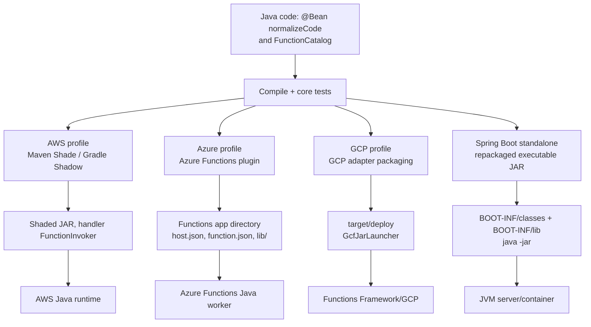
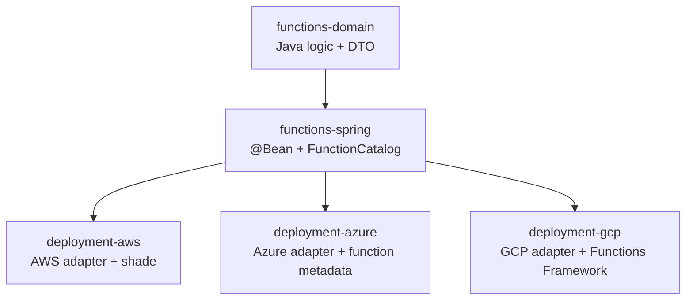
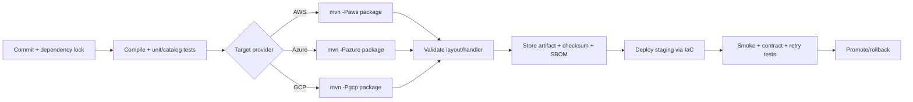
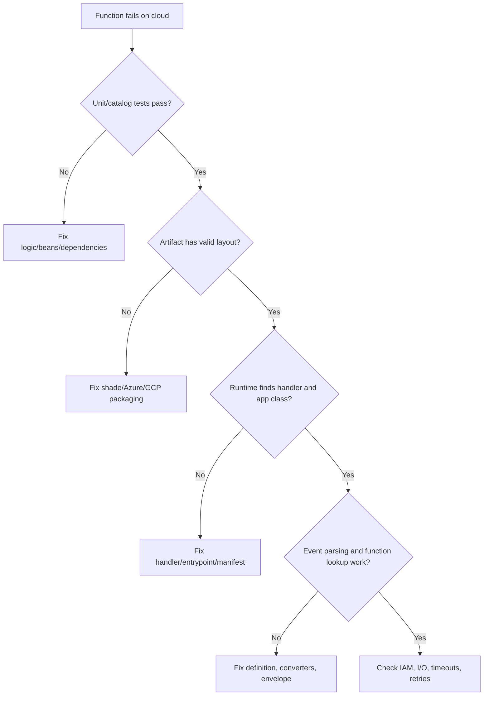

# Packaging Artifacts for Each Cloud Provider

> **Chapter:** Serverless  
> **Module:** SPRING_CLOUD_FUNCTION  
> **Objective:** Turn the same `Supplier`, `Function`, and `Consumer` logic into artifacts matching the exact **classpath, layout, entrypoint, metadata, runtime, and deployment tooling** of AWS Lambda, Azure Functions, or Google Cloud Functions; avoid confusing an executable Spring Boot JAR with a serverless deployment package.  
> **Illustrative version stack, November 24, 2026:** Java 21, Spring Boot 4.2.0, Spring Cloud 2026.0.0 (Spring Cloud Function 5.1.0). Plugin and runtime versions must be verified against your actual environment before use.

## 1. A Java Function Is Reusable, but Artifacts Are Not Always Identical

Spring Cloud Function lets you encapsulate logic using standard Java interfaces:

- `Supplier<T>` produces data without taking an invocation input.
- `Function<T,R>` accepts data, performs a transformation, and returns a result.
- `Consumer<T>` accepts data and performs side effects without returning a business result.

`FunctionCatalog` looks up and composes beans. HTTP, Spring Cloud Stream, AWS Lambda, Azure Functions, and Google Cloud Functions provide **adapters** that feed events/requests into the catalog. Consequently, **business code** can remain unchanged across environments.

However, deployment artifacts impose rules that a Java interface cannot resolve:

- Where does the runtime locate the **handler/entrypoint**?
- Where do application classes and dependency JARs reside in the package?
- Can the framework read `META-INF/spring/...`, `META-INF/services`, and manifest metadata?
- Does the cloud expect a single JAR, a specially structured ZIP, a **source/JAR directory**, or a container image?
- Which build plugin generates trigger/binding metadata?
- Does the provider's Java runtime execute the compiled bytecode?

Thus, "one Function reused everywhere" means **reusable business logic**, not uploading the same `target/app.jar` to all three cloud providers.

### 1.1. Diagram: Same Source, Multiple Artifact Types



**Goal of this lesson:** know how to pick the right build branch, recognize the output artifact, test the artifact before deployment, and understand why packaging failures can still occur even when `FunctionCatalog` tests pass.

### 1.2. Target Outcomes

After this lesson, you will be able to:

1. Distinguish **plain JAR**, **Spring Boot executable JAR**, **shaded JAR**, **Azure Functions package**, **GCP deployment directory**, and **container image**.
2. Build a shared Java/`FunctionCatalog` foundation without coupling the domain to a single provider.
3. Create provider-specific Maven/Gradle packaging strategies for AWS, Azure, and GCP.
4. Select the proper handler/entrypoint: `FunctionInvoker`, Azure `@FunctionName`/bindings, and `GcfJarLauncher`.
5. Inspect manifests, service metadata, dependency graphs, Java versions, and artifact layouts.
6. Establish a testing ladder: unit → catalog → package → local runtime → cloud integration.
7. Troubleshoot common errors: `ClassNotFoundException`, bean scan failures, missing bindings, mismatched Java runtimes, and incompatible JSON/events.
8. Design a CI/CD workflow that separates artifacts while preserving traceability and safe rollbacks.

## 2. Distinguishing Java Packaging Formats

### 2.1. Plain JAR: Only the Module's Classes and Resources

A standard Java JAR produced by `maven-jar-plugin` or Gradle's `jar` task typically contains:

```text
META-INF/MANIFEST.MF
vn/example/scf/PackagingApplication.class
application.properties
...
```

External dependencies are **not** bundled inside this JAR. Running it requires an external classpath of dependency JARs. A plain JAR suits a library module, but fails if a cloud runtime expects a self-contained artifact.

### 2.2. Spring Boot Executable JAR

When the Spring Boot Maven/Gradle plugin runs **repackage/bootJar**, the artifact typically has this layout:

```text
META-INF/MANIFEST.MF
org/springframework/boot/loader/...
BOOT-INF/classes/...
BOOT-INF/lib/<dependency>.jar
```

Boot's loader knows how to load nested dependency JARs inside `BOOT-INF/lib`. This is ideal for running:

```bash
java -jar target/scf-package-demo-0.0.1-SNAPSHOT.jar
```

However, a cloud runtime with its own classloader/handler does not necessarily read nested JARs properly. **In particular, the Spring Cloud Function AWS adapter documentation requires a shaded JAR for traditional JAR deployments.** Azure requires a plugin-generated directory and functions metadata. GCP uses packaging tied to its adapter.

### 2.3. Shaded JAR

*Shading* merges classes and resources from dependencies into a single JAR with a flat classpath:

```text
META-INF/MANIFEST.MF
META-INF/services/...
META-INF/spring/...
vn/example/scf/PackagingApplication.class
org/springframework/cloud/function/adapter/aws/FunctionInvoker.class
org/springframework/...
...
```

It no longer relies on the Boot loader to unpack `BOOT-INF/lib`. Maven Shade or Gradle Shadow creates artifacts using this strategy.

**The catch:** when merging many JARs, identically named resource files can overwrite one another. For Spring, auto-configuration and service-loader metadata files are critical. Therefore, shading is not just "dump all classes into one ZIP"; you need proper resource transformers and verification tests.

### 2.4. Packaging by Provider Contract

| Artifact type | Primary contents | Where used | Produced by |
| --- | --- | --- | --- |
| Plain JAR | Module classes/resources | Internal classpath/modules | Maven JAR plugin / Gradle `jar` |
| Spring Boot executable JAR | `BOOT-INF` and Boot loader | JVM servers, Boot containers, local `java -jar` | Spring Boot Maven/Gradle plugin |
| AWS shaded JAR | Classes and dependencies flattened into one JAR | AWS Lambda Java handler via SCF AWS adapter | Maven Shade or Gradle Shadow |
| Azure Functions app package | Handler class/JAR, `host.json`, `function.json`, libraries in Azure layout | Azure Functions Java worker | Azure Functions Maven/Gradle plugin |
| GCP adapter deployment directory | JAR and resources packaged by adapter, e.g., `target/deploy` | Google Cloud Functions / Functions Framework | Spring Boot Maven plugin + GCP adapter |
| OCI container image | Filesystem + entrypoint + runtime/libraries | Services accepting container images per runtime contract | Container build tooling |

**Never evaluate an artifact solely by its `.jar` extension.** Inspect classpath, manifest, resources, bootstrap files, and entrypoint configuration.

## 3. Version Pairs, Toolchains, and Runtimes Must Align

### 3.1. Illustrative Compatibility Stack

| Component | Example version | Notes |
| --- | --- | --- |
| Java source/target | **21** | Bytecode must be supported by the target runtime. |
| Spring Boot parent/plugin | **4.2.0** | Manages Spring Boot build and libraries. |
| Spring Cloud BOM | **2026.0.0** | Release train compatible with Spring Boot 4.2.0. |
| Spring Cloud Function modules | **5.1.0** | Module version managed by Cloud BOM. |
| Maven Shade Plugin | **3.6.2** | Release verified on Apache Maven in November 2026. |
| Azure Functions Maven Plugin | **1.42.0** | Version recorded on Maven Central at reference baseline; verify against target worker/runtime. |

Spring Cloud 2026.0.0 was released on November 20, 2026, based on Spring Boot 4.2.0 and containing Spring Cloud Function 5.1.0. Application artifacts under `org.springframework.cloud` should inherit versions from `spring-cloud-dependencies` rather than pinning individual adapters to a different train.

**The BOM does not manage every build plugin.** Maven Shade, Azure Functions Maven Plugin, and Google Functions Framework plugin need compatible versions chosen explicitly. A plugin version number looking similar to Spring Cloud's version does not mean they are synchronized.

### 3.2. Check Java at Three Points

1. **Compile:** JDK used by Maven/Gradle to emit bytecode (`mvn -v`, Gradle toolchain).
2. **Test/package:** JDK used by CI runners and build plugins.
3. **Runtime:** AWS Lambda `java21`, Azure Functions Java 21, or GCP `java21` matching the chosen environment generation.

Do not copy old `--runtime java11` flags from legacy Spring GCP pages and apply them to Java 21 bytecode. Java 11 has reached end of life in several Google environments and cannot execute Java 21 class files.

### 3.3. Pre-Build Checkpoints

```bash
java -version
javac -version
mvn -v
mvn help:effective-pom
mvn dependency:tree -Dincludes=org.springframework.cloud
```

If the project includes Maven Wrapper, use `./mvnw` instead of `mvn`. On Windows, use `./mvnw.cmd`. You do not have to run all of these while reading; they form the checklist you will practice on your project.

If an adapter requires a Java runtime or plugin incompatible with Boot 4.2.0, adjust the **entire version matrix consistently**; never disable compatibility checks just to silence errors.

## 4. Creating a Reusable Business Source

### 4.1. Shared Java Application

Create `src/main/java/vn/example/scf/PackagingApplication.java`:

```java
package vn.example.scf;

import java.util.Locale;
import java.util.function.Function;

import org.springframework.boot.SpringApplication;
import org.springframework.boot.autoconfigure.SpringBootApplication;
import org.springframework.context.annotation.Bean;

@SpringBootApplication
public class PackagingApplication {

    public static void main(String[] args) {
        SpringApplication.run(PackagingApplication.class, args);
    }

    @Bean
    public Function<String, String> normalizeCode() {
        return code -> {
            if (code == null || code.isBlank()) {
                throw new IllegalArgumentException("Code must not be empty");
            }

            return code.trim().toUpperCase(Locale.ROOT);
        };
    }

    @Bean
    public Function<String, String> validateCode() {
        return code -> {
            if (!code.matches("[A-Z]{2}-[0-9]{3}")) {
                throw new IllegalArgumentException(
                        "Code must match pattern AA-999: " + code);
            }
            return code;
        };
    }
}
```

This code imports zero AWS/Azure/GCP SDKs and knows nothing about HTTP methods, queues, or function handlers. Spring Cloud Function registers two beans: `normalizeCode` and `validateCode`.

Example with input `"  od-123 "`:

| Definition | Result |
| --- | --- |
| `normalizeCode` | `OD-123` |
| `validateCode` | Fails because lowercase/whitespace has not been normalized. |
| `normalizeCode\|validateCode` | `OD-123` |
| `validateCode\|normalizeCode` | Fails due to wrong execution order. |

From here, each provider build only needs a **different adapter and packaging setup**, without modifying either bean's algorithm.

### 4.2. Why Do We Need `FunctionCatalog`?

Java code could invoke `normalizeCode().apply(...)` directly, but Spring Cloud Function's `FunctionCatalog` enables:

- Looking up functions by name.
- Composing pipelines like `normalizeCode|validateCode` from configuration.
- Applying type and message conversion wrappers where supported.
- Preserving a uniform Spring Function contract across differing adapters.

When packaged for serverless, the provider handler invokes the adapter, the adapter selects the function/definition, and passes the converted payload to the catalog. Testing the catalog directly isolates business errors from deployment errors.

### 4.3. Testing the Catalog Before Packaging

Create `src/test/java/vn/example/scf/PackagingApplicationTest.java`:

```java
package vn.example.scf;

import static org.junit.jupiter.api.Assertions.assertEquals;
import static org.junit.jupiter.api.Assertions.assertNotNull;
import static org.junit.jupiter.api.Assertions.assertThrows;

import java.util.function.Function;

import org.junit.jupiter.api.Test;
import org.springframework.beans.factory.annotation.Autowired;
import org.springframework.boot.test.context.SpringBootTest;
import org.springframework.cloud.function.context.FunctionCatalog;

@SpringBootTest
class PackagingApplicationTest {

    @Autowired
    FunctionCatalog catalog;

    @Test
    void findsAndCallsFunction() {
        Function<String, String> fn = catalog.lookup("normalizeCode");

        assertNotNull(fn);
        assertEquals("OD-123", fn.apply("  od-123 "));
    }

    @Test
    void composesFunctions() {
        Function<String, String> pipeline =
                catalog.lookup("normalizeCode|validateCode");

        assertNotNull(pipeline);
        assertEquals("OD-123", pipeline.apply("  od-123 "));
        assertThrows(IllegalArgumentException.class,
                () -> pipeline.apply("???"));
    }
}
```

This is a **Spring context/catalog integration test**; it does not yet verify AWS/Azure/GCP layouts. Therefore, CI pipelines need at least two layers: Java/catalog tests and package/runtime tests.

## 5. Base Maven Setup: One Project, Multiple Packaging Profiles

### 5.1. Practice Project Structure

```text
scf-package-demo/
├── pom.xml
└── src/
    ├── main/
    │   ├── java/vn/example/scf/
    │   │   └── PackagingApplication.java
    │   └── resources/
    │       ├── application.properties
    │       └── host.json                  # used when building the Azure profile
    └── test/
        └── java/vn/example/scf/
            └── PackagingApplicationTest.java
```

`host.json` is unnecessary for core logic or AWS/GCP; it is referenced only by the Azure packaging plugin when running the Azure profile.

### 5.2. Shared `pom.xml`

Create the base POM below. Provider profiles from subsequent sections are **inserted inside this same `<project>`**, rather than creating three duplicate POM files:

```xml
<?xml version="1.0" encoding="UTF-8"?>
<project xmlns="http://maven.apache.org/POM/4.0.0"
         xmlns:xsi="http://www.w3.org/2001/XMLSchema-instance"
         xsi:schemaLocation="http://maven.apache.org/POM/4.0.0
           https://maven.apache.org/xsd/maven-4.0.0.xsd">

    <modelVersion>4.0.0</modelVersion>

    <parent>
        <groupId>org.springframework.boot</groupId>
        <artifactId>spring-boot-starter-parent</artifactId>
        <version>4.2.0</version>
        <relativePath/>
    </parent>

    <groupId>vn.example</groupId>
    <artifactId>scf-package-demo</artifactId>
    <version>0.0.1-SNAPSHOT</version>

    <properties>
        <java.version>21</java.version>
        <spring-cloud.version>2026.0.0</spring-cloud.version>
        <spring-cloud-function.version>5.1.0</spring-cloud-function.version>
        <start-class>vn.example.scf.PackagingApplication</start-class>
    </properties>

    <dependencyManagement>
        <dependencies>
            <dependency>
                <groupId>org.springframework.cloud</groupId>
                <artifactId>spring-cloud-dependencies</artifactId>
                <version>${spring-cloud.version}</version>
                <type>pom</type>
                <scope>import</scope>
            </dependency>
        </dependencies>
    </dependencyManagement>

    <dependencies>
        <dependency>
            <groupId>org.springframework.boot</groupId>
            <artifactId>spring-boot-starter</artifactId>
        </dependency>
        <dependency>
            <groupId>org.springframework.cloud</groupId>
            <artifactId>spring-cloud-function-context</artifactId>
        </dependency>
        <dependency>
            <groupId>org.springframework.boot</groupId>
            <artifactId>spring-boot-starter-test</artifactId>
            <scope>test</scope>
        </dependency>
    </dependencies>

    <build>
        <plugins>
            <plugin>
                <groupId>org.springframework.boot</groupId>
                <artifactId>spring-boot-maven-plugin</artifactId>
            </plugin>
        </plugins>
    </build>

    <!-- Insert aws/azure/gcp profiles from sections 7/8/9 here. -->
</project>
```

**Note:** the `spring-cloud-function.version=5.1.0` property above is **only used when a Maven plugin needs an explicit dependency version on the plugin's own classpath**, such as GCP packaging. Application dependencies still inherit versions from the Spring Cloud BOM; do not add `<version>5.1.0</version>` next to `spring-cloud-function-context`.

### 5.3. Base Function Configuration

Create `src/main/resources/application.properties`:

```properties
spring.application.name=scf-package-demo
spring.main.web-application-type=none
spring.cloud.function.definition=normalizeCode|validateCode
```

This is a static pipeline. If a deployment should only run `normalizeCode`, override the definition via environment variables or profiles without changing Java code.

`spring.main.web-application-type=none` fits serverless examples that do not need an embedded HTTP server. **Do not reuse this file verbatim to test the Spring Cloud Function Web starter via cURL**; standalone HTTP requires a Web application context and Web dependencies.

### 5.4. Base Build Exercise Before Adding Adapters

```bash
mvn clean test
mvn dependency:tree -Dincludes=org.springframework.cloud
mvn package
```

With the base POM, the Spring Boot plugin builds an executable Boot JAR at `target/scf-package-demo-0.0.1-SNAPSHOT.jar`. **This is not yet an artifact packaged for a cloud provider.** It simply verifies the base layer before adding provider plugins and profiles.

## 6. What Should You Inspect Inside an Artifact?

### 6.1. Filenames Alone Do Not Reveal Structure

Maven may produce:

```text
target/scf-package-demo-0.0.1-SNAPSHOT.jar
target/scf-package-demo-0.0.1-SNAPSHOT-aws.jar
target/azure-functions/<function-app-name>/
target/deploy/
```

Exact paths depend on plugin settings. After building, **list actual files** instead of guessing from names.

```bash
ls -lh target/*.jar
jar tf target/scf-package-demo-0.0.1-SNAPSHOT.jar
```

With PowerShell:

```powershell
Get-ChildItem -Path .\target -Filter *.jar
jar tf .\target\scf-package-demo-0.0.1-SNAPSHOT.jar
```

### 6.2. Identification Signals

| Signal | Indication | Sufficient to certify deployment? |
| --- | --- | --- |
| Contains `BOOT-INF/lib` | Boot executable JAR. | Not yet; AWS shaded JAR takes another format. |
| Dependency classes sit directly in JAR | Likely a shaded JAR. | Not yet; verify metadata/handler. |
| Contains `org/springframework/cloud/function/adapter/aws/FunctionInvoker.class` | AWS adapter is bundled. | Not yet; handler and main class must still match. |
| Contains `function.json`/`host.json` in Azure layout | Azure package generated metadata. | Not yet; test Azure worker/triggers. |
| Contains `target/deploy` and GCP launcher | GCP package has the right foundation. | Not yet; test Functions Framework and provider. |
| `mvn test` succeeds | `FunctionCatalog` and business logic passed. | Does not verify runtime artifact. |
| `java -jar` runs | Boot loader and Boot app classpath work. | Does not verify provider handler. |

### 6.3. Why Does Metadata Matter During Shading?

Spring Boot and the Spring ecosystem rely on resources such as:

```text
META-INF/services/...
META-INF/spring.factories
META-INF/spring/org.springframework.boot.autoconfigure.AutoConfiguration.imports
META-INF/spring.handlers
META-INF/spring.schemas
META-INF/spring.components
```

Identically named files can appear in multiple JARs. If Shade simply keeps the last copy, auto-configuration or service providers from other dependencies vanish. Therefore, **resource transformers/mergers** must match the Spring Boot and plugin versions, especially across Boot major versions.

**Failure symptom:** tests pass in the IDE, yet invoking the cloud handler throws `ClassNotFoundException` or fails because the Spring context lacks beans/auto-configuration. Inspect metadata files, not just `.class` entries.

## 7. AWS Lambda: Building a Shaded JAR for `FunctionInvoker`

### 7.1. Spring Cloud Function AWS Packaging Model

For the AWS Lambda Java runtime, the handler can be:

```text
org.springframework.cloud.function.adapter.aws.FunctionInvoker::handleRequest
```

This handler receives AWS invocations and delegates to the selected function/pipeline in `FunctionCatalog`. A Java `@Bean` is not automatically a Lambda handler.

Per the Spring Cloud Function AWS documentation, traditional JAR deployments use a **shaded JAR**. Documentation examples produce an artifact with the `aws` classifier:

```text
target/scf-package-demo-0.0.1-SNAPSHOT-aws.jar
```

This is a **different file** from the Spring Boot executable JAR and must be built via a dedicated AWS profile. Do not upload a standard `BOOT-INF` Boot JAR when the adapter guide expects a shaded classpath.

### 7.2. AWS-Specific Dependency

Inside an AWS Maven profile, add:

```xml
<dependency>
    <groupId>org.springframework.cloud</groupId>
    <artifactId>spring-cloud-function-adapter-aws</artifactId>
</dependency>
```

This dependency belongs in the profile's `<dependencies>`, not `dependencyManagement`. Its version is managed by the Cloud BOM.

### 7.3. AWS Maven Profile — Practical Guide Template

**Insert the following `<profiles>` block into the base POM from section 5.** This build template includes the key components required by Spring/AWS; **test it on your real toolchain** and adjust transformers if your Boot/adapter version requires changes. It does not replace the entire POM.

```xml
<profiles>
    <profile>
        <id>aws</id>

        <dependencies>
            <dependency>
                <groupId>org.springframework.cloud</groupId>
                <artifactId>spring-cloud-function-adapter-aws</artifactId>
            </dependency>
        </dependencies>

        <build>
            <plugins>
                <!-- Do not use Boot nested-JAR as Lambda deployment input. -->
                <plugin>
                    <groupId>org.springframework.boot</groupId>
                    <artifactId>spring-boot-maven-plugin</artifactId>
                    <configuration>
                        <skip>true</skip>
                    </configuration>
                </plugin>

                <plugin>
                    <groupId>org.apache.maven.plugins</groupId>
                    <artifactId>maven-shade-plugin</artifactId>
                    <version>3.6.2</version>

                    <dependencies>
                        <!-- Enables Spring Boot transformer for factories. -->
                        <dependency>
                            <groupId>org.springframework.boot</groupId>
                            <artifactId>spring-boot-maven-plugin</artifactId>
                            <version>4.2.0</version>
                        </dependency>
                    </dependencies>

                    <executions>
                        <execution>
                            <id>shade-for-aws</id>
                            <phase>package</phase>
                            <goals>
                                <goal>shade</goal>
                            </goals>
                            <configuration>
                                <shadedArtifactAttached>true</shadedArtifactAttached>
                                <shadedClassifierName>aws</shadedClassifierName>
                                <createDependencyReducedPom>false</createDependencyReducedPom>

                                <filters>
                                    <filter>
                                        <artifact>*:*</artifact>
                                        <excludes>
                                            <exclude>META-INF/*.SF</exclude>
                                            <exclude>META-INF/*.DSA</exclude>
                                            <exclude>META-INF/*.RSA</exclude>
                                        </excludes>
                                    </filter>
                                </filters>

                                <transformers>
                                    <transformer implementation="org.apache.maven.plugins.shade.resource.ServicesResourceTransformer"/>
                                    <transformer implementation="org.apache.maven.plugins.shade.resource.AppendingTransformer">
                                        <resource>META-INF/spring/org.springframework.boot.autoconfigure.AutoConfiguration.imports</resource>
                                    </transformer>
                                    <transformer implementation="org.springframework.boot.maven.PropertiesMergingResourceTransformer">
                                        <resource>META-INF/spring.factories</resource>
                                    </transformer>
                                    <transformer implementation="org.apache.maven.plugins.shade.resource.AppendingTransformer">
                                        <resource>META-INF/spring.handlers</resource>
                                    </transformer>
                                    <transformer implementation="org.apache.maven.plugins.shade.resource.AppendingTransformer">
                                        <resource>META-INF/spring.schemas</resource>
                                    </transformer>
                                    <transformer implementation="org.apache.maven.plugins.shade.resource.AppendingTransformer">
                                        <resource>META-INF/spring.components</resource>
                                    </transformer>
                                    <transformer implementation="org.apache.maven.plugins.shade.resource.ManifestResourceTransformer">
                                        <manifestEntries>
                                            <Start-Class>vn.example.scf.PackagingApplication</Start-Class>
                                        </manifestEntries>
                                    </transformer>
                                </transformers>
                            </configuration>
                        </execution>
                    </executions>
                </plugin>
            </plugins>
        </build>
    </profile>
</profiles>
```

**Verification point for Spring Boot 4.2:** the `PropertiesMergingResourceTransformer` class and resource paths must exist and match the resolved plugin version. Official AWS doc examples still contain Spring Boot 3.x snippets, so **do not blindly mix old versions into a Boot 4.2 POM**. If a transformer fails to resolve, consult updated official samples for your project version or adjust the profile rather than dropping metadata merging.

Also check whether another build execution is running Boot repackage simultaneously. Setting `<skip>true</skip>` in the AWS profile avoids shading over a nested Boot JAR.

### 7.4. Building and Inspecting the Output

```bash
mvn clean test
mvn -Paws clean package
ls -lh target/*aws.jar
jar tf target/scf-package-demo-0.0.1-SNAPSHOT-aws.jar
```

Verify:

- `FunctionInvoker.class` is present in the artifact.
- `PackagingApplication.class` and Spring resources are present.
- Dependency classes sit flat on the classpath.
- Required `META-INF/spring.factories` and auto-configuration imports are preserved.
- Manifest / `MAIN_CLASS` points to the `@SpringBootApplication` class.
- Exactly one intended artifact is uploaded to Lambda, not the `original` or Boot JAR.

Do not use `java -jar ...-aws.jar` as your sole verification: a shaded artifact is built for the Lambda handler rather than standalone Boot executable execution.

### 7.5. Configuring the AWS Handler and Function Definition

An illustrative AWS SAM template using the built `aws.jar` artifact:

```yaml
AWSTemplateFormatVersion: '2010-09-09'
Transform: AWS::Serverless-2016-10-31

Resources:
  NormalizeCodeLambda:
    Type: AWS::Serverless::Function
    Properties:
      Runtime: java21
      Handler: org.springframework.cloud.function.adapter.aws.FunctionInvoker
      CodeUri: target/scf-package-demo-0.0.1-SNAPSHOT-aws.jar
      MemorySize: 512
      Timeout: 30
      Environment:
        Variables:
          MAIN_CLASS: vn.example.scf.PackagingApplication
          spring_cloud_function_definition: normalizeCode|validateCode
```

Note: in the AWS Console, Spring's guide uses `FunctionInvoker::handleRequest`; some SAM examples use the class name `FunctionInvoker`. **Choose the exact Lambda Java handler syntax required by your deployment tool and verify it with an invocation**, rather than assuming both forms are interchangeable everywhere.

This SAM snippet **illustrates only core fields**; it omits event sources, specific IAM policies, logs, networking, tags, alarms, secrets management, and CI packaging. Before running `sam deploy`, supply those pieces and confirm the artifact exists. Settings in `application.properties` can also be overridden by environment variables.

### 7.6. Other AWS Packaging Options

AWS Lambda also supports container images and custom runtimes:

- For **container images**, the image must satisfy the Lambda Runtime API and entrypoint contract. A standard Spring Boot Web OCI image does not automatically work as a Lambda image.
- For **GraalVM native images / custom runtimes**, the artifact may be a ZIP containing a native binary and a `bootstrap` executable at the root instead of a Java JAR.
- For SQS/S3/Kafka triggers, inputs carry provider-specific envelopes; setting the right handler alone does not make converters turn every event into a `String`.

In this lesson, the **primary path is Java 21 + shaded JAR + `FunctionInvoker`**. Image and native options must follow their dedicated runtime/provider guides.

## 8. Azure Functions: Plugin Generates App Directory and Binding Metadata

### 8.1. Why a Boot Uber-JAR Is Not an Azure Functions Package

Azure Java Functions run inside the **Azure Functions Java worker**. The worker expects metadata describing function names, triggers, input/output bindings, and Java libraries arranged in an Azure-defined directory layout.

The Spring Cloud Function Azure adapter supports Spring DI and `FunctionCatalog`, but does not replace the Azure runtime. Spring docs emphasize that Azure packaging **is incompatible with the default Spring Boot uber-JAR**. Typical solutions are:

1. Use `azure-functions-maven-plugin` or the Azure Gradle plugin to assemble the package.
2. Invoke Spring beans from handlers annotated with `@FunctionName`.
3. Disable Boot repackage in the Azure profile, or use a version-appropriate thin launcher strategy.
4. Ensure `Main-Class`/`Start-Class` or `MAIN_CLASS` identifies the Spring application context.
5. Test locally with Azure Functions Core Tools before deploying.

### 8.2. Azure Dependencies and Annotations

In the Azure profile, add the adapter and Azure Java annotations library:

```xml
<dependencies>
    <dependency>
        <groupId>org.springframework.cloud</groupId>
        <artifactId>spring-cloud-function-adapter-azure</artifactId>
    </dependency>
    <dependency>
        <groupId>com.microsoft.azure.functions</groupId>
        <artifactId>azure-functions-java-library</artifactId>
        <version>3.3.0</version>
    </dependency>
</dependencies>
```

These two dependencies serve distinct purposes: Spring integration and Azure worker types/annotations. `azure-functions-java-library:3.3.0` is the version published on Maven Central at the reference baseline; verify compatibility with your project's plugin and worker.

### 8.3. Azure Handler Discovered via Annotations

Example of a **file placed only in an Azure-specific module/source set**:

```java
package vn.example.scf.azure;

import java.util.Optional;
import java.util.function.Function;

import com.microsoft.azure.functions.AuthorizationLevel;
import com.microsoft.azure.functions.ExecutionContext;
import com.microsoft.azure.functions.HttpMethod;
import com.microsoft.azure.functions.HttpRequestMessage;
import com.microsoft.azure.functions.HttpResponseMessage;
import com.microsoft.azure.functions.HttpStatus;
import com.microsoft.azure.functions.annotation.FunctionName;
import com.microsoft.azure.functions.annotation.HttpTrigger;

import org.springframework.cloud.function.context.FunctionCatalog;
import org.springframework.stereotype.Component;

@Component
public class AzureNormalizeHandler {

    private final Function<String, String> function;

    public AzureNormalizeHandler(FunctionCatalog catalog) {
        this.function = catalog.lookup("normalizeCode|validateCode");
    }

    @FunctionName("normalizeCodeHttp")
    public HttpResponseMessage handle(
            @HttpTrigger(
                name = "request",
                methods = {HttpMethod.POST},
                authLevel = AuthorizationLevel.FUNCTION)
            HttpRequestMessage<Optional<String>> request,
            ExecutionContext context) {

        String input = request.getBody()
                .orElseThrow(() ->
                    new IllegalArgumentException("Missing request body"));

        String output = function.apply(input);

        return request.createResponseBuilder(HttpStatus.OK)
                .body(output)
                .build();
    }
}
```

`@FunctionName("normalizeCodeHttp")` names the **Azure function**, whereas `normalizeCode|validateCode` is the Spring Cloud Function definition. The Azure plugin processes annotations and emits binding metadata. This snippet does not yet map `IllegalArgumentException` to HTTP 400; production error contracts must be designed and tested.

If you prefer not to write Azure annotations for a complex Web app, Spring also offers `spring-cloud-function-adapter-azure-web`. That is a separate adapter model and should not be mixed arbitrarily without clear architectural requirements.

### 8.4. Azure Maven Profile — Plugin Configuration

**Insert this profile inside `<profiles>` alongside the AWS profile in the POM.** Activate only one profile per build:

```xml
<profile>
    <id>azure</id>

    <properties>
        <start-class>vn.example.scf.PackagingApplication</start-class>
    </properties>

    <dependencies>
        <dependency>
            <groupId>org.springframework.cloud</groupId>
            <artifactId>spring-cloud-function-adapter-azure</artifactId>
        </dependency>
        <dependency>
            <groupId>com.microsoft.azure.functions</groupId>
            <artifactId>azure-functions-java-library</artifactId>
            <version>3.3.0</version>
        </dependency>
    </dependencies>

    <build>
        <plugins>
            <plugin>
                <groupId>org.springframework.boot</groupId>
                <artifactId>spring-boot-maven-plugin</artifactId>
                <configuration>
                    <skip>true</skip>
                </configuration>
            </plugin>

            <plugin>
                <groupId>com.microsoft.azure</groupId>
                <artifactId>azure-functions-maven-plugin</artifactId>
                <version>1.42.0</version>
                <configuration>
                    <appName>scf-package-demo-azure</appName>
                    <resourceGroup>REPLACE_RESOURCE_GROUP</resourceGroup>
                    <region>REPLACE_REGION</region>
                    <hostJson>${project.basedir}/src/main/resources/host.json</hostJson>
                    <runtime>
                        <os>linux</os>
                        <javaVersion>21</javaVersion>
                    </runtime>
                    <appSettings>
                        <property>
                            <name>FUNCTIONS_EXTENSION_VERSION</name>
                            <value>~4</value>
                        </property>
                        <property>
                            <name>MAIN_CLASS</name>
                            <value>vn.example.scf.PackagingApplication</value>
                        </property>
                    </appSettings>
                </configuration>
                <executions>
                    <execution>
                        <id>package-functions</id>
                        <phase>package</phase>
                        <goals>
                            <goal>package</goal>
                        </goals>
                    </execution>
                </executions>
            </plugin>
        </plugins>
    </build>
</profile>
```

**You must customize** `appName`, region, resource group, plan/hosting mode, storage/auth, and any properties required by the plugin/provider. This profile is a **learning recipe**, not a finished deployment template. Run packaging and inspect generated files; if plugin 1.42.0 or your worker requires additional parameters for your hosting plan, add them per current Azure documentation.

With the Spring Boot plugin, `<skip>true</skip>` in the Azure profile prevents Boot repackage from turning the Azure package into an incompatible nested Boot JAR. In projects using other libraries, you may also need to set `maven-jar-plugin`'s Main-Class manifest entry and/or `MAIN_CLASS`.

### 8.5. `host.json` and `function.json` Serve Different Roles

Create a minimal `src/main/resources/host.json`:

```json
{
  "version": "2.0"
}
```

`host.json` configures Function App-wide settings. `function.json` describes triggers and bindings for **one function**, typically generated by the Azure plugin from `@FunctionName` and `@HttpTrigger`.

Example directory structure after packaging (exact folder name depends on plugin settings):

```text
target/azure-functions/scf-package-demo-azure/
├── host.json
├── normalizeCodeHttp/
│   └── function.json
├── scf-package-demo-0.0.1-SNAPSHOT.jar
└── lib/
    ├── spring-*.jar
    └── ...
```

**Never copy `BOOT-INF/lib` from a Boot JAR into an arbitrary folder expecting the Azure worker to load it.** Let the Azure plugin generate the proper layout.

### 8.6. Build and Verification Commands

```bash
mvn -Pazure clean package
mvn -Pazure azure-functions:run
```

Or use Maven Wrapper if available. Running locally requires Azure Functions Core Tools; some triggers also require Azurite/storage emulators and `local.settings.json`.

Before deploying, verify:

- The Function App folder contains `host.json`.
- Each Azure function to deploy has its `function.json`.
- Application JARs and libraries sit in the expected layout.
- `MAIN_CLASS` or manifest points to `PackagingApplication`.
- The Java worker/runtime targets compatible Java 21.
- Handler annotations were scanned by the plugin; endpoints/triggers appear when Functions Core Tools starts.

**Never commit `local.settings.json` containing secrets** to version control; use a secret store or CI environment configuration.

## 9. Google Cloud Functions: GCP Adapter and `GcfJarLauncher`

### 9.1. How GCP Packaging Differs from AWS and Azure

The Spring Cloud Function GCP adapter provides the launcher:

```text
org.springframework.cloud.function.adapter.gcp.GcfJarLauncher
```

The launcher connects the Functions Framework / Google runtime to the Spring Cloud Function context. Spring docs specify adding:

- `spring-cloud-function-adapter-gcp` to application dependencies.
- The GCP adapter as a **dependency of `spring-boot-maven-plugin`** to customize packaging into the expected format.
- `function-maven-plugin` from Functions Framework for local execution.
- Output directory `target/deploy` as the deployment source.

**Never use an AWS shaded JAR or an Azure function directory as a GCP deployment source.**

### 9.2. GCP Maven Profile

**Insert into `<profiles>` of the shared POM:**

```xml
<profile>
    <id>gcp</id>

    <dependencies>
        <dependency>
            <groupId>org.springframework.cloud</groupId>
            <artifactId>spring-cloud-function-adapter-gcp</artifactId>
        </dependency>
    </dependencies>

    <build>
        <plugins>
            <plugin>
                <groupId>org.springframework.boot</groupId>
                <artifactId>spring-boot-maven-plugin</artifactId>
                <configuration>
                    <outputDirectory>target/deploy</outputDirectory>
                </configuration>
                <dependencies>
                    <dependency>
                        <groupId>org.springframework.cloud</groupId>
                        <artifactId>spring-cloud-function-adapter-gcp</artifactId>
                        <version>${spring-cloud-function.version}</version>
                    </dependency>
                </dependencies>
            </plugin>

            <plugin>
                <groupId>com.google.cloud.functions</groupId>
                <artifactId>function-maven-plugin</artifactId>
                <version>0.9.1</version>
                <configuration>
                    <functionTarget>org.springframework.cloud.function.adapter.gcp.GcfJarLauncher</functionTarget>
                    <port>8080</port>
                </configuration>
            </plugin>
        </plugins>
    </build>
</profile>
```

Here, version `5.1.0` on the **plugin dependency** is stated explicitly because Maven plugin classpaths do not always inherit BOM dependency management the same way runtime dependencies do. **Do not use this technique to force application modules off the BOM version.**

`function-maven-plugin:0.9.1` is shown in Spring Cloud Function 5.1.0 docs for Functions Framework. Before combining Java 21 with newer GCP runtimes, test locally and confirm plugin compatibility; do not assume this snippet was executed/packaged in this reading material.

### 9.3. Manifest and Main Class

GCP docs emphasize specifying the application main class. Example `src/main/resources/META-INF/MANIFEST.MF`:

```text
Manifest-Version: 1.0
Main-Class: vn.example.scf.PackagingApplication

```

With `spring-boot-maven-plugin` and `start-class` configured, writing the main/start class in the artifact may be handled automatically by the build plugin. **Do not blindly layer two manifests** if the plugin already emits one; inspect the resulting JAR to ensure `GcfJarLauncher` finds the Spring Boot application class.

When the GCP launcher fails to locate the main class, check the manifest, corresponding properties/environment variables, and package location.

### 9.4. Building and Testing Locally

```bash
mvn -Pgcp clean package
mvn -Pgcp function:run
```

If the GCP function is deployed as an HTTP function, send a request with a String input:

```bash
curl -i -X POST http://localhost:8080/ \
  -H "Content-Type: text/plain" \
  --data-raw "  od-123  "
```

The output depends on the function definition and the GCP adapter's HTTP contract. With `normalizeCode|validateCode`, the expected business output is `OD-123`. If local execution fails due to a plugin/API mismatch, fix the Functions Framework configuration instead of changing bean logic once catalog tests already pass.

### 9.5. Inspecting `target/deploy`

```bash
ls -lh target/deploy
jar tf target/deploy/scf-package-demo-0.0.1-SNAPSHOT.jar
```

The JAR name inside `target/deploy` is **an example**; check the actual filename produced by the Maven plugin. What matters is that the directory and contents match the format expected by the GCP adapter.

### 9.6. Illustrative Deployment with Java 21

For modern Cloud Run functions / Cloud Functions environments supporting Java 21, an illustrative command looks like:

```bash
gcloud functions deploy scf-normalize \
  --gen2 \
  --region=YOUR_REGION \
  --runtime=java21 \
  --entry-point=org.springframework.cloud.function.adapter.gcp.GcfJarLauncher \
  --source=target/deploy \
  --trigger-http
```

This is a **reference command to understand the flags**, not a copy-pasteable production script: substitute region, project, deploy/invoke permissions, authentication settings, and storage/build options, and verify CLI/runtime support. Cloud Run functions deployment behavior can vary across `gcloud` / Functions Framework versions and organizational policies.

**Very important:** Spring Cloud Function GCP docs still contain historical `--runtime java11` examples. Never use Java 11 when compiling Java 21; currently Google publishes `java21` for Cloud Run functions, and Java 11 is end-of-life.

### 9.7. HTTP and Pub/Sub Do Not Share the Same Event Contract

A GCP HTTP function receives HTTP requests; Pub/Sub / CloudEvents receive event envelopes/attributes with a different structure. If the same `Function<String,String>` bean is reused, an adapter/bridge must extract the payload into the String. Having the right JAR and entrypoint **does not guarantee Pub/Sub `data` decodes automatically into a business command**.

Tests must use real event fixtures and matching triggers.

## 10. Gradle: Equivalent Mapping per Platform

### 10.1. Base Gradle Groovy DSL

Base Gradle configuration for dependency management:

```groovy
plugins {
    id 'java'
    id 'org.springframework.boot' version '4.2.0'
    id 'io.spring.dependency-management' version '1.1.7'
}

group = 'vn.example'
version = '0.0.1-SNAPSHOT'

repositories {
    mavenCentral()
}

java {
    toolchain {
        languageVersion = JavaLanguageVersion.of(21)
    }
}

ext {
    set('springCloudVersion', '2026.0.0')
}

dependencyManagement {
    imports {
        mavenBom "org.springframework.cloud:spring-cloud-dependencies:${springCloudVersion}"
    }
}

dependencies {
    implementation 'org.springframework.boot:spring-boot-starter'
    implementation 'org.springframework.cloud:spring-cloud-function-context'
    testImplementation 'org.springframework.boot:spring-boot-starter-test'
}

tasks.named('test') {
    useJUnitPlatform()
}
```

This is only the **base build equivalent** without provider packaging plugins. Do not run `./gradlew bootJar` and upload that Boot JAR to Azure or AWS expecting it to work.

### 10.2. AWS: Gradle Shadow

- Add `spring-cloud-function-adapter-aws`.
- Apply a **Gradle Shadow Plugin** version compatible with your Gradle, JDK, and Boot versions.
- Configure `shadowJar` with classifier `aws`, merging `META-INF/services` and Spring metadata resources.
- Avoid letting `bootJar` nest dependencies in the Lambda artifact.
- Verify the output JAR and `FunctionInvoker` via local and cloud integration tests.

The task name is typically `shadowJar`. Spring AWS docs show Shadow 8.x examples from the Spring Boot 3.x era; do not copy legacy plugin IDs/versions without checking compatibility with modern Gradle and Boot 4.2.

### 10.3. Azure: Gradle Plugin

Spring/Azure docs support tasks such as:

```bash
./gradlew azureFunctionsPackage
./gradlew azureFunctionsRun
./gradlew azureFunctionsDeploy
```

To enable these tasks, apply the `com.microsoft.azure.azurefunctions` plugin and configure the function app, Java runtime, triggers, and packaging settings. They **do not appear automatically** just from adding `spring-cloud-function-adapter-azure` to dependencies.

### 10.4. GCP: Gradle Needs a Dedicated Compatibility Strategy

Spring GCP docs explicitly describe a Maven workflow using a plugin dependency on `spring-boot-maven-plugin`; do not assume Gradle's `bootJar` produces an equivalent `target/deploy` artifact automatically.

If your organization standardizes on Gradle, use a GCP packaging recipe verified for your exact adapter and Functions Framework versions, or isolate packaging in a dedicated Maven module. **Do not mix Gradle and Maven outputs in the same deployment job** without a clear artifact handoff.

## 11. Splitting Modules per Environment to Avoid Classpath Conflicts

For larger systems, one Maven project with multiple profiles is fast for learning, but not necessarily best for production. You can structure modules as:

```text
orders-functions/
├── functions-domain/
│   └── OrderNormalizer.java
├── functions-spring/
│   └── FunctionBeans.java
├── deployment-aws/
│   └── pom.xml + AWS Shade config
├── deployment-azure/
│   └── pom.xml + Azure Functions config
└── deployment-gcp/
    └── pom.xml + GCP packaging config
```

Dependencies should flow one way:



Arrows indicate that **downstream modules depend on shared code upstream**. `functions-domain` never imports AWS, Azure, or GCP SDKs. This makes it easy to:

- Keep each runtime classpath limited to only its needed adapter.
- Upgrade provider plugin versions independently.
- Provision separate IAM roles, triggers, and resources per deployment.
- Produce and store each artifact with its own name, version, and checksum.
- Unit-test domain logic once while testing packaging per runtime.

**Do not generate three runtime artifacts for a project that only targets AWS.** Split modules when you truly target multiple providers, not because the framework forces it.

## 12. Inspecting Classpaths and Manifests After Packaging

### 12.1. Checking the Dependency Tree Before Building

```bash
mvn -Paws dependency:tree -Dincludes=org.springframework.cloud
mvn -Pazure dependency:tree -Dincludes=org.springframework.cloud
mvn -Pgcp dependency:tree -Dincludes=org.springframework.cloud
```

Confirm:

- No mixed major/minor Spring Cloud Function versions appear in the same artifact.
- `spring-cloud-function-context` is present.
- Only the target provider's adapter is included.
- Spring MVC, Stream, or Kafka binders are not pulled in unintentionally.
- Test dependencies are not packaged into the runtime artifact.

### 12.2. Inspecting the Manifest

You can run:

```bash
jar tf target/scf-package-demo-0.0.1-SNAPSHOT-aws.jar
```

To read the manifest contents, use a JAR inspection tool or run `jar xf` **inside a dedicated temporary directory**, then inspect `META-INF/MANIFEST.MF`. Never extract randomly inside the project directory, which pollutes the workspace and can overwrite files.

For AWS, ensure the adapter locates the application class via `Start-Class`/`MAIN_CLASS`; for Azure, check `MAIN_CLASS`/manifest and annotated handlers; for GCP, verify `Main-Class`/entrypoint per the adapter.

### 12.3. Signs of a Broken Classpath from Shading

| Symptom | Likely root cause |
| --- | --- |
| `NoClassDefFoundError` immediately on handler startup | Dependency classes missing from the shaded JAR. |
| `BeanCreationException` appearing only after shading | Spring metadata / auto-configuration resources overwritten or dropped. |
| `ServiceConfigurationError` | `META-INF/services` not merged properly. |
| `UnsupportedClassVersionError` | Compiled bytecode targets a newer JDK than the runtime. |
| `ClassCastException` after conversion | Function generic types/schema mismatch actual input. |
| `FunctionCatalog` cannot find bean | Main class / package scan or definition/adapter config error. |

When suspecting a shade issue, compare the **classpath from `mvn test`** against the **deployed JAR layout** before touching business functions.

### 12.4. Measuring Size and Dependency Footprint

```bash
ls -lh target/*.jar
mvn dependency:tree
```

Larger JARs can increase artifact download and cold-start times, though **there is no universal size threshold** guaranteeing fast or slow execution. Measure cold and warm latencies on the provider alongside memory size, class loading, and initialization time. Removing unused dependencies reduces footprint and risk, but never exclude core Spring modules blindly.

## 13. CI/CD Pipeline Pattern: Build Once, Test, and Release the Right Artifact

### 13.1. Separating Build Steps



A trustworthy workflow does not stop at **BUILD SUCCESS**. It verifies that the artifact was **created in the right location**, is non-empty, contains the expected entrypoint/classpath, and passes runtime smoke tests.

### 13.2. Example Separate Build Commands

```bash
mvn clean test
mvn -Paws clean package
mvn -Pazure clean package
mvn -Pgcp clean package
```

These are **three independent builds**—do not activate all three profiles in one command. If run sequentially in the same workspace, each `clean` deletes the previous output; CI should archive or copy each target artifact immediately after its build or run separate jobs/workspaces. Never run all three and expect every artifact to remain in `target` at the end.

### 13.3. Artifact Identity

Every release artifact should record:

| Field | Example |
| --- | --- |
| Git revision | Exact commit SHA. |
| Java/Boot/Cloud | `21 / 4.2.0 / 2026.0.0`. |
| Provider target | `aws-lambda / azure-functions / gcp-functions`. |
| Artifact path | `target/...-aws.jar` or corresponding package directory. |
| Build plugin versions | Resolved Shade/Azure/GCP plugin versions. |
| Checksums | SHA-256 of archive/manifest. |
| Dependency inventory | SBOM or dependency report. |
| Test evidence | Unit/catalog tests and provider integration tests. |
| Runtime/entrypoint | `java21` + handler/launcher name. |

When rolling back, redeploy the **exact immutable tested artifact** rather than rebuilding old source with newly resolved dependencies or plugins. This is especially critical for order, payment, and event-processing deployments.

### 13.4. Protecting CI Secrets

Grant deploy jobs only minimum cloud credentials (using OIDC / workload identity where supported). Build/test jobs do not need permissions to create IAM roles, delete buckets, or administer databases. Never store access keys in `pom.xml`, `host.json`, properties files, or JARs.

Keep secrets and PII out of CI logs and artifact metadata as well. An SBOM tracks libraries and CVEs, but does not replace vulnerability scanning and runtime testing.

## 14. Smoke Tests Must Run on the Matching Runtime Type

### 14.1. Testing Matrix

| Test layer | AWS | Azure | GCP |
| --- | --- | --- | --- |
| Java unit tests | Shared | Shared | Shared |
| Spring `FunctionCatalog` tests | Shared | Shared | Shared |
| Package structure checks | Shade/metadata | `host.json`/`function.json` | `target/deploy`/launcher |
| Local runtime tests | SAM local or corresponding handler tests | Azure Functions Core Tools | Functions Framework |
| Cloud invocations | Lambda test / event source | Azure HTTP/queue/blob triggers | GCP HTTP/PubSub/CloudEvents |
| Failure/retry | Event source mapping, DLQ, batching | Trigger retry / dead-letter | Pub/Sub / event retry contract |
| Cold start | Lambda runtime init | Azure host/worker init | GCP / Cloud Run functions init |

A test calling `catalog.lookup(...).apply(...)` directly does not test the AWS Java handler. A successful `java -jar` run does not test Azure's `function.json`. A passing HTTP cURL request does not test Pub/Sub event envelopes or idempotency.

### 14.2. Testing Inputs/Outputs Against the Exact Event Contract

Business input example:

```text
"  od-123  " -> "OD-123"
```

With AWS **direct invoke**, the raw event stream must convert cleanly into a String. With **SQS**, input may be an object containing `Records`; with **Azure queues**, the handler receives types per binding; with **GCP Pub/Sub**, events carry specific data and attributes.

**Do not conclude conversion works solely by passing a String into the catalog.** Use real provider event fixtures, verifying JSON/base64, headers/content types, and output/error contracts.

### 14.3. Testing Failure Modes

At a minimum, test:

1. Misnamed function definition.
2. Missing or invalid payload.
3. Java runtime mismatch against compilation target.
4. Missing dependency or manifest entry.
5. Wrong trigger, handler, or entrypoint.
6. Transient failure after writing a side effect.
7. Redelivered events and/or batches with failing records.
8. Missing IAM / managed identity or network permissions.

Success means more than "the server returned an error"—it means **no lost messages**, bounded retries, no duplicate side effects, logs carrying correlation IDs, and zero leaked secrets.

## 15. Troubleshooting: Mapping Symptoms to the Right Failure Layer

| Symptom | Root-cause layer | Action |
| --- | --- | --- |
| AWS cannot find `FunctionInvoker` | Uploaded Boot JAR instead of shaded JAR, or missing adapter. | Inspect `-aws.jar` and class entries. |
| AWS finds handler but fails to load Spring | Main class/manifest, shaded metadata, or dependency mismatch. | Check `Start-Class`, `MAIN_CLASS`, and auto-configuration imports. |
| AWS cannot find bean `normalizeCode` | Wrong definition or bean outside package scan. | Test `FunctionCatalog`; check environment and logs. |
| Azure finds no functions | Annotations/`function.json` not generated by plugin. | Inspect Azure plugin config and output directory. |
| Azure runs Boot JAR but worker misses classes | Improper nested uber-JAR layout. | Disable Boot repackage or use Azure-supported packaging. |
| Azure `MAIN_CLASS` incorrect | Adapter cannot locate Spring Boot application. | Set main class/manifest per guide and inspect package. |
| GCP entrypoint not found | `GcfJarLauncher` missing from artifact or wrong target. | Check adapter dependency, build plugin, and entrypoint. |
| GCP build succeeds but deploy source missing | Empty or wrong `target/deploy` artifact. | Check `outputDirectory` and GCP adapter packaging output. |
| `UnsupportedClassVersionError` | Compiled on newer JDK than runtime supports. | Align Java 21 with a supported provider runtime. |
| `NoSuchMethodError` across Spring libs | Boot/Cloud/adapter version drift. | Inspect BOM and resolved dependency tree. |
| `ServiceConfigurationError` after shading | `META-INF/services` not merged properly. | Add/verify `ServicesResourceTransformer`. |
| `NoSuchBeanDefinitionException` only in cloud | Lost metadata, package scan, or context bootstrap differences. | Compare shaded resources and main class. |
| Valid JSON but function gets wrong type | Converter or event envelope mismatches signature. | Inspect actual input, content type, and schema. |
| Invocation timeouts or high cold start | JVM init, dependency footprint, client init, low memory. | Measure cold/warm runs; trim boot path; tune runtime. |
| Retries create duplicate records | At-least-once delivery without idempotency. | Implement idempotency keys/atomic writes and DLQs. |

### 15.1. Layered Debugging Flowchart



This workflow prevents you from rewriting business logic when the real fault lies in a plugin or manifest.

## 16. Comprehensive Exercises

### Exercise 1 — Identify the Artifact

Given four build outputs:

```text
A) app.jar contains BOOT-INF/classes and BOOT-INF/lib
B) app-aws.jar directly contains FunctionInvoker.class and Spring classes
C) target/azure-functions/myapp contains host.json and foo/function.json
D) target/deploy contains a GCP-adapter-packaged JAR targeting GcfJarLauncher
```

Answer:

1. Which artifact suits `java -jar` per Spring Boot's layout?
2. Which artifact is a candidate for the AWS Lambda Java runtime?
3. Which artifact is an Azure Functions package?
4. Which artifact is a GCP deployment source?
5. Why are runtime tests still needed even when the layout looks right?

**Guided answer:** A for standalone Boot; B for AWS assuming resource metadata is intact; C for Azure; D for GCP. Layout is necessary but not sufficient for handlers/triggers, converters, auth, and runtime behavior.

### Exercise 2 — AWS Maven Packaging

Using the base POM and AWS profile:

1. Run `mvn -Paws dependency:tree`.
2. Run `mvn -Paws clean package`.
3. Identify the JAR filename carrying the `aws` classifier.
4. Inspect `FunctionInvoker.class`, application classes, manifest, and Spring metadata.
5. Write the Handler, Java runtime, and definition configuration for a Lambda running `normalizeCode|validateCode`.
6. Describe how to test direct invocation before wiring SQS/S3.

**Pass criteria:** selects the right artifact, avoids confusing it with the Boot JAR, and explains why metadata merging matters.

### Exercise 3 — Azure Packaging

Using the Azure profile and annotated handler:

1. Configure Java 21, `appName`, region, and resource group for a test environment.
2. Package using the Azure plugin.
3. Locate `host.json` and `normalizeCodeHttp/function.json`.
4. Verify `MAIN_CLASS`/manifest.
5. Run locally with Azure Functions Core Tools and send an HTTP POST.
6. Explain why a JAR containing `BOOT-INF/lib` cannot substitute for an Azure package.

**Pass criteria:** Azure worker discovers the handler, input conversion succeeds, and the HTTP response is correct—beyond merely seeing `mvn package` succeed.

### Exercise 4 — GCP Packaging

Using the GCP profile:

1. Verify the GCP plugin dependency resolves the version matching Function 5.1.0.
2. Run `mvn -Pgcp clean package`.
3. Inspect the files inside `target/deploy`.
4. Run `mvn -Pgcp function:run` if plugins/runtimes are compatible.
5. Send an HTTP request and verify the output.
6. Explain the consequence of deploying Java 21 bytecode onto a `java11` runtime.

**Pass criteria:** correctly identifies `GcfJarLauncher` as the entrypoint and contrasts it with Azure `@FunctionName` and AWS `FunctionInvoker`.

### Exercise 5 — Build an Artifact Matrix for CI/CD

Design three independent jobs:

| Job | Build command | Required output | Runtime smoke test |
| --- | --- | --- | --- |
| AWS | `mvn -Paws clean package` | Shaded `*-aws.jar` | Lambda/SAM invocation |
| Azure | `mvn -Pazure clean package` | Functions app directory + bindings | Azure Core Tools |
| GCP | `mvn -Pgcp clean package` | `target/deploy` package | Functions Framework |

Include checksums, dependency report/SBOM, commit SHA, immutable artifact storage, and promotion to staging/production.

### Exercise 6 — Diagnosing a Real Packaging Bug

A team's catalog tests pass. They upload `target/scf-package-demo-0.0.1-SNAPSHOT.jar` (containing `BOOT-INF`) to AWS Lambda with Handler `FunctionInvoker::handleRequest`. Lambda fails with a class-not-found error.

Explain:

1. Why did the catalog tests still pass?
2. How does the classpath of a Boot executable JAR differ from a shaded JAR?
3. Which file should the pipeline upload instead?
4. Why should you not modify `normalizeCode` before fixing packaging?
5. How can you add an artifact validation step to prevent recurrence?

### Exercise 7 — Thinking About Events and Idempotency

Suppose the next release introduces a `Consumer<OrderCommand>` writing to a database, triggered by SQS.

- Why does a properly shaded JAR still not guarantee SQS records are processed properly?
- If the same SQS message is redelivered, what protects the database from duplicate writes?
- When one record in a batch fails, what kind of result must the adapter/handler return to avoid retrying the whole batch if supported by the source?
- Why must DLQs, retries, and failure rates be configured and monitored per environment?

**Guided answer:** packaging only solves layout, entrypoint, and dependencies. Event semantics, idempotency, batch responses, and retries belong to separate operational and business layers.

### Lesson Completion Criteria

| Competency | Required evidence |
| --- | --- |
| Identify artifacts accurately | Distinguishes plain, Boot, AWS shaded, Azure, and GCP packages. |
| Understand provider plugins | Explains Maven Shade, Azure Functions plugin, and GCP adapter plugin. |
| Package for target platform | Produces distinct outputs without misusing JARs. |
| Select entrypoints | Uses AWS `FunctionInvoker`, Azure annotations/bindings, and GCP `GcfJarLauncher`. |
| Inspect binaries | Inspects class entries, manifests, resources, and dependency versions. |
| Verify runtimes | Plans event/HTTP, retry, and permission tests on providers. |
| Manage releases | Tracks checksums, SBOMs, artifact identity, and rollback strategy. |

## 17. Summary and Official References

**Reusing a Function does not mean reusing the exact same JAR file.** Spring Cloud Function keeps business logic, `FunctionCatalog`, and composition relatively protocol-agnostic; **provider adapters + build plugins** govern the artifact, handler, entrypoint, and runtime execution on each platform.

Principles to remember:

- **AWS Lambda Java:** Spring Cloud Function recommends a **shaded JAR**, `FunctionInvoker` handler, and proper main class/definition; Maven Shade / Gradle Shadow must preserve Spring metadata.
- **Azure Functions:** use the **Azure Functions Maven/Gradle plugin** to generate bindings and package layout; do not deploy a default Boot uber-JAR as an Azure package.
- **Google Cloud Functions:** the GCP adapter integrates with `spring-boot-maven-plugin` to emit `target/deploy` with entrypoint `GcfJarLauncher`; verify Java runtime, plugin versions, and trigger generation.
- **Java/toolchain/BOM:** Spring Boot 4.2.0 and Cloud 2026.0.0 / Function 5.1.0 form an illustrative stack; build plugins are versioned separately with their own lifecycles.
- **Layered testing:** unit/catalog tests → package layout/manifest → local provider runtime → cloud integration, input/output, retries, and idempotency.
- **CI/CD:** produce a distinct artifact per provider with checksums/SBOMs, least-privilege credentials, smoke tests, and immutable rollbacks.

**Official references when updating projects:**

1. Spring Cloud Function 5.1.0 — AWS Lambda Adapter / Notes on JAR Layout / Maven Shade / Gradle Shadow: https://docs.spring.io/spring-cloud-function/reference/adapters/aws-intro.html
2. Spring Cloud Function — Microsoft Azure Functions Adapter / Packaging / Plugins: https://docs.spring.io/spring-cloud-function/reference/adapters/azure-intro.html
3. Spring Cloud Function 5.1.0 — Google Cloud Functions Adapter / GcfJarLauncher / target/deploy: https://docs.spring.io/spring-cloud-function/reference/adapters/gcp-intro.html
4. Spring Cloud Function — Programming Model and FunctionCatalog: https://docs.spring.io/spring-cloud-function/reference/spring-cloud-function/programming-model.html
5. Spring Cloud 2026.0.0 release train and Boot compatibility: https://spring.io/blog/2026/11/20/spring-cloud-2026-0-0-has-been-released/
6. Spring Cloud — Release train support matrix: https://spring.io/projects/spring-cloud/
7. Apache Maven Shade Plugin — official documentation: https://maven.apache.org/plugins/maven-shade-plugin/
8. Azure Functions — Java developer guide and runtime versions: https://learn.microsoft.com/en-us/azure/azure-functions/functions-reference-java
9. Google Cloud — Java runtimes for Cloud Run functions: https://cloud.google.com/run/docs/runtimes/function-runtimes
10. AWS Lambda — Java handler: https://docs.aws.amazon.com/lambda/latest/dg/java-handler.html
11. Spring Boot — Maven Plugin documentation: https://docs.spring.io/spring-boot/maven-plugin/
12. Spring Boot — Gradle Plugin documentation: https://docs.spring.io/spring-boot/gradle-plugin/
