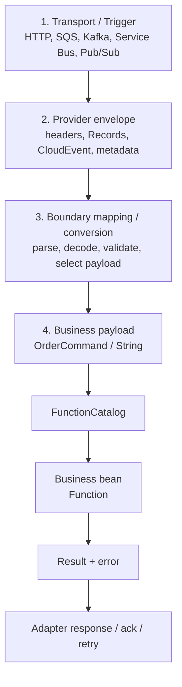
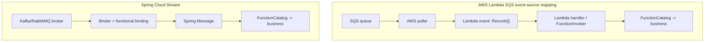
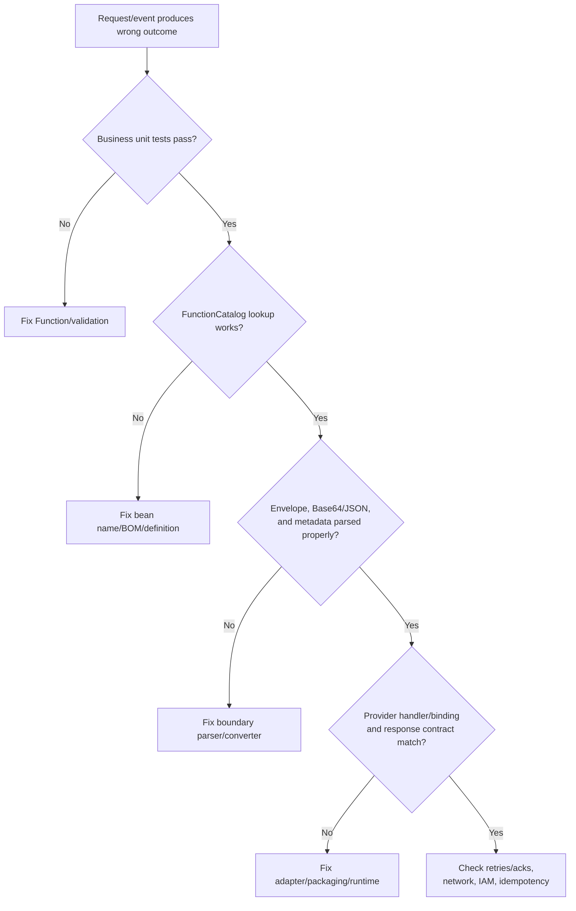

# HTTP Events, Broker Events, and Data Envelopes

> **Chapter:** Serverless  
> **Module:** SPRING_CLOUD_FUNCTION  
> **Focus:** Accurately distinguish HTTP requests, message brokers, event envelopes, and business payloads; route each data shape into `Supplier`, `Function`, and `Consumer` through adapters and `FunctionCatalog`, instead of coupling business logic to transport protocols.  
> **Illustrative baseline:** November 24, 2026. Examples use Java 21, Spring Boot 4.2.0, Spring Cloud BOM 2026.0.0, and Spring Cloud Function 5.1.0. Always verify event schemas against your actual trigger and provider version.

## 1. One Business Capability, Many Input "Shapes"

Consider normalizing an order code: input `"  od-123  "`, output `"OD-123"`. In Java, its essence might be:

```java
Function<String, String> normalizeCode =
        raw -> raw.trim().toUpperCase(Locale.ROOT);
```

Yet that code can arrive from many sources:

1. **Direct HTTP:** a client sends `POST /normalizeCode` with a `text/plain` body.
2. **API Gateway → AWS Lambda:** Lambda receives a JSON *proxy event* containing `headers`, `requestContext`, `body`, and `isBase64Encoded`.
3. **Amazon SQS → AWS Lambda:** Lambda receives JSON wrapping `Records`; each record contains `messageId` and `body`.
4. **Azure Service Bus → Azure Functions:** the worker calls a `@ServiceBusQueueTrigger` method, passing the message body and binding metadata.
5. **Google Pub/Sub → Eventarc/Cloud Run functions:** CloudEvents headers (`id`, `source`, `type`) carry context, while the Pub/Sub message sits inside event `data`; its inner payload may be Base64-encoded.
6. **Kafka/RabbitMQ → Spring Cloud Stream:** the binder consumes messages and feeds the function via bindings/configuration, unlike Lambda receiving raw event JSON.

**From `Function<String,String>`, you cannot assume "the framework automatically finds the code inside every envelope."** Spring Cloud Function provides contracts and conversion, while the event-receiving layer must understand the specific schema to extract the business payload.

### 1.1. Four Data Layers



These four layers are not interchangeable:

- **Transport** is how the message travels and is triggered.
- **Envelope** is the outer wrapper carrying protocol/provider metadata.
- **Business payload** is the data the domain needs for computation.
- **Spring `Message<T>`** is an **in-application** intermediate model holding payload and headers, not a universal cross-provider event format.

### 1.2. Learning Objectives

After this lesson, you will be able to:

- Identify **HTTP method/path/headers/body** and distinguish a proxy event from the raw body.
- Unpack an SQS batch into individual records, distinguishing `messageId`, `receiptHandle`, and partial failure results.
- Read Pub/Sub structures carried over CloudEvents, identifying the Base64 decoding step and nested JSON layers.
- Design a neutral `OrderCommand` and invoke the same `Function` across diverse event types.
- Know when `FunctionCatalog`/`MessageConverter` conversion suffices and when custom mapping is required.
- Explain the differences among HTTP responses, asynchronous event processing, acknowledgements, retries, and idempotency.
- Write layered tests without mistaking unit tests for cloud handler verification.

## 2. Vocabulary to Clarify Before Reading JSON

| Concept | Meaning | Example |
| --- | --- | --- |
| **Request** | A call carrying a method, address, headers, and body. | HTTP `POST /normalize`. |
| **Event** | A record that "something happened" or a trigger notification. | `orders.created`, SQS record. |
| **Envelope** | Outer structure wrapping payload and metadata. | API Gateway proxy JSON, SQS `Records`, CloudEvent. |
| **Payload** | Content processed by the application; sometimes itself JSON needing further parsing. | `"  od-123  "` or `OrderCommand`. |
| **Message attributes/headers** | Metadata attached alongside the payload. | `contentType`, `correlationId`, `traceId`. |
| **Execution context** | Runtime-provided metadata at invocation time. | AWS Lambda `Context`, Azure `ExecutionContext`. |
| **Delivery attempt** | One attempt by the source to deliver a message to the handler. | SQS `ApproximateReceiveCount`. |
| **Business event ID** | Stable identifier for a business event. | `evt-42`; used within proper scope for deduplication. |
| **Invocation/request ID** | Execution identifier assigned by the runtime. | A retry may receive a new request ID. |
| **Correlation ID** | Identifier linking multiple calls/trace spans. | `corr-7`. |
| **Content type** | Describes the format of the corresponding data segment. | `text/plain`, `application/json`. |

In particular, **`Content-Type: application/json` on the outer layer does not mean the inner business payload is JSON**. A CloudEvent over HTTP may have a JSON body describing a Pub/Sub message, yet `message.data` may be Base64-encoded plain text, nested JSON, or raw bytes.

### 2.1. An Event Can Have Multiple "Wrappers"

```text
HTTP request to Eventarc receiver
└── CloudEvent context (ce-id, ce-type, ce-source...)
    └── HTTP body: Pub/Sub MessagePublishedData (JSON)
        └── message
            ├── messageId
            ├── attributes
            └── data: Base64 string
                └── decoded bytes
                    └── OrderCommand or a string code
```

Similarly:

```text
AWS Lambda invocation
└── SQS event object
    └── Records[]            <-- multiple records possible per invocation
        ├── messageId
        ├── receiptHandle
        ├── attributes
        └── body: String
            └── could be JSON text or business text/plain
```

Never call `toString()` on the whole event and feed it into `normalizeCode`. Understand the schema and extract the exact field.

## 3. Direct HTTP: Request Body Is Not a Proxy Event

### 3.1. Calling the Spring Cloud Function Web Adapter

In a Spring Boot Web app with `spring-cloud-starter-function-web` and the bean:

```java
@Bean
public Function<String, String> normalizeCode() {
    return raw -> raw.trim().toUpperCase(Locale.ROOT);
}
```

a client can send:

```http
POST /normalizeCode HTTP/1.1
Host: localhost:8080
Content-Type: text/plain
Accept: text/plain
X-Correlation-Id: corr-7

  od-123  
```

The response typically returns `200 OK` with body `OD-123`. Crucially, the Web adapter knows how to read the **HTTP body** and pass it into the function per its declared type; the lambda never needs `HttpServletRequest`.

Testing with cURL (once the Web server is running):

```bash
curl -i -X POST http://localhost:8080/normalizeCode \
  -H "Content-Type: text/plain" \
  -H "Accept: text/plain" \
  -H "X-Correlation-Id: corr-7" \
  --data-raw "  od-123  "
```

This is **Spring Cloud Function's Web adapter serving direct HTTP**; it is not an example of a Lambda proxy payload. How HTTP headers map into Spring Messaging depends on the adapter and header rules, and does not automatically echo `X-Correlation-Id` back in the response.

### 3.2. Parts of an HTTP Request

| Location | Example value | Meaning |
| --- | --- | --- |
| Method | `POST` | Protocol action. |
| URL/path | `/normalizeCode` | Route mapped by the Web adapter. |
| `Content-Type` | `text/plain` | Format of the request body. |
| `Accept` | `text/plain` | Response format requested by the client. |
| `X-Correlation-Id` | `corr-7` | Application metadata, if trusted and allowed by policy. |
| Body | `"  od-123  "` | Payload processed by `Function<String,String>`. |

Method and URL are transport metadata. The business bean only needs the raw code. User authentication, authorization, and HTTP status mapping belong at the boundary, not inside the normalization algorithm.

### 3.3. If the Body Is JSON

Suppose the bean changes to `Function<OrderCommand,OrderResult>`. An HTTP client sends:

```http
POST /normalizeCommand HTTP/1.1
Host: localhost:8080
Content-Type: application/json
Accept: application/json

{"eventId":"evt-42","code":"  od-123  ","correlationId":"corr-7"}
```

When JSON converters and generic signatures align, the framework can construct `OrderCommand`. However:

- Malformed JSON can fail **before** reaching the bean.
- Valid JSON parsing into a DTO with an empty `code` still requires business validation.
- `eventId` inside the body is sender-supplied business metadata; assess its trustworthiness.
- DTO records/classes must be compatible with the converter in your Spring Boot/Function version.

**Do not assume every JSON payload converts automatically just because the header says `application/json`.** The input type and configured converters decide.

## 4. API Gateway → AWS Lambda: HTTP Wrapped into Another Event

### 4.1. Why Does Lambda Receive JSON Describing an HTTP Request?

When API Gateway HTTP APIs integrate with Lambda as a proxy, the Lambda runtime does not invoke `@Bean` directly with the raw HTTP body. API Gateway builds a **JSON event** describing the HTTP request and passes it to the Lambda handler.

AWS documents two main payload format versions—`1.0` and `2.0`—for Lambda proxy integrations. Pick the exact version on the integration; their schemas are not identical.

### 4.2. Condensed Fixture for HTTP API Payload Format 2.0

```json
{
  "version": "2.0",
  "routeKey": "POST /normalize",
  "rawPath": "/normalize",
  "rawQueryString": "",
  "headers": {
    "content-type": "text/plain",
    "x-event-id": "evt-http-42",
    "x-correlation-id": "corr-7"
  },
  "requestContext": {
    "http": {
      "method": "POST",
      "path": "/normalize"
    }
  },
  "body": "  od-123  ",
  "isBase64Encoded": false
}
```

This is a **condensed fixture** highlighting key fields, not a full real-world API Gateway request JSON. In format 2.0, `version`, `headers`, `rawPath`, `requestContext.http`, `body`, and `isBase64Encoded` play the roles documented by AWS.

The business function needs `"  od-123  "`, **not the JSON string of the entire outer object**.

### 4.3. Decoding `isBase64Encoded`

The proxy event `body` may be plain text or Base64-encoded. The adapter/handler must check:

```java
byte[] bytes = isBase64Encoded
        ? Base64.getDecoder().decode(body)
        : body.getBytes(StandardCharsets.UTF_8);

String rawCode = new String(bytes, StandardCharsets.UTF_8);
```

This illustrative snippet requires importing `java.util.Base64` and `java.nio.charset.StandardCharsets`. It applies only when the **business contract uses UTF-8 text**; if requests upload binary data, handle raw bytes and content type without forcing a String conversion.

Never Base64-decode a second time when `isBase64Encoded=false`, and never assume every text body is JSON.

### 4.4. A Proxy Response Is Not Just a Java String

For proxy format 2.0 responses, Lambda can return a structure such as:

```json
{
  "statusCode": 200,
  "headers": {
    "content-type": "text/plain"
  },
  "body": "OD-123",
  "isBase64Encoded": false
}
```

AWS API Gateway format 2.0 can infer responses in certain cases when Lambda returns JSON without `statusCode`. However, for an explicit API contract covering status codes, headers, cookies, or binary payloads, follow the exact response format rules of your integration.

**Do not assume generic `FunctionInvoker` automatically produces the exact proxy response required by every API Gateway configuration.** When you need full control over request context and HTTP status, use appropriate AWS event/response types or an explicit mapping layer, and test against a real API Gateway integration.

### 4.5. How Format 1.0 and 2.0 Differ

| Detail | HTTP API payload format 1.0 | HTTP API payload format 2.0 |
| --- | --- | --- |
| Request path | `path` and related fields. | `rawPath`. |
| Duplicate headers | Can use `multiValueHeaders`. | Merged into `headers`; no `multiValueHeaders`. |
| Duplicate query params | Can use `multiValueQueryStringParameters`. | Merged into `queryStringParameters`. |
| Cookies | Via headers per 1.0 format. | Dedicated `cookies` field. |
| Response | Structured proxy response required by contract. | Supports inferred responses in certain cases. |

This table covers **HTTP API Lambda proxy integrations**. Do not apply the same schema blindly to **REST APIs**, Lambda Function URLs, or ALBs without checking their specific integration contracts.

AWS documentation: https://docs.aws.amazon.com/apigateway/latest/developerguide/http-api-develop-integrations-lambda.html

## 5. Broker Events: SQS/Kafka Have Different Semantics from HTTP Responses

### 5.1. What Is a Message Broker?

A broker stores and delivers messages between producers and consumers according to its delivery contract. With queues, a message can be redelivered; with logs like Kafka, consumers track offsets/partitions and ordering within scoped boundaries. Unlike synchronous HTTP request/response, messages are typically processed **asynchronously**.

A broker message usually includes:

- **Payload/body:** bytes, String, or serialized DTO.
- **Message key / message ID:** identifiers with broker-specific semantics.
- **Headers/attributes:** content type, correlation ID, schema version, etc.
- **Delivery metadata:** timestamp, offset, partition, receive count, lock token, receipt handle, etc.
- **Delivery/ack contract:** how completion and redelivery are determined.

**There is no universal "broker JSON standard" shared across SQS, Kafka, RabbitMQ, Azure Service Bus, and Pub/Sub.** Brokers may transmit raw bytes or native records; JSON appears when clients/adapters serialize events, not always as a broker-generated envelope.

### 5.2. Two Integration Models to Distinguish



**SQS → Lambda:** the Lambda service polls the queue, builds an event wrapping records, and invokes the handler. **Spring Cloud Stream:** the binder uses application consumer clients/bindings to deliver messages to the function. Both can share the same Java business logic, yet **they do not share the same input contract**.

## 6. Amazon SQS → Lambda: One Invocation Can Carry Multiple Records

### 6.1. Condensed SQS Fixture

```json
{
  "Records": [
    {
      "messageId": "m-1",
      "receiptHandle": "opaque-handle-1",
      "body": " od-123 ",
      "attributes": {
        "ApproximateReceiveCount": "1"
      },
      "messageAttributes": {},
      "eventSource": "aws:sqs",
      "awsRegion": "ap-southeast-1"
    },
    {
      "messageId": "m-2",
      "receiptHandle": "opaque-handle-2",
      "body": " ab-12 ",
      "attributes": {
        "ApproximateReceiveCount": "1"
      },
      "messageAttributes": {},
      "eventSource": "aws:sqs",
      "awsRegion": "ap-southeast-1"
    }
  ]
}
```

This is a **condensed sample**; real event payloads also carry fields like ARNs and broker metadata. The two `body` values here are assumed to be **plain text containing codes**, not JSON domain DTOs. If the producer sent:

```json
{
  "eventId": "evt-42",
  "code": "  od-123  "
}
```

then the SQS record `body` would be a **JSON string** (with escaped quotes inside the outer JSON), needing another parse step to extract `code`.

### 6.2. IDs Inside an SQS Event

| Field | Role | Good as an idempotency key? |
| --- | --- | --- |
| `messageId` | SQS message identifier. | Can serve as a technical key when scope/retention fit; does not replace business operation IDs everywhere. |
| `receiptHandle` | Delivery-specific token used for queue operations. | **No**; changes when a message is redelivered. |
| `ApproximateReceiveCount` | Approximate delivery count for retry diagnostics. | **No**; not an ID. |
| `eventId` in body | Business-producer-assigned identifier. | Usually better if guaranteed unique and stable per operation. |
| `awsRequestId` from Lambda `Context` | Runtime invocation identifier. | **No** for deduplicating business events across invocations. |

A common mistake is using `receiptHandle` or invocation ID for deduplication, causing a redelivered message to generate a different key and run side effects twice.

### 6.3. Batch Semantics

AWS Lambda's SQS event source mapping polls and batches messages; a single invocation can process multiple records. By default, if the function **fails the entire batch**, all messages in the batch may be redelivered after the visibility timeout—including records that succeeded.

To avoid retrying succeeded records when only a subset fails, AWS supports **partial batch responses** when `ReportBatchItemFailures` is enabled on the event source mapping.

Example response when record `m-2` fails:

```json
{
  "batchItemFailures": [
    {
      "itemIdentifier": "m-2"
    }
  ]
}
```

Using AWS SDK for Java types, the Spring Cloud Function AWS adapter can accept provider types:

```java
@Bean
public Function<SQSEvent, SQSBatchResponse> processSqsBatch() {
    // Split records, call shared logic, and return exact failures.
    // Requires aws-lambda-java-events dependency and real implementation.
    return event -> ...;
}
```

This is **signature pseudo-code**, not standalone Java: `SQSEvent`/`SQSBatchResponse` come from the AWS events library and the batch loop must be implemented. Spring Cloud Function AWS docs confirm generic `FunctionInvoker` supports provider-specific event types when partial batch responses are needed.

### 6.4. Special Considerations for FIFO Queues

For SQS FIFO, ordering and message groups matter. When a batch hits a failing record, AWS recommends **halting processing of remaining records in the affected group/sequence and reporting all unprocessed records as failures** rather than continuing arbitrarily as in Standard queues.

The Java demo later in this lesson illustrates **Standard queue semantics** and must not be copied verbatim for FIFO workloads requiring strict ordering.

AWS documentation: https://docs.aws.amazon.com/lambda/latest/dg/with-sqs.html

## 7. Kafka/RabbitMQ via Spring Cloud Stream: Messages and Bindings

### 7.1. Binders Feed Data into `FunctionCatalog`

Spring Cloud Stream attaches functional beans to broker destinations. Example bean:

```java
@Bean
public Function<OrderCommand, OrderResult> normalizeCommand() {
    return command -> /* ... */;
}
```

With the Kafka binder (compatible dependencies/versions), configuration might look like:

```properties
spring.cloud.function.definition=normalizeCommand
spring.cloud.stream.bindings.normalizeCommand-in-0.destination=raw-orders
spring.cloud.stream.bindings.normalizeCommand-out-0.destination=normalized-orders
spring.cloud.stream.bindings.normalizeCommand-in-0.content-type=application/json
spring.cloud.stream.kafka.binder.brokers=localhost:9092
```

This is a **configuration sketch**; running it requires `spring-cloud-starter-stream-kafka`, a Kafka broker, serializers/consumers, consumer-group policies, security, and retries. It does not imply SQS `Records` will appear on input.

### 7.2. A Kafka Record Differs from SQS `Records[]`

A Kafka record has a topic, partition, offset, timestamp, key, value, and headers. The Stream binder manages polling and maps payload/metadata into a Spring `Message<?>`. That differs from a Lambda handler receiving a single SQS `{"Records":[...]}` object.

A Kafka `offset` is not a business event ID. While topic/partition/offset can help deduplicate reprocessed records in narrow scopes, **business idempotency** typically needs an operation-level key.

### 7.3. Header Mapping and Native Serialization

Spring Cloud Stream provides settings such as:

- `content-type` on the binding.
- `headerMode` to use native headers or embedded headers when supported by middleware.
- `useNativeEncoding`/decoding to delegate serialization/deserialization to the broker client.

Do not assume every Kafka or RabbitMQ header matches HTTP headers or CloudEvent attributes automatically. For non-Spring producers, agree explicitly on **wire contracts**, schema versions, charsets, and header names.

### 7.4. A `Consumer` Returns No HTTP Response

`Consumer<OrderCommand>` defines `void accept(...)`, which has no HTTP 200 equivalent. The broker/binder governs acknowledgement, offset commit, and retries per configuration. Business logic must still ensure idempotency when events are redelivered.

Spring Cloud Stream reference: https://docs.spring.io/spring-cloud-stream/reference/

## 8. Azure Functions: HTTP Triggers and Service Bus Triggers

### 8.1. Azure HTTP Triggers

Azure Java Functions use `@FunctionName`, `@HttpTrigger`, and types like `HttpRequestMessage<Optional<String>>` to declare HTTP handlers. The Spring Cloud Function Azure adapter can inject Spring beans or `FunctionCatalog` into handlers.

Logical flow:

```text
HTTP request
  -> Azure HTTP trigger / annotated Java handler
  -> extract body + headers + authenticate
  -> FunctionCatalog.lookup("normalizeCommand")
  -> normalizeCommand.apply(OrderCommand)
  -> Azure HttpResponseMessage
```

Depending on the contract, the handler must set explicit HTTP status codes and bodies. Declaring `@Bean` does not create an Azure HTTP trigger automatically; the plugin/worker still relies on annotations and bindings.

### 8.2. Service Bus Queue/Topic Triggers

Azure Service Bus carries message bodies and metadata such as message ID, delivery count, enqueue time, and correlation/application properties. In Java Azure Functions, `@ServiceBusQueueTrigger` or `@ServiceBusTopicTrigger` binds a handler to a queue or subscription.

Pseudo-handler illustrating the boundary only:

```java
@FunctionName("normalizeQueue")
public void onMessage(
        @ServiceBusQueueTrigger(
                name = "message",
                queueName = "raw-orders",
                connection = "ServiceBusConnection")
        String messageBody,
        ExecutionContext context) {

    // Parse messageBody per producer schema,
    // construct OrderCommand, and invoke business bean.
    // Completion/retry policies belong to Azure Service Bus trigger.
}
```

This requires the Azure Java SDK/annotations, build plugin, and app settings; it is **not a standalone runnable Azure project**. `messageBody` is the binding input, not a full HTTP request or CloudEvent.

### 8.3. Message Settlement and Dead-Lettering

With Service Bus, **PeekLock**, delivery count, auto-completion, and dead-lettering depend on the trigger extension/runtime and host configuration. When a handler fails, the message may be abandoned and redelivered; settling a message is not the same as returning a successful Java string.

Azure HTTP 200 and Service Bus message completion are **two distinct completion contracts**. Test each trigger with batches, retries, poison messages, and lock timeouts.

Azure documentation: https://learn.microsoft.com/en-us/azure/azure-functions/functions-bindings-service-bus-trigger

## 9. Google Pub/Sub and CloudEvents: HTTP Transport Can Carry an Event

### 9.1. Eventarc Uses CloudEvents

Google Eventarc can deliver events to Cloud Run functions/services as **CloudEvents 1.0 over HTTP POST**. This is an easy trap: **the outer transport is HTTP**, yet **the semantic payload is a broker event**, not a normal synchronous API call.

In CloudEvents HTTP binding, headers include:

```http
ce-specversion: 1.0
ce-id: 10042
ce-source: //pubsub.googleapis.com/projects/demo/topics/orders
ce-type: google.cloud.pubsub.topic.v1.messagePublished
content-type: application/json
```

The `ce-*` headers are **event context**, not the order code.

### 9.2. Pub/Sub Message Inside a CloudEvent

Illustrative HTTP body for an Eventarc Pub/Sub message:

```json
{
  "message": {
    "messageId": "m-pub-1",
    "data": "b2QtMTIz",
    "attributes": {
      "contentType": "text/plain",
      "correlationId": "corr-7"
    },
    "publishTime": "2026-11-24T08:30:00Z"
  },
  "subscription": "projects/demo/subscriptions/orders-sub"
}
```

Here, `b2QtMTIz` is Base64 for `od-123`. Decode it to bytes, then interpret the bytes per producer schema/charset:

```java
byte[] decoded = Base64.getDecoder().decode("b2QtMTIz");
String code = new String(decoded, StandardCharsets.UTF_8);
System.out.println(code); // od-123
```

**Never call `normalizeCode.apply("b2QtMTIz")`**—that is a Base64 string, not the order code. And **never conclude that outer HTTP `content-type: application/json` means `message.data` is JSON too**. The outer JSON describes the message; the inner data has its own format.

### 9.3. CloudEvents Structured Mode vs. Binary HTTP Binding

CloudEvents can encode context in two common modes:

- **Binary mode:** `ce-id`, `ce-type`, etc. reside in HTTP headers; the body holds event data.
- **Structured mode:** a single JSON object contains `specversion`, `id`, `source`, `type`, and `data`.

Example structured representation:

```json
{
  "specversion": "1.0",
  "id": "10042",
  "source": "//pubsub.googleapis.com/projects/demo/topics/orders",
  "type": "google.cloud.pubsub.topic.v1.messagePublished",
  "datacontenttype": "application/json",
  "data": {
    "message": {
      "messageId": "m-pub-1",
      "data": "b2QtMTIz"
    }
  }
}
```

This is a **conceptually valid CloudEvent representation**, not a claim that Eventarc always delivers this exact structured JSON object to Java handlers. Eventarc's documented HTTP binding places `ce-*` in HTTP headers; intermediaries may convert between modes for downstream consumers. Verify the exact trigger and framework contract.

### 9.4. GCP Adapter/Launcher and Business Beans

Spring Cloud Function's GCP adapter provides `org.springframework.cloud.function.adapter.gcp.GcfJarLauncher` for supported deployment types. Functions Framework for Java also offers dedicated interfaces for HTTP and CloudEvents.

Do not conflate:

- GCP **entrypoint**.
- CloudEvent **event schema**.
- Spring Cloud Function **bean name**.
- `OrderCommand` **business schema**.

A Java `Function<OrderCommand,OrderResult>` will not automatically understand a Pub/Sub message envelope without mapping `message.data` into `OrderCommand`.

Google source: https://docs.cloud.google.com/eventarc/docs/cloudevents

## 10. Designing a Neutral Application Envelope

### 10.1. Do You Need a Universal Envelope?

An organization may standardize an internal schema:

```json
{
  "eventId": "evt-42",
  "eventType": "orders.normalize.requested",
  "source": "order-api",
  "schemaVersion": 1,
  "occurredAt": "2026-11-24T08:30:00Z",
  "correlationId": "corr-7",
  "contentType": "text/plain",
  "payload": "  od-123  "
}
```

**This is an illustrative internal schema, not an AWS/Azure/GCP standard.** It helps internal services share a contract, yet when passing through API Gateway, SQS, or Pub/Sub, a **provider envelope still wraps the outside**, or a dedicated converter is needed.

### 10.2. "Outside → Inside" Boundary

One clean separation of responsibilities:

| Layer | Example | Owner |
| --- | --- | --- |
| Provider envelope | `Records`, `requestContext`, `ce-id` | Provider / binder. |
| Boundary DTO | `HttpEnvelope`, `SqsRecord`, `PubSubEnvelope` | Application adapter. |
| Canonical command | `OrderCommand(eventId,code,correlationId)` | Business contract. |
| Domain result | `OrderResult(eventId,normalizedCode,correlationId)` | Business logic. |
| Provider response | HTTP proxy status/body, SQS failures, event completion | Boundary / adapter / runtime. |

**Only `OrderCommand` and `OrderResult` truly need to stay uniform across providers.** Boundary envelope classes can differ and should stay out of the domain model unless genuinely required.

### 10.3. Choosing Event IDs and Schema Versions

- **`eventId`:** should remain stable across retries and unique within its source; combine with `source` or a business operation ID if uniqueness across sources is needed.
- **`schemaVersion`:** payload version agreed upon by producer and consumer—not necessarily API Gateway version 2.0 or CloudEvents specversion 1.0.
- **`correlationId`:** used for tracing; not necessarily unique per event.
- **`occurredAt`:** timestamp when the producer emitted the event, not when the consumer processed it.

Using a provider field as a deduplication key can work, provided you account for key retention windows, uniqueness scope, and the difference between a retry and a new business event carrying identical payload values.

## 11. Message Conversion in Spring Cloud Function

### 11.1. `FunctionCatalog` Does Not Replace an Event Parser

Spring Cloud Function discovers `Supplier`, `Function`, and `Consumer` beans and exposes `FunctionCatalog.lookup(...)`. The catalog can return wrappers handling composition and conversion per the function signature.

For example:

```java
Function<OrderCommand, OrderResult> fn =
        catalog.lookup("normalizeCommand");
OrderResult result = fn.apply(
        new OrderCommand("evt-42", "  od-123  ", "corr-7"));
```

If you pass an `SQSEvent` object directly to a function expecting `OrderCommand` without mapping, conversion has no reason to know `Records[0].body` holds the command. That is a **structural schema transformation**, not a simple `byte[]` to `String` conversion.

### 11.2. `Message<T>` Consists of Payload and Headers

Spring Messaging provides `Message<T>` and `MessageHeaders`:

```java
Message<OrderCommand> message = MessageBuilder
        .withPayload(new OrderCommand(
                "evt-42", "  od-123  ", "corr-7"))
        .setHeader(MessageHeaders.CONTENT_TYPE, "application/json")
        .setHeader("correlationId", "corr-7")
        .build();
```

This snippet requires importing `org.springframework.messaging.Message`, `MessageHeaders`, and `MessageBuilder`; `OrderCommand` is the business record from the full code listing below.

**Spring Message headers do not automatically equal all provider headers.** The adapter decides which fields map, their types, and whether sensitive metadata is filtered.

### 11.3. `MessageConverter` and `ConversionService`

Per Spring Cloud Function documentation:

1. When receiving a **Spring Message** with a raw payload, `MessageConverter` converts it to the target type declared by `Function<T,R>`.
2. When receiving a **non-Message input**, Spring may use `ConversionService`.
3. The `contentType` header guides converter selection. If absent, message conversion often defaults to `application/json`.
4. Converters can turn JSON `byte[]`/Strings into POJOs when JSON libraries, schemas, and target types align.

However, **content type is a hint, not infinite schema magic**. Without a matching converter or valid input structure, invocation fails.

### 11.4. Each Layer Has Its Own Content Type

```text
HTTP API Gateway:
  request Content-Type: text/plain
  event.body: String (Base64-decoded if flag is true)
  business type: String

GCP Eventarc:
  outer Content-Type: application/json
  CloudEvent data: PubSub MessagePublishedData JSON
  PubSub message.data: Base64 bytes
  business type: String or OrderCommand per inner byte schema

Kafka + Stream:
  native serializer/deserializer or binding content-type
  Spring Message payload/headers supplied by binder
  business type: OrderCommand
```

A common debugging trap is editing `@Bean Function<String,String>` when the incoming input is still an unparsed Base64 string or outer JSON envelope.

### 11.5. Never Deserialize Arbitrary Client-Supplied Class Names

In particular, if using `Content-Type: application/json;type=...` for dynamic class selection, Spring Cloud Function enforces a **deserialization allowlist** (`META-INF/deserializable.types`). Never let untrusted event sources dictate arbitrary class loading. For domains with stable schemas, prefer explicit generic signatures and concrete DTOs.

## 12. Hands-On Project: One Bean, Three Simulated Boundary Adapters

The goal here is not to deploy to three clouds simultaneously. We will build a project that **runs and passes tests in Spring Boot** without a cloud account, making each mapping step explicit:

- HTTP proxy-style input → `OrderCommand`.
- SQS-like batch input → multiple `OrderCommand` instances.
- Pub/Sub-like message → Base64 decode → `OrderCommand`.
- All feeding a single `Function<OrderCommand,OrderResult> normalizeCommand` bean.

**The envelope classes below are minimal simulations**, not provider SDK types. Consequently, they do not become AWS Lambda/Azure/GCP handlers on their own. When deploying, replace these mappings with real event types/bindings and test on target runtimes.

### 12.1. Maven `pom.xml`

```xml
<?xml version="1.0" encoding="UTF-8"?>
<project xmlns="http://maven.apache.org/POM/4.0.0"
         xmlns:xsi="http://www.w3.org/2001/XMLSchema-instance"
         xsi:schemaLocation="http://maven.apache.org/POM/4.0.0
           https://maven.apache.org/xsd/maven-4.0.0.xsd">

    <modelVersion>4.0.0</modelVersion>

    <parent>
        <groupId>org.springframework.boot</groupId>
        <artifactId>spring-boot-starter-parent</artifactId>
        <version>4.2.0</version>
        <relativePath/>
    </parent>

    <groupId>vn.example</groupId>
    <artifactId>event-envelope-demo</artifactId>
    <version>0.0.1-SNAPSHOT</version>

    <properties>
        <java.version>21</java.version>
        <spring-cloud.version>2026.0.0</spring-cloud.version>
    </properties>

    <dependencyManagement>
        <dependencies>
            <dependency>
                <groupId>org.springframework.cloud</groupId>
                <artifactId>spring-cloud-dependencies</artifactId>
                <version>${spring-cloud.version}</version>
                <type>pom</type>
                <scope>import</scope>
            </dependency>
        </dependencies>
    </dependencyManagement>

    <dependencies>
        <dependency>
            <groupId>org.springframework.boot</groupId>
            <artifactId>spring-boot-starter</artifactId>
        </dependency>
        <dependency>
            <groupId>org.springframework.cloud</groupId>
            <artifactId>spring-cloud-function-context</artifactId>
        </dependency>
        <dependency>
            <groupId>org.springframework.boot</groupId>
            <artifactId>spring-boot-starter-test</artifactId>
            <scope>test</scope>
        </dependency>
    </dependencies>

    <build>
        <plugins>
            <plugin>
                <groupId>org.springframework.boot</groupId>
                <artifactId>spring-boot-maven-plugin</artifactId>
            </plugin>
        </plugins>
    </build>
</project>
```

`spring-cloud-dependencies` manages Spring Cloud module versions; `spring-cloud-function-context` supplies the catalog and bean integration. The example omits Web starters or cloud adapters because it **only tests business logic and simulated boundary mapping**.

### 12.2. File Layout

```text
event-envelope-demo/
├── pom.xml
└── src/
    ├── main/
    │   ├── java/
    │   │   └── vn/example/envelope/
    │   │       ├── EventEnvelopeApplication.java
    │   │       └── EnvelopeBoundary.java
    │   └── resources/
    │       └── application.properties
    └── test/
        └── java/
            └── vn/example/envelope/
                └── EnvelopeBoundaryTest.java
```

Create `src/main/resources/application.properties`:

```properties
spring.application.name=event-envelope-demo
spring.main.web-application-type=none
spring.cloud.function.definition=normalizeCommand
```

`web-application-type=none` ensures the app **does not open an HTTP port**. HTTP requests in this example are represented by records and boundary tests; to hit it with real cURL requests later, add a Web adapter/handler.

### 12.3. Business Bean with Record DTOs

Create `src/main/java/vn/example/envelope/EventEnvelopeApplication.java`:

```java
package vn.example.envelope;

import java.util.Locale;
import java.util.function.Function;

import org.springframework.boot.SpringApplication;
import org.springframework.boot.autoconfigure.SpringBootApplication;
import org.springframework.context.annotation.Bean;

@SpringBootApplication
public class EventEnvelopeApplication {

    public static void main(String[] args) {
        SpringApplication.run(EventEnvelopeApplication.class, args);
    }

    public record OrderCommand(
            String eventId,
            String code,
            String correlationId) {}

    public record OrderResult(
            String eventId,
            String normalizedCode,
            String correlationId) {}

    @Bean
    public Function<OrderCommand, OrderResult> normalizeCommand() {
        return command -> {
            if (command == null || command.eventId() == null ||
                    command.eventId().isBlank()) {
                throw new IllegalArgumentException(
                        "Missing event ID");
            }
            if (command.code() == null ||
                    command.code().isBlank()) {
                throw new IllegalArgumentException(
                        "Order code must not be empty");
            }

            String code = command.code()
                    .trim()
                    .toUpperCase(Locale.ROOT);

            if (!code.matches("[A-Z]{2}-[0-9]{3}")) {
                throw new IllegalArgumentException(
                        "Order code does not match AA-999");
            }

            return new OrderResult(
                    command.eventId(),
                    code,
                    command.correlationId());
        };
    }
}
```

This bean **imports zero AWS/Azure/GCP SDKs**, parses no HTTP JSON, knows nothing about receipt handles, and performs no Base64 decoding. It only understands `OrderCommand`.

## 13. Boundary Code: HTTP, SQS Batch, and Pub/Sub

Create `src/main/java/vn/example/envelope/EnvelopeBoundary.java`:

```java
package vn.example.envelope;

import java.nio.charset.StandardCharsets;
import java.util.ArrayList;
import java.util.Base64;
import java.util.List;
import java.util.Locale;
import java.util.Map;
import java.util.function.Function;

import org.springframework.cloud.function.context.FunctionCatalog;
import org.springframework.stereotype.Component;

import vn.example.envelope.EventEnvelopeApplication.OrderCommand;
import vn.example.envelope.EventEnvelopeApplication.OrderResult;

@Component
public class EnvelopeBoundary {

    // Records simulating boundary contracts, not SDK types.
    public record HttpEnvelope(
            String method,
            String path,
            Map<String, String> headers,
            String body,
            boolean base64Encoded) {}

    public record HttpReply(
            int statusCode,
            Map<String, String> headers,
            String body) {}

    public record SqsRecord(
            String messageId,
            String body,
            Map<String, String> attributes) {}

    public record SqsEnvelope(List<SqsRecord> records) {}

    public record BatchItemFailure(String itemIdentifier) {}

    public record SqsBatchReply(
            List<BatchItemFailure> batchItemFailures) {}

    public record PubSubEnvelope(
            String eventId,
            String messageId,
            String dataBase64,
            Map<String, String> attributes) {}

    private final Function<OrderCommand, OrderResult> normalize;

    public EnvelopeBoundary(FunctionCatalog catalog) {
        this.normalize = catalog.lookup("normalizeCommand");
        if (this.normalize == null) {
            throw new IllegalStateException(
                    "normalizeCommand not found");
        }
    }

    // HTTP proxy boundary, not a @RestController endpoint.
    public HttpReply handleHttp(HttpEnvelope request) {
        if (request == null) {
            return http(400, "Missing request");
        }
        if (!"/normalize".equals(request.path())) {
            return http(404, "Unknown path");
        }
        if (!"POST".equalsIgnoreCase(request.method())) {
            return http(405, "Method not allowed");
        }

        try {
            String contentType =
                    header(request.headers(), "content-type");
            if (contentType == null ||
                    !contentType.toLowerCase(Locale.ROOT)
                        .startsWith("text/plain")) {
                return http(415, "Unsupported content type");
            }

            String id = header(request.headers(), "x-event-id");
            if (id == null || id.isBlank()) {
                return http(400, "Missing event id");
            }

            String code = decodeUtf8(
                    request.body(), request.base64Encoded());

            OrderResult result = normalize.apply(
                    new OrderCommand(
                        id,
                        code,
                        header(request.headers(),
                               "x-correlation-id")));

            return http(200, result.normalizedCode());
        } catch (IllegalArgumentException exception) {
            // Never expose raw body or stack traces in HTTP responses.
            return http(400, "Invalid input");
        }
    }

    // Illustrates SQS Standard queue and raw text bodies only.
    public SqsBatchReply handleSqs(SqsEnvelope event) {
        if (event == null || event.records() == null) {
            throw new IllegalArgumentException(
                    "Missing SQS Records");
        }

        List<BatchItemFailure> failed = new ArrayList<>();

        for (SqsRecord record : event.records()) {
            if (record == null ||
                    record.messageId() == null ||
                    record.messageId().isBlank()) {
                // Without a valid messageId, an accurate partial
                // failure response cannot be constructed.
                throw new IllegalArgumentException(
                        "SQS record missing messageId");
            }

            try {
                String correlation = record.attributes() == null
                        ? null
                        : record.attributes().get("correlationId");

                normalize.apply(new OrderCommand(
                        record.messageId(),
                        record.body(),
                        correlation));
            } catch (RuntimeException exception) {
                // Batch response: provider retries this record
                // IF event source mapping enables the feature.
                failed.add(new BatchItemFailure(
                        record.messageId()));
            }
        }

        return new SqsBatchReply(List.copyOf(failed));
    }

    // Simulates a GCP Pub/Sub message wrapped in a CloudEvent.
    public OrderResult handlePubSub(PubSubEnvelope event) {
        if (event == null ||
                event.eventId() == null ||
                event.eventId().isBlank() ||
                event.messageId() == null ||
                event.messageId().isBlank()) {
            throw new IllegalArgumentException(
                    "Missing CloudEvent/PubSub ID");
        }

        String code = decodeUtf8(
                event.dataBase64(), true);

        String correlation = event.attributes() == null
                ? null
                : event.attributes().get("correlationId");

        return normalize.apply(new OrderCommand(
                event.eventId(), code, correlation));
    }

    private static HttpReply http(int status, String body) {
        return new HttpReply(
                status,
                Map.of(
                    "content-type", "text/plain; charset=utf-8",
                    "cache-control", "no-store"),
                body);
    }

    private static String header(
            Map<String, String> headers,
            String wantedName) {

        if (headers == null) {
            return null;
        }
        for (Map.Entry<String, String> entry
                : headers.entrySet()) {
            if (wantedName.equalsIgnoreCase(
                    entry.getKey())) {
                return entry.getValue();
            }
        }
        return null;
    }

    private static String decodeUtf8(
            String body, boolean base64Encoded) {

        if (body == null) {
            throw new IllegalArgumentException(
                    "Missing body/data");
        }

        byte[] bytes = base64Encoded
                ? Base64.getDecoder().decode(body)
                : body.getBytes(StandardCharsets.UTF_8);

        return new String(bytes, StandardCharsets.UTF_8);
    }
}
```

### 13.1. Flow of the Three Inputs

| Method | External data | Boundary step | Business input |
| --- | --- | --- | --- |
| `handleHttp` | Method/path/headers/body/flag | Validate method/path/content type, decode if needed, read event ID | `OrderCommand` |
| `handleSqs` | List of records | Process each record; map per-record failures to `batchItemFailures` | One `OrderCommand` per record |
| `handlePubSub` | CloudEvent ID, Pub/Sub message ID, Base64 data | Verify metadata, decode Base64 | `OrderCommand` |

In a real project:

- The HTTP handler must translate `HttpReply` into the response format expected by API Gateway, Azure, or GCP.
- The SQS handler must return the AWS SDK's `SQSBatchResponse` **and enable `ReportBatchItemFailures`** on the event source mapping, not just return the simulated `SqsBatchReply`.
- The GCP handler must parse a **real CloudEvent** to extract `message.data` and attributes; `PubSubEnvelope` here represents the already-extracted data.
- Catching `RuntimeException` in SQS is pedagogical: classify errors, log safely, emit metrics, and configure DLQs so poison messages do not retry endlessly.
- For **FIFO**, halt after a failure and report unprocessed records in the group to preserve ordering.
- If the body holds JSON rather than a plain string, parse against a strict schema with size limits and field validation before calling the bean.

### 13.2. Why Still Go Through the Catalog?

`EnvelopeBoundary` only knows the name `normalizeCommand` and the `OrderCommand -> OrderResult` contract; it never needs a `@RestController`, Azure handler, or AWS handler inside the domain bean. `FunctionCatalog` lets you:

- Look up functions by name.
- Leverage Spring Cloud Function wrappers and converters.
- Compose functions later if types align.

This separation lets you swap out all provider mappings without altering code-validation rules.

### 13.3. Intentional Limitations of the Demo

To keep tests runnable with just the JDK and Spring context, the demo omits a JSON deserializer and provider SDKs. Never copy `HttpEnvelope`, `SqsEnvelope`, or `PubSubEnvelope` as real AWS/Azure/GCP handler signatures. Their job is to **pinpoint exactly where envelopes are unwrapped and where business logic is invoked**.

## 14. JUnit Tests: One Bean, Multiple Input Shapes

Create `src/test/java/vn/example/envelope/EnvelopeBoundaryTest.java`:

```java
package vn.example.envelope;

import static org.junit.jupiter.api.Assertions.assertEquals;
import static org.junit.jupiter.api.Assertions.assertNotNull;
import static org.junit.jupiter.api.Assertions.assertThrows;

import java.nio.charset.StandardCharsets;
import java.util.Base64;
import java.util.List;
import java.util.Map;
import java.util.function.Function;

import org.junit.jupiter.api.Test;
import org.springframework.beans.factory.annotation.Autowired;
import org.springframework.boot.test.context.SpringBootTest;
import org.springframework.cloud.function.context.FunctionCatalog;

import vn.example.envelope.EventEnvelopeApplication.OrderCommand;
import vn.example.envelope.EventEnvelopeApplication.OrderResult;

@SpringBootTest
class EnvelopeBoundaryTest {

    @Autowired
    FunctionCatalog catalog;

    @Autowired
    EnvelopeBoundary boundary;

    @Test
    void businessFunctionIsInCatalog() {
        Function<OrderCommand, OrderResult> fn =
                catalog.lookup("normalizeCommand");

        assertNotNull(fn);

        OrderResult result = fn.apply(
                new OrderCommand(
                        "evt-42", "  od-123  ", "corr-7"));

        assertEquals("OD-123", result.normalizedCode());
        assertEquals("evt-42", result.eventId());
    }

    @Test
    void httpPlainTextMapsIntoSameFunction() {
        var request = new EnvelopeBoundary.HttpEnvelope(
                "POST", "/normalize",
                Map.of(
                    "Content-Type", "text/plain",
                    "X-Event-Id", "evt-h-1",
                    "X-Correlation-Id", "corr-7"),
                "  od-123  ",
                false);

        var reply = boundary.handleHttp(request);

        assertEquals(200, reply.statusCode());
        assertEquals("OD-123", reply.body());
    }

    @Test
    void httpBase64IsDecodedOnce() {
        String encoded = Base64.getEncoder()
                .encodeToString(
                    "  od-123  ".getBytes(
                        StandardCharsets.UTF_8));

        var reply = boundary.handleHttp(
                new EnvelopeBoundary.HttpEnvelope(
                    "POST", "/normalize",
                    Map.of(
                        "Content-Type", "text/plain",
                        "X-Event-Id", "evt-h-2"),
                    encoded, true));

        assertEquals("OD-123", reply.body());
    }

    @Test
    void httpRejectsUnsupportedMediaType() {
        var reply = boundary.handleHttp(
                new EnvelopeBoundary.HttpEnvelope(
                    "POST", "/normalize",
                    Map.of(
                        "Content-Type", "application/octet-stream",
                        "X-Event-Id", "evt-h-3"),
                    "od-123", false));

        assertEquals(415, reply.statusCode());
    }

    @Test
    void sqsBatchReportsOnlyFailedRecord() {
        var event = new EnvelopeBoundary.SqsEnvelope(
                List.of(
                    new EnvelopeBoundary.SqsRecord(
                        "m-1", "  od-123  ", Map.of()),
                    new EnvelopeBoundary.SqsRecord(
                        "m-2", "  ab-12  ", Map.of())));

        var reply = boundary.handleSqs(event);

        assertEquals(
                List.of(
                    new EnvelopeBoundary.BatchItemFailure("m-2")),
                reply.batchItemFailures());
    }

    @Test
    void pubSubBase64IsDecodedAndMapped() {
        String encoded = Base64.getEncoder()
                .encodeToString(
                    "  od-123  ".getBytes(
                        StandardCharsets.UTF_8));

        var event = new EnvelopeBoundary.PubSubEnvelope(
                "ce-42", "pub-m-42", encoded,
                Map.of("correlationId", "corr-7"));

        OrderResult result = boundary.handlePubSub(event);

        assertEquals("OD-123", result.normalizedCode());
        assertEquals("ce-42", result.eventId());
        assertEquals("corr-7", result.correlationId());
    }

    @Test
    void invalidPubSubDataIsRejected() {
        var event = new EnvelopeBoundary.PubSubEnvelope(
                "ce-43", "pub-m-43", "not*base64", Map.of());

        assertThrows(IllegalArgumentException.class,
                () -> boundary.handlePubSub(event));
    }
}
```

Run with Maven:

```bash
mvn clean test
```

If the repository includes Maven Wrapper, run `./mvnw clean test` (Windows: `./mvnw.cmd clean test`). This test suite opens no HTTP ports and connects to no SQS/PubSub services; it verifies **the Spring context, catalog, and mapping logic in the JVM**.

### 14.1. Interpreting Evidence Appropriately

| Test | Proves | Does not prove |
| --- | --- | --- |
| Catalog lookup | Bean is registered in Spring and handles DTOs properly. | Cloud handler/trigger executed. |
| HTTP boundary | Simulated body/header/flag map correctly. | Real API Gateway sends valid format 2.0 payloads. |
| SQS batch boundary | Failed records collect into simulated `batchItemFailures`. | Event source mapping has partial batch responses enabled. |
| Pub/Sub boundary | Base64 decodes and calls domain logic. | Eventarc CloudEvents parse properly at runtime. |
| Invalid media type/data | Selected input errors are classified. | Provider retries/DLQs are configured properly. |

**Do not claim tests passed on a machine simply because the test code is written.** Actual execution results must be verified when building the project on the proper toolchain.

## 15. When Deploying, Replace Simulations with Real Adapters

### 15.1. Spring Cloud Function Web Running as an HTTP Server

To expose direct HTTP endpoints, add:

```xml
<dependency>
    <groupId>org.springframework.cloud</groupId>
    <artifactId>spring-cloud-starter-function-web</artifactId>
</dependency>
```

and remove `spring.main.web-application-type=none`. You can `POST /normalizeCommand` with JSON matching the `OrderCommand` record; the Web adapter/converter parses the body per signature and environment. Note that `EnvelopeBoundary.handleHttp` is **not** registered at `/normalize`: it is merely a Spring component method.

To expose `/normalize` matching an API Gateway schema, add explicit Web mapping/controller/gateway config or deploy a real cloud handler.

### 15.2. AWS Lambda

Add `spring-cloud-function-adapter-aws`, use `FunctionInvoker`, and package in the layout required by the AWS adapter. There are two approaches:

- **Direct invocation / JSON DTO:** the function accepts data matching `OrderCommand` (after conversion).
- **SQS batch:** an integration function accepts `SQSEvent`, iterates records, calls `normalizeCommand`, returns `SQSBatchResponse`, and enables `ReportBatchItemFailures` as needed.

A single-DTO function will **not automatically** handle arbitrary `SQSEvent` payloads. Verify raw event types and map them explicitly.

Documentation: https://docs.spring.io/spring-cloud-function/reference/adapters/aws-intro.html

### 15.3. Azure Functions

Add `spring-cloud-function-adapter-azure`, Azure Java annotations, the Azure Functions build plugin, and annotated handlers matching HTTP, Service Bus, or queue triggers. The handler reads input, builds `OrderCommand`, and invokes the catalog; the plugin generates bindings and packages for the Azure worker.

If you use the Azure Web adapter, that model targets Web apps—**it does not automatically turn Service Bus events into HTTP requests**.

Documentation: https://docs.spring.io/spring-cloud-function/reference/adapters/azure-intro.html

### 15.4. GCP Cloud Run Functions

Add `spring-cloud-function-adapter-gcp` with the `GcfJarLauncher` entrypoint/packaging per docs, or pick a dedicated Functions Framework CloudEvents handler when processing provider-specific CloudEvents. Pub/Sub inputs must be parsed per message schema before decoding data.

**Runtime generation note:** different Cloud Functions generations and Cloud Run functions carry different contracts and configurations; follow the documentation for your target trigger. Never assume parsing code from a Functions Framework CloudEvents handler shares the exact same bootstrap as the Spring Cloud Function GCP adapter without an integration layer.

Documentation: https://docs.spring.io/spring-cloud-function/reference/adapters/gcp-intro.html

## 16. Are HTTP Success, Broker Ack, and Function Return Value Identical?

The answer is **no**.

| Scenario | External completion signal | How `Function.apply` output is used |
| --- | --- | --- |
| Synchronous HTTP | HTTP status + headers + body. | Adapter serializes output and picks status/error. |
| Lambda direct invocation | Result or error per Lambda invocation contract. | Adapter maps output to corresponding response. |
| Lambda SQS | Batch marked succeeded or list of failed records. | Domain result alone is insufficient; must return batch response per contract for per-record handling. |
| Azure Service Bus trigger | Message settlement/lock/retry per trigger. | Bean may return void or value, yet ack is not an HTTP response. |
| Kafka + Spring Cloud Stream | Offset/ack/retry per binder/consumer config. | Output may publish to outbound binding; commit is separate from Java return value. |
| Pub/Sub / Eventarc | Delivery success/retry per trigger and HTTP event receiver. | Java response must map per framework; there is no single universal JSON response for all events. |

**A `Consumer<T>` returning `void` does not mean the message was processed exactly once.** Every event source can suffer timeouts, network failures, process crashes, or retries after a side effect has already committed.

### 16.1. Why Is Idempotency Needed?

Suppose a consumer deducts inventory and writes to the DB successfully, then the handler times out before the runtime acknowledges the message. The source redelivers the event, and without duplicate protection the consumer deducts inventory a second time.

A minimal safe design:

1. Choose an **idempotency key** from a stable business operation ID or event ID (combined with source if needed).
2. Store processed keys in durable storage with a unique constraint or conditional insert.
3. Couple key persistence with the side effect via a transaction or equivalent mechanism.
4. Separate permanent from transient errors; configure retries, backoff, and DLQs.
5. Monitor duplicates, poison messages, and partial batch failures.

Never rely on in-memory Java singletons as your only processed-state store: serverless instances can be destroyed or scaled out concurrently.

### 16.2. HTTP 400 Has No Exact Equivalent in a Queue

In HTTP, a missing or invalid body can return 400. In SQS, there is no "HTTP 400 returned to a waiting producer"; bad records generally require quarantine, a DLQ, or business-rule handling. Simply failing repeatedly forces the source to retry data that will never fix itself.

**The same domain error may be surfaced differently across transports.** Keep validation rules in the domain while letting adapters choose appropriate error/ack policies.

## 17. Securing Data Inside Envelopes

### 17.1. Do Not Trust Every Header and Metadata Field

- Client-supplied `X-Correlation-Id`, custom operations, or `schemaVersion` can be forged without authentication.
- Broker message attributes are producer-controlled; verify producer identity, ACLs, and permissions.
- CloudEvents `source` and `type` are trustworthy only when requests arrive over an authenticated, validated channel.
- `isBase64Encoded` describes encoding, **not proof that the payload is safe**.
- `contentType` is a conversion hint, not proof of valid JSON schema or authorization.
- Routing directly by client-supplied bean names can expose internal functions you never meant to publish.

### 17.2. Enforce Data Limits and Avoid Logging Sensitive Content

At the boundary, validate:

| Check | Why |
| --- | --- |
| Body/event/batch size | Limits DoS, parsing cost, and timeouts. |
| Valid encoding/charset and Base64 | Prevents decoding corruption and garbled text. |
| Schema version and required fields | Rejects incompatible payloads early. |
| Max record count and deadlines | Prevents single invocations from overloading. |
| Authentication/authorization | Blocks unauthorized callers from triggering business logic. |
| Header allowlist | Prevents leaking secrets, tokens, or sensitive provider metadata into outputs. |
| Log/redaction policy | Avoids logging raw payloads, credentials, `receiptHandle`, or unnecessary PII. |
| Deserializer allowlist | Prevents untrusted class names or SpEL from loading arbitrary code. |

### 17.3. Logging to Trace the Same Message End to End

Useful logs/traces include:

- Business event ID and source/trigger type.
- Permitted delivery metadata (SQS message ID, Kafka partition/offset, Pub/Sub message ID).
- Correlation ID or trace ID.
- Selected function definition.
- Outcome: success, validation failure, conversion error, retry/DLQ.
- Processing duration and retry count when available.

**Never equate invocation ID with event ID.** A redelivered business event can span multiple invocations.

## 18. Diagnosing Failures Layer by Layer

| Symptom | Possible cause | Check first |
| --- | --- | --- |
| HTTP returns JSON envelope instead of `OD-123` | Whole API Gateway proxy event passed to String function. | Extract `body`, decode flag, and content type. |
| Garbled HTTP characters or JSON parse failure | Wrong encoding/`isBase64Encoded` flag or content type. | Compare raw bytes, charset, and converter. |
| API Gateway errors even though Java unit tests pass | Wrong proxy response format, status, or headers. | Test format 1.0 vs. 2.0 integration. |
| Valid SQS record gets reprocessed | Another record in batch failed without partial batch responses. | Event source mapping and `batchItemFailures` response. |
| SQS delivers JSON body but code treats JSON as raw String | Forgot to parse `record.body` into command. | Test individual record bodies after parsing. |
| SQS FIFO loses ordering | Continued processing after a failure within a message group. | FIFO partial batch handling and ordering policy. |
| Kafka function receives `byte[]` instead of DTO | Serializer/content-type binding mismatch. | Native decoding, headers, and type conversion. |
| Azure Service Bus trigger retries excessively | Poison message or misconfigured lock/retry/settlement. | Delivery count and DLQ/host settings. |
| GCP Pub/Sub outputs `b2QtMTIz` | Forgot to Base64-decode `message.data`. | CloudEvent schema and byte decoding. |
| `FunctionCatalog.lookup` returns `null` | Wrong bean name, missing context, or version mismatch. | `@Bean`, BOM, `spring-cloud-function-context`. |
| Domain tests pass but cloud fails to invoke | Wrong entry handler, trigger, or packaging. | Lambda handler, Azure bindings, GCP launcher. |
| Duplicate rows in DB | Event redelivery/retry with unstable deduplication key. | Business event ID, idempotency, and persistence. |
| Correlation ID dropped or leaked | Adapter-specific header mapping or blind header copying. | Allowlist policy, `MessageHeaders`, and logs. |
| Wrong function invoked via external metadata | External header allowed to pick arbitrary beans. | `MessageRoutingCallback`, authorization, and allowlist. |

### 18.1. Short Debugging Workflow



This sequence keeps you from modifying business beans when the root cause sits in envelope parsing or the provider runtime.

## 19. Exercises and Self-Check Questions

### Exercise 1 — Unwrap an HTTP API Gateway Event

Using the `version=2.0` fixture in section 4:

1. Identify the actual HTTP method and URL path.
2. Point out the body that should reach `normalizeCode`.
3. Explain why `isBase64Encoded` must be inspected.
4. Write a `200` proxy response carrying body `OD-123`.
5. If the body is an escaped JSON string, describe the parse/deserialization step.

**Guided answer:** `requestContext.http.method=POST`, `rawPath=/normalize`, business body `"  od-123  "`; respond per the API Gateway 2.0 contract. Never pass the entire outer event into the String function.

### Exercise 2 — SQS Batches and Partial Failures

Given two records: `m-1` contains `od-123`, and `m-2` contains `ab-12`.

1. Which record passes or fails regex `AA-999`?
2. What is the correct partial batch response?
3. Why must `ReportBatchItemFailures` be enabled?
4. If disabled, why might `m-1` be retried?
5. On a FIFO queue, how must the policy change to protect ordering?

**Guided answer:** `m-1` succeeds, `m-2` is invalid. The response is `{"batchItemFailures":[{"itemIdentifier":"m-2"}]}` when enabled; for FIFO, report unprocessed records according to ordering rules.

### Exercise 3 — Pub/Sub CloudEvent

Given `message.data="b2QtMTIz"`:

1. Distinguish `ce-id`, `messageId`, and `correlationId`.
2. What String does Base64 decoding yield?
3. Why does outer `Content-Type: application/json` not prove the inner message is JSON?
4. If the business payload is a JSON DTO, at which step should it be parsed?
5. List at least two tests covering malformed Base64 and missing `message.data`.

**Guided answer:** decodes to `od-123`, normalizes to `OD-123`; separate HTTP/CloudEvent, Pub/Sub message, and domain payload layers.

### Exercise 4 — Multiple Protocols, One Bean

Using the Maven/JUnit setup from sections 12–14, add tests verifying:

- HTTP missing `X-Event-Id` returns 400.
- HTTP wrong method returns 405.
- SQS with only valid records returns an empty failures list.
- Pub/Sub Base64 for `"  zz-999  "` yields `ZZ-999`.
- `FunctionCatalog.lookup("normalizeCommand")` still works without any cloud adapter.

Explain the scope of what these tests prove and which steps remain before deploying to AWS/Azure/GCP.

### Exercise 5 — Designing a Versioned Schema

A producer emits:

```json
{
  "eventId": "evt-101",
  "eventType": "orders.normalize.requested",
  "schemaVersion": 2,
  "payload": {
    "orderCode": "od-123",
    "tenantId": "tenant-1"
  }
}
```

Design a mapping layer supporting `schemaVersion=1` and `schemaVersion=2` into the same `OrderCommand`. For unknown versions, reject or quarantine per policy—**never** guess field names or silently fall back to an older version.

### Exercise 6 — Operational Design

A DB-writing `Consumer<OrderCommand>` receives events from a queue with possible retries. Describe:

- Which idempotency key is most reliable?
- When is the "processed" marker recorded?
- How should poison messages be handled differently from database timeouts?
- How do you guarantee logs contain no raw bodies or secret headers?
- How do you monitor duplicates, retries, DLQs, and batch latency?

### Self-Check Checklist

| Question | Key answer |
| --- | --- |
| Is an HTTP request always the raw business payload? | No; through API Gateway, Lambda may receive a proxy event wrapping the request. |
| Are SQS `Records` and Kafka records identical? | No; providers and binders define distinct contracts. |
| Does `contentType` automatically extract `Records[0].body`? | No; converters do not guess domain envelope mappings. |
| Is CloudEvent `ce-id` the same as Pub/Sub `messageId`? | They are identifiers at two different layers; they may correlate but must not be assumed identical everywhere. |
| Is Base64 encryption or encoding? | Encoding; it provides neither authentication nor confidentiality. |
| Does a successful function return guarantee exactly-once broker ack? | No; check triggers, retries, transactions, and idempotency. |
| Can one bean be reused across HTTP, brokers, and serverless? | Yes, provided adapters map data contracts properly and deployment environments are configured correctly. |

## 20. Summary and References

**Key takeaway:** transport is one layer, the provider envelope is the second, and the business payload is the third; `FunctionCatalog` and Java beans sit behind the conversion boundary. **The same business `Function` can be invoked via HTTP, an event broker, or serverless runtimes**, yet each source requires precise handling of schemas, headers, encoding, responses, retries, and idempotency.

- For direct HTTP, the Web adapter can pass the body straight to the function; for API Gateway proxy integrations, Lambda typically receives an **HTTP request wrapped in a JSON event**.
- For SQS, a single invocation may carry multiple records; partial failures require the exact AWS response contract and mapping feature.
- For Kafka/Service Bus, brokers, binders, and triggers govern message delivery under their own semantics; there is no universal `Records` schema across all brokers.
- For Pub/Sub via Eventarc, CloudEvents context and `message.data` are separate layers; Base64 must be decoded properly and payload schemas clearly defined.
- `MessageConverter` and `ConversionService` assist type conversion by signature and content type, but **do not replace provider envelope parsers**.
- Safe operations demand validation, authorization, idempotency, retries/DLQs, observability, and contract tests on the real runtime.

**Official sources:**

1. Spring Cloud Function — Programming Model, FunctionCatalog, message conversion: https://docs.spring.io/spring-cloud-function/reference/spring-cloud-function/programming-model.html
2. Spring Cloud Function — Web adapter, HTTP mappings: https://docs.spring.io/spring-cloud-function/reference/spring-cloud-function/standalone-web-applications.html
3. Spring Cloud Function — AWS adapter, FunctionInvoker, and SQS event types: https://docs.spring.io/spring-cloud-function/reference/adapters/aws-intro.html
4. Spring Cloud Function — Azure adapter and handlers: https://docs.spring.io/spring-cloud-function/reference/adapters/azure-intro.html
5. Spring Cloud Function — GCP adapter/launcher: https://docs.spring.io/spring-cloud-function/reference/adapters/gcp-intro.html
6. Spring Cloud Stream — Reference, binders, and functional messages: https://docs.spring.io/spring-cloud-stream/reference/
7. AWS API Gateway — HTTP API Lambda proxy payload format 1.0/2.0: https://docs.aws.amazon.com/apigateway/latest/developerguide/http-api-develop-integrations-lambda.html
8. AWS Lambda — SQS invocation, batches, and retries: https://docs.aws.amazon.com/lambda/latest/dg/with-sqs.html
9. AWS Lambda — Partial batch responses with SQS: https://docs.aws.amazon.com/lambda/latest/dg/services-sqs-errorhandling.html
10. Azure Functions — Service Bus trigger, metadata, and settlement: https://learn.microsoft.com/en-us/azure/azure-functions/functions-bindings-service-bus-trigger
11. Google Eventarc — CloudEvents HTTP format: https://docs.cloud.google.com/eventarc/docs/cloudevents
12. Google Eventarc — CloudEvents JSON event format: https://docs.cloud.google.com/eventarc/docs/cloudevents-json
13. Google Cloud Run functions — Pub/Sub CloudEvent Java sample: https://docs.cloud.google.com/functions/docs/samples/functions-cloudevent-pubsub
14. Spring Cloud — Release train compatibility matrix: https://spring.io/projects/spring-cloud/
