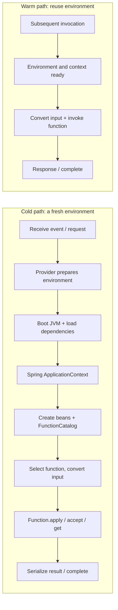
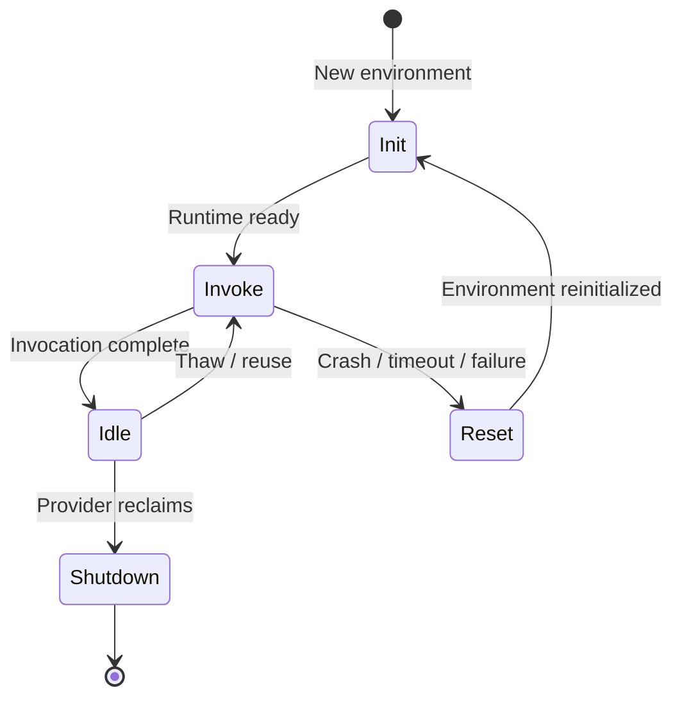

# Cold Starts and Execution Environment Reuse

> **Chapter:** Serverless  
> **Module:** SPRING_CLOUD_FUNCTION  
> **Focus:** Understand cold starts, warm invocations, and execution environment lifecycles when deploying `Supplier`, `Function`, and `Consumer` beans with Spring Cloud Function; safely leverage reuse of `ApplicationContext`, `FunctionCatalog`, and clients without relying on single-instance in-memory state.  
> **Illustrative version baseline:** November 24, 2026 — Java 21, Spring Boot 4.2.0, Spring Cloud BOM 2026.0.0, Spring Cloud Function 5.1.0. Runtime choices, hosting plans, concurrency settings, and cold-start optimizations must be verified with your provider at deployment time.

## 1. Why Does the Same Function Show Different Latencies?

Suppose you have the bean:

```java
@Bean
public Function<String, String> normalizeCode() {
    return raw -> raw.trim().toUpperCase(Locale.ROOT);
}
```

With the exact same input `"  od-123  "`, two invocations may return `"OD-123"` yet exhibit **different latencies to the caller**. When the serverless platform has no ready execution instance, the provider must provision the runtime, load Java classes, boot the Spring context, and locate the function before business logic runs.

On an already-warmed instance, many of those steps **do not have to run again** on the next invocation. This difference underlies the core concepts:

- **Cold start:** an execution environment must be created/initialized before handling the call; that extra time adds to observed latency.
- **Warm invocation:** the provider reuses a previously initialized environment without re-bootstrapping the full Spring context under normal conditions.
- **Scale-out cold start:** rising traffic forces the provider to spin up additional new environments even while existing ones are active.
- **Instance lifecycle:** environments can be frozen/idled, terminated, or replaced after errors or new deployments; reuse is never a guarantee of permanent state retention.

### 1.1. Timeline Diagram Across Both Paths



This diagram illustrates **the concept**, without guaranteeing strict ordering across every adapter/provider. AWS, for instance, explicitly separates `Init` and `Invoke` phases; other platforms feature prewarming, snapshot restoration, or distinct concurrency models.

### 1.2. Learning Objectives

After this lesson, you will be able to:

1. Distinguish startup of the **provider runtime**, **JVM**, **Spring Boot context**, **FunctionCatalog**, and execution of the **functional bean**.
2. Explain the **AWS Lambda Init–Invoke–Shutdown** lifecycle and why environments can be reused or reset.
3. Compare cold-start mitigations across AWS, Azure Functions, and Google Cloud Run functions.
4. Build a Spring Cloud Function project with stateless beans, an invocation observation probe, and `FunctionCatalog` tests.
5. Classify what **should be cached/reused** versus what **must never be stored** in singletons/static fields or `/tmp`.
6. Design clients and pools that stay safe across freezes, reuse, concurrent requests, or snapshot restores.
7. Measure cold/warm latency accurately using p50/p95/p99, memory, cost, and concurrency rather than a single cURL test.
8. Assemble a pre-deployment checklist covering testing, security, retries, and idempotency.

## 2. How Execution Environments Differ from Spring `ApplicationContext`

### 2.1. The Provider Owns the Execution Environment

An **execution environment** is the space provisioned by the cloud provider for the function runtime. Depending on the platform, it includes a process/container, memory, CPU, ephemeral filesystem, networking, and configuration parameters (timeout, identity, memory, concurrency).

The provider decides when to create, idle, freeze, thaw, or terminate an environment. Applications **must never assume** every invocation lands on the same instance.

### 2.2. Spring Owns the `ApplicationContext`

Inside the Java runtime, Spring Boot constructs an `ApplicationContext`. The context discovers `@Bean`/`@Component` definitions, wires dependencies, applies auto-configuration, and registers functional beans into `FunctionCatalog`.

`FunctionCatalog` can:

- Look up `Supplier<T>`, `Function<T,R>`, and `Consumer<T>` beans by name.
- Compose pipelines like `normalizeCode|validateCode`.
- Apply wrappers supporting type and message conversion when adapters supply compatible data.

**A single JVM execution environment can host a reusable Spring context**; however, never equate "one cloud function resource = one JVM = one single context for life." During scale-out, many environments exist simultaneously, each holding its own context and singleton beans.

### 2.3. What Does `@Bean` Singleton Exactly Mean?

A Spring singleton bean has **one instance per Spring `ApplicationContext`**, not a global singleton across a distributed cluster.

For example:

```text
AWS Lambda resource "normalize-order"
├── Environment A
│   └── Spring context A
│       └── bean Client A + FunctionCatalog A
├── Environment B
│   └── Spring context B
│       └── bean Client B + FunctionCatalog B
└── Environment C
    └── Spring context C
        └── bean Client C + FunctionCatalog C
```

If all three instances receive events, each can hold distinct caches and counters. Data inside singletons is **never** automatically synchronized across A, B, and C.

### 2.4. When Is the Function Invoked?

When Spring creates the bean:

```java
@Bean
public Function<String, String> normalizeCode() {
    return raw -> raw.trim().toUpperCase(Locale.ROOT);
}
```

calling `normalizeCode()` creates and returns the lambda while building the context. **The lambda does not execute business logic** just because the bean was instantiated. Calling `apply(raw)` happens only when the adapter or Java caller invokes the function.

We can therefore separate:

| Phase | Typical work | Runs on every invocation? |
| --- | --- | --- |
| Provider environment startup | Provision environment, fetch artifact, prepare runtime. | No, when an environment is reused. |
| JVM/class loading | Load classes, initialize static members. | Not repeated within the same classloader under normal conditions. |
| Spring startup | Initialize context, `@Bean`, `FunctionCatalog`. | Not repeated when the same context is reused. |
| Adapter function resolution | Lookup/compose function, prepare wrappers. | Depends on adapter and caching implementation. |
| Business invocation | `apply`, `accept`, or `get`. | Yes, per triggered call. |
| Serialization/response | Convert payload, return result/error. | Yes, per invocation/record. |

**Avoid claiming adapters always re-run `lookup(...)` on every event**; handlers may cache the function wrapper after startup.

## 3. What Are the Time Components of a Cold Start?

A conceptual breakdown for analysis:

\[
T_{\text{observed}} \approx T_{\text{platform/setup}} +
T_{\text{JVM}} + T_{\text{Spring init}} + T_{\text{adapter/convert}} +
T_{\text{business}} + T_{\text{response/network}}
\]

This formula is a **conceptual model**: not every term is always measured separately, and not every step executes strictly sequentially. Warm invocations usually skip paying the full `platform/JVM/Spring init` cost again while still paying network, conversion, and business-logic costs.

### 3.1. Factors That Increase Startup Latency

- Large JARs or container images with many dependencies and classes to load.
- Excessive Spring auto-configurations, unused beans, and overly broad component scanning.
- Slow client or connection-pool creation inside constructors or `@Bean` methods.
- Startup network calls (fetching remote config, database migrations, secret managers) hitting timeouts.
- Including Web MVC, Spring Cloud Stream binders, and multiple provider adapters when a deployment only needs one.
- JVM runtime, memory/CPU allocation, and scale-out behavior.
- Differences among on-demand cold initialization, prewarmed instances, and snapshot restores.

**Do not assume** a larger JAR always yields worse p99: artifact download, CPU speed, classloading, and init-time work all matter. Measure on real artifacts and runtimes.

### 3.2. When Do Cold Starts Occur?

| Scenario | Can a new environment initialize? | Explanation |
| --- | --- | --- |
| First invocation after deploy | Yes | No initialized environment exists yet. |
| Low-traffic app scaled to zero | Yes | Provider may reclaim idle instances. |
| Sudden traffic spike | Yes | Extra capacity needed beyond running instances. |
| Version/alias/revision update | Yes | New instances load updated code/config. |
| Crash, timeout, out-of-memory | Yes | Provider may reset and reinitialize runtime. |
| Next invocation to a live instance | Usually no | Context can already be reused. |
| Prewarmed/provisioned environment | Initializes prior to calls | Initialization cost moves off the request critical path. |
| SnapStart restore | Restores snapshot rather than classic cold init | Still incurs restore time and state-safety caveats. |

**Never guess exact idle durations** to conclude "after N minutes it is definitely cold." Providers retain idle instances for varying windows based on load and policy.

## 4. AWS Lambda: Init, Invoke, Freeze, Reset, and Shutdown

### 4.1. Official Phases

AWS Lambda documents a typical execution environment lifecycle:



- **Init:** AWS starts extensions, bootstraps the runtime, and runs function initialization (static initializers and Spring bootstrap).
- **Invoke:** the runtime calls the handler for an event.
- **Freeze/idle:** Lambda may freeze the environment after an invocation, preserving resources for reuse.
- **Shutdown:** runtime/extensions shut down per lifecycle; never rely on shutdown hooks to guarantee data persistence.
- **Reset/suppressed init:** after certain Invoke failures, Lambda resets the runtime; a subsequent initialization may appear "suppressed" in Invoke logs. `/tmp` may survive a reset, whereas the Java heap/context does not persist as in a warm invocation.

For Spring Cloud Function, the typical handler is:

```text
org.springframework.cloud.function.adapter.aws.FunctionInvoker::handleRequest
```

`FunctionInvoker` is the AWS entrypoint; Spring beans like `normalizeCode` sit behind `FunctionCatalog`.

### 4.2. INIT and INVOKE Do Not Map One-to-One to Java Methods

With an adapter-provided handler:

1. Lambda provisions an execution environment.
2. The Java runtime loads the handler and boots the Spring application context via the adapter.
3. The context builds beans, `FunctionCatalog`, and wrappers.
4. The handler receives the event, converts the payload, and calls `Function.apply(...)`.
5. AWS may freeze the environment.
6. The next invocation may reuse steps 2–3.

However, **adapters also support late-initialization modes** and settings that shift part of startup into the first invocation. Therefore, never assume "the init log timestamp strictly equals bean-creation time" for precise accounting; inspect telemetry and logs directly.

### 4.3. AWS `Init Duration` and `REPORT`

CloudWatch Logs emit entries like:

```text
START RequestId: ... Version: ...
END RequestId: ...
REPORT RequestId: ... Duration: ... ms Billed Duration: ... ms
       Memory Size: ... MB Max Memory Used: ... MB
       Init Duration: ... ms
```

Meaning:

- `Duration` reflects the AWS-reported invocation execution time.
- `Init Duration` (when present) reports AWS-measured initialization time.
- Init reporting differs across SnapStart, provisioned concurrency, and resets.
- During a **suppressed init**, initialization work can fall inside invocation duration without a separate `START`/`END` init phase.

**Do not calculate cold-start overhead by subtracting two single cURL timings.** Use CloudWatch metrics/logs, Telemetry API / X-Ray as appropriate, and enough samples.

### 4.4. Reuse on AWS Offers No Future Guarantees

AWS encourages placing reusable SDK clients and connections **outside the handler**. While an environment survives, those objects remain reusable. Yet:

- The provider may spin up a different environment for the next request.
- Idle network connections may close; clients/pools need health checks, keep-alive, and reconnection.
- In-flight background tasks may be frozen; never rely on them finishing after returning a response.
- `/tmp` is only environment-local scratch space, not a durable database.
- After errors, the Java runtime may reset rather than warm-reuse.

### 4.5. Lambda Concurrency and Spring Singletons

In standard Lambda Java execution environments, one environment processes one invocation at a time, and rising load creates additional independent environments. Still:

- Never design entire Java libraries around that single assumption, since code may spawn worker threads, use async clients, or run on Cloud Run/Azure with multi-request concurrency.
- **Spring singletons are never shared across environments.**
- Reading data or mutating state in one instance does not make it visible in another.

Official documentation: https://docs.aws.amazon.com/lambda/latest/dg/lambda-runtime-environment.html

## 5. Azure Functions: Cold Starts Depend on the Hosting Plan

Azure Functions does not use identical `Init`/`Invoke` labels in every scenario. The Azure host and Java worker scale and activate according to the **hosting plan**, triggers, and scale controller.

### 5.1. When an App Scales to Zero

When a Function App sits idle on a scale-to-zero plan, Azure can scale instances down to zero. The next event or request provisions a new instance/host/worker, requiring the Spring adapter and context to initialize again. This creates cold-start latency, particularly noticeable on synchronous HTTP triggers.

### 5.2. Options to Reduce Cold Starts

| Azure hosting model | Relevant mechanism | When to consider |
| --- | --- | --- |
| **Flex Consumption** | `Always ready instances` per supported function group. | When minimizing cold starts while keeping serverless scaling. |
| **Premium** | Prewarmed / always-ready instances. | When predictable latency, VNET integration, and richer resources/features are needed. |
| **Traditional Consumption** | No Flex/Premium always-ready mechanism. | Acceptable when workloads tolerate cold starts. |
| **Dedicated / App Service plan** | `Always On`. | When continuous infrastructure already exists and pure serverless isn't required. |

Plan and feature names can evolve. **Never claim enabling always-ready guarantees 100% warm requests:** scale-out, recycles, rollouts, and host failures can still spin up fresh instances.

### 5.3. Java DI and Client Reuse

Azure Java Functions integrate dependency injection; the Spring Cloud Function Azure adapter lets handlers inject `FunctionCatalog` and beans. A singleton bean or client initialized in the context can be reused within **that worker/context**, not globally across the entire Azure Function App.

Microsoft recommends **not creating new SDK clients on every invocation**; register shared clients via DI or lifecycle-managed helpers. This cuts latency and socket exhaustion, provided clients are thread-safe when handlers run concurrently.

Documentation:
- https://learn.microsoft.com/en-us/azure/azure-functions/event-driven-scaling
- https://learn.microsoft.com/en-us/azure/azure-functions/manage-connections

## 6. Google Cloud Run Functions: Instance Reuse and Concurrency

Google Cloud Run functions rely on Cloud Run / Functions Framework instance provisioning and autoscaling according to generation and trigger. When no warm instance is free, a request or event waits for a new instance to boot.

### 6.1. Min Instances Do Not Imply Durable State

Cloud Run supports **minimum instances** to keep environments warm and reduce scale-to-zero cold starts. However:

- Instances can still be replaced or restarted despite min instances being configured.
- When load exceeds warm capacity, the autoscaler spins up additional cold instances.
- Balance the cost of idle min instances against latency sensitivity.
- Never store orders, sessions, or transaction state solely in one instance's RAM.

### 6.2. Concurrency Is a Major Difference

On modern Cloud Run functions, a single instance can handle **multiple concurrent requests** when configured concurrency allows it. This cuts both ways:

- **Benefit:** warm instances absorb more traffic without spawning as many cold environments.
- **Risk:** singleton beans, caches, connection pools, and mutable fields must be **thread-safe**; one request must never leak payloads into another.

Do not blindly apply Lambda's "one request per instance at a time" assumption to Cloud Run functions. Check explicit concurrency, CPU, and instance settings.

### 6.3. Initialization at Global/Context Scope

Google recommends caching network clients and libraries at instance-wide scope while **avoiding background tasks continuing after a response returns** for critical business work. In Spring, a `@Bean` managing a client corresponds directly to this global-initialization pattern.

Documentation:
- https://docs.cloud.google.com/run/docs/tips/functions-best-practices
- https://docs.cloud.google.com/run/docs/configuring/min-instances

## 7. What Should Be Reused vs. Created per Invocation?

### 7.1. Classification Table

| Resource | Reuse within the same environment? | Notes |
| --- | --- | --- |
| `FunctionCatalog` and function wrappers | **Yes** | Tied to Spring context; adapters may cache lookups. |
| Immutable business rules/configuration | **Yes** | Update through controlled deploy/config lifecycles. |
| Thread-safe AWS/Azure/GCP SDK clients | **Generally yes** | Reconnect/recreate if connections go stale. |
| Thread-safe Java `HttpClient` / connection pools | **Yes** | Configure timeouts, pool limits, TLS, and credential refresh. |
| Configured, thread-safe JSON mapper | **Yes** | Never mutate configuration during concurrent requests. |
| Immutable regex `Pattern` | **Yes** | Avoids recompiling identical patterns repeatedly. |
| Low-churn static reference data | **Yes, with TTL/version** | Use cache invalidation; never assume endless freshness. |
| Non-sensitive `/tmp` cache files | **Conditionally** | Instance-ephemeral; verify existence, version, and size. |
| Event payloads, user data, secret tokens in static fields | **No** | Risk of cross-invocation data leakage. |
| Transactions/DB sessions, request context, MDC | **Never leave behind** | Create and clean up strictly per invocation scope. |
| Invocation ID, remaining time, deadline | **No** | Every invocation gets fresh runtime context. |
| In-memory counters for business decisions | **No** | Unsynchronized across instances and volatile. |
| Durable idempotency / order state | **Never RAM-only** | Use a database or atomic durable store. |

### 7.2. Stateless Business Functions

A well-designed bean looks like:

```java
@Bean
public Function<String, String> normalizeCode() {
    return raw -> raw.trim().toUpperCase(Locale.ROOT);
}
```

Each call's output depends solely on its input; invocations across any number of instances yield identical results. Side effects such as DB writes belong in use-cases with clear transactions and idempotency.

### 7.3. Anti-Pattern Example: Singleton Storing Last Input

```java
// DO NOT use in production:
@Bean
public Function<String, String> unsafeEcho() {
    return new Function<>() {
        private String lastUserInput;

        @Override
        public String apply(String input) {
            lastUserInput = input;
            return lastUserInput;
        }
    };
}
```

Here, `lastUserInput` persists across calls on the same instance, creating race conditions under concurrency and retaining sensitive user data unnecessarily. Passing a local single-threaded run **does not prove** thread or data safety in the cloud.

### 7.4. Reuse Is Not Infinite Caching

Tokens, schemas, feature flags, certificates, network sockets, and DNS entries can expire or rotate while the Spring context stays alive. Clients/pools need refresh, timeout, and retry logic; cached data needs TTLs or versioning. Never treat "singleton" as a promise that internal data never goes stale.

## 8. Hands-On Project: Observing the Same Spring Context Across Calls

We will build an application containing:

- A pure business `Function<String,String> normalizeCode` bean.
- A `Function<String,ProbeResult> normalizeWithProbe` bean to **observe** environment reuse.
- A `Supplier<String> runtimeState` bean returning probe diagnostics for debugging.
- A `RuntimeProbe` bean holding **diagnostic-only markers and counters** within the same Spring context.

This demo runs JUnit tests against `FunctionCatalog` and, with the Maven Web profile enabled, accepts cURL calls. **Markers and counters are learning aids, not production-grade cloud instance identifiers.**

### 8.1. Directory Structure

```text
scf-cold-start-demo/
├── pom.xml
└── src/
    ├── main/
    │   ├── java/vn/example/coldstart/
    │   │   └── ColdStartApplication.java
    │   └── resources/
    │       └── application.properties
    └── test/
        └── java/vn/example/coldstart/
            └── ColdStartApplicationTest.java
```

### 8.2. Complete Maven POM

```xml
<?xml version="1.0" encoding="UTF-8"?>
<project xmlns="http://maven.apache.org/POM/4.0.0"
         xmlns:xsi="http://www.w3.org/2001/XMLSchema-instance"
         xsi:schemaLocation="http://maven.apache.org/POM/4.0.0
           https://maven.apache.org/xsd/maven-4.0.0.xsd">
    <modelVersion>4.0.0</modelVersion>

    <parent>
        <groupId>org.springframework.boot</groupId>
        <artifactId>spring-boot-starter-parent</artifactId>
        <version>4.2.0</version>
        <relativePath/>
    </parent>

    <groupId>vn.example</groupId>
    <artifactId>scf-cold-start-demo</artifactId>
    <version>0.0.1-SNAPSHOT</version>

    <properties>
        <java.version>21</java.version>
        <spring-cloud.version>2026.0.0</spring-cloud.version>
    </properties>

    <dependencyManagement>
        <dependencies>
            <dependency>
                <groupId>org.springframework.cloud</groupId>
                <artifactId>spring-cloud-dependencies</artifactId>
                <version>${spring-cloud.version}</version>
                <type>pom</type>
                <scope>import</scope>
            </dependency>
        </dependencies>
    </dependencyManagement>

    <dependencies>
        <dependency>
            <groupId>org.springframework.boot</groupId>
            <artifactId>spring-boot-starter</artifactId>
        </dependency>

        <dependency>
            <groupId>org.springframework.cloud</groupId>
            <artifactId>spring-cloud-function-context</artifactId>
        </dependency>

        <dependency>
            <groupId>org.springframework.boot</groupId>
            <artifactId>spring-boot-starter-test</artifactId>
            <scope>test</scope>
        </dependency>
    </dependencies>

    <!-- Web adapter is added only when running local HTTP examples. -->
    <profiles>
        <profile>
            <id>local-web</id>
            <dependencies>
                <dependency>
                    <groupId>org.springframework.cloud</groupId>
                    <artifactId>spring-cloud-starter-function-web</artifactId>
                </dependency>
            </dependencies>
        </profile>
    </profiles>

    <build>
        <plugins>
            <plugin>
                <groupId>org.springframework.boot</groupId>
                <artifactId>spring-boot-maven-plugin</artifactId>
            </plugin>
        </plugins>
    </build>
</project>
```

**Why use a Maven profile?** `spring-cloud-function-context` suffices for catalog tests and function runtimes. `spring-cloud-starter-function-web` adds the Web adapter and HTTP server for local observation. An AWS Lambda processing SQS **does not need an embedded Spring MVC server**, so do not accidentally bake the Web starter into every artifact just for cURL tests.

`spring-cloud-dependencies` is a version-management BOM, not a runtime dependency. For cloud deployments, add **provider-specific adapters and packaging profiles** (AWS/Azure/GCP) and verify classpaths and entrypoints.

### 8.3. Configuration File

`src/main/resources/application.properties`:

```properties
spring.application.name=scf-cold-start-demo
server.port=8080
logging.level.vn.example.coldstart=INFO
```

Leave `spring.cloud.function.definition` unset when testing the Web adapter so `normalizeCode`, `normalizeWithProbe`, and `runtimeState` remain accessible by name. When deploying a real cloud function resource, set the exact definition, e.g.:

```properties
spring.cloud.function.definition=normalizeCode
```

The property selects the function/pipeline, but **does not control** when the provider spins up new environments.

## 9. Java Code: Measuring Reuse Within One Context

Create `src/main/java/vn/example/coldstart/ColdStartApplication.java`:

```java
package vn.example.coldstart;

import java.time.Instant;
import java.util.Locale;
import java.util.UUID;
import java.util.concurrent.atomic.AtomicLong;
import java.util.function.Function;
import java.util.function.Supplier;

import org.slf4j.Logger;
import org.slf4j.LoggerFactory;
import org.springframework.boot.SpringApplication;
import org.springframework.boot.autoconfigure.SpringBootApplication;
import org.springframework.boot.context.event.ApplicationReadyEvent;
import org.springframework.context.annotation.Bean;
import org.springframework.context.event.EventListener;

@SpringBootApplication
public class ColdStartApplication {

    private static final Logger log =
            LoggerFactory.getLogger(ColdStartApplication.class);

    public static void main(String[] args) {
        SpringApplication.run(ColdStartApplication.class, args);
    }

    public record ProbeResult(
            String normalizedCode,
            String environmentMarker,
            long invocationIndex,
            long contextAgeMillis) {}

    // Strictly for demonstration and local telemetry.
    public static final class RuntimeProbe {

        private final String marker = UUID.randomUUID().toString();
        private final Instant createdAt = Instant.now();
        private final long createdAtNanos = System.nanoTime();
        private final AtomicLong calls = new AtomicLong();

        public String marker() {
            return marker;
        }

        public long nextInvocation() {
            return calls.incrementAndGet();
        }

        public long currentCount() {
            return calls.get();
        }

        public long ageMillis() {
            return (System.nanoTime() - createdAtNanos)
                    / 1_000_000;
        }

        public String summary() {
            return "marker=" + marker
                    + ", createdAt=" + createdAt
                    + ", calls=" + calls.get();
        }
    }

    @Bean
    public RuntimeProbe runtimeProbe() {
        return new RuntimeProbe();
    }

    @Bean
    public Function<String, String> normalizeCode() {
        return ColdStartApplication::normalize;
    }

    @Bean
    public Function<String, ProbeResult> normalizeWithProbe(
            RuntimeProbe probe) {

        return raw -> {
            String normalized = normalize(raw);
            long index = probe.nextInvocation();

            log.info("Function executed; context marker={}, index={}",
                    probe.marker(), index);

            return new ProbeResult(
                    normalized,
                    probe.marker(),
                    index,
                    probe.ageMillis());
        };
    }

    @Bean
    public Supplier<String> runtimeState(RuntimeProbe probe) {
        return probe::summary;
    }

    @EventListener(ApplicationReadyEvent.class)
    public void onReady() {
        log.info("Spring ApplicationContext ready");
    }

    private static String normalize(String raw) {
        if (raw == null || raw.isBlank()) {
            throw new IllegalArgumentException(
                    "Code must not be null/empty");
        }

        String code = raw.trim().toUpperCase(Locale.ROOT);
        if (!code.matches("[A-Z]{2}-[0-9]{3}")) {
            throw new IllegalArgumentException(
                    "Code must match pattern AA-999: " + code);
        }
        return code;
    }
}
```

### 9.1. Key Details in the Code

- `RuntimeProbe` is **a Spring singleton bean inside one context**. It is instantiated when the context boots, not as a global singleton across all Lambda/GCP/Azure instances.
- `marker` is a UUID for demo observation. With **AWS SnapStart**, a value generated before snapshotting can appear across multiple restored environments. **Never use this marker as a unique ID or idempotency key.**
- `calls` increments via `AtomicLong`, which is thread-safe for atomic increments but does not provide transactions, request isolation, ordering, or distributed consensus.
- `contextAgeMillis` approximates elapsed time since the bean was created in the Java process. It is **not** an official provider cold-start metric; snapshot/restore, JVM freezes, and clock behavior complicate interpretation.
- `runtimeState` is a debug-only `Supplier`. Never expose diagnostic endpoints leaking markers or internal operational metadata to the public internet.
- Both `normalizeCode` and `normalizeWithProbe` share the same domain rule, while only the second records experiment counters.

### 9.2. Sample Output from One Context

Calling `normalizeWithProbe` twice **within the same Spring context** might yield:

```json
{
  "normalizedCode": "OD-123",
  "environmentMarker": "demo-marker-1",
  "invocationIndex": 1,
  "contextAgeMillis": 1200
}
```

Followed by:

```json
{
  "normalizedCode": "AB-999",
  "environmentMarker": "demo-marker-1",
  "invocationIndex": 2,
  "contextAgeMillis": 1700
}
```

Both JSON blocks are **illustrative outputs**, not captured live runs. Real markers are UUIDs and millisecond values will differ. Seeing the counter rise while the marker stays fixed within one JVM proves **context state is reused**, not that every real cloud invocation hits this instance.

Restarting the app in a **fresh JVM** produces a new marker and resets the counter—expected behavior.

## 10. Testing with JUnit and `FunctionCatalog`

Create `src/test/java/vn/example/coldstart/ColdStartApplicationTest.java`:

```java
package vn.example.coldstart;

import static org.junit.jupiter.api.Assertions.assertEquals;
import static org.junit.jupiter.api.Assertions.assertNotNull;
import static org.junit.jupiter.api.Assertions.assertThrows;
import static org.junit.jupiter.api.Assertions.assertTrue;

import java.util.function.Function;

import org.junit.jupiter.api.Test;
import org.springframework.beans.factory.annotation.Autowired;
import org.springframework.boot.test.context.SpringBootTest;
import org.springframework.cloud.function.context.FunctionCatalog;

import vn.example.coldstart.ColdStartApplication.ProbeResult;
import vn.example.coldstart.ColdStartApplication.RuntimeProbe;

@SpringBootTest
class ColdStartApplicationTest {

    @Autowired
    FunctionCatalog catalog;

    @Autowired
    RuntimeProbe probe;

    @Test
    void catalogFindsBusinessFunction() {
        Function<String, String> fn =
                catalog.lookup("normalizeCode");

        assertNotNull(fn);
        assertEquals("OD-123", fn.apply("  od-123 "));
        assertThrows(IllegalArgumentException.class,
                () -> fn.apply("invalid"));
    }

    @Test
    void sequentialCallsReuseOneSpringProbeBean() {
        Function<String, ProbeResult> fn =
                catalog.lookup("normalizeWithProbe");

        assertNotNull(fn);

        ProbeResult first = fn.apply("  od-123  ");
        ProbeResult second = fn.apply(" ab-999 ");

        assertEquals("OD-123", first.normalizedCode());
        assertEquals("AB-999", second.normalizedCode());
        assertEquals(first.environmentMarker(),
                     second.environmentMarker());
        assertEquals(first.invocationIndex() + 1,
                     second.invocationIndex());
        assertTrue(second.contextAgeMillis() >= 0);
        assertEquals(probe.marker(),
                     second.environmentMarker());
    }

    @Test
    void catalogCanComposeSimpleFunction() {
        Function<String, String> fn =
                catalog.lookup("normalizeCode");

        assertNotNull(fn);
        assertEquals("ZZ-111", fn.apply("  zz-111  "));
    }
}
```

Run:

```bash
mvn clean test
```

If the project uses Maven Wrapper, run `./mvnw clean test` (Windows: `./mvnw.cmd`).

**Scope of evidence:** these tests verify `ApplicationContext`, `FunctionCatalog`, and the singleton probe **inside one Spring Test JVM**. They **do not** verify AWS Lambda Init, Azure scale-to-zero, Cloud Run concurrency, snapshot restore, or cloud p99 latency.

### 10.1. Caution with Counter-Based Tests

JUnit `@Test` execution order is not guaranteed. Therefore, the reuse test compares **two consecutive calls inside the same test**, rather than asserting the counter always starts at `1`. In the cloud, an invocation may land on an environment that already handled prior events.

When tests run in parallel, global counters only act as **instance diagnostics**, never as proof of event ordering. Keep domain tests centered on stateless `normalizeCode` independent of the probe.

## 11. Running the Local Web Profile and Observing

### 11.1. Running via Maven

Enable the Web adapter for local experimentation only:

```bash
mvn -Plocal-web spring-boot:run
```

The Web server listens on port 8080 if available. Open a second terminal:

```bash
curl -i -X POST http://localhost:8080/normalizeCode \
  -H "Content-Type: text/plain" \
  --data-raw "  od-123  "
```

Expected business body: `OD-123`.

Call the probe function:

```bash
curl -i -X POST http://localhost:8080/normalizeWithProbe \
  -H "Content-Type: text/plain" \
  -H "Accept: application/json" \
  --data-raw "  od-123  "
```

The `ProbeResult` response serializes to JSON as in section 9. Send `" ab-999 "` next and compare `environmentMarker` and `invocationIndex`. Note: actual conversion and response headers depend on the Spring Cloud Function Web adapter and media types, so always inspect both status and body.

### 11.2. Building an Executable JAR for HTTP Testing

```bash
mvn -Plocal-web clean package
java -jar target/scf-cold-start-demo-0.0.1-SNAPSHOT.jar
```

Stop the previous `spring-boot:run` process before starting the JAR so port 8080 is free. Once running, repeat the cURL calls. Launching a **new JVM** creates a fresh `ApplicationContext` and `RuntimeProbe`.

**This is not an exact simulation of a cloud cold start:** a local JVM/server lacks AWS environment allocation, the Azure host, API Gateway, Google Cloud Functions Framework, and autoscalers. Local results only show application boot cost and in-process bean reuse.

### 11.3. Never Declare "Warm" from One cURL

A local machine may warm OS filesystem/JIT caches, yet a fresh JVM still boots a new Spring context. Conversely, a cloud resource may serve simultaneous requests across distinct instances. To distinguish real warm and cold calls, use provider telemetry alongside markers merely as **explanatory aids**, never as the source of truth.

## 12. Optimization Practice: Initializing Clients at the Right Lifecycle Stage

### 12.1. Create an HTTP Client Once via a Spring Bean

Java 21 includes `java.net.http.HttpClient`:

```java
@Configuration(proxyBeanMethods = false)
public class ClientConfiguration {

    @Bean
    public HttpClient sharedHttpClient() {
        return HttpClient.newBuilder()
                .connectTimeout(Duration.ofSeconds(2))
                .build();
    }
}
```

Import `java.net.http.HttpClient`, `java.time.Duration`, `org.springframework.context.annotation.Bean`, and `Configuration`. This is an **optional snippet** for a separate configuration class; it is not required by the core `ColdStartApplication`.

Use-case classes receive the client via DI:

```java
@Service
public class PartnerGateway {

    private final HttpClient httpClient;

    public PartnerGateway(HttpClient httpClient) {
        this.httpClient = httpClient;
    }

    // Issue HTTP requests inside business methods;
    // never call external APIs inside the constructor.
}
```

`HttpClient` reuses its connection pool. For real requests, add request timeouts, retry policies, authentication, circuit breakers where appropriate, and avoid blocking I/O on reactive paths.

### 12.2. Avoid Expensive Network Calls Inside `@Bean` Unless Mandatory

Anti-pattern:

```java
@Bean
public PartnerConfiguration partnerConfiguration() {
    // Do not force every cold start to call an external API:
    return remoteService.fetchConfigurationWithLongTimeout();
}
```

Consequence: if the remote service slows down or experiences an outage, **the Spring context may fail to start**, inflating cold starts or crashing every fresh environment.

Better alternatives depending on the use case:

- Load non-sensitive configuration from environment variables at startup.
- Use lazy initialization for resources needed only on specific routes.
- Fetch remote config only when needed, with bounded timeouts, TTL caches, and fallbacks.
- Apply controlled warm-up where supported by plan and provider.
- Do not lazily load a critical dependency only to turn a startup error into cascading request timeouts; always test failure/timeout modes.

### 12.3. Database Connection Pools Multiply Across Instances

If each environment creates a pool of up to `N` connections and the provider scales out to `M` environments, potential demand is:

\[
\text{connections}_{\max} \approx N \times M
\]

This is a **configured upper-bound estimate**, not always the exact count of open connections. Against databases with strict connection limits, rising concurrency can exhaust connections even though each Spring context owns only one pool.

Recommendations:

1. Size max pool limits for autoscaling and concurrency.
2. Evaluate provider-managed database proxies or poolers.
3. Reduce or close idle connections per workload and tune connection lifetimes.
4. Enable connection validation and reconnect handling after idle periods or server closes.
5. Never share transactions or sessions across invocations.

### 12.4. Client Retries Do Not Replace Idempotency

If a partner API call times out **after the partner already processed it**, retrying can trigger duplicate side effects. Caching an `HttpClient` reuses sockets, yet you still need **idempotency keys** and separate rules for transient vs. permanent errors.

## 13. `/tmp`, Memory Caches, and Durable State

### 13.1. AWS Lambda `/tmp`

AWS Lambda provides configurable scratch space under `/tmp` inside the execution environment. Files persist across warm invocations in the same environment, and AWS notes that runtime resets after errors **do not necessarily wipe `/tmp`**.

This helps for:

- Versioned/TTL non-sensitive reference files or configs.
- Checksum-verified downloaded artifacts or models used purely as a cache.
- Temporary per-invocation scratch files cleaned up afterward.

**Never use `/tmp` as an order store**, because providers can reclaim environments, instances do not share filesystems, and there are no transactions or replication.

### 13.2. Never Store Tokens or Sensitive Data in Uncontrolled Caches

AWS best practices warn against using the execution environment to store user data or security-sensitive state across invocations. A Java singleton field or temp file could be read by a subsequent request landing in the same environment.

Apply these safeguards:

- Avoid caching raw events or PII unless strictly required.
- If using temp files, avoid name collisions, restrict permissions, and clean up explicitly.
- Never store per-tenant sessions or tokens in mutable static fields.
- Fetch secrets from provider secret managers with TTL and rotation.
- Scrub logs to avoid printing request bodies or credentials.

### 13.3. Never Assume Local Disk Is Durable on Cloud Run or Azure Either

Container/local filesystems can hold caches for the lifetime of an instance, yet **they never replace object storage, queues, or databases**. Depending on the provider, filesystems are ephemeral, quota-limited, or RAM-backed. Never build contracts assuming "a file written by the previous event is guaranteed to exist."

## 14. AWS SnapStart and Provisioned Concurrency

### 14.1. Two Mechanisms to Cut Cold-Start Cost

**AWS Lambda SnapStart:** for supported runtimes/configurations, Lambda initializes the function when publishing a version, snapshots the initialized environment, and restores that snapshot for new execution environments. This reduces from-scratch initialization work while introducing **restore latency**, hooks, and snapshot-state safety concerns.

**Provisioned Concurrency:** Lambda keeps a configured number of environments pre-initialized and ready for invocations. Choose this when you need predictable startup latency in exchange for provisioned capacity costs.

Both features have distinct eligibility criteria and limits; do not assume they always combine or share pricing/latency profiles. Check AWS docs for your exact function and runtime before choosing.

### 14.2. Risk of Shared Unique State After Snapshots

If `Init` code generates:

```java
private final String environmentMarker =
        UUID.randomUUID().toString();
```

and the object gets snapshotted, **multiple restored environments can share the exact same marker**. The same applies to random seeds, tokens, or connections opened before the snapshot.

Therefore:

- Generate IDs **after restore or per invocation** whenever uniqueness is required.
- Use proper entropy sources and follow Lambda SnapStart guidance.
- Never assume network sockets opened before snapshotting stay valid after restore.
- Implement before-checkpoint / after-restore lifecycle hooks where required by SDKs/providers/runtimes.
- Test restoration on a **SnapStart-enabled published version**, not just `$LATEST`.

### 14.3. SnapStart Does Not Make Side Effects Exactly-Once

Snapshot/restore accelerates startup; it does not ensure events are delivered once. A DB-writing `Consumer<OrderCommand>` still requires idempotency keys, transactions/outbox patterns, or equivalent safeguards.

**Never use this demo's environment marker or counter as an idempotency key**, with or without SnapStart: neither identifies a stable business operation.

Documentation:
- https://docs.aws.amazon.com/lambda/latest/dg/snapstart.html
- https://docs.aws.amazon.com/lambda/latest/dg/lambda-runtime-environment.html

## 15. Measuring Cold/Warm Latency Accurately and Avoiding Statistical Traps

### 15.1. Distinguishing Four Metrics

| Metric | Measured where | Pure business execution time? |
| --- | --- | --- |
| **Client end-to-end latency** | From caller/API Gateway to response | No; includes network/transport/queues. |
| **Provider Init/Restore time** | AWS `INIT_REPORT`/`RESTORE_REPORT`; Azure/GCP equivalents | No; measures platform startup/restore. |
| **Invocation runtime duration** | Cloud provider logs/metrics/tracing | No; includes adapter, conversion, I/O, and business logic. |
| **Business function duration** | Timer inside logic/use-case | Partial; place timers carefully. |

Never subtract a Lambda `Duration` from total cURL wall time and call the remainder "cold start": API Gateway, network, and serialization all contribute.

### 15.2. Measure by Percentiles

Collect sufficient samples and compute:

- **p50:** median experience.
- **p95/p99:** tail latency, critical for SLOs.
- **Cold-start rate:** fraction of invocations incurring init/restore as reported by the provider.
- **Duration per route:** two functions with different logic can mask one another in a single aggregate average.
- **Concurrency, instance count, memory, CPU, and startup errors.**
- **Cost:** provisioned capacity, minimum instances, memory-duration, and request volume.

Separate **cold and warm cohorts** during analysis; never blend everything into one averaged "startup benchmark."

### 15.3. Common Benchmarking Mistakes

- Running a few sequential requests and assuming the first is cold and all others are warm.
- Increasing parallel load and comparing against sequential runs (scale-out triggers extra cold environments).
- Changing artifact, JDK, config, region, or triggers between two deployment runs.
- Reading only application logs while ignoring provider init/restore telemetry.
- Skipping JIT warm-up when evaluating CPU-bound business performance.
- Ignoring network, DB, and broker latencies.
- Using in-process wall clocks to measure whole-platform cold starts.
- Caching results across test iterations so business work is no longer comparable.

**A more reliable method:** measure on the target provider/region/plan with consistent payloads and artifacts, correlated via traces/metrics, across varied load levels and time windows, clearly labeling cold vs. warm cohorts.

### 15.4. Startup Logs in Spring Boot

Spring Boot's `Started ... in ... seconds` log measures Boot application startup, which helps spot `ApplicationContext` growth. You can add Spring Boot Actuator or observability instrumentation when deployments genuinely need it. Still, that number **excludes several stages**: artifact/image download, non-Boot Java runtime bootstrap, HTTP gateways, snapshot restoration, and queue delivery sit outside Boot's timer.

## 16. Prioritized Cold-Start Optimization

### 16.1. Trim Unnecessary Bootstrap Work

1. Pick focused dependencies: include only `spring-cloud-function-context` and the needed adapter; avoid pulling Web starters or Kafka binders unless used.
2. Narrow component scanning to exact packages to avoid instantiating stray beans.
3. Avoid heavy API/DB calls inside `@Bean` methods or constructors unless strictly required for readiness.
4. Evaluate functional bean registration or Spring optimizations supported by your version when profiling justifies them.
5. Consider deliberate lazy initialization; note that **deferring work from init to the first request** may not improve real user latency.
6. Minimize client/pool count; optimize serializer and dependency startup.
7. Inspect startup logs to see whether time goes to class scanning, bean wiring, DNS, TLS, or remote calls.

### 16.2. Tune Provider Settings

| Provider | Primary levers | Trade-offs |
| --- | --- | --- |
| AWS Lambda | Memory/CPU allocation, SnapStart, Provisioned Concurrency, artifact size, SDK reuse | Cost, snapshot/state constraints, concurrency limits. |
| Azure Functions | Flex always-ready, Premium prewarmed, Dedicated Always On, fewer dependencies, DI shared clients | Hosting plan cost and scaling behavior. |
| Google Cloud Run functions | Min instances, concurrency, CPU/memory, dependency trimming, client reuse | Idle instance cost, thread-safety/throughput, memory pressure. |

There is **no single optimal configuration**. An asynchronous queue consumer can tolerate higher cold starts than an HTTP endpoint with a tight p99 SLO. Tune against real workload SLOs and budgets.

### 16.3. Keep Business Logic Stateless for Clean Scaling

This is a foundational strategy, not merely a latency trick:

- `Function<OrderCommand,OrderResult>` accepts DTOs and returns DTOs.
- Databases/storage hold durable business state.
- Idempotency keys rely on stable event/operation IDs.
- Reused clients store no per-request state.
- Retries, timeouts, and circuit breakers follow explicit contracts.
- Logs/traces include correlation IDs while redacting sensitive raw payloads.

Such an architecture runs reliably whether the provider provisions 1, 10, or 100 environments.

## 17. Lifecycles and Failures: When Does Reinitialization Happen?

### 17.1. Different Failure Classes

| Symptom | Where it occurs | Where to investigate |
| --- | --- | --- |
| First call slow, later calls fast | Cold initialization | Init/restore metrics, Boot startup, dependencies. |
| Some warm requests still slow | Business/DB/network or contention | Tracing, pools, downstream latency. |
| Timeout during init | Heavy framework or remote initialization | Bean constructors, memory/CPU, provider init timeout. |
| `ClassNotFoundException` in handler | Packaging/entrypoint error | Artifact layout, adapter, classpath. |
| `FunctionCatalog.lookup` misses bean | Bean/definition/config issue | `@Bean`, component scan, Cloud BOM. |
| Connection fails after idle period | Stale socket/TLS/credentials | Health checks, reconnects, TTL/keep-alive. |
| Counter/marker changes unexpectedly | New instance, context restart, or snapshot behavior | Provider instance lifecycle, resets, revisions. |
| Cache loses data | Fresh environment / ephemeral cache | Use DB/object storage for important data. |
| DB runs out of connections during spike | Pool × instance count too high | Pool caps, concurrency, proxies, max instances. |
| Duplicate side effects after retry | At-least-once delivery without idempotency | Event IDs, unique constraints, transactions/outbox. |
| Memory climbs across warm invokes | Cache leak, retained payloads, or threads | Heap/GC, resource cleanup, cache TTLs. |

### 17.2. Never Boot a Spring Context per Record

An anti-pattern is calling `SpringApplication.run(...)` inside `handle(...)` for every invocation or record. Even where handler structure allows it, this pays full Spring bootstrap overhead on every call, loses reuse benefits, and risks resource leaks.

Let the adapter/handler manage context according to runtime lifecycle; inside the handler, look up and invoke pre-initialized beans. For batches, process multiple records through one context while honoring provider error and batch contracts.

### 17.3. Reuse Does Not Make Asynchronous Background Writes Safe

If a handler returns success while a background thread is still finishing a write, the provider may freeze the environment or terminate the process, leaving work incomplete. For critical tasks:

- Await completion before signaling success, or
- Offload work to a durable queue/workflow with explicit acknowledgement,
- Never expect daemon threads to keep running after an invocation finishes.

## 18. Deploying to AWS, Azure, and GCP: Responsibility Boundaries

### 18.1. AWS Lambda with Spring Cloud Function

- Add `spring-cloud-function-adapter-aws` and package per Lambda handler requirements.
- Use `FunctionInvoker::handleRequest`; set `spring.cloud.function.definition` to `normalizeCode` or the chosen function.
- Test published versions and a compatible Java 21 runtime.
- Use CloudWatch / X-Ray / Telemetry API to observe Init, Invoke, and Restore.
- Evaluate SnapStart or Provisioned Concurrency per latency SLOs.

A Spring `@Bean` is not automatically a Lambda handler, and running `java -jar` on a laptop does not verify a Lambda entrypoint.

### 18.2. Azure Functions

- Add the Azure adapter and Azure Java annotations / Functions plugin.
- `@FunctionName` handlers or the Azure Web adapter route events into the catalog.
- Choose an appropriate hosting plan / always-ready setting and verify Java worker startup.
- App Insights and metrics help track cold starts, invocation durations, and scaling errors.

Do not assume every method inside the same Function App gets isolated environment/DI lifecycles like separate Lambda resources.

### 18.3. Google Cloud Run Functions

- Add the GCP adapter and `GcfJarLauncher` entrypoint per supported deployment type.
- Build the artifact in the expected layout and pick a compatible Java 21 runtime, generation, and trigger.
- Tune min instances, concurrency, and CPU settings.
- Use Cloud Logging, Monitoring, and Trace to measure instance startup and request latency.

The `RuntimeProbe` demo operates at the Spring context layer; it does **not** parse raw Pub/Sub CloudEvents on its own. An adapter must translate payloads and metadata into the right business types.

## 19. Exercises

### Exercise 1 — Classify Cold vs. Warm

Suppose a cloud function has three environments:

```text
Environment A: 1 invocation -> idle -> second invocation
Environment B: created during a traffic spike
Environment C: created after deploying a new revision
```

Identify which environment **may** be warm, which definitely incur fresh startups, and explain why you cannot predict warmness from total invocation count across a cloud resource.

**Hint:** `A` can be reused if still alive; `B` and `C` are brand-new environments. The provider may reclaim `A` at any time, so even the second call is never guaranteed warm.

### Exercise 2 — Observing Beans Inside One JVM

Build the project from sections 8–10 and run `mvn test`. Add tests to:

1. Retrieve `RuntimeProbe` twice from `ApplicationContext` and assert same instance.
2. Call `normalizeWithProbe` three times and verify the sequence increments monotonically.
3. Call `normalizeCode` and explain why it does not increment `RuntimeProbe.calls`.
4. Boot a new context/JVM and explain how markers and counters change.

**Pass criterion:** understand the boundary of **one Spring context**; never call this "counting AWS cold starts."

### Exercise 3 — Running the Local Web Profile

Run:

```bash
mvn -Plocal-web spring-boot:run
```

Send `POST /normalizeWithProbe` multiple times. Stop and restart the process, then compare markers. Next, call `GET /runtimeState` if your Web adapter version exposes Suppliers by function name; restrict this endpoint strictly to debug environments.

Explain why restarting the JVM always builds a fresh context yet does not directly measure cloud environment-allocation overhead.

### Exercise 4 — Deciding How to Reuse Clients

Given four items:

- A thread-safe SDK HTTP client.
- The current request's `correlationId`.
- An immutable product lookup table cached with a TTL.
- A transaction token used for database writes.

Decide which can live in a singleton Spring bean versus which must stay scoped to an invocation/request, and why.

**Hint:** clients and immutable caches can be reused with TTL/reconnect support; correlation IDs and transaction tokens must never be shared state across requests.

### Exercise 5 — Designing Against Duplicates

A queue delivers event `evt-42` twice because the handler timed out after writing to the DB. Design:

1. A stable idempotency key.
2. A unique constraint or conditional write.
3. A transaction coupling the side effect with the processed marker.
4. A retry policy for transient timeouts and a DLQ/quarantine for permanent data errors.
5. A test simulating two invocations across **two distinct environments**.

**Takeaway:** an `AtomicLong` inside a Spring bean cannot replace distributed idempotency.

### Exercise 6 — Balancing Cost and Latency

Suppose an HTTP API requires low p99 latency with heavy peak-hour spikes, while SQS processing is asynchronous. Compare:

- AWS SnapStart vs. Provisioned Concurrency.
- Azure Flex always-ready vs. scale-to-zero plans.
- GCP min instances + concurrency.
- Trimming dependencies and remote startup calls before paying for provisioned capacity.

Do not invent exact dollar figures without pricing tables, regions, and traffic profiles; instead, build a decision table covering **SLOs, cold rate, p99, cost, and operational risk**.

### Exercise 7 — Incident Analysis

Observations:

```text
Unit test normalizeCode: PASS
FunctionCatalog lookup: PASS
Lambda REPORT: high Init Duration
Some requests after idle periods: connection timeout
Concurrent traffic: database connection limit exceeded
```

Identify at least three root causes **outside the `normalizeCode` algorithm** and outline an investigation plan for each.

**Guided answer:** heavy dependencies/bean startup, stale connections after environment thaw, and connection pools multiplying across instances; add CPU/memory/concurrency profiling and provider metrics.

### Self-Check Checklist

| Question | Correct answer |
| --- | --- |
| Are cold starts and the very first invocation always identical? | No; prewarming, snapshots, scale-out, and reuse complicate the relationship. |
| Does a Spring singleton span all cloud instances? | No; singletons are scoped per `ApplicationContext`. |
| Is a cached Java field persistent state? | No; environments can be destroyed at any time. |
| Does a warm environment guarantee live network connections? | No; idle sockets and tokens can expire. |
| Can HTTP/SDK clients be reused? | Yes, when concurrency-safe with reconnect and refresh logic. |
| Does one Cloud Run instance serve only one request at a time? | Not necessarily; concurrency may exceed one. |
| Can SnapStart affect IDs generated during init? | Yes; multiple environments restored from one snapshot share pre-snapshot state. |
| Do provisioned/always-ready instances replace idempotency? | No. |
| Does a JUnit context test measure AWS cold starts? | No; real provider telemetry and runtimes are required. |
| Is cold-start tuning only about shrinking JAR size? | No; it spans JVM, Spring beans, I/O, memory, and provisioned capacity. |

## 20. Summary and References

**Execution environment reuse is a performance optimization, not a durable state contract.** Spring Cloud Function allows the same `Supplier`, `Function`, or `Consumer` to run over HTTP, event brokers, or serverless platforms, while adapters and providers govern handler lifecycles, environments, and event translation.

Remember these principles:

1. **Cold starts** typically include platform/runtime/JVM/Spring initialization before business logic runs; **warm invocations** can reuse initialized contexts and clients.
2. **Spring singletons belong to a single `ApplicationContext`**, not the entire cloud deployment. Scale-out creates multiple contexts.
3. Reuse **`FunctionCatalog`, SDK clients, and immutable caches**, never static fields or `/tmp` for durable business state or per-request secrets.
4. **AWS Lambda** follows Init–Invoke–Shutdown, freeze/reuse, resets, and suppressed inits; SnapStart and Provisioned Concurrency alter startup trade-offs.
5. **Azure Functions** cold starts depend on hosting plans; Flex always-ready, Premium prewarmed, and Dedicated Always On are key mitigation options.
6. **Google Cloud Run functions** support min instances and concurrency; beans and caches must be thread-safe when instances serve concurrent requests.
7. **Measure with provider telemetry and latency percentiles**, not one cURL call or an in-JVM counter.
8. **Idempotency, retries, transactions, security, and event conversion** remain essential even when environments are warm and startups are fast.

**Official references:**

1. Spring Cloud Function — Programming Model / FunctionCatalog: https://docs.spring.io/spring-cloud-function/reference/spring-cloud-function/programming-model.html
2. Spring Cloud Function — AWS Lambda adapter / Performance considerations / FunctionInvoker: https://docs.spring.io/spring-cloud-function/reference/adapters/aws-intro.html
3. Spring Cloud Function — Azure adapter: https://docs.spring.io/spring-cloud-function/reference/adapters/azure-intro.html
4. Spring Cloud Function — GCP adapter / GcfJarLauncher: https://docs.spring.io/spring-cloud-function/reference/adapters/gcp-intro.html
5. AWS Lambda — Execution environment lifecycle, Init/Invoke/Shutdown, reset, logs: https://docs.aws.amazon.com/lambda/latest/dg/lambda-runtime-environment.html
6. AWS Lambda — Best practices for execution environment reuse, clients, `/tmp`: https://docs.aws.amazon.com/lambda/latest/dg/best-practices.html
7. AWS Lambda — SnapStart snapshot and after-restore considerations: https://docs.aws.amazon.com/lambda/latest/dg/snapstart.html
8. AWS Lambda — Concurrency & provisioned concurrency: https://docs.aws.amazon.com/lambda/latest/dg/provisioned-concurrency.html
9. Microsoft Azure Functions — Event-driven scaling and cold start by hosting plan: https://learn.microsoft.com/en-us/azure/azure-functions/event-driven-scaling
10. Microsoft Azure Functions — Connection management / reuse clients: https://learn.microsoft.com/en-us/azure/azure-functions/manage-connections
11. Microsoft Azure Functions — Java developer guide / dependency injection: https://learn.microsoft.com/en-us/azure/azure-functions/functions-reference-java
12. Google Cloud Run functions — Functions best practices, global reuse and cold starts: https://docs.cloud.google.com/run/docs/tips/functions-best-practices
13. Google Cloud Run — Configure minimum instances: https://docs.cloud.google.com/run/docs/configuring/min-instances
14. Google Cloud Run — Instance autoscaling and idle lifecycle: https://docs.cloud.google.com/run/docs/about-instance-autoscaling
15. Spring Cloud — release train compatibility matrix: https://spring.io/projects/spring-cloud/
