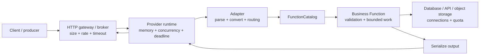
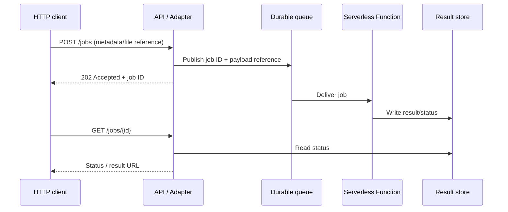
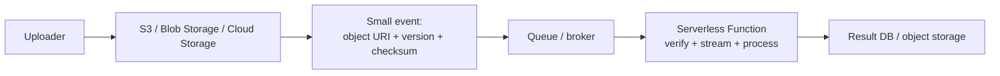
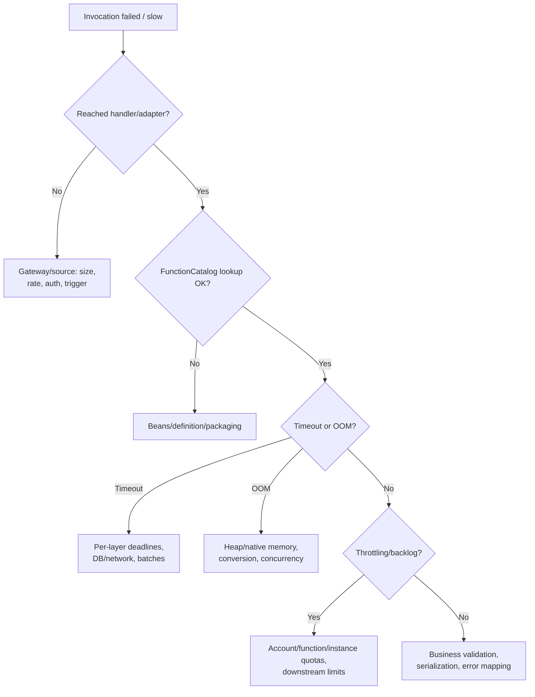

# Time, Memory, Concurrency, and Payload Size Limits

> **Chapter:** Serverless  
> **Module:** SPRING_CLOUD_FUNCTION  
> **Focus:** Design Spring Cloud Function `Supplier`, `Function`, and `Consumer` beans to operate within the **time, memory, concurrency, and payload size budgets** of AWS Lambda, Azure Functions, and Google Cloud Run functions; use `FunctionCatalog` to reuse logic without mistaking business limits for infrastructure quotas.  
> **Quota baseline date:** November 24, 2026. Java examples use JDK 21, Spring Boot 4.2.0, Spring Cloud BOM 2026.0.0, and Spring Cloud Function 5.1.0. Quotas can vary by region, account, hosting plan, trigger type, runtime generation, and organizational policies; always verify current docs and live deployment quotas.

## 1. Why Can a Valid Java Bean Still Fail on Serverless?

Spring Cloud Function separates business logic from how it is invoked:

```java
@Bean
public Function<String, String> normalizeCode() {
    return code -> code.trim().toUpperCase(Locale.ROOT);
}
```

This same function can run via an HTTP adapter, Spring Cloud Stream, or a serverless adapter. However, **passing `Function.apply(...)` in a unit test does not prove the cloud environment has sufficient resources** to handle a live request.

An invocation can fail before or during Java function execution due to:

1. **Timeout:** the deadline of API Gateway, an HTTP load balancer, the provider runtime, message visibility timeout, or the client expires before work finishes.
2. **Memory:** JVM heap, metaspace, thread stacks, direct buffers, JSON serialization, framework overhead, and payloads collectively exceed allocated RAM.
3. **Concurrency:** concurrent invocations, scaled-out instances, or database connection pools exceed quotas.
4. **Payload size:** HTTP bodies, broker messages, event envelopes, Base64 encoding, or responses exceed a communication layer's limit.
5. **Other limits:** CPU, file descriptors, threads, temporary disk storage, API rate limits, and downstream budgets.

Raising one setting does not fix other limits. Increasing a Lambda timeout does not make API Gateway wait forever; adding instances does not give a database more connections; adding RAM does not make SQS accept oversized messages.

### 1.1. Four Budgets to Define Before Writing Logic

| Budget | Design question | Symptom when exceeded |
| --- | --- | --- |
| **Time** | How long may the full pipeline run? Is there margin to report errors/ack? | Timeouts, HTTP 504, retries, terminated invocations. |
| **Memory** | How much RAM do the JVM, Spring context, payloads, threads, and concurrency need? | OOM, instance restarts, rising GC pauses and latency. |
| **Concurrency** | How many requests/records run at once, how many instances, and how many downstream connections? | Throttling, queue backlogs, exhausted DB pools. |
| **Data size** | What limits apply to inputs, envelopes, headers, batches, responses, artifacts, and intermediates? | HTTP 413 / oversized events, serialization failures, rejected requests. |

### 1.2. End-to-End Picture



**Rule:** the effective limit of a request is the intersection of every limit along the path, usually governed by **the tightest layer**, not the highest number in one provider's quota table.

## 2. Four Distinct Types of Limits: Hard, Soft, Configurable, and Application

Not every number in cloud documentation carries the same meaning.

| Kind | Meaning | Example |
| --- | --- | --- |
| **Hard limit** | Cannot be raised through standard quota consoles. | Maximum event size on a specific trigger. |
| **Soft / service quota** | Has a default that may be raised upon request if region/account permits. | Lambda account concurrency quota. |
| **Per-resource configuration** | Chosen by the deployer within the provider's supported range. | Timeout, memory, max instances, per-instance concurrency. |
| **Business / application limit** | Enforced by the application itself to protect stability. | Max 32 codes per batch; max 64 KiB input. |

For instance, an **application limit of 64 KiB** remains valuable even when an HTTP provider allows tens of megabytes: rejecting early avoids excessive parsing/allocation and protects downstream services.

### 2.1. Changing Quotas Does Not Change Business Contracts

If an API accepts order codes up to 16 characters long, raising RAM to 4 GiB does not make a 200 MB code valid. Conversely, if a system must process 2 GB files, do not stretch a JSON body limit to 2 GB; upload the file to object storage and pass a **validated reference** to the function.

### 2.2. Anchor Numbers to Dates

As of November 24, 2026, the **AWS Lambda quotas** page lists up to **1,800 seconds (30 minutes)** for standard invocations; older docs or guides may still cite **900 seconds (15 minutes)**. Always check current quotas for your exact Lambda model rather than copying stale numbers into runbooks.

Also distinguish **Cloud Run services** from **Cloud Run functions (2nd gen)**, **classic Azure Consumption** from **Flex/Premium**, and **Lambda Event Functions** from Lambda Managed Instances options. Models do not necessarily share identical timeout, memory, concurrency, or request limits.

## 3. Reference Limits Table: AWS, Azure, and Google Cloud

The figures below come from official documentation at the time of writing. They teach **how to read quotas**, not replace verification in your target project, region, and account before release.

| Platform | Duration limit | Memory per instance | Key notes |
| --- | --- | --- | --- |
| **Standard AWS Lambda** | Up to **1,800 seconds / 30 minutes** per updated quotas table. | **128–10,240 MB** in 1 MB increments. | CPU scales with memory; default account concurrency 1,000, potentially lower on new accounts. |
| **AWS Lambda Managed Instances, eligible invocation types** | Documented support up to **5,400 seconds / 90 minutes** for specified async/event source mappings. | Depends on resource/runtime class. | Do not assume 90 minutes applies to every Lambda or every event source. |
| **Azure Functions Classic Consumption** | Default **5 minutes**, max **10 minutes**. | Plan limit, typically up to **1.5 GB**/instance. | Legacy model; evaluate Flex Consumption for new apps. |
| **Azure Functions Flex Consumption** | Default **30 minutes**; `functionTimeout` may have no fixed ceiling, though platform lifecycle limits apply. | Select **512 MB / 2,048 MB / 4,096 MB**. | HTTP responses still hit an ~**230-second** Azure Load Balancer idle timeout. |
| **Azure Premium / Dedicated** | Default **30 minutes**, configurable without a hard execution cap on proper plans; recycle grace periods still apply. | Depends on worker/plan size. | Never interpret "unbounded" as running forever or keeping HTTP connections open indefinitely. |
| **Google Cloud Run functions (2nd gen), HTTP** | Up to **60 minutes**. | Up to **32 GiB**. | HTTP payloads carry separate limits. |
| **Google Cloud Run functions (2nd gen), event-driven** | Up to **540 seconds / 9 minutes** per functions quotas; scheduled/task queues have separate caps. | Up to **32 GiB**. | Eventarc event size cap is smaller than HTTP request size cap. |

Sources: AWS Lambda quotas, Azure Functions hosting/scale docs, Google Cloud Run functions quotas (full links at the end).

**Important:** Azure's **230-second** HTTP cap is a load-balancer response timeout, not the overall `functionTimeout`. For longer jobs, returning **202 Accepted + job ID** and delegating execution to a durable queue/workflow is a sound approach.

### 3.1. Reference Payload Quotas

| Transport path | Documented threshold | Scope and conditions |
| --- | --- | --- |
| **AWS Lambda synchronous invocation** | **6 MB** request and **6 MB** response, each. | Raw synchronous invoke; front doors like API Gateway impose their own limits. |
| **AWS Lambda asynchronous invocation** | **1 MB** event payload. | Do not treat this as the universal cap for every broker event. |
| **AWS Lambda streamed response** | Up to **200 MB** response streaming. | Applies only to supported response-streaming handlers; not every adapter streams. |
| **Azure Functions HTTP request** | Platform limit documented as **210 MB**. | Hosts, apps, or front doors may enforce lower limits; never assume 210 MB everywhere. |
| **Google Cloud Run functions (2nd gen) HTTP request** | **32 MB** uncompressed. | Response: 32 MB unstreamed, 10 MB streamed per functions quotas. |
| **Google Cloud Run functions (2nd gen) Eventarc event** | **512 KB**. | Differs from legacy events and raw Pub/Sub message size limits. |
| **Google Cloud Run functions (1st gen) HTTP request** | **10 MB**. | Do not confuse with 2nd gen. |

**Conservative rule:** design for the lowest ceiling among **API gateway**, **cloud function**, **event source**, **serializer/envelope**, **tenant quota**, and **business API contract**. For binary data, Base64 and JSON envelopes inflate wire size beyond raw bytes.

## 4. Time Budgets: Where Do Timeouts Exist?

### 4.1. The Effective Deadline Is the Shortest One

A single HTTP call may be constrained simultaneously by:

- Browser / HTTP client timeout.
- API Gateway / HTTP load balancer timeout.
- Cloud function invocation timeout.
- Spring adapter / message conversion duration.
- Downstream API/DB connect, read, and write timeouts.
- Internal workflow or business SLA deadlines.

Along a synchronous path, the time a caller can wait is bounded approximately by:

\[
T_{\text{effective}} \le
\min(T_{\text{client}}, T_{\text{gateway}},
T_{\text{function}}, T_{\text{business-SLA}})
\]

This is a **budget relationship**, not an API computed automatically by the framework. Layers may start clocks at different instants; always reserve **time for serialization, essential logging, and response completion**.

### 4.2. Breaking Down the Budget by Stage

Suppose an API has an **8-second** SLO to return a result:

| Stage | Illustrative budget |
| --- | ---: |
| Gateway + authentication | 0.5 seconds |
| Adapter + JSON parse | 0.5 seconds |
| DB + external API | 5.0 seconds |
| Business CPU | 1.0 second |
| Serialize + response + safety margin | 1.0 second |
| **Total** | **8.0 seconds** |

These are **illustrative application numbers**, not cloud quotas. If downstream calls already consumed 7.5 seconds, the business function cannot assume it still has 8 full seconds left.

### 4.3. Do Not Set Timeouts Tightly Around the Average

Suppose a batch normally finishes in 20 seconds, occasionally spiking to 65 seconds. Setting a 21-second function timeout causes frequent failures on large payloads, cold starts, or network jitter. Measure p95/p99 across realistic input sizes, add headroom, and adopt **early-abort / partial-progress policies** where appropriate.

Conversely, cranking timeouts up indiscriminately raises costs and prolongs stuck error retries. Bound retries, record counts, and poison-message handling.

### 4.4. Synchronous Responses Do Not Fit Very Long Tasks



Tasks reading huge files, transcoding media, or syncing millions of records should use **durable workflows and chunking** rather than holding an HTTP request open up to the provider's maximum cap.

## 5. AWS Lambda: Timeouts, Deadlines, and SQS Visibility Timeout

### 5.1. Lambda Resource Configuration

An **illustrative** AWS SAM fragment for a packaged AWS artifact:

```yaml
Resources:
  NormalizeLambda:
    Type: AWS::Serverless::Function
    Properties:
      Runtime: java21
      Handler: org.springframework.cloud.function.adapter.aws.FunctionInvoker
      CodeUri: target/scf-limit-demo-0.0.1-SNAPSHOT-aws.jar
      MemorySize: 2048
      Timeout: 120
      ReservedConcurrentExecutions: 50
      Environment:
        Variables:
          spring_cloud_function_definition: normalizeBatch
```

This fragment **is not a complete SAM template**: add `Transform`, properly packaged AWS artifacts, IAM roles, event sources, region config, and security policies. `Timeout: 120` is a **lesson-chosen value**, not a hard ceiling. `MemorySize` sets allocated RAM; `ReservedConcurrentExecutions` caps concurrency to protect downstream systems.

### 5.2. Deadlines When Using AWS `Context`

If writing a **custom AWS handler** receiving `com.amazonaws.services.lambda.runtime.Context`, you can inspect:

```java
long remainingMs = context.getRemainingTimeInMillis();

if (remainingMs < 2_000) {
    // Stop taking more work, return partial failures, or
    // report an error per the event source contract.
    throw new IllegalStateException("Approaching execution deadline");
}
```

This snippet belongs in an AWS handler, **not a shared business bean**. Generic `FunctionInvoker` handles events and context via its own mechanisms; do not add `Context` into `Function<OrderBatch,BatchResult>` unless your converter setup explicitly supports it.

A cleaner separation has the handler translate the deadline into a **neutral budget** (such as `Duration remaining`) before calling use-cases. Business rules never need to import the AWS SDK.

### 5.3. SQS Timeouts and Message Visibility Time

With an SQS event source mapping:

- The function timeout must align with the queue's **visibility timeout**.
- If visibility timeout is too short, in-flight messages can become visible and be redelivered while the first instance is still running.
- With batch windows, account for batching wait time plus retries/throttling per AWS docs.
- For per-record failure reporting, enable **`ReportBatchItemFailures`** and return a valid `SQSBatchResponse`.

AWS has historically recommended setting visibility timeout to several times the function timeout (plus batch window in some scenarios). When provisioning infrastructure, **check current SQS event-source mapping guidance** instead of guessing an arbitrary multiplier.

### 5.4. Sizing Processing Time by Batch Size

Suppose a batch holds 100 records, each averaging 200 ms of sequential downstream I/O: nominal I/O alone is **20 seconds**, before cold init, serialization, or retries. If individual records occasionally take 2 seconds, large batches easily exceed timeouts. Shrinking batch size, using bounded parallelism, or checkpointing helps—just **avoid unbounded parallelism** that throttles downstream services.

## 6. Azure Functions: `functionTimeout` and the 230-Second HTTP Limit

### 6.1. `host.json` Sets Execution Timeout

Example `host.json`:

```json
{
  "version": "2.0",
  "functionTimeout": "00:05:00"
}
```

This sets a **5-minute** Function App timeout within plan limits. Azure Functions documentation notes:

- **Classic Consumption:** default 5 minutes, max 10 minutes.
- **Flex Consumption, Premium, Dedicated:** typically default 30 minutes; maximum execution duration may have no fixed cap, though scale-in/platform update grace periods still apply.
- **HTTP triggers:** capped at roughly **230 seconds** to finish responding through the Azure Load Balancer, regardless of larger `functionTimeout` values.

Consequently, a 20-minute HTTP function might keep running partially on certain plans, yet **clients cannot keep that HTTP connection open for 20 minutes**. Split long operations into asynchronous jobs or Durable Functions.

### 6.2. Worker Startup Also Has a Budget

Azure docs also note startup time limits for the language worker. A Java/Spring app whose context boots slowly can fail at **startup** before the business function ever receives an event. Never try to fix slow network calls inside Spring bean constructors solely by bumping `functionTimeout`.

### 6.3. Protecting Service Bus / Queue Workloads

For Azure Service Bus triggers, consider:

- Message lock duration, auto-renewal/settlement, and delivery counts.
- Batch size, `maxConcurrentCalls`, and session handling if enabled.
- Poison messages and dead-letter queues.
- Downstream call deadlines and retry behavior if execution halts.

Setting `functionTimeout` does **not automatically extend broker message locks** indefinitely. Keep side effects idempotent whenever messages can be redelivered.

## 7. Google Cloud Run Functions: HTTP vs. Event-Driven Timeouts Differ

### 7.1. Read the Right Function Category

Per Cloud Run functions (2nd gen) quotas:

- **HTTP functions:** up to **60 minutes**.
- **Scheduled / task queue functions:** up to **1,800 seconds / 30 minutes**.
- **Event-driven functions:** up to **540 seconds / 9 minutes**.
- **1st gen:** quotas table lists **540 seconds** overall.

Never assume HTTP's **60-minute** limit applies to Pub/Sub or Eventarc triggers. Nor should you equate `Cloud Run service request timeout` with every background event source.

### 7.2. HTTP Timeout Does Not Guarantee All Work Stops

When a Cloud Run service exceeds request timeout, clients normally receive **HTTP 504**. Cloud Run docs warn that **closing the connection does not necessarily terminate the container immediately**; code may keep executing briefly. Therefore, never assume "no HTTP response means the DB write definitely did not commit."

If a client retries a mutating request after a 504, an **idempotency key** must prevent duplicate effects.

### 7.3. Account for Event Size on Pub/Sub / Eventarc

A function may have ample timeout to process a 100 MB file while **Eventarc** events are capped around **512 KB**. Pattern: have Pub/Sub carry a **small URI, object version, and metadata**, keeping large payloads in Cloud Storage; the function authorizes access, verifies checksums, and streams in chunks.

## 8. Memory: Java Heap Is Not Equal to Total Function RAM

### 8.1. Everything Competing for RAM

A Java Spring Cloud Function runtime requires memory for:

- JVM heap holding DTOs, strings, collections, and conversion buffers.
- Metaspace/class metadata, JIT code cache, and JVM native memory.
- Thread stacks, direct/native buffers, and TLS/network buffers.
- Spring `ApplicationContext`, `FunctionCatalog`, auto-configuration, and dependencies.
- JSON/Jackson buffers, Base64 decoding, and compression/decompression.
- SDK HTTP clients, connection pools, TLS certificates, and caches.
- Concurrent in-flight requests/batches inside the same instance.

A cloud RAM limit like **2 GiB** does not mean you can set `-Xmx2g` and fill 2 GiB of heap without starving native allocations.

### 8.2. Memory Budget Model

For an environment serving concurrent requests:

\[
M_{\text{peak}} \approx M_{\text{JVM+Spring baseline}}
+ C \times M_{\text{per-inflight-request}}
+ M_{\text{shared caches}} + M_{\text{safety}}
\]

Here `C` is **per-instance** concurrency, not account-wide concurrency. Illustrative example:

- JVM + Spring + SDK baseline: **400 MiB**.
- Each in-flight request needs up to **12 MiB** of buffers/objects.
- Per-instance concurrency: **20**.
- Shared cache: **50 MiB**.
- Safety headroom: **200 MiB**.

Peak usage is roughly `400 + 20 × 12 + 50 + 200 = 890 MiB`. For this workload, configuring **1 GiB or more** is a reasonable starting point for testing—**not a guarantee**, since GC spikes, direct buffers, and tail payload sizes vary.

### 8.3. Increasing Memory Can Increase CPU

AWS Lambda allocates CPU proportionally to memory: quotas documentation notes roughly **1 vCPU equivalent at 1,769 MB**. Raising memory from 512 MB to 2,048 MB can cut duration for CPU-bound tasks or Spring initialization even with identical payloads. Cost (memory × duration) may rise or fall depending on actual speedup; always benchmark.

Azure Flex offers **fixed instance sizes**; Cloud Run restricts CPU/memory to allowed pairings. Never assume every extra megabyte of RAM yields identical CPU gains across all three clouds.

### 8.4. `-Xmx` and Container-Aware JVMs

Java 21 recognizes container/cgroup limits in most environments; heap can be tuned with flags like:

```text
-XX:MaxRAMPercentage=60.0
```

This is an **experimental starting value**, not a universal rule to always pick 60%. Leave headroom for metaspace, threads, direct buffers, native SDKs, and allocation spikes. Never set `-Xmx` or percentages blindly and treat them as cloud quotas.

### 8.5. OOM Can Strike Even on Small Payloads

- A 5 MB JSON payload expands into object graphs far larger than 5 MB.
- Base64 temporarily holds both the encoded string and decoded `byte[]`.
- Streaming inputs beats reading entire files into a `byte[]`.
- A batch of 10,000 tiny records spawns thousands of DTOs, lists, and log lines simultaneously.
- An unbounded cache grows across warm invocations until OOM.
- High concurrency multiplies per-request buffers simultaneously.

Metrics to watch: RSS/memory utilization, max memory used, heap/GC pauses, direct buffers, thread count, and input-size distributions.

## 9. Concurrency: Requests, Instances, Threads, and Downstream Connections Are Four Separate Numbers

### 9.1. Estimating with Little's Law

With average arrival rate `λ` requests/second and average duration `W` seconds, average concurrent invocations are:

\[
L \approx \lambda \times W
\]

For **120 requests/second** averaging **2 seconds** each:

\[
L \approx 120 \times 2 = 240
\]

If a Cloud Run instance caps concurrency at **20 concurrent requests**, you need at least `240 / 20 = 12` instances on average under ideal conditions—**before headroom, cold starts, CPU saturation, p99 tails, and rate limits**.

If each instance opens a DB pool of **15 connections**, 12 instances can demand up to **180 connections**. If the database allows only 100 connections, scaling out more instances worsens the outage.

### 9.2. Three Scopes of Concurrency Limits

| Scope | Impact |
| --- | --- |
| **Account/region concurrency** | Total active invocations/environments allowed across a provider region/account. |
| **Per-function/resource concurrency** | Cap on one cloud function resource to protect downstream systems or reserve capacity. |
| **Per-instance concurrency** | Parallel requests/records sharing one JVM/context, affecting race safety and RAM. |

Inside Java, you also have **thread/executor pool sizes, DB connection pools, semaphores, and downstream rate limits**. Never conflate these numbers.

### 9.3. AWS Reserved vs. Provisioned Concurrency

- **Reserved concurrency:** reserves and caps maximum concurrency for a function, acting as an **upper bound** to protect databases.
- **Provisioned concurrency:** pre-warms initialized environments to cut cold starts; does not replace reserved concurrency or idempotency.
- **Account concurrency:** regional/account total quota, published by AWS with a 1,000 default (new accounts may start lower).
- **Throttling:** behavior upon hitting quotas depends on invocation mode; HTTP/synchronous callers may fail, while async/event sources retry or build backlogs.

An initial capacity heuristic:

\[
\text{desired concurrency} \gtrsim
\text{peak request rate} \times \text{p95 duration}
\]

This is a **headroom heuristic**, not an AWS SLA formula. Monitor live concurrency, throttles, and queue age.

### 9.4. Azure Fixed vs. Dynamic Concurrency

Azure Functions configures concurrency per trigger/instance; extensions such as Queue Storage, Blob Storage, and Service Bus support **dynamic concurrency**. In `host.json`:

```json
{
  "version": "2.0",
  "concurrency": {
    "dynamicConcurrencyEnabled": true,
    "snapshotPersistenceEnabled": true
  }
}
```

When enabled, the host tunes concurrency dynamically for **supported extensions** and can override manual static settings. **Never assume dynamic concurrency automatically applies to every HTTP trigger or extension.**

Under **Flex Consumption**, HTTP per-instance concurrency and scale-out have separate knobs. Raising per-instance concurrency reduces instance count while raising memory usage and shared-client contention per worker.

### 9.5. Google Cloud Run Per-Instance Concurrency

Cloud Run services currently support up to **1,000 concurrent requests per instance** per service docs; defaults vary by deployment method and CPU (commonly 80 in several configurations). That is a **Cloud Run platform capability**, not a recommendation to set 1,000 on every Java function.

If a Spring bean holds mutable fields, high concurrency triggers race conditions across requests. If code blocks I/O across too many threads, higher concurrency degrades memory and latency. For event-driven functions, also check trigger-specific semantics.

### 9.6. Backpressure and Admission Control

Instead of accepting unbounded work:

1. Cap per-instance in-flight requests via provider settings, thread pools, or semaphores.
2. Bound batch sizes and per-request memory.
3. For HTTP, return **429/503** with `Retry-After` where contractually appropriate.
4. For queues, apply retry/backoff or pause consumption per binder/trigger.
5. When downstream services enforce quotas, lower concurrency or add rate limiters and circuit breakers.
6. Never return fake success before processing finishes; if an event is accepted asynchronously, persist durable state or defer ack per contract.

A semaphore inside a Spring singleton only bounds **one context**, not the entire cluster. Cluster-wide limits require controls at the gateway, broker, database, or distributed rate limiter.

## 10. Payload Size: Count Envelopes, Headers, and Encoding

### 10.1. Three Different Sizes

- **Logical business size:** size of the code, DTO, or file the user wants processed.
- **Wire size:** bytes transmitted over HTTP/broker after JSON formatting, Base64 encoding, headers, and metadata.
- **In-memory footprint:** Java objects and buffers allocated after deserialization and transformation.

For example, a 600 KiB UTF-8 string expands to roughly **800 KiB** once Base64-encoded—before adding JSON envelopes or headers. Formula:

\[
\operatorname{Base64Len}(n) =
4 \times \left\lceil \frac{n}{3} \right\rceil
\]

This measures **encoded data** alone, excluding JSON quotes/escaping/metadata or HTTP headers.

### 10.2. Why Pub/Sub Limits Differ from Eventarc Limits

Pub/Sub has its own message size cap, yet when Eventarc wraps the message into a CloudEvent, JSON envelopes and Base64 can push the event past the **512 KB Eventarc limit** on 2nd-gen Cloud Run functions. Thus, a Pub/Sub message **valid at the source** can still fail to reach the function over that trigger.

Solution: write large objects to **Cloud Storage** and publish a small event carrying the URI, generation/version, and checksum. The function streams the object while verifying permissions, size, and signature.

### 10.3. Why Lambda's 6 MB Limit Does Not Mean APIs Accept 6 MB

AWS Lambda's 6 MB synchronous request/response limit is a quota of the **Lambda invocation API**; API Gateway, Lambda Function URLs, ALBs, and event sources enforce their own caps and semantics. Requests can be rejected **before** `FunctionInvoker` or `FunctionCatalog` ever sees them.

Never tweak Spring converters when the gateway already returned `413 Payload Too Large`; fix the API contract, offload payloads to object storage, or adopt supported streaming.

### 10.4. Batch Size Is Not Just Record Count

A batch of 500 tiny records may fit easily, while a batch of 5 huge records blows past the payload cap. Enforce **two independent limits**:

- `maxItems`: maximum record count.
- `maxBytes`: maximum encoded/enveloped bytes, or a conservative application cap.

With SQS Lambda, also account for batch size, batch window, per-invocation payload quotas, and partial batch response rules. Never infer from `BatchSize=1000` that any 1,000 messages will fit inside one invocation.

## 11. Strategies for Large Data: Pointers, Chunks, and Workflows

### 11.1. Offload Large Payloads to Object Storage



Advantages:

- Events stay well under payload caps.
- Files can be streamed in chunks, bounding peak memory.
- Retries target an exact object version and checksum.
- Upload and processing decouple cleanly.

Risks to mitigate:

- Object permissions, expiration, versioning, and retention.
- Never trust unvalidated object URLs or raw paths; guard against SSRF and path traversal.
- Verify actual checksum, size, and content type rather than trusting caller-supplied metadata.
- Objects can be overwritten or deleted before the worker reads them; pin generation/version IDs where supported.
- Enforce cleanup lifecycles and storage cost caps.

### 11.2. Checkpointed Chunking

When work exceeds function timeouts, split into small chunks:

1. The worker receives a job ID and pointer.
2. Reads a bounded slice of bytes or records.
3. Processes it and **writes a durable checkpoint**.
4. Enqueues the next chunk or lets orchestration advance.
5. Records the final result using an idempotency key.

Never keep the sole progress offset in a static field or `/tmp`. When instances recycle or events retry, RAM checkpoints vanish.

### 11.3. Never Use `Consumer<T>` for Reckless "Fire-and-Forget"

`Consumer<T>` returns `void`; if a handler returns success while a background thread is still writing, the provider may freeze or kill the environment and drop work. For long work, **enqueue to a durable queue** or await side-effect completion before acknowledging.

### 11.4. Streaming Differs from Buffering

Java:

```java
// Illustrates principle: process chunk by chunk instead of reading all bytes.
try (InputStream in = storage.openStream(objectKey)) {
    byte[] buffer = new byte[64 * 1024];
    int n;
    while ((n = in.read(buffer)) != -1) {
        processChunk(buffer, n);
    }
}
```

This is **pseudo-code** because `storage`, `objectKey`, and `processChunk` represent application/provider APIs; add timeout, partial-read, checksum, retry, error, and security handling. Note especially that `InputStream.read` may return fewer bytes than `buffer.length`; always use the exact byte count `n`.

## 12. Spring Cloud Function: How Adapters and Conversion Consume Budgets

### 12.1. `FunctionCatalog` Does Not Remove Provider Limits

A bean:

```java
@Bean
public Function<OrderBatch, BatchResult> normalizeBatch() {
    return batch -> /* business logic */;
}
```

is registered in `FunctionCatalog` and can be called by any adapter. Still:

- **AWS Lambda adapter** receives events via its handler; HTTP/SQS envelopes vary by source.
- **Web adapter** deserializes request bodies per content type and function signature.
- **Spring Cloud Stream** binders translate broker messages into payloads and headers.
- **Azure/GCP adapters** apply distinct runtime triggers and conversions.

`FunctionCatalog` handles lookup, composition, and supported type/message conversions; **it cannot rescue an event that already blew a quota before reaching the runtime**.

### 12.2. Conversion Can Multiply Memory Footprint

Suppose an HTTP body carries JSON `OrderBatch`:

1. Gateway buffers bytes.
2. Adapter/runtime allocates byte/string buffers.
3. JSON converter materializes records/DTOs and `List`s.
4. Function iterates and builds an output list.
5. Serializer allocates response bytes.

At one moment, **input bytes, decoded String, DTOs, and output objects** coexist in memory. Under concurrency, peak RAM climbs fast. For large DTOs, test at p95/p99 input sizes and evaluate streaming formats, pagination, or object pointers.

### 12.3. Message Headers Are Not for Large Files

Spring's `Message<T>` carries payload and headers. Headers such as `contentType`, `correlationId`, `traceId`, and routing definitions should remain **small and controlled**. Never stuff Base64 of large files into headers to "bypass" payload limits; headers have their own quotas and risk getting logged, forwarded, or stripped by adapters.

### 12.4. Routing Multiple Functions in One Instance

A single artifact can bundle multiple `Function`, `Supplier`, and `Consumer` beans. `spring.cloud.function.definition` picks one function/pipeline, while `functionRouter` can select from permitted metadata.

However, **multiple beans do not get separate resource quotas** when sharing one resource/instance. A heavy file-parsing route can starve RAM/CPU for a lightweight normalization route in the same worker. When deadlines, memory, IAM, or concurrency diverge sharply, **splitting cloud resources** isolates faults and sizes allocations cleanly.

## 13. Hands-On Maven Project: Bounding Batches Before Processing

We will build a Spring Cloud Function project accepting a `BatchCommand` of order codes. **The 32-item and 64 KiB UTF-8 raw-code caps are demo policies**, not AWS/Azure/GCP platform limits.

Goals:

- Prevent unbounded item counts.
- Reject invalid items before allocating excessive outputs.
- Keep business logic cloud-independent.
- Verify `FunctionCatalog` via JUnit.
- Show why size checks after DTO parsing **do not replace** early checks at the gateway or adapter.

### 13.1. Directory Structure

```text
scf-limit-demo/
├── pom.xml
└── src/
    ├── main/
    │   ├── java/vn/example/limits/
    │   │   └── LimitsApplication.java
    │   └── resources/
    │       └── application.properties
    └── test/
        └── java/vn/example/limits/
            └── LimitsApplicationTest.java
```

### 13.2. `pom.xml` Using the Spring Cloud BOM

```xml
<?xml version="1.0" encoding="UTF-8"?>
<project xmlns="http://maven.apache.org/POM/4.0.0"
         xmlns:xsi="http://www.w3.org/2001/XMLSchema-instance"
         xsi:schemaLocation="http://maven.apache.org/POM/4.0.0
           https://maven.apache.org/xsd/maven-4.0.0.xsd">
    <modelVersion>4.0.0</modelVersion>

    <parent>
        <groupId>org.springframework.boot</groupId>
        <artifactId>spring-boot-starter-parent</artifactId>
        <version>4.2.0</version>
        <relativePath/>
    </parent>

    <groupId>vn.example</groupId>
    <artifactId>scf-limit-demo</artifactId>
    <version>0.0.1-SNAPSHOT</version>

    <properties>
        <java.version>21</java.version>
        <spring-cloud.version>2026.0.0</spring-cloud.version>
    </properties>

    <dependencyManagement>
        <dependencies>
            <dependency>
                <groupId>org.springframework.cloud</groupId>
                <artifactId>spring-cloud-dependencies</artifactId>
                <version>${spring-cloud.version}</version>
                <type>pom</type>
                <scope>import</scope>
            </dependency>
        </dependencies>
    </dependencyManagement>

    <dependencies>
        <dependency>
            <groupId>org.springframework.boot</groupId>
            <artifactId>spring-boot-starter</artifactId>
        </dependency>
        <dependency>
            <groupId>org.springframework.cloud</groupId>
            <artifactId>spring-cloud-function-context</artifactId>
        </dependency>
        <dependency>
            <groupId>org.springframework.boot</groupId>
            <artifactId>spring-boot-starter-test</artifactId>
            <scope>test</scope>
        </dependency>
    </dependencies>

    <build>
        <plugins>
            <plugin>
                <groupId>org.springframework.boot</groupId>
                <artifactId>spring-boot-maven-plugin</artifactId>
            </plugin>
        </plugins>
    </build>
</project>
```

The Boot/Cloud pair is an illustrative baseline as of the reference date. The BOM manages **runtime dependency versions**, without automatically adding AWS/Azure/GCP adapters. This demo omits **serverless handlers, a Web server, and broker binders** because its focus is data bounds and catalog behavior inside the JVM.

### 13.3. Configuration

```properties
spring.application.name=scf-limit-demo
spring.main.web-application-type=none
spring.cloud.function.definition=normalizeBatch
```

`spring.main.web-application-type=none` prevents starting an HTTP server. To test with cURL, add the Web adapter and adjust this property in a dedicated project or Maven profile. `spring.cloud.function.definition` selects the `normalizeBatch` bean when integrated with an adapter; **it does not configure cloud timeout or memory**.

## 14. Complete Java Code: Bounding Item Counts, Bytes, and Data

Create `src/main/java/vn/example/limits/LimitsApplication.java`:

```java
package vn.example.limits;

import java.nio.charset.StandardCharsets;
import java.util.ArrayList;
import java.util.List;
import java.util.Locale;
import java.util.function.Function;

import org.springframework.boot.SpringApplication;
import org.springframework.boot.autoconfigure.SpringBootApplication;
import org.springframework.context.annotation.Bean;

@SpringBootApplication
public class LimitsApplication {

    // These are business/application limits.
    public static final int MAX_ITEMS = 32;
    public static final long MAX_INPUT_BYTES = 64L * 1024L;

    public static void main(String[] args) {
        SpringApplication.run(LimitsApplication.class, args);
    }

    public record WorkItem(String id, String code) {}

    public record BatchCommand(List<WorkItem> items) {}

    public record NormalizedItem(String id, String code) {}

    public record BatchResult(
            int count,
            long inputBytes,
            List<NormalizedItem> items) {}

    @Bean
    public Function<BatchCommand, BatchResult> normalizeBatch() {
        return batch -> {
            if (batch == null || batch.items() == null
                    || batch.items().isEmpty()) {
                throw new IllegalArgumentException(
                        "Batch must not be empty");
            }

            if (batch.items().size() > MAX_ITEMS) {
                throw new IllegalArgumentException(
                        "Exceeded max item count: " + MAX_ITEMS);
            }

            long totalBytes = 0L;
            List<NormalizedItem> output =
                    new ArrayList<>(batch.items().size());

            for (WorkItem item : batch.items()) {
                if (item == null || item.id() == null
                        || item.id().isBlank()
                        || item.code() == null) {
                    throw new IllegalArgumentException(
                            "Item missing id or code");
                }

                byte[] encoded =
                        item.code().getBytes(StandardCharsets.UTF_8);

                // Bound by UTF-8 bytes, not just String.length().
                totalBytes += encoded.length;
                if (totalBytes > MAX_INPUT_BYTES) {
                    throw new IllegalArgumentException(
                            "Exceeded max input byte limit");
                }

                String normalized = item.code()
                        .trim()
                        .toUpperCase(Locale.ROOT);

                if (!normalized.matches("[A-Z]{2}-[0-9]{3}")) {
                    throw new IllegalArgumentException(
                            "Code does not match pattern AA-999");
                }

                output.add(new NormalizedItem(
                        item.id(), normalized));
            }

            return new BatchResult(
                    output.size(),
                    totalBytes,
                    List.copyOf(output));
        };
    }
}
```

### 14.1. Why Check Item Count Before Allocating?

Checking `batch.items().size()` rejects oversized lists **before** allocating the output `ArrayList`. In real workloads, if inbound JSON was already deserialized into a million-element list before reaching this function, memory has already been consumed; **enforce request size caps at the gateway/parser** to defend the outer boundary.

### 14.2. Why Measure Bytes Instead of String Length?

`String.length()` counts UTF-16 code units in Java, not wire bytes. A UTF-8 string containing non-ASCII characters occupies more bytes. `getBytes(StandardCharsets.UTF_8).length` measures exact UTF-8 payload bytes.

In this demo, calling `getBytes` on every item allocates a **temporary `byte[]`**. For huge inputs, that is still allocation; reject oversized requests **before** parsing and passing DTOs to business functions.

### 14.3. Why Not Put AWS `Context` Directly in the Bean?

This `Function<BatchCommand,BatchResult>` bean needs zero knowledge of Lambda or GCP timeouts. Inside a provider-specific handler, you can:

- Read remaining provider time/deadline.
- Compute an appropriate record/byte budget.
- Stop, checkpoint, or return batch failures before the deadline.
- Invoke `normalizeBatch` chunk by chunk.

This keeps the same logic portable across HTTP, Stream, and serverless while resource quotas remain in boundary and ops configuration.

### 14.4. Batches Do Not Have to Be All-or-Nothing

The `normalizeBatch` demo rejects the whole batch on a single invalid item. **That is this lesson's chosen contract**, not an AWS SQS rule. For SQS partial batch failures, the adapter must report failing `messageId`s and obey FIFO vs. Standard queue semantics. You can split SQS records into smaller `BatchCommand`s while mapping results and exceptions back to the provider's event response.

## 15. JUnit: Testing Data Bounds and Catalog

Create `src/test/java/vn/example/limits/LimitsApplicationTest.java`:

```java
package vn.example.limits;

import static org.junit.jupiter.api.Assertions.assertEquals;
import static org.junit.jupiter.api.Assertions.assertNotNull;
import static org.junit.jupiter.api.Assertions.assertThrows;

import java.util.ArrayList;
import java.util.List;
import java.util.function.Function;

import org.junit.jupiter.api.Test;
import org.springframework.beans.factory.annotation.Autowired;
import org.springframework.boot.test.context.SpringBootTest;
import org.springframework.cloud.function.context.FunctionCatalog;

import vn.example.limits.LimitsApplication.BatchCommand;
import vn.example.limits.LimitsApplication.BatchResult;
import vn.example.limits.LimitsApplication.WorkItem;

@SpringBootTest
class LimitsApplicationTest {

    @Autowired
    FunctionCatalog catalog;

    @Test
    void catalogFindsBoundedFunction() {
        Function<BatchCommand, BatchResult> fn =
                catalog.lookup("normalizeBatch");

        assertNotNull(fn);

        var result = fn.apply(
                new BatchCommand(List.of(
                    new WorkItem("e1", " od-123 "),
                    new WorkItem("e2", "ab-999"))));

        assertEquals(2, result.count());
        assertEquals("OD-123", result.items().get(0).code());
        assertEquals("AB-999", result.items().get(1).code());
    }

    @Test
    void rejectsBatchExceedingItemLimit() {
        var items = new ArrayList<WorkItem>();
        for (int i = 0; i <= LimitsApplication.MAX_ITEMS; i++) {
            items.add(new WorkItem("id-" + i, "AB-123"));
        }

        // Test factory method directly to verify business
        // exception independent of adapter mapping.
        var fn = new LimitsApplication().normalizeBatch();

        assertThrows(IllegalArgumentException.class,
                () -> fn.apply(new BatchCommand(items)));
    }

    @Test
    void rejectsInvalidCode() {
        var fn = new LimitsApplication().normalizeBatch();

        assertThrows(IllegalArgumentException.class,
                () -> fn.apply(new BatchCommand(List.of(
                    new WorkItem("e1", "code-too-long")))));
    }

    @Test
    void rejectsEmptyBatch() {
        var fn = new LimitsApplication().normalizeBatch();

        assertThrows(IllegalArgumentException.class,
                () -> fn.apply(new BatchCommand(List.of())));
    }
}
```

Run:

```bash
mvn clean test
```

If the project uses Maven Wrapper, run `./mvnw clean test` or `./mvnw.cmd clean test` on Windows. This test suite **does not measure AWS/Azure/GCP quotas**, generate concurrent load, or prove serverless packaging. It only checks data policies and `FunctionCatalog` inside the Spring JVM.

### 15.1. What Additional Tests Are Needed?

| Test to add | Why? |
| --- | --- |
| `MAX_ITEMS` and `MAX_ITEMS+1` | Verify item-count boundary. |
| Total input `64 KiB` and `64 KiB+1` | Verify UTF-8 byte boundary. |
| JSON body with deeply nested objects | Catch parser/memory amplification. |
| Batch with null or malformed records | Protect conversion and validation. |
| 1 MB request through the real gateway | Verify quota enforcement at the entrypoint layer. |
| Parallel invocations: 1/10/50/100 | Observe CPU, GC, RSS, and throttling. |
| Slow downstream / exhausted connections | Verify timeouts, retries, and backpressure. |
| Provider runtime test | Validate real handler, memory, deadline, and event size. |

Never allocate a 1 GB object inside a unit test just to "test OOM"; that can crash CI runners. Use small boundary unit tests alongside controlled load tests in dedicated environments.

## 16. Concurrency and Deadlines at the Adapter: Design Sketch

### 16.1. Bounding In-Flight Work on One JVM

Example admission-control gate:

```java
public final class LocalAdmissionGate {

    private final Semaphore permits = new Semaphore(8);

    public <T> T run(Callable<T> work) throws Exception {
        if (!permits.tryAcquire()) {
            throw new RejectedExecutionException(
                    "Instance is overloaded");
        }

        try {
            return work.call();
        } finally {
            permits.release();
        }
    }
}
```

This snippet requires importing `java.util.concurrent.Semaphore`, `Callable`, and `RejectedExecutionException`. It **bounds one JVM/process**, not global AWS/Azure/GCP concurrency quotas. The adapter layer must map rejections to HTTP 429/503 or trigger retries/deferrals per contract; never treat throwing as successful completion.

### 16.2. Checking Timeouts Only at the End Is Too Late

When an I/O call can take 30 seconds while only 5 seconds remain on the provider clock, enforce a **per-call timeout strictly smaller than the remaining budget**. Do not wait out 30 seconds only to inspect remaining time afterward.

Pseudo-algorithm:

```text
remaining = deadline_from_provider_or_application
reserve = response_serialization + checkpoint + safety_margin

if remaining <= reserve:
    stop_before_starting_next_unit()

clientTimeout = min(remaining - reserve, configuredDownstreamTimeout)
call_downstream_with_timeout(clientTimeout)

checkpoint_if_needed()
complete_before_provider_deadline()
```

**Never sleep or busy-spin while waiting for a deadline.** Exit cleanly using remaining budget, cancellation/interrupts, network client timeouts, and durable checkpoints.

### 16.3. Bounded Retries

Retrying an HTTP API 5 times with a 10-second timeout each inside a 30-second Lambda will always time out. Bound retries by:

- Total retry time budget.
- Attempt cap with exponential backoff and jitter.
- Retryable errors (timeouts, 429, 503) vs. non-retryable schema/authorization errors.
- Idempotency keys for side effects.
- Trigger error/ack reporting rules.

## 17. Impact of Limits on `Supplier`, `Function`, and `Consumer`

| Functional type | Primary risk | Design approach |
| --- | --- | --- |
| `Supplier<T>` | Polling/scheduling too often, oversized outputs, slow downstream consumers. | Cap rate/size, paginate or emit references, align schedules/triggers. |
| `Function<T,R>` | Request/response size overruns, I/O or composition timeouts. | Clear DTO contracts, bounded input/output, time budgets, streaming/chunking when needed. |
| `Consumer<T>` | Slow side effects, duplicate retries, unclear ack semantics. | Idempotency, DB transactions/outbox, bounded concurrency and retry policies. |

Compositions like `normalize|validate|enrich` must budget **cumulative duration and peak intermediate data**. Returning `Flux<T>`/`Mono<T>` does not magically turn a cloud invocation into an infinite stream; adapters and triggers may still require finite results within fixed timeouts. Verify converter and reactive runtime behavior directly.

### 17.1. Multiple Functions in One Resource Still Share Limits

When a deployment uses `functionRouter` to select among multiple beans inside one Lambda or Cloud Run resource, all routes share:

- Memory and CPU allocations.
- Environment/server processes.
- IAM role / service account.
- Concurrency quotas.
- Downstream clients and pools.

A heavy file-parsing route can degrade a lightweight normalization route in the same worker. When SLOs, IAM permissions, payload sizes, or memory profiles diverge sharply, **splitting into separate resources** pays off even when sharing code modules.

## 18. Observability, Alerting, and Load Testing

### 18.1. Metrics to Collect

| Metric / signal | What to inspect when spiking |
| --- | --- |
| p50/p95/p99 duration per route | Outliers, cold starts, downstream latency. |
| Timeout count/rate | Deadline budgets, tail inputs, retries. |
| Peak memory / RSS / GC pauses | Heap sizing, direct buffers, batch sizes, concurrency. |
| Concurrent invocations/instances | Scaling behavior, reserved quotas, traffic spikes. |
| Throttles / HTTP 429 / 503 | Provider, gateway, and app admission quotas. |
| Queue depth / oldest-message age | Under-provisioned consumers, poison events, retry storms. |
| Payload size histogram / p95 / p99 | Oversized events, Base64/envelope bloat. |
| Dead-letter / partial-batch failures | Validation errors, transient downstream failures. |
| DB pool active / waiting counts | Instance × pool oversubscription. |
| Cost / GB-seconds / vCPU-seconds | Memory/concurrency/duration trade-offs. |

AWS: CloudWatch metrics/logs (e.g., `Duration`, `Max Memory Used`, `Throttles`, `ConcurrentExecutions`) and Event Source metrics. Azure: Application Insights/Monitor plus scaling/concurrency telemetry. Google: Cloud Monitoring/Logging plus Cloud Run instance/concurrency/memory metrics.

### 18.2. Controlled Load-Testing Workflow

1. Pin commit SHA, artifact, Java version, provider/region/plan, and triggers.
2. Use valid payloads reflecting real size distributions, including p99 tails.
3. Capture a low-load baseline, then ramp 1 → 5 → 10 → 25 → 50 concurrent requests as permitted.
4. Hold steady load long enough to observe autoscaling, warm/cold mix, and memory/GC stability.
5. Record throughput, errors/throttles, queue age, DB connections, and cost.
6. Exercise timeouts, 429s, 413s, oversized payloads, retries, and idempotency.
7. Change one parameter at a time (memory, batch size, concurrency, timeout).
8. Repeat on the same artifact under comparable conditions.

**Never run stress tests against production or third-party systems without approved scope and limits.** Use staging with safe test data, explicit budgets, and traffic caps.

### 18.3. Never Infer "Max Concurrency" from the Wrong Unit

An AWS Lambda reaching 50 concurrent executions differs from Cloud Run configured with concurrency=50 requests **per instance**. Always state: **scope** (account/function/instance) + **unit** (executions/requests/instances) + **time window** (peak, average, rate).

## 19. Troubleshooting by Symptom

| Symptom | Likely cause | Check first |
| --- | --- | --- |
| Lambda times out despite fast Java logic | Gateway, init, DB/network, payload conversion. | End-to-end trace, `Duration`, downstream latency. |
| Azure HTTP times out before `functionTimeout` | Azure Load Balancer ~230-second limit. | Switch to async job / Durable Functions. |
| GCP 5 MB event never reaches function | Eventarc event cap is smaller than HTTP quota. | Eventarc quota, Base64/envelope size. |
| Container OOMs at 20 concurrent requests | Per-request buffers × concurrency too high. | RSS, heap, direct memory, and concurrency settings. |
| AWS reports `Throttles` | Account quota or reserved concurrency hit. | Service Quotas, reserved/provisioned config. |
| Queue backlog grows despite free RAM | Slow downstream, small batches, low concurrency cap. | Queue age, p95 duration, DB quotas. |
| DB runs out of connections during scale-out | Pool size × instances exceeds DB max. | Per-instance pool, max instances, proxy. |
| 6 MB input rejected by gateway | Front-door limit is tighter than Lambda sync API. | API Gateway / HTTP service quota. |
| Huge output from small input | Unbounded response serialization/aggregation. | Measure output bytes; add pagination or object storage. |
| Valid source Base64 fails as oversized event | Encoding + envelope inflated wire size. | Measure full encoded event bytes. |
| `OutOfMemoryError` after many warm calls | Cache leak or payload retained in singleton/static. | Safe heap dump, cache TTLs, GC logs. |
| Good SQS record retried with failing record | Partial batch failures disabled or malformed response. | `ReportBatchItemFailures`, batch response. |
| Event processed twice after timeout | At-least-once delivery without idempotency. | Unique business operation key, transaction. |
| `FunctionCatalog.lookup` misses bean | Bean/definition/packaging bug, not quota. | Spring context, BOM, and adapter handler. |

### 19.1. Diagnostic Flowchart



## 20. Scenario Exercises

### Exercise 1 — Read the Right Limits per Runtime

A system consists of:

- An AWS Lambda handling a synchronous request.
- An Azure Functions Flex HTTP trigger.
- A Google Cloud Run functions (2nd gen) Pub/Sub via Eventarc trigger.

Answer:

1. Why can you not apply the same 60-minute timeout across all three?
2. For an Azure HTTP request expected to run 10 minutes, which async pattern is required?
3. For an 800 KiB Pub/Sub message, what risk arises on Eventarc?
4. What does AWS's updated 30-minute figure mean, and why must gateway timeouts still be checked separately?

### Exercise 2 — Calculate Concurrency and DB Connections

An API serves 150 requests/second averaging 0.8 seconds each:

1. Estimate average concurrency using Little's Law.
2. If one Cloud Run instance uses concurrency=20, roughly how many instances are needed ideally?
3. If each instance opens a 20-connection pool, what is the potential total connection count?
4. Propose how to protect a database capped at 80 connections.

**Hint:** average concurrency ~120; ideal instances ~6; max pool connections ~120, before headroom and autoscaler limits.

### Exercise 3 — Calculate Base64 Overhead

A producer emits 900 KiB of raw binary Base64-encoded inside a JSON event.

1. Approximate the Base64 byte size after encoding.
2. Will adding the envelope and headers increase or decrease total wire size?
3. Will it fit inside Eventarc's 512 KB cap?
4. Propose a message body containing only object URI, checksum, and version.

**Hint:** 900 KiB raw → ~1,200 KiB Base64 before JSON overhead.

### Exercise 4 — Business Batch Limits

For `normalizeBatch`, add tests covering:

- 32 valid items vs. 33 items.
- An empty `BatchCommand`.
- An item with a `null` code.
- A code containing multibyte Unicode rejected by validation.
- Document explicitly that the "64 KiB limit" is an application policy, not a provider quota.

Explain why checking size **after JSON parsing** cannot protect the parser from hundreds of megabytes of raw input.

### Exercise 5 — Solution for Large Files

An endpoint receives a 1 GiB file, normalizes its contents, and returns the result file. Design:

1. Direct upload to object storage using an appropriate upload mechanism rather than Lambda JSON payloads.
2. Sending job ID + object version/checksum over a queue.
3. Splitting work into chunks with durable checkpoints.
4. Writing status/results to DB/storage for client polling or callbacks.
5. Capping concurrency to avoid overloading the DB while bounding retries and idempotency.

### Exercise 6 — SQS and Timeout Incident

A Lambda with `Timeout=30` seconds processes batches of 100 records where some records take 2 seconds each, and the queue visibility timeout is too short. Analyze:

- Why the batch cannot always finish sequentially within 30 seconds.
- What happens when the message visibility timeout is too short.
- How reducing batch size, sizing timeout/visibility properly, and using partial failures resolve this.
- How to checkpoint or split workflows when tail inputs are very large.

### Exercise 7 — Protecting the System Under Load

A Java `Function` calls a downstream API with a 10-second client timeout; when Cloud Run concurrency increases from 10 to 100, OOMs and HTTP 503s spike. Describe:

- Which memory components scale with concurrent requests.
- How to lower per-instance concurrency while tuning instance count and memory experimentally.
- How to cap connection pools and request timeouts.
- Why unbounded retries amplify load and trigger a "retry storm."
- Which metrics belong on the dashboard before rollout.

## 21. Checklist for Deploying Spring Cloud Function to Serverless

| Category | What to verify |
| --- | --- |
| **Provider/runtime** | AWS/Azure/GCP, function type, generation, Java version, and region. |
| **Entry point** | `FunctionInvoker` / Azure handler / `GcfJarLauncher` matching adapter. |
| **Function definition** | `spring.cloud.function.definition` selects the intended bean/pipeline. |
| **Timeouts** | Runtime + gateway + broker visibility/ack + downstream + app SLA. |
| **Memory/CPU** | JVM/Spring baseline, p99 payloads, concurrency, GC/RSS/native buffers. |
| **Concurrency** | Account quotas, resource caps, per-instance concurrency, threads, DB pools. |
| **Payload sizes** | HTTP/gateway/event source, envelopes/Base64, responses, batches, storage. |
| **Validation** | Early byte/record caps, strict schemas/content types, authorization. |
| **Failure semantics** | 413/429/503/504, retries, DLQs, partial batches, idempotency. |
| **Large jobs** | Object references + async workflows + chunks/checkpoints. |
| **Observability** | p95/p99, memory peaks, throttles, queue age, oversized events. |
| **QA/release** | Unit/catalog tests, controlled load tests, provider contract tests. |

A deployment is production-ready only when **both business logic is correct and all four budgets have adequate headroom** under realistic load—not merely when a bean passes on a developer's laptop.

## 22. Summary and Official Documentation

**Time, memory, concurrency, and payload size are four independent design axes.** Spring Cloud Function makes `Supplier`, `Function`, and `Consumer` logic reusable and `FunctionCatalog` handles lookup, composition, and conversion; it never erases hard limits imposed by API gateways, queues, cloud runtimes, or databases.

Key principles:

1. Identify the **exact trigger, hosting plan, and runtime** before reading quotas.
2. Compute the **shortest effective deadline**, never just the function timeout.
3. Budget memory for the **full JVM + Spring + buffers + per-request concurrency**, not Java heap alone.
4. Size concurrency around **throughput, memory, and downstream capacity**, not raw throughput alone.
5. Measure **wire size** including encoding and envelopes, not just logical payloads.
6. Route large data through **object storage + small pointer events + chunked workflows**, not inline JSON.
7. For brokers, design retries, visibility/ack, partial batch failures, and idempotency.
8. Pair every quota number with its **baseline date, scope, and source doc**; limits evolve across provider releases.

**Official documentation:**

1. Spring Cloud Function — Programming Model and FunctionCatalog: https://docs.spring.io/spring-cloud-function/reference/spring-cloud-function/programming-model.html
2. Spring Cloud Function — AWS adapter/FunctionInvoker: https://docs.spring.io/spring-cloud-function/reference/adapters/aws-intro.html
3. Spring Cloud Function — Azure adapter: https://docs.spring.io/spring-cloud-function/reference/adapters/azure-intro.html
4. Spring Cloud Function — GCP adapter/GcfJarLauncher: https://docs.spring.io/spring-cloud-function/reference/adapters/gcp-intro.html
5. AWS Lambda — Quotas (timeout/memory/concurrency/payload): https://docs.aws.amazon.com/lambda/latest/dg/gettingstarted-limits.html
6. AWS Lambda — Configure timeout: https://docs.aws.amazon.com/lambda/latest/dg/configuration-timeout.html
7. AWS Lambda — Reserved and provisioned concurrency: https://docs.aws.amazon.com/lambda/latest/dg/configuration-concurrency.html
8. AWS Lambda — SQS event source mapping and batch behavior: https://docs.aws.amazon.com/lambda/latest/dg/with-sqs.html
9. Azure Functions — Hosting options, timeout, memory, and service limits: https://learn.microsoft.com/en-us/azure/azure-functions/functions-scale
10. Azure Functions — Concurrency (fixed/dynamic): https://learn.microsoft.com/en-us/azure/azure-functions/functions-concurrency
11. Azure Functions — Flex Consumption plan: https://learn.microsoft.com/en-us/azure/azure-functions/flex-consumption-plan
12. Google Cloud Run functions — Quotas (1st/2nd generation): https://docs.cloud.google.com/functions/quotas
13. Google Cloud Run — Request timeout: https://docs.cloud.google.com/run/docs/configuring/request-timeout
14. Google Cloud Run — Memory limits: https://docs.cloud.google.com/run/docs/configuring/services/memory-limits
15. Google Cloud Run — Concurrency limits and scaling: https://docs.cloud.google.com/run/docs/about-concurrency
16. Spring Cloud Stream — Functional bindings and broker messages: https://docs.spring.io/spring-cloud-stream/reference/
17. Spring Cloud — Release train compatibility: https://spring.io/projects/spring-cloud/
