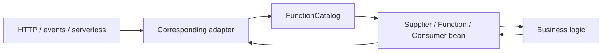

# Foundational Knowledge of Java Functional Interfaces, Spring Boot, and Reactor

> **Chapter:** Initialization  
> **Module:** SPRING_CLOUD_FUNCTION  
> **Focus:** Java functional interfaces, bean management with Spring Boot, and data stream programming with Project Reactor.

## 1. Why Are These Three Foundations Needed?

**Spring Cloud Function** lets you encapsulate business logic into reusable functions using `Supplier`, `Function`, and `Consumer`, independent of the invocation protocol. The same logic can be connected over HTTP, event systems, or serverless adapters when the appropriate integration layer is configured. To understand `FunctionCatalog`, composition, message conversion, and how to expose functions to different execution environments, you first need to distinguish the roles of the three foundations:

| Foundation | Question Answered | Role in Spring Cloud Function |
| --- | --- | --- |
| **Java functional interface** | What does the function take, what does it return, and how is it invoked? | Defines the logic contract: producing data, transforming data, or consuming data. |
| **Spring Boot** | Who creates, configures, and manages the objects containing the functions? | Registers functions into `ApplicationContext` as beans so the framework can discover and reuse them. |
| **Project Reactor** | What happens if data arrives as a stream, asynchronously, or may fail? | Represents processing with `Mono`/`Flux`; supports stream composition, error signals, and backpressure. |

`Spring Cloud Function` sits at the integration layer: it locates function beans through `FunctionCatalog` and coordinates with adapters so external callers can invoke the functions.



The diagram illustrates the conceptual path. Not every adapter supports every function type or shares the same data conversion rules; the specific integration must be configured for each environment.

After this lesson, learners should be able to:

1. Write and compose `Supplier<T>`, `Function<T, R>`, and `Consumer<T>` using lambdas or method references.
2. Explain why a plain Java function can become a bean in Spring Boot and be looked up via `FunctionCatalog`.
3. Distinguish synchronous per-value processing from Reactor's `Mono`/`Flux` stream processing.
4. Recognize common pitfalls when handling `null`, exceptions, side effects, and blocking code.
5. Read a Spring Cloud Function example comprising function beans, composition, and tests.

## 2. Java Functional Interfaces: The Contract of Logic

### 2.1. What Is a Single Abstract Method (SAM)?

A *functional interface* has exactly **one abstract method to implement** (Single Abstract Method, abbreviated as SAM). Because of this, Java allows providing the implementation via a lambda expression or method reference. The `@FunctionalInterface` annotation helps the compiler enforce this constraint, though it is not required for an interface to be a functional interface.

```java
@FunctionalInterface
interface CodeFormatter {
    String format(String rawCode);

    default String describe() {
        return "Normalize code";
    }
}

CodeFormatter formatter = input -> input.trim().toUpperCase(Locale.ROOT);
String result = formatter.format("  od-123  "); // "OD-123"
```

`default` and `static` methods do not break the SAM property. Methods corresponding to public methods on `Object` also do not count as an additional abstract method.

Usually you do not need to declare a new interface yourself: the standard library `java.util.function` already provides many common contracts.

### 2.2. The Three Core Interfaces

| Interface | SAM Method | Meaning | Business Example |
| --- | --- | --- | --- |
| `Supplier<T>` | `T get()` | Supplies a value without taking any input parameters. | Generating a reference code or fetching data from a source. |
| `Function<T, R>` | `R apply(T value)` | Takes a value of type `T` and returns a result of type `R`. | Normalizing codes, calculating scores, or converting DTOs. |
| `Consumer<T>` | `void accept(T value)` | Receives data and performs an action without returning a result. | Writing logs, sending notifications, or publishing events. |

```java
import java.util.Locale;
import java.util.UUID;
import java.util.function.Consumer;
import java.util.function.Function;
import java.util.function.Supplier;

Supplier<String> newReference = () -> UUID.randomUUID().toString();

Function<String, String> normalizeCode =
        raw -> raw.trim().toUpperCase(Locale.ROOT);

Consumer<String> auditCode =
        code -> System.out.println("Processed: " + code);

String id = newReference.get();
String code = normalizeCode.apply("  od-123  "); // OD-123
auditCode.accept(code);                         // Processed: OD-123
```

Key points to read accurately from the types:

- `Supplier<String>` does not automatically generate data just because the variable has been initialized; value generation happens when `get()` is called.
- `Function<String, String>` has the same input and output type, but `Function<T, R>` can also change types, such as `Function<String, Integer>`.
- `Consumer<T>` has a `void` return type. It often produces *side effects*, so you need to consider duplicate delivery, retries, and idempotency in event-driven systems.
- `Predicate<T>` (`boolean test(T value)`), `UnaryOperator<T>` (`T apply(T value)`), and `BiFunction<T, U, R>` are also useful in Java, but the first three interfaces are the fundamental contracts of Spring Cloud Function.

### 2.3. Lambdas, Method References, and Composition

A lambda describes behavior concisely; a method reference points to a method with a matching signature.

```java
Function<String, String> trim = String::trim;
Function<String, String> upper =
        value -> value.toUpperCase(Locale.ROOT);

Function<String, String> normalize = trim.andThen(upper);

normalize.apply("  od-123  "); // "OD-123"
```

Given functions `f` and `g`:

- `f.andThen(g)` executes `f` first, then `g`: `g(f(x))`.
- `f.compose(g)` executes `g` first, then `f`: `f(g(x))`.
- The output type of the preceding function must be compatible with the input type of the following function.

**Ordering error example:** checking a regular expression that only allows uppercase letters *before* normalization will reject `"od-123"`, whereas normalizing first and then validating will accept it. Composition order is part of the business rules.

### 2.4. What to Keep in Mind for Reusable Functions?

An ideal transformation function has an output that depends only on its input and avoids mutating shared state. Calling it twice with the same code yields the same result; this makes testing and concurrent execution easier.

```java
Function<String, String> normalizeSafe = raw -> {
    String required = java.util.Objects.requireNonNull(raw, "rawCode");
    return required.trim().toUpperCase(Locale.ROOT);
};
```

The example above has explicit input, holds no mutable counter outside the lambda, and uses `Locale.ROOT` to prevent results from depending on the host machine's locale. For invalid input, the function can throw an intentional exception. In a Reactor stream, a similar error becomes an `onError` signal when it occurs inside an operator.

## 3. Spring Boot: From Java Lambda to Discoverable Bean

### 3.1. IoC, DI, and `ApplicationContext`

In plain Java, you manually instantiate and pass around objects containing functions. Spring Boot uses the Spring container to manage the lifecycle of **beans**. This mechanism is based on *Inversion of Control* (IoC): the framework instantiates objects and supplies dependencies via *Dependency Injection* (DI).

- `@SpringBootApplication` marks the entry point, combining configuration and component scanning within the package scope.
- `@Bean` marks a factory method: the value returned by the method is registered as a bean.
- `ApplicationContext` holds the beans and allows other components to obtain them via DI.
- Spring Boot provides auto-configuration and starters to reduce boilerplate configuration; Spring Cloud Function adds mechanisms to detect and invoke function beans.

**A `Function` instance is still just a Java object.** It becomes a function that Spring Cloud Function can discover when registered as a bean and placed within an appropriate application context.

### 3.2. Minimal Spring Boot Example

The example uses Java without needing `record` (Java 17+): it uses only `String` to focus on the function contract.

```java
package demo.function;

import java.util.Locale;
import java.util.Objects;
import java.util.function.Function;

import org.springframework.boot.SpringApplication;
import org.springframework.boot.autoconfigure.SpringBootApplication;
import org.springframework.context.annotation.Bean;

@SpringBootApplication
public class FunctionDemoApplication {

    public static void main(String[] args) {
        SpringApplication.run(FunctionDemoApplication.class, args);
    }

    @Bean
    public Function<String, String> normalizeCode() {
        return raw -> Objects.requireNonNull(raw, "rawCode")
                .trim()
                .toUpperCase(Locale.ROOT);
    }

    @Bean
    public Function<String, String> validateCode() {
        return code -> {
            if (!code.matches("[A-Z0-9-]{3,20}")) {
                throw new IllegalArgumentException("Invalid code: " + code);
            }
            return code;
        };
    }
}
```

Both methods are invoked to create two beans with the default names `normalizeCode` and `validateCode`. When the application runs, Spring manages them; there is no need to write a controller or broker listener just to express the code normalization and validation business logic.

**Note:** `@Bean` only creates a bean in Spring. To perform lookup and composition with Spring Cloud Function, the application needs the appropriate Spring Cloud Function dependency. To handle HTTP, events, or serverless, the corresponding adapter is also required; simply adding `@Bean` does not automatically expose an HTTP endpoint.

### 3.3. `FunctionCatalog` and Function Composition

`FunctionCatalog` is the registration/lookup mechanism of Spring Cloud Function. It allows components to invoke functions by name, compose them, and handle additional type/message conversion at the framework layer.

```java
import java.util.function.Function;
import org.springframework.cloud.function.context.FunctionCatalog;
import org.springframework.stereotype.Component;

@Component
public class CodeService {
    private final Function<String, String> pipeline;

    public CodeService(FunctionCatalog catalog) {
        this.pipeline = catalog.lookup("normalizeCode|validateCode");
    }

    public String handle(String raw) {
        return pipeline.apply(raw);
    }
}

// handle("  od-123  ") -> "OD-123"
// handle(" ? ")      -> IllegalArgumentException
```

The name `normalizeCode|validateCode` expresses the order **normalize then validate**. The `|` symbol is Spring Cloud Function's composition syntax; it is similar to `andThen` in Java, but resolved through the catalog by bean name.

When an application has multiple function beans, you can select a single function or function chain as the definition via configuration:

```properties
spring.cloud.function.definition=normalizeCode|validateCode
```

The selected definition will be used by the adapter according to that adapter's conventions. You should not assume URLs, binding names, or `Supplier` polling schedules solely from bean declarations: they depend on the adapter and environment configuration.

### 3.4. Dependencies and Responsibility Boundaries

In a Maven project, Spring Boot/Spring Cloud should use compatible version sets and manage Spring Cloud versions with the appropriate BOM. For example, an application needing an HTTP adapter can add the Spring Cloud Function Web starter:

```xml
<dependency>
    <groupId>org.springframework.cloud</groupId>
    <artifactId>spring-cloud-starter-function-web</artifactId>
</dependency>
```

The declaration above is **an illustrative dependency**, not a complete `pom.xml`; an actual build also requires the Spring Boot plugin/dependency management with compatible versions. For event systems, the corresponding integration/binding is needed (typically via Spring Cloud Stream); for serverless, an adapter for the deployment platform is required.

When designing, keep business logic inside Java functions, while keeping request decoding, authentication, broker communication, and retries in the appropriate layer. If the business logic itself needs message metadata, Spring Messaging provides `Message<T>` to carry both payload and headers, though preserving/converting headers depends on the function signature and adapter.

## 4. Reactor: When Data Is Processed as a Stream

### 4.1. `Mono` and `Flux`

Project Reactor provides reactive types compliant with Reactive Streams. The two most important types:

| Type | Successful Element Count | Use Cases |
| --- | --- | --- |
| `Mono<T>` | 0 or 1 | Looking up a single record, executing a command, or representing an empty result. |
| `Flux<T>` | 0 to N | A stream of multiple records, multiple events, or elements from a data source. |

Besides data (`onNext`), a publisher also emits **completion** (`onComplete`) or **error** (`onError`) signals. An errored stream will not continue emitting normal elements after that error, unless an appropriate recovery operator is applied.

Most Reactor streams are *cold*: processing starts when a subscriber subscribes. There are also *hot publishers* that emit data independently of individual subscriptions. Therefore, you should not equate every `Flux` with a precomputed collection.

```java
import reactor.core.publisher.Flux;
import reactor.core.publisher.Mono;

Mono<String> oneCode = Mono.just("OD-123");
Mono<String> noCode = Mono.empty();

Flux<String> manyCodes = Flux.just("OD-123", "OD-124", "OD-125");
```

Reactor does not allow emitting `null` as an `onNext` element. When there is no data, use `Mono.empty()`, `Flux.empty()`, or operators that handle empty cases; when data is invalid, emit a meaningful error signal.

### 4.2. Essential Operators

```java
import java.util.Locale;
import reactor.core.publisher.Flux;

Flux<String> normalized = Flux.just("  od-123  ", " ", " od-124 ")
        .map(String::trim)
        .filter(value -> !value.isBlank())
        .map(value -> value.toUpperCase(Locale.ROOT));

// When subscribed, the stream emits "OD-123" and "OD-124" sequentially.
```

| Operator | Effect | Notes |
| --- | --- | --- |
| `map` | Synchronously transforms each element `T -> R`. | The mapping function must not return `null`. |
| `filter` | Retains only elements matching the predicate. | Filtered-out elements do not become errors. |
| `flatMap` | Turns each element into a publisher and flattens the results. | For asynchronous work, emission order may differ from input order. |
| `concatMap` | Flattens publishers sequentially in order. | Useful when ordering must be preserved; may reduce concurrency. |
| `onErrorResume` | Replaces an errored stream with a fallback publisher. | Must have a clear error policy; avoid silently swallowing errors. |
| `doOnNext` | Observes elements for logging/metrics. | Is a side effect; do not use for business transformations. |

`map` is suitable when the result is a regular value. If an asynchronous lookup returns `Mono<R>`, use `flatMap` to avoid nested types like `Flux<Mono<R>>`.

```java
import reactor.core.publisher.Flux;
import reactor.core.publisher.Mono;

// Illustrates a lookup function returning a Mono, without depending on a real database yet.
java.util.function.Function<String, Mono<String>> loadCode =
        id -> Mono.just("CODE-" + id);

Flux<String> codes = Flux.just("1", "2")
        .flatMap(loadCode);
// Provides a stream of String, not Flux<Mono<String>>.
```

### 4.3. Lazy Execution, Subscription, and Backpressure

Calling `map`, `filter`, or `flatMap` mainly constructs a pipeline description; it does not mean data is processed immediately. A subscriber triggers consumption for a cold stream. In applications using WebFlux or reactive adapters, **the framework is typically the subscriber at the I/O boundary**; business functions should return publishers so the framework can orchestrate execution.

```java
Mono<String> lazyCode = Mono.fromSupplier(
        () -> "  od-123  ".trim().toUpperCase(Locale.ROOT)
);

// Pipeline description is not the String result yet.
// The value is produced when there is a subscription.
```

Reactive Streams includes a *backpressure* mechanism: a subscriber can request a specific amount of data from the publisher. This helps regulate flow rate within pipelines that support backpressure, but it **does not guarantee** that every external source (such as a specific broker) will stop emitting when downstream slows down. You need to understand the limits of the connector and transport system.

**Avoid calling `block()` or `subscribe()` arbitrarily inside reactive functions:** `block()` can block processing threads, especially on the event loop; manual `subscribe()` fragments lifecycle, error, and backpressure management. Instead, return `Mono`/`Flux` to the calling layer. Reactor does not automatically turn a blocking API into a non-blocking API; when wrapping legacy blocking code is unavoidable, isolate it on a scheduler designed for blocking, such as `Schedulers.boundedElastic()`, and manage resources carefully.

### 4.4. Error Handling in Streams

```java
Flux<String> validated = Flux.just("OD-123", "?", "OD-124")
        .map(code -> {
            if (code.length() < 3) {
                throw new IllegalArgumentException("Code too short: " + code);
            }
            return code;
        })
        .onErrorResume(IllegalArgumentException.class, error -> {
            // Example policy: log the error and terminate this stream.
            System.err.println(error.getMessage());
            return Flux.empty();
        });
```

In the example, when `"?"` is encountered, the pipeline switches to the fallback branch and completes; `"OD-124"` is **not** automatically processed afterward. If you need to drop individual faulty elements and continue, design per-item error handling (for example inside an inner `flatMap`) or use a mechanism suited to the business requirements. Be especially careful with retries when operations have side effects: send or write commands may execute again.

## 5. Combining Java, Spring Boot, and Reactor in Spring Cloud Function

### 5.1. How Do Imperative and Reactive Functions Differ?

Spring Cloud Function works with both imperative and reactive functions, but their contracts differ:

| Bean Type | Interpretation | Typical Data |
| --- | --- | --- |
| `Function<String, String>` | Each invocation receives one value and returns one value. | Normalizing a code from an HTTP request or a single message. |
| `Function<Flux<String>, Flux<String>>` | Receives a publisher and returns a transformed publisher. | Filtering/normalizing a continuous stream of codes. |
| `Supplier<String>` | Each invocation supplies one value. | Fetching a code from a source actively called/polled by an adapter. |
| `Consumer<String>` | Consumes one value and returns nothing. | Writing logs or interacting with an output system. |

A reactive function typically does not register a subscriber itself. It constructs a pipeline and returns `Flux`/`Mono` so the calling system manages execution.

You can register a reactive function as a bean alongside `normalizeCode` and `validateCode`:

```java
import java.util.Locale;
import java.util.function.Function;
import org.springframework.context.annotation.Bean;
import reactor.core.publisher.Flux;

@Bean
public Function<Flux<String>, Flux<String>> normalizeStream() {
    return input -> input
            .map(String::trim)
            .filter(value -> !value.isBlank())
            .map(value -> value.toUpperCase(Locale.ROOT));
}
```

The snippet above is a **method placed inside a Spring configuration class**, such as `FunctionDemoApplication` in section 3; it is not a standalone Java file. The generic `Flux<String>` declaration indicates the reactive boundary of the function; how the adapter converts HTTP/event payloads into a publisher depends on the adapter and configuration.

### 5.2. One Logic, Multiple Triggers

Suppose the business logic is normalizing and validating an order code. The core logic is:

```text
rawCode -> normalizeCode -> validateCode -> normalizedValidCode
```

Common invocation environments:

- **HTTP:** The web adapter receives a request, converts the payload to a supported input type, invokes the function bean, and writes the response.
- **Events:** The messaging integration layer receives a message from a broker, maps payload/headers to the function contract, and sends the result to the configured destination (if any).
- **Serverless:** The provider adapter or runtime receives a trigger event, creates a corresponding invocation to the function, and converts the result into the format required by the platform.

Thus, the business logic can be reused, while **binding configuration, serialization, security, retries, and invocation timing** belong to the execution environment. This is why it is important to distinguish Java functions from data-transport adapters right from the start.

## 6. Testing Layer by Layer

### 6.1. Testing Java Logic Without Starting Spring

For simply declared functions, you can test composition directly with JUnit 5:

```java
import static org.junit.jupiter.api.Assertions.*;
import java.util.function.Function;
import org.junit.jupiter.api.Test;

class FunctionUnitTest {

    @Test
    void normalizeThenValidate() {
        FunctionDemoApplication config = new FunctionDemoApplication();
        Function<String, String> pipeline =
                config.normalizeCode().andThen(config.validateCode());

        assertEquals("OD-123", pipeline.apply("  od-123  "));
        assertThrows(IllegalArgumentException.class,
                () -> pipeline.apply(" ? "));
    }
}
```

This test verifies ordering and business rules, though it does not verify that Spring detects the beans or that Spring Cloud Function can look up the definition.

### 6.2. Testing Composition via `FunctionCatalog`

```java
import static org.junit.jupiter.api.Assertions.assertEquals;
import java.util.function.Function;
import org.junit.jupiter.api.Test;
import org.springframework.beans.factory.annotation.Autowired;
import org.springframework.boot.test.context.SpringBootTest;
import org.springframework.cloud.function.context.FunctionCatalog;

@SpringBootTest
class FunctionCatalogTest {

    @Autowired
    FunctionCatalog catalog;

    @Test
    void lookupComposedFunction() {
        Function<String, String> function =
                catalog.lookup("normalizeCode|validateCode");
        assertEquals("OD-123", function.apply("  od-123  "));
    }
}
```

This integration test requires Spring Boot Test and Spring Cloud Function dependencies on the classpath. It verifies that the beans are registered and that the catalog performs composition as expected.

### 6.3. Testing Reactor Pipelines with `StepVerifier`

```java
import static org.junit.jupiter.api.Assertions.*;
import org.junit.jupiter.api.Test;
import reactor.core.publisher.Flux;
import reactor.test.StepVerifier;

class ReactiveFunctionTest {

    @Test
    void normalizeStreamEmitsExpectedValues() {
        FunctionDemoApplication config = new FunctionDemoApplication();

        StepVerifier.create(config.normalizeStream()
                .apply(Flux.just(" od-123 ", " ", " od-124 ")))
            .expectNext("OD-123", "OD-124")
            .verifyComplete();
    }
}
```

`StepVerifier` belongs to the `io.projectreactor:reactor-test` dependency (typically declared with `test` scope). It actually subscribes and verifies the sequence of emitted signals, including elements and completion. For error cases, you can use `expectError` or `expectErrorMatches` to verify the error-handling policy.

## 7. Common Pitfalls and How to Identify Them

| Symptom | Possible Cause | Resolution |
| --- | --- | --- |
| Lambda fails to compile | Interface does not satisfy SAM; lambda signature incompatible with generics. | Check input/output types and the number of abstract methods. |
| `FunctionCatalog.lookup(...)` cannot find function | Bean not registered, wrong definition name, or missing Spring Cloud Function config/dependency. | Check `@Bean`, component scan scope, bean name, and classpath. |
| Composing two functions fails | Output and input types between them are incompatible, or composition order is wrong. | Trace the chain `T -> R -> U` and check each step. |
| Reactive pipeline produces no result | No subscriber attached, or created publisher was ignored. | Return the publisher to the framework or test with `StepVerifier`. |
| `NullPointerException` in Reactor | Emitting `null` as an item, or mapper returning `null`. | Use appropriate empty types, validate inputs, and handle errors explicitly. |
| Out-of-order records | Using `flatMap` for asynchronous work. | Use `concatMap` if ordering is a requirement. |
| Slow or hung processing thread | Calling blocking I/O directly inside the pipeline/event loop. | Use non-blocking APIs or offload blocking calls to an appropriate scheduler. |
| Event processed twice | Retry or broker redelivery when side effects are not idempotent. | Design an idempotency key and configure acknowledgment/commit per adapter. |

## 8. Initialization Hands-On Exercise

Use a Spring Boot application with compatible Spring Cloud Function dependencies added and perform the following steps:

1. Register `normalizeCode` and `validateCode` as two `@Bean Function<String, String>`. Requirement: `"  od-123 "` returns `"OD-123"`; an invalid code throws `IllegalArgumentException`.
2. Inject `FunctionCatalog`, look up `"normalizeCode|validateCode"`, and call `apply` with one valid code and one invalid code.
3. Register `normalizeStream` as a `Function<Flux<String>, Flux<String>>`, filtering out blank strings after `trim()`, then converting remaining elements to uppercase.
4. Write a plain Java unit test, a catalog test, and a `StepVerifier` test as in section 6.
5. If an HTTP adapter is added, select a definition in configuration and try invoking it via HTTP according to the route/contract exposed by the adapter; compare the result with the Java tests. Then review why `normalizeCode` logic does not need to change when changing the invocation mechanism.

**Completion criteria:** ability to distinguish who *creates* the function (Spring), who *defines the signature* (Java), who *describes the stream* (Reactor), who *discovers/composes* functions (Spring Cloud Function), and who *bridges the protocol* (adapter).

## 9. Summary of Foundational Knowledge

- **Java functional interfaces** define data and behavior contracts. `Supplier` produces, `Function` transforms, `Consumer` consumes.
- **Spring Boot** registers function implementations as beans, managing dependencies and lifecycle; **Spring Cloud Function** adds `FunctionCatalog` to look up and compose function beans.
- **Reactor** represents asynchronous results or streams via `Mono`/`Flux`, with lazy subscription, completion/error signals, and backpressure where supported by the contract.
- **Adapters** turn these functions into HTTP, event, or serverless endpoints. Changing protocols does not require changing business logic, though adapter configuration and actual runtime semantics still need to be verified.

Next topics to read: how `FunctionCatalog` is organized, name-based composition rules, `Message<?>` conversion, and deploying the same functionality across HTTP, events, and serverless runtimes.

**Official References:**

- Java `java.util.function`: https://docs.oracle.com/en/java/javase/17/docs/api/java.base/java/util/function/package-summary.html
- Spring Boot Reference: https://docs.spring.io/spring-boot/reference/
- Project Reactor Reference: https://projectreactor.io/docs/core/release/reference/
- Spring Cloud Function Reference: https://docs.spring.io/spring-cloud-function/reference/
