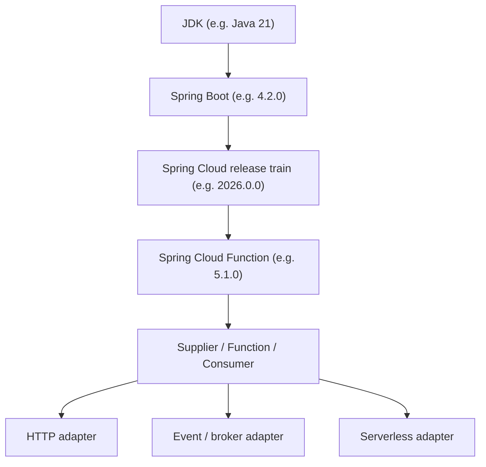
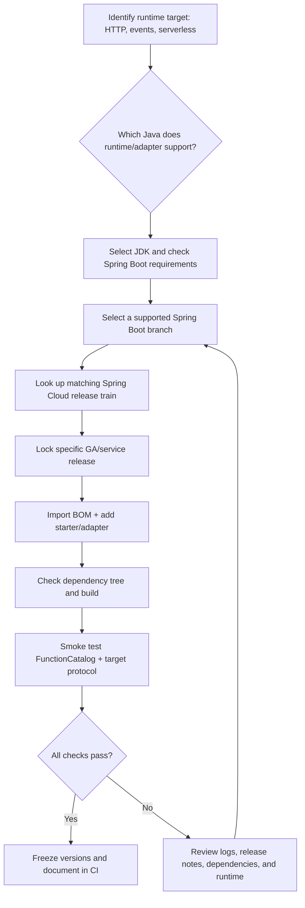

# Choosing Compatible Java, Spring Boot, and Spring Cloud BOM Versions

> **Chapter:** Initialization  
> **Module:** SPRING_CLOUD_FUNCTION  
> **Goal:** Select a compatible Java – Spring Boot – Spring Cloud version set, configure the BOM in Maven/Gradle, and verify that the Spring Cloud Function project actually runs.  
> **Reference date:** November 24, 2026. Versions and support status may change; always verify against official documentation before initializing or upgrading a project.

## 1. Why Must Versions Be Chosen as a Set?

Spring Cloud Function encapsulates business logic into `Supplier<T>`, `Function<T, R>`, and `Consumer<T>`, independent of the invocation protocol. `FunctionCatalog` helps look up and compose functions (*composition*); adapters convert data from HTTP, events, or serverless runtimes to function contracts, including cases requiring payload and `Message<?>` conversion.

To get those capabilities, you do not just need a single Spring Cloud Function library version. The application also depends on Java, Spring Boot, Spring Framework, and ecosystem Spring Cloud modules. Choosing the wrong version at any layer can cause errors at build time, at startup, or when an adapter begins converting messages.

| Component | What Does It Determine? | Common Configuration Location |
| --- | --- | --- |
| **JDK** | Java version used to compile and run; Java APIs, bytecode, and toolchain. | `java.version`, Maven compiler/Gradle toolchain, `JAVA_HOME`. |
| **Spring Boot** | Application foundation, auto-configuration, build plugins, and Spring/third-party library versions. | Maven `spring-boot-starter-parent` or Boot BOM; Gradle Boot plugin. |
| **Spring Cloud release train** | Set of Spring Cloud modules released together as a compatible group for a Spring Boot generation. | BOM `org.springframework.cloud:spring-cloud-dependencies`. |
| **Spring Cloud Function** | Runtime and adapters for `Supplier`/`Function`/`Consumer`, `FunctionCatalog`, composition. | Function starter or module managed by the Spring Cloud BOM. |
| **Integration adapter** | Whether the function is invoked over HTTP, a message broker, or serverless. | Dependencies and configuration for Web, Stream/binder, or provider. |

Relationship diagram:



The numbers above represent **an illustrative verified set** at the time of writing, and do not mean that any Spring Boot version can be paired with any Spring Cloud version.

### 1.1. How Does a Release Train Differ from a Library Version?

A **release train** is a synchronized release group of Spring Cloud projects. For example:

- `2026.0.0`: Spring Cloud release train version.
- `5.1.0`: Spring Cloud Function version included in release train `2026.0.0`.
- `4.2.0`: Spring Boot version corresponding to that release train.

These three numbers serve **different** roles. Do not use `5.1.0` as the version of `spring-cloud-dependencies`, and do not set `2026.0.0` as the Spring Boot version.

A **BOM** (*Bill of Materials*) is a POM that centralizes dependency versions. When importing `spring-cloud-dependencies` in Maven or using the equivalent BOM in Gradle, the build tool selects the Spring Cloud versions managed by the release train. A BOM **does not automatically add** dependencies to the project and **does not replace** Spring Boot parent/plugin configuration.

### 1.2. Three Levels to Verify

A version set is only considered ready when it simultaneously satisfies:

1. **Published compatibility:** Java satisfies Spring Boot's requirements; the Spring Cloud release train supports the chosen Spring Boot generation.
2. **Dependency/build compatibility:** Maven or Gradle resolves dependencies and plugins; the runtime classpath has no library conflicts.
3. **Functional compatibility:** The application starts; `FunctionCatalog` recognizes the function; the intended adapter invokes the function successfully. For serverless, also verify the provider's runtime version.

Choosing the right matrix is **the starting point**, not a substitute for testing.

## 2. Reading the Spring Boot ↔ Spring Cloud Matrix

### 2.1. Representative Version Sets

The table below summarizes branches to **identify compatibility**; it does not imply that every branch is still supported for new applications as of November 24, 2026.

| Spring Boot | Spring Cloud release train | Spring Cloud Function per train | Interpretation |
| --- | --- | --- | --- |
| **4.2.0** | **2026.0.0 (Paddington)** | **5.1.0** | GA set announced on November 20, 2026; used as the main example in this guide. |
| **4.1.x** | **2025.1.2+ (Oakwood)** | 5.0.x per BOM | Supports Boot 4.1.x starting from train `2025.1.2`. |
| **4.0.x** | **2025.1.x (Oakwood)** | 5.0.x per BOM | Boot 4.0 branch; choose the latest appropriate service release. |
| **3.5.x** | **2025.0.x (Northfields)** | 4.3.x per BOM | Published pair for the Boot 3.5 branch. |
| **3.4.x** | **2024.0.x (Moorgate)** | 4.2.x per BOM | Historical pair for maintaining systems still on Boot 3.4. |
| **3.3.x** | **2023.0.2+ (Leyton)** | 4.1.x per BOM | For Boot 3.3, train must be at least `2023.0.2`. |
| **3.2.x** | **2023.0.x (Leyton)** | 4.1.x per BOM | Historical pair for Boot 3.2. |

**Regarding support status:** Spring Cloud documentation marks older release trains as end-of-life (EOL); even a **technically compatible** pair may **no longer be maintained**. Prefer release trains that are still supported according to your project and deployment platform policies. If an older branch must be maintained, clearly identify the support mechanism and upgrade plan.

Reference documentation:

- Spring Cloud release trains and compatibility table: https://spring.io/projects/spring-cloud/
- Train 2026.0.0 documentation, specifying Spring Boot 4.2.0: https://docs.spring.io/spring-cloud-release/reference/
- Announcement of 2026.0.0 and Spring Cloud Function 5.1.0: https://spring.io/blog/2026/11/20/spring-cloud-2026-0-0-has-been-released/

### 2.2. Do Not Confuse "Compatible" with "Latest"

Suppose you have an existing Boot `3.5.x` application:

- Choose Spring Cloud `2025.0.x` from the corresponding train.
- Do not upgrade Spring Cloud alone to `2026.0.0` while keeping Boot `3.5.x`.
- If you want to use Spring Cloud `2026.0.0`, plan to upgrade **both** Boot to `4.2.0` and evaluate the impact of changing framework generations.

Conversely, if starting a new project and all your adapters/SDKs/serverless runtimes support the new set, you can choose Boot `4.2.0` + Cloud `2026.0.0`. This is the set used throughout the examples below.

### 2.3. Rules for Choosing a Maintenance Release

The trailing `x` notations represent patch/service releases, such as `2025.1.x`. To finalize a real project:

1. Choose a Boot/Cloud **line** with an official compatibility relationship.
2. Choose an appropriate maintained **GA/service release** within that line—do not assume the highest numbers across the ecosystem can always be mixed.
3. Check release notes, Java requirements, support schedules, and breaking changes.
4. Pin exact versions in the build and update in a controlled manner with tests/CI.

Do not use `SNAPSHOT`, `M1`, or `RC` in normal operational environments unless there is a clear experimental need.

## 3. Choosing the Right Java Version

### 3.1. Minimum Requirements and Practical Choice

According to **Spring Boot 4.2.0 System Requirements**, Boot 4.2.0 requires at least **Java 17**, and documentation at the reference date states compatibility up to Java 27. However, a third-party library or runtime may impose its own restrictions.

For a project learning Spring Cloud Function with the Boot 4.2.0 + Cloud 2026.0.0 set, **Java 21 LTS** is a practical choice for examples because:

- It is above the Java 17 minimum.
- It has a widely adopted toolchain and ecosystem.
- It can stay consistent between developer machines and CI without requiring the very latest JDK release.

Java 17, Java 21, or Java 25 may be worth considering depending on organizational standards, support lifecycles, and target runtimes. Especially for **serverless**, confirm that the provider offers the corresponding Java runtime and that the Function adapter supports that combination. A JDK higher than the minimum requirement **does not automatically** guarantee compatibility with every adapter.

Source: https://docs.spring.io/spring-boot/system-requirements.html

### 3.2. Distinguishing the JDK Running Maven, Source Version, and Runtime

In a Java application, multiple Java versions can be involved simultaneously:

- **Build tool JDK:** `mvn -v` or `gradlew -version` shows the Java used to run Maven/Gradle.
- **Language level/toolchain:** `java.version` (Maven via Boot parent) or `java.toolchain` (Gradle) specifies the Java used during compilation.
- **Bytecode target:** the class file version that the runtime JVM must understand; can be set via the `--release` option.
- **Actual runtime:** `java -version` on the server/container/serverless environment.

For example, compiling Java 21 bytecode and deploying to a runtime that only has Java 17 will throw `UnsupportedClassVersionError`, even if the Maven build succeeded on the developer's machine.

Basic verification commands:

```bash
java -version
javac -version
mvn -v
```

With the project's Maven Wrapper (Linux/macOS):

```bash
./mvnw -v
```

On Windows PowerShell:

```powershell
java -version
javac -version
./mvnw.cmd -v
```

If the commands report different versions, check `JAVA_HOME`, `PATH`, IDE settings, and the CI toolchain before blaming Spring Cloud.

## 4. Complete Maven Example with a Compatible Version Set

### 4.1. Version Decisions for the Lesson

The example is pinned so learners can copy and verify it:

| Property | Value |
| --- | --- |
| Compile/runtime JDK | Java **21** |
| Spring Boot parent | **4.2.0** |
| Spring Cloud release train/BOM | **2026.0.0** |
| Spring Cloud Function managed by BOM | **5.1.0** |
| Illustrative adapter | `spring-cloud-starter-function-web` |
| Build tool | Maven meeting Boot 4.2.0 requirements, e.g. Maven 3.9.x |

Spring Boot 4.2.0 supports Maven 3.6.3 or newer. The example uses Maven 3.9.x for convenience, without claiming it is the minimum Maven version.

### 4.2. `pom.xml`

```xml
<?xml version="1.0" encoding="UTF-8"?>
<project xmlns="http://maven.apache.org/POM/4.0.0"
         xmlns:xsi="http://www.w3.org/2001/XMLSchema-instance"
         xsi:schemaLocation="
           http://maven.apache.org/POM/4.0.0
           https://maven.apache.org/xsd/maven-4.0.0.xsd">
    <modelVersion>4.0.0</modelVersion>

    <parent>
        <groupId>org.springframework.boot</groupId>
        <artifactId>spring-boot-starter-parent</artifactId>
        <version>4.2.0</version>
        <relativePath/>
    </parent>

    <groupId>vn.example</groupId>
    <artifactId>scf-version-demo</artifactId>
    <version>0.0.1-SNAPSHOT</version>
    <name>scf-version-demo</name>

    <properties>
        <java.version>21</java.version>
        <spring-cloud.version>2026.0.0</spring-cloud.version>
    </properties>

    <dependencyManagement>
        <dependencies>
            <dependency>
                <groupId>org.springframework.cloud</groupId>
                <artifactId>spring-cloud-dependencies</artifactId>
                <version>${spring-cloud.version}</version>
                <type>pom</type>
                <scope>import</scope>
            </dependency>
        </dependencies>
    </dependencyManagement>

    <dependencies>
        <dependency>
            <groupId>org.springframework.cloud</groupId>
            <artifactId>spring-cloud-starter-function-web</artifactId>
        </dependency>

        <dependency>
            <groupId>org.springframework.boot</groupId>
            <artifactId>spring-boot-starter-test</artifactId>
            <scope>test</scope>
        </dependency>
    </dependencies>

    <build>
        <plugins>
            <plugin>
                <groupId>org.springframework.boot</groupId>
                <artifactId>spring-boot-maven-plugin</artifactId>
            </plugin>
        </plugins>
    </build>
</project>
```

**Explanation of each section:**

1. `spring-boot-starter-parent:4.2.0` manages Spring Boot's default configuration and dependencies.
2. `java.version=21` selects the Java level used for compilation according to the Boot parent configuration.
3. `spring-cloud.version=2026.0.0` is the **release train**, not the individual Function version.
4. `dependencyManagement` with `type=pom` and `scope=import` imports Spring Cloud versions from the BOM.
5. `spring-cloud-starter-function-web` is the actual dependency added to the application so Spring Cloud Function is exposed over HTTP in a supported Web context.
6. The Function starter has **no** separate `<version>` tag; the Spring Cloud BOM determines the appropriate version.
7. `spring-boot-maven-plugin` handles packaging/running the Boot application; the plugin version is managed by the Boot parent.

Do not place `spring-cloud-dependencies` inside `<dependencies>` as a JAR library; it is a BOM for version management, not a starter.

### 4.3. Function Bean Example to Verify Configuration

Create the class `src/main/java/vn/example/functiondemo/FunctionDemoApplication.java`:

```java
package vn.example.functiondemo;

import java.util.Locale;
import java.util.function.Function;

import org.springframework.boot.SpringApplication;
import org.springframework.boot.autoconfigure.SpringBootApplication;
import org.springframework.context.annotation.Bean;

@SpringBootApplication
public class FunctionDemoApplication {

    public static void main(String[] args) {
        SpringApplication.run(FunctionDemoApplication.class, args);
    }

    @Bean
    public Function<String, String> normalizeCode() {
        return raw -> raw.trim().toUpperCase(Locale.ROOT);
    }
}
```

The `normalizeCode` bean uses the `java.util.function.Function` interface, separating normalization logic from HTTP. When adding composition later, a `validateCode` function can be registered similarly and looked up with `FunctionCatalog.lookup("normalizeCode|validateCode")`.

In this initialization step, we only need to prove that **the version pair and adapter** run smoothly, without needing a broker or serverless environment.

### 4.4. Build and Test Over HTTP

Inside the project directory containing `pom.xml`:

```bash
./mvnw clean test
./mvnw spring-boot:run
```

If the project does not have a Maven Wrapper yet, use an installed `mvn` accordingly. On Windows replace `./mvnw` with `./mvnw.cmd`.

Once the application is running, open another terminal and call the endpoint following the web adapter convention:

```bash
curl -X POST http://localhost:8080/normalizeCode \
  -H "Content-Type: text/plain" \
  --data "  od-123  "
```

Expected response body:

```text
OD-123
```

`curl` in Windows PowerShell may be a different alias depending on the environment; if you need syntax matching real cURL, use `curl.exe` and pass shell-appropriate arguments.

**Why the endpoint works:** the Web starter provides an adapter layer that receives HTTP requests, locates the matching function bean, and passes the String payload into `Function<String, String>`. The business layer does not need to declare a controller. The function signature, request content, and adapter determine the conversion details.

Web adapter documentation: https://docs.spring.io/spring-cloud-function/reference/spring-cloud-function/standalone-web-applications.html

## 5. Equivalent Gradle Configuration

Maven is not mandatory. If the project uses **Gradle Groovy DSL**, you can describe the same version set in `build.gradle`:

```groovy
plugins {
    id 'java'
    id 'org.springframework.boot' version '4.2.0'
    id 'io.spring.dependency-management' version '1.1.7'
}

group = 'vn.example'
version = '0.0.1-SNAPSHOT'

repositories {
    mavenCentral()
}

java {
    toolchain {
        languageVersion = JavaLanguageVersion.of(21)
    }
}

ext {
    set('springCloudVersion', '2026.0.0')
}

dependencyManagement {
    imports {
        mavenBom "org.springframework.cloud:spring-cloud-dependencies:${springCloudVersion}"
    }
}

dependencies {
    implementation 'org.springframework.cloud:spring-cloud-starter-function-web'
    testImplementation 'org.springframework.boot:spring-boot-starter-test'
}

tasks.named('test') {
    useJUnitPlatform()
}
```

Notes:

- `org.springframework.boot` is the **Gradle plugin**, whose version matches the selected Spring Boot version.
- `io.spring.dependency-management` is used here to illustrate importing the Spring Cloud BOM. The example uses plugin version `1.1.7` from the release train's published guide; before using it in a real project, check for the latest compatible release.
- `java.toolchain` selects JDK 21 for compilation; the tool must find this JDK locally or via toolchain provisioning configuration.
- `spring-cloud-starter-function-web` does not require a version declaration because it is managed by the BOM.
- Spring Boot 4.2.0 supports Gradle 8.14+ in the 8.x branch, or Gradle 9.x according to official documentation. Also verify the project's wrapper version.

Run:

```bash
./gradlew --version
./gradlew clean test
./gradlew bootRun
```

In Windows PowerShell use `./gradlew.bat`. Do not maintain both `pom.xml` and `build.gradle` simultaneously as two separate configuration sources for the same build without a clear strategy.

### 5.1. Comparing Maven BOM and Gradle BOM

| Maven | Gradle |
| --- | --- |
| `<dependencyManagement>` + `<type>pom</type>` + `<scope>import</scope>`. | `dependencyManagement { imports { mavenBom(...) } }` when using the dependency-management plugin. |
| Spring Boot parent can provide default versions/plugins. | Boot Gradle plugin manages Boot tasks; BOM/import helps manage dependency versions. |
| Inspect using `help:effective-pom` and `dependency:tree`. | Inspect using `dependencies` and `dependencyInsight`. |

Gradle also supports native `platform(...)`, but if you switch BOM import mechanisms, you must understand version precedence between platforms and version constraints. For the first lesson, stick to one consistent import mechanism for easy verification.

## 6. Verifying Which Versions Were Actually Resolved

Looking only at version properties in the build file is not enough: dependencies may be pulled in via transitive dependencies, another BOM, or overridden by explicit declarations.

### 6.1. Maven: Inspecting the Effective POM and Dependency Tree

```bash
./mvnw help:effective-pom
./mvnw dependency:tree
```

Filter dependencies in a way supported by the build tool/shell, for example:

```bash
./mvnw dependency:tree -Dincludes=org.springframework.cloud
```

Points to cross-check:

- Spring Boot parent remains `4.2.0`.
- Spring Cloud BOM is imported at version `2026.0.0`.
- `spring-cloud-function-context` and Function-related modules resolve to the `5.1.0` line per the BOM.
- No older Spring Framework/Function version is forced by a manually declared dependency.

The `dependency:tree` command shows **dependencies actually added** to the project, not every component listed in the BOM if unused.

### 6.2. Gradle: Viewing Selected Dependencies

```bash
./gradlew dependencies --configuration runtimeClasspath
./gradlew dependencyInsight --dependency spring-cloud-function-context --configuration runtimeClasspath
```

`dependencyInsight` shows which request pulled in the dependency, why that version was chosen, and version conflicts (if any).

### 6.3. Verifying with Application Startup and an Actual Invocation

If the BOM is right but the adapter is wrong or the classpath is missing a component, the app can still fail at runtime. Therefore, add a minimal integration test:

```java
package vn.example.functiondemo;

import static org.junit.jupiter.api.Assertions.assertEquals;

import java.util.function.Function;

import org.junit.jupiter.api.Test;
import org.springframework.beans.factory.annotation.Autowired;
import org.springframework.boot.test.context.SpringBootTest;
import org.springframework.cloud.function.context.FunctionCatalog;

@SpringBootTest
class FunctionCatalogTest {

    @Autowired
    FunctionCatalog catalog;

    @Test
    void normalizeCodeIsAvailable() {
        Function<String, String> f = catalog.lookup("normalizeCode");
        assertEquals("OD-123", f.apply("  od-123  "));
    }
}
```

Place the test file at `src/test/java/vn/example/functiondemo/FunctionCatalogTest.java`. This test proves that `FunctionCatalog` is loaded and recognizes the Function bean, though an HTTP smoke test is still needed to verify that the Web adapter actually serves requests.

In CI, run `test`, `package` (or `bootJar`), and a real startup smoke test together. Running `mvn dependency:tree` alone does not certify runtime compatibility.

## 7. Choosing a Version Set by Deployment Environment

Spring Cloud Function is designed so the same business logic can be used over HTTP, events, or serverless, but infrastructure constraints differ for each environment.

| Environment | Additional Checks Beyond Boot/Cloud/JDK | Example Risks |
| --- | --- | --- |
| **HTTP** | Function Web starter, Spring MVC/WebFlux matching the adapter, content type, serialization. | App runs but has no HTTP mapping or fails to convert payload. |
| **Events/broker** | Spring Cloud Stream, Kafka/RabbitMQ binder, message shape, serialization, and retries. | Function bean exists, but input/output bindings are not connected to the broker. |
| **Serverless** | Exact platform adapter, provider-supported Java runtime, packaging/handler, cold start. | Build runs locally, but the serverless runtime fails to start or the handler is incompatible. |

Example of a pure function:

```java
@Bean
public Function<String, String> normalizeCode() {
    return code -> code.trim().toUpperCase(Locale.ROOT);
}
```

This function is reusable business logic. To run over HTTP, it needs a Web adapter; to receive events, it needs an event system adapter/binder; to run serverless, it needs the packaging and runtime officially supported by the provider. **You cannot infer cross-platform compatibility solely from having the right Spring Cloud BOM version.**

### 7.1. Rules for Serverless Deployment

- Cross-check **all** versions of the provider adapter, Java runtime, and Spring Cloud Function.
- Read release notes on fat JAR packaging, handler classes, native images, and supported starters.
- If the provider's adapter does not yet support the latest branch, choose an **older but still supported Boot/Cloud set** or plan an adapter upgrade; avoid forcing a standalone Function dependency override.
- Test the actual deployment package in an environment matching the target runtime before publishing.

### 7.2. Message Conversion Boundaries

In HTTP/event adapters, Spring Cloud Function can handle data conversion based on the function signature. However, this still depends on codecs, content types, `Message<?>` metadata, and adapter versions. Upgrading versions can expose differences in JSON serialization or conversion. When changing major release trains, test at least:

- Simple payloads (`String`/DTO) and invalid payloads.
- Important message headers.
- Composition (`normalizeCode|validateCode`).
- `Consumer` retries/side effects and `Supplier` emission mechanisms if used by the application.

## 8. Common Versioning Errors

### 8.1. Spring Boot and Spring Cloud Are Not on the Same Train

**Scenario:** `spring-boot-starter-parent=4.2.0`, but the Spring Cloud BOM is still `2025.0.x` (meant for Boot 3.5).

**Symptoms:** startup fails due to the version verifier or due to binary incompatibility/auto-configuration errors.

**Fix:** consult the official matrix and move both together to Boot `4.2.0` + Cloud `2026.0.0`. Do not work around it by disabling `spring.cloud.compatibility-verifier.enabled`; disabling the check does not make libraries compatible.

### 8.2. Using the Wrong Kind of Version for the BOM

**Scenario:** configuring `spring-cloud-dependencies:5.1.0` after seeing that Spring Cloud Function has version `5.1.0`.

**Cause:** confusing the module version with the release train. The correct BOM for the example set is `spring-cloud-dependencies:2026.0.0`.

### 8.3. Pinning Individual Spring Cloud Dependency Versions

**Scenario:** the BOM uses `2026.0.0`, yet `spring-cloud-function-context` is forced to `4.3.x`.

**Risk:** mixing APIs from two generations of Spring Cloud Function, leading to `NoSuchMethodError`, `ClassNotFoundException`, or subtle message conversion bugs.

**Fix:** remove unnecessary version overrides; let the BOM manage versions. Only override when there is a specific reason and it has been tested alongside release notes.

### 8.4. Java/Class File Errors

- `UnsupportedClassVersionError`: the Java runtime is too old for the compiled bytecode.
- `invalid target release: 21`: the compiling JDK does not support target Java 21, or the compiler/toolchain is misconfigured.
- Build passes in IDE but fails in CI: JDKs and toolchains differ.

**Fix:** verify `java -version`, `mvn -v`/`gradlew -version`, `JAVA_HOME`, wrapper, and Docker/serverless runtimes; align the Java version used for build and deployment.

### 8.5. BOM Imported but Starter Missing

The BOM only manages versions. Without the necessary starter dependency, `FunctionCatalog` or the HTTP handler may be missing.

**Fix:** add the Function starter as needed. For the HTTP example, use `spring-cloud-starter-function-web`; for events and serverless, add the corresponding adapter.

### 8.6. Dependencies Fail to Download

Errors like `Non-resolvable import POM` or `Could not resolve ...` can result from wrong coordinates, an unreleased version in the configured repository, proxy/network issues, or build caches.

**Fix:** check BOM coordinates, whether the GA release exists on Maven Central, repository settings, and the exact error message. Do not switch to SNAPSHOT just to "make the build pass".

### 8.7. Major Upgrade Without Checking API Changes

Jumping from Boot 3.x/Cloud 2025.0 to Boot 4.x/Cloud 2026.0 brings underlying Spring Framework 7 and library changes that can affect tests, logging, JSON, packaging, or adapters. **Compile success** does not mean business flows work properly with real data.

**Fix:** read migration guides/release notes, run unit/integration/adapter tests, and re-verify message paths.

## 9. Version Selection Workflow for New Projects or Upgrades

You can use the following workflow to avoid "guessing" version numbers:



**Step 1 – Identify infrastructure constraints.** Record Java runtime, serverless provider, broker/binder version, build tool, and long-term support requirements.

**Step 2 – Choose Spring Boot.** Refer to https://spring.io/projects/spring-boot/ and the system requirements documentation for that exact Boot version.

**Step 3 – Choose Spring Cloud BOM.** Use the table at https://spring.io/projects/spring-cloud/ or the corresponding release train docs. Prefer a line that is still supported.

**Step 4 – Let the BOM manage Function.** Add `spring-cloud-starter-function-web` or other adapter dependencies as needed; do not mix in a Function version from another train.

**Step 5 – Verify.** Check dependency resolution, run the `FunctionCatalog` unit test, start the application, and test against the intended environment/protocol.

**Step 6 – Document the decision.** Record Java, Boot, Cloud BOM, adapter, Maven/Gradle wrapper versions, rationale, and documentation check date. When updating, review the entire compatibility group rather than changing a single version number.

## 10. Exercises: Choosing and Proving a Compatible Set

### Exercise 1. Initialize an HTTP Project

1. Choose Java 21, Spring Boot 4.2.0, Spring Cloud BOM 2026.0.0.
2. Create a Maven project with `spring-cloud-starter-function-web` following `pom.xml` in section 4.
3. Add a `Function<String, String> normalizeCode` bean.
4. Use `dependency:tree` to prove that Spring Cloud Function belongs to the imported release train.
5. Start the app and call `POST /normalizeCode` with body `"  od-123  "`; record the `"OD-123"` response.

### Exercise 2. Explain a Misconfiguration

Given the project:

```xml
<parent>
    <groupId>org.springframework.boot</groupId>
    <artifactId>spring-boot-starter-parent</artifactId>
    <version>3.5.0</version>
</parent>
<!-- Wrong: train 2026.0.0 is for Boot 4.2.0 -->
<properties>
    <spring-cloud.version>2026.0.0</spring-cloud.version>
</properties>
```

Answer:

- Which **relationship** between the two versions causes the problem?
- If you want to stay on Spring Boot 3.5.x, which Spring Cloud branch should you choose?
- If you want to use Cloud 2026.0.0, what must change before building/testing?

**Answer hint:** Boot 3.5.x pairs with Cloud 2025.0.x; Cloud 2026.0.0 goes with Boot 4.2.0. When changing Boot major versions, inspect Java/runtime and all adapters/SDKs in use.

### Exercise 3. Replacing HTTP with Events (Design Analysis)

Keep the `normalizeCode` logic unchanged. List the additional factors that must be selected to turn it into an event processor: appropriate Spring Cloud Stream/binder, broker, content type, retries, destination/binding, and how side effects are managed. Explain why **changing the adapter** does not require modifying the string normalization rules.

### Exercise Completion Criteria

Learners can explain on their own:

- Why Java, Boot, and Cloud must be selected as a compatible set.
- Why `2026.0.0` is the release train/BOM while `5.1.0` is the Spring Cloud Function version.
- The difference between `dependencyManagement` (version management) and `dependencies` (adding libraries).
- How to verify that Maven/Gradle resolved the right dependencies and that the app actually invokes the function.
- Additional checks needed when deploying the same function over HTTP, events, or serverless.

## Official References for Ongoing Updates

1. **Spring Cloud – compatibility table and support lifecycle:** https://spring.io/projects/spring-cloud/
2. **Spring Cloud 2026.0.0 – November 20, 2026 announcement:** https://spring.io/blog/2026/11/20/spring-cloud-2026-0-0-has-been-released/
3. **Spring Cloud release train reference:** https://docs.spring.io/spring-cloud-release/reference/
4. **Spring Boot – releases:** https://spring.io/projects/spring-boot/
5. **Spring Boot – Java, Maven, and Gradle requirements:** https://docs.spring.io/spring-boot/system-requirements.html
6. **Spring Cloud Function – version and functional programming documentation:** https://docs.spring.io/spring-cloud-function/reference/
7. **Spring Cloud Function – Web adapter and HTTP mappings:** https://docs.spring.io/spring-cloud-function/reference/spring-cloud-function/standalone-web-applications.html
8. **Spring Initializr – generate projects and BOMs for selected Boot versions:** https://start.spring.io/
