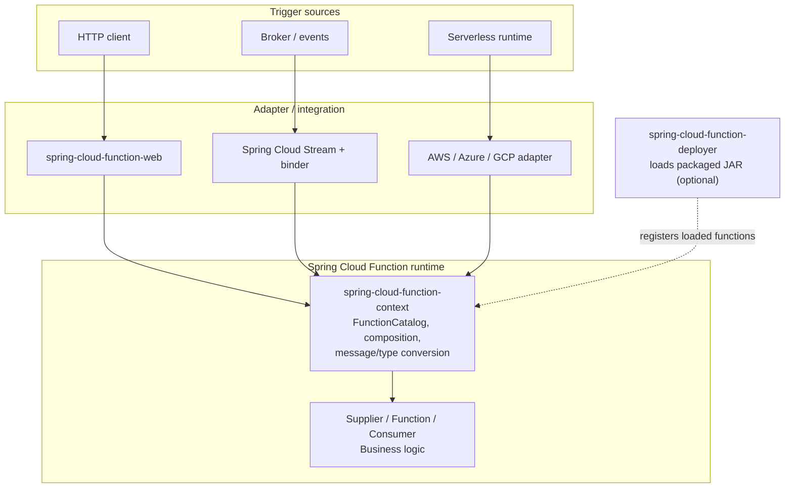
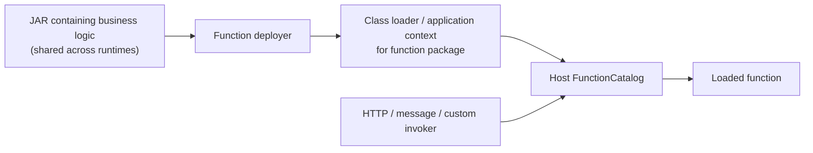
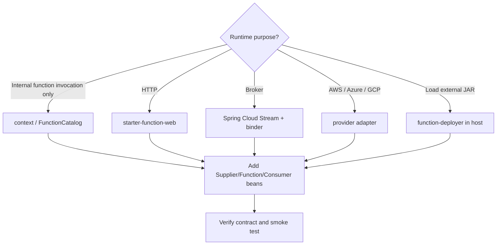

# The context, web, deployer, and Platform Adapter Modules

> **Chapter:** Initialization  
> **Study Module:** SPRING_CLOUD_FUNCTION  
> **Topic:** Spring Cloud Function module structure, the role of each dependency, and how to choose modules when deploying over HTTP, events, or serverless.

## 1. Objectives and Architectural Overview

Spring Cloud Function helps develop reusable business logic using `Supplier<T>`, `Function<T, R>`, and `Consumer<T>`. Java functions are registered, looked up, and composed via `FunctionCatalog`; a corresponding adapter receives requests from HTTP, events, or serverless environments. Therefore, to initialize a project properly, you must understand **which module contains the function execution logic, which module provides the invocation protocol, and which module loads code from external packages**.

After this lesson, learners should be able to:

1. Distinguish `spring-cloud-function-context`, `spring-cloud-function-web`, `spring-cloud-function-deployer`, and `spring-cloud-function-adapter-*`.
2. Choose dependencies for applications running in JVM, HTTP, event/broker, or serverless modes; know when deployer is not needed.
3. Register function beans, look up functions using `FunctionCatalog`, and create compositions.
4. Understand how adapters pass payloads, headers, and content types into functions and why message conversion still requires configuration.
5. Use protocol-agnostic business logic to envision three different deployment modes.



The key takeaway: `context` contains the execution and function discovery mechanism. `web` and platform adapters are **communication gateways** into that mechanism. `deployer` solves a different problem: **loading functions packaged outside the host application**.

## 2. Quick Comparison Table of Modules

| Module/component | Maven artifact or technology name | Primary responsibility | When to use |
| --- | --- | --- | --- |
| **Context** | `spring-cloud-function-context` | Integrates function beans with Spring, provides `FunctionCatalog`, composition, invocation orchestration, and conversion support. | When invoking functions via catalog inside a Spring application or writing a runtime adapter. |
| **Web** | `spring-cloud-function-web` | Auto-configuration exposing functions as HTTP endpoints in a compatible Spring Boot Web/MVC application. | When exposing functions over simple HTTP. |
| **Web starter** | `spring-cloud-starter-function-web` | Bundles dependencies for convenient use of the Web adapter. | The common way to initialize an HTTP application. |
| **Deployer** | `spring-cloud-function-deployer` | Loads a JAR/archived application containing functions with an isolated class loader; registers discovered functions into the host's catalog. | When the host needs to load function packages from an external path/coordinate. |
| **AWS Lambda adapter** | `spring-cloud-function-adapter-aws` | Connects Spring Cloud Function to AWS Lambda's invocation model. | Packaging/running functions on AWS Lambda. |
| **Azure Functions adapter** | `spring-cloud-function-adapter-azure` | Integrates Spring/`FunctionCatalog` with Azure Functions handlers and bindings. | Writing Azure Functions with Spring and the Azure Java Worker. |
| **Azure Web adapter** | `spring-cloud-function-adapter-azure-web` | Integrates Spring Web applications with Azure HTTP triggers. | Running the Spring Web model on Azure Functions via the dedicated adapter. |
| **Google Cloud adapter** | `spring-cloud-function-adapter-gcp` | Connects functions with Google Cloud Functions and Functions Framework. | Running functions on Google Cloud Functions. |
| **Spring Cloud Stream + binder** | Corresponding Spring Cloud Stream/binder artifacts | Receives/sends messages to brokers and maps bindings to function beans. | Processing Kafka, RabbitMQ, or messaging systems via binders. |

**Not all of them are required.** A minimal HTTP project usually needs only the Web starter and compatible Spring Boot/BOM configurations. Add AWS/Azure/GCP adapters or deployer only when the architecture truly calls for them.

Some artifacts pull in the `context` dependency *transitively*. So when using a starter, you do not need to redundantly declare every underlying module. Inspect the dependency tree before deciding to add another module.

## 3. `spring-cloud-function-context`: The Core of Spring Function Integration

### 3.1. The Programming Contract Is Standard Java

Spring Cloud Function uses interfaces from `java.util.function`:

| Interface | Method | Meaning |
| --- | --- | --- |
| `Supplier<T>` | `T get()` | Generates or supplies data. |
| `Function<T, R>` | `R apply(T input)` | Transforms data and produces a result. |
| `Consumer<T>` | `void accept(T input)` | Consumes data, typically with side effects. |

To keep logic independent of HTTP or brokers, declare beans like this:

```java
package vn.example.function;

import java.util.Locale;
import java.util.function.Consumer;
import java.util.function.Function;
import java.util.function.Supplier;

import org.springframework.boot.SpringApplication;
import org.springframework.boot.autoconfigure.SpringBootApplication;
import org.springframework.context.annotation.Bean;

@SpringBootApplication
public class FunctionApplication {

    public static void main(String[] args) {
        SpringApplication.run(FunctionApplication.class, args);
    }

    @Bean
    public Function<String, String> normalizeCode() {
        return raw -> raw.trim().toUpperCase(Locale.ROOT);
    }

    @Bean
    public Function<String, String> validateCode() {
        return code -> {
            if (!code.matches("[A-Z]{2}-[0-9]{3}")) {
                throw new IllegalArgumentException("Invalid code: " + code);
            }
            return code;
        };
    }

    @Bean
    public Supplier<String> exampleCode() {
        return () -> "OD-123";
    }

    @Bean
    public Consumer<String> auditCode() {
        return code -> System.out.println("Received: " + code);
    }
}
```

The example uses an order code formatted like `OD-123`. `normalizeCode` itself does not know whether the string came from an HTTP body, a Kafka message, or an AWS Lambda event. **Receiving and passing the data** is the responsibility of the adapter.

`Supplier` and `Consumer` in the example illustrate the contracts; in real applications, `Supplier` might query a data source while `Consumer` might write to a DB or publish an event. When handling events, proactively design for idempotency so retries do not produce duplicate side effects.

### 3.2. What Does `FunctionCatalog` Do?

Spring Cloud Function discovers `Supplier`, `Function`, and `Consumer` beans, standardizes how they are invoked, and provides a lookup API by name. You do not need to manually hold references to each bean when an adapter determines the function name at runtime.

```java
import java.util.function.Function;

import org.springframework.cloud.function.context.FunctionCatalog;
import org.springframework.stereotype.Service;

@Service
public class OrderCodeService {

    private final Function<String, String> pipeline;

    public OrderCodeService(FunctionCatalog catalog) {
        this.pipeline = catalog.lookup("normalizeCode|validateCode");
    }

    public String process(String rawCode) {
        return pipeline.apply(rawCode);
    }
}

// process(" od-123 ") -> "OD-123"
// process(" ? ")       -> IllegalArgumentException
```

Here:

- `normalizeCode` and `validateCode` are **bean names** from the `@Bean` methods.
- `|` is Spring Cloud Function's composition syntax: the output of the preceding function becomes the input of the next function.
- `FunctionCatalog.lookup(...)` returns a function adapted by the framework for invocation or adapter integration.
- Composition requirement: adjacent data types must be compatible, either directly or through framework-provided conversion.

You can select a definition for an adapter via configuration:

```properties
spring.cloud.function.definition=normalizeCode|validateCode
```

When multiple functions exist, declaring an explicit definition avoids ambiguity around default selection. However, **a definition does not create an HTTP server, Kafka consumer, or AWS handler**; an adapter establishes the connection to the trigger source.

### 3.3. `Message<?>`, Headers, and Data Conversion

Input from a protocol typically consists of two parts: **payload** (business data) and **metadata** (content type, correlation ID, event source, etc.). Spring Messaging represents them via `Message<T>`.

```java
import java.util.function.Function;

import org.springframework.context.annotation.Bean;
import org.springframework.messaging.Message;
import org.springframework.messaging.support.MessageBuilder;

@Bean
public Function<Message<String>, Message<String>> normalizeMessage() {
    return message -> {
        String normalized = message.getPayload().trim().toUpperCase();
        return MessageBuilder.withPayload(normalized)
                .copyHeaders(message.getHeaders())
                .setHeader("processedBy", "normalizeMessage")
                .build();
    };
}
```

> The `@Bean` method above is part of a `@Configuration` or `@SpringBootApplication` class; it is not a complete standalone Java file. For locale-independent uppercase normalization, production code should use `toUpperCase(Locale.ROOT)`.

`context` supports conversion based on **the declared input/output types of the function** and, when `Message<?>` is present, **contentType** information. For example, when a function accepts a DTO, an HTTP adapter may supply a JSON payload and `Content-Type: application/json` header; the framework will apply the appropriate converter before invoking the function. Invalid data or failing to find a suitable converter will throw an error.

Be sure to distinguish:

- `MessageConverter`: uses payload/headers when input is a message and type conversion is needed.
- `ConversionService`: converts types for data not wrapped in `Message<?>`.
- `contentType`: format hint; **does not replace** the target type and does not guarantee every payload can be converted.
- `Message<T>`: type carrying both payload and headers; preserving/forwarding headers in the output follows specific rules and adapter behavior.

When an application converts messages across HTTP, events, and serverless, test schemas, DTO types, content types, and critical headers on **each adapter**.

### 3.4. Using Only `context`, Without `web`

A Spring Boot application may only need Spring Cloud Function at the catalog level to orchestrate internal logic. For example, in a command-line/worker application that looks up `normalizeCode` from configuration, you can use `spring-cloud-function-context` without adding the Web starter. In that case, the application **does not automatically expose HTTP endpoints** simply because function beans exist.

When using the HTTP starter, the `context` dependency is typically brought in transitively. Avoid mechanically adding every artifact.

## 4. `spring-cloud-function-web`: Exposing Functions Over HTTP

### 4.1. How Does the Web Module Differ from `context`?

`context` knows how to find and invoke functions; `web` knows how to map HTTP requests to functions in the catalog and build responses. The Web module provides auto-configuration for Spring Boot Web applications supporting Spring MVC. To get started quickly with HTTP, use `spring-cloud-starter-function-web` to bundle the appropriate dependencies.

Maven example with the Spring Cloud BOM already imported:

```xml
<dependency>
    <groupId>org.springframework.cloud</groupId>
    <artifactId>spring-cloud-starter-function-web</artifactId>
</dependency>
```

Do not declare a separate version for the starter when a compatible Spring Cloud BOM already manages it. In this initialization chapter, you can use Java 21 + Spring Boot 4.2.0 + Spring Cloud BOM 2026.0.0; when upgrading later, re-check the official compatibility matrix.

### 4.2. Common HTTP Mappings

With the Web adapter enabled, the function name typically appears in the URL path. Typical mappings per the documentation:

| Function Kind | Example HTTP Request | Meaning |
| --- | --- | --- |
| `Function<String, String>` | `POST /normalizeCode` | Passes the request body into `apply(...)` and returns the result. |
| `Function<String, String>` | `GET /normalizeCode/od-123` | Uses the path item as the function's input. |
| `Supplier<String>` | `GET /exampleCode` | Calls `get()` to retrieve data. |
| `Consumer<String>` | `POST /auditCode` | Sends data to `accept(...)`; response follows the adapter contract. |

The Web adapter also supports other methods/formats depending on the function kind; the table above lists only easy-to-test scenarios. If the application has only one eligible function, default mapping may allow omitting the function name from the path, but **you should invoke by explicit name in multi-bean examples**.

### 4.3. Testing HTTP with cURL

With the `FunctionApplication` from section 3 and the Web starter, start the app and use another terminal:

```bash
curl -i -X POST http://localhost:8080/normalizeCode \
  -H "Content-Type: text/plain" \
  --data "  od-123  "
```

Expected response body:

```text
OD-123
```

Calling a Supplier:

```bash
curl -i http://localhost:8080/exampleCode
```

Sending data to a Consumer:

```bash
curl -i -X POST http://localhost:8080/auditCode \
  -H "Content-Type: text/plain" \
  --data "OD-123"
```

For Consumer endpoints, the Web adapter typically returns `202 Accepted` on POST per the HTTP mapping documentation; do not assume a Consumer will return business data because `accept(...)` returns `void`.

If you want to change the endpoint prefix, you can use:

```properties
spring.cloud.function.web.path=/functions
```

Then the function path becomes `/functions/normalizeCode`. When changing the base path or using a reverse proxy, verify the actual endpoint in the deployment environment.

### 4.4. Composition and HTTP

You can enable a default pipeline:

```properties
spring.cloud.function.definition=normalizeCode|validateCode
```

How this definition is mapped to a specific endpoint by the adapter depends on the mapping rules of the adapter version and configuration. To avoid guessing composition URLs incorrectly, check the live running application's mappings or invoke directly via `FunctionCatalog` in tests.

### 4.5. The Web Adapter Does Not Replace Spring MVC

Spring Cloud Function Web is very useful for business functions with simple inputs/outputs, especially for local testing or providing stateless capabilities. For APIs with many resources, complex REST semantics, or specialized validation/security/pagination/caching, Spring MVC/WebFlux with controllers or routers still has its own place.

Do not equate **having an HTTP adapter** with **having designed a complete production API**. You still need authentication, authorization, rate limiting, standard error codes, and operational observability at the appropriate layers.

## 5. `spring-cloud-function-deployer`: Loading Functions from External Packages

### 5.1. What Problem Does Deployer Solve?

Suppose there are two applications:

- **Host/invoker:** the running application containing `FunctionCatalog` and input adapters.
- **Function package:** a JAR containing function implementations to be registered and invoked.

`spring-cloud-function-deployer` allows the host to locate and load a function package from a resource/JAR path. The library can load packaged JARs or compatible archives using an **isolated class loader** (by default), initialize the associated context, and register discovered functions into the host's catalog.



Deployer **does not automatically push JARs to AWS, Azure, or GCP**, is not a release/rollout system, and is not required for every Spring Cloud Function application. The name "deployer" here primarily refers to **the mechanism for loading and activating packaged functions**.

### 5.2. Dependency and Basic Configuration

In the **host** application with Spring Cloud Function and a compatible BOM, add:

```xml
<dependency>
    <groupId>org.springframework.cloud</groupId>
    <artifactId>spring-cloud-function-deployer</artifactId>
</dependency>
```

If using a different dependency management setup, pin the deployer version to match the host's Function modules; avoid pulling a version from another release train.

An illustrative configuration when the package is a packaged Spring Boot application containing the `normalizeCode` bean:

```properties
spring.cloud.function.location=file:/opt/functions/order-functions.jar
spring.cloud.function.definition=normalizeCode
```

Meaning:

- `spring.cloud.function.location` points to the JAR/archive to load; the path and permissions must be valid on the host machine.
- `spring.cloud.function.definition` selects the function registered/looked up by bean name inside the **packaged Spring Boot application**.
- Deployer relies on metadata and proper package structure to initialize the application containing the function.

This is an illustrative **host-side** configuration. To run, the host must have an entry point, dependencies, and an actual function package. You cannot simply write those two property lines in an empty project and expect a function to appear.

### 5.3. Is the Package a Plain Java Class or a Spring Boot Application?

Two cases need to be distinguished:

**Case A — JAR contains classes implementing the functional interface:**

```java
package vn.example.dynamic;

import java.util.Locale;
import java.util.function.Function;

public class NormalizeCodeFunction implements Function<String, String> {
    @Override
    public String apply(String code) {
        return code.trim().toUpperCase(Locale.ROOT);
    }
}
```

With appropriate packaging and classpath, specify the class name:

```properties
spring.cloud.function.location=file:/opt/functions/order-functions.jar
spring.cloud.function.function-class=vn.example.dynamic.NormalizeCodeFunction
```

**Case B — JAR is a Spring Boot app with `@Bean` methods:**

```java
@Bean
public Function<String, String> normalizeCode() {
    return code -> code.trim().toUpperCase(Locale.ROOT);
}
```

In this case, deployer can initialize the packaged application and select the bean via `spring.cloud.function.definition=normalizeCode`, as in the previous section. Choosing `function-class` or `definition` depends on the packaging format and the documentation of the deployer version in use.

### 5.4. When Should You Use Deployer?

| Requirement | Is Deployer Needed? | Reason |
| --- | --- | --- |
| A Spring Boot app containing all function beans, running local HTTP | **No** | Catalog and Web starter are sufficient. |
| An app using a Kafka binder with pre-built function beans | **No** in typical cases | Stream/binder handles broker connectivity. |
| A host needing to load a function JAR provided outside the host's build | **Possibly** | Deployer is the dedicated mechanism for loading function packages. |
| Simply deploying an application to AWS Lambda | **Not required** | Use the AWS adapter and proper Lambda packaging. |
| Publishing multiple function versions and selecting at runtime | **Possibly**, but requires additional design | Deployer loads functions; versioning, trust, permissions, and rollback remain the application/infrastructure's responsibility. |

**Limitation to remember:** an isolated class loader helps isolate dependencies at the Java level, but **is not a security boundary** for running untrusted code. Only load packages from verified sources and check compatibility, memory/thread cleanup, and lifecycle when swapping functions.

## 6. Platform Adapters: Running the Same Function on Specific Runtimes

### 6.1. What Work Does an Adapter Handle?

An adapter is the bridge from a platform's invocation model to the Spring Cloud Function contract. Typically it is responsible for:

1. Receiving events/requests in the platform's format.
2. Identifying the target function bean or definition/routing to invoke.
3. Constructing appropriate input, including payload and metadata.
4. Invoking the function from `FunctionCatalog`.
5. Mapping output, errors, and metadata according to the environment's contract.

This layer **must** know the specific protocol, while the business bean may only need `Function<String, String>`.

### 6.2. AWS Lambda — `spring-cloud-function-adapter-aws`

Spring Cloud Function provides an adapter for AWS Lambda:

```xml
<dependency>
    <groupId>org.springframework.cloud</groupId>
    <artifactId>spring-cloud-function-adapter-aws</artifactId>
</dependency>
```

The adapter provides the generic handler `org.springframework.cloud.function.adapter.aws.FunctionInvoker`. In Lambda configuration, the handler is declared as:

```text
org.springframework.cloud.function.adapter.aws.FunctionInvoker::handleRequest
```

The Java application still contains the `normalizeCode` bean from section 3. When multiple beans exist, explicitly select the function:

```properties
spring.cloud.function.definition=normalizeCode
```

On AWS Lambda, this configuration can be passed via environment variables following the naming conventions required by Spring Boot and the adapter documentation.

**Items to prepare beyond the dependency:** an AWS-supported Java runtime, an artifact packaged according to Lambda requirements (e.g., a shaded JAR with valid structure), handler, IAM permissions, memory/timeout, and event sources. You cannot assume that a fat JAR runnable with `java -jar` is always a valid Lambda artifact.

For example, an application receiving SQS/S3 events will need to understand the event structure and how the adapter converts input; `Function<String, String>` only fits if the payload can be converted to String under the designed contract.

### 6.3. Microsoft Azure Functions — `spring-cloud-function-adapter-azure`

Azure Functions uses a Java handler/binding model through Azure annotations and build plugins. Spring Cloud Function provides integration via:

```xml
<dependency>
    <groupId>org.springframework.cloud</groupId>
    <artifactId>spring-cloud-function-adapter-azure</artifactId>
</dependency>
```

Inside an Azure handler, you can use dependency injection and `FunctionCatalog`:

```java
// Illustrates part of a Spring-managed Azure handler.
@Autowired
private FunctionCatalog catalog;

public String processPayload(String input) {
    Function<String, String> function = catalog.lookup("normalizeCode");
    return function.apply(input);
}
```

To make it a complete Azure Function, you must declare `@FunctionName` along with triggers/bindings (e.g., `@HttpTrigger`), configure the Azure Java Worker, and package with the corresponding Azure plugin. The snippet above only illustrates **a handler invoking the catalog**, not a standalone deployable Azure handler.

If you are deploying a **Spring Web application** onto Azure with an HTTP trigger, the documentation also describes a dedicated module `spring-cloud-function-adapter-azure-web`. Do not confuse the standard Azure adapter with the Azure Web adapter: the choice depends on the endpoint model you want to deploy.

### 6.4. Google Cloud Functions — `spring-cloud-function-adapter-gcp`

For Google Cloud Functions:

```xml
<dependency>
    <groupId>org.springframework.cloud</groupId>
    <artifactId>spring-cloud-function-adapter-gcp</artifactId>
</dependency>
```

The adapter integrates with the Google Functions Framework for Java; the documentation covers both local execution and GCP deployment. Deployment packages typically require build/entrypoint configuration per the adapter documentation; official examples also place the GCP adapter inside the appropriate packaging plugin configuration.

Check:

- Java runtime supported by GCP at deployment time.
- Entry point/target and trigger type (HTTP or event).
- Packaging/build plugin requirements of the adapter in use.
- Content type, schema, and permissions to access the event source.

As with AWS/Azure, **having the adapter dependency does not mean deployment will automatically succeed**; the platform must receive the right artifact and trigger configuration.

### 6.5. Event/Broker Systems — Spring Cloud Stream

For internal event streams, the common integration approach is **Spring Cloud Stream + binder** for Kafka, RabbitMQ, or another supported broker. This is a related Spring Cloud integration project, **not one of the `spring-cloud-function-adapter-aws/azure/gcp` modules**.

Example keeping the same bean:

```java
@Bean
public Function<String, String> normalizeCode() {
    return code -> code.trim().toUpperCase(Locale.ROOT);
}
```

With a Stream binder added and configured, you can specify:

```properties
spring.cloud.function.definition=normalizeCode
```

Stream creates bindings following the conventions of the version in use, and you then configure destinations, binders, serialization, and consumer groups. The function can transform payloads, but Spring Cloud Function **by itself does not open Kafka/RabbitMQ connections**.

**Key distinction:**

- `context`: discovers and invokes functions.
- `Stream`: connects functions to message sources/sinks.
- `binder`: implements communication with a specific broker.
- `adapter-aws/azure/gcp`: connects functions to serverless provider runtimes.

## 7. Same Business Logic, Multiple Trigger Mechanisms

Suppose you want to receive an order code, trim whitespace, convert to uppercase, and validate the pattern `OD-123`.

### 7.1. Shared Business Logic

```java
@Bean
public Function<String, String> normalizeCode() {
    return raw -> raw.trim().toUpperCase(Locale.ROOT);
}

@Bean
public Function<String, String> validateCode() {
    return value -> {
        if (!value.matches("[A-Z]{2}-[0-9]{3}")) {
            throw new IllegalArgumentException("Invalid code: " + value);
        }
        return value;
    };
}
```

It can be composed through the catalog:

```java
Function<String, String> chain =
        catalog.lookup("normalizeCode|validateCode");

String result = chain.apply(" od-123 "); // "OD-123"
```

### 7.2. Parts That Vary by Environment

| Component | HTTP Application | Event Consumer/Processor | Serverless Function |
| --- | --- | --- | --- |
| Business beans | `normalizeCode` + `validateCode` | Unchanged if payload contract matches | Unchanged if payload contract matches |
| Trigger source | HTTP request | Broker destination / binding | Provider trigger |
| Additional integration | Web starter | Stream + binder | AWS/Azure/GCP adapter |
| Input | Body/path/headers | Payload + message headers | Event payload + runtime context |
| Output | HTTP response | Message to output binding, if any | Response/event per runtime contract |
| Things to test | URL, method, content type, HTTP status | Schema, ack/retry, ordering, consumer group | Handler/entrypoint, packaging, timeout, permissions |

If the HTTP input is a plain string, `Function<String, String>` suffices for illustration. But if an event from a provider arrives in a JSON envelope like `{"order":{"code":"od-123"},"eventId":"..."}`, you must convert that envelope into a DTO/message or write a transformation adapter before invoking the business logic. **Reusing business logic** does not mean every environment sends data in the same shape.

### 7.3. When to Use `Message<T>` to Preserve Metadata?

Suppose the system needs `correlationId` to trace an order across HTTP and a broker:

```java
@Bean
public Function<Message<String>, Message<String>> normalizeWithMetadata() {
    return incoming -> {
        String code = incoming.getPayload()
                .trim()
                .toUpperCase(Locale.ROOT);

        return MessageBuilder.withPayload(code)
                .copyHeaders(incoming.getHeaders())
                .setHeader("normalized", true)
                .build();
    };
}
```

The appropriate integration layer maps headers from HTTP/broker into `MessageHeaders` and responds according to the adapter's rules. However, not every header is forwarded intact across every broker or provider. Headers reserved for routing, encoding, and protocol transport may receive special handling; verify with integration tests.

### 7.4. An Important Limitation: Invocation Models of `Supplier` and `Consumer`

- `Supplier` only declares `get()`. Whether it is invoked on a schedule/poll, triggered per request, or subscribed as a reactive stream is controlled by **the framework/adapter**.
- `Consumer` returns no business value. In event processing, pay attention to delivery semantics, error handling, and side effects rather than relying on an HTTP response.
- `Function` produces an output value, but does not guarantee a destination exists automatically; with messaging, you must configure output bindings/destinations; with serverless, you must define the response contract.

## 8. Initializing the Right Dependencies for Your Purpose

### 8.1. BOM Manages Versions, Modules Implement Capabilities

Spring Cloud is released as release trains. Choose a compatible Java, Spring Boot, and Spring Cloud BOM before adding starters. Example **Maven** configuration for Java 21, Spring Boot 4.2.0, Spring Cloud BOM 2026.0.0:

```xml
<parent>
    <groupId>org.springframework.boot</groupId>
    <artifactId>spring-boot-starter-parent</artifactId>
    <version>4.2.0</version>
    <relativePath/>
</parent>

<properties>
    <java.version>21</java.version>
    <spring-cloud.version>2026.0.0</spring-cloud.version>
</properties>

<dependencyManagement>
    <dependencies>
        <dependency>
            <groupId>org.springframework.cloud</groupId>
            <artifactId>spring-cloud-dependencies</artifactId>
            <version>${spring-cloud.version}</version>
            <type>pom</type>
            <scope>import</scope>
        </dependency>
    </dependencies>
</dependencyManagement>
```

This snippet is **a configuration fragment**, not a complete `pom.xml`. It illustrates that the parent/BOM must belong to a compatible set; afterward, choose one of the dependencies below based on your goal.

Application calling the catalog inside the JVM, without HTTP:

```xml
<dependency>
    <groupId>org.springframework.cloud</groupId>
    <artifactId>spring-cloud-function-context</artifactId>
</dependency>
```

Simple HTTP application:

```xml
<dependency>
    <groupId>org.springframework.cloud</groupId>
    <artifactId>spring-cloud-starter-function-web</artifactId>
</dependency>
```

Host loading external function JARs:

```xml
<dependency>
    <groupId>org.springframework.cloud</groupId>
    <artifactId>spring-cloud-function-deployer</artifactId>
</dependency>
```

Deploying to a serverless platform: choose the corresponding adapter and add packaging/trigger configuration per the platform documentation. You do not need to bundle all adapters into a single artifact.

### 8.2. Selecting Dependencies with a Simple Decision Tree



For complex architectures, an application may need to combine multiple modules—for instance, an HTTP host capable of loading external JARs. Even then, each module keeps its own responsibility: Web receives HTTP, deployer loads JARs, and context provides the catalog.

### 8.3. Checking the Dependency Tree

Maven:

```bash
./mvnw dependency:tree -Dincludes=org.springframework.cloud
./mvnw test
```

Gradle:

```bash
./gradlew dependencies --configuration runtimeClasspath
./gradlew test
```

The goal is to confirm:

1. Function modules resolve according to the selected BOM.
2. The Web starter actually pulls in the necessary modules, without conflicting Function versions.
3. The right adapter is added for the target environment.
4. Application tests start and invoke the function successfully.

Do not rely solely on dependency tree output to claim Web/Stream/serverless works; run a smoke test through **the actual entry point** of each environment.

## 9. Testing Across Three Layers

### 9.1. Unit Testing Logic Without HTTP

```java
import static org.junit.jupiter.api.Assertions.assertEquals;

import java.util.function.Function;

import org.junit.jupiter.api.Test;

class PureFunctionTest {
    @Test
    void normalizesCode() {
        Function<String, String> fn = code ->
                code.trim().toUpperCase(java.util.Locale.ROOT);

        assertEquals("OD-123", fn.apply("  od-123  "));
    }
}
```

This test isolates business correctness, though it does not prove that the catalog or adapter works.

### 9.2. Integration Testing with `FunctionCatalog`

With `spring-boot-starter-test` and the appropriate Spring Cloud Function dependency:

```java
import static org.junit.jupiter.api.Assertions.assertEquals;

import java.util.function.Function;

import org.junit.jupiter.api.Test;
import org.springframework.beans.factory.annotation.Autowired;
import org.springframework.boot.test.context.SpringBootTest;
import org.springframework.cloud.function.context.FunctionCatalog;

@SpringBootTest
class FunctionCatalogTest {
    @Autowired
    FunctionCatalog catalog;

    @Test
    void composesFunctions() {
        Function<String, String> f =
                catalog.lookup("normalizeCode|validateCode");

        assertEquals("OD-123", f.apply("  od-123  "));
    }
}
```

The test must be placed in an appropriate package so `@SpringBootTest` finds the Spring Boot application. If `lookup` does not find the name, check bean registration, the `context` dependency, and function definition configuration.

### 9.3. Smoke Testing Through the Adapter

- **HTTP:** start the app with the Web starter, send a POST via cURL, and compare status/content type/response.
- **Event:** run the binder with a broker or test binder as appropriate for the test scope, send a sample message with headers and payload, and verify output or side effects.
- **Serverless:** run a runtime emulator or the provider's test environment with the **packaged artifact**, send a sample event, and compare response/logs/error handling.
- **Deployer:** configure the packaged JAR at a test path, start the host, verify the function appears in `FunctionCatalog`, and verify `apply(...)` works.

Sharing the same business unit tests across environments is a reusability advantage. However, unit tests do not replace environment-specific integration tests.

## 10. Common Module-Related Errors

| Symptom | Possible Cause | How to Check/Fix |
| --- | --- | --- |
| Function bean exists, but HTTP call returns 404 | Web starter not added, Spring MVC Web not active, wrong path or base path. | Check classpath, Web starter, and `spring.cloud.function.web.path`; test the exact route. |
| `FunctionCatalog` lacks the expected bean | Bean not scanned/registered, wrong name, or context not loaded. | Check `@Bean`, package scan, bean name, and `lookup(...)`. |
| Composition fails | Types between two functions are incompatible or order is wrong. | Trace the type chain `T -> R -> U`; invoke each function individually. |
| HTTP receives JSON, but Function cannot read DTO | Target type, content type, or converter mismatch. | Verify valid JSON, `Content-Type`, function signature, and converter. |
| Function dependency present, but no messages received from Kafka | Stream binder missing or destination/binding misconfigured. | Check Stream/binder, broker connectivity, function definition, and bindings. |
| Deployer fails to load function JAR | Wrong `location`, invalid JAR layout, missing class/bean, or mismatched class/definition config. | Check resource path, packaging, manifest, classpath, and host logs. |
| AWS Lambda cannot invoke function | Wrong handler, improperly packaged artifact, incompatible Java runtime, or missing definition. | Check `FunctionInvoker`, JAR build, runtime, IAM, and logs. |
| Azure/GCP does not recognize function | Missing annotation/entrypoint/trigger or provider build plugin/packaging. | Check adapter documentation for the exact version and runtime. |
| Consumer causes side effects twice | Adapter/broker retries or redelivers messages. | Design an idempotency key, error handling, and retries per business requirements. |
| App runs locally, fails when deployed | Java runtime, environment, permissions, or package structure differs from local. | Run smoke tests on the actual artifact in an environment close to the target runtime. |

Another common mistake is treating `spring-cloud-function-deployer` as an "automated cloud deployment solution". This library handles **loading function packages inside a JVM**, whereas cloud operations require dedicated build, release, configuration, and observability mechanisms.

## 11. Exercises: Deciding Modules for Four Scenarios

### Scenario A — Order Code Normalization API

Requirement: receive a POST containing a code, return the normalized code.

1. Create a Spring Boot app with a `Function<String, String> normalizeCode` bean.
2. Add `spring-cloud-starter-function-web`.
3. Run locally and test `POST /normalizeCode`.
4. Explain why neither `spring-cloud-function-deployer` nor the AWS adapter is needed.

**Guided answer:** the Web starter provides the HTTP bridge; `context` is pulled in via the appropriate dependency; the Java bean provides the business logic.

### Scenario B — Processing Codes from Kafka

Requirement: each message carrying a code must be normalized and sent to an output topic.

1. Keep `normalizeCode` unchanged.
2. Add Spring Cloud Stream and a compatible Kafka binder.
3. Choose the function definition, input/output bindings, and destinations.
4. Check content type, invalid payload cases, and retries.

**Guided answer:** changes happen in the broker integration layer; the business function can remain unchanged if the payload contract stays the same.

### Scenario C — A Function Running on AWS Lambda

Requirement: receive an event from AWS and apply `normalizeCode`.

1. Keep the Function bean in the project.
2. Add the AWS adapter.
3. Configure the `FunctionInvoker` handler, Java runtime, and function definition.
4. Package in AWS Lambda format, deploy to a test environment, and send a test event.

**Guided answer:** the adapter translates AWS invocations into the catalog; event payloads and packaging must be checked rather than just swapping a Maven dependency.

### Scenario D — Runtime Loading Function JARs via Configuration

Requirement: the host does not rebuild whenever a new function JAR arrives.

1. Create a host with Spring Cloud Function catalog; add `spring-cloud-function-deployer`.
2. Place the function JAR at a location accessible to the host.
3. Configure `spring.cloud.function.location` and `definition` or `function-class` matching the package.
4. Start the host, look up and invoke the function via the catalog.
5. Explain how to verify JAR provenance, versioning, classloaders, and rollback mechanisms.

**Guided answer:** deployer loads and registers functions; artifact distribution and trust mechanisms must be handled by the host architecture.

### Self-Assessment Questions

1. If a project includes `spring-cloud-function-context`, does it already have HTTP endpoints? **No**; it needs the Web adapter and an appropriate web environment.
2. If you already use `spring-cloud-starter-function-web`, must you add `spring-cloud-function-context` separately? **Usually no**, because the starter pulls in the required dependency; verify via the dependency tree.
3. Can `spring-cloud-function-deployer` replace the AWS Lambda adapter? **No**; the two modules address different layers.
4. When sending JSON into `Function<OrderRequest, OrderResult>`, what converts the payload into the DTO? **Framework conversion coordinated by `context`/adapter**, based on the data types and relevant metadata.
5. Can the same `Function` be used with both HTTP and Kafka? **Yes**, if the data contract is compatible and each environment has its own adapter/binder and configuration.

## 12. Summary and References

- `spring-cloud-function-context`: the core for discovering, registering, and invoking functions via `FunctionCatalog`; supports composition and data/message conversion.
- `spring-cloud-function-web` and Web starter: expose `Function`/`Supplier`/`Consumer` as HTTP endpoints when appropriate web auto-configuration is enabled.
- `spring-cloud-function-deployer`: loads an external function package (JAR/archive) into a host and registers it in the catalog.
- `spring-cloud-function-adapter-aws/azure/gcp`: integrates with each provider's invocation/handler/trigger model.
- **Spring Cloud Stream + binder**: connects functions to message brokers using the messaging model.
- `Supplier`, `Function`, and `Consumer` logic remains reusable; runtime, conversion, retries, security, and packaging must be verified per environment.

**Official References:**

1. Spring Cloud Function – Introduction: https://docs.spring.io/spring-cloud-function/reference/spring-cloud-function/introduction.html
2. Spring Cloud Function – Programming Model, FunctionCatalog, Composition, Message Conversion: https://docs.spring.io/spring-cloud-function/reference/spring-cloud-function/programming-model.html
3. Standalone Web Applications: https://docs.spring.io/spring-cloud-function/reference/spring-cloud-function/standalone-web-applications.html
4. Deploying a Packaged Function: https://docs.spring.io/spring-cloud-function/reference/spring-cloud-function/deploying-a-packaged.html
5. AWS Lambda Adapter: https://docs.spring.io/spring-cloud-function/reference/adapters/aws-intro.html
6. Azure Functions Adapter: https://docs.spring.io/spring-cloud-function/reference/adapters/azure-intro.html
7. Google Cloud Functions Adapter: https://docs.spring.io/spring-cloud-function/reference/adapters/gcp-intro.html
8. Spring Cloud Stream: https://docs.spring.io/spring-cloud-stream/reference/
9. Spring Cloud Release Train and BOM Compatibility: https://spring.io/projects/spring-cloud/
