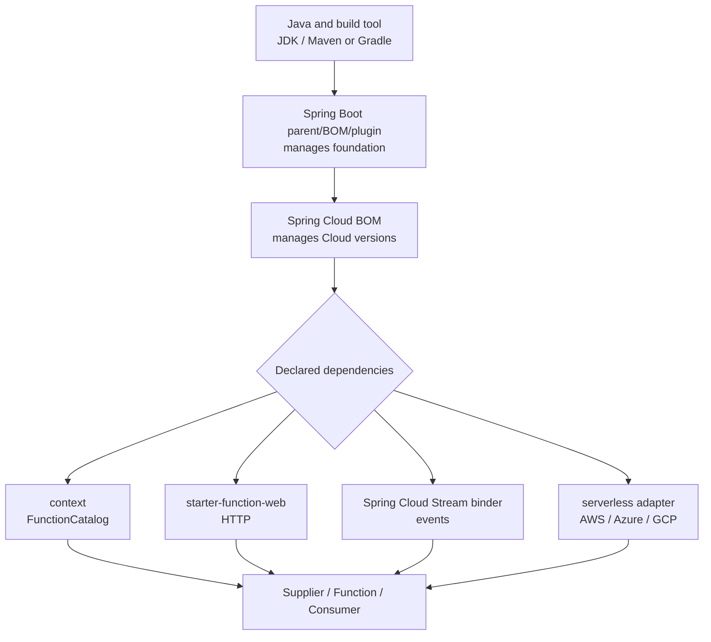

# Declaring Dependencies with Maven or Gradle

> **Chapter:** Initialization  
> **Module:** SPRING_CLOUD_FUNCTION  
> **Goal:** Declare Spring Cloud Function dependencies accurately in Maven or Gradle, use the Spring Cloud BOM for version management, select starters/adapters for the deployment environment, and verify build results.  
> **Illustrative version baseline:** November 24, 2026 — Java 21, Spring Boot 4.2.0, Spring Cloud 2026.0.0 (Spring Cloud Function 5.1.0). When applying at another time, re-verify the compatibility matrix and supported patches.

## 1. Why Learn Dependency Declaration Before Writing Functions?

Spring Cloud Function lets you encapsulate business logic into `Supplier<T>`, `Function<T, R>`, and `Consumer<T>`, then look them up and compose them via `FunctionCatalog`. The same function can be connected to HTTP, events, or serverless runtimes through the appropriate adapter. However, the application must have **the right libraries on the classpath** for those components to exist.

For example, suppose you wrote a `@Bean Function<String, String>` without adding a Spring Cloud Function module. Spring Boot can still create that Java bean, yet the application will not automatically have `FunctionCatalog` or an HTTP endpoint to invoke the function. Conversely, adding the Spring Cloud BOM does not by itself pull in Function libraries: the BOM only **manages the versions of declared dependencies**.

This lesson answers four questions:

1. How do you select Java, Spring Boot, and Spring Cloud versions for valid declarations?
2. Which part of the build file **manages versions**, and which part actually **adds libraries to the application**?
3. What are the differences between Maven `pom.xml`, Gradle Groovy `build.gradle`, and Gradle Kotlin `build.gradle.kts` declarations?
4. How do you prove that the application loaded `FunctionCatalog` and the adapter properly, rather than merely trusting the configuration file?

Relationship diagram:



**Expected outcome:** starting from an empty Java project, you create a Spring Boot application with a `normalizeCode` function, run `mvn test` or `gradle test`, and test the function over HTTP or `FunctionCatalog`.

## 2. Mastering Versions and Dependency Structure

### 2.1. Three Versions with Three Distinct Roles

The illustrative set used in this lesson was announced in November 2026:

| Component | Example Value | Role |
| --- | --- | --- |
| Java | **21** | JDK used for compiling/running; practical choice for this lesson. |
| Spring Boot | **4.2.0** | Manages the Spring Framework foundation, auto-configuration, plugins, and many other libraries. |
| Spring Cloud release train | **2026.0.0** | Version of the `spring-cloud-dependencies` BOM, compatible with Spring Boot 4.2.0. |
| Spring Cloud Function | **5.1.0** | Version of the Function module included in release train 2026.0.0. |

The Spring Cloud 2026.0.0 announcement on November 20, 2026 confirms that this train is based on Spring Boot 4.2.0 and uses Spring Cloud Function 5.1.0. Therefore, **do not** declare BOM `spring-cloud-dependencies:5.1.0`; `5.1.0` is the Function module version.

At other times, check the official matrix at https://spring.io/projects/spring-cloud/ and record the exact version set selected. Only use a release train compatible with your project's actual Spring Boot line. Avoid pairing a Boot 4.x Spring Cloud train with Boot 3.x.

### 2.2. What Is a BOM?

A BOM (*Bill of Materials*) is a POM file containing a coordinated set of managed dependency versions. For Spring Cloud, the coordinates used to import the BOM are:

```text
groupId    = org.springframework.cloud
artifactId = spring-cloud-dependencies
version    = 2026.0.0
type       = pom
scope      = import   (when importing in Maven)
```

**The BOM does not automatically install every artifact**; you must still declare the desired dependencies. For example:

- The BOM only dictates which Spring Cloud Function version will be used if the project depends on it.
- `spring-cloud-starter-function-web` is the dependency that brings the Web adapter into the application.
- A starter may pull in `spring-cloud-function-context` and necessary libraries as *transitive dependencies*.

Separating these two roles keeps versions aligned without manually pinning every module.

### 2.3. Commonly Used Artifacts

| Need | Suggested Artifact | Notes |
| --- | --- | --- |
| Working with catalog/functions inside a Spring app | `org.springframework.cloud:spring-cloud-function-context` | Provides `FunctionCatalog`; if you want a Boot app, you still need an appropriate Boot base. |
| Exposing functions over HTTP quickly | `org.springframework.cloud:spring-cloud-starter-function-web` | Simple starting point with the MVC Web adapter. |
| Using the Web module directly | `org.springframework.cloud:spring-cloud-function-web` | You must supply corresponding Web dependencies yourself. |
| Host loading packaged function JARs | `org.springframework.cloud:spring-cloud-function-deployer` | Loads function packages; does not deploy to cloud providers automatically. |
| AWS Lambda | `org.springframework.cloud:spring-cloud-function-adapter-aws` | Requires handler configuration and Lambda packaging. |
| Azure Functions | `org.springframework.cloud:spring-cloud-function-adapter-azure` | Requires Java worker, triggers/bindings, and Azure packaging. |
| Google Cloud Functions | `org.springframework.cloud:spring-cloud-function-adapter-gcp` | Requires matching GCP runtime/entrypoint and packaging. |
| Kafka via Spring Cloud Stream | `org.springframework.cloud:spring-cloud-starter-stream-kafka` | Includes Kafka binder integration; requires broker/binding configuration. |
| RabbitMQ via Spring Cloud Stream | `org.springframework.cloud:spring-cloud-starter-stream-rabbit` | Includes RabbitMQ binder; requires broker/binding configuration. |

Choose **one starting point** per environment instead of adding every adapter to the same project. Adapters can bring their own libraries and configurations, so adding unused ones complicates the classpath and increases conflict risk.

## 3. Maven: Declaring a Complete Spring Cloud Function Web Application

### 3.1. Project Structure

Maven uses `pom.xml` in the root directory by default:

```text
scf-demo/
├── pom.xml
└── src/
    ├── main/
    │   ├── java/
    │   │   └── vn/example/scf/ScfDemoApplication.java
    │   └── resources/
    │       └── application.properties
    └── test/
        └── java/
            └── vn/example/scf/FunctionCatalogTest.java
```

This project uses `spring-cloud-starter-function-web` so you can test the function over HTTP while verifying `FunctionCatalog` in tests.

### 3.2. Complete `pom.xml`

```xml
<?xml version="1.0" encoding="UTF-8"?>
<project xmlns="http://maven.apache.org/POM/4.0.0"
         xmlns:xsi="http://www.w3.org/2001/XMLSchema-instance"
         xsi:schemaLocation="
           http://maven.apache.org/POM/4.0.0
           https://maven.apache.org/xsd/maven-4.0.0.xsd">
    <modelVersion>4.0.0</modelVersion>

    <parent>
        <groupId>org.springframework.boot</groupId>
        <artifactId>spring-boot-starter-parent</artifactId>
        <version>4.2.0</version>
        <relativePath/>
    </parent>

    <groupId>vn.example</groupId>
    <artifactId>scf-demo</artifactId>
    <version>0.0.1-SNAPSHOT</version>
    <name>scf-demo</name>
    <description>Spring Cloud Function Maven example</description>

    <properties>
        <java.version>21</java.version>
        <spring-cloud.version>2026.0.0</spring-cloud.version>
    </properties>

    <dependencyManagement>
        <dependencies>
            <dependency>
                <groupId>org.springframework.cloud</groupId>
                <artifactId>spring-cloud-dependencies</artifactId>
                <version>${spring-cloud.version}</version>
                <type>pom</type>
                <scope>import</scope>
            </dependency>
        </dependencies>
    </dependencyManagement>

    <dependencies>
        <dependency>
            <groupId>org.springframework.cloud</groupId>
            <artifactId>spring-cloud-starter-function-web</artifactId>
        </dependency>

        <dependency>
            <groupId>org.springframework.boot</groupId>
            <artifactId>spring-boot-starter-test</artifactId>
            <scope>test</scope>
        </dependency>
    </dependencies>

    <build>
        <plugins>
            <plugin>
                <groupId>org.springframework.boot</groupId>
                <artifactId>spring-boot-maven-plugin</artifactId>
            </plugin>
        </plugins>
    </build>
</project>
```

In `pom.xml`:

1. **`<parent>`** uses Spring Boot 4.2.0, providing Maven configuration and managing many Spring Boot dependencies/plugins.
2. **`<java.version>`** sets Java 21. Verify that the actual build machine uses a matching JDK via `mvn -v`.
3. **`<dependencyManagement>`** imports Spring Cloud BOM 2026.0.0. `type=pom` and `scope=import` are mandatory for importing a BOM in Maven.
4. **`<dependencies>`** adds the Web starter to the runtime classpath and Spring Boot Test to the test classpath.
5. **`spring-boot-maven-plugin`** supports running/packaging the Boot application. The plugin is a build tool; it does not replace Function dependencies.

Do not add `<version>5.1.0</version>` inside `spring-cloud-starter-function-web`: let the BOM determine the version, unless you are deliberately testing an override.

### 3.3. Explaining Dependency Scopes

| Maven Scope | Present on Classpath When? | When to Use? |
| --- | --- | --- |
| Default (`compile`) | Compile, test, and runtime. | Starters, Function libraries used in the application. |
| `test` | Test compilation/execution; not packaged into normal runtime artifacts. | `spring-boot-starter-test`, test libraries. |
| `runtime` | Runtime and test; not used directly for compiling code. | Certain drivers/implementations needed only at runtime. |
| `provided` | Compile/test, but expected to be provided by the runtime environment. | Specialized container/runtime cases; do not apply to adapters unless docs require it. |
| `import` | Used only inside `dependencyManagement` for BOMs with `type=pom`. | Imports version tables without adding JARs to the app. |

A classic mistake is putting `spring-cloud-starter-function-web` in `scope=test`. Tests might still see some related classes, but the production artifact will lack the Web adapter.

### 3.4. Maven Without the Spring Boot Parent

If your organization has its own parent POM, you can import both the Spring Boot BOM and the Spring Cloud BOM:

```xml
<dependencyManagement>
    <dependencies>
        <dependency>
            <groupId>org.springframework.boot</groupId>
            <artifactId>spring-boot-dependencies</artifactId>
            <version>4.2.0</version>
            <type>pom</type>
            <scope>import</scope>
        </dependency>
        <dependency>
            <groupId>org.springframework.cloud</groupId>
            <artifactId>spring-cloud-dependencies</artifactId>
            <version>2026.0.0</version>
            <type>pom</type>
            <scope>import</scope>
        </dependency>
    </dependencies>
</dependencyManagement>
```

This is a **replacement snippet for dependency management**, not a full `pom.xml`. Unlike the Boot parent, importing the Boot BOM **does not automatically manage all build plugin configurations**. You must explicitly define the `spring-boot-maven-plugin` version, compiler plugin settings (Java 21), and other plugins per project standards. BOM ordering/precedence and any overridden versions must be verified in the effective POM.

## 4. Adding Java Logic to Verify Dependencies Work

Create `src/main/java/vn/example/scf/ScfDemoApplication.java`:

```java
package vn.example.scf;

import java.util.Locale;
import java.util.function.Function;
import org.springframework.boot.SpringApplication;
import org.springframework.boot.autoconfigure.SpringBootApplication;
import org.springframework.context.annotation.Bean;

@SpringBootApplication
public class ScfDemoApplication {

    public static void main(String[] args) {
        SpringApplication.run(ScfDemoApplication.class, args);
    }

    @Bean
    public Function<String, String> normalizeCode() {
        return raw -> raw.trim().toUpperCase(Locale.ROOT);
    }

    @Bean
    public Function<String, String> validateCode() {
        return code -> {
            if (!code.matches("[A-Z]{2}-[0-9]{3}")) {
                throw new IllegalArgumentException("Invalid code: " + code);
            }
            return code;
        };
    }
}
```

Both beans use the `java.util.function.Function` interface from the JDK—no special interface invented by Spring Cloud Function is required. Spring Cloud Function's context discovers these beans and registers them in `FunctionCatalog`. The Java lambda does not know whether it will be invoked over HTTP or from a message broker.

Create `src/main/resources/application.properties`:

```properties
spring.application.name=scf-demo
```

With the configuration above, the Web adapter can expose each bean by name (e.g., `/normalizeCode`). When you want to select a composition as the default function for an adapter, you can **add** `spring.cloud.function.definition=normalizeCode|validateCode`. This chain normalizes first and validates second, and by Web adapter rules maps the pipeline to the root path `/`. Integration adapters like Spring Cloud Stream should also have an explicit definition configured.

**First HTTP test:** when the app runs with the Web starter and no default definition is configured, use `POST /normalizeCode` to invoke the bean directly. The Web adapter also allows invoking compositions via comma-separated paths like `/normalizeCode,validateCode`; setting a default definition changes the root path mapping rules as described above.

HTTP adapter documentation: https://docs.spring.io/spring-cloud-function/reference/spring-cloud-function/standalone-web-applications.html

## 5. Gradle Groovy DSL: Writing the Equivalent `build.gradle`

### 5.1. Configuring with the Spring Dependency-Management Plugin

Gradle has no `<parent>` like Maven. A simple way to manage the Spring Cloud BOM is using the Spring Boot plugin and `io.spring.dependency-management`:

```groovy
plugins {
    id 'java'
    id 'org.springframework.boot' version '4.2.0'
    id 'io.spring.dependency-management' version '1.1.7'
}

group = 'vn.example'
version = '0.0.1-SNAPSHOT'
description = 'Spring Cloud Function Gradle example'

repositories {
    mavenCentral()
}

java {
    toolchain {
        languageVersion = JavaLanguageVersion.of(21)
    }
}

ext {
    set('springCloudVersion', '2026.0.0')
}

dependencyManagement {
    imports {
        mavenBom "org.springframework.cloud:spring-cloud-dependencies:${springCloudVersion}"
    }
}

dependencies {
    implementation 'org.springframework.cloud:spring-cloud-starter-function-web'
    testImplementation 'org.springframework.boot:spring-boot-starter-test'
}

tasks.named('test') {
    useJUnitPlatform()
}
```

When using `io.spring.dependency-management` together with the Boot plugin, Boot automatically imports the `spring-boot-dependencies` BOM matching the Boot plugin; the `dependencyManagement` block additionally imports the Spring Cloud BOM. Consequently, dependencies in `implementation` and `testImplementation` generally do not need explicit versions if managed by a BOM.

**Role of each block:**

| Gradle | Meaning |
| --- | --- |
| `plugins` | Applies the Java, Spring Boot, and dependency-management plugins. |
| `repositories { mavenCentral() }` | Specifies the repository to resolve dependencies from. |
| `java.toolchain` | Selects JDK 21 for compiling/testing via toolchain support. |
| `ext.springCloudVersion` | Declares a version value in one central place for easy updates. |
| `dependencyManagement.imports.mavenBom` | Imports the Spring Cloud version BOM. |
| `implementation` | Adds starters needed by the application at compile/runtime. |
| `testImplementation` | Adds test libraries. |
| `useJUnitPlatform()` | Runs JUnit 5/JUnit Platform tests. |

Plugin version `io.spring.dependency-management:1.1.7` is illustrated in the Spring Cloud 2026.0.0 release guide. When upgrading Spring Boot/Gradle versions, also check plugin compatibility.

### 5.2. Gradle Kotlin DSL: `build.gradle.kts`

With Kotlin DSL, the equivalent structure has slightly different type-safe syntax:

```kotlin
plugins {
    java
    id("org.springframework.boot") version "4.2.0"
    id("io.spring.dependency-management") version "1.1.7"
}

group = "vn.example"
version = "0.0.1-SNAPSHOT"

repositories {
    mavenCentral()
}

java {
    toolchain {
        languageVersion = JavaLanguageVersion.of(21)
    }
}

val springCloudVersion = "2026.0.0"

dependencyManagement {
    imports {
        mavenBom("org.springframework.cloud:spring-cloud-dependencies:$springCloudVersion")
    }
}

dependencies {
    implementation("org.springframework.cloud:spring-cloud-starter-function-web")
    testImplementation("org.springframework.boot:spring-boot-starter-test")
}

tasks.test {
    useJUnitPlatform()
}
```

**Do not mix syntaxes:** Groovy DSL uses `id 'java'` and `implementation 'group:artifact'`; Kotlin DSL uses `id("java")` or `java` and `implementation("group:artifact")`.

Do not use `$springCloudVersion` in a Groovy block expecting Kotlin behavior or vice versa without understanding string interpolation. Both examples provide the correct string reference syntax for each DSL.

### 5.3. Gradle Native BOM Option via `platform(...)`

Gradle has a BOM management mechanism that **does not require** the dependency-management plugin. If you choose this approach, explicitly declare the required platforms, for example in `build.gradle`:

```groovy
plugins {
    id 'java'
    id 'org.springframework.boot' version '4.2.0'
}

group = 'vn.example'
version = '0.0.1-SNAPSHOT'

repositories {
    mavenCentral()
}

java {
    toolchain {
        languageVersion = JavaLanguageVersion.of(21)
    }
}

dependencies {
    implementation platform('org.springframework.boot:spring-boot-dependencies:4.2.0')
    implementation platform('org.springframework.cloud:spring-cloud-dependencies:2026.0.0')
    implementation 'org.springframework.cloud:spring-cloud-starter-function-web'

    testImplementation platform('org.springframework.boot:spring-boot-dependencies:4.2.0')
    testImplementation platform('org.springframework.cloud:spring-cloud-dependencies:2026.0.0')
    testImplementation 'org.springframework.boot:spring-boot-starter-test'
}

tasks.named('test') {
    useJUnitPlatform()
}
```

This approach uses *native Gradle platform constraints*. The Spring Boot Gradle plugin creates the Boot tasks, but without the dependency-management plugin, you **must** ensure the BOMs are applied to the appropriate configurations. Depending on actual configuration inheritance, the `testImplementation platform(...)` lines can sometimes be simplified; they are shown explicitly here for clarity.

Choose **one version management strategy** for the project. Do not mix the dependency-management plugin, native `platform(...)`, and scattered version overrides without understanding Gradle's precedence rules.

Documentation: https://docs.spring.io/spring-boot/gradle-plugin/managing-dependencies.html

## 6. How Do Maven and Gradle Differ?

| Aspect | Maven | Gradle |
| --- | --- | --- |
| Build file | `pom.xml` | `build.gradle` or `build.gradle.kts` |
| Boot foundation | Usually uses `spring-boot-starter-parent` | Uses `org.springframework.boot` plugin |
| Import Spring Cloud BOM | `dependencyManagement` + `type=pom` + `scope=import` | `mavenBom(...)` or native `platform(...)` |
| Main dependencies | `<dependencies><dependency>...` | `dependencies { implementation(...) }` |
| Test dependencies | `<scope>test</scope>` | `testImplementation(...)` |
| Test build | `./mvnw clean test` | `./gradlew clean test` |
| Run app | `./mvnw spring-boot:run` | `./gradlew bootRun` |
| Inspect dependencies | `dependency:tree` | `dependencies` and `dependencyInsight` |
| Package Boot app | `./mvnw package` | `./gradlew bootJar` |

Only one build system is needed for a learning project. If a repository contains both Maven and Gradle during a migration, define which one is the source of truth in CI and avoid maintaining two diverging version sets.

## 7. Switching Dependencies by Deployment Environment

The same business bean can be wired to multiple invocation paths, but **dependencies and adapter configuration** must change according to the environment.

### 7.1. Needing Only `FunctionCatalog` in an Internal Application

If neither HTTP nor a broker is needed, replace the Web starter with `context` and the Spring Boot base:

**Maven — inside `<dependencies>`:**

```xml
<dependency>
    <groupId>org.springframework.boot</groupId>
    <artifactId>spring-boot-starter</artifactId>
</dependency>
<dependency>
    <groupId>org.springframework.cloud</groupId>
    <artifactId>spring-cloud-function-context</artifactId>
</dependency>
```

**Gradle:**

```groovy
dependencies {
    implementation 'org.springframework.boot:spring-boot-starter'
    implementation 'org.springframework.cloud:spring-cloud-function-context'
}
```

When running inside a Spring Boot application, you can inject `FunctionCatalog` and look up function beans. `context` does not create REST endpoints on its own.

### 7.2. HTTP: Web Starter

**Maven:**

```xml
<dependency>
    <groupId>org.springframework.cloud</groupId>
    <artifactId>spring-cloud-starter-function-web</artifactId>
</dependency>
```

**Gradle:**

```groovy
dependencies {
    implementation 'org.springframework.cloud:spring-cloud-starter-function-web'
}
```

The Web starter bundles the dependencies needed for Web integration. When you just want to test HTTP request/response functions, this is simpler than assembling individual modules manually. It does not replace a complex REST API that needs resource controllers, security, pagination, or strict contract control.

### 7.3. Kafka or RabbitMQ Events: Stream and Binder

Spring Cloud Function focuses on the functional model. To connect to a broker, add Spring Cloud Stream along with the corresponding binder, such as Kafka:

**Maven:**

```xml
<dependency>
    <groupId>org.springframework.cloud</groupId>
    <artifactId>spring-cloud-starter-stream-kafka</artifactId>
</dependency>
```

**Gradle Groovy:**

```groovy
dependencies {
    implementation 'org.springframework.cloud:spring-cloud-starter-stream-kafka'
}
```

Example configuration when the function is named `normalizeCode`:

```properties
spring.cloud.function.definition=normalizeCode
spring.cloud.stream.bindings.normalizeCode-in-0.destination=raw-codes
spring.cloud.stream.bindings.normalizeCode-out-0.destination=normalized-codes
spring.cloud.stream.kafka.binder.brokers=localhost:9092
```

Here:

- `normalizeCode-in-0` is the input binding following Spring Cloud Stream conventions.
- `normalizeCode-out-0` is the output binding, since `Function` returns a result.
- `destination` maps to the configured topic/destination.
- `binder.brokers` specifies where to connect to Kafka; the broker must be running and accessible.

If using RabbitMQ, swap in `spring-cloud-starter-stream-rabbit` and configure the Rabbit binder accordingly. **Do not** install both Kafka and RabbitMQ binders simultaneously when using only one broker.

### 7.4. Serverless: AWS, Azure, Google Cloud

To keep business functions unchanged while running on a cloud provider, select the dedicated adapter:

**Maven — choose exactly one adapter per platform:**

```xml
<!-- AWS Lambda -->
<dependency>
    <groupId>org.springframework.cloud</groupId>
    <artifactId>spring-cloud-function-adapter-aws</artifactId>
</dependency>

<!-- Azure Functions: replace AWS dependency with the following dependency -->
<!--
<dependency>
    <groupId>org.springframework.cloud</groupId>
    <artifactId>spring-cloud-function-adapter-azure</artifactId>
</dependency>
-->

<!-- Google Cloud Functions: replace AWS dependency with the following dependency -->
<!--
<dependency>
    <groupId>org.springframework.cloud</groupId>
    <artifactId>spring-cloud-function-adapter-gcp</artifactId>
</dependency>
-->
```

**Gradle — pick only the matching dependency:**

```groovy
// Example targeting AWS Lambda
dependencies {
    implementation 'org.springframework.cloud:spring-cloud-function-adapter-aws'
}
```

An adapter dependency does not configure the entire target runtime by itself. AWS also requires a handler and a Lambda-formatted JAR package; Azure requires triggers/bindings and a deployment plugin; Google Cloud requires an entrypoint/Functions Framework setup. All require a compatible Java runtime and adapter version.

In particular, **do not** switch the Boot/Cloud BOM to an older or newer version solely because you noticed an adapter has a different artifact name; first check the adapter documentation for your exact release train.

### 7.5. When to Add `spring-cloud-function-deployer`?

If the host needs to load a JAR containing functions from outside its own build, you can add:

```xml
<dependency>
    <groupId>org.springframework.cloud</groupId>
    <artifactId>spring-cloud-function-deployer</artifactId>
</dependency>
```

Or in Gradle:

```groovy
implementation 'org.springframework.cloud:spring-cloud-function-deployer'
```

Deployer handles **loading function packages into the host**, not automatically pushing applications to the cloud. It requires location configuration, proper packaging, and artifact management mechanisms; ordinary HTTP applications do not need this library.

### 7.6. Project Reactor and Reactive Signatures

Spring Cloud Function can accept functions of type `Function<Flux<T>, Flux<R>>`, `Function<Mono<T>, Mono<R>>`, or many other compatible combinations. Reactor is often present in the dependency graph when using reactive-capable modules, but you should not assume the classpath automatically has every library you want.

If an application uses Reactor directly and does not already have it, declare `io.projectreactor:reactor-core` with its version managed by Spring Boot. For tests needing `StepVerifier`, add `io.projectreactor:reactor-test` in test scope:

```xml
<dependency>
    <groupId>io.projectreactor</groupId>
    <artifactId>reactor-test</artifactId>
    <scope>test</scope>
</dependency>
```

Gradle equivalent:

```groovy
testImplementation 'io.projectreactor:reactor-test'
```

Changing a bean to reactive **does not automatically turn** HTTP, Kafka, AWS, or Azure into an end-to-end non-blocking pipeline; you must understand the capabilities of the corresponding adapter and I/O libraries.

## 8. Building, Running, and Verifying `FunctionCatalog`

### 8.1. Using Wrappers to Pin Build Tool Versions

In CI and across development teams, prefer `mvnw` or `gradlew` generated and committed in the project. If no wrapper exists yet, use a compatible installed Maven/Gradle and generate the wrapper per project workflow.

**Maven (Linux/macOS):**

```bash
java -version
./mvnw -v
./mvnw clean test
./mvnw spring-boot:run
```

**Gradle (Linux/macOS):**

```bash
java -version
./gradlew --version
./gradlew clean test
./gradlew bootRun
```

On Windows PowerShell, use `./mvnw.cmd` or `./gradlew.bat` respectively. If there is no wrapper, use `mvn` or `gradle` installed on `PATH`.

If the JDK running Maven/Gradle differs from the Java toolchain declared in the build, check `JAVA_HOME`, toolchain settings, and the CI runner. A build may succeed on a developer's machine yet fail on a deployment environment running an older Java version.

### 8.2. Testing the Catalog with JUnit

Add `src/test/java/vn/example/scf/FunctionCatalogTest.java`:

```java
package vn.example.scf;

import static org.junit.jupiter.api.Assertions.assertEquals;
import static org.junit.jupiter.api.Assertions.assertThrows;

import java.util.function.Function;

import org.junit.jupiter.api.Test;
import org.springframework.beans.factory.annotation.Autowired;
import org.springframework.boot.test.context.SpringBootTest;
import org.springframework.cloud.function.context.FunctionCatalog;

@SpringBootTest
class FunctionCatalogTest {

    @Autowired
    FunctionCatalog catalog;

    @Test
    void canComposeAndValidate() {
        Function<String, String> chain =
                catalog.lookup("normalizeCode|validateCode");

        assertEquals("OD-123", chain.apply("  od-123  "));
        assertThrows(IllegalArgumentException.class,
                () -> chain.apply("??"));
    }
}
```

The test verifies:

- The Spring Boot context starts up.
- Spring Cloud Function provides a `FunctionCatalog` bean.
- Both Function beans are found by name and composition works.
- The function returns the expected output for valid input and throws an error for invalid codes.

Catalog testing does not replace testing the HTTP adapter, Kafka binder, or serverless handler. It confirms **the core layer** independent of protocol.

### 8.3. Sending an HTTP Request

Once `spring-boot:run` or `bootRun` is running with the Web starter, you can invoke the `normalizeCode` bean directly:

```bash
curl -i -X POST http://localhost:8080/normalizeCode \
  -H "Content-Type: text/plain" \
  --data "  od-123  "
```

Expected body:

```text
OD-123
```

If you want to verify composition directly, the `FunctionCatalog` test in section 8.2 is more reliable than guessing URLs containing `|`. Composition URLs, base route paths, and definition selection rules must be verified against the actual Web adapter and configuration.

With the Web adapter and the two beans from section 4 (without setting a default definition), you can invoke the composition using a comma in the URL:

```bash
curl -i -X POST http://localhost:8080/normalizeCode,validateCode \
  -H "Content-Type: text/plain" \
  --data "  od-123  "
```

The expected result is still `OD-123`. This is the Web adapter syntax described in the Spring Cloud Function documentation; the pipe `|` is used in `FunctionCatalog.lookup(...)` and the definition property.

### 8.4. Inspecting the Function List via Actuator (Optional)

You can add:

```xml
<dependency>
    <groupId>org.springframework.boot</groupId>
    <artifactId>spring-boot-starter-actuator</artifactId>
</dependency>
```

In local environment configuration:

```properties
management.endpoints.web.exposure.include=health,info,functions
```

When supported and enabled, the `/actuator/functions` endpoint lets you inspect functions in the catalog. **Expose only management endpoints compliant with your environment's security requirements**; do not expose all actuator endpoints publicly just for debugging.

## 9. Verifying Actually Resolved Dependencies

### 9.1. Maven: `dependency:tree` and Effective POM

```bash
./mvnw dependency:tree
./mvnw dependency:tree -Dincludes=org.springframework.cloud
./mvnw help:effective-pom
```

In the output, verify:

1. Spring Cloud BOM is imported at version `2026.0.0`.
2. `spring-cloud-function-context`, the Web starter, and related dependencies resolve to the same version line managed by the BOM.
3. No other Spring Framework/Function version is pulled in or unintentionally overridden.
4. Test dependencies use the proper scope; the runtime classpath contains no test-only libraries.

In particular, `dependency:tree` displays **dependencies actually used**. It does not list every library in the BOM if the application does not use them. To check the managed version of an undeclared artifact, inspect the effective POM or BOM metadata.

### 9.2. Gradle: `dependencies` and `dependencyInsight`

```bash
./gradlew dependencies --configuration runtimeClasspath
./gradlew dependencyInsight \
  --dependency spring-cloud-function-context \
  --configuration runtimeClasspath
```

In PowerShell, you can put the `dependencyInsight` command on a single line:

```powershell
./gradlew.bat dependencyInsight --dependency spring-cloud-function-context --configuration runtimeClasspath
```

`dependencyInsight` shows which dependency branch pulled in the module, which version was selected, and why. If the dependency is not found, it may not be on the runtime classpath; verify that you declared the right starter.

### 9.3. Minimum Initialization Verification Checklist

| Check | Passing Signal | What Errors Does It Catch? |
| --- | --- | --- |
| `java -version` and build tool version | JDK/toolchain meets Boot/Cloud requirements. | Wrong JDK, compiler does not support target. |
| `mvn dependency:tree` / Gradle runtimeClasspath | Function modules resolve to the exact BOM version. | Version mismatch, missing starter, transitive conflicts. |
| `mvn test` / `gradlew test` | Catalog and Java logic tests pass. | Context fails to load, function bean not found. |
| `spring-boot:run` / `bootRun` | Application starts cleanly. | Auto-configuration errors, classpath issues, port conflicts. |
| `curl POST /normalizeCode` | Returns `OD-123`. | Missing Web adapter or wrong mapping/converter. |
| Broker/serverless smoke test (if used) | Event passes through binding/handler with expected payload. | Wrong packaging, binding, runtime, permissions, or message conversion. |

Do not judge success solely by **BUILD SUCCESSFUL** or **BUILD SUCCESS**. An application can compile cleanly yet still lack an HTTP handler, broker connection, or cloud runtime setup at execution time.

## 10. Common Errors When Declaring Maven/Gradle Dependencies

| Symptom | Common Cause | Resolution |
| --- | --- | --- |
| `Non-resolvable import POM` | Wrong BOM coordinates/version, unreleased version in configured repo, or network/proxy error. | Verify `spring-cloud-dependencies` and release train; check Maven Central, proxy, and repositories. |
| `Could not find ...` in Gradle | Missing `mavenCentral()`, misspelled artifact, or repo lacks requested version. | Check repositories and coordinates; avoid blindly switching to SNAPSHOT. |
| `FunctionCatalog` does not exist | Java bean present, but missing Function library or starter. | Add `spring-cloud-function-context` or the Web starter. |
| `/normalizeCode` returns 404 | Web adapter missing, app not running as a Web app, or wrong route/base path. | Check Web starter, `spring.cloud.function.web.path`, and active mappings. |
| Maven reports missing dependency version | BOM not imported or dependency not covered by the active BOM. | Check `dependencyManagement`, `type=pom`, `scope=import`, and effective POM. |
| Gradle reports missing dependency version | Dependency-management plugin or native platform not applied to the right configuration. | Check `dependencyManagement` or `platform(...)` on the right classpath. |
| `NoSuchMethodError` or `ClassNotFoundException` | Mixing multiple generations of Spring Boot/Cloud/Function, or bad transitive override. | Inspect dependency tree/insight; revert to a compatible version pair. |
| `UnsupportedClassVersionError` | Java runtime is older than compiled bytecode. | Align Java toolchain with server/container/serverless runtime. |
| Function works on HTTP, receives no Kafka messages | Web starter present, but missing Spring Cloud Stream binder/bindings. | Add the required binder; configure destinations and broker. |
| AWS Lambda upload succeeds but fails to run | Missing proper handler/packaging or mismatched Java runtime. | Follow AWS adapter instructions and test the actual artifact in Lambda. |
| CLI build differs from IDE | IDE uses a different JDK or Gradle/Maven importer. | Align wrapper, toolchain, and `JAVA_HOME`. |
| Hardcoding Function version directly | Overriding BOM with `5.0.x` in a Cloud 2026.0.0 project. | Remove the version override and verify BOM resolves to 5.1.x. |

### 10.1. Do Not Fix Version Mismatches by Disabling the Compatibility Verifier

If Spring Cloud detects an unsupported Boot/Cloud pair, the application may refuse to start or emit a warning. Disabling the check (e.g., via `spring.cloud.compatibility-verifier.enabled=false`) only **suppresses the warning**; it does not fix binary incompatibility. The right fix is selecting a documented compatible release train pair and running tests.

### 10.2. Do Not Overuse `exclusions`

Maven and Gradle allow excluding transitive dependencies. For example, accidentally excluding a module pulled in by the Web starter can remove `FunctionCatalog` or Web conversion support. Only use exclusions when you have identified a concrete conflict and replaced it with a compatible equivalent dependency. Afterward, run tests and inspect the actual classpath.

### 10.3. Changing the BOM Can Change Runtime Behavior

Upgrading from one release train to a newer major train pulls in many libraries simultaneously. Beyond compile errors, also check JSON/message conversion, `Message<?>` headers, composition, retries, backpressure, and HTTP/event/serverless adapter responses. Treat a BOM upgrade as an ecosystem change that requires running integration tests.

## 11. End-of-Lesson Exercises

### Exercise 1 — Maven with the HTTP Adapter

**Requirement:** build `pom.xml` following section 3, running JDK 21, Boot 4.2.0, and Cloud BOM 2026.0.0.

Steps:

1. Create `ScfDemoApplication` with two functions: `normalizeCode` and `validateCode`.
2. Add `spring-cloud-starter-function-web` without a separate version.
3. Run `./mvnw clean test` and `./mvnw spring-boot:run`.
4. Send `POST /normalizeCode` with `"  od-123  "`; verify `"OD-123"`.
5. Inspect `dependency:tree` to prove the Function dependency is managed by the BOM.

**Completion criteria:** catalog test passes, HTTP returns the exact body, and no Function dependency is unintentionally overridden.

### Exercise 2 — Migrating from Maven to Gradle

Create `build.gradle` or `build.gradle.kts` equivalent to the initial `pom.xml`.

- Boot plugin remains `4.2.0`, Cloud BOM is `2026.0.0`.
- Use `java.toolchain` to select Java 21.
- Declare the Function Web starter via `implementation`.
- Place `spring-boot-starter-test` in `testImplementation`.
- Run `dependencies --configuration runtimeClasspath` and confirm no Function artifact is outside the compatible line.

Explain the difference between Maven `scope=test` and Gradle `testImplementation`, and between Maven BOM import and Gradle `mavenBom(...)` or `platform(...)`.

### Exercise 3 — Selecting the Right Dependency for Four Scenarios

| Scenario | Primary Dependency to Choose |
| --- | --- |
| Using only `FunctionCatalog` inside a Spring Boot worker | `spring-cloud-function-context` and appropriate Boot base. |
| Receiving HTTP requests and returning normalized codes | `spring-cloud-starter-function-web`. |
| Reading codes from Kafka and publishing results to another topic | `spring-cloud-starter-stream-kafka` plus Stream binding/broker config. |
| Deploying the same function to AWS Lambda | `spring-cloud-function-adapter-aws` plus AWS packaging/handler. |

**Open question:** why can all four options still use `Function<String, String> normalizeCode`, yet require different dependencies and runtime configurations? Relate your answer to the roles of `FunctionCatalog`, payload/message conversion, and adapters.

### Exercise 4 — Analyzing a Misconfiguration

Given Maven configuration:

```xml
<properties>
    <spring-cloud.version>2026.0.0</spring-cloud.version>
</properties>

<dependencies>
    <dependency>
        <groupId>org.springframework.cloud</groupId>
        <artifactId>spring-cloud-starter-function-web</artifactId>
        <version>5.0.4</version>
    </dependency>
</dependencies>
```

Identify three issues:

1. `spring-cloud.version` is declared, yet `spring-cloud-dependencies` is not **imported**, so this property does not manage versions on its own.
2. The starter is forced to `5.0.4`, which differs from the Function 5.1.0 line of Cloud 2026.0.0.
3. If the project lacks a compatible Boot base, adding the starter alone is not enough to ensure the application runs.

**How to fix:** select the matching Boot 4.2.0, import Cloud BOM 2026.0.0 in `dependencyManagement`, and remove the `<version>` tag from the Function starter. Then verify with effective POM, dependency tree, and tests.

## 12. Summary and Official References

- **Maven:** use Boot parent (or Boot BOM + equivalent plugin configuration), import the Spring Cloud BOM in `dependencyManagement`, then add starters/adapters under `dependencies`.
- **Gradle:** use the Boot plugin, manage the Spring Cloud BOM via `io.spring.dependency-management` or native `platform(...)`, and declare `implementation`/`testImplementation` in the right scopes.
- **Starters/adapters:** `context` for catalog, Web starter for HTTP, Stream binder for brokers, and platform adapters for serverless; deployer is only needed when loading function packages external to the host.
- **Verification:** inspect dependency tree/insight, run `FunctionCatalog` tests, and run smoke tests on the actual protocol. A correct BOM does not replace dependencies or adapter configuration.
- **Reusability principle:** business functions written with `Supplier`, `Function`, and `Consumer` can stay unchanged; dependencies and the invocation environment determine how data reaches the function.

**Official References (re-check version baselines when applying later):**

1. Spring Cloud 2026.0.0 GA, announced November 20, 2026: https://spring.io/blog/2026/11/20/spring-cloud-2026-0-0-has-been-released/
2. Spring Boot/Spring Cloud Compatibility Table: https://spring.io/projects/spring-cloud/
3. Spring Cloud Function Programming Model: https://docs.spring.io/spring-cloud-function/reference/spring-cloud-function/programming-model.html
4. Spring Cloud Function Web Adapter: https://docs.spring.io/spring-cloud-function/reference/spring-cloud-function/standalone-web-applications.html
5. Spring Boot Gradle Dependency Management: https://docs.spring.io/spring-boot/gradle-plugin/managing-dependencies.html
6. Spring Boot Maven Plugin: https://docs.spring.io/spring-boot/maven-plugin/
7. Spring Cloud Stream Kafka Binder: https://docs.spring.io/spring-cloud-stream/reference/kafka/kafka-binder/usage.html
8. Spring Cloud Function AWS Adapter: https://docs.spring.io/spring-cloud-function/reference/adapters/aws-intro.html
9. Spring Initializr (initialize a project with an appropriate Boot foundation): https://start.spring.io/
