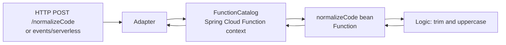
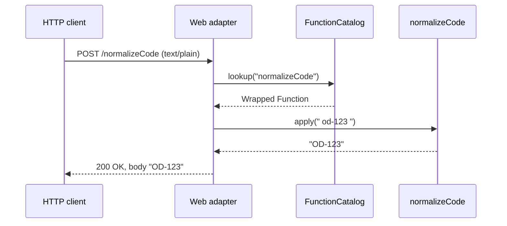

# Creating Your First Function<String, String> with @Bean

> **Chapter:** Initialization  
> **Module:** SPRING_CLOUD_FUNCTION  
> **Hands-on goal:** Initialize a Spring Boot application, register a `Function<String, String>` bean via `@Bean`, invoke the function using `FunctionCatalog` and HTTP, and test its behavior with JUnit.  
> **Example version set:** Java 21, Spring Boot 4.2.0, Spring Cloud BOM 2026.0.0 (Spring Cloud Function 5.1.0); re-verify versions at the time of use.

## 1. The Problem and Expected Result

Suppose a service receives order codes from multiple channels: an HTTP request, an event message, or a call from a serverless environment. The first business rule is very simple: **trim leading/trailing whitespace and convert the code to uppercase**.

| Input (`String`) | Output (`String`) |
| --- | --- |
| `"  od-123  "` | `"OD-123"` |
| `"  inv-2026 "` | `"INV-2026"` |
| `" ab-01"` | `"AB-01"` |

This is a **one-value-to-one-value** transformation; the matching Java contract is `java.util.function.Function<String, String>`. We do not need to declare a controller or write Kafka/AWS code inside the function. Connecting the function to HTTP, events, and serverless is handled by Spring Cloud Function and the corresponding adapters.

After completing this exercise, you should be able to:

1. Explain the meaning of the two generic types in `Function<String, String>` and the `apply(String)` method.
2. Register a function as a Spring bean using `@Bean` and understand where the bean name comes from.
3. Start an application with the Spring Cloud Function Web starter dependency.
4. Call `POST /normalizeCode` and receive `OD-123`.
5. Look up the framework-registered bean via `FunctionCatalog.lookup("normalizeCode")`.
6. Write tests for both business logic and the catalog, and recognize common initialization errors.

### 1.1. Four Layers of Responsibility



- **Java:** `Function<String, String>` defines the input/output of the logic.
- **Spring Boot:** `@Bean` instantiates and manages the function object in `ApplicationContext`.
- **Spring Cloud Function:** `FunctionCatalog` discovers/looks up the bean and adds unified invocation, composition, and type conversion when supported.
- **Adapter:** retrieves data from HTTP, a broker, or serverless, passes it into the function, and converts the result back to the corresponding protocol.

Thanks to this layering, the code normalization logic does not need to be rewritten when changing how it is invoked. However, each environment still needs its own dependencies, serialization configuration, and tests.

## 2. Reading the `Function<String, String>` Signature Correctly

Java provides the `Function<T, R>` interface in `java.util.function`:

```java
@FunctionalInterface
public interface Function<T, R> {
    R apply(T value);
    // Also includes default/static methods such as andThen, compose, identity.
}
```

The snippet above is **an abbreviated version for explanation**; you do not need to recreate this interface in your project. For `Function<String, String>`:

- `T = String`: the function **receives a string**.
- `R = String`: the function **returns a string**.
- `apply(T)`: the method called to run the transformation.
- The two generic types can differ—for example, `Function<String, Integer>` returns string length.

In plain Java, you can write:

```java
import java.util.Locale;
import java.util.function.Function;

Function<String, String> normalizeCode =
        raw -> raw.trim().toUpperCase(Locale.ROOT);

String output = normalizeCode.apply("  od-123  ");
System.out.println(output); // OD-123
```

`raw -> ...` is a **lambda** expression implementing the `apply` method. Because `Function` is a *functional interface* with only one abstract method, Java knows the lambda implements `apply`.

### 2.1. Why Use `Locale.ROOT`?

`String.toUpperCase()` with no locale argument uses the host machine's default locale. When the goal is a technical identifier independent of user language, using `toUpperCase(Locale.ROOT)` avoids locale-specific differences, such as the letter `i` in Turkish.

`String.trim()` strips basic leading/trailing whitespace characters. For fuller Unicode whitespace handling, consider `strip()` (Java 11+) and matching test rules. This lesson intentionally uses `trim()` for predictable results.

### 2.2. Why Not Use `Supplier` or `Consumer`?

| Interface | Primary Signature | Used For |
| --- | --- | --- |
| `Supplier<String>` | `String get()` | Generating/supplying a code with **no input** from the caller. |
| **`Function<String, String>`** | **`String apply(String)`** | Receiving a code, normalizing it, and **returning the result**. |
| `Consumer<String>` | `void accept(String)` | Receiving a code to log/dispatch, **returning no result**. |

For the requirement of receiving `"  od-123  "` and returning `"OD-123"`, `Function<String, String>` is the exact contract. The other two interfaces are also supported by Spring Cloud Function, but have different semantics and adapter triggers.

## 3. Preparing the Project and Dependencies

### 3.1. Choosing a Compatible Version Set

The example is built on this release set:

| Component | Version |
| --- | --- |
| JDK | **Java 21** |
| Spring Boot | **4.2.0** |
| Spring Cloud BOM | **2026.0.0** |
| Spring Cloud Function in this release train | **5.1.0** |

Spring Cloud 2026.0.0 was released on November 20, 2026 and announced compatibility with Spring Boot 4.2.0; Spring Cloud Function in that train is 5.1.0. Java 21 is chosen for this hands-on lesson. When picking another set, consult the official Boot–Cloud matrix; do not mix arbitrary versions simply because they have high numbers.

To let the application automatically expose an HTTP endpoint for `@Bean`, use the artifact:

```text
org.springframework.cloud:spring-cloud-starter-function-web
```

This starter pulls in the modules needed for Spring Cloud Function Web. **The Spring Cloud BOM only manages versions; it does not add starters automatically.** For an app that only invokes the catalog without HTTP, use `spring-cloud-function-context` with a compatible Spring Boot base.

### 3.2. Maven Directory Structure

```text
function-first/
├── pom.xml
└── src/
    ├── main/
    │   ├── java/
    │   │   └── vn/example/functionfirst/
    │   │       └── FunctionFirstApplication.java
    │   └── resources/
    │       └── application.properties
    └── test/
        └── java/
            └── vn/example/functionfirst/
                └── FunctionFirstApplicationTest.java
```

The main class package is `vn.example.functionfirst`; placing the test class in the same package lets `@SpringBootTest` find the application. You do not need to create a controller to use Spring Cloud Function's Web adapter.

### 3.3. Complete Maven `pom.xml`

```xml
<?xml version="1.0" encoding="UTF-8"?>
<project xmlns="http://maven.apache.org/POM/4.0.0"
         xmlns:xsi="http://www.w3.org/2001/XMLSchema-instance"
         xsi:schemaLocation="
           http://maven.apache.org/POM/4.0.0
           https://maven.apache.org/xsd/maven-4.0.0.xsd">
    <modelVersion>4.0.0</modelVersion>

    <parent>
        <groupId>org.springframework.boot</groupId>
        <artifactId>spring-boot-starter-parent</artifactId>
        <version>4.2.0</version>
        <relativePath/>
    </parent>

    <groupId>vn.example</groupId>
    <artifactId>function-first</artifactId>
    <version>0.0.1-SNAPSHOT</version>

    <properties>
        <java.version>21</java.version>
        <spring-cloud.version>2026.0.0</spring-cloud.version>
    </properties>

    <dependencyManagement>
        <dependencies>
            <dependency>
                <groupId>org.springframework.cloud</groupId>
                <artifactId>spring-cloud-dependencies</artifactId>
                <version>${spring-cloud.version}</version>
                <type>pom</type>
                <scope>import</scope>
            </dependency>
        </dependencies>
    </dependencyManagement>

    <dependencies>
        <dependency>
            <groupId>org.springframework.cloud</groupId>
            <artifactId>spring-cloud-starter-function-web</artifactId>
        </dependency>

        <dependency>
            <groupId>org.springframework.boot</groupId>
            <artifactId>spring-boot-starter-test</artifactId>
            <scope>test</scope>
        </dependency>
    </dependencies>

    <build>
        <plugins>
            <plugin>
                <groupId>org.springframework.boot</groupId>
                <artifactId>spring-boot-maven-plugin</artifactId>
            </plugin>
        </plugins>
    </build>
</project>
```

**Explanation of key sections:**

1. `spring-boot-starter-parent:4.2.0` provides build configuration and Spring Boot dependencies/plugins.
2. `<java.version>21</java.version>` specifies Java 21 per the Boot parent configuration.
3. `spring-cloud-dependencies:2026.0.0` is **imported** in `dependencyManagement` to manage Spring Cloud module versions.
4. `spring-cloud-starter-function-web` sits under `dependencies` because it is the library the application actually uses.
5. `spring-boot-starter-test` in `test` scope supports JUnit/Spring integration tests.
6. `spring-boot-maven-plugin` supports running and packaging the Spring Boot application.

Do not add `<version>5.1.0</version>` to the starter. The Function module version is determined by the imported BOM, preventing two Spring Cloud lines from mixing.

### 3.4. If Using Gradle Groovy DSL

Create an equivalent `build.gradle`:

```groovy
plugins {
    id 'java'
    id 'org.springframework.boot' version '4.2.0'
    id 'io.spring.dependency-management' version '1.1.7'
}

group = 'vn.example'
version = '0.0.1-SNAPSHOT'

repositories {
    mavenCentral()
}

java {
    toolchain {
        languageVersion = JavaLanguageVersion.of(21)
    }
}

ext {
    set('springCloudVersion', '2026.0.0')
}

dependencyManagement {
    imports {
        mavenBom "org.springframework.cloud:spring-cloud-dependencies:${springCloudVersion}"
    }
}

dependencies {
    implementation 'org.springframework.cloud:spring-cloud-starter-function-web'
    testImplementation 'org.springframework.boot:spring-boot-starter-test'
}

tasks.named('test') {
    useJUnitPlatform()
}
```

Gradle uses the Boot plugin and the dependency-management plugin instead of a Maven parent. Both approaches must satisfy compatible Java/Boot/Cloud version relationships and add the proper starter. With Gradle, use a wrapper compatible with the chosen Spring Boot version.

You only need to **choose one build tool** for the project. The Java, `@Bean`, and `FunctionCatalog` sections below do not depend on whether Maven or Gradle is used.

## 4. Creating Your First Function with `@Bean`

Create the exact file `src/main/java/vn/example/functionfirst/FunctionFirstApplication.java`:

```java
package vn.example.functionfirst;

import java.util.Locale;
import java.util.function.Function;

import org.springframework.boot.SpringApplication;
import org.springframework.boot.autoconfigure.SpringBootApplication;
import org.springframework.context.annotation.Bean;

@SpringBootApplication
public class FunctionFirstApplication {

    public static void main(String[] args) {
        SpringApplication.run(FunctionFirstApplication.class, args);
    }

    @Bean
    public Function<String, String> normalizeCode() {
        return raw -> raw.trim().toUpperCase(Locale.ROOT);
    }
}
```

This is a complete, self-contained application with a `Function<String, String>` bean and a Spring Boot entry point. Note:

- `@SpringBootApplication` marks the startup class; it also enables configuration and package-scoped component scanning.
- `@Bean` tells Spring to call `normalizeCode()` to obtain an object to register as a bean in `ApplicationContext`.
- The `normalizeCode()` method **returns a `Function`**, specifically a lambda. Spring does not call `apply` while creating the bean.
- The default bean name is **`normalizeCode`**, derived from the `@Bean` method name.
- `raw -> raw.trim().toUpperCase(Locale.ROOT)` is the business logic, independent of HTTP.

### 4.1. Distinguishing the Bean Factory Method from Data Processing

There are two distinct moments in time:

```text
At Spring startup:
  calls normalizeCode()
      -> receives a Function<String,String>
      -> registers bean named "normalizeCode"

When a processing request arrives:
  looks up Function bean via catalog/adapter
      -> calls function.apply("  od-123  ")
      -> returns "OD-123"
```

Beginners often mistakenly assume that declaring `@Bean` executes the lambda body immediately at startup. In reality, **creating the Function object** and **invoking the Function** are two separate actions.

### 4.2. What Does Renaming the Bean Do?

If you want the public name in the catalog to be `canonicalizeCode`, you can declare:

```java
@Bean("canonicalizeCode")
public Function<String, String> normalizeCode() {
    return raw -> raw.trim().toUpperCase(Locale.ROOT);
}
```

Then the bean name is `canonicalizeCode` even though the Java method name remains `normalizeCode`. When looking up via `FunctionCatalog` and using the named Web route, you must use the registered name.

**Do not declare two `@Bean` methods with the same name simultaneously** in the same configuration just to try both approaches. The snippet above is **an alternative** to the method in section 4.

### 4.3. A Version with Input Validation

If the application needs to reject empty strings, you can replace the logic with:

```java
@Bean
public Function<String, String> normalizeCode() {
    return raw -> {
        if (raw == null || raw.isBlank()) {
            throw new IllegalArgumentException("Order code must not be blank");
        }
        return raw.trim().toUpperCase(Locale.ROOT);
    };
}
```

This function fails explicitly on invalid input. In an HTTP app, translating business exceptions into appropriate HTTP status codes is the job of the adapter or an additional error-handling layer. Do not assume that every `IllegalArgumentException` automatically becomes `400 Bad Request`.

For the basic hands-on exercise, **keep the simple version from section 4** to focus on registering and invoking `@Bean`. The validation version is used for design discussion at the end.

## 5. Configuring the Spring Boot Application

Create `src/main/resources/application.properties`:

```properties
spring.application.name=function-first
server.port=8080
```

These two properties simply set the application name and HTTP port. When there is **only one** function bean in the catalog, `spring.cloud.function.definition` is usually not required yet. This lesson intentionally uses a single function to keep things simple.

If you later have multiple function beans, you can specify the default function with:

```properties
spring.cloud.function.definition=normalizeCode
```

When a definition is chosen as default, the Web adapter can serve it on the root path. This lesson uses the named route `/normalizeCode` to make the path origin explicit, independent of whether root-path mapping is active.

**No `@RestController`, `@PostMapping`, or `@RequestBody` is needed** for this basic HTTP example: Spring Cloud Function's Web adapter handles mapping to the Function bean.

## 6. Building and Testing the Function Over HTTP

### 6.1. Verifying Java and the Build Tool

With Maven pre-installed:

```bash
java -version
mvn -v
mvn clean test
mvn spring-boot:run
```

If the project includes **Maven Wrapper** (`mvnw`, `mvnw.cmd`, and `.mvn` folder), use `./mvnw` on Linux/macOS or `./mvnw.cmd` on Windows. Do not run `./mvnw` if the wrapper has not been generated.

With Gradle Wrapper:

```bash
java -version
./gradlew --version
./gradlew clean test
./gradlew bootRun
```

On Windows use `./gradlew.bat`. If no wrapper exists yet, you can use a compatible installed Gradle. Keep JDK 21 consistent across your personal machine, IDE, and CI.

Wait for the log message indicating that the Spring Boot application has started on port 8080, then open **another terminal** to send HTTP requests.

### 6.2. Sending the First Request

```bash
curl -i -X POST http://localhost:8080/normalizeCode \
  -H "Content-Type: text/plain" \
  -H "Accept: text/plain" \
  --data-raw "  od-123  "
```

Expected response body:

```text
OD-123
```

The Web adapter receives the string body, looks up the function named `normalizeCode`, and calls `apply(...)`. The `Function`'s return value becomes the response. For this valid request, standard HTTP mapping returns success.

On Windows PowerShell, `curl` may be an alias for another tool; to use the exact cURL syntax above, run `curl.exe` on a single line:

```powershell
curl.exe -i -X POST "http://localhost:8080/normalizeCode" -H "Content-Type: text/plain" -H "Accept: text/plain" --data-raw "  od-123  "
```

### 6.3. Can It Be Called with HTTP GET?

The Web adapter supports several mappings based on the function type. For `Function<String, String>`, one example is:

```bash
curl -i http://localhost:8080/normalizeCode/od-123
```

The response body is `OD-123`. This path passes the path item `od-123` as input to the function. For arbitrary data or strings with spaces/special characters, proper URL encoding is needed; using a `text/plain` POST body is usually simpler.

If the catalog has only one function, the Web adapter may also allow invoking it via the root path `/`. However, named routes are easier to read and avoid relying on fallback behavior once you add a second function.

### 6.4. From Request to Result



This is a **logical flow** diagram; it does not mean the framework re-runs `lookup` on every single HTTP request (catalogs and mappings may be cached). It helps distinguish where the protocol is handled from where the business logic lives.

## 7. Invoking the Function Directly in Java and via `FunctionCatalog`

### 7.1. Calling the Function as a Java Object

Because `normalizeCode()` is an ordinary factory method, you can obtain the lambda and call it directly:

```java
FunctionFirstApplication app = new FunctionFirstApplication();
Function<String, String> fn = app.normalizeCode();

String result = fn.apply("  od-123  "); // OD-123
```

This is useful for understanding the Java contract, but it **does not create a Spring ApplicationContext** and **does not test FunctionCatalog**. In production code, do not manually `new` a Spring configuration class just to obtain a bean.

### 7.2. Looking Up via Catalog in Spring

Example of a service that invokes a function by name:

```java
package vn.example.functionfirst;

import java.util.function.Function;

import org.springframework.cloud.function.context.FunctionCatalog;
import org.springframework.stereotype.Service;

@Service
public class CodeProcessingService {

    private final Function<String, String> normalizeCode;

    public CodeProcessingService(FunctionCatalog catalog) {
        this.normalizeCode = catalog.lookup("normalizeCode");
    }

    public String process(String raw) {
        return normalizeCode.apply(raw);
    }
}
```

Place this class in the same package `vn.example.functionfirst` so Spring Boot scans it. When Spring constructs the service, `FunctionCatalog` is injected into the constructor.

Difference between the two ways of retrieving the function:

| Retrieval Method | Return Value | Meaning |
| --- | --- | --- |
| `applicationContext.getBean("normalizeCode")` | Raw Java bean created by `@Bean`. | Calls the function directly with only the behavior you wrote. |
| `catalog.lookup("normalizeCode")` | Function normalized/wrapped by Spring Cloud Function. | Enables framework features such as composition and type/message conversion depending on signature. |

For a simple `String -> String` example, both may yield the same result. The difference becomes apparent when composing multiple functions or processing payloads/messages from adapters.

### 7.3. Consistent Naming

If you change it to `@Bean("canonicalizeCode")`, the lookup becomes:

```java
Function<String, String> fn = catalog.lookup("canonicalizeCode");
```

Do not use the old method name `"normalizeCode"` once the bean has been renamed. Spring Cloud Function primarily looks up by **bean name** or configured definition/composition.

## 8. Writing Tests for `@Bean` and `FunctionCatalog`

### 8.1. Plain Java Unit Test

You do not need to start Spring to verify string transformation rules:

```java
package vn.example.functionfirst;

import static org.junit.jupiter.api.Assertions.assertEquals;
import java.util.function.Function;
import org.junit.jupiter.api.Test;

class PureFunctionTest {

    @Test
    void normalizeCodeReturnsUppercaseTrimmedText() {
        Function<String, String> fn =
                new FunctionFirstApplication().normalizeCode();

        assertEquals("OD-123", fn.apply("  od-123  "));
        assertEquals("INV-2026", fn.apply("  inv-2026 "));
    }
}
```

This test verifies the lambda, but **does not** prove that Spring registered the bean or that the Web adapter is working.

### 8.2. Integration Test for FunctionCatalog

Create `src/test/java/vn/example/functionfirst/FunctionFirstApplicationTest.java`:

```java
package vn.example.functionfirst;

import static org.junit.jupiter.api.Assertions.assertEquals;
import static org.junit.jupiter.api.Assertions.assertNotNull;

import java.util.function.Function;

import org.junit.jupiter.api.Test;
import org.springframework.beans.factory.annotation.Autowired;
import org.springframework.boot.test.context.SpringBootTest;
import org.springframework.cloud.function.context.FunctionCatalog;

@SpringBootTest
class FunctionFirstApplicationTest {

    @Autowired
    FunctionCatalog catalog;

    @Test
    void beanCanBeFoundAndInvoked() {
        Function<String, String> fn = catalog.lookup("normalizeCode");
        assertNotNull(fn);
        assertEquals("OD-123", fn.apply("  od-123  "));
    }
}
```

`@SpringBootTest` starts the Spring Boot context, and the test queries the catalog to confirm the framework recognizes the `normalizeCode` bean. If the Function dependency is missing or the bean is in the wrong package/configuration, this test catches it early.

**Scope of this test:** it does not verify that an HTTP server started on port 8080. The cURL step in section 6 serves as a *smoke test* for the adapter. For automated HTTP testing in CI, add an integration test using the HTTP test client appropriate for your Spring Boot version and a random port.

### 8.3. Checking Input Scenarios

| Input | Expected with Section 4 Version | Reason |
| --- | --- | --- |
| `"  od-123  "` | `"OD-123"` | Trims whitespace then converts to uppercase. |
| `"OD-123"` | `"OD-123"` | Function makes no changes. |
| `"   "` | `""` | `trim()` removes whitespace; no validation yet. |
| `""` | `""` | Empty string is still valid for the current lambda. |
| `null` via direct Java call | `NullPointerException` | `trim()` cannot be called on null. |

The validation version in section 4.3 handles blank strings differently from the simple version. Do not write a test expecting an error against the simple version and assume `@Bean` is broken: that is a **difference in business rules**.

## 9. Extending: Composing Two `Function`s Without Changing the Adapter

After creating your first `@Bean`, you can add a code validation function to see the power of composition. Add **a second method inside** `FunctionFirstApplication`:

```java
@Bean
public Function<String, String> validateCode() {
    return code -> {
        if (!code.matches("[A-Z]{2}-[0-9]{3}")) {
            throw new IllegalArgumentException("Invalid code: " + code);
        }
        return code;
    };
}
```

With two function beans available, look up the pipeline:

```java
Function<String, String> pipeline =
        catalog.lookup("normalizeCode|validateCode");

String normalized = pipeline.apply("  od-123  "); // OD-123
```

The pipe `|` expresses **execution order** from left to right: normalize first, validate second. If reversed, input `" od-123 "` would be rejected before being normalized.

You can also declare the function definition for adapters via a property:

```properties
spring.cloud.function.definition=normalizeCode|validateCode
```

With the Web adapter, `definition` specifies the default composition; per documented mapping rules, the default composition can be invoked at the root path `/`. If no definition is set and you want to invoke a composition via URL, you can separate function names with a comma:

```bash
curl -i -X POST http://localhost:8080/normalizeCode,validateCode \
  -H "Content-Type: text/plain" \
  --data-raw "  od-123  "
```

Still **two Java beans**, no controller needed. When connected to Spring Cloud Stream or a serverless adapter, the definition name selects the function chain serving the event source.

### 9.1. How Does Java Composition Differ from Catalog Composition?

Java `Function` comes with `andThen` and `compose`:

```java
Function<String, String> pipeline = normalizeCode.andThen(validateCode);
```

Java composition requires direct references to both functions. `FunctionCatalog.lookup("normalizeCode|validateCode")` uses **bean names** to assemble the pipeline at runtime, aligning with how adapters pick a definition from configuration. The catalog also provides framework capabilities like type/message conversion at the integration layer.

For simple functions sharing `String` types, both can yield the same business result. Do not rely on conversion to hide unclear type contracts: design compatible inputs/outputs and test them.

## 10. From `String` to Messages, HTTP, and Events

The first example intentionally uses `Function<String, String>` for clear input/output. In real systems, adapters may receive payloads accompanied by metadata.

### 10.1. When Is `Message<String>` Needed?

An event often carries `correlationId`, `contentType`, and other headers. When business logic genuinely needs metadata, you can use Spring Messaging's `Message<T>`:

```java
import java.util.Locale;
import java.util.function.Function;

import org.springframework.context.annotation.Bean;
import org.springframework.messaging.Message;
import org.springframework.messaging.support.MessageBuilder;

// Place this method inside a @Configuration or @SpringBootApplication class.
@Bean
public Function<Message<String>, Message<String>> normalizeMessage() {
    return input -> {
        String code = input.getPayload()
                .trim()
                .toUpperCase(Locale.ROOT);

        return MessageBuilder.withPayload(code)
                .copyHeaders(input.getHeaders())
                .build();
    };
}
```

This is **an illustrative additional bean**, not required in the first application. The `Message<String>` signature grants access to both payload and headers, though how headers are mapped from HTTP/brokers and preserved on output still depends on the adapter.

### 10.2. Where Does Message Conversion Happen?

Spring Cloud Function can convert inputs/outputs based on the declared function signature and metadata such as `contentType` when a compatible adapter/message is present. For example, with a DTO and JSON, the integration layer can deserialize the body into an object before calling `apply`.

In this first lesson, input is always `text/plain` and the signature is `String`; we do not need JSON handling yet. Later, when moving to `Function<OrderRequest, OrderResult>`, verify serializers, content types, and how the adapter transforms schemas. **Business functions should not manually parse HTTP requests or broker messages if they only need converted data.**

### 10.3. Using the Same Function Across Multiple Protocols

| Environment | Additional Integration Component Needed | What Remains Unchanged |
| --- | --- | --- |
| HTTP | `spring-cloud-starter-function-web`. | `@Bean normalizeCode` and string transformation. |
| Kafka/RabbitMQ events | Spring Cloud Stream with binder and binding config. | Business function if payload is compatible. |
| AWS Lambda | Spring Cloud Function AWS adapter, handler, packaging, and compatible runtime. | Business function if event payload converts to String per contract. |
| Azure/Google Cloud Functions | Provider adapter and corresponding trigger/entrypoint config. | String normalization rules. |

The core idea of **SPRING_CLOUD_FUNCTION** is reusing `Supplier`, `Function`, and `Consumer` logic and looking them up via `FunctionCatalog`. You cannot assume a function is ready for Kafka or serverless just because the HTTP adapter works; each integration path has its own lifecycle, serialization, retries, and failure modes.

## 11. Common Initialization Mistakes

| Symptom | Possible Cause | Resolution |
| --- | --- | --- |
| Java reports `Cannot resolve symbol Function` | Missing `java.util.function.Function` import or wrong package imported. | Add standard JDK import; verify JDK/IDE setup. |
| `@Bean` has no effect | Method placed outside a configuration class or class not in Spring context. | Place inside `@SpringBootApplication` or `@Configuration` loaded by Spring. |
| `FunctionCatalog` cannot be injected | Missing Spring Cloud Function context/starter, or Boot/Cloud BOM mismatch. | Add the right starter; inspect dependency tree and version pair. |
| `catalog.lookup("normalizeCode")` does not return expected bean | Bean renamed, wrong component scan config, or bean not registered in catalog. | Check `@Bean` name and application package/configuration. |
| `POST /normalizeCode` returns 404 | Missing Web starter, wrong port/base path, or wrong route. | Check startup logs, starter, and `spring.cloud.function.web.path` if configured. |
| HTTP body not processed properly | Wrong `Content-Type` or payload incompatible with input type. | For this example, use `Content-Type: text/plain` and a String body. |
| Output still contains whitespace | Wrong bean invoked or logic omitted `trim()`. | Unit test directly and check route/definition name. |
| `NullPointerException` | Calling `apply(null)` on the simple lambda version. | Define a null policy: reject, return a clear error, or use an explicit contract. |
| Invalid input triggers unexpected HTTP error | Throwing `IllegalArgumentException` without designing error mapping. | Design response/error handling at the adapter/API layer; do not assume 400 for every exception. |
| Maven/Gradle build reports class conflicts | Mixing Spring Boot and Spring Cloud from different release trains, or overriding module versions. | Pick a compatible BOM, remove unnecessary version overrides, and check resolved dependencies. |
| App runs locally but fails on server | Java runtime, classpath, environment, or adapter differs from local. | Align toolchains, inspect packaged artifact, and smoke test on target. |

### 11.1. How Simple Should a First Function Be?

Prefer a **deterministic** transformation: same input, same output, no side effects. Do not connect to a database, create a Kafka producer, or call external APIs in your very first function. Once bean registration, catalog lookup, and HTTP work, you can add validation, logging, security, persistence, or async processing.

### 11.2. Avoid Holding Mutable State in Lambda Beans

Spring beans default to singleton scope, so the same function can be called concurrently by multiple requests. If a lambda mutates an unsynchronized `ArrayList` or counter, you risk race conditions. The string normalization function here is stateless and safe for reuse. For operations with side effects, design for thread safety and idempotency.

## 12. Hands-On Exercises and Completion Criteria

### Exercise 1 — Completing the First Step

Create a Maven or Gradle project following section 3 and copy the Java code from section 4. Run:

```bash
mvn clean test
mvn spring-boot:run
```

Or the equivalent Gradle tasks. Send requests:

```bash
curl -s -X POST http://localhost:8080/normalizeCode \
  -H "Content-Type: text/plain" \
  --data-raw " od-123 "

curl -s -X POST http://localhost:8080/normalizeCode \
  -H "Content-Type: text/plain" \
  --data-raw "  inv-2026 "
```

Expected outputs: `OD-123` and `INV-2026` respectively.

### Exercise 2 — Proving `FunctionCatalog` Recognizes the Bean

Add `FunctionFirstApplicationTest` from section 8, run the test, and verify the bean name `normalizeCode`. Explain why `new FunctionFirstApplication().normalizeCode()` still runs without starting Spring, yet cannot prove that the catalog or HTTP adapter works.

### Exercise 3 — Trying a Custom Bean Name

Replace `@Bean` with `@Bean("canonicalizeCode")`, then:

1. Check what happens when calling the old URL `/normalizeCode`.
2. Update the catalog test to use `lookup("canonicalizeCode")`.
3. Call the URL `/canonicalizeCode`.
4. Conclude that the Java method name and Spring bean name can differ.

Remember to update definition configs if they reference the old name. If the app has only one function, catalog/adapter fallback rules may allow arbitrary names to still resolve; to verify exact name matching, disable single-function fallback with `spring.cloud.function.single-function-fallback-enabled=false` and retest.

### Exercise 4 — Composition Two Ways

Add the `validateCode` bean, then test:

- Java: `normalizeCode.andThen(validateCode)` using references to both beans.
- Spring Cloud Function: `catalog.lookup("normalizeCode|validateCode")`.
- Web adapter: call `POST /normalizeCode,validateCode` or configure the definition and corresponding route.

Supply `"  od-123  "` and `" ??? "` to test both success and error paths.

### Completion Criteria

| Competency | Evidence |
| --- | --- |
| Can use `Function<String, String>` | Explains `T`, `R`, `apply`, and writes a valid lambda. |
| Can register `@Bean` | Application starts; catalog finds `normalizeCode`. |
| Can invoke over HTTP | `POST /normalizeCode` returns `OD-123`. |
| Can write tests | Both unit tests and `@SpringBootTest` pass. |
| Distinguishes responsibility layers | Explains Java / Spring Boot / FunctionCatalog / adapter. |
| Understands reusability | Can explain how to keep the bean unchanged when moving from HTTP to events/serverless. |

## 13. Summary and References

You have created a `Function<String, String>` bean with `@Bean`, passed data through `apply`, and exposed it to the Spring Cloud Function runtime via the catalog and Web adapter. The key is keeping **Java business logic** decoupled from **trigger protocols**: `normalizeCode` only knows `String` input/output, while HTTP, events, and serverless are handled by the integration layer.

Good next steps are adding more functions for composition, moving from `String` to DTOs, handling `Message<?>`/headers, and deploying the same function via a Stream binder or cloud provider adapter.

**Official References:**

1. Java `Function<T,R>` API: https://docs.oracle.com/en/java/javase/21/docs/api/java.base/java/util/function/Function.html
2. Spring Cloud Function – Programming Model, `@Bean`, and `FunctionCatalog`: https://docs.spring.io/spring-cloud-function/reference/spring-cloud-function/programming-model.html
3. Spring Cloud Function – Standalone Web Applications: https://docs.spring.io/spring-cloud-function/reference/spring-cloud-function/standalone-web-applications.html
4. Spring Cloud Function – Function Composition: https://docs.spring.io/spring-cloud-function/reference/spring-cloud-function/function-composition.html
5. Spring Cloud Function – Reference: https://docs.spring.io/spring-cloud-function/reference/
6. Spring Cloud Stream – Reference: https://docs.spring.io/spring-cloud-stream/reference/
7. Spring Cloud 2026.0.0 release train, November 20, 2026: https://spring.io/blog/2026/11/20/spring-cloud-2026-0-0-has-been-released/
8. Spring Cloud – Spring Boot/Spring Cloud Matrix: https://spring.io/projects/spring-cloud/
9. Spring Boot – Documentation: https://docs.spring.io/spring-boot/reference/
