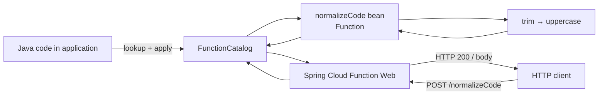

# Invoking Functions from FunctionCatalog and HTTP

> **Chapter:** Initialization  
> **Module:** SPRING_CLOUD_FUNCTION  
> **Goal:** Invoke the same Java function via `FunctionCatalog` and the HTTP Web adapter; understand data flow, function naming, composition, payload conversion, and differences in error handling.  
> **Illustrative environment:** Java 21, Spring Boot 4.2.0, Spring Cloud BOM 2026.0.0 (Spring Cloud Function 5.1.0). This version set was announced in November 2026; re-check release documentation when using at another time.

## 1. The Problem: One Capability, Two Ways to Invoke It

A service receives order codes from different sources. The immediate business requirement is to **trim leading and trailing whitespace and normalize the code to uppercase**. For example:

| Input Data | Expected Result |
| --- | --- |
| `"  od-123  "` | `"OD-123"` |
| `" in-2026 "` | `"IN-2026"` |
| `"x-9"` | `"X-9"` |

We will write a single `Function<String, String> normalizeCode` bean, then invoke it in two ways:

1. **Inside Java/Spring:** obtain the function from `FunctionCatalog.lookup("normalizeCode")` and call `apply(...)`.
2. **Externally over HTTP:** send `POST /normalizeCode`; the Spring Cloud Function Web adapter receives the request, locates the function, and returns the response.

The lambda itself does not need to know who called it. When the same logic is used through Spring Cloud Stream or a serverless environment, the corresponding adapter handles the protocol outside the function.



**Takeaway after this lesson:** Java `Function` is the processing contract, Spring Boot `@Bean` registers it, `FunctionCatalog` provides unified lookup/adaptation, and the Web adapter translates HTTP requests into calls against the catalog. These parts work together while handling distinct responsibilities.

## 2. Data Types and APIs Involved in an Invocation

### 2.1. `Function<T, R>` in Java

`Function<T, R>` belongs to `java.util.function`. Its primary method is `R apply(T input)`. For `Function<String, String>`:

- Input is a `String`.
- Output is a `String`.
- `apply(...)` performs the transformation on a single value.
- Types `T` and `R` can differ, e.g., `Function<String, Integer>`.

```java
import java.util.Locale;
import java.util.function.Function;

Function<String, String> normalize =
        code -> code.trim().toUpperCase(Locale.ROOT);

String result = normalize.apply("  od-123  ");
System.out.println(result); // OD-123
```

This is plain Java. There is no Spring container, catalog, or HTTP server yet.

### 2.2. `@Bean` and `ApplicationContext`

In Spring Boot, a `@Bean` method creates an object and registers it in `ApplicationContext`. With the method:

```java
@Bean
public Function<String, String> normalizeCode() {
    return code -> code.trim().toUpperCase(Locale.ROOT);
}
```

The bean gets the default name `normalizeCode`. Spring calls the **factory method** `normalizeCode()` when creating the bean, but does not automatically run `Function.apply(...)` with business data. Processing occurs when a caller invokes the function.

You can access the raw bean using `applicationContext.getBean("normalizeCode")`; however, to integrate with Spring Cloud Function, the standard approach is to look it up via `FunctionCatalog`.

### 2.3. What Else Does `FunctionCatalog` Provide?

Spring Cloud Function discovers `Supplier`, `Function`, and `Consumer` beans in the Spring context and can lazily register (*lazy registration*) them into the catalog. API:

```java
Function<String, String> function = catalog.lookup("normalizeCode");
String result = function.apply(" od-123 "); // OD-123
```

The lookup result is a function **wrapped/adapted** by Spring Cloud Function to support capabilities such as composition and type/message conversion. It is not necessarily the exact original `Function` instance returned by `ApplicationContext.getBean(...)`.

For example, when combining `normalizeCode` with `validateCode`, the catalog can construct an invocation by name `"normalizeCode|validateCode"` without you holding both function references and writing `andThen(...)` manually.

### 2.4. What Is the Role of the HTTP Web Adapter?

The `spring-cloud-function-web` module provides auto-configuration to expose functions as HTTP endpoints in a Spring Boot application with compatible Web/MVC support. The `spring-cloud-starter-function-web` starter bundles dependencies for quick setup.

The adapter is responsible for receiving requests, resolving the function from the catalog, converting body/headers into arguments, and mapping the result back to an HTTP response. **You do not need to write a `@RestController`** in this example. However, the Web adapter does not replace the full capabilities of building deep REST APIs with Spring MVC/WebFlux.

## 3. Initializing the Sample Application

### 3.1. Dependency Set Runnable Over HTTP

The example uses a compatible set:

| Component | Version |
| --- | --- |
| JDK | 21 |
| Spring Boot parent | 4.2.0 |
| Spring Cloud BOM | 2026.0.0 |
| Spring Cloud Function per above BOM | 5.1.0 |
| HTTP adapter | `spring-cloud-starter-function-web` |

Complete Maven `pom.xml`:

```xml
<?xml version="1.0" encoding="UTF-8"?>
<project xmlns="http://maven.apache.org/POM/4.0.0"
         xmlns:xsi="http://www.w3.org/2001/XMLSchema-instance"
         xsi:schemaLocation="
           http://maven.apache.org/POM/4.0.0
           https://maven.apache.org/xsd/maven-4.0.0.xsd">
    <modelVersion>4.0.0</modelVersion>

    <parent>
        <groupId>org.springframework.boot</groupId>
        <artifactId>spring-boot-starter-parent</artifactId>
        <version>4.2.0</version>
        <relativePath/>
    </parent>

    <groupId>vn.example</groupId>
    <artifactId>function-invocation-demo</artifactId>
    <version>0.0.1-SNAPSHOT</version>

    <properties>
        <java.version>21</java.version>
        <spring-cloud.version>2026.0.0</spring-cloud.version>
    </properties>

    <dependencyManagement>
        <dependencies>
            <dependency>
                <groupId>org.springframework.cloud</groupId>
                <artifactId>spring-cloud-dependencies</artifactId>
                <version>${spring-cloud.version}</version>
                <type>pom</type>
                <scope>import</scope>
            </dependency>
        </dependencies>
    </dependencyManagement>

    <dependencies>
        <dependency>
            <groupId>org.springframework.cloud</groupId>
            <artifactId>spring-cloud-starter-function-web</artifactId>
        </dependency>
        <dependency>
            <groupId>org.springframework.boot</groupId>
            <artifactId>spring-boot-starter-test</artifactId>
            <scope>test</scope>
        </dependency>
    </dependencies>

    <build>
        <plugins>
            <plugin>
                <groupId>org.springframework.boot</groupId>
                <artifactId>spring-boot-maven-plugin</artifactId>
            </plugin>
        </plugins>
    </build>
</project>
```

**Why import the BOM?** `spring-cloud-dependencies` manages Spring Cloud module versions consistently; `2026.0.0` corresponds to Boot `4.2.0`. `dependencyManagement` **does not automatically add** libraries. It is `spring-cloud-starter-function-web` inside `dependencies` that places the Web adapter and required modules on the classpath. Do not declare a separate version for the starter when the BOM already manages it.

If you are using a different Spring Boot/Spring Cloud set, update **both as a pair** following the matrix at https://spring.io/projects/spring-cloud/. Do not mix a standalone Function version from another release train.

### 3.2. Gradle Groovy DSL Option

If the project uses Gradle, you can declare `build.gradle` as follows:

```groovy
plugins {
    id 'java'
    id 'org.springframework.boot' version '4.2.0'
    id 'io.spring.dependency-management' version '1.1.7'
}

group = 'vn.example'
version = '0.0.1-SNAPSHOT'

repositories {
    mavenCentral()
}

java {
    toolchain {
        languageVersion = JavaLanguageVersion.of(21)
    }
}

ext {
    set('springCloudVersion', '2026.0.0')
}

dependencyManagement {
    imports {
        mavenBom "org.springframework.cloud:spring-cloud-dependencies:${springCloudVersion}"
    }
}

dependencies {
    implementation 'org.springframework.cloud:spring-cloud-starter-function-web'
    testImplementation 'org.springframework.boot:spring-boot-starter-test'
}

tasks.named('test') {
    useJUnitPlatform()
}
```

Use Maven **or** Gradle as the primary build tool. The Java files in the following steps can be used identically with either.

### 3.3. Source Structure

```text
function-invocation-demo/
├── pom.xml
└── src/
    ├── main/
    │   ├── java/
    │   │   └── vn/example/functiondemo/
    │   │       ├── FunctionDemoApplication.java
    │   │       └── CodeProcessor.java
    │   └── resources/
    │       └── application.properties
    └── test/
        └── java/
            └── vn/example/functiondemo/
                └── FunctionDemoApplicationTest.java
```

If using Gradle, the build file is `build.gradle` and the `src/...` structure stays the same.

## 4. Registering `Function<String, String>` with `@Bean`

Create `src/main/java/vn/example/functiondemo/FunctionDemoApplication.java`:

```java
package vn.example.functiondemo;

import java.util.Locale;
import java.util.function.Function;

import org.springframework.boot.SpringApplication;
import org.springframework.boot.autoconfigure.SpringBootApplication;
import org.springframework.context.annotation.Bean;

@SpringBootApplication
public class FunctionDemoApplication {

    public static void main(String[] args) {
        SpringApplication.run(FunctionDemoApplication.class, args);
    }

    @Bean
    public Function<String, String> normalizeCode() {
        return raw -> raw.trim().toUpperCase(Locale.ROOT);
    }
}
```

The line `return raw -> ...` returns a lambda implementing `Function.apply(...)`. Spring registers that object as a bean named `normalizeCode`. Key points to note:

- `String::trim` only removes whitespace; `toUpperCase(Locale.ROOT)` converts to uppercase consistently for technical codes regardless of the host machine's locale.
- This function **does not check for `null`**; calling `apply(null)` throws `NullPointerException`. For external endpoints, clear validation and error rules are needed.
- Spring beans default to singleton scope. This lambda holds no mutable state, so concurrent invocations can safely share it.
- No `@RestController` is needed for the Web starter to expose this bean over HTTP.

Create `src/main/resources/application.properties`:

```properties
spring.application.name=function-invocation-demo
server.port=8080
```

At this stage there is **only one function**, so `spring.cloud.function.definition` is not needed yet. Definition selection configuration will be introduced when there are two functions.

## 5. First Way: Invoking from `FunctionCatalog` in Java

### 5.1. Injecting the Catalog into a Service

Create `src/main/java/vn/example/functiondemo/CodeProcessor.java`:

```java
package vn.example.functiondemo;

import java.util.function.Function;

import org.springframework.cloud.function.context.FunctionCatalog;
import org.springframework.stereotype.Service;

@Service
public class CodeProcessor {

    private final Function<String, String> normalize;

    public CodeProcessor(FunctionCatalog catalog) {
        this.normalize = catalog.lookup("normalizeCode");
        if (this.normalize == null) {
            throw new IllegalStateException(
                    "Function not found: normalizeCode");
        }
    }

    public String process(String rawCode) {
        return normalize.apply(rawCode);
    }
}
```

When Spring starts up:

1. Creates `FunctionDemoApplication` and the `normalizeCode` bean.
2. Creates `CodeProcessor`; via constructor injection, Spring supplies `FunctionCatalog`.
3. `catalog.lookup("normalizeCode")` returns the function by name.
4. `process(...)` uses `apply(...)` to process input later, such as when the service is called.

**Looking up in the constructor** is a simple choice for this lesson because we only need to find it once and reuse it. In complex applications, lookups may be dynamic based on configuration or environment, though you still need to control which functions are allowed to be called.

### 5.2. How Does Using `ApplicationContext` Directly Differ?

You can retrieve the raw bean:

```java
Function<String, String> rawFunction =
        applicationContext.getBean("normalizeCode", Function.class);
String value = rawFunction.apply(" od-123 ");
```

The code above requires Spring's `applicationContext` variable to be available in scope; this is an **illustrative snippet**, not a standalone Java file. `rawFunction` is the Java bean created by `@Bean`, whereas `FunctionCatalog.lookup(...)` typically returns a wrapper managed by Spring Cloud Function.

| Retrieval Approach | Suitable Purpose | Difference |
| --- | --- | --- |
| `new FunctionDemoApplication().normalizeCode()` | Unit testing Java logic without starting Spring. | Does not test bean registration or the catalog. |
| `ApplicationContext.getBean(...)` | Accessing the raw Spring bean. | Does not apply Spring Cloud Function's adaptation/composition layer by default. |
| **`FunctionCatalog.lookup(...)`** | Name-based invocation, composition, adapter integration. | Returns a function standardized by the framework. |
| HTTP `POST /normalizeCode` | Allowing clients outside the JVM to invoke the function. | Requires the Web adapter and HTTP request/response handling. |

### 5.3. Bean Name and Function Name

The default name is the `@Bean` method name. If you write:

```java
@Bean("canonicalCode")
public Function<String, String> normalizeCode() {
    return raw -> raw.trim().toUpperCase(Locale.ROOT);
}
```

then you must look it up with `catalog.lookup("canonicalCode")`. This snippet is **an alternative**, not added alongside the bean in section 4.

Spring Cloud Function has a **single-function fallback** mechanism: when the catalog contains only one functional bean, a non-existent name may still resolve to that sole function. Therefore, testing `catalog.lookup("wrong-name")` and getting a result does not prove the name is right. To practice strict name-based lookup, you can disable the fallback:

```properties
spring.cloud.function.single-function-fallback-enabled=false
```

Once disabled, a wrong name will no longer automatically resolve to the single function. When an app has multiple functions, declare explicit names or definitions to avoid ambiguity.

### 5.4. When Is `spring.cloud.function.definition` Needed?

A definition identifies the default function or composition for adapters and integration frameworks, for example:

```properties
spring.cloud.function.definition=normalizeCode
```

With one function, it can usually be omitted. With multiple functions—especially in Spring Cloud Stream and serverless environments—configure it explicitly. **A definition is not an `apply` call** and does not open an HTTP endpoint on its own; only an appropriate adapter turns it into a protocol invocation.

## 6. Testing Catalog Invocation

### 6.1. Unit Test for the Plain Java Function

Create `src/test/java/vn/example/functiondemo/PureFunctionTest.java`:

```java
package vn.example.functiondemo;

import static org.junit.jupiter.api.Assertions.assertEquals;

import java.util.function.Function;

import org.junit.jupiter.api.Test;

class PureFunctionTest {

    @Test
    void normalizesCode() {
        Function<String, String> function =
                new FunctionDemoApplication().normalizeCode();

        assertEquals("OD-123", function.apply("  od-123  "));
        assertEquals("IN-2026", function.apply(" in-2026 "));
    }
}
```

This tests the lambda's behavior. It **does not start Spring** and does not prove that the catalog or Web adapter is present on the classpath.

### 6.2. Integration Test with `@SpringBootTest`

Create `src/test/java/vn/example/functiondemo/FunctionDemoApplicationTest.java`:

```java
package vn.example.functiondemo;

import static org.junit.jupiter.api.Assertions.assertEquals;
import static org.junit.jupiter.api.Assertions.assertNotNull;

import java.util.function.Function;

import org.junit.jupiter.api.Test;
import org.springframework.beans.factory.annotation.Autowired;
import org.springframework.boot.test.context.SpringBootTest;
import org.springframework.cloud.function.context.FunctionCatalog;

@SpringBootTest
class FunctionDemoApplicationTest {

    @Autowired
    private FunctionCatalog catalog;

    @Autowired
    private CodeProcessor codeProcessor;

    @Test
    void findsFunctionAndInvokesIt() {
        Function<String, String> function = catalog.lookup("normalizeCode");

        assertNotNull(function);
        assertEquals("OD-123", function.apply("  od-123  "));
    }

    @Test
    void serviceCanUseCatalogFunction() {
        assertEquals("AB-01", codeProcessor.process(" ab-01 "));
    }
}
```

This test proves that `FunctionCatalog` is registered by Spring, the bean is found under the exact name, and the service can use the catalog to invoke the function. It **does not start an HTTP server on port 8080**; a separate HTTP smoke test or Web test with a server/test client is still needed.

Run Maven:

```bash
mvn clean test
```

If the project has a Maven Wrapper, use `./mvnw clean test`. With Gradle, use `./gradlew test` (Windows: `./gradlew.bat test`).

### 6.3. Conclusions Drawn from the Two Tests

- If the **unit test fails**, fix the `trim`/`uppercase` logic or expected output.
- If the **unit test passes but the catalog test fails**, inspect starters/dependencies, `@Bean` declaration, bean name, and the Spring context.
- If the **catalog test passes but HTTP calls fail**, focus on the Web starter, port, route, HTTP method, content type, and runtime environment.

Splitting verification into layers lets you pinpoint failures without changing the whole application.

## 7. Second Way: Invoking the Same Function Over HTTP

### 7.1. Starting the Web Adapter Application

With Maven, inside the project directory containing `pom.xml`:

```bash
java -version
mvn -v
mvn spring-boot:run
```

If using Maven Wrapper, replace `mvn` with `./mvnw`. With Gradle, use `./gradlew bootRun`, or `./gradlew.bat bootRun` on Windows. Confirm in startup logs that the HTTP server is listening on port 8080.

Spring Cloud Function's Web adapter maps the name `normalizeCode` onto the URL path. The exact same lambda from section 4 can now be called from programs or cURL outside the JVM.

### 7.2. Sending `POST` with `text/plain`

Open another terminal:

```bash
curl -i -X POST http://localhost:8080/normalizeCode \
  -H "Content-Type: text/plain" \
  -H "Accept: text/plain" \
  --data-raw "  od-123  "
```

Typical response:

```http
HTTP/1.1 200 OK
Content-Type: text/plain

OD-123
```

The example above only illustrates **status, content type, and body**; actual HTTP headers will vary depending on the server and configuration. With a single-value `String -> String` function and a `text/plain` request, the output is a plain string.

Try another:

```bash
curl -s -X POST http://localhost:8080/normalizeCode \
  -H "Content-Type: text/plain" \
  --data-raw " in-2026 "
```

Expected result: `IN-2026`.

On Windows PowerShell, use `curl.exe` to avoid the `curl` alias:

```powershell
curl.exe -i -X POST "http://localhost:8080/normalizeCode" -H "Content-Type: text/plain" -H "Accept: text/plain" --data-raw "  od-123  "
```

**Why include both headers?** `Content-Type` describes the request body format; `Accept` indicates the response format the client expects. Providing both during testing reduces confusion from content negotiation.

### 7.3. `GET /{function}/{item}`

Per Web adapter rules, a single-value `Function` can also accept a value from the URL path:

```bash
curl -i http://localhost:8080/normalizeCode/od-123
```

The response body is `OD-123`. The `/{function}/{item}` path passes a single path segment as input; for inputs with special characters or spaces, proper URL encoding is required, and you should not assume a path segment can represent arbitrary complex JSON/bodies.

### 7.4. Do `POST`, `PUT`, and `GET` Differ?

The table below describes the basic mappings published by Spring Cloud Function Web:

| Bean Kind | Method and URL | Input | Typical Result |
| --- | --- | --- | --- |
| `Function<T,R>` | `POST /{function}` | Request body | HTTP 200, output from `apply`. |
| `Function<T,R>` | `PUT /{function}` | Request body | HTTP 200, output from `apply`. |
| `Function<T,R>` | `GET /{function}/{item}` | Path segment | HTTP 200, output from `apply`. |
| `Supplier<T>` | `GET /{supplier}` | No body | HTTP 200, data from `get`. |
| `Consumer<T>` | `POST /{consumer}` | Request body | HTTP 202 Accepted, behavior per `accept`. |

For `Supplier`, the runtime/adapter decides when `get` is called. For `Consumer`, the HTTP response does not represent a returned business value because `accept` returns `void`. In event processing, you also need to pay attention to retries and side effects.

### 7.5. Default HTTP Path and Custom Base Path

When the catalog contains only **one** function, the Web adapter usually allows invoking it by name or via the root path `/`:

```bash
curl -i -X POST http://localhost:8080/ \
  -H "Content-Type: text/plain" \
  --data-raw "  od-123  "
```

However, with multiple functional beans, invoke by explicit name. You can configure a base path:

```properties
spring.cloud.function.web.path=/functions
```

Then the named route becomes `/functions/normalizeCode`. `spring.cloud.function.web.path` determines **the Web adapter mapping prefix**, which is distinct from `spring.cloud.function.definition` (which selects the function or function chain).

### 7.6. Why Is Checking the Body Alone Not Enough?

When testing HTTP, record:

- HTTP method and URL.
- Request `Content-Type` and `Accept`.
- HTTP status.
- Response body and `Content-Type`.
- How the server responds when input is empty or invalid.

Both invocation paths can produce the same `OD-123` output yet behave differently at the transport layer. `catalog.lookup(...).apply(...)` can throw a Java exception directly; HTTP turns errors into status codes and response bodies via the Web/error-handling layer. Do not assume every validation exception automatically becomes HTTP 400.

## 8. Which Layers Does an HTTP Call Pass Through?

```mermaid
sequenceDiagram
    participant Client as HTTP client
    participant Web as Web adapter
    participant Catalog as FunctionCatalog
    participant Function as normalizeCode

    Client->>Web: POST /normalizeCode; Content-Type: text/plain
    Web->>Catalog: Resolve function normalizeCode
    Catalog-->>Web: Adapted Function
    Web->>Function: apply("  od-123  ")
    Function-->>Web: "OD-123"
    Web-->>Client: HTTP 200, body OD-123
```

The diagram shows the **logical flow**; it does not mean the Web adapter performs a fresh lookup on every request. The framework can pre-initialize/cache mappings and wrappers. What matters is:

1. **Protocol** is handled by the Web adapter.
2. **Function selection and adaptation** are handled by the catalog.
3. **Business logic** is executed by the lambda.
4. **Building the HTTP response** is handled by the adapter.

When replacing Web with Spring Cloud Stream/binder, the HTTP part becomes receiving and sending messages. When replacing with a serverless adapter, the protocol part becomes the provider's handler/trigger. `normalizeCode` can still remain unchanged as long as the input is converted to `String`.

## 9. Composition: Invoking Two Functions via Catalog and HTTP

### 9.1. Adding a Second Bean to the Application

Add another method inside `FunctionDemoApplication` (alongside `normalizeCode`):

```java
@Bean
public Function<String, String> validateCode() {
    return code -> {
        if (!code.matches("[A-Z]{2}-[0-9]{3}")) {
            throw new IllegalArgumentException("Invalid code: " + code);
        }
        return code;
    };
}
```

Once added, there are **two** beans: `normalizeCode` and `validateCode`. Both have `String` input/output signatures, making them compatible for composition.

### 9.2. Invoking Composition via the Catalog

```java
Function<String, String> pipeline =
        catalog.lookup("normalizeCode|validateCode");

String result = pipeline.apply(" od-123 ");  // OD-123
```

The pipe `|` means run `normalizeCode` first, then `validateCode`. If you reverse the order, input `" od-123 "` will be rejected before normalization happens.

In plain Java, you could write:

```java
Function<String, String> pipeline =
        normalizeCode.andThen(validateCode);
```

However, that requires both `normalizeCode` and `validateCode` variables to already exist as `Function` objects in the current scope. Looking up from `FunctionCatalog` is convenient when the caller only knows **function names from configuration**, and the catalog also supplies Spring Cloud Function's conversion/orchestration features.

### 9.3. Invoking Composition Over HTTP

The Web adapter can accept composed function names joined by **commas** in the URL:

```bash
curl -i -X POST http://localhost:8080/normalizeCode,validateCode \
  -H "Content-Type: text/plain" \
  -H "Accept: text/plain" \
  --data-raw "  od-123  "
```

Expected response body: `OD-123`.

In shell commands, `|` is a shell pipe operator, so using a comma in the URL is simpler. Spring Cloud Function also supports pipe or comma composition syntax in function definitions; URLs must follow your HTTP client's escaping rules.

### 9.4. Mapping a Composition to the Root Path

When you want the adapter to use a function chain as the default definition:

```properties
spring.cloud.function.definition=normalizeCode|validateCode
```

Per Web adapter documentation, this definition can be mapped to root `/`. Once a definition is set, URL-based function selection behavior can differ from the unconfigured case; check actual mappings if there are multiple functions or definitions.

For a selective list of exposed functions, the Web adapter also supports definitions separated by `;`, for example:

```properties
spring.cloud.function.definition=normalizeCode;validateCode
```

Unlike the pipe, the semicolon in this case represents **a list of functions to expose**, not a processing pipeline. If you also want clients to invoke the composition, declare the corresponding definition following Web adapter filtering rules. Distinguish the syntaxes:

| Notation | Context | Meaning |
| --- | --- | --- |
| `normalizeCode|validateCode` | `FunctionCatalog.lookup` or definition property | Composition: left function → right function. |
| `/normalizeCode,validateCode` | Web adapter URL | Invoke composition via route. |
| `normalizeCode;validateCode` | Web adapter definition property | Select multiple individual functions to expose, not composition. |

### 9.5. Adding a Catalog Test for Composition

Inside the `FunctionDemoApplicationTest` class, add:

```java
@Test
void canComposeFunctions() {
    Function<String, String> pipeline =
            catalog.lookup("normalizeCode|validateCode");

    assertNotNull(pipeline);
    assertEquals("OD-123", pipeline.apply("  od-123  "));
}
```

This test only applies **after** the `validateCode` bean has been added. Do not add the composition test before the second bean exists.

## 10. Payload and Metadata Conversion Between HTTP and Functions

### 10.1. How Do Plain `String` and `Message<T>` Differ?

The `Function<String,String>` example processes only the payload. Yet an HTTP request also carries method, URL, content type, correlation ID, and headers. Spring Messaging represents payload/headers pairs via `Message<T>`. When metadata is needed, you can write a function with `Message<String>` input/output.

**Additional** bean example (place inside a Spring configuration class):

```java
import java.util.Locale;
import java.util.function.Function;

import org.springframework.context.annotation.Bean;
import org.springframework.messaging.Message;
import org.springframework.messaging.support.MessageBuilder;

@Bean
public Function<Message<String>, Message<String>> normalizeMessage() {
    return incoming -> {
        String normalized = incoming.getPayload()
                .trim()
                .toUpperCase(Locale.ROOT);

        return MessageBuilder.withPayload(normalized)
                .copyHeaders(incoming.getHeaders())
                .setHeader("processedBy", "normalizeMessage")
                .build();
    };
}
```

When invoked by the Web adapter, the function can read request headers via `MessageHeaders` and return headers that the adapter maps onto the response according to applicable rules. Do not assume all headers pass through unconditionally: standard headers, ignored-header rules, content types, and the specific adapter can all affect them.

### 10.2. Converting JSON to DTOs

If business logic takes `Function<OrderRequest, OrderResult>`, an HTTP request can carry JSON with `Content-Type: application/json`. Spring Cloud Function uses **the function's parameter type** together with metadata such as `contentType` to select a converter.

Suppose we replace input/output with DTOs (Java 21):

```java
public record OrderRequest(String code) {}

public record OrderResult(String normalizedCode) {}
```

The `Function` bean can be written as:

```java
@Bean
public Function<OrderRequest, OrderResult> normalizeOrder() {
    return request -> new OrderResult(
            request.code().trim().toUpperCase(Locale.ROOT)
    );
}
```

Once these records are declared in proper Java files and a JSON converter library is configured, an illustrative HTTP request is:

```bash
curl -i -X POST http://localhost:8080/normalizeOrder \
  -H "Content-Type: application/json" \
  -H "Accept: application/json" \
  --data-raw '{"code":" od-123 "}'
```

Expected response body for the DTO model:

```json
{"normalizedCode":"OD-123"}
```

**Source code note:** each top-level `public record` requires its own `OrderRequest.java` / `OrderResult.java` file in the same package, or records can be nested inside an appropriate class and referenced by their corresponding types. The snippet above illustrates DTO conversion and is not a mandatory part of the initial `String` project.

With JSON, you must also handle missing `code`, `null` values, malformed JSON, and invalid content. Content type alone does **not** guarantee successful conversion; it also depends on the target type and actual converter.

### 10.3. Distinguishing Conversion Errors from Business Errors

| Scenario | Primary Layer | Example |
| --- | --- | --- |
| Invalid JSON syntax | HTTP/message conversion | Body cannot be parsed into a DTO. |
| Function signature incompatible with payload | Catalog/conversion | Function expects `OrderRequest`, but payload cannot be converted. |
| Data converts to DTO, but violates business rules | Business logic | `code="??"` fails the order regex check. |
| Function name not found | FunctionCatalog/Web mapping | Calling `/unknownFunction` with fallback disabled. |
| Unable to connect to server | Network/runtime | Wrong port or app not started. |

Separating error layers is crucial when later deploying the same logic to HTTP, brokers, or serverless. Each adapter handles error reporting and retries differently; do not cram all transport handling into the lambda.

## 11. Error Handling and Limitations When Invoking Over HTTP

### 11.1. A Java Exception Does Not Automatically Mean HTTP 400

When `validateCode` is added, invalid input can throw `IllegalArgumentException`:

```java
Function<String, String> pipeline =
        catalog.lookup("normalizeCode|validateCode");

pipeline.apply("???"); // IllegalArgumentException
```

In Java, the caller can catch the exception with `try/catch` or let it propagate. In HTTP, the adapter/framework turns errors into an HTTP response according to the application's error-handling mechanism. **Do not assume `IllegalArgumentException` automatically becomes 400 Bad Request** or that error bodies always follow a fixed JSON schema.

For a stable HTTP API, define an explicit error contract—status, error code, message, correlation ID—and test it with the Web adapter or HTTP error-handling layer you use.

### 11.2. Blank Values and `null`

With the simple `normalizeCode` version in section 4:

| Java Input | Output |
| --- | --- |
| `" OD-123 "` | `"OD-123"` |
| `"   "` | `""` |
| `""` | `""` |
| `null` | `NullPointerException` |

The HTTP layer may map an empty or missing request body differently from an empty `String`. Therefore, test **actual HTTP requests** instead of extrapolating solely from the Java input table.

A clearer policy is rejecting blank codes inside the logic:

```java
@Bean
public Function<String, String> normalizeCode() {
    return raw -> {
        if (raw == null || raw.isBlank()) {
            throw new IllegalArgumentException("Code must not be blank");
        }
        return raw.trim().toUpperCase(Locale.ROOT);
    };
}
```

This snippet **replaces** the implementation of `normalizeCode`; do not create a second bean with the same name.

### 11.3. API Security and the HTTP Web Adapter

Spring Cloud Function Web is very convenient for learning, testing functions, or exposing simple endpoints. However, a real HTTP endpoint also requires:

- Proper authentication/authorization.
- Request size limits, timeouts, and rate limiting where needed.
- Control over headers and user inputs allowed into the function.
- Logging, correlation IDs, and sensitive data protection.
- A stable error contract and observability via metrics/tracing.

In particular, if an application allows dynamic function routing via headers or expressions, restrict selection privileges and avoid exposing capabilities unintended for clients. Typical business apps should expose only the functions meant to be served.

## 12. Common Errors and How to Diagnose Them

| Symptom | Possible Cause | Diagnostic Action |
| --- | --- | --- |
| `catalog.lookup("normalizeCode")` returns `null` | Wrong bean name, bean not registered, or context not loaded; fallback may be disabled. | Check `@Bean`, package scan, actual bean name, and Function classpath. |
| Wrong name lookup still returns a function | Only one function exists and **single-function fallback** is enabled. | Disable `spring.cloud.function.single-function-fallback-enabled` to verify exact name matching. |
| Injecting `FunctionCatalog` fails | Missing `spring-cloud-function-context`/starter or incompatible Boot–Cloud dependencies. | Inspect Maven/Gradle dependency tree and Spring Cloud BOM. |
| Java call works, HTTP returns 404 | Missing Web starter, app not running Web/MVC, or wrong URL/base path. | Check startup logs, starter, port, and `spring.cloud.function.web.path`. |
| HTTP 405 Method Not Allowed | HTTP method does not match active mapping. | Review Web adapter mappings; use POST for the example Function. |
| HTTP 415 / conversion error | Wrong `Content-Type`, missing converter, or payload/Function type mismatch. | Use `text/plain` for String; use JSON converter and `application/json` for DTOs. |
| Java returns `OD-123`, HTTP returns something else | Hitting a different route/definition, or different conversion/encoding. | Check URL, function definition, headers, and actual payload sent. |
| Composition error / bean not found | Wrong syntax, missing `validateCode`, or incompatible types between functions. | Invoke each function individually, then test `catalog.lookup("normalizeCode|validateCode")`. |
| HTTP error response on invalid input | Business exception not mapped per API contract. | Add error handling and smoke test status/body. |
| Builds/runs locally, fails on deploy | Different JDK, port, dependencies, runtime, or packaging. | Compare environments, inspect packaged artifact, and check runtime logs. |
| Consumer triggers duplicate side effects | Retry/message redelivery or client sending request twice. | Design for idempotency; do not treat HTTP 202 as an exactly-once guarantee. |

### 12.1. Short Diagnostic Workflow

1. **Test logic:** run the unit test for `normalizeCode`.
2. **Test Spring:** run `@SpringBootTest` and `FunctionCatalog.lookup`.
3. **Test HTTP adapter:** verify starter, startup logs, and port.
4. **Test request:** run `curl -i` with `Content-Type: text/plain` and the exact URL.
5. **Test extensions:** when adding composition/DTOs, re-test function definitions and conversion.

This workflow isolates errors by responsibility layer. If both Java and the catalog work but cURL fails, do not edit the lambda before checking the Web mapping.

## 13. Comprehensive Hands-On Exercises

### Exercise 1 — Invoking One Function Two Ways

**Prompt:** Create a project using `pom.xml` from section 3 and the `normalizeCode` bean from section 4. With input `"  od-123  "`:

1. Write a unit test calling `apply(...)` directly.
2. Write a catalog test calling `lookup("normalizeCode")`.
3. Start the HTTP server and send `POST /normalizeCode`.
4. Compare the outputs of all three calls.

**Completion criteria:** all three return `OD-123`, yet only steps 2 and 3 test Spring Cloud Function integration; step 3 also tests the Web adapter.

### Exercise 2 — Distinguishing Bean Name Errors from Route Errors

Change `@Bean` to `@Bean("canonicalCode")`, then enable:

```properties
spring.cloud.function.single-function-fallback-enabled=false
```

Test:

- `catalog.lookup("normalizeCode")` and `catalog.lookup("canonicalCode")`.
- `POST /normalizeCode` and `POST /canonicalCode`.
- Explain the difference between a Java method name and a registered bean name.

**Hint:** after renaming the bean, `canonicalCode` is the matching lookup and route name. Fallback is disabled so name checks are not masked.

### Exercise 3 — Composition and HTTP

Add the `validateCode` bean from section 9. Test:

```java
Function<String, String> pipeline =
        catalog.lookup("normalizeCode|validateCode");
```

And:

```bash
curl -i -X POST http://localhost:8080/normalizeCode,validateCode \
  -H "Content-Type: text/plain" \
  --data-raw "  od-123  "
```

Change input to `"  invalid??  "` and observe the difference between the Java exception and the HTTP error response.

### Exercise 4 — Changing the Base Path and Checking HTTP

Add:

```properties
spring.cloud.function.web.path=/functions
```

Call `POST /functions/normalizeCode`. Explain why changing the base path only affects the Web layer, while `catalog.lookup("normalizeCode")` remains unchanged.

### Exercise 5 — Protocol Transition Thinking

Suppose tomorrow order codes must be processed from Kafka. Describe what needs to be added:

- Spring Cloud Stream and a compatible Kafka binder.
- Function definition, input/output bindings, and Kafka destinations.
- Event payload/header conversion, retries, and idempotency.

Keep the `normalizeCode` bean unchanged if the payload converts to an appropriate `String`. Explain why `FunctionCatalog` and the core Java logic remain usable even without HTTP requests.

### Self-Assessment Checklist

| Question | Expected Answer |
| --- | --- |
| Once `@Bean Function<String,String>` exists, is it immediately usable via HTTP? | **No**; it needs the Spring Cloud Function Web starter and a running Web application. |
| Does `FunctionCatalog.lookup` return the raw Java bean? | It returns a function wrapped/adapted by the framework, adding catalog capabilities. |
| How does composition `normalizeCode|validateCode` differ from `normalizeCode;validateCode`? | Pipe composes functions; semicolon selects a list of functions in the Web adapter's filtering context. |
| What does sending `text/plain` via POST to a String Function do? | The Web adapter passes the body into the function call and returns its output. |
| Can this same logic be reused over events/serverless? | Yes, with the appropriate adapter, payload types, and environment configuration. |

## 14. Summary

- `FunctionCatalog.lookup("normalizeCode")` lets you locate a function by name and call `apply(...)` inside a Spring application. The catalog also supports composition and data/message conversion under appropriate contracts.
- The Spring Cloud Function Web adapter exposes functions as HTTP endpoints. `POST /normalizeCode` and `GET /normalizeCode/{item}` are simple examples for `Function<String, String>`.
- With multiple functions, compose them via `catalog.lookup("normalizeCode|validateCode")` or HTTP calls to `/normalizeCode,validateCode`; `spring.cloud.function.definition` specifies the definition for adapters.
- Java exceptions and HTTP error responses belong to two separate layers. Test inputs, statuses, and payload conversions in each environment.
- The same business logic can be used across HTTP, events, or serverless; the adapter layer translates protocol calls into the contract of `Supplier`, `Function`, or `Consumer`.

### Official References

1. Spring Cloud Function – **Programming Model**, FunctionCatalog, function definition, composition, type conversion: https://docs.spring.io/spring-cloud-function/reference/spring-cloud-function/programming-model.html
2. Spring Cloud Function – **Standalone Web Applications**, HTTP mapping, root path, composition URL, headers: https://docs.spring.io/spring-cloud-function/reference/spring-cloud-function/standalone-web-applications.html
3. Spring Cloud Function – Reference: https://docs.spring.io/spring-cloud-function/reference/
4. Spring Cloud Stream – Reference (connecting functions to brokers): https://docs.spring.io/spring-cloud-stream/reference/
5. Spring Cloud 2026.0.0 GA, released November 20, 2026: https://spring.io/blog/2026/11/20/spring-cloud-2026-0-0-has-been-released/
6. Spring Cloud Release Trains and Spring Boot Compatibility Matrix: https://spring.io/projects/spring-cloud/
7. Spring Boot Reference: https://docs.spring.io/spring-boot/reference/
8. Java `java.util.function.Function` API: https://docs.oracle.com/en/java/javase/21/docs/api/java.base/java/util/function/Function.html
