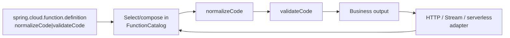

# Selecting Functions with spring.cloud.function.definition

> **Chapter:** Initialization  
> **Module:** SPRING_CLOUD_FUNCTION  
> **Goal:** Use `spring.cloud.function.definition` to select a function, compose multiple functions, or declare multiple functions to expose to the execution environment; distinguish function selection from invoking functions via `FunctionCatalog`, HTTP, events, and serverless.  
> **Illustrative version set:** Java 21, Spring Boot 4.2.0, Spring Cloud BOM 2026.0.0, Spring Cloud Function 5.1.0 (as of November 24, 2026). In real deployments, verify releases and adapter compatibility.

## 1. Why Is `spring.cloud.function.definition` Needed?

Spring Cloud Function lets you encapsulate business logic using Java's three standard functional interfaces: `Supplier<T>` supplies data, `Function<T, R>` transforms data, and `Consumer<T>` receives and consumes data. Logic is reusable independent of the invocation protocol. `FunctionCatalog` discovers beans and supports lookup, composition, and data/message conversion; HTTP, Spring Cloud Stream, or serverless adapters determine when and how the function is called.

An application can have multiple beans:

```text
normalizeCode : Function<String, String>  // trim whitespace, uppercase
validateCode  : Function<String, String>  // validate code pattern
addPrefix     : Function<String, String>  // prepend ORDER: prefix
```

When there is only **one** function in the catalog, the framework can usually pick that function automatically. When there are **multiple** functions, the adapter needs to know which function should act as the main processing entry point, or which functions are allowed to be exposed externally. The following property expresses that choice:

```properties
spring.cloud.function.definition=normalizeCode
```

This is a **definition** (function definition): it can point to one bean or describe a composition chain of multiple beans. The property does not create beans and does not execute `apply(...)` on its own; the beans must exist in the Spring context or catalog, while execution occurs when an adapter or Java code invokes them.

After this lesson, learners should be able to:

1. Select a function by bean name using `spring.cloud.function.definition`.
2. Compose multiple functions using `|` or `,` and explain the execution order.
3. Distinguish `;` for selecting a **list of separate functions/chains** from `|` used to **compose**.
4. Write configuration in `application.properties`, `application.yml`, environment variables, and command-line arguments.
5. Check different behaviors of `definition` across the Web adapter, Spring Cloud Stream, and serverless.
6. Diagnose bean name, missing function, type mismatch, path, and message conversion errors.

### 1.1. General Flow



The configuration controls **which function or pipeline is selected**. Request/event sources, message serialization, responses, retries, timeouts, and security still belong to the adapter or deployment environment.

## 2. Reading the Property Syntax Correctly

### 2.1. One Function Name: Selecting One Bean

```properties
spring.cloud.function.definition=normalizeCode
```

The name `normalizeCode` is a **bean name**, usually taken from the `@Bean` method name. If you declare:

```java
@Bean("canonicalCode")
public Function<String, String> normalizeCode() {
    return text -> text.trim().toUpperCase(Locale.ROOT);
}
```

the name to select becomes `canonicalCode`, even though the Java method is still named `normalizeCode`. This snippet illustrates an **alternative naming approach** and should not duplicate a bean in the sample application in section 4.

### 2.2. Composition: Using `|` or `,`

```properties
spring.cloud.function.definition=normalizeCode|validateCode
```

This describes **a single composed function**:

```text
input -> normalizeCode -> validateCode -> output
```

Spring Cloud Function also allows writing composition definitions with a comma:

```properties
spring.cloud.function.definition=normalizeCode,validateCode
```

Both syntaxes express **left-to-right** execution order in composition contexts. Given `"  od-123 "`, `normalizeCode` returns `"OD-123"` and `validateCode` checks that result. Reversing it to `validateCode|normalizeCode` can cause valid input to be rejected before normalization.

Plain Java has a conceptual equivalent:

```java
Function<String, String> pipeline = normalizeCode.andThen(validateCode);
```

However, `FunctionCatalog` lets you build pipelines using **bean names from configuration**, which is useful when the same logic is deployed across multiple different adapters.

### 2.3. List: Using a Semicolon `;`

Example:

```properties
spring.cloud.function.definition=normalizeCode;addPrefix
```

These are **two separate selected functions**. The `;` does not mean run `normalizeCode` and pass its output into `addPrefix`. Each function is used by the relevant adapter as an individual definition according to its export or binding rules.

You can also select a composition alongside an individual function:

```properties
spring.cloud.function.definition=normalizeCode|validateCode;addPrefix
```

When using the **Web adapter**, this exposes only the `normalizeCode|validateCode` composition and the `addPrefix` bean over HTTP; functions omitted from the list are not exposed directly by the Web adapter. In **Spring Cloud Stream**, semicolons can specify multiple functions to wire to separate bindings.

### 2.4. Quick Reference Table

| Definition Value | Conceptual Meaning | How Many Definitions Selected? |
| --- | --- | --- |
| `normalizeCode` | Select one Function bean. | 1 |
| `normalizeCode\|validateCode` | Compose two Functions in order. | 1 pipeline |
| `normalizeCode,validateCode` | Alternative composition syntax. | 1 pipeline |
| `normalizeCode;addPrefix` | Select two separate functions. | 2 |
| `normalizeCode\|validateCode;addPrefix` | Select one pipeline and one separate function. | 2 |
| `validateCode\|normalizeCode` | Also composition, but **different order**. | 1 pipeline, potentially wrong business logic |

**Do not swap `|` and `;`**: they have different meanings. Likewise, do not put `;` in a URL and assume a request will execute two functions sequentially.

## 3. How Does Definition Relate to `FunctionCatalog`?

### 3.1. `FunctionCatalog` Exists to Look Up Functions

When a `Function<String, String>` bean named `normalizeCode` exists, Java code can call:

```java
Function<String, String> function =
        catalog.lookup("normalizeCode");

String output = function.apply("  od-123  "); // "OD-123"
```

If a `validateCode` bean is also present, you can look up the composition:

```java
Function<String, String> pipeline =
        catalog.lookup("normalizeCode|validateCode");
```

`FunctionCatalog.lookup(...)` is an **explicit name-based call**. The `spring.cloud.function.definition` property primarily helps integration systems choose a default function or a set of functions to use. For example, you do not need to pass a function name inside every Kafka event if Stream already reads the definition from configuration.

Each adapter has its own rules for applying this property. **Setting a definition does not lock out programmatic lookups** in the Spring context. In particular, do not use this property as a substitute for function access control.

### 3.2. Why Doesn't Spring Cloud Function Always Require a Definition?

If there is only **one functional bean** in `ApplicationContext`, Spring Cloud Function has a *single-function fallback* mechanism. In ordinary cases, looking up with an empty name, an arbitrary name, or no name can resolve to that sole function.

For instance, when only `normalizeCode` exists:

```java
catalog.lookup("normalizeCode"); // exact name
catalog.lookup(null);            // may resolve the sole function
catalog.lookup("wrongName");     // may also fall back to the sole function
```

This illustrates **documented default behavior**, not a reason to use wrong names as a habit. When you want lookups to require exact names:

```properties
spring.cloud.function.single-function-fallback-enabled=false
```

With Spring Cloud Stream, documentation recommends **always declaring `definition` explicitly**, even with a single function, to prevent ambiguity as the application grows in bean count.

### 3.3. Functions Ineligible for Export or Filtered from the Catalog

Not every Java bean implementing `Function` makes sense as a business entry point. Some internal beans may need to be excluded from candidate functions. If a functional bean should not be registered in the catalog, Spring Cloud Function supports:

```properties
spring.cloud.function.ineligible-definitions=internalFormatter,debugFunction
```

This property controls **catalog candidate filtering**, which differs from `spring.cloud.function.definition` (which specifies the definition to run or expose via an adapter). If a function is excluded from catalog registration, naming it in `definition` will not make it appear.

## 4. Creating a Three-Function App for Practice

### 4.1. Maven Dependencies

A compatible choice as of November 24, 2026 is Java 21, Spring Boot 4.2.0, Spring Cloud BOM 2026.0.0. This Spring Cloud release train includes Spring Cloud Function 5.1.0. Use the Web starter to verify definitions easily over HTTP.

Create `pom.xml`:

```xml
<?xml version="1.0" encoding="UTF-8"?>
<project xmlns="http://maven.apache.org/POM/4.0.0"
         xmlns:xsi="http://www.w3.org/2001/XMLSchema-instance"
         xsi:schemaLocation="
           http://maven.apache.org/POM/4.0.0
           https://maven.apache.org/xsd/maven-4.0.0.xsd">
    <modelVersion>4.0.0</modelVersion>

    <parent>
        <groupId>org.springframework.boot</groupId>
        <artifactId>spring-boot-starter-parent</artifactId>
        <version>4.2.0</version>
        <relativePath/>
    </parent>

    <groupId>vn.example</groupId>
    <artifactId>function-definition-demo</artifactId>
    <version>0.0.1-SNAPSHOT</version>

    <properties>
        <java.version>21</java.version>
        <spring-cloud.version>2026.0.0</spring-cloud.version>
    </properties>

    <dependencyManagement>
        <dependencies>
            <dependency>
                <groupId>org.springframework.cloud</groupId>
                <artifactId>spring-cloud-dependencies</artifactId>
                <version>${spring-cloud.version}</version>
                <type>pom</type>
                <scope>import</scope>
            </dependency>
        </dependencies>
    </dependencyManagement>

    <dependencies>
        <dependency>
            <groupId>org.springframework.cloud</groupId>
            <artifactId>spring-cloud-starter-function-web</artifactId>
        </dependency>

        <dependency>
            <groupId>org.springframework.boot</groupId>
            <artifactId>spring-boot-starter-test</artifactId>
            <scope>test</scope>
        </dependency>
    </dependencies>

    <build>
        <plugins>
            <plugin>
                <groupId>org.springframework.boot</groupId>
                <artifactId>spring-boot-maven-plugin</artifactId>
            </plugin>
        </plugins>
    </build>
</project>
```

`spring-cloud-dependencies` is the **BOM managing versions**. `spring-cloud-starter-function-web` is the dependency for running the Web adapter. With the right BOM, there is no need for a separate Function version inside the dependency element. If using another release train, choose a matching Boot/Cloud pair from the official compatibility matrix.

### 4.2. Directory Structure

```text
function-definition-demo/
├── pom.xml
└── src/
    ├── main/
    │   ├── java/
    │   │   └── vn/example/definition/
    │   │       └── FunctionDefinitionApplication.java
    │   └── resources/
    │       └── application.properties
    └── test/
        └── java/
            └── vn/example/definition/
                └── FunctionDefinitionApplicationTest.java
```

If using Gradle instead of Maven, the Java sources and configuration files stay the same; only the build tool, dependency management, and run commands change.

### 4.3. Defining Beans in Java

Create `src/main/java/vn/example/definition/FunctionDefinitionApplication.java`:

```java
package vn.example.definition;

import java.util.Locale;
import java.util.function.Function;

import org.springframework.boot.SpringApplication;
import org.springframework.boot.autoconfigure.SpringBootApplication;
import org.springframework.context.annotation.Bean;

@SpringBootApplication
public class FunctionDefinitionApplication {

    public static void main(String[] args) {
        SpringApplication.run(FunctionDefinitionApplication.class, args);
    }

    @Bean
    public Function<String, String> normalizeCode() {
        return raw -> raw.trim().toUpperCase(Locale.ROOT);
    }

    @Bean
    public Function<String, String> validateCode() {
        return code -> {
            if (!code.matches("[A-Z]{2}-[0-9]{3}")) {
                throw new IllegalArgumentException("Invalid code: " + code);
            }
            return code;
        };
    }

    @Bean
    public Function<String, String> addPrefix() {
        return code -> "ORDER:" + code;
    }
}
```

The three beans get the default names `normalizeCode`, `validateCode`, and `addPrefix`, corresponding to the `@Bean` method names. Processing order yields different outcomes:

| Composition | Input | Result |
| --- | --- | --- |
| `normalizeCode` | `"  od-123  "` | `"OD-123"` |
| `normalizeCode\|validateCode` | `"  od-123  "` | `"OD-123"` |
| `normalizeCode\|addPrefix` | `"  od-123  "` | `"ORDER:OD-123"` |
| `addPrefix\|validateCode` | `"OD-123"` | Throws `IllegalArgumentException` because `ORDER:` does not match the pattern. |

This example deliberately shows that **composition is an ordered business rule**, not arbitrary name chaining.

### 4.4. Writing the First Configuration File

Place `src/main/resources/application.properties`:

```properties
spring.application.name=function-definition-demo
server.port=8080
spring.cloud.function.definition=normalizeCode|validateCode
```

When Spring Boot runs with the Web starter, the function definition picks the `normalizeCode|validateCode` pipeline as the default function for HTTP. Before testing URLs, distinguish bean creation from the adapter wiring the definition to a route.

## 5. Selecting Functions Over HTTP Using `definition`

### 5.1. Setting a Single Definition: Mapping to the Root Path

The Web adapter documentation explains that when multiple functions exist, the property:

```properties
spring.cloud.function.definition=normalizeCode|validateCode
```

creates a **default composition** and maps it to the root path `/` (or the configured base path for the Web adapter). Run the app:

```bash
mvn clean package
mvn spring-boot:run
```

If the project has a Maven Wrapper, use `./mvnw` (Linux/macOS) or `./mvnw.cmd` (Windows).

Send an HTTP POST from another terminal:

```bash
curl -i -X POST http://localhost:8080/ \
  -H "Content-Type: text/plain" \
  -H "Accept: text/plain" \
  --data-raw "  od-123  "
```

Expected body:

```text
OD-123
```

Input arrives at the root URL yet flows through **two beans** per the definition. No `@RestController` is needed: the Web starter maps requests to Spring Cloud Function.

### 5.2. What If No Definition Is Declared?

In the three-bean application, delete the `spring.cloud.function.definition=...` line and restart. By Web adapter rules, each function can be called by name:

```bash
curl -i -X POST http://localhost:8080/normalizeCode \
  -H "Content-Type: text/plain" \
  --data-raw "  od-123  "
```

You can also invoke a composition via a URL containing comma-separated names:

```bash
curl -i -X POST http://localhost:8080/normalizeCode,validateCode \
  -H "Content-Type: text/plain" \
  --data-raw "  od-123  "
```

The Web adapter also supports `|` in URLs, though you must watch out for shell and URL escaping. Commas keep cURL examples readable. In `FunctionCatalog.lookup(...)` or properties files, pipes usually express order more clearly.

### 5.3. When One Definition Is Set, Does It Automatically Hide All Other Functions?

**Do not treat a single definition as an authorization mechanism or API filter.** With the Web adapter, a single definition selects the default composition, maps to root, and may act as a fallback for URLs not mapped by name. Exact fallback/mapping rules also depend on configuration and adapter version.

If you want to **expose only a specific set of functions/compositions**, use a **semicolon-separated list of definitions** following the Web adapter's function filtering rules:

```properties
spring.cloud.function.definition=normalizeCode|validateCode;addPrefix
```

Now the HTTP endpoints exposed for the selected list include:

- `POST /normalizeCode,validateCode`: the normalize-then-validate pipeline.
- `POST /addPrefix`: the prefix-adding function.

With a `;`-separated list, **there is no root `/` mapping under the filtering rules**, and the Web adapter does not expose other functions outside the list (nor unlisted compositions). For example, `/validateCode` will not be exposed standalone. Even so, real endpoint security still requires Spring Security/a gateway and testing.

### 5.4. Customizing the Base Path

```properties
spring.cloud.function.web.path=/functions
spring.cloud.function.definition=normalizeCode|validateCode
```

The base path is no longer `/` but `/functions` per Web adapter rules. If configuring a filtered list `normalizeCode|validateCode;addPrefix`, named paths carry the `/functions/` prefix, such as `/functions/addPrefix`.

`spring.cloud.function.web.path` **adjusts the URL**; `spring.cloud.function.definition` **selects functions/compositions**. They serve two distinct responsibilities.

### 5.5. Comparing the Three Web Modes

| Configuration | URL to Test | Expected Result |
| --- | --- | --- |
| No definition set, three beans registered | `POST /normalizeCode` | `OD-123` |
| No definition set, using composition URL | `POST /normalizeCode,validateCode` | `OD-123` |
| `definition=normalizeCode\|validateCode` | `POST /` | `OD-123` |
| `definition=normalizeCode\|addPrefix` | `POST /` | `ORDER:OD-123` |
| `definition=normalizeCode\|validateCode;addPrefix` | `POST /normalizeCode,validateCode` or `POST /addPrefix` | Two separate endpoints; no root mapping. |

These results assume the app has the exact three sample beans, the Web starter is active, and requests use `Content-Type: text/plain`. If controllers, security, or proxies are added, verify the actual mappings.

## 6. Declaring in Properties, YAML, CLI, and Environment Variables

### 6.1. `application.properties`

```properties
spring.cloud.function.definition=normalizeCode|validateCode
```

This is the most direct approach. The `|` character is preserved as-is in the property value.

### 6.2. `application.yml`

```yaml
spring:
  application:
    name: function-definition-demo
  cloud:
    function:
      definition: "normalizeCode|validateCode"
```

To select multiple functions:

```yaml
spring:
  cloud:
    function:
      definition: "normalizeCode|validateCode;addPrefix"
```

Quoting the value improves readability and avoids special-character pitfalls; a single **string** value is still passed into the Spring Environment. No extra field like `functionNames` is needed to describe compositions.

### 6.3. Command-Line Arguments

After running `mvn package`:

```bash
java -jar target/function-definition-demo-0.0.1-SNAPSHOT.jar \
  '--spring.cloud.function.definition=normalizeCode|addPrefix'
```

Single quotes stop Bash from interpreting `|` as a pipe operator. On Windows PowerShell:

```powershell
java -jar target/function-definition-demo-0.0.1-SNAPSHOT.jar '--spring.cloud.function.definition=normalizeCode|addPrefix'
```

If using Windows CMD, use CMD-compatible quoting, for example:

```bat
java -jar target\function-definition-demo-0.0.1-SNAPSHOT.jar "--spring.cloud.function.definition=normalizeCode|addPrefix"
```

This lets you switch pipelines at launch without modifying Java code; in typical deployments, the app must be **restarted** to pick up the new configuration.

### 6.4. Environment Variables

Spring Boot supports binding environment variables using configuration naming rules. For this property, you can use:

**Linux/macOS:**

```bash
export SPRING_CLOUD_FUNCTION_DEFINITION='normalizeCode|validateCode'
java -jar target/function-definition-demo-0.0.1-SNAPSHOT.jar
```

**PowerShell:**

```powershell
$env:SPRING_CLOUD_FUNCTION_DEFINITION = 'normalizeCode|validateCode'
java -jar target/function-definition-demo-0.0.1-SNAPSHOT.jar
```

In Docker/Kubernetes/serverless, environment variables are often a natural fit for controlling which function is active per deployment. Ensure the runtime actually passes the value into the Java process.

### 6.5. Profiles and Configuration Precedence

You can use profiles for different environments:

```properties
# application-dev.properties
spring.cloud.function.definition=normalizeCode|addPrefix
```

```properties
# application-prod.properties
spring.cloud.function.definition=normalizeCode|validateCode
```

Activate a profile via `spring.profiles.active` and verify that the Spring Environment loaded the right file. Properties in config files, environment variables, and command-line arguments have different precedence under Spring Boot *externalized configuration*. When behavior does not match expectations, check which config source is **actually taking effect**, not only the file you just edited.

## 7. Selecting Functions in Spring Cloud Stream

### 7.1. Why Does Spring Cloud Stream Usually Need an Explicit Definition?

Spring Cloud Stream uses the functional model to connect logic to brokers through binders. An application with multiple `Function` beans does not indicate which bean should receive which message unless you specify it. `spring.cloud.function.definition` tells Stream which handler or pipeline to bind to input/output destinations.

For example, to consume raw codes from Kafka and emit validated codes:

```properties
spring.cloud.function.definition=normalizeCode|validateCode
```

This value tells Stream **which pipeline to pick**; it does not declare the Kafka broker or topics by itself. You still need the Stream binder dependency and binding configuration.

### 7.2. One Function with the Kafka Binder

With a standalone `normalizeCode` bean and a compatible Spring Cloud Stream Kafka binder:

```xml
<dependency>
    <groupId>org.springframework.cloud</groupId>
    <artifactId>spring-cloud-starter-stream-kafka</artifactId>
</dependency>
```

After adding the binder, example configuration:

```properties
spring.cloud.function.definition=normalizeCode
spring.cloud.stream.bindings.normalizeCode-in-0.destination=raw-codes
spring.cloud.stream.bindings.normalizeCode-out-0.destination=normalized-codes
spring.cloud.stream.kafka.binder.brokers=localhost:9092
```

By Stream's functional binding conventions:

- `normalizeCode-in-0`: input of the `normalizeCode` bean.
- `normalizeCode-out-0`: output of the `normalizeCode` bean.
- `destination`: external broker topic/destination.
- `brokers`: Kafka broker address. The broker must be running and accessible to the application.

A message arriving on the `raw-codes` topic can now be processed and published to `normalized-codes` if the payload converts to an appropriate `String`.

### 7.3. Composition and Multiple Functions in Stream

When `definition=normalizeCode|validateCode`, Stream works with **a single pipeline** that takes input and produces output. Binding names for compositions can be derived from the component names; to avoid guessing binding names incorrectly, inspect startup logs and the **Functional Binding Names** documentation for your exact Stream version, or use supported binding aliases.

To run **two independent pipelines**, write:

```properties
spring.cloud.function.definition=normalizeCode;addPrefix
```

Stream selects both functions and creates their respective bindings; you must configure destinations for each binding pair. The `;` does not forward messages from `normalizeCode` to `addPrefix`. To create a single transformation chain, use `|` or `,`.

**Important note:** do not equate Web and Stream semantics. The same definition string may be read by both adapters, yet Web controls HTTP mapping/filtering while Stream controls broker bindings. If deploying the same app with multiple adapters, verify that global configuration serves both purposes properly.

## 8. Definition When Running Serverless

With AWS Lambda, Azure Functions, or Google Cloud Functions, the adapter receives invocations from the provider's runtime and locates the function to run. When the deployment package contains multiple beans, specify the definition explicitly:

```properties
spring.cloud.function.definition=normalizeCode|validateCode
```

On some platforms, this property is supplied as an environment variable:

```text
SPRING_CLOUD_FUNCTION_DEFINITION=normalizeCode|validateCode
```

When the provider triggers the function, the adapter loads the Spring context, picks the function or pipeline per the adapter's contract, and passes in the payload. **Adding the property alone does not create a handler or deploy a cloud function**: you still need the AWS/Azure/GCP adapter, a supported Java runtime, trigger/handler configuration, packaging, permissions, and artifact testing.

For example, `Function<String,String>` processes string codes once the adapter converts the input to a `String`. If the runtime sends a complex JSON event envelope (such as an S3 or SQS event), design a DTO/`Message<?>` or conversion layer to extract the right data. The definition does not understand that JSON structure on its own.

### 8.1. Definition Does Not Replace Dynamic Routing

A **static definition** like `normalizeCode|validateCode` applies to a pipeline chosen by configuration. If each message must choose a different function based on headers or payload, Spring Cloud Function provides `functionRouter` and `spring.cloud.function.routing-expression`.

Example:

```text
Static deployment:
  definition = normalizeCode|validateCode

Per-message routing:
  functionRouter -> selects function based on configured condition
```

Routing is an advanced topic that can use SpEL and message metadata. Never take routing expressions directly from untrusted input; restrict the list of callable functions. In this lesson, we configure only a **static definition** for safe, easily testable function selection.

## 9. Composition with Supplier, Function, and Consumer

### 9.1. Type Compatibility Principle

Not every pair of beans can be composed. For two functions:

```text
Function<A,B> | Function<B,C> -> Function<A,C>
```

The output type of the first function must be compatible with the input type of the second function, or a supported conversion mechanism must be properly configured.

Valid example:

```java
@Bean
public Function<String, Integer> codeLength() {
    return String::length;
}

@Bean
public Function<Integer, String> lengthLabel() {
    return len -> "length=" + len;
}
```

These are two **additional** beans that can be placed in the application class. Definition:

```properties
spring.cloud.function.definition=codeLength|lengthLabel
```

Input `"OD-123"` produces `"length=6"`.

If reversed to `lengthLabel|codeLength`, `lengthLabel` outputs `String` but expects `Integer` input: the pipeline no longer has a logical signature suited for `String` input as before. Do not rely on implicit conversion to mask an out-of-order design.

### 9.2. Composing with Supplier and Consumer

Spring Cloud Function supports composition not only between `Function`s. Per the programming guide:

| Composition | Resulting Contract | Meaning |
| --- | --- | --- |
| `Supplier<T>` → `Function<T,R>` | `Supplier<R>` | Generate data, then transform it. |
| `Function<T,R>` → `Consumer<R>` | `Consumer<T>` | Transform data, then perform a side effect. |
| `Supplier<T>` → `Consumer<T>` | `Runnable` in behavior | Supply then consume, with no business input/output value. |
| `Consumer<T>` → `Function<...>` | Cannot compose in this direction | A Consumer returns no result to pass to a downstream function. |

The table describes **conceptual** contracts. How an adapter triggers a `Supplier`, `Consumer`, or `Runnable` depends on the environment: HTTP, Stream polling/reactive sources, and serverless do not share identical semantics.

### 9.3. What Should You Watch Out for with Reactive Functions?

With Reactor, a bean can have the signature:

```java
@Bean
public Function<Flux<String>, Flux<String>> normalizeStream() {
    return input -> input
            .map(String::trim)
            .map(value -> value.toUpperCase(Locale.ROOT));
}
```

This method requires importing `reactor.core.publisher.Flux` and placing it in a configuration class. The function accepts/returns a **publisher**; the adapter handles subscription and data flow at the boundary. Composition can combine reactive functions when component types match, though you should not assume composing an imperative function with a reactive one always has the exact semantics you expect.

The `definition` property still selects **names/pipelines**; it does not alter Reactor's backpressure, retry, or threading rules.

## 10. Writing Tests for Definition and Composition

### 10.1. Testing `FunctionCatalog` with Two Beans

Create `src/test/java/vn/example/definition/FunctionDefinitionApplicationTest.java`:

```java
package vn.example.definition;

import static org.junit.jupiter.api.Assertions.assertEquals;
import static org.junit.jupiter.api.Assertions.assertNotNull;
import static org.junit.jupiter.api.Assertions.assertThrows;

import java.util.function.Function;

import org.junit.jupiter.api.Test;
import org.springframework.beans.factory.annotation.Autowired;
import org.springframework.beans.factory.annotation.Value;
import org.springframework.boot.test.context.SpringBootTest;
import org.springframework.cloud.function.context.FunctionCatalog;

@SpringBootTest(properties = {
        "spring.cloud.function.definition=normalizeCode|validateCode"
})
class FunctionDefinitionApplicationTest {

    @Autowired
    private FunctionCatalog catalog;

    @Value("${spring.cloud.function.definition}")
    private String definition;

    @Test
    void picksExpectedDefinition() {
        assertEquals("normalizeCode|validateCode", definition);
    }

    @Test
    void composesInTheConfiguredOrder() {
        Function<String, String> pipeline =
                catalog.lookup(definition);

        assertNotNull(pipeline);
        assertEquals("OD-123", pipeline.apply("  od-123  "));
        assertThrows(IllegalArgumentException.class,
                () -> pipeline.apply("  ???  "));
    }
}
```

This test confirms:

- The property is actually read by the Spring Environment.
- Both Function beans exist and the catalog can compose them using the definition.
- The pipeline runs in the right order for valid inputs and throws an error for invalid codes.

**Limitation:** this tests the catalog and configuration, without verifying Web adapter root `/` mapping. To verify HTTP behavior, start the app and send cURL as in section 5 or add an HTTP integration test with a live server/appropriate test client.

### 10.2. Testing with cURL Across Configurations

Try three startups, one per definition value:

**A. Selecting one function:**

```properties
spring.cloud.function.definition=normalizeCode
```

```bash
curl -i -X POST http://localhost:8080/ \
  -H "Content-Type: text/plain" --data-raw "  od-123  "
```

Expected body: `OD-123`.

**B. Selecting a composition:**

```properties
spring.cloud.function.definition=normalizeCode|addPrefix
```

```bash
curl -i -X POST http://localhost:8080/ \
  -H "Content-Type: text/plain" --data-raw "  od-123  "
```

Expected body: `ORDER:OD-123`.

**C. Selecting a filtered list:**

```properties
spring.cloud.function.definition=normalizeCode|validateCode;addPrefix
```

```bash
curl -i -X POST http://localhost:8080/normalizeCode,validateCode \
  -H "Content-Type: text/plain" --data-raw "  od-123  "
```

Expected body: `OD-123`. Here root is not mapped per filtering rules. To test the remaining bean, send `POST /addPrefix`; with input `OD-123`, expect `ORDER:OD-123`.

Restart the app between scenarios to avoid confusion from stale property values still taking effect.

### 10.3. Commands to Inspect Dependencies and Confirm Versions

Maven:

```bash
mvn dependency:tree -Dincludes=org.springframework.cloud
mvn test
```

If using the wrapper, replace `mvn` with `./mvnw`. Check that the starter actually resolves and Function modules pull their versions from the BOM. Having `spring.cloud.function.definition` in properties without the Function context/starter will still not create a catalog.

## 11. Common Pitfalls

| Symptom | Possible Cause | Resolution |
| --- | --- | --- |
| App has multiple beans; unclear which receives messages | Missing definition in Spring Cloud Stream or an adapter needing selection. | Set `spring.cloud.function.definition` to the desired name/pipeline. |
| Definition references a non-existent name | Bean was renamed or `@Bean` not scanned. | Verify bean name, package scan, and `FunctionCatalog.lookup(...)`. |
| Wrote `normalizeCode;validateCode` expecting sequential execution | Confused `;` with `\|`. | Use `normalizeCode\|validateCode` to compose. |
| Wrote `validateCode\|normalizeCode` and input is rejected | Business order is reversed. | Normalize first, validate second. |
| HTTP `POST /` returns 404 when using a `;`-separated list | Function filtering does not map root. | Call `/normalizeCode,validateCode` or `/addPrefix` from the exported list. |
| HTTP calls one bean but receives output from a different pipeline | Single definition used as root/fallback, or config/environment override is active. | Check active properties, definition, and Web mappings. |
| `catalog.lookup("wrongName")` still returns a result | Single-function fallback when catalog has only one bean. | Disable `spring.cloud.function.single-function-fallback-enabled` to test exact name matching. |
| HTTP call fails, but catalog lookup succeeds | Missing Web starter, app not running Web, or wrong route. | Check `spring-cloud-starter-function-web`, port, and base path. |
| Composition throws data type errors | Output/input types between functions are incompatible. | Trace `T -> R -> U`, inspect converters and generics. |
| Function receives JSON but conversion fails | DTO, `contentType`, or converter mismatch. | Check payload, headers, and function signature. |
| Pipe in terminal causes an error | `\|` is interpreted by the shell as a pipeline operator. | Quote the argument appropriately for Bash/PowerShell/CMD. |
| Beans in catalog can be called unexpectedly | Exposing too many functions or leaving uncontrolled dynamic routing enabled. | Specify an explicit function list, restrict entry points, and add authentication/authorization. |
| Changed definition, but app behaves the same | Process was not restarted or a higher-precedence config source overrides it. | Inspect Spring Environment, env vars, profiles, and startup command. |

### 11.1. The Selection Property Is Not a Security Mechanism

`spring.cloud.function.definition` supports selecting and filtering functions according to adapter semantics. However, do not rely on it as the sole protection for sensitive endpoints. For HTTP, combine Spring Security policies, a gateway, and intentional exposure; for brokers, restrict topic read/write permissions; for serverless, apply IAM and trigger configurations.

### 11.2. Definition Does Not Handle Errors on Its Own

If `validateCode` throws `IllegalArgumentException` on invalid codes, in Java the error appears as an exception; the HTTP adapter turns it into a response via the application's error-handling mechanism, while Stream may retry or handle it per binder configuration. Definition only determines the pipeline—not HTTP 400 status, retry counts, or idempotency.

For `Consumer`s with side effects, take extra care to handle duplicates when event sources redeliver messages.

## 12. End-of-Lesson Exercises

### Exercise 1 — Selecting One Function

With the three sample beans from section 4:

1. Set `spring.cloud.function.definition=normalizeCode`.
2. Start the app and call `POST /` with `"  od-123  "`.
3. Change to `spring.cloud.function.definition=addPrefix`, restart, and call the same URL.
4. Record both outputs and explain why the Java source code did not change.

**Guided answer:** the first returns `OD-123`, the second returns `ORDER:  od-123  ` (since `addPrefix` only prepends the string without calling `trim`). This proves that `definition` selects **which bean runs**, rather than chaining logic by itself.

### Exercise 2 — Selecting a Composition

1. Set `spring.cloud.function.definition=normalizeCode|addPrefix`.
2. Call `POST /` with body `"  od-123  "`.
3. Observe the result `ORDER:OD-123`.
4. Reverse the order to `addPrefix|normalizeCode`. What is the result, and does it match the previous case?

**Guided answer:** `addPrefix|normalizeCode` returns `ORDER:  OD-123` for input `"  od-123  "`: `addPrefix` prepends `ORDER:` before the leading spaces, so `trim()` in the second step only strips trailing spaces while the two spaces between `ORDER:` and `OD-123` remain. Meanwhile, `normalizeCode|addPrefix` returns `ORDER:OD-123`. The lesson is that composition order changes results even when each individual function is correct.

### Exercise 3 — Using `;` to Restrict Web Exports

1. Configure `spring.cloud.function.definition=normalizeCode|validateCode;addPrefix`.
2. Send `POST /normalizeCode,validateCode` and `POST /addPrefix`.
3. Try `POST /` and `POST /validateCode`.
4. Explain why root is not mapped and why `validateCode` is not exposed as a standalone function.

**Guided answer:** `;` selects **a list of endpoints** for the Web adapter. Each item in the list can be a single bean or a composition; root is not mapped when filtering with a list.

### Exercise 4 — Distinguishing Web and Stream

Suppose Kafka messages must be processed instead of HTTP:

1. Add the Stream Kafka binder and configure `spring.cloud.function.definition=normalizeCode`.
2. Configure `normalizeCode-in-0` and `normalizeCode-out-0` to two appropriate topics.
3. State what can be reused (`normalizeCode`, `FunctionCatalog`) and what must be additionally configured (binder, broker, destinations, serialization).
4. Explain why `spring.cloud.function.definition=normalizeCode;addPrefix` does not mean messages pass through both functions sequentially.

### Exercise 5 — Moving Configuration to an Environment Variable

Move the `normalizeCode|validateCode` pipeline from `application.properties` to the `SPRING_CLOUD_FUNCTION_DEFINITION` environment variable, rerun the application, and verify with an HTTP test. Ensure the value string is quoted in shells where `|` is a special character.

### Completion Criteria

| Competency | Evidence |
| --- | --- |
| Select function by name | `definition=normalizeCode` and root HTTP return the expected result. |
| Understand composition | `normalizeCode\|validateCode` executes in the right order. |
| Distinguish `;` and `\|` | Two separate functions are not mistaken for a pipeline. |
| Know configuration sources | Can write properties, YAML, CLI, and env configs. |
| Understand catalog–adapter relationship | Can explain why Java lookup and HTTP/Stream selection differ. |
| Verify instead of guessing | Catalog tests and HTTP smoke tests run per definition. |

## 13. Summary and References

- **`spring.cloud.function.definition`** identifies the function or pipeline to integrate; its value can be a bean name or a composition.
- **`|`** and **`,`** compose multiple functions in order; **`;`** selects multiple separate definitions, meaning filtering/export or multiple bindings depending on the adapter.
- **`FunctionCatalog.lookup(...)`** performs explicit lookup by name; **definition** is typically read by adapters to determine the default function, routes, or bindings. Configuration does not replace declaring beans and dependencies.
- With the Web adapter, a single definition can map a composition to root `/`; a semicolon-separated list exports only the listed functions/compositions and does not map root under filtering rules.
- With Spring Cloud Stream, `definition` selects functions for bindings; with serverless, the adapter uses `definition` within the runtime context, though proper handlers/triggers and packaging are still required.
- Successfully selecting functions requires **verifying processing results, bean names, data types, HTTP/broker contracts, and active configuration**.

**Official References:**

1. Spring Cloud Function – Programming Model, function definition, composition, and fallback: https://docs.spring.io/spring-cloud-function/reference/spring-cloud-function/programming-model.html
2. Spring Cloud Function – Standalone Web Applications, mapping and filtering: https://docs.spring.io/spring-cloud-function/reference/spring-cloud-function/standalone-web-applications.html
3. Spring Cloud Stream – Functional Binding Names: https://docs.spring.io/spring-cloud-stream/reference/spring-cloud-stream/functional-binding-names.html
4. Spring Cloud Stream – Producing and Consuming Messages: https://docs.spring.io/spring-cloud-stream/reference/spring-cloud-stream/producing-and-consuming-messages.html
5. Spring Cloud Function – Reference: https://docs.spring.io/spring-cloud-function/reference/
6. Spring Cloud 2026.0.0 GA and version set per release train: https://spring.io/blog/2026/11/20/spring-cloud-2026-0-0-has-been-released/
7. Spring Boot – Externalized Configuration: https://docs.spring.io/spring-boot/reference/features/external-config.html
8. Spring Cloud – Release Train Compatibility Matrix: https://spring.io/projects/spring-cloud/
