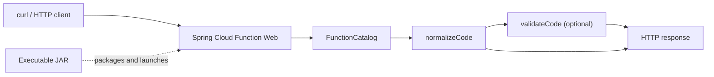
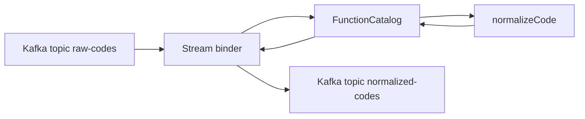

# Running Locally, Packaging, and Verifying Input and Output

> **Chapter:** Initialization  
> **Module:** SPRING_CLOUD_FUNCTION  
> **Hands-on goal:** Run a Spring Cloud Function application on a developer machine, package it as an executable JAR, invoke it over HTTP, and verify both normal outputs and error cases.  
> **Illustrative version set (November 24, 2026):** Java 21, Spring Boot 4.2.0, Spring Cloud BOM 2026.0.0, Spring Cloud Function 5.1.0.

## 1. What Will You Be Able to Do After This Lesson?

Spring Cloud Function lets you write business logic via `Supplier<T>`, `Function<T, R>`, and `Consumer<T>`, look them up and compose them with `FunctionCatalog`, and connect them to HTTP, events, or serverless environments through the appropriate adapter. When initializing a project, seeing a Java function compile cleanly is not enough: you must prove the entire path **input → adapter → FunctionCatalog → business logic → output** works properly.

This lesson uses an order code normalization function:

```text
Input:  "  od-123  "
Output: "OD-123"
```

Afterward, we add a code format check `AA-999` to observe composition and invalid-input handling. You will carry out the following tasks:

1. Create a Spring Boot project with two `Function<String, String>` beans.
2. Run the project directly from Maven or Gradle on a local machine.
3. Call the function through the Web adapter using `curl` and compare **status, headers, and body**.
4. Look up both functions via `FunctionCatalog` and test composition.
5. Package the application into an executable JAR, run it independently of the build tool, and re-verify.
6. Distinguish business errors, input conversion errors, and infrastructure errors.
7. Understand the limits of HTTP smoke tests when reusing the same function over events or serverless.

### 1.1. Why Test Running from the JAR as Well?

When running `mvn spring-boot:run` or `gradlew bootRun`, the build tool constructs the classpath and launches the application. When running `java -jar ...`, **the packaged artifact** must be self-contained with everything needed for the Spring Boot runtime. These two modes test different concerns:

| Verification Layer | What Must Be Proven | Example Errors Caught |
| --- | --- | --- |
| Java unit test | String logic works correctly. | Missing `trim()` or unintended locale-dependent uppercasing. |
| `FunctionCatalog` test | Beans are registered by Spring; catalog looks them up by name and composes them. | Wrong bean name or bean not discovered. |
| Local run over HTTP | Web adapter maps requests to the right function. | Missing Web starter, wrong URL, or wrong content type. |
| Run from executable JAR | Packaged artifact contains all dependencies and entry point. | Non-executable JAR, wrong Java runtime, or missing libraries. |
| Invalid input check | Validation rules and error mechanisms are exercised. | Server returns success despite invalid business data. |
| Testing in another environment | Port config, env vars, runtime, and adapter are suitable. | JAR runs locally, but lacks permissions/handler in serverless. |



The Web adapter and executable JAR are two distinct concerns: **the adapter** bridges the protocol, whereas **packaging** determines how the program is distributed and launched.

## 2. Preparing the Environment and Versions

### 2.1. Choosing Compatible Versions

The example uses the following Spring-published version set:

| Component | Example Version | Role |
| --- | --- | --- |
| Java JDK | **21** | Compiles and runs the application. |
| Spring Boot | **4.2.0** | Application foundation, auto-configuration, and build plugins. |
| Spring Cloud BOM | **2026.0.0** | Manages versions of Spring Cloud modules compatible with Boot 4.2.0. |
| Spring Cloud Function | **5.1.0** | Function modules managed by release train 2026.0.0. |
| Spring Cloud Function Web starter | Managed by BOM | Provides the HTTP Web adapter and related dependencies. |

This is a **fixed example set for practice**. When creating a new project or upgrading, consult https://spring.io/projects/spring-cloud/ and release notes; do not manually mix in a Spring Cloud release train from another Boot generation.

Spring Cloud Function structure used here:

- `java.util.function.Function`: contract accepting a `String` and returning a `String`.
- `@Bean`: registers lambdas into Spring Boot's `ApplicationContext`.
- `FunctionCatalog`: looks up beans and builds compositions by name.
- `spring-cloud-starter-function-web`: exposes function beans as HTTP endpoints per Web adapter rules.

### 2.2. Checking the JDK and Build Tool

On Linux/macOS:

```bash
java -version
javac -version
mvn -v
```

If using Gradle:

```bash
gradle --version
```

On Windows PowerShell, similar commands apply; pay attention to `JAVA_HOME` and `PATH` ordering. The output of `mvn -v` reveals **the JDK actually running Maven**, which may differ from the JDK selected in your IDE. With Gradle, check both the daemon JVM version and the Java toolchain.

**Requirement:** the compiler must locate JDK 21 (or the exact configured Java version). If a machine only has a Java 17 runtime while the build produces Java 21 bytecode, running the JAR will fail with `UnsupportedClassVersionError`.

### 2.3. Do You Need Both Maven and Gradle Installed?

No. Pick **one** build tool for your project. When a repository includes a Maven Wrapper (`mvnw`, `mvnw.cmd`) or Gradle Wrapper (`gradlew`, `gradlew.bat`), prefer the provided wrapper to avoid build tool version differences across machines. The main examples use Maven; an equivalent Gradle workflow is in section 9.

## 3. Creating a Minimal Spring Cloud Function Application

### 3.1. Directory Structure

```text
scf-local-demo/
├── pom.xml
└── src/
    ├── main/
    │   ├── java/
    │   │   └── vn/example/scf/local/
    │   │       └── LocalFunctionApplication.java
    │   └── resources/
    │       └── application.properties
    └── test/
        └── java/
            └── vn/example/scf/local/
                └── LocalFunctionApplicationTest.java
```

This is standard Maven structure. Java files must be in the `vn.example.scf.local` package so Spring Boot finds the beans and JUnit tests load the application context.

### 3.2. Complete `pom.xml`

```xml
<?xml version="1.0" encoding="UTF-8"?>
<project xmlns="http://maven.apache.org/POM/4.0.0"
         xmlns:xsi="http://www.w3.org/2001/XMLSchema-instance"
         xsi:schemaLocation="
             http://maven.apache.org/POM/4.0.0
             https://maven.apache.org/xsd/maven-4.0.0.xsd">
    <modelVersion>4.0.0</modelVersion>

    <parent>
        <groupId>org.springframework.boot</groupId>
        <artifactId>spring-boot-starter-parent</artifactId>
        <version>4.2.0</version>
        <relativePath/>
    </parent>

    <groupId>vn.example</groupId>
    <artifactId>scf-local-demo</artifactId>
    <version>0.0.1-SNAPSHOT</version>
    <name>scf-local-demo</name>

    <properties>
        <java.version>21</java.version>
        <spring-cloud.version>2026.0.0</spring-cloud.version>
    </properties>

    <dependencyManagement>
        <dependencies>
            <dependency>
                <groupId>org.springframework.cloud</groupId>
                <artifactId>spring-cloud-dependencies</artifactId>
                <version>${spring-cloud.version}</version>
                <type>pom</type>
                <scope>import</scope>
            </dependency>
        </dependencies>
    </dependencyManagement>

    <dependencies>
        <dependency>
            <groupId>org.springframework.cloud</groupId>
            <artifactId>spring-cloud-starter-function-web</artifactId>
        </dependency>

        <dependency>
            <groupId>org.springframework.boot</groupId>
            <artifactId>spring-boot-starter-test</artifactId>
            <scope>test</scope>
        </dependency>
    </dependencies>

    <build>
        <plugins>
            <plugin>
                <groupId>org.springframework.boot</groupId>
                <artifactId>spring-boot-maven-plugin</artifactId>
            </plugin>
        </plugins>
    </build>
</project>
```

Explanation:

1. `spring-boot-starter-parent` provides dependency/plugin management and Spring Boot build configuration.
2. `spring-cloud-dependencies` is the **BOM** (*Bill of Materials*) managing Spring Cloud versions; it is imported inside `dependencyManagement`, not added as a direct runtime JAR library.
3. `spring-cloud-starter-function-web` is the dependency that **actually** brings the HTTP adapter and context into the application. No starter version is needed because the BOM manages it.
4. `spring-boot-starter-test` is for unit/integration tests; declared with `scope=test` so test tools are excluded from normal runtime artifacts.
5. `spring-boot-maven-plugin` creates the executable JAR and provides `spring-boot:run`.

If you only need internal functions without HTTP, choose `spring-cloud-function-context` with a compatible Spring Boot base. This lesson uses the Web starter to verify request/response behavior with cURL.

### 3.3. Writing Business Beans

Create `src/main/java/vn/example/scf/local/LocalFunctionApplication.java`:

```java
package vn.example.scf.local;

import java.util.Locale;
import java.util.function.Function;

import org.springframework.boot.SpringApplication;
import org.springframework.boot.autoconfigure.SpringBootApplication;
import org.springframework.context.annotation.Bean;

@SpringBootApplication
public class LocalFunctionApplication {

    public static void main(String[] args) {
        SpringApplication.run(LocalFunctionApplication.class, args);
    }

    @Bean
    public Function<String, String> normalizeCode() {
        return raw -> raw.trim().toUpperCase(Locale.ROOT);
    }

    @Bean
    public Function<String, String> validateCode() {
        return code -> {
            if (!code.matches("[A-Z]{2}-[0-9]{3}")) {
                throw new IllegalArgumentException(
                        "Code must match format AA-999: " + code);
            }
            return code;
        };
    }
}
```

Both beans receive the default names `normalizeCode` and `validateCode`. Both are `Function<String, String>`, so they can be called individually or composed with `FunctionCatalog.lookup("normalizeCode|validateCode")`. The pipe syntax means normalize first, validate second.

The function signature expresses only the **business data** accepted and returned. It contains no `HttpServletRequest`, Kafka topic names, or AWS Lambda handlers. That is the core value of Spring Cloud Function: the same logic can be wired through multiple adapters.

With the functions above:

| Invocation | Input | Result |
| --- | --- | --- |
| `normalizeCode` only | `"  od-123  "` | `"OD-123"` |
| `normalizeCode` only | `"  ab-12  "` | `"AB-12"` (pattern not validated yet). |
| `normalizeCode` then `validateCode` | `"  od-123  "` | `"OD-123"` |
| `normalizeCode` then `validateCode` | `"  ab-12  "` | `IllegalArgumentException` due to invalid format. |

**Remember:** normalization and validation are two distinct behaviors. If calling `normalizeCode` alone, do not expect it to reject malformed codes.

### 3.4. Configuring `application.properties`

Create `src/main/resources/application.properties`:

```properties
spring.application.name=scf-local-demo
server.port=8080
```

We do not add `spring.cloud.function.definition` yet so both beans can be invoked by name over HTTP. When you want to select a default composition, you can add:

```properties
spring.cloud.function.definition=normalizeCode|validateCode
```

With the Web adapter, such a definition can be mapped to the root path `/` per the documentation. In this basic exercise, **leave `definition` unset** and call functions via explicit named URLs to avoid mapping confusion.

## 4. Running Locally from the Build Tool

### 4.1. Building and Running the App with Maven

In the directory containing `pom.xml`, run:

```bash
mvn clean test
mvn spring-boot:run
```

If the project has a Maven Wrapper:

```bash
./mvnw clean test
./mvnw spring-boot:run
```

On Windows PowerShell, use `./mvnw.cmd` when the wrapper is present. If there is no wrapper, simply use an installed `mvn`.

What the commands do:

- `clean`: clears previous build outputs in `target`.
- `test`: compiles sources and compiles/runs unit and integration tests.
- `spring-boot:run`: uses the Boot plugin to run the application using the project's classpath.

Check startup logs to confirm the application opened an HTTP server on port **8080**. While the server runs, the `spring-boot:run` terminal stays occupied; open a second terminal to run cURL tests. Stop the application with `Ctrl+C` in the running terminal.

### 4.2. Signs the Application Is Ready

When started successfully, standard Spring Boot logs indicate:

- The `LocalFunctionApplication` class started.
- The embedded web server is listening on port 8080.
- The application context created the required beans.

**Do not rely on a single log line** to conclude the function works properly. The next verification step is sending a real request and observing status/body. An app can start cleanly while still having misconfigured routes or converters.

If port 8080 is already occupied by another process, you can run on 8081:

```bash
mvn spring-boot:run -Dspring-boot.run.arguments=--server.port=8081
```

In many shells, Maven parameters containing equals signs may require appropriate quoting. A simpler option while learning locally is setting `server.port=8081` in `application.properties`, restarting, and changing the cURL URL to `http://localhost:8081`.

### 4.3. Request Flow Diagram

```mermaid
sequenceDiagram
    participant User as cURL
    participant Web as Web adapter
    participant Catalog as FunctionCatalog
    participant Fn as normalizeCode

    User->>Web: POST /normalizeCode; text/plain
    Web->>Catalog: Resolve normalizeCode bean
    Catalog-->>Web: Matching Function
    Web->>Fn: apply("  od-123  ")
    Fn-->>Web: "OD-123"
    Web-->>User: 200 OK; body OD-123
```

This is a logical diagram and does not claim the framework looks up the catalog fresh for every request; caching of mappings/wrappers depends on the implementation. The essential point is that there is no HTTP handling inside the Java lambda.

## 5. Verifying Input and Output Over HTTP

### 5.1. First `POST` Request

In the second terminal, run:

```bash
curl -i -X POST http://localhost:8080/normalizeCode \
  -H "Content-Type: text/plain" \
  -H "Accept: text/plain" \
  --data-raw "  od-123  "
```

Typical response:

```http
HTTP/1.1 200 OK
Content-Type: text/plain

OD-123
```

This is **an illustrative example of status, content type, and body**; actual headers may vary by server, version, and configuration. With `Function<String, String>` invoked using a single `text/plain` body, the expected result is the normalized code.

**Why use `curl -i`?** The `-i` flag prints response headers alongside the body, letting you check HTTP status codes, content type, and result together. Using only `curl -s` can hide important diagnostic details when an API returns an error.

### 5.2. Testing Two More Inputs

```bash
curl -i -X POST http://localhost:8080/normalizeCode \
  -H "Content-Type: text/plain" \
  -H "Accept: text/plain" \
  --data-raw "  in-2026  "
```

Expected response body: `IN-2026`.

```bash
curl -i -X POST http://localhost:8080/normalizeCode \
  -H "Content-Type: text/plain" \
  -H "Accept: text/plain" \
  --data-raw "AB-12"
```

Response body: `AB-12`. This is **not a bug** in `normalizeCode`, because that function only normalizes and does not perform regex validation. To enforce the `AA-999` format, invoke the composition with `validateCode`.

### 5.3. Invoking Composition Over HTTP

Spring Cloud Function Web documentation allows invoking compositions via comma-separated function names in the URL:

```bash
curl -i -X POST http://localhost:8080/normalizeCode,validateCode \
  -H "Content-Type: text/plain" \
  -H "Accept: text/plain" \
  --data-raw "  od-123  "
```

Expected success response body: `OD-123`.

Try an invalid input:

```bash
curl -i -X POST http://localhost:8080/normalizeCode,validateCode \
  -H "Content-Type: text/plain" \
  --data-raw "  ab-12  "
```

`normalizeCode` returns `AB-12`, then `validateCode` throws `IllegalArgumentException` because it does not match `[A-Z]{2}-[0-9]{3}`. **What to observe:** the error HTTP status, the framework-generated response body, and the exception details in the logs. Do not assume this error will always be `400 Bad Request`; HTTP error mapping depends on exception-handling configuration.

To have the pipeline run at the root path, you can enable:

```properties
spring.cloud.function.definition=normalizeCode|validateCode
```

Restart and call `POST /`. The property defines the selected pipeline; it is not a data-processing call itself and does not create an endpoint if the Web starter is missing.

### 5.4. Testing with `GET` Using a Path Item

The Web adapter also supports:

```bash
curl -i "http://localhost:8080/normalizeCode/od-123"
```

Expected body: `OD-123`. This mapping style fits simple inputs; if the input has spaces, `/` characters, question marks, or complex JSON, proper URL encoding is required. For real business data, a `POST` body usually represents inputs more cleanly.

### 5.5. Testing on Windows PowerShell

On Windows, `curl` may be an alias depending on the PowerShell version. Use `curl.exe` to ensure you run the real cURL binary:

```powershell
curl.exe -i -X POST "http://localhost:8080/normalizeCode" -H "Content-Type: text/plain" -H "Accept: text/plain" --data-raw "  od-123  "
```

This single-line command avoids Bash backslash line-continuation issues (PowerShell uses different continuation rules). For JSON, shell double-quote escaping rules are trickier; when testing JSON, you can use a payload file or an HTTP client tool that supports JSON bodies directly.

## 6. Reading Results Accurately: Status, Content Type, Body, and Timing

A good HTTP test should answer at least four questions:

1. **Are the endpoint and method right?** E.g., `POST /normalizeCode`.
2. **What payload and content type did the request carry?** E.g., String `"  od-123  "` with `text/plain`.
3. **What are the HTTP status and response content type?** E.g., `200 OK` with `text/plain`.
4. **Does the body obey business rules?** E.g., `OD-123`.

Minimum test case table:

| Entry Point | Request Body | Business Expectation | What to Record |
| --- | --- | --- | --- |
| `POST /normalizeCode` | `"  od-123  "` | `OD-123` | Status 200, text body. |
| `POST /normalizeCode` | `"AB-12"` | `AB-12` | Normalization still succeeds. |
| `POST /normalizeCode,validateCode` | `"  od-123  "` | `OD-123` | Both steps execute. |
| `POST /normalizeCode,validateCode` | `"  ab-12  "` | Validation throws error. | Actual error status/body/log; do not guess status. |
| `GET /normalizeCode/od-123` | No body | `OD-123` | Path-item mapping. |
| `POST /notExisting` | `"od-123"` | No matching function exists. | Observe mapping/fallback and configuration. |

Watch out for **single-function fallback**: when the catalog contains only one functional bean, Spring Cloud Function may return that sole bean for an invalid lookup name. The sample app has two beans so mappings must be verified, rather than extrapolating from single-bean behavior. To enforce strict function names on the catalog, configure:

```properties
spring.cloud.function.single-function-fallback-enabled=false
```

### 6.1. Inspecting Status Independently of Body

You can print just the HTTP status with `curl -w`:

```bash
curl -sS -o /dev/null -w "%{http_code}\n" \
  -X POST http://localhost:8080/normalizeCode \
  -H "Content-Type: text/plain" \
  --data-raw "  od-123  "
```

Expected output is `200` when the request is valid and the Web adapter is working. `/dev/null` is the null sink on Linux/macOS; on Windows you can run a cURL command displaying headers with `-i` or choose a shell-appropriate null sink.

To inspect processing time and spot abnormal latency, cURL offers `time_total`:

```bash
curl -sS -o /dev/null \
  -w "status=%{http_code} total=%{time_total}s\n" \
  -X POST http://localhost:8080/normalizeCode \
  -H "Content-Type: text/plain" \
  --data-raw "  od-123  "
```

The `time_total` number is a single-request observation; do not treat it as a performance benchmark without warm-up, sufficient sample size, controlled load, and proper statistics.

### 6.2. Input Cases Frequently Misunderstood

- **Empty string**: the current `normalizeCode` returns `""` when called directly with `""`. However, an empty HTTP body may be handled differently by the adapter from an empty Java `String`, so test via HTTP.
- **`null`**: the lambda calls `trim()`, so `apply(null)` throws `NullPointerException`. An HTTP request cannot send a literal Java `null` via `text/plain`; `"null"` is just four characters n-u-l-l.
- **Whitespace and newlines**: `trim()` strips leading/trailing whitespace within Java's `trim` range. When sending multiline input, the Web adapter may interpret it as multiple items depending on content type and signature; do not extrapolate from a single-value test.
- **JSON does not behave like `text/plain`**: a body `"od-123"` sent with `application/json` is a JSON string with quotes in JSON syntax; when sent as `text/plain`, quote characters (if present) are part of the payload.
- **Headers and URL encoding**: `Content-Type` helps conversion pick a processing path; `Accept` specifies the response format the client wants. In URL paths, encode special characters properly.

### 6.3. Checking Message/Headers When Needed

If business logic needs to track a `correlationId` across an event system, choose `Function<Message<String>, Message<String>>` instead of raw `String`. Example of an **extended bean** (do not add into the core app while relying on the two sample beans):

```java
@Bean
public Function<Message<String>, Message<String>> normalizeMessage() {
    return input -> MessageBuilder
            .withPayload(input.getPayload().trim()
                    .toUpperCase(Locale.ROOT))
            .copyHeaders(input.getHeaders())
            .setHeader("processedBy", "normalizeMessage")
            .build();
}
```

This snippet requires importing `java.util.function.Function`, `org.springframework.messaging.Message`, `org.springframework.messaging.support.MessageBuilder`, and `java.util.Locale`, placed inside a Spring configuration class. The Web adapter can place HTTP headers into `MessageHeaders` and map output message headers back to the response. Which headers are preserved or filtered depends on the adapter; write integration tests per contract.

## 7. Testing Logic and `FunctionCatalog` with JUnit

### 7.1. Why Write Tests After Trying cURL?

cURL exercises the full request/response path, but when something fails, it is hard to tell whether the root cause is the business logic, bean registration, or the Web adapter. A plain Java test and a catalog test help **isolate errors**.

- Java unit test: calls the lambda without starting Spring.
- Catalog integration test: runs the Spring context and looks up functions/compositions by name.
- HTTP smoke test: confirms the adapter receives requests and returns responses.

### 7.2. Complete Test File

Create `src/test/java/vn/example/scf/local/LocalFunctionApplicationTest.java`:

```java
package vn.example.scf.local;

import static org.junit.jupiter.api.Assertions.assertEquals;
import static org.junit.jupiter.api.Assertions.assertNotNull;
import static org.junit.jupiter.api.Assertions.assertThrows;

import java.util.function.Function;

import org.junit.jupiter.api.Test;
import org.springframework.beans.factory.annotation.Autowired;
import org.springframework.boot.test.context.SpringBootTest;
import org.springframework.cloud.function.context.FunctionCatalog;

@SpringBootTest
class LocalFunctionApplicationTest {

    @Autowired
    FunctionCatalog catalog;

    @Test
    void functionIsRegisteredAndTransformsInput() {
        Function<String, String> fn = catalog.lookup("normalizeCode");

        assertNotNull(fn);
        assertEquals("OD-123", fn.apply("  od-123  "));
        assertEquals("AB-12", fn.apply(" ab-12 "));
    }

    @Test
    void pipelineNormalizesBeforeValidating() {
        Function<String, String> pipeline =
                catalog.lookup("normalizeCode|validateCode");

        assertNotNull(pipeline);
        assertEquals("OD-123", pipeline.apply("  od-123  "));
    }

    @Test
    void validationRejectsUnexpectedFormat() {
        Function<String, String> validator =
                new LocalFunctionApplication().validateCode();

        assertThrows(IllegalArgumentException.class,
                () -> validator.apply("AB-12"));
    }
}
```

The `@SpringBootTest` methods prove that the Spring context and `FunctionCatalog` work. The final test invokes **the bean factory method directly** to verify the logic's exception rule; it does not verify how the HTTP adapter maps `IllegalArgumentException` to a status code. This test suits our initial goal, while production systems should also add HTTP integration tests for error cases.

### 7.3. Run Tests Before Packaging

```bash
mvn clean test
```

If tests pass, Maven reports success and the number of tests run. Do not habitually pass `-DskipTests` for a "quick package", as doing so can hide business or catalog bugs. When the project uses CI, run tests with the exact dependency BOM/versions and Java toolchain used for the release artifact.

**Do not equate writing tests with running tests.** Real verification only comes after the build command finishes on the machine/CI with the right project and dependencies.

## 8. Packaging an Executable JAR and Running Standalone

### 8.1. How Does `mvn package` Work?

In the project using `spring-boot-maven-plugin` and the Boot parent from section 3, run:

```bash
mvn clean package
```

This builds and runs tests before creating the package (following the Maven lifecycle). Properly configured, the Spring Boot Maven plugin **repackages** the artifact into an executable JAR runnable via `java -jar`.

Example filename:

```text
target/scf-local-demo-0.0.1-SNAPSHOT.jar
```

Depending on plugin and project configuration, other files such as `.original` may be generated; verify the executable JAR before using it. Do not accidentally pick a JAR lacking the Boot loader and dependencies.

### 8.2. Inspecting the Generated JAR

Linux/macOS:

```bash
ls -lh target/*.jar
jar tf target/scf-local-demo-0.0.1-SNAPSHOT.jar
```

Windows PowerShell:

```powershell
Get-ChildItem -Path .\target -Filter *.jar
jar tf .\target\scf-local-demo-0.0.1-SNAPSHOT.jar
```

For a Spring Boot executable JAR, you will typically find:

- `META-INF/MANIFEST.MF` with Boot startup entries.
- `BOOT-INF/classes/` containing application bytecode and resources.
- `BOOT-INF/lib/` containing runtime dependencies.
- Boot loader classes needed to load nested JARs.

You can inspect the manifest and layout using the JDK's `jar` tool. Do not rely on a JAR path inside your IDE or local Maven cache: that is not the artifact you will distribute.

### 8.3. Running the JAR Independently of Maven

Stop the `mvn spring-boot:run` process to free port 8080. Then run:

```bash
java -jar target/scf-local-demo-0.0.1-SNAPSHOT.jar
```

If you need to run on 8081:

```bash
java -jar target/scf-local-demo-0.0.1-SNAPSHOT.jar --server.port=8081
```

On Windows PowerShell:

```powershell
java -jar .\target\scf-local-demo-0.0.1-SNAPSHOT.jar
```

Run `java -version` to confirm the runtime matches the Java 21 target. Even if the JAR built cleanly, an older Java runtime will reject loading classes compiled to newer bytecode.

### 8.4. Re-Running the Same HTTP Test Suite

Once the JAR is running on port 8080, resend:

```bash
curl -i -X POST http://localhost:8080/normalizeCode \
  -H "Content-Type: text/plain" \
  --data-raw "  od-123  "
```

Then test the composition:

```bash
curl -i -X POST http://localhost:8080/normalizeCode,validateCode \
  -H "Content-Type: text/plain" \
  --data-raw "  od-123  "
```

If both responses match what you saw when running from Maven, you have proof that **the JAR contains the logic and Web adapter required for execution**. For invalid inputs, also check logs and HTTP error statuses rather than comparing only success cases.

### 8.5. Is Packaging a JAR the Same as Deploying Serverless?

No. An executable Boot JAR run via `java -jar` and an artifact deployed to AWS Lambda/Azure/GCP may require **different handlers, entrypoints, layouts, plugins, or runtimes**. Some serverless adapters use specialized packaging. Therefore:

- Testing `java -jar` proves packaging for a standard JVM server/VM/container.
- Testing HTTP locally proves the Web adapter receives and responds to requests.
- Testing serverless requires using **the provider-packaged artifact**, triggers/handlers, runtime, and appropriate permissions.

The `normalizeCode` and `validateCode` logic can remain unchanged when switching adapters, while packaging and event-conversion responsibilities must be adapted for the target environment.

## 9. If Choosing Gradle: Building and Running with `bootRun`/`bootJar`

### 9.1. Equivalent `build.gradle`

Gradle Groovy DSL example:

```groovy
plugins {
    id 'java'
    id 'org.springframework.boot' version '4.2.0'
    id 'io.spring.dependency-management' version '1.1.7'
}

group = 'vn.example'
version = '0.0.1-SNAPSHOT'

repositories {
    mavenCentral()
}

java {
    toolchain {
        languageVersion = JavaLanguageVersion.of(21)
    }
}

ext {
    set('springCloudVersion', '2026.0.0')
}

dependencyManagement {
    imports {
        mavenBom "org.springframework.cloud:spring-cloud-dependencies:${springCloudVersion}"
    }
}

dependencies {
    implementation 'org.springframework.cloud:spring-cloud-starter-function-web'
    testImplementation 'org.springframework.boot:spring-boot-starter-test'
}

tasks.named('test') {
    useJUnitPlatform()
}
```

The Gradle project uses the exact same `src/main/java`, `src/main/resources`, and `src/test/java` created earlier. When using Gradle, `pom.xml` is unnecessary; use a single build tool as the authoritative source of configuration in CI.

### 9.2. Running from Source

If a Gradle Wrapper exists:

```bash
./gradlew clean test
./gradlew bootRun
```

On Windows use `./gradlew.bat`. If there is no wrapper, use an installed Gradle version compatible with your selected Spring Boot version. `bootRun` runs the app using the build classpath, serving the same purpose as Maven's `spring-boot:run`.

### 9.3. Building the JAR and Running It

```bash
./gradlew clean test bootJar
java -jar build/libs/scf-local-demo-0.0.1-SNAPSHOT.jar
```

`bootJar` builds the executable JAR. The filename depends on project name, version, and archive settings; inspect `build/libs` before running. If Gradle generates both a plain JAR and a Boot JAR, choose **the executable Boot JAR**.

### 9.4. Maven/Gradle Comparison

| Task | Maven | Gradle |
| --- | --- | --- |
| Run app from build tool | `mvn spring-boot:run` | `./gradlew bootRun` |
| Run tests | `mvn test` | `./gradlew test` |
| Package executable JAR | `mvn package` with Boot repackage | `./gradlew bootJar` |
| Default artifact location | `target/` | `build/libs/` |
| Run artifact | `java -jar target/...jar` | `java -jar build/libs/...jar` |
| Inspect dependencies | `mvn dependency:tree` | `./gradlew dependencies` and `dependencyInsight` |

Both paths share the same goal: clean build, JAR containing the right dependencies, runnable via `java -jar`, and accurate input/output handling.

## 10. Measuring and Comparing Results Across All Three Modes

You can build a comparison table across the same inputs:

| Check | `FunctionCatalog` Test | Run from Build Tool | Run from Executable JAR |
| --- | --- | --- | --- |
| Input `"  od-123  "` | `OD-123` | `OD-123` over HTTP | `OD-123` over HTTP |
| Input `"  ab-12  "` into standalone normalize | `AB-12` | `AB-12` | `AB-12` |
| Input `"  ab-12  "` into pipeline | Validation fails | HTTP error; check status/logs | HTTP error; check status/logs |
| Verifies bean registration | Yes | Yes via adapter | Yes via adapter |
| Verifies HTTP mapping | No | Yes | Yes |
| Verifies executable packaging | No | No | Yes |

From this table, you can pinpoint causes whenever results diverge:

- Catalog test passes, build-tool HTTP run fails: likely Web adapter, URL, headers, or conversion.
- Build-tool HTTP run passes, JAR fails to start: check Boot plugin, packaging, manifest, Java runtime, dependencies, and properties packaged into the artifact.
- Both runs return the same wrong output: inspect business logic and the actual input sent.
- Error appears only on invalid inputs: check validation and how the adapter maps exceptions to responses.

**Note:** catalog tests do not verify HTTP or packaged artifacts; local smoke tests likewise do not verify Kafka or serverless behavior. Each mode provides its own scope of evidence.

## 11. Common Errors When Running and Packaging

| Symptom | Common Cause | Resolution |
| --- | --- | --- |
| `mvn` or `gradle` not recognized | Build tool not installed, wrong `PATH`, or project uses a wrapper not yet invoked. | Use the existing wrapper or install a compatible tool. |
| `invalid target release: 21` | Maven/Gradle compiler is using an older JDK. | Check `java -version`, `mvn -v`, toolchain, and `JAVA_HOME`. |
| `UnsupportedClassVersionError` | Runtime executing the JAR is older than the compiled bytecode. | Use Java 21 or match the build target. |
| Port 8080 already in use | Another process is listening on the same port. | Stop the old process or change `server.port`. |
| `POST /normalizeCode` returns 404 | Missing Web adapter, wrong URL/base path, or bean not registered. | Check starter, `@Bean` name, startup logs, and `spring.cloud.function.web.path`. |
| `POST /normalizeCode` returns 405 | Wrong HTTP method for the active mapping. | Use `POST` or a method supported by the adapter mapping. |
| HTTP 415 or conversion error | Wrong `Content-Type`/`Accept` or payload incompatible with function signature. | For String, try `text/plain` first; for DTOs, check JSON converter. |
| Catalog cannot find function | Wrong name, bean outside scan scope, or missing Spring Cloud Function context. | Check package, `@Bean`, dependencies, and fallback settings. |
| `java -jar` reports missing Main-Class/no main manifest | Running the plain JAR; Boot repackage/`bootJar` did not run. | Run the executable Boot JAR. |
| JAR throws `ClassNotFoundException` or `NoSuchMethodError` | Missing or mismatched dependency versions in artifact. | Check BOM, `dependency:tree`/`dependencyInsight`, and JAR structure. |
| HTTP works in IDE, but JAR uses different config | `application.properties` not packaged or overridden at runtime. | Check `BOOT-INF/classes`, profiles, env vars, and CLI args. |
| HTTP 200, but wrong content | Invoking wrong bean or validation pipeline not enabled. | Check URL, `spring.cloud.function.definition`, and actual input. |
| Invalid input sent, but no HTTP 400 seen | No error mapping defined for `IllegalArgumentException`. | Inspect actual status/logs; design an error contract at the API layer. |
| Build completes, but JAR filename differs from docs | Changed `artifactId`, `version`, or Gradle archive settings. | List the output directory and use the actual filename. |

### 11.1. Errors Caused by `definition` Configuration

If you set:

```properties
spring.cloud.function.definition=normalizeCode|validateCode
```

the Web adapter may map the pipeline to the root `/`. If you then call `POST /normalizeCode` and get unexpected behavior, inspect routing/fallback rather than assuming it behaves identically to when no definition is set.

To **filter** which functions Web exposes, the documentation supports a semicolon-separated definition list; in that filtering mode, root no longer receives a default mapping. For example:

```properties
spring.cloud.function.definition=normalizeCode|validateCode;normalizeCode
```

Only functions/chains in the list are exposed through the Web adapter under supported mappings. This function selection mechanism does not replace authentication/authorization for an HTTP API.

### 11.2. Invalid Input Errors

In Java, `validateCode` throws `IllegalArgumentException` on codes failing the regex; over HTTP, Spring turns the error into a failure response according to Web/application configuration. Standardize an **error contract** containing HTTP status, business error code, safe message, and correlation ID when building real applications.

Do not embed all HTTP error-handling code inside the lambda if the business logic must be reused for Kafka or serverless. Let the logic raise meaningful errors and let the adapter layer define the appropriate mapping.

## 12. Extending: Testing `Supplier`, `Consumer`, and Message Conversion

The core sections used `Function<String,String>`. Once running and packaging are clear, the same verification approach applies to the other two shapes.

### 12.1. `Supplier<String>`

A data-supplying bean:

```java
@Bean
public Supplier<String> sampleCode() {
    return () -> "OD-123";
}
```

Import `java.util.function.Supplier`. With the Web adapter, it can usually be called with `GET /sampleCode`, expecting body `OD-123`. With Spring Cloud Stream, how `Supplier` is triggered depends on polling/reactive configuration; with serverless, the runtime controls invocation. Do not assume a polling schedule just because a bean has a `Supplier` signature.

### 12.2. `Consumer<String>`

A code-recording bean:

```java
@Bean
public Consumer<String> auditCode() {
    return code -> System.out.println("Received: " + code);
}
```

Import `java.util.function.Consumer`. With the Web adapter, `POST /auditCode` typically returns `202 Accepted` when the request is accepted; a Consumer returns no value because `accept(...)` is `void`. When consuming events in production, this side effect can run again due to retries; design idempotent handling where needed.

**The snippets in section 12 are extensions.** Do not add them to the core app mid-exercise if you are relying on single-function fallback behavior; adding new beans can change default function selection rules.

### 12.3. `Message<T>` and JSON DTOs

For data carrying a `correlationId` header or specific content types, a bean can accept `Message<String>` instead of raw `String`. For JSON payloads, use `Function<OrderRequest, OrderResult>` with an appropriate converter.

When converting inputs/outputs, tests should verify:

- Does the HTTP/event payload convert into the function's exact generic type?
- Are required headers preserved or forwarded according to adapter rules?
- What error occurs on JSON `null`, missing fields, or invalid schemas?
- Is the output `String`, DTO, or `Message<?>` serialized cleanly into the response?

These tests establish the baseline for reusing the same capability across HTTP, events, and serverless; each adapter may enforce additional conversion rules.

## 13. End-of-Lesson Exercises

### Exercise 1. Run Locally and Record Responses

Using the app from section 3, launch it with Maven/Gradle. Test `POST /normalizeCode` with three inputs:

- `"  od-123  "` → `OD-123`.
- `"  zz-999  "` → `ZZ-999`.
- `"  ab-12  "` → `AB-12` (normalization only).

Record **HTTP method, URL, Content-Type, Accept, status, and body** for each request. Explain why the third request still succeeds when calling `normalizeCode` by itself.

### Exercise 2. Test Composition and Error Inputs

Call `POST /normalizeCode,validateCode` with:

- `"  od-123  "`: expect `OD-123`.
- `"  ab-12  "`: expect validation failure; record actual status, body, and logs.
- `"  12-123  "`: expect validation failure because the prefix is not uppercase letters.

Identify which parts of the request belong to **transport** and which belong to **business logic**. Do not state a guessed HTTP status as the answer without checking the actual adapter and error handling.

### Exercise 3. Package and Run `java -jar`

1. Stop the app running from the build tool.
2. Run `mvn clean package` or `./gradlew clean test bootJar`.
3. List the executable JARs, inspect metadata/structure, and choose the right artifact.
4. Run `java -jar` with the generated JAR.
5. Resend the same cURL commands and record results.

**Completion criteria:** the artifact runs independently of the build tool, binds the right port, and responds with identical business logic. Explain why passing this JAR test does not prove serverless deployment works.

### Exercise 4. Change Port Without Editing Java

Run the JAR with `--server.port=8081` and call `http://localhost:8081/normalizeCode`. Prove that the function logic is unchanged; only runtime configuration and the client URL changed.

### Exercise 5. Describe the Transition to Events

Keep the `normalizeCode` bean unchanged. Draw the corresponding diagram when replacing the Web adapter with Spring Cloud Stream + Kafka binder:



Indicate the dependencies/configurations to add: binder, broker, `spring.cloud.function.definition`, input/output destinations, content type, and retries. For serverless, also identify the corresponding provider adapter, handler, packaging, and Java runtime.

### Completion Criteria for the Entire Lesson

| Competency | Required Evidence |
| --- | --- |
| Can build a Spring Cloud Function app | `mvn clean test` or `gradlew test` succeeds. |
| Can run directly from source | App opens port and cURL invokes the function. |
| Understands input/output | Can compare status, content type, and body across multiple payloads. |
| Understands composition | Can invoke the pipeline and recognize invalid inputs. |
| Packages properly | Executable JAR contains Boot loader, classes, and runtime dependencies. |
| Reruns from artifact | `java -jar` yields the same business output as running from the build tool. |
| Distinguishes environments | Can explain why HTTP/JAR tests do not replace broker/serverless tests. |

## 14. Summary and Official References

- Run **from the build tool** using `spring-boot:run` or `bootRun` for rapid testing; run **from the executable JAR** to verify the packaged deliverable.
- Testing business logic and `FunctionCatalog` separately isolates whether bugs live in the lambda or Spring context; cURL additionally checks the HTTP adapter and conversion.
- For `Function<String,String>`, cross-check **request body, Content-Type, Accept, HTTP status, and response body**. Use catalog composition or the `/normalizeCode,validateCode` path to test multi-step pipelines.
- The Spring Boot plugin builds the runnable JAR; the BOM manages dependency versions; the Web starter wires HTTP—they do not substitute for one another.
- The same business logic can move from HTTP to events or serverless environments, provided you add the corresponding adapter, packaging, runtime, configuration, and test suite.

**Official References:**

1. Spring Cloud Function – Standalone Web Applications, HTTP mapping and response behavior: https://docs.spring.io/spring-cloud-function/reference/spring-cloud-function/standalone-web-applications.html
2. Spring Cloud Function – Programming Model and FunctionCatalog: https://docs.spring.io/spring-cloud-function/reference/spring-cloud-function/programming-model.html
3. Spring Cloud Function – Reference: https://docs.spring.io/spring-cloud-function/reference/
4. Spring Boot Maven Plugin – executable JAR, repackage, and run: https://docs.spring.io/spring-boot/maven-plugin/
5. Spring Boot Gradle Plugin – packaging executable archives: https://docs.spring.io/spring-boot/gradle-plugin/packaging.html
6. Spring Boot – Executable Jar Format: https://docs.spring.io/spring-boot/specification/executable-jar/index.html
7. Spring Cloud 2026.0.0 GA (November 20, 2026), Boot 4.2.0 compatible: https://spring.io/blog/2026/11/20/spring-cloud-2026-0-0-has-been-released/
8. Spring Cloud release trains and version table: https://spring.io/projects/spring-cloud/
9. Spring Cloud Stream – Reference: https://docs.spring.io/spring-cloud-stream/reference/
