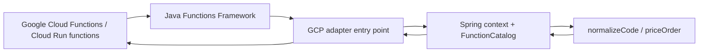
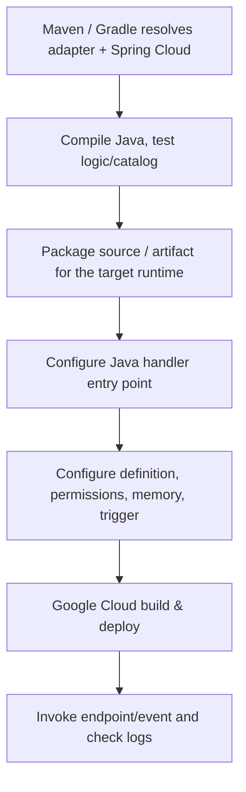

# The `spring-cloud-function-adapter-gcp` Dependency in Google Cloud

## Lesson Objectives

**Spring Cloud Function** lets you write business logic once using a `Supplier`, `Function`, or `Consumer`, and then invoke that logic via Java, HTTP, events, or a serverless environment. In the **Google Cloud** chapter, the `spring-cloud-function-adapter-gcp` library acts as **the bridge between the Spring Cloud Function programming model and the Java function invocation mechanism on the Google Cloud platform**.

This lesson focuses on **the dependency and its accompanying components**, rather than treating adding a single Maven/Gradle line as completing cloud deployment.

After this lesson, you will be able to:

- Identify the exact Maven coordinates of `spring-cloud-function-adapter-gcp` and manage compatible Spring Boot/Spring Cloud Function versions.
- Distinguish between the **business bean** in `FunctionCatalog`, the **Google Cloud Functions entry point**, and the **Spring Boot startup point**.
- Create an HTTP-independent `Function<PriceRequest, PriceResponse>` example and test it through the Spring context.
- Understand the requirements of **Google Cloud Functions/Cloud Run functions**, the Java Functions Framework, and artifact packaging.
- Avoid confusing the GCP adapter with the Spring Cloud Function Web adapter or the Pub/Sub binder.
- Set up testing steps, error observability, security, and cold-start considerations.

## 1. What Problem Does the GCP Adapter Solve?

Suppose you have a Java bean:

```java
@Bean
Function<String, String> normalizeCode() {
    return text -> text.trim().toUpperCase(Locale.ROOT);
}
```

Spring Cloud Function can detect the `normalizeCode` bean and expose it through `FunctionCatalog`. However, **Google Cloud does not call `catalog.lookup(...)` directly**: the serverless platform needs an *entry point* that satisfies the Java Functions Framework contract to receive requests/events.

The GCP adapter sits between those two worlds:



In the diagram:

1. Google Cloud triggers a function via HTTP or a configured event type.
2. The Java Functions Framework routes the invocation to the specified **Java handler/entry point**.
3. The Spring Cloud Function GCP adapter uses the Spring context and `FunctionCatalog` to look up the business function.
4. Data is converted according to the adapter contract, the function is invoked, and the result is mapped back to a response when appropriate.

**It is important to distinguish** framework capabilities from the capabilities of each adapter and each Google Cloud Functions generation. Having a GCP adapter library does not mean every `HttpFunction`, `CloudEventsFunction`, `BackgroundFunction`, streaming mode, and trigger type is supported in the exact same way across all versions.

## 2. Maven Dependency Coordinates

The artifact for the Google Cloud integration of Spring Cloud Function is:

```xml
<dependency>
    <groupId>org.springframework.cloud</groupId>
    <artifactId>spring-cloud-function-adapter-gcp</artifactId>
</dependency>
```

**Group ID:** `org.springframework.cloud`. **Artifact ID:** `spring-cloud-function-adapter-gcp`.

Do not pick a random version just because the artifact can be downloaded from a repository. It needs to align with:

- The application's Spring Boot and Spring Framework versions.
- Spring Cloud Function Context and other Spring Cloud Function modules.
- The Java runtime supported by Google Cloud in the target environment.
- Build/deploy tools, the Google Functions Framework, and accompanying dependencies.

### Using a BOM to Align Versions

With Maven, if the project uses a Spring Boot parent or an equivalent Boot version-management mechanism, you can import the Spring Cloud BOM **compatible with that Boot version**:

```xml
<dependencyManagement>
    <dependencies>
        <dependency>
            <groupId>org.springframework.cloud</groupId>
            <artifactId>spring-cloud-dependencies</artifactId>
            <version>SPRING_CLOUD_RELEASE_VERSION</version>
            <type>pom</type>
            <scope>import</scope>
        </dependency>
    </dependencies>
</dependencyManagement>

<dependencies>
    <dependency>
        <groupId>org.springframework.cloud</groupId>
        <artifactId>spring-cloud-function-adapter-gcp</artifactId>
    </dependency>
</dependencies>
```

`SPRING_CLOUD_RELEASE_VERSION` is a **placeholder that must be replaced with an actual release train**, not a runnable version string as-is. Check the Spring Cloud/Spring Boot compatibility matrix and the BOM you are using. If the project manages Spring Cloud Function with a dedicated BOM, apply the correct BOM for the Spring Cloud Function line you are deploying and avoid letting multiple BOMs pull Function modules to conflicting versions.

**Do not copy this XML snippet verbatim as a complete `pom.xml`**: the example only shows dependency management and dependencies, without the application's group/artifact/version, build plugins, or Java toolchain.

### Do You Also Need to Declare `spring-cloud-function-context`?

`spring-cloud-function-adapter-gcp` uses the Spring Cloud Function infrastructure, where `FunctionCatalog` is the central component. The adapter may pull in several related modules **transitively** depending on the version; if your project code directly imports catalog APIs, declaring the Context dependency explicitly also documents that relationship clearly:

```xml
<dependency>
    <groupId>org.springframework.cloud</groupId>
    <artifactId>spring-cloud-function-context</artifactId>
</dependency>
```

This **does not mean** adding these two dependencies automatically starts an HTTP handler. You still need application configuration, the proper handler class, packaging, and the Google Cloud runtime.

## 3. Declaring with Gradle

With Gradle Groovy DSL in a project already configured with the Spring Boot plugin and appropriate Java version management:

```groovy
dependencies {
    implementation platform(
        "org.springframework.cloud:spring-cloud-dependencies:SPRING_CLOUD_RELEASE_VERSION"
    )

    implementation "org.springframework.cloud:spring-cloud-function-adapter-gcp"
    implementation "org.springframework.cloud:spring-cloud-function-context"

    testImplementation "org.springframework.boot:spring-boot-starter-test"
}
```

Replace `SPRING_CLOUD_RELEASE_VERSION` with the release train matching your project's Spring Boot version. If you already use the `io.spring.dependency-management` plugin and a BOM elsewhere, do not duplicate an inconsistent second version-management setup.

In Gradle Kotlin DSL, the idea is the same:

```kotlin
dependencies {
    implementation(platform(
        "org.springframework.cloud:spring-cloud-dependencies:SPRING_CLOUD_RELEASE_VERSION"
    ))
    implementation("org.springframework.cloud:spring-cloud-function-adapter-gcp")
    implementation("org.springframework.cloud:spring-cloud-function-context")
    testImplementation("org.springframework.boot:spring-boot-starter-test")
}
```

This configuration snippet only shows **the dependency section**. Building on Google Cloud also depends on plugins, artifact type, builders, and whether the platform deploys from source or from a container image.

### Verifying Resolved Dependencies

A few useful commands once the project has a working build:

```bash
./mvnw dependency:tree
```

```bash
./gradlew dependencies --configuration runtimeClasspath
```

Check whether `spring-cloud-function-adapter-gcp`, `spring-cloud-function-context`, Spring Boot/Spring Framework, and the Google Functions Framework libraries resolve as expected. Pay special attention to **two different versions of the same library** pulled in via transitive dependencies.

## 4. Distinguishing Four Layers of Responsibility

When handling a Google Cloud invocation, there are at least four distinct naming concepts:

| Concept | Example | Who Uses It? |
| --- | --- | --- |
| **Bean name / FunctionCatalog name** | `priceOrder` | Spring Cloud Function to look up the business function |
| **Function definition** | `spring.cloud.function.definition=priceOrder` | Adapter/catalog to select a function or composition |
| **Google Cloud Java entry point** | Handler class provided by the adapter, e.g., `GcfJarLauncher` in supported versions | Java Functions Framework invokes it according to the deployment configuration |
| **Spring Boot application class** | `PriceFunctionApplication` | Spring bootstrap uses it to create the application context and register beans |

For example, some versions of Spring Cloud Function GCP use a launcher class named:

```text
org.springframework.cloud.function.adapter.gcp.GcfJarLauncher
```

**You must verify the handler class and contract in the exact artifact/version you are using** before filling in `--entry-point`. Do not assume the same launcher can handle every trigger type or every Java runtime version. The name `priceOrder` is the Spring function name, **not the Java entry point name required by Google Cloud to load**.

Similarly, `PriceFunctionApplication.main(...)` can start the application on a local JVM, but the Google Cloud Functions Java runtime **calls the configured entry point**, not necessarily `main` before each request.

## 5. Business Example: Order Pricing

This example uses Java 17+ (since it uses `record`) and compatible Spring Boot/Spring Cloud Function versions. The logic only knows about Java data and does not depend on `HttpRequest`, `HttpResponse`, or Pub/Sub.

The classes live in package `example.gcp`.

### 5.1. Input and Output DTOs

File `PriceRequest.java`:

```java
package example.gcp;

public record PriceRequest(String orderId, int quantity) {
}
```

File `PriceResponse.java`:

```java
package example.gcp;

public record PriceResponse(String orderId, long totalCents) {
}
```

Each record is placed in a Java file with the same name. In a real system, you should strictly validate `orderId`, enforce access control, and add quantity limits appropriate for your business rules.

### 5.2. Registering the Function with `@Bean`

File `PriceFunctionApplication.java`:

```java
package example.gcp;

import java.util.function.Function;

import org.springframework.boot.SpringApplication;
import org.springframework.boot.autoconfigure.SpringBootApplication;
import org.springframework.context.annotation.Bean;

@SpringBootApplication(proxyBeanMethods = false)
public class PriceFunctionApplication {

    public static void main(String[] args) {
        SpringApplication.run(PriceFunctionApplication.class, args);
    }

    @Bean
    public Function<PriceRequest, PriceResponse> priceOrder() {
        return request -> {
            if (request == null
                    || request.orderId() == null
                    || request.orderId().isBlank()
                    || request.quantity() <= 0) {
                throw new IllegalArgumentException(
                        "Invalid order data");
            }

            long total = Math.multiplyExact(
                    (long) request.quantity(), 15_000L);

            return new PriceResponse(request.orderId(), total);
        };
    }
}
```

The signature `Function<PriceRequest, PriceResponse>` preserves explicit generic type information, which helps `FunctionCatalog` and the adapter's JSON conversion layer. With input:

```json
{"orderId":"ORD-55","quantity":2}
```

the expected business result is:

```json
{"orderId":"ORD-55","totalCents":30000}
```

**Limitation of this example:** this code alone **does not create a Google Cloud Java entry point**. You need a compatible GCP adapter, a bootstrap mechanism so the handler can locate the Spring application, and proper deployment configuration. Moreover, if a Google Cloud runtime does not support the Java version you are using, you must choose another Java toolchain or deployment environment.

### 5.3. Selecting a Function via `spring.cloud.function.definition`

In an application that may register multiple `Function` beans, explicitly select the function the adapter should invoke:

```properties
spring.cloud.function.definition=priceOrder
```

In `application.yml`:

```yaml
spring:
  cloud:
    function:
      definition: priceOrder
```

This property **does not create a function bean**. It only selects `priceOrder` that already exists in the context/catalog. If you register it under another name, update the property to match.

In environments that support mapping Spring Boot properties from environment variables, you can set:

```text
SPRING_CLOUD_FUNCTION_DEFINITION=priceOrder
```

Do not hard-code HTTP-request-specific branching inside `priceOrder`. Thanks to the `Function` model, the same logic can be invoked in Java tests or from another adapter without changing the code.

## 6. How Does the GCP Adapter Dependency Differ from `spring-cloud-function-web`?

The two adapters target **different runtime environments**.

| Component | Purpose | Typical Use Case |
| --- | --- | --- |
| `spring-cloud-function-context` | `FunctionCatalog` and the function model | Looking up/invoking functions in the Spring context |
| `spring-cloud-function-adapter-gcp` | Integrates Google Cloud Functions Java invocations with Spring Cloud Function | Deploying functions on Google Cloud Functions / Cloud Run functions when supported by the runtime |
| `spring-cloud-function-web` | Maps functions to Spring Cloud Function's web adapter | A standalone Spring Boot app running its own HTTP server |
| `spring-boot-starter-web` | Standard Spring Boot MVC/servlet web infrastructure | Spring Boot app/server; does not by itself turn it into a Google Cloud function |
| Spring Cloud Stream + Pub/Sub binder | Pub/Sub message binding and transport | Applications processing messaging through a binder |
| Google Java Functions Framework API/invoker | HTTP/event handler contracts and handler invocation tool | Google Functions Java runtime or local invoker |

Do not add `spring-cloud-function-web` and `spring-boot-starter-web` just "to make the GCP adapter work" when the GCP adapter runtime already handles HTTP through the Java Functions Framework contract. Adding an unnecessary web stack can make startup heavier or pull in unused auto-configuration.

Conversely, if you want to run **a standalone Spring Boot service** with an HTTP server to test the `/priceOrder` endpoint directly, the web adapter can be useful. Choose **one HTTP path that matches your deployment target** and verify which adapter layer actually receives the request.

**Pub/Sub is a separate topic:** adding `spring-cloud-function-adapter-gcp` does not automatically create subscriptions, grant IAM permissions, or replace the Spring Cloud Stream binder. A Pub/Sub trigger also has a specific payload/event contract that may differ from a standard HTTP JSON contract.

## 7. Google Cloud Java Runtime and Entry Point

The Java Functions Framework uses common handler contracts:

- `com.google.cloud.functions.HttpFunction` for HTTP request/response handling.
- `com.google.cloud.functions.CloudEventsFunction` for CloudEvents in corresponding eventing environments.
- `com.google.cloud.functions.BackgroundFunction<T>` for certain legacy-generation background event contracts, depending on the runtime.

**Do not infer that all of the interfaces above are implemented by the GCP adapter in every version.** If you need HTTP, choose the HTTP launcher/entry point supported by your adapter version. If receiving Pub/Sub/Eventarc events, verify that the adapter supports the exact signature and envelope of the functions generation you are using.

Google Cloud now offers the **Cloud Run functions** model for newer-generation functions, while many historical docs/samples use the names **Cloud Functions** or **Cloud Functions 1st gen / 2nd gen**. There are differences across generations in runtime, ingress, identity, triggers, and deployment; do not copy a deployment command verbatim from older documentation without verifying it.

### Three Things to Verify Before Deploying

1. **Handler:** identify the Java entry point class name actually present in the GCP adapter artifact and the signature required by the runtime.
2. **Spring bootstrap:** ensure the launcher discovers the Spring Boot application and the `priceOrder` bean at startup.
3. **Function definition:** confirm `spring.cloud.function.definition=priceOrder` selects the right function in `FunctionCatalog`.

If you pass `--entry-point=priceOrder` when the platform expects a **Java handler class** name, deployment may report that the target was not found. If you enter `--entry-point=PriceFunctionApplication`, the Spring Boot application class may not implement the Google Functions Framework interface either. That is a different failure from `FunctionCatalog.lookup("priceOrder")` returning `null`.

## 8. Packaging and Deployment: Understanding the Required Pieces

Depending on the platform and version, there are different deployment modes: deploying **from source**, deploying via buildpacks, or deploying a **container image**. Not all of them use the same Maven command, JAR layout, or handler.

General workflow:



### Deploy Command Template with Placeholders

This is a **command skeleton** for an environment supporting the corresponding `gcloud functions deploy` interface. It intentionally uses placeholders because the exact runtime and handler depend on the adapter/Google Cloud version you chose:

```bash
gcloud functions deploy order-pricing \
  --gen2 \
  --region=REGION_ID \
  --runtime=SUPPORTED_JAVA_RUNTIME \
  --source=. \
  --entry-point=ADAPTER_HTTP_HANDLER_CLASS \
  --trigger-http
```

You must replace `REGION_ID`, `SUPPORTED_JAVA_RUNTIME`, and `ADAPTER_HTTP_HANDLER_CLASS` with valid values; they **are not directly deployable values**. Beforehand, you need to select a project, grant permissions to the deploying account, enable the required APIs, and configure authentication/ingress. For environments using the newer Cloud Run interface, deployment commands/flags may differ.

Avoid automatically adding `--allow-unauthenticated` in production environments just for a quick test. Real HTTP endpoints should be protected with IAM/identity tokens, appropriate authentication mechanisms, and least-privilege access.

### Configuration at Deploy Time

In the target environment, consider at least:

| Category | Question |
| --- | --- |
| Version | Is the supported Java runtime compatible with the bytecode you built? |
| Entry point | Is the platform invoking the **GCP handler class**, or was it confused with the bean name? |
| Application discovery | Does the Spring context load `PriceFunctionApplication` and the `priceOrder` bean? |
| Definition | Are there multiple `Supplier`/`Function`/`Consumer` beans requiring the adapter to pick a specific name? |
| Runtime resources | Are memory, CPU, timeout, and concurrency adequate for a Spring cold start? |
| Security | Is the function public? Who is allowed to invoke it and access secrets and external resources? |
| Trigger | Is this HTTP or CloudEvent/Pub/Sub? Does the adapter support that envelope? |
| Logs | Can you distinguish Spring context startup failures from `apply(...)` errors or serialization errors? |

Do not assume a Spring Boot fat JAR can be used as-is as a **Google Cloud Java Functions source package**. Entry point discovery and dependency layout must follow **the runtime's buildpack/functions framework mechanism** and the guidance for your Spring Cloud Function GCP adapter version.

## 9. HTTP Invocation and JSON Conversion

Suppose the function has been deployed with a **compatible HTTP entry point**, has a URL provided by Google Cloud, and the Spring context contains `priceOrder`.

An illustrative business request:

```bash
curl -X POST "$FUNCTION_URL" \
  -H "Content-Type: application/json" \
  -H "Authorization: Bearer $ID_TOKEN" \
  --data '{"orderId":"ORD-55","quantity":2}'
```

Here, `FUNCTION_URL` is the actual function URL, and `ID_TOKEN` is a valid identity token according to the service's authentication policy. How you obtain the token must match the account and target audience; **never put tokens in source code or public logs**.

If the adapter/codec maps the JSON body to `PriceRequest` as intended, the function can return an equivalent payload:

```json
{"orderId":"ORD-55","totalCents":30000}
```

**This is the expected business result, not a guarantee of wire format.** Depending on the adapter version, there may be different requirements for payloads, headers, response structure, or trigger types. Test the actual path JSON → `PriceRequest` → `Function.apply` → `PriceResponse` → HTTP response end to end.

### Why Generics Matter So Much

The signature:

```java
Function<PriceRequest, PriceResponse>
```

tells Spring Cloud Function the target payload type and return type. If you replace it with a raw `Function`, generic type information can be lost:

```java
// Avoid raw return types when DTO conversion is needed:
@Bean
@SuppressWarnings({"rawtypes", "unchecked"})
Function rawPriceOrder() {
    return (Function<PriceRequest, PriceResponse>)
            request -> new PriceResponse(
                    request.orderId(),
                    (long) request.quantity() * 15_000L);
}
```

The lambda above can still be called with the right Java types, but the bean definition does not clearly expose `PriceRequest`/`PriceResponse`. For dynamic registration cases, a `FunctionRegistration` and explicit type metadata may be required; apply the API corresponding to the Spring Cloud Function version you are using.

Beyond generics, the JSON mapper, content type, charset, Java record deserialization behavior, and body size limits can also affect the outcome. **The GCP adapter dependency does not automatically fix every conversion error.**

## 10. Testing Before Using Google Cloud

### 10.1. Pure Java Unit Tests for Business Logic

You can call the `Function` directly without Google Cloud:

```java
package example.gcp;

import static org.junit.jupiter.api.Assertions.assertEquals;
import org.junit.jupiter.api.Test;

class PriceLogicTest {

    @Test
    void calculatesOrderTotal() {
        PriceFunctionApplication configuration =
                new PriceFunctionApplication();

        PriceResponse result = configuration.priceOrder()
                .apply(new PriceRequest("ORD-55", 2));

        assertEquals(new PriceResponse("ORD-55", 30_000L), result);
    }
}
```

This test checks the business math, but **it does not prove that the Spring context, GCP launcher, or JSON adapter works**. If you want to separate the business layer further, move the function into a dedicated `PriceOrderFunction implements Function<...>` class and test that class directly.

### 10.2. `FunctionCatalog` Integration Test

With JUnit 5 and Spring Boot Test:

```java
package example.gcp;

import static org.junit.jupiter.api.Assertions.assertEquals;
import static org.junit.jupiter.api.Assertions.assertNotNull;

import java.util.function.Function;
import org.junit.jupiter.api.Test;
import org.springframework.beans.factory.annotation.Autowired;
import org.springframework.boot.test.context.SpringBootTest;
import org.springframework.cloud.function.context.FunctionCatalog;

@SpringBootTest(
        classes = PriceFunctionApplication.class,
        webEnvironment = SpringBootTest.WebEnvironment.NONE)
class PriceCatalogTest {

    @Autowired
    FunctionCatalog catalog;

    @Test
    void canFindNamedFunction() {
        Function<PriceRequest, PriceResponse> fn =
                catalog.lookup("priceOrder");

        assertNotNull(fn);
        assertEquals(
                new PriceResponse("ORD-55", 30_000L),
                fn.apply(new PriceRequest("ORD-55", 2)));
    }
}
```

This test verifies that Spring Boot/Spring Cloud Function loaded `priceOrder` and that `FunctionCatalog` can look up the function. It **does not start the Google Functions Framework**, so additional testing through the actual handler is still needed.

### 10.3. Local Invoker or Test Environment

With the Java Functions Framework and the matching version of the GCP adapter, you can run a Google Cloud-supported local invoker/plugin and send HTTP requests to the chosen Java entry point. Commands like `mvn function:run` only work when **the corresponding Functions Framework plugin has been configured**; do not assume adding `spring-cloud-function-adapter-gcp` automatically gives Maven that goal.

Verify across three layers:

1. **Handler loaded:** the Java Functions Framework finds the GCP handler/entry point class.
2. **Spring initialized:** the handler can create the Spring context and look up `priceOrder`.
3. **Payload converted:** the same JSON used in production produces `PriceRequest` and the expected response.

If a local test goes through a different Spring MVC controller rather than the GCP handler, that test is not enough to conclude the GCP adapter works.

### 10.4. Testing in the Cloud Environment

After deploying, run an authenticated smoke test and inspect the logs. For event-driven functions, use a **sample event in the trigger's actual format** rather than turning a CloudEvent into arbitrary HTTP JSON. Check first-call latency (cold start) as well as subsequent calls, timeout, and memory.

## 11. Multiple Function Beans, Composition, and Triggers

Spring Cloud Function can compose functions when their types are compatible. Additional example:

```java
@Bean
public Function<PriceResponse, String> formatReceipt() {
    return result ->
            result.orderId() + ":" + result.totalCents();
}
```

With both `priceOrder` and `formatReceipt` registered, `FunctionCatalog` can look up:

```java
Function<PriceRequest, String> chain =
        catalog.lookup("priceOrder|formatReceipt");
```

The adapter can select the same expression via configuration:

```properties
spring.cloud.function.definition=priceOrder|formatReceipt
```

However, **whether the GCP handler returns the expected data also depends on request/response types and the adapter's codec**. Composition does not mean Google Cloud triggers two separate cloud functions, nor does it create a new Pub/Sub trigger.

For `Supplier` or `Consumer`:

- A `Supplier` takes no business input; the adapter mechanism determines when `get()` is called. Adding the GCP adapter does not automatically create a polling schedule.
- A `Consumer` returns no business result; design side effects safely with idempotency if retries occur.
- Reactive variants (`Flux`/`Mono`) or CloudEvents require verifying actual support in the adapter and platform; do not assume support just because `FunctionCatalog` supports those types.

## 12. Security, Cold Starts, and Operations

### 12.1. Authentication and Authorization

An HTTP function can be configured as public or require an identity token depending on policy. In production, prefer **caller authentication**, least-privilege IAM, and appropriate ingress restrictions. Do not store API keys, passwords, or service account keys in source code or committed `application.properties`.

If the function calls Google Cloud Storage, Pub/Sub, Secret Manager, or other APIs, grant permissions to the **runtime service account** for the exact resources needed and use supported Application Default Credentials. These are runtime permissions of the application, independent of the `spring-cloud-function-adapter-gcp` dependency.

### 12.2. Cold Starts and the Spring Context Lifecycle

The Spring Boot context must initialize whenever a new function instance is created. Cold start time can depend on classpath size, number of beans, auto-configuration, JSON mappers, external connections, and allocated memory/CPU.

To reduce latency, you can:

- Keep dependencies minimal, avoiding adding an entire web stack or binder when unused.
- Avoid making slow connections or unnecessary network reads in static initializers.
- Choose the right deployment region and configure resources suited to the workload.
- Measure both cold invocations and warm invocations on the actual runtime.

Do not rely on an instance staying alive permanently: Google Cloud can create or tear down instances based on load. Therefore, **in-memory state is not durable storage**.

### 12.3. Retries, Concurrency, and Side Effects

When events are redelivered, a `Consumer` can execute an action twice if idempotency is not designed in. If multiple requests share the same singleton Spring bean, ensure mutable state is managed in a thread-safe manner.

Log with a correlation ID/event ID where appropriate, while avoiding logging payloads containing sensitive data. Track failure causes separately across the handler, Spring startup, `FunctionCatalog`, conversion, and business logic.

## 13. Common Errors

| Symptom | Possible Cause | How to Check and Fix |
| --- | --- | --- |
| Build fails to resolve `spring-cloud-function-adapter-gcp` | Missing repository, wrong version, or incompatible BOM | Check artifact coordinates, dependency management, and repositories |
| `NoSuchMethodError` / incompatible class at startup | Version mismatch among Spring Boot, Spring Framework, Spring Cloud Function, or Functions Framework | Align the BOM, inspect the dependency tree, and check the compatibility matrix |
| Google Cloud reports entry point not found | Passed bean name `priceOrder` instead of the Java handler, or handler class is missing from the artifact | Match `--entry-point` to the launcher and trigger type of your adapter version |
| Handler is invoked, but `FunctionCatalog` is unavailable | Spring application was not loaded or Function Context is missing | Check bootstrap, application class, dependencies, and logs |
| `lookup("priceOrder")` returns `null` | Bean name mismatch or bean is not registered | Check `@Bean`, `definition`, and package/configuration |
| Multiple functions exist, wrong one runs | `spring.cloud.function.definition` is not explicitly configured | Choose the name or composition matching the adapter contract |
| HTTP 401 or 403 | Missing token, wrong audience, or IAM does not allow invocation | Verify access policy and runtime caller/service account |
| HTTP 404 | Wrong route/URL, function not deployed, or hitting another web adapter | Verify URL/entry point, function generation, and trigger type |
| JSON fails to map to `PriceRequest` | Lost generics, wrong content type, or incompatible body format | Keep `Function<PriceRequest, PriceResponse>` and test conversion through the GCP handler |
| CloudEvent/Pub/Sub does not reach the function | Trigger/event signature does not match adapter, or missing subscription/trigger permissions | Check event source, envelope, Eventarc/Pub/Sub, and IAM |
| Maven `function:run` does not exist | Corresponding Functions Framework plugin is not configured | Install/configure the plugin with the right version or choose another local invoker |
| Local JVM tests pass, but deployment fails | Tests bypass the launcher, packaging misses classes/dependencies, or Java runtime differs | Test the actual handler and deployable artifact |
| High cold start / timeout | Large Spring context, slow startup I/O, or insufficient resources | Measure startup, minimize dependencies, and tune memory/timeout |

### Layered Troubleshooting Workflow

1. **Dependencies:** have the artifact and versions resolved properly?
2. **Entry point:** is the Google Cloud Java Functions Framework loading the right handler class?
3. **Spring bootstrap:** is the context created and does it contain the `priceOrder` bean?
4. **Catalog:** does `FunctionCatalog.lookup("priceOrder")` find the expected function?
5. **Payload:** is the HTTP body/event envelope converted into the expected Java type?
6. **Operations:** are IAM, timeout, memory, retries, and external APIs configured properly?

Following this order avoids editing `application.properties` when the real issue is Google Cloud not finding the Java entry point, or swapping handlers when the real issue is the JSON converter.

## 14. Practice Exercises

**Exercise 1 — Add the right dependencies:** create a Spring Boot project using a compatible Spring Cloud BOM, declare `spring-cloud-function-adapter-gcp` and `spring-cloud-function-context`. Inspect the dependency tree to check whether any related Spring versions conflict.

**Exercise 2 — Verify the catalog:** implement the `priceOrder` bean as in section 5, write a `@SpringBootTest` to look it up by name, and verify `PriceResponse("ORD-55", 30000)`.

**Exercise 3 — Distinguish the two names:** record the value of `spring.cloud.function.definition` and the class Google Functions Framework uses as the entry point. Explain why these two values cannot be swapped.

**Exercise 4 — Choose the environment:** compare the requirements for running a Spring Boot web service versus deploying a Google Cloud Function. List the minimal dependencies/adapters for each type; explain why `spring-cloud-function-web` is not required when already using the GCP handler.

**Exercise 5 — HTTP security:** deploy a test function that requires authentication; send a request with a valid identity token and verify the response. Do not put tokens in shared documents or logs.

**Exercise 6 — Events:** if you want to use Pub/Sub/Eventarc instead of HTTP, find the Java event handler contract for your runtime and adapter version. Design a test using a real envelope and describe how to guarantee idempotency when events are redelivered.

### Self-Check Questions

1. **What is the Artifact ID for the Google Cloud adapter?** `spring-cloud-function-adapter-gcp`.
2. **Does adding the adapter alone provide a business function?** No. You must create/register a `Supplier`, `Function`, or `Consumer`.
3. **What does `FunctionCatalog` do?** Looks up and invokes registered functions, and can support composition and message conversion through the framework.
4. **Is `priceOrder` always Google Cloud's `--entry-point`?** No; that is the Spring bean/function name. Google Cloud needs the appropriate Java handler class.
5. **Do you need to add `spring-cloud-function-web` for an HTTP GCP adapter to run?** Not by default; the two adapters target different runtime environments.
6. **Does adding the GCP adapter automatically create a Pub/Sub subscription?** No.
7. **Does a passing `FunctionCatalog` test prove that a Google Cloud deployment will pass?** No; you must test the Java handler, packaging, and target environment.

## 15. Summary and Reference Documentation

The **`org.springframework.cloud:spring-cloud-function-adapter-gcp`** dependency is the bridge that lets you use the Spring Cloud Function model in compatible Google Cloud Functions/Cloud Run functions environments. It does not replace the remaining pieces: **Spring application + business beans**, **`FunctionCatalog`**, the **Google Cloud Java entry point**, the **Functions Framework**, **runtime-compliant packaging**, and **trigger/IAM configuration**.

When designing, start with a `Function<I,O>` with explicit generics, verify it in the catalog, then test the GCP handler itself, and finally deploy with the proper runtime/entry point. For Pub/Sub, CloudEvents, and other serverless platforms, verify the adapter contract for your version rather than assuming every event source behaves like an HTTP JSON POST.

Reference documentation for version verification:

- [Spring Cloud Function Reference](https://docs.spring.io/spring-cloud-function/reference/) — programming model, adapters, and environment-specific deployment guides.
- [Spring Cloud Function — source code and samples](https://github.com/spring-cloud/spring-cloud-function) — where you can find Google Cloud integration samples matching your release branch.
- [Google Cloud — Cloud Run functions](https://cloud.google.com/run/docs/functions) — runtime environment, triggers, access control, and how to deploy functions.
- [Google Cloud — Java Functions Framework](https://github.com/GoogleCloudPlatform/functions-framework-java) — Java handler contracts and local execution tools.

**Version note:** entry point classes, HTTP/CloudEvent support, Java runtimes, build methods, and deploy commands can differ across Spring Cloud Function and Google Cloud versions. Before deploying to production, verify those components against your actual artifacts and runtime.
