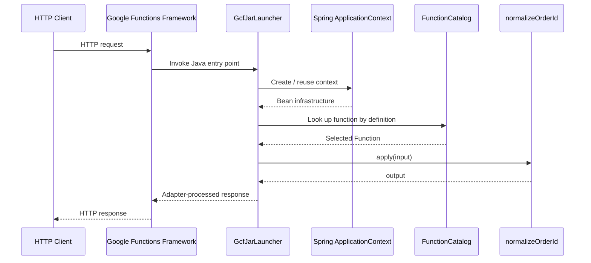
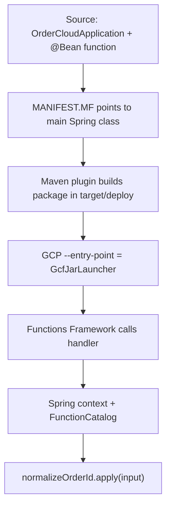

# The Role of `GcfJarLauncher` and the Main Application Class

## Lesson Objectives

In **Spring Cloud Function**, developers define a `Supplier`, `Function`, or `Consumer` as protocol-independent business processing components. `FunctionCatalog` lets you look them up and invoke them, while also supporting composition and message conversion when an appropriate adapter is present. On **Google Cloud Functions / Cloud Run functions**, Google does not directly know how to create a Spring `ApplicationContext` or call `FunctionCatalog.lookup(...)`; the platform requires a **Java function entry point** conforming to the runtime contract.

In the integration described by the Spring Cloud Function GCP adapter documentation, the **`org.springframework.cloud.function.adapter.gcp.GcfJarLauncher`** class fulfills that entry point role. By contrast, the main application class—for example **`com.example.gcp.OrderCloudApplication`**—is where Spring Boot configuration and function beans live. These two classes have completely distinct roles, yet both are required for a properly packaged deployment.

After this lesson, you will be able to:

- Distinguish between the **Google Cloud entry point**, **Spring Boot application class**, **bean name**, and **`spring.cloud.function.definition`**.
- Understand how `GcfJarLauncher` connects Google Functions Framework invocations to the Spring `ApplicationContext` and `FunctionCatalog`.
- Declare `Main-Class` in the manifest so the deployment package points to the main application configuration class following the GCP adapter pattern.
- Build a Java example for `Function<String, String>`, configure Maven, run locally with the Functions Framework, and perform a controlled test deployment.
- Recognize the differences between a GCP manifest and a standard Spring Boot executable JAR manifest.
- Diagnose errors involving wrong entry points, wrong manifests, missing beans, incorrect function definitions, improper packaging, and HTTP/event issues.

**Version scope:** the examples are based on the `spring-cloud-function-adapter-gcp` and `GcfJarLauncher` model described in the Spring Cloud Function documentation. APIs, compatibility with each Google Cloud Functions generation, Java runtimes, and build/deploy steps must be verified against your project's exact versions; do not assume a historical configuration fits every modern environment.

## 1. Four Easily Confused Names in One Application

Suppose an application exposes a function `normalizeOrderId`. You may encounter the following names:

| Name | Example | Responsibility |
| --- | --- | --- |
| Google Cloud **Java entry point** | `org.springframework.cloud.function.adapter.gcp.GcfJarLauncher` | Located and invoked by the Google Functions Framework when a request/event arrives per the adapter contract |
| Spring **main application class** | `com.example.gcp.OrderCloudApplication` | Provides Spring Boot configuration, `@Bean` definitions, and metadata to build the `ApplicationContext` |
| **Function bean name** | `normalizeOrderId` | Recognized by Spring Cloud Function and looked up via `FunctionCatalog` |
| **Function definition** | `spring.cloud.function.definition=normalizeOrderId` | Selects an existing function or composition expression for the adapter to invoke |

Key points:

- When Google Cloud asks for an **entry point**, this deployment model uses the fully qualified **`GcfJarLauncher`** class name, **not** `normalizeOrderId`.
- When the adapter needs to know **which Spring application to bootstrap**, the deployment package must provide the **main application class** according to the adapter's convention, such as in the manifest.
- When `FunctionCatalog` receives a **function lookup** request, it uses the bean name **`normalizeOrderId`**, **not** `GcfJarLauncher`.
- When an application has multiple functions, the **`spring.cloud.function.definition`** property selects which function to invoke; it **does not create a new bean**.

An incorrect deploy command such as `--entry-point=normalizeOrderId` can cause the **Google Functions Framework to fail to find the Java handler**, even when the Spring context and Java function are completely valid. Conversely, having `--entry-point=GcfJarLauncher` right while the catalog lacks `normalizeOrderId` will still fail execution at a different layer.

## 2. What Does `GcfJarLauncher` Do?

`GcfJarLauncher` is the **adapter/launcher class** provided by the `spring-cloud-function-adapter-gcp` library. The Spring Cloud Function documentation uses this exact class as `functionTarget` when running the Google Functions Framework locally and as `--entry-point` when deploying with the JAR packaging approach described by the adapter.

```text
org.springframework.cloud.function.adapter.gcp.GcfJarLauncher
```

An **HTTP Function** invocation flow can be understood across these layers:



This is a **conceptual model** and does not claim that the Spring context is created fresh on **every request**. The runtime can reuse the instance and context across subsequent invocations; reuse behavior depends on the environment, version, and container lifecycle.

The launcher class helps by:

1. Providing the invocation entry point understood by the Java Functions Framework.
2. Connecting to the deployment package's Spring application bootstrap mechanism.
3. Using the Spring Cloud Function programming model instead of requiring the application to write its own controllers or Google Java handlers for each function.
4. Dispatching invocations per the adapter contract, including payload/response handling appropriate for the trigger type.

**Do not assume** `GcfJarLauncher` supports all `HttpFunction`, `BackgroundFunction<T>`, and `CloudEventsFunction` variants identically. The adapter documentation shows examples for both HTTP and background functions, so verify the trigger type and Java Functions Framework API matching your target deployment generation.

## 3. What Is the Role of the Main Application Class?

The main application class is typically a Spring Boot class annotated with `@SpringBootApplication`, for example:

```java
package com.example.gcp;

import java.util.Locale;
import java.util.function.Function;

import org.springframework.boot.SpringApplication;
import org.springframework.boot.autoconfigure.SpringBootApplication;
import org.springframework.context.annotation.Bean;

@SpringBootApplication(proxyBeanMethods = false)
public class OrderCloudApplication {

    public static void main(String[] args) {
        SpringApplication.run(OrderCloudApplication.class, args);
    }

    @Bean
    public Function<String, String> normalizeOrderId() {
        return value -> {
            if (value == null || value.isBlank()) {
                throw new IllegalArgumentException(
                        "Order ID must not be blank");
            }
            return value.trim().toUpperCase(Locale.ROOT);
        };
    }
}
```

Corresponding file: `src/main/java/com/example/gcp/OrderCloudApplication.java`.

Analysis:

- `OrderCloudApplication` is the **Spring application class**, used to organize configuration and function beans.
- `main(String[] args)` allows running the application via Spring Boot's standard mechanism when appropriate; **it is not the Google Java entry point** expected by the adapter's `--entry-point`.
- `@Bean` exposes the function named **`normalizeOrderId`**; the generic `Function<String, String>` lets the catalog know the input and output types.
- The function only processes `String` and does not depend on `HttpRequest`, `HttpResponse`, Pub/Sub, or the Google Cloud SDK.
- `proxyBeanMethods = false` is suitable when `@Bean` methods do not call each other through proxy interception; it is **not** a mandatory Google Cloud setting.

Because the business layer is decoupled from the handler, the same function can be tested as plain Java, invoked via `FunctionCatalog`, or wired to another HTTP/event adapter without rewriting its logic.

### Why Is `main(...)` Still Present?

In Spring Cloud Function GCP examples, the application class includes `main(...)` to represent the standard Spring Boot startup point. At the same time, information about the **main configuration class** is placed in the deployment package so the launcher knows which Spring application to use.

**Make the distinction clear:** having a `main` method on the class does not mean the Google Cloud runtime calls that method **on every event**. The Java Functions Framework calls the **configured entry point**. How Spring is bootstrapped inside the adapter is the launcher's responsibility; reflection details or how the manifest is read are version-dependent implementation details.

## 4. Manifest: Connecting the Launcher to the Main Application Class

Following the pattern described in the Spring Cloud Function GCP documentation, you specify the main application class in **`META-INF/MANIFEST.MF`** inside the project's resources.

Example source layout:

```text
src/
└── main/
    ├── java/
    │   └── com/example/gcp/OrderCloudApplication.java
    └── resources/
        └── META-INF/
            └── MANIFEST.MF
```

Sample content of `src/main/resources/META-INF/MANIFEST.MF`:

```text
Manifest-Version: 1.0
Main-Class: com.example.gcp.OrderCloudApplication
```

According to the GCP adapter guide, the **`Main-Class` value here is the main application class**, **not** the `normalizeOrderId` bean name and **not** `GcfJarLauncher`. This mechanism embeds the Spring bootstrap metadata required by the adapter inside the deployment package.

### Distinguishing from a Spring Boot Executable JAR Manifest

This is an easy difference to get wrong:

| Package / Context | What Does `Main-Class` Usually Represent? | What to Watch Out For |
| --- | --- | --- |
| GCP adapter pattern per Spring Cloud Function docs | The application configuration class, e.g. `com.example.gcp.OrderCloudApplication` | The package and GCP launcher must be able to read metadata per the adapter's convention |
| Standard Spring Boot **executable fat JAR** | A **Spring Boot loader** class, e.g. `org.springframework.boot.loader.launch.JarLauncher` on the corresponding Boot line | The application class usually resides in the **`Start-Class`** attribute |
| Google Functions Framework at run/deploy time | The **Java function target**, e.g. `GcfJarLauncher` | This is supplied via `functionTarget` or `--entry-point`, not automatically the Boot fat JAR's `Main-Class` |

Therefore, **do not take an arbitrary Spring Boot fat JAR and assume it is a valid GCP adapter package**. The Spring Boot Maven plugin can repackage the JAR and alter metadata; the classloader layout, dependency layout, and post-build manifest must be inspected.

The GCP adapter documentation introduces a `spring-boot-maven-plugin` configuration **with the adapter dependency added inside the plugin** to produce a JAR package suitable for Google Cloud. The `Main-Class` setting in source and the metadata in the **final artifact** must be cross-checked together, because plugins and build systems can rewrite the manifest.

### Inspecting the Actual Package Contents

With the JDK `jar` tool, you can list the files:

```bash
jar tf target/deploy/YOUR_APPLICATION.jar
```

To inspect a JAR's manifest using plain JDK tools, you can extract it into a temporary inspection directory:

```bash
jar xf YOUR_APPLICATION.jar META-INF/MANIFEST.MF
```

Then read `META-INF/MANIFEST.MF` and verify the main class entry. **Do not run the extract command inside a source directory that already contains an important manifest without a backup**, because `jar xf` writes files into the current directory. Beyond the manifest, verify that the application class and adapter/Function dependencies are actually packaged properly.

`YOUR_APPLICATION.jar` is a placeholder; the exact path and package format depend on the plugin and build.

## 5. `pom.xml`: Dependencies and Plugins Serving Two Roles

The example below shows the **core** configuration snippet of a Maven project that already has a compatible Spring Boot parent/BOM and Spring Cloud BOM. This is **not a complete POM**; do not copy the snippet as a single file and expect it to build right away.

### 5.1. Application Runtime Dependencies

```xml
<dependencies>
    <dependency>
        <groupId>org.springframework.cloud</groupId>
        <artifactId>spring-cloud-function-adapter-gcp</artifactId>
    </dependency>
    <dependency>
        <groupId>org.springframework.cloud</groupId>
        <artifactId>spring-cloud-function-context</artifactId>
    </dependency>
</dependencies>
```

`spring-cloud-function-context` provides infrastructure such as `FunctionCatalog`; the GCP adapter provides the Google Functions Framework integration. Some adapter versions may pull in Context transitively, but if application code directly uses `FunctionCatalog`, declaring it explicitly also accurately expresses the project's dependencies.

For version management, use a Spring Cloud BOM compatible with your Spring Boot version and **do not mix arbitrary versions manually**:

```xml
<dependencyManagement>
    <dependencies>
        <dependency>
            <groupId>org.springframework.cloud</groupId>
            <artifactId>spring-cloud-dependencies</artifactId>
            <version>COMPATIBLE_SPRING_CLOUD_RELEASE</version>
            <type>pom</type>
            <scope>import</scope>
        </dependency>
    </dependencies>
</dependencyManagement>
```

`COMPATIBLE_SPRING_CLOUD_RELEASE` is a placeholder; replace it with the release train compatible with the Spring Boot version in use.

### 5.2. Spring Boot Maven Plugin: GCP Packaging

Under `<build><plugins>...</plugins></build>`, the Spring Cloud Function GCP documentation describes a configuration like:

```xml
<plugin>
    <groupId>org.springframework.boot</groupId>
    <artifactId>spring-boot-maven-plugin</artifactId>
    <configuration>
        <outputDirectory>target/deploy</outputDirectory>
    </configuration>
    <dependencies>
        <dependency>
            <groupId>org.springframework.cloud</groupId>
            <artifactId>spring-cloud-function-adapter-gcp</artifactId>
        </dependency>
    </dependencies>
</plugin>
```

**Pay close attention to this separate `<plugin><dependencies>` block.** In the packaging mechanism described by the GCP adapter docs, it gives the plugin the extension needed to produce the **deployment package layout** expected by the Google Cloud adapter. A plugin-level dependency and an application-level dependency **are not the same thing**.

With that sample configuration, after `mvn package`, the documentation notes the output is placed in **`target/deploy`**. However, the final location and layout should be verified against your plugin version and actual build; major changes across Spring Boot generations may require adjusting historical examples.

### 5.3. Google Functions Framework Maven Plugin: Running Locally

The adapter documentation uses **`com.google.cloud.functions:function-maven-plugin`** to create the local invoker:

```xml
<plugin>
    <groupId>com.google.cloud.functions</groupId>
    <artifactId>function-maven-plugin</artifactId>
    <version>COMPATIBLE_FUNCTION_PLUGIN_VERSION</version>
    <configuration>
        <functionTarget>org.springframework.cloud.function.adapter.gcp.GcfJarLauncher</functionTarget>
        <port>8080</port>
    </configuration>
</plugin>
```

`COMPATIBLE_FUNCTION_PLUGIN_VERSION` must be replaced with a compatible plugin version. Some Spring Cloud Function docs/branches show `0.9.1` as an example; **do not assume that is the latest recommended version for every runtime**.

The **`functionTarget` property is the `GcfJarLauncher` class**, not `OrderCloudApplication` and not `normalizeOrderId`.

| Component in POM | Role |
| --- | --- |
| `spring-cloud-function-adapter-gcp` in application `dependencies` | Provides the adapter code at runtime |
| `spring-cloud-function-adapter-gcp` in `spring-boot-maven-plugin.dependencies` | Participates in GCP packaging per the mechanism described in the adapter docs |
| `function-maven-plugin` | Provides the `mvn function:run` goal for the local Java Functions Framework |
| `functionTarget=...GcfJarLauncher` | Selects the Java handler for the local invoker to call |
| Manifest `Main-Class: ...OrderCloudApplication` | Points to the Spring application class per the package convention |
| `spring.cloud.function.definition=normalizeOrderId` | Selects the business function bean via the catalog |

## 6. Configuring `FunctionCatalog` and Multiple Functions

In the `OrderCloudApplication` example, the function name is **`normalizeOrderId`**. When one or more functions need to be explicitly selected, declare it in `src/main/resources/application.properties`:

```properties
spring.cloud.function.definition=normalizeOrderId
```

Or:

```yaml
spring:
  cloud:
    function:
      definition: normalizeOrderId
```

With `@Bean` registration, `FunctionCatalog` can look it up:

```java
Function<String, String> fn =
        catalog.lookup("normalizeOrderId");

if (fn == null) {
    throw new IllegalStateException(
            "normalizeOrderId not found in FunctionCatalog");
}

String output = fn.apply("  ord-88  ");
// output: "ORD-88"
```

The snippet above assumes `catalog` has been injected by Spring or retrieved from the application context. It **does not invoke `GcfJarLauncher`**. This is a catalog-layer check, useful before testing the Google Functions Framework.

### What About Function Composition?

Suppose you add an `appendSuffix` function taking `String` and returning `String`:

```java
@Bean
public Function<String, String> appendSuffix() {
    return value -> value + "-PROCESSED";
}
```

In Spring Cloud Function, once the functions are registered and their types are compatible, you can look up:

```java
Function<String, String> pipeline =
        catalog.lookup("normalizeOrderId|appendSuffix");
```

And configure the adapter when composition expressions are supported:

```properties
spring.cloud.function.definition=normalizeOrderId|appendSuffix
```

**Do not get confused:** `|` creates composition **inside the Spring Cloud Function catalog**, not two Google Cloud Functions, and it does not make Google Cloud invoke two Java entry points. Google still calls the launcher, which then selects the composed function expression.

### What About `Supplier` and `Consumer`?

A `Supplier` accepts no payload, and a `Consumer` returns no business value. Spring Cloud Function can expose both, but **how the Google adapter triggers them, converts inputs, or interprets outputs** depends on the trigger/handler type. Do not assume `Supplier.get()` runs on a schedule or that a `Consumer` automatically receives Pub/Sub messages without configuring the corresponding trigger.

## 7. Testing HTTP Locally Through `GcfJarLauncher`

Once the application class, manifest, and Maven plugins are properly configured:

```bash
./mvnw clean package
./mvnw function:run
```

The `function:run` command belongs to the **Google Functions Framework Maven plugin** configured earlier. If you only added the GCP adapter dependency without this plugin, Maven may report **that the `function` plugin prefix/goal was not found**.

In the HTTP sample described by Spring Cloud Function GCP, the invoker typically listens on port `8080` and handles requests at the **root path `/`**:

```bash
curl -X POST http://localhost:8080/ \
  -H "Content-Type: text/plain" \
  --data-binary "  ord-88  "
```

Expected business output from `normalizeOrderId`:

```text
ORD-88
```

Important notes:

- This is the **endpoint of the Java Functions Framework local invoker** running the GCP handler. Do not append `/normalizeOrderId` to the URL out of habit from `spring-cloud-function-web`.
- Google Cloud Functions provides its own HTTP serving URL. When deployed, the request path/route is managed by the runtime; **do not treat it as a Spring MVC controller route**.
- If JSON or a DTO body is required, test how the adapter converts payloads according to the content type rather than testing only `String` values.
- If the runtime requires authentication, cURL calls must include a valid token; **do not disable production security just for a demo**.

### Why Testing with `spring-cloud-function-web` Is Not Enough

Running Spring Boot with the web adapter and sending `POST /normalizeOrderId` proves that a **different adapter** works, but it does not verify `GcfJarLauncher`, the manifest, or the Functions Framework. To validate a GCP deployment, **you must run at least one test through the real Java function target**.

## 8. Packaging and Deploying to Google Cloud

After building:

```bash
./mvnw clean package
```

According to the sample Maven GCP adapter configuration in the docs, the deployable artifact is placed in **`target/deploy`**. This path is determined by the plugin example, not a permanent convention across every Spring Boot version.

For **an environment compatible with `gcloud functions deploy` and the chosen GCP adapter**, a reference command skeleton is:

```bash
gcloud functions deploy order-normalizer \
  --region=YOUR_REGION \
  --runtime=SUPPORTED_JAVA_RUNTIME \
  --entry-point=org.springframework.cloud.function.adapter.gcp.GcfJarLauncher \
  --trigger-http \
  --source=target/deploy
```

**You must replace** `YOUR_REGION` and `SUPPORTED_JAVA_RUNTIME` with real values. The runtime, flags, generation, IAM/ingress, and whether the GCF adapter supports the target Cloud Run functions/Cloud Functions generation must be checked beforehand; do not copy a historical command targeting Java 11 verbatim onto a newer Java project.

For platforms that require **`--gen2`** or use the newer Cloud Run workflow, verify **adapter compatibility with that generation's Java Functions Framework contract** and adjust the command accordingly. There is no guarantee that every version of `GcfJarLauncher` or JAR packaging layout works identically across every generation.

### The Proper Deployment Flow



A successful deployment requires **both** the metadata for Google to load the handler **and** the metadata for the handler to locate the Spring application. Missing either one can prevent your business code from ever being invoked.

### Access Control and Environment Variables

If you need to specify the selected function in the deployment environment, Spring Boot can typically accept:

```text
SPRING_CLOUD_FUNCTION_DEFINITION=normalizeOrderId
```

Passing this variable into the runtime environment must follow Google Cloud's configuration mechanism. If the handler needs permissions to call other services, grant the **runtime service account** only the minimum required permissions. For HTTP endpoints, prefer IAM/identity token authentication or an equivalent authentication mechanism instead of leaving them public by default.

## 9. Do Background Events and Pub/Sub Change the Launcher's Role?

According to the Spring Cloud Function GCP docs, the same adapter family also includes a **background function** pattern, such as a `Consumer` receiving Pub/Sub event payloads. This is a different contract from plain-text HTTP:

```java
@Bean
public Consumer<PubSubMessage> auditPubSub() {
    return message -> {
        System.out.println("Received event message ID: "
                + message.getMessageId());
    };
}
```

`PubSubMessage` in this example is an application DTO that you define to match the trigger's payload; **it is not a Java class automatically available in every project**. A simple shape from historical background examples is:

```java
package com.example.gcp;

import java.util.Map;

public class PubSubMessage {

    private String data;
    private Map<String, String> attributes;
    private String messageId;
    private String publishTime;

    public String getData() { return data; }
    public void setData(String data) { this.data = data; }

    public Map<String, String> getAttributes() { return attributes; }
    public void setAttributes(Map<String, String> attributes) {
        this.attributes = attributes;
    }

    public String getMessageId() { return messageId; }
    public void setMessageId(String messageId) {
        this.messageId = messageId;
    }

    public String getPublishTime() { return publishTime; }
    public void setPublishTime(String publishTime) {
        this.publishTime = publishTime;
    }
}
```

Many Pub/Sub payloads carry `data` as **Base64**, requiring decoding if you want to read the original content. The DTO and decoding logic must match the **actual envelope**, especially when comparing legacy background events against modern CloudEvents/Eventarc.

What stays the same:

- Google still needs a **valid entry point** for the specific trigger type.
- The application still needs its main Spring class and business bean, such as `auditPubSub`.
- The adapter still has to connect to the Spring context/catalog.
- Setting `spring.cloud.function.definition=auditPubSub` only selects an existing bean.

**Do not assume** every `GcfJarLauncher` version works across all CloudEvent/Pub/Sub triggers or all runtime generations. The fact that a historical background sample used `--trigger-topic` does not guarantee the exact same code runs unchanged over Eventarc today. In addition, messages can be redelivered, so a `Consumer` with side effects must handle **idempotency**, retries, and duplicate deliveries.

## 10. Layered Testing

When something fails, do not immediately tweak `--entry-point` or the manifest blindly. Verify layer by layer, from Java logic up to the cloud.

### 10.1. Unit Test Checking Business Logic Only

```java
package com.example.gcp;

import static org.junit.jupiter.api.Assertions.assertEquals;

import org.junit.jupiter.api.Test;

class NormalizeOrderIdTest {

    @Test
    void normalizesOrderId() {
        OrderCloudApplication config =
                new OrderCloudApplication();
        assertEquals(
                "ORD-88",
                config.normalizeOrderId().apply("  ord-88  "));
    }
}
```

This test proves the `Function` expression works. It **does not start Spring**, does not read the manifest, and does not initialize `GcfJarLauncher`. In real applications, extract substantial logic into a dedicated service/function class rather than treating `@Bean` factory methods as the sole unit under test.

### 10.2. Spring Context Test Checking Beans and Catalog

```java
package com.example.gcp;

import static org.junit.jupiter.api.Assertions.assertEquals;
import static org.junit.jupiter.api.Assertions.assertNotNull;

import java.util.function.Function;
import org.junit.jupiter.api.Test;
import org.springframework.beans.factory.annotation.Autowired;
import org.springframework.boot.test.context.SpringBootTest;
import org.springframework.cloud.function.context.FunctionCatalog;

@SpringBootTest(
        classes = OrderCloudApplication.class,
        webEnvironment = SpringBootTest.WebEnvironment.NONE)
class FunctionCatalogTest {

    @Autowired
    FunctionCatalog catalog;

    @Test
    void findsFunctionByBeanName() {
        Function<String, String> fn =
                catalog.lookup("normalizeOrderId");

        assertNotNull(fn);
        assertEquals("ORD-88", fn.apply("  ord-88  "));
    }
}
```

This test proves Spring Boot/Cloud Function Context has the bean and can look up the function **on the JVM**, but it does not prove `GcfJarLauncher` starts up properly.

### 10.3. Local Functions Framework Test Checking the Launcher

With the plugin and manifest configured:

```bash
./mvnw clean package
./mvnw function:run
```

Then invoke:

```bash
curl -X POST http://localhost:8080/ \
  -H "Content-Type: text/plain" \
  --data-binary "  ord-88  "
```

If `function:run` initializes the handler and returns `ORD-88`, you have verified part of the **Functions Framework → GcfJarLauncher → Spring → FunctionCatalog** path. That is still not a smoke test on the real Google Cloud runtime.

### 10.4. Smoke Test in the Cloud

After deploying, call the function at its real URL or send a properly formatted event, with authentication if required by the service. Monitor at least:

- Startup/cold start: whether the handler loaded and the Spring context initialized.
- Routing: whether `spring.cloud.function.definition` selected the right bean.
- Payload: whether the body/event envelope converted to the expected Java type.
- Authorization: whether the caller and runtime service account have the required permissions.
- Error behavior: whether the function returns HTTP errors or throws exceptions, and whether retries cause duplicate invocations.

Do not log tokens or sensitive payloads; use a correlation ID/event ID when needed.

## 11. Typical Errors and Identifying the Right Layer

| Symptom | Possible Failing Layer | Cause / How to Fix |
| --- | --- | --- |
| `ClassNotFoundException: GcfJarLauncher` | Google handler/packaging | Artifact does not contain the adapter or packaging does not follow the GCP pattern; inspect dependencies and `target/deploy` |
| Google reports invalid entry point | Google function target | Passed `normalizeOrderId` or `OrderCloudApplication` instead of the contract-compliant GCP adapter class |
| Local Functions Framework fails to load handler | Local invoker | Wrong `functionTarget`, or Functions Framework/plugin and classpath mismatch |
| Launcher exists, but Spring application class not found | Spring bootstrap/manifest | Missing/wrong `Main-Class` FQCN, or final build manifest lacks the metadata expected by the adapter |
| `Main-Class` becomes Spring Boot `JarLauncher` | Artifact layout | Inspecting a standard fat JAR's manifest instead of the GCP artifact, or a build plugin overwrote it |
| `NoSuchBeanDefinitionException: FunctionCatalog` | Spring Cloud Function context | Missing dependency, auto-configuration, or bootstrap failure |
| `catalog.lookup("normalizeOrderId")` returns `null` | Bean registration/catalog | Missing `@Bean`, wrong name, or `definition` mismatch |
| Right handler runs, wrong function executes | Function selection | Multiple beans exist and `spring.cloud.function.definition` is unset or wrong |
| `mvn function:run` reports missing goal | Maven plugin | `function-maven-plugin` not declared properly or goal/plugin prefix not resolved |
| Local HTTP `404` at `/normalizeOrderId` | Route | Using the Spring Cloud Function Web URL instead of the GCP invoker's root `/` in the sample |
| HTTP `401`/`403` on Google Cloud | IAM/ingress | Missing identity token, wrong audience, missing invoke permission, or ingress restriction |
| Java tests pass, but JSON conversion fails | Adapter/message conversion | Wrong content type, generic type, JSON mapper, or envelope |
| Pub/Sub triggers, but no data is processed | Background event contract | DTO/CloudEvent envelope or handler type does not match the runtime generation |
| Excessive cold start or timeout | Runtime resources | Large context, slow external connections, insufficient memory/timeout |
| Works locally, but Google Cloud rejects Java runtime | Deployment platform | Incompatible runtime/bytecode or generation-mismatched entry point/packaging |

### Ordered Diagnostic Approach

1. **Verify dependencies:** `spring-cloud-function-adapter-gcp`, Context, and compatible versions.
2. **Verify the Java function target:** `GcfJarLauncher` for the deployment method in use.
3. **Verify the artifact/manifest:** points to `OrderCloudApplication` and packages the application properly.
4. **Verify the Spring context:** starts up cleanly and contains the `normalizeOrderId` bean.
5. **Verify `FunctionCatalog.lookup(...)`:** resolves the expected function.
6. **Verify payload/adapter:** plain text, JSON, Pub/Sub, or CloudEvent.
7. **Verify the cloud environment:** runtime, trigger, IAM, memory, and timeout.

Checking layer by layer prevents wasted effort such as changing the Spring function name when Google cannot load the Java handler, or editing the manifest when the real issue is IAM.

## 12. Pre-Deployment Checklist

| Check | Acceptance Criteria |
| --- | --- |
| Main Spring class | `OrderCloudApplication` exists in the right package with required `@Bean`s |
| Package metadata | Manifest specifies the Spring class per the GCP adapter convention in use |
| Dependencies | Compatible `spring-cloud-function-adapter-gcp` and `spring-cloud-function-context` |
| Maven plugin build | Generates artifact per GCP pattern; contents of `target/deploy` verified |
| Java function target | Local `functionTarget` and cloud `--entry-point` point to an adapter-supported handler |
| Catalog | `catalog.lookup("normalizeOrderId")` returns the function |
| Function definition | Configuration selects the right bean, especially when multiple functions exist |
| HTTP/event | Trigger type, envelope, and route are supported by the adapter |
| Tests | Unit → catalog → Functions Framework → cloud smoke tests all pass |
| Security | Caller identity, ingress, and runtime service account are properly scoped |
| Observability | Logs separate startup, handler, catalog, conversion, and business errors |

## 13. Practice Exercises and Self-Check Questions

### Exercise 1 — Four Names, Four Purposes

Given an application:

- Spring main class: `com.example.gcp.OrderCloudApplication`.
- Bean: `normalizeOrderId`.
- Cloud entry point: `org.springframework.cloud.function.adapter.gcp.GcfJarLauncher`.
- Property: `spring.cloud.function.definition=normalizeOrderId`.

Specify which value goes into **manifest `Main-Class`**, which value goes into Maven `functionTarget` and Google `--entry-point`, and which value is passed to `FunctionCatalog.lookup(...)`.

### Exercise 2 — Rename the Function

Rename the `normalizeOrderId` bean to `normalizeCustomerId` via `@Bean(name="normalizeCustomerId")`. Update `definition` and the integration test. **Do you need to rename `GcfJarLauncher` to the new name?** No, because the handler is the adapter's entry point, not the business bean.

### Exercise 3 — Inspect the Manifest After Packaging

Produce the artifact by building the project per the GCP adapter pattern. Inspect the package metadata and confirm the launcher can locate the Spring class. Contrast this with a standard Spring Boot JAR whose `Main-Class` is Boot's `JarLauncher` and whose `Start-Class` is the application.

### Exercise 4 — Events Instead of HTTP

Suppose you switch from an HTTP `Function<String,String>` to `Consumer<PubSubMessage>`. List the pieces to verify: **event trigger**, payload contract, Base64 encoding, bean name, function definition, handler support on your runtime generation, and idempotency. Explain why changing only `--trigger-http` to `--trigger-topic` may not be enough.

### Self-Check Questions

1. **Is `GcfJarLauncher` an application `Function` bean?** No; it is the Java entry point/adapter.
2. **Is `OrderCloudApplication.main(...)` the Google Java function target?** Not in this GCP adapter model; Google calls the configured handler.
3. **What does `Main-Class` point to in the GCP adapter pattern?** The Spring application configuration class.
4. **Can `spring.cloud.function.definition` create `normalizeOrderId` on its own?** No, it only selects an already-registered function.
5. **Why does local cURL usually hit `/` instead of `/normalizeOrderId`?** That is the HTTP path of the Functions Framework invoker in the GCP sample, not a Spring Cloud Function Web route.
6. **Why must you inspect the final artifact instead of checking only `src/main/resources/META-INF/MANIFEST.MF`?** Plugins can repackage or rewrite the manifest and alter the class/dependency layout.
7. **Is a passing catalog test enough to conclude a Google Cloud deployment will succeed?** No; there are still the handler, deployment package, runtime, trigger, and access permissions.

## 14. Summary and References

In the Spring Cloud Function model for Google Cloud, **`GcfJarLauncher` is the bridge invoked by the Java Functions Framework**, while **the main Spring Boot class provides configuration and function beans**, and **`FunctionCatalog` selects business logic by name**. The manifest and Maven packaging connect these layers of responsibility. Setting the right `--entry-point` with broken packaging, or having a valid manifest without a valid bean/function definition, can both prevent the business logic from executing.

In practice, verify step by step: **Java function target → manifest/application class → Spring context → FunctionCatalog → payload/adapter → cloud runtime**. Keep `Supplier`, `Function`, and `Consumer` functions protocol-independent, letting the launcher and adapter handle HTTP/event delivery. For modern serverless environments, always verify generation, Java version, and trigger type against your GCP adapter version.

Official references:

- [Spring Cloud Function — Google Cloud Functions (5.0)](https://docs.spring.io/spring-cloud-function/reference/5.0/adapters/gcp-intro.html): `GcfJarLauncher` entry point, `MANIFEST.MF`, Maven plugins, local invoker, and HTTP/background examples.
- [Spring Cloud Function — Reference](https://docs.spring.io/spring-cloud-function/reference/): `FunctionCatalog`, bean registration, definitions, and composition.
- [Spring Boot — Launching Executable Jars](https://docs.spring.io/spring-boot/specification/executable-jar/launching.html): explains `Main-Class`, `Start-Class`, and Boot `JarLauncher`.
- [Google Cloud — Cloud Run functions](https://cloud.google.com/run/docs/functions): runtimes, Java handlers, triggers, security, and newer deployment mechanisms.
- [Google Functions Framework for Java](https://github.com/GoogleCloudPlatform/functions-framework-java): Java entry point contract and local invoker.

**Version note:** the packaging examples and `gcloud functions deploy` commands in the Spring Cloud Function documentation stem from specific GCP adapter mechanisms. Do not assume every version of Spring Boot, Java Functions Framework, or every generation of Cloud Functions/Cloud Run functions uses the exact same manifest, classpath, and flags without verification.
