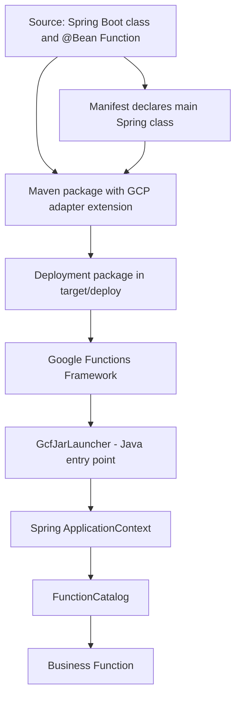
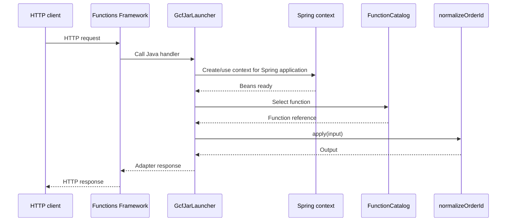

# Artifact Packaging and Proper Manifest Declaration for Google Cloud Deployment

## Lesson Objectives

In **Spring Cloud Function**, a business function written as a `Supplier<O>`, `Function<I, O>`, or `Consumer<I>` can be reused through `FunctionCatalog`, composition, HTTP, eventing systems, and serverless platforms. However, when deploying to **Google Cloud Functions / Cloud Run functions**, writing the right function bean is only part of the job: **the artifact must have a format that the Java Functions Framework and GCP adapter can load**, and its metadata must point to the right Spring configuration class.

This topic focuses on **artifact packaging and declaring `META-INF/MANIFEST.MF`** following the integration approach described in the `spring-cloud-function-adapter-gcp` documentation. After this lesson, you will be able to:

- Distinguish between the **Spring Boot application class**, **Java function target**, **function name in `FunctionCatalog`**, and **manifest `Main-Class`**.
- Create a source manifest pointing to the right application class and understand why `Main-Class` in a standard Spring Boot executable JAR can differ.
- Properly configure both application dependencies and the `spring-boot-maven-plugin` extension dependency to build a GCP deployment package per the Spring Cloud Function pattern.
- Understand the relationship between `target/deploy`, `functionTarget` when running locally, and `--entry-point` when deploying.
- Inspect the final artifact after `mvn package`, rather than checking only source files.
- Diagnose missing handler errors, wrong manifests, incompatible classpaths, `FunctionCatalog` missing-bean issues, wrong Java runtimes, and wrong trigger types.

**Version limitation:** the current Spring Cloud Function documentation describes the GCP adapter workflow using `GcfJarLauncher`, a manifest, and dedicated Maven plugin setup; some original illustrative commands use a Java runtime from an older generation of Google Cloud Functions. In real use, always verify your Spring Cloud Function, Spring Boot, Java Functions Framework, and target Google Cloud platform releases before applying deployment commands.

## 1. Why Is a `@Bean Function` Not Enough to Deploy?

Example:

```java
@Bean
Function<String, String> uppercase() {
    return text -> text.toUpperCase(Locale.ROOT);
}
```

Spring Cloud Function can register the `uppercase` function and let you invoke it via `FunctionCatalog.lookup("uppercase")`. But the Google Cloud platform runs a Java function through a specific **Java entry point**, rather than scanning source code directly for `@Bean Function` methods.

The GCP adapter bridges this gap through a chain of responsibilities:



There are **two separate concerns** in the deployment package:

1. **Google must know which Java handler to invoke:** `org.springframework.cloud.function.adapter.gcp.GcfJarLauncher` in the adapter pattern.
2. **The handler must know which Spring application to load:** a class such as `com.example.gcp.OrderCloudApplication`, declared via the manifest per the package convention.

Even when both are right, the Spring context still needs the business bean and `FunctionCatalog`. Therefore, do not lump all of these issues together as a single generic "Java deploy error".

## 2. Four Identifiers in the Packaging Workflow

| Identifier | Example | Where It Is Used |
| --- | --- | --- |
| **Spring application class** | `com.example.gcp.OrderCloudApplication` | `Main-Class` in the manifest **per the GCP adapter pattern**; used by Spring bootstrap to load configuration |
| **Google Java entry point** | `org.springframework.cloud.function.adapter.gcp.GcfJarLauncher` | `functionTarget` in the Functions Framework and `--entry-point` at deploy time |
| **Spring function bean name** | `normalizeOrderId` | `FunctionCatalog.lookup("normalizeOrderId")` |
| **Spring function definition** | `spring.cloud.function.definition=normalizeOrderId` | Selects a registered function or function chain for the adapter to invoke |

Notes:

- Do not pass `--entry-point=normalizeOrderId` when the deployment method requires the name of the **Google Java handler implementation class**.
- Do not put `Main-Class: org.springframework.cloud.function.adapter.gcp.GcfJarLauncher` in the source manifest under this pattern if that attribute's purpose is to specify the **Spring application class**.
- Do not set `spring.cloud.function.definition=OrderCloudApplication`: that is the configuration class name, not the business function name.
- A Spring class with a `main(String[] args)` method **does not automatically become a Google Java function handler**.

The invocation flow can be visualized as:



This diagram is architectural; it does not imply that `ApplicationContext` is recreated on every HTTP request. Context reuse, concurrency, and cold starts depend on the runtime, adapter, and configuration.

## 3. Sample Project Structure

Let's create an order ID normalization function that does not depend on HTTP. With Java 17+ and compatible Spring Boot/Spring Cloud Function versions, an illustrative source structure is:

```text
order-normalizer/
├── pom.xml
└── src/
    ├── main/
    │   ├── java/
    │   │   └── com/example/gcp/
    │   │       └── OrderCloudApplication.java
    │   └── resources/
    │       ├── application.properties
    │       └── META-INF/
    │           └── MANIFEST.MF
    └── test/
        └── java/
            └── com/example/gcp/
                └── OrderFunctionCatalogTest.java
```

**Three file types serve three different roles:** `OrderCloudApplication.java` defines the application and beans; `MANIFEST.MF` supplies bootstrap metadata per the GCP pattern; `application.properties` selects the function in Spring Cloud Function. `pom.xml` defines how packaging is performed.

### 3.1. Main Spring Application Class

File `src/main/java/com/example/gcp/OrderCloudApplication.java`:

```java
package com.example.gcp;

import java.util.Locale;
import java.util.function.Function;

import org.springframework.boot.SpringApplication;
import org.springframework.boot.autoconfigure.SpringBootApplication;
import org.springframework.context.annotation.Bean;

@SpringBootApplication(proxyBeanMethods = false)
public class OrderCloudApplication {

    public static void main(String[] args) {
        SpringApplication.run(OrderCloudApplication.class, args);
    }

    @Bean
    public Function<String, String> normalizeOrderId() {
        return input -> {
            if (input == null || input.isBlank()) {
                throw new IllegalArgumentException(
                        "orderId must not be blank");
            }
            return input.trim().toUpperCase(Locale.ROOT);
        };
    }
}
```

The class carries `@SpringBootApplication` and exposes a bean named `normalizeOrderId` via a `@Bean` method. `Function<String, String>` preserves explicit input/output generics to help the catalog and adapter handle payloads. The business logic is completely protocol-independent; `normalizeOrderId` knows nothing about `HttpRequest`, `CloudEvent`, or Pub/Sub.

**Separating the two entry points:** `OrderCloudApplication.main(...)` starts Spring Boot through the standard JVM path; in the GCP adapter workflow, the Google Functions Framework calls `GcfJarLauncher` configured as the entry point. Do not assume Google Cloud calls `main` before each request.

### 3.2. `application.properties`

File `src/main/resources/application.properties`:

```properties
spring.cloud.function.definition=normalizeOrderId
```

When only one function exists, some adapters can select it by default; declaring the name explicitly makes the example easier to verify and avoids surprises when more beans are added later.

`spring.cloud.function.definition` only **selects** an already-registered function; it does not create the `normalizeOrderId` bean and does not replace manifest metadata.

## 4. Writing `META-INF/MANIFEST.MF` for Its Proper Role

According to the Spring Cloud Function GCP adapter documentation, the main configuration class is declared in:

```text
src/main/resources/META-INF/MANIFEST.MF
```

Contents for the sample project:

```text
Manifest-Version: 1.0
Main-Class: com.example.gcp.OrderCloudApplication
```

Why `OrderCloudApplication`?

- It is the **fully qualified class name (FQCN)** of the main Spring application class.
- The name matches `package com.example.gcp;` and class `OrderCloudApplication` in the Java source.
- Per the documented GCP adapter convention, the manifest tells the launcher which **Spring configuration class** to use when preparing the context.

Do not enter a source file path like `com/example/gcp/OrderCloudApplication.java`; Java manifests use dot-separated class names. Also do not put the bean name `normalizeOrderId` in `Main-Class`.

### 4.1. Manifest Formatting Mistakes You May Encounter

`MANIFEST.MF` is not an arbitrary properties file. Keep these rules in mind:

1. Spell **`Main-Class`** accurately, with the hyphen and proper capitalization.
2. Include a **space after the colon**: `Main-Class: com.example.gcp.OrderCloudApplication`.
3. Write valid manifest lines and end with a trailing newline. When creating the file manually, a blank line at the end of the manifest helps avoid parse errors due to a missing section terminator.
4. For long values, follow JAR manifest *line folding* rules; do not split an FQCN across two lines arbitrarily.
5. Do not add two conflicting `Main-Class` entries or copy a manifest from another JAR and reuse it as-is.

Incorrect example:

```text
Main-Class: normalizeOrderId
```

This is wrong because `normalizeOrderId` is a **bean name**, not a Java class.

Another mistake:

```text
Main-Class: org.springframework.cloud.function.adapter.gcp.GcfJarLauncher
```

Under **the GCP adapter source manifest pattern covered here**, that value specifies the Google handler, not the main Spring application class that this attribute is meant to identify.

### 4.2. The Source Manifest Is Not Always the Final Manifest

Crucially, `src/main/resources/META-INF/MANIFEST.MF` is an **input to the build/adapter pipeline**. The Maven JAR plugin, Spring Boot Maven plugin, or another packaging tool may generate or rewrite `META-INF/MANIFEST.MF` inside the artifact.

Therefore, after building, verify the **actual manifest in the deployment package**. Do not inspect only the source file and assume `GcfJarLauncher` will start cleanly.

## 5. Distinguishing a GCP Adapter JAR from a Spring Boot Executable JAR

This is a common source of confusion during deployment. For a standard **Spring Boot executable fat JAR**, a modern manifest typically contains:

```text
Main-Class: org.springframework.boot.loader.launch.JarLauncher
Start-Class: com.example.gcp.OrderCloudApplication
```

Spring Boot's `JarLauncher` builds a classloader to read `BOOT-INF/classes/` and nested dependencies under `BOOT-INF/lib/`, then delegates to the `Start-Class`. The class path `org.springframework.boot.loader.JarLauncher` in older versions differs from `org.springframework.boot.loader.launch.JarLauncher` in newer lines. Exact values must be checked against your actual Boot version.

**Do not confuse Spring Boot's `JarLauncher` with Spring Cloud Function's `GcfJarLauncher`.**

| Scenario | Entry Point | Metadata Role |
| --- | --- | --- |
| Running `java -jar` with a standard Spring Boot executable JAR | Spring Boot loader `JarLauncher` | `Main-Class` is the loader; `Start-Class` is the application class |
| Running the GCP adapter per Spring Cloud Function docs | Google Functions Framework calls `GcfJarLauncher` | Source manifest `Main-Class` points to the main Spring class per GCP packaging convention |
| Accessing a function inside the running application | `FunctionCatalog.lookup("normalizeOrderId")` | Bean name and `spring.cloud.function.definition`, not a Java entry point |

Having `@SpringBootApplication` does not mean you can take **any fat JAR**, change `--entry-point` to `GcfJarLauncher`, and expect it to run. The package must have a **classpath layout that the Functions Framework/adapter can read**, along with contract-compliant metadata.

Some JARs whose `Main-Class` is the Boot loader are completely valid for `java -jar`; that **does not prove** they are suitable for **Google Functions Framework source deployment**. Conversely, if a properly packaged GCP artifact cannot run via `java -jar` like a standard fat JAR, that does not mean the GCP artifact is broken—the two launchers serve different purposes.

## 6. Configuring `pom.xml`: Two Layers of Dependencies

In Maven, application dependencies and **build plugin dependencies** are two separate lists. According to the Spring Cloud Function GCP guide, the adapter must appear in both places in the provided configuration.

### 6.1. Application Runtime Dependencies

In the project's `<dependencies>`:

```xml
<dependencies>
    <dependency>
        <groupId>org.springframework.cloud</groupId>
        <artifactId>spring-cloud-function-adapter-gcp</artifactId>
    </dependency>
    <dependency>
        <groupId>org.springframework.cloud</groupId>
        <artifactId>spring-cloud-function-context</artifactId>
    </dependency>
</dependencies>
```

The `spring-cloud-function-adapter-gcp` artifact provides the adapter code. `spring-cloud-function-context` provides Spring Cloud Function infrastructure such as `FunctionCatalog`. Depending on the version, the adapter may pull Context transitively; explicit declaration makes sense when the application directly uses Context APIs.

### 6.2. Managing Compatible Versions

Do not pick versions of Spring Boot, Spring Cloud Function, and the adapter independently. In a Spring Boot project with an appropriate parent/BOM, you can use the Spring Cloud release train BOM:

```xml
<dependencyManagement>
    <dependencies>
        <dependency>
            <groupId>org.springframework.cloud</groupId>
            <artifactId>spring-cloud-dependencies</artifactId>
            <version>SPRING_CLOUD_RELEASE_VERSION</version>
            <type>pom</type>
            <scope>import</scope>
        </dependency>
    </dependencies>
</dependencyManagement>
```

`SPRING_CLOUD_RELEASE_VERSION` is a **placeholder that must be replaced**, not a directly usable value. The BOM must be compatible with the Spring Boot version your project uses. If the project uses a dedicated Spring Cloud Function BOM, keep Function module versions aligned and inspect the dependency tree.

### 6.3. `spring-boot-maven-plugin` Dependency

According to the GCP adapter documentation, the Spring Boot Maven plugin is configured as follows:

```xml
<build>
    <plugins>
        <plugin>
            <groupId>org.springframework.boot</groupId>
            <artifactId>spring-boot-maven-plugin</artifactId>
            <configuration>
                <outputDirectory>target/deploy</outputDirectory>
            </configuration>
            <dependencies>
                <dependency>
                    <groupId>org.springframework.cloud</groupId>
                    <artifactId>spring-cloud-function-adapter-gcp</artifactId>
                </dependency>
            </dependencies>
        </plugin>
    </plugins>
</build>
```

**This is an important detail of this lesson.** The Spring Cloud Function docs note that the adapter dependency is placed **inside `spring-boot-maven-plugin`** because it customizes how the plugin packages the function into a JAR suitable for Google Cloud Functions.

You cannot omit the snippet above while keeping only the application dependency in section 6.1 and assume the plugin automatically knows how to produce the right GCP package. Conversely, declaring the adapter on the plugin while **dropping the application runtime dependency** does not guarantee the adapter code will be available at execution time either.

**Maven note:** this snippet is only a portion of `pom.xml` and omits the parent, version/plugin management, and lifecycle bindings. In some Maven setups, plugin dependencies require an explicit **`<version>`**; the application's release train BOM should not be assumed to apply automatically to every plugin dependency. If Maven complains about a missing version or fails to resolve the dependency, declare the adapter version matching your project's Function version and inspect `help:effective-pom`.

### 6.4. Google Functions Framework Maven Plugin

To run locally through the **actual Java GCP entry point**, add the Functions Framework plugin:

```xml
<plugin>
    <groupId>com.google.cloud.functions</groupId>
    <artifactId>function-maven-plugin</artifactId>
    <version>FUNCTIONS_FRAMEWORK_PLUGIN_VERSION</version>
    <configuration>
        <functionTarget>org.springframework.cloud.function.adapter.gcp.GcfJarLauncher</functionTarget>
        <port>8080</port>
    </configuration>
</plugin>
```

`FUNCTIONS_FRAMEWORK_PLUGIN_VERSION` is a placeholder. The Spring Cloud Function GCP docs show an example using plugin `0.9.1`; before deploying, verify whether the current plugin/version supports the toolchain you are using.

`functionTarget` points to **`GcfJarLauncher`**, not `OrderCloudApplication`. This is a plugin for **local test invocation**, distinct from `spring-boot-maven-plugin` which handles packaging.

| Component | Purpose |
| --- | --- |
| Project `dependencies` | Application classpath: Spring Cloud Function, GCP adapter, business logic |
| Project `dependencyManagement` | Compatible version management |
| `spring-boot-maven-plugin` | Builds/repackages the artifact with the corresponding packaging strategy |
| `spring-boot-maven-plugin.dependencies` | Supplies the plugin with the GCP adapter extension per the guide |
| `function-maven-plugin` | Runs the Java Functions Framework locally |
| `functionTarget` / Google `--entry-point` | Selects the GCP Java handler |
| Pattern `MANIFEST.MF Main-Class` | Points to the Spring application class |

## 7. Building and Verifying the Final Artifact

From a project with Maven Wrapper or a compatible Maven installation:

```bash
./mvnw clean package
```

Under the documented configuration where `spring-boot-maven-plugin` is extended with the GCP adapter and `<outputDirectory>target/deploy</outputDirectory>`, packaging produces the **deployable JAR** in `target/deploy`. The exact artifact structure depends on the build plugin version; inspect the real output before deploying.

### 7.1. Checking That the File Was Created in the Right Place

Example on Linux/macOS:

```bash
ls -lah target/deploy/
```

On Windows PowerShell:

```powershell
Get-ChildItem -LiteralPath target/deploy -File
```

Do not confuse `target/`, which holds standard build JARs, with `target/deploy/`, which was configured separately. If `target/deploy` is empty, inspect the lifecycle, plugin extension, output directory, and Maven errors in the log.

### 7.2. Inspecting the JAR Structure

Suppose the actual JAR is `target/deploy/order-normalizer.jar` (this is an **example filename**; substitute your real artifact name):

```bash
jar tf target/deploy/order-normalizer.jar
```

Look for signs that:

- The package has a manifest at `META-INF/MANIFEST.MF`.
- The `OrderCloudApplication` class is present in the artifact layout expected by the packager.
- Required runtime libraries (Spring Cloud Function Context, GCP adapter, dependencies) are provided in a way **the runtime classloader actually supports**, not necessarily with every class flattened at the JAR root.
- No classes or resources were dropped during shading, repackaging, or ZIP creation.

In particular, not seeing `GcfJarLauncher.class` directly at the root of **a single** JAR is not enough to conclude the handler is missing: the class may live inside a dependency packaged in a layout supported by the adapter/runtime. Inspect the actual classpath and test loading the handler with the Functions Framework.

### 7.3. Reading the Artifact's Manifest, Not Just the Source

On systems with `unzip`:

```bash
unzip -p target/deploy/order-normalizer.jar META-INF/MANIFEST.MF
```

Or using JDK `jar` in a separate inspection directory:

```bash
mkdir -p manifest-check
cd manifest-check
jar xf ../target/deploy/order-normalizer.jar META-INF/MANIFEST.MF
cat META-INF/MANIFEST.MF
```

The second snippet assumes you start from the **project root directory**: once you run `cd manifest-check`, the relative path `../target/deploy/...jar` resolves properly. Never extract into a source directory containing an important manifest, because `jar xf` can overwrite identically named files.

Verify the main class FQCN and launcher type recorded in the manifest; compare them against **the contract of the exact GCP adapter/version you chose**. If the output lists Spring Boot's `JarLauncher` as `Main-Class` and the application as `Start-Class`, do not assume that is the proper GCP manifest merely because it runs with `java -jar`.

### 7.4. Verifying with the Local Invoker

After packaging, run:

```bash
./mvnw function:run
```

With `function-maven-plugin` configured with `functionTarget=org.springframework.cloud.function.adapter.gcp.GcfJarLauncher`, the Java Functions Framework will attempt to load the handler and invoke Spring.

For a simple HTTP function, test:

```bash
curl -X POST http://localhost:8080/ \
  -H 'Content-Type: text/plain' \
  --data-binary '  ord-103  '
```

Expected business output:

```text
ORD-103
```

**The `/` path is the Functions Framework request path in the GCP example**, not the `/normalizeOrderId` route commonly seen with `spring-cloud-function-web`. If your test only hits a different Spring MVC endpoint, it has not verified GCP packaging or the launcher.

## 8. Testing the Bean Independently Before Testing the JAR

If the Functions Framework fails to start, separate **function registration errors** from **packaging errors** first.

With JUnit 5 and Spring Boot Test:

```java
package com.example.gcp;

import static org.junit.jupiter.api.Assertions.assertEquals;
import static org.junit.jupiter.api.Assertions.assertNotNull;

import java.util.function.Function;
import org.junit.jupiter.api.Test;
import org.springframework.beans.factory.annotation.Autowired;
import org.springframework.boot.test.context.SpringBootTest;
import org.springframework.cloud.function.context.FunctionCatalog;

@SpringBootTest(
        classes = OrderCloudApplication.class,
        webEnvironment = SpringBootTest.WebEnvironment.NONE)
class OrderFunctionCatalogTest {

    @Autowired
    FunctionCatalog catalog;

    @Test
    void findsNormalizedOrderId() {
        Function<String, String> fn =
                catalog.lookup("normalizeOrderId");
        assertNotNull(fn);
        assertEquals("ORD-103", fn.apply("  ord-103  "));
    }
}
```

This test confirms that Spring Boot can build the context, Spring Cloud Function infrastructure has the catalog, and the `normalizeOrderId` bean processes inputs properly. It **does not test** the manifest, `GcfJarLauncher`, or the Google Cloud Functions Framework.

Maintain at least two test layers:

1. **Catalog test:** isolates issues in the Spring context, bean names, or business logic.
2. **Local Functions Framework test:** isolates issues in the Java handler, manifest, classloader, adapter, or HTTP conversion.

Adding a smoke test on Google Cloud then verifies deployment, runtime, and IAM behavior.

## 9. Deploying the Artifact Directory with the Right Handler

Once the `target/deploy` package is verified, you can adapt a command skeleton for **environments supporting `gcloud functions deploy` with this adapter/handler type**:

```bash
gcloud functions deploy order-normalizer \
  --region=REGION_ID \
  --runtime=SUPPORTED_JAVA_RUNTIME \
  --entry-point=org.springframework.cloud.function.adapter.gcp.GcfJarLauncher \
  --trigger-http \
  --source=target/deploy
```

**This is a template requiring parameter substitution**, not a ready-to-run command. Replace `REGION_ID` and `SUPPORTED_JAVA_RUNTIME` with a supported region and runtime. Across different Google Cloud Functions/Cloud Run functions generations, flags or deployment workflows may change; pay special attention to `--gen2`, buildpacks, and the Java Functions Framework.

In this example, `--entry-point` is the FQCN of the handler provided by the GCP adapter. `--source` points to the **artifact directory** per the packaging guide, not the `normalizeOrderId` bean name. Do not replace `--source=target/deploy` with a regular JAR in `target/` without verifying the layout expected by the runtime.

### 9.1. Choose the Trigger Before Testing Wire Format

With an HTTP trigger, the platform provides an HTTP URL, while routing and body mapping are controlled by the Functions Framework/adapter. With Pub/Sub or CloudEvent, payloads may be wrapped in an envelope with different types and metadata; do not assume you can test with arbitrary JSON bodies.

If you want to use `Consumer<PubSubMessage>` instead of `Function<String,String>` in the example, you must update the **bean**, **`spring.cloud.function.definition`**, payload DTO, tests, and **matching trigger**. The GCP adapter library documents background functions using the historical model; re-verify against today's Eventarc/Cloud Run functions generation.

### 9.2. Deployment Security

Do not blindly add `--allow-unauthenticated` in production. Define IAM policies, ingress controls, the runtime service account, and how valid identity tokens are obtained. If the application calls Cloud Storage, Pub/Sub, or Secret Manager, grant least-privilege permissions; IAM policies and secrets are not created automatically just because the adapter is in your dependencies.

A protected HTTP invocation may look like:

```bash
curl -X POST "$FUNCTION_URL" \
  -H "Authorization: Bearer $ID_TOKEN" \
  -H "Content-Type: text/plain" \
  --data-binary '  ord-103  '
```

Here `FUNCTION_URL` and `ID_TOKEN` are **pre-configured environment variables**. Never put real tokens in lessons, shared logs, or source control.

## 10. Do Not Confuse Google Cloud Deployment with Running a Spring Boot Web Server

Another way to expose functions is using `spring-cloud-function-web` with a Spring Boot web server. The two packaging styles serve two different goals:

| Criterion | Spring Cloud Function Web | Spring Cloud Function GCP Adapter |
| --- | --- | --- |
| Runtime | Standalone Spring Boot web app/server | Google Functions Framework calls the Java handler |
| HTTP entry point | Web adapter mapping per configuration | Java function target/launcher per cloud contract |
| Sample route | Can be `/normalizeOrderId` | Local sample invoker typically hits `/` |
| Typical artifact | Spring Boot executable JAR/container | GCP adapter package per plugin/manifest guide |
| Manifest | Boot loader as `Main-Class` in fat JAR | Source manifest points to Spring application class per GCP pattern |
| When to use? | Running a standalone HTTP service or web container | Deploying a function onto a supported Java serverless platform |

You can reuse the **same `Function<String,String>` code** for both, while **bootstrapping and packaging differ**. Do not add a web starter or embed Tomcat just to serve an HTTP function on Google Cloud. That can increase startup time and cause unnecessary conflicts unless your specific architecture calls for a web stack.

Likewise, `spring-cloud-function-adapter-gcp` is not the **Spring Cloud Stream Pub/Sub binder**. To create subscriptions/bindings in a Spring Stream app, configure the corresponding messaging components; for GCP event triggers, verify the specific handler/envelope contract.

## 11. Common Packaging Errors

| Symptom | Possible Cause | How to Fix |
| --- | --- | --- |
| `target/deploy` directory not created | GCP plugin extension not loaded, lifecycle skipped, or different output directory | Check Maven build log, effective POM, `outputDirectory`, and plugin dependency |
| Maven cannot resolve adapter inside plugin | Plugin dependency lacks compatible version, or repository/BOM does not apply in plugin scope | Check plugin dependency version and repository settings |
| `ClassNotFoundException: GcfJarLauncher` | Handler not packaged/exposed to the Java Functions Framework classloader | Check plugin/runtime dependencies, layout, and `functionTarget` |
| `Main-Class` is not the expected Spring application | Manifest file not included by packager, or overwritten by another plugin | Check source manifest **and** final artifact |
| `Main-Class` is Boot `JarLauncher` | Using/inspecting standard executable fat JAR instead of GCP package | Distinguish `target/` from `target/deploy/`; verify plugin extension |
| `Main-Class` says `normalizeOrderId` | Confused bean name with Java class name | Use FQCN `OrderCloudApplication` |
| `--entry-point=OrderCloudApplication` rejected | Spring class does not implement the Java handler contract under this deployment mode | Use FQCN `GcfJarLauncher` per supported adapter version |
| `--entry-point=normalizeOrderId` reports target not found | Spring function name used as Java entry point | Switch to the Java handler; keep bean name in `definition` |
| Java Functions Framework runs, but `normalizeOrderId` bean missing | Spring application failed to load, or bean name/definition mismatch | Run catalog test; check application class and configuration |
| `NoSuchBeanDefinitionException: FunctionCatalog` | Missing Context/auto-configuration or incompatible versions | Check `spring-cloud-function-context`, dependency tree, and bootstrap |
| Local `curl /normalizeOrderId` returns 404 | Using the Web adapter route instead of the sample Functions Framework route | Try `POST /` on the local invoker |
| Works on local JVM, cloud rejects Java runtime | Newer Java bytecode/build toolchain or generation mismatch with target runtime | Pick a valid runtime and check target Java/toolchain |
| `NoSuchMethodError` during handler startup | Version mismatch across Spring Boot/Framework/Cloud Function/Functions Framework | Align BOM and inspect resolved dependencies |
| JSON fails to convert to DTO | Missing generics, wrong content type, or unsupported codec/envelope | Keep explicitly typed `Function<I,O>` and test through the real adapter |
| Pub/Sub function runs twice for the same event | Normal retry/redelivery while side-effect handling is not idempotent | Design idempotency around event ID and durable state |
| Slow cold start, function timeout | Large classpath, excessive auto-configuration, or startup I/O | Minimize dependencies, measure startup, and tune resources |

An effective investigation order:

1. **Dependency resolution:** do artifacts and plugins have compatible versions?
2. **Packaging:** does the package in `target/deploy` have the right format, manifest, and classpath?
3. **Java handler:** can the Functions Framework load `GcfJarLauncher`?
4. **Spring application:** does the manifest point to the right configuration class, and does the context refresh?
5. **FunctionCatalog:** is the function registered and does `definition` match?
6. **Transport:** are payload, HTTP/event trigger, and JSON mapper working properly?
7. **Cloud platform:** are runtime, IAM, ingress, memory, and timeout valid?

Do not try to fix JSON serialization by changing `Main-Class` if the catalog already has the function and the handler was invoked. Conversely, adding `spring.cloud.function.definition` will not fix a **missing Java handler class**.

## 12. Pre-Publish Verification Workflow

A practical checklist for whoever owns packaging:

| Check Item | Acceptance Criteria |
| --- | --- |
| Spring Boot application class | Correct FQCN, includes configuration and `normalizeOrderId` bean |
| Function bean | Appropriate input/output generics, logic unit-tested |
| `application.properties` | `spring.cloud.function.definition` points to the right bean |
| Source `META-INF/MANIFEST.MF` | `Main-Class` points to the Spring application class per the GCP pattern |
| Spring Cloud versions | Boot, Function Context, and GCP adapter managed compatibly |
| Plugin dependencies | `spring-boot-maven-plugin` has the GCP adapter extension at the right version |
| Maven package | Produces artifact in `target/deploy` per version guidelines |
| Post-build artifact | Manifest, classpath, and layout verified directly |
| Java handler | `functionTarget` and `--entry-point` point to a supported handler |
| Local smoke test | `mvn function:run`, request to `/` returns expected output |
| Cloud deploy | Runtime, trigger, source path, and IAM match target environment |
| Observability | Logs cover startup, handler, catalog, and conversion errors |

**Do not publish or deploy solely because `mvn package` returned exit code 0.** A successful build does not verify the handler, the final manifest, or network/event behavior.

## 13. Practice Exercises

### Exercise 1 — Identify the Four Names

Given:

```text
Spring class: com.example.gcp.OrderCloudApplication
Bean: normalizeOrderId
Java handler: org.springframework.cloud.function.adapter.gcp.GcfJarLauncher
Definition: spring.cloud.function.definition=normalizeOrderId
```

Place each of the four values in its proper spot: **source manifest `Main-Class`**, **Maven `functionTarget`**, **Google Cloud `--entry-point`**, and **`FunctionCatalog.lookup(...)`**. Explain why these values cannot be swapped.

### Exercise 2 — Inspect the Artifact Twice

After `mvn package`, compare the manifest of a standard Spring Boot executable JAR with the manifest/layout of the artifact in `target/deploy`. Locate `Main-Class`, `Start-Class`, the application class, and how dependencies are arranged. Explain why **being able to run `java -jar`** does not prove **the Functions Framework can load the handler**.

### Exercise 3 — Intentionally Trigger a Manifest Error

In a sandbox project, change `Main-Class` to the bean name `normalizeOrderId`, build, and run the local invoker. Record the error from the bootstrap step. Restore the Spring class FQCN, rebuild, and compare. Do not perform this exercise on a production branch.

### Exercise 4 — Separate Catalog Errors from Packaging Errors

Write a `@SpringBootTest` that looks up `normalizeOrderId` successfully while intentionally setting an invalid `functionTarget` in the local invoker. Explain why **the catalog test passes** while **the Functions Framework test fails**, and which layer needs to be fixed.

### Exercise 5 — Switch from HTTP to Events

Suppose you replace `Function<String,String>` with `Consumer<PubSubMessage>`. Analyze the required changes to the bean type, `spring.cloud.function.definition`, payload DTO, Java event contract, trigger, tests, and idempotency. Do not assume changing only the `--trigger-http` deploy flag is enough.

### Self-Check Questions

1. **Where does `Main-Class` in the source manifest point in the GCP adapter pattern?** To the Spring application configuration class, such as `OrderCloudApplication`.
2. **What does `GcfJarLauncher` represent?** It is the Java handler/entry point invoked by the Google Functions Framework.
3. **Are `JarLauncher` and `GcfJarLauncher` the same class?** No. One is the Spring Boot executable JAR loader; the other is the Google Java function adapter.
4. **Why is adding the GCP adapter to `<dependencies>` alone not enough for pattern-compliant packaging?** Because the Maven plugin also needs the GCP adapter extension in `<plugin><dependencies>`.
5. **Why should you inspect the artifact after building?** Plugins can alter the manifest and layout; the source file does not guarantee what ends up in the final JAR.
6. **Does `spring.cloud.function.definition` create a Java handler?** No. It selects an existing function bean and does not determine Google's entry point.
7. **What does `mvn function:run` test that unit tests do not?** Whether the Functions Framework loads the Java handler and calls into the Spring context/catalog through the GCP adapter.
8. **Do all Cloud Run functions versions use the exact historical GCF doc packaging unchanged?** Do not assume so; verify the generation, Java runtime, buildpack, and adapter version.

## 14. Summary and References

In Spring Cloud Function on Google Cloud, **proper packaging is the coordination of three pieces**: **main Spring class metadata in the manifest**, **the GCP adapter extension producing the right artifact layout**, and **`GcfJarLauncher` serving as the Java function target**. Only after the handler initializes the context does `FunctionCatalog` look up the business bean according to `spring.cloud.function.definition`. Breaking any one link can cause the function to fail before `apply(...)` is ever called.

Therefore, a reliable workflow is: **write a protocol-independent function → declare the bean/definition → create the manifest → configure Maven packaging → inspect `target/deploy` → test locally with Functions Framework → verify cloud runtime/IAM → deploy and smoke-test**. Pay special attention to distinguishing a GCP package manifest from a standard Spring Boot fat JAR manifest.

Official documentation:

- [Spring Cloud Function — Google Cloud Functions adapter](https://docs.spring.io/spring-cloud-function/reference/adapters/gcp-intro.html): adapter coordinates, plugin extension, `MANIFEST.MF`, `functionTarget`, `target/deploy`, local execution, and deployment.
- [Spring Boot — Launching Executable Jars](https://docs.spring.io/spring-boot/specification/executable-jar/launching.html): `Main-Class`, `Start-Class`, `JarLauncher`, and nested dependency layout.
- [Google Functions Framework for Java](https://github.com/GoogleCloudPlatform/functions-framework-java): Java handler interface, Maven local invoker, and testing workflow.
- [Google Cloud — Cloud Run functions](https://cloud.google.com/run/docs/functions): runtime/trigger/deployment options, IAM, and platform generations.

**Version note:** the packaging and manifest examples in this lesson follow the workflow documented by the Spring Cloud Function GCP adapter. Before applying them to production, verify compatibility across your actual Spring Boot, Spring Cloud Function, Java Functions Framework, Maven plugin, and Google Cloud runtime versions.
