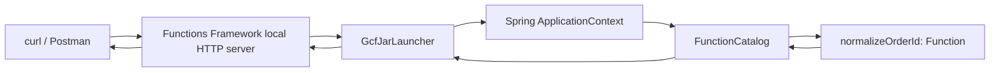

# Running Locally with the Google Functions Framework

## Learning Objectives

**Spring Cloud Function** lets you write business logic as a `Supplier`, `Function`, and `Consumer`, and reuse it through `FunctionCatalog`, composition, and message conversion—regardless of whether the invocation source is HTTP, events, or a serverless environment. When deploying to **Google Cloud**, `spring-cloud-function-adapter-gcp` acts as the bridge between Spring and the **Google Functions Framework for Java**.

Before pushing a function to Google Cloud, you should **run and test the exact GCP adapter Java handler right on your development machine**. This catches errors that calling `Function.apply(...)` directly or running plain Spring Boot cannot detect: wrong entry point, Spring application not found, wrong `FunctionCatalog` name, incorrect payload conversion, and runtime dependency errors.

After this lesson, you will be able to:

- Configure `com.google.cloud.functions:function-maven-plugin` to run `GcfJarLauncher` via `mvn function:run`.
- Distinguish between `functionTarget` (Java handler), `Main-Class` (main Spring class per the adapter pattern), `spring.cloud.function.definition` (selected function), and the bean name in `FunctionCatalog`.
- Build a `Function<String, String>`, start the Functions Framework on port `8080`, test it via HTTP using `curl`, and verify the result.
- Run a `Consumer<PubSubMessage>` locally following the historical **background function pattern**, while understanding the limitations when moving to CloudEvents/Eventarc.
- Layer your tests: Java unit tests, Spring context/catalog tests, local Functions Framework tests, and cloud smoke tests.
- Troubleshoot missing `function:run`, `ClassNotFoundException`, port conflicts, `404` responses, `FunctionCatalog.lookup(...)` misses, and JSON errors.

> **Version note:** these examples are based on the Spring Cloud Function GCP adapter guide featuring `org.springframework.cloud.function.adapter.gcp.GcfJarLauncher`. Packaging, APIs, and trigger support can vary across versions of Spring Cloud Function, Spring Boot, the Google Functions Framework, and Cloud Functions/Cloud Run functions generations. Always confirm your project's compatible version set.

## 1. What Is the Google Functions Framework?

**Google Functions Framework for Java** is an open-source tool that implements the **Java function handler** invocation contract in a local environment. Instead of deploying a new build to Google Cloud for every change, you can run a local HTTP server and send requests that simulate platform invocations.

When using the Spring Cloud Function GCP adapter, the call path looks like:



Each component has a distinct responsibility:

| Component | Role |
| --- | --- |
| Google Functions Framework | Provides the local server and invokes the Java handler per the HTTP or event contract |
| `GcfJarLauncher` | Entry point of the Spring Cloud Function GCP adapter, connecting the handler to the Spring context/catalog |
| `@SpringBootApplication` class | Configures Spring and creates `Supplier`/`Function`/`Consumer` beans |
| `FunctionCatalog` | Looks up, composes, and invokes registered business functions |
| `spring.cloud.function.definition` | Selects the function name or function chain for the adapter |

**Running the Functions Framework locally does not mean you are running all of Google Cloud.** It tests the Java handler path and payload invocation on your development machine; it does not fully simulate IAM, Eventarc routing, Pub/Sub delivery/retries, service accounts, cold starts, or Google Cloud scaling.

## 2. What Do You Need Before Running?

For the examples here:

1. Java/JDK compatible with your chosen Spring Boot and Spring Cloud Function line; the examples use Java 17+ syntax.
2. Maven or Maven Wrapper (`mvnw`) able to resolve dependencies from the appropriate repositories.
3. A Spring Boot project with **`spring-cloud-function-adapter-gcp`** and the appropriate Spring Cloud Function infrastructure.
4. The Google Functions Framework Maven plugin in `pom.xml`.
5. A main Spring configuration class and a `Function` bean.
6. A source manifest with the right `Main-Class` per the GCP adapter guide; inspect the final artifact if plugins repackage it.
7. Port `8080` free from other processes, or knowledge of how to pick a different port.

You **do not need to deploy the function to Google Cloud or grant access to a cloud project** just to test the `String -> String` example on localhost. If your function actually calls Google APIs, permissions and credentials for those APIs are a separate concern.

### Review the Names Before Starting

| Parameter / Metadata | Example Value | Where Does It Go? |
| --- | --- | --- |
| Java handler target | `org.springframework.cloud.function.adapter.gcp.GcfJarLauncher` | `function-maven-plugin.functionTarget` |
| Spring application class | `example.gcp.LocalGcpApplication` | `Main-Class` in the pattern manifest |
| Business bean name | `normalizeOrderId` | `@Bean` method name |
| Function definition | `normalizeOrderId` | `spring.cloud.function.definition` |
| Local port | `8080` | `function-maven-plugin.port` or runtime override |
| HTTP test URL | `http://localhost:8080/` | `curl`/Postman |

`GcfJarLauncher` is **not** the `normalizeOrderId` function and **not** the main Spring class `LocalGcpApplication`. These are three distinct names that are frequently confused.

## 3. A Small, Protocol-Independent Spring Cloud Function HTTP Example

Create the structure:

```text
local-gcp-demo/
├── pom.xml
└── src/
    ├── main/
    │   ├── java/example/gcp/
    │   │   └── LocalGcpApplication.java
    │   └── resources/
    │       ├── application.properties
    │       └── META-INF/MANIFEST.MF
    └── test/java/example/gcp/
        └── NormalizeCatalogTest.java
```

### 3.1. Main Spring Class and `Function` Bean

File `src/main/java/example/gcp/LocalGcpApplication.java`:

```java
package example.gcp;

import java.util.Locale;
import java.util.function.Function;

import org.springframework.boot.SpringApplication;
import org.springframework.boot.autoconfigure.SpringBootApplication;
import org.springframework.context.annotation.Bean;

@SpringBootApplication(proxyBeanMethods = false)
public class LocalGcpApplication {

    public static void main(String[] args) {
        SpringApplication.run(LocalGcpApplication.class, args);
    }

    @Bean
    public Function<String, String> normalizeOrderId() {
        return input -> {
            if (input == null || input.isBlank()) {
                throw new IllegalArgumentException(
                        "Order ID must not be blank");
            }
            return input.trim().toUpperCase(Locale.ROOT);
        };
    }
}
```

If the input is `"  ord-204  "`, the expected business result is `"ORD-204"`. This function does not use `HttpRequest`, `HttpResponse`, or the Google Cloud SDK; it can be invoked from unit tests, `FunctionCatalog`, an HTTP adapter, or a serverless environment.

`LocalGcpApplication.main(...)` is used to run Spring Boot via the standard JVM path. **When running the Functions Framework, the invoked entry point is `GcfJarLauncher`, not the `main` method on every request.**

### 3.2. Selecting the Function Name in `application.properties`

File `src/main/resources/application.properties`:

```properties
spring.cloud.function.definition=normalizeOrderId
```

The `definition` property tells the adapter to pick the **existing `normalizeOrderId` bean**; it does not create a new bean. It becomes even more important when the application has multiple `Function`, `Consumer`, or `Supplier` beans.

### 3.3. Declaring the Source Manifest

File `src/main/resources/META-INF/MANIFEST.MF`:

```text
Manifest-Version: 1.0
Main-Class: example.gcp.LocalGcpApplication

```

According to the Spring Cloud Function GCP adapter guide, `Main-Class` in **this source manifest points to the main Spring application class**, not the Google handler `GcfJarLauncher`. The trailing blank line properly terminates the manifest section.

**Distinguishing from a Spring Boot executable fat JAR:** a standard `java -jar` JAR may use Spring Boot's `JarLauncher` as `Main-Class` and the application as `Start-Class`. Plugins can modify the manifest during packaging; therefore you should inspect **the post-build artifact** rather than inferring from the source file alone.

## 4. Configuring Maven Plugins to Run the Functions Framework

### 4.1. Application Dependencies

In a `pom.xml` that already has a Spring Boot parent and a **compatible** Spring Cloud BOM managing versions, declare:

```xml
<dependencies>
    <dependency>
        <groupId>org.springframework.cloud</groupId>
        <artifactId>spring-cloud-function-adapter-gcp</artifactId>
    </dependency>
    <dependency>
        <groupId>org.springframework.cloud</groupId>
        <artifactId>spring-cloud-function-context</artifactId>
    </dependency>
    <dependency>
        <groupId>org.springframework.boot</groupId>
        <artifactId>spring-boot-starter-test</artifactId>
        <scope>test</scope>
    </dependency>
</dependencies>
```

`spring-cloud-function-context` provides the infrastructure containing `FunctionCatalog`. The adapter may pull in certain dependencies transitively depending on the version, but explicit declaration helps when application source or tests directly reference those APIs.

Example BOM import (when the project does not already manage versions equivalently):

```xml
<dependencyManagement>
    <dependencies>
        <dependency>
            <groupId>org.springframework.cloud</groupId>
            <artifactId>spring-cloud-dependencies</artifactId>
            <version>COMPATIBLE_SPRING_CLOUD_VERSION</version>
            <type>pom</type>
            <scope>import</scope>
        </dependency>
    </dependencies>
</dependencyManagement>
```

`COMPATIBLE_SPRING_CLOUD_VERSION` is a **placeholder** and must not be used as-is. You must select a Spring Cloud release train matching your project's Spring Boot and Spring Cloud Function modules. These XML fragments **are not a complete POM**; you still need a parent, project coordinates, build plugins, and an appropriate Java toolchain.

### 4.2. `function-maven-plugin`: The Core of Local Execution

Under `<build><plugins>`:

```xml
<plugin>
    <groupId>com.google.cloud.functions</groupId>
    <artifactId>function-maven-plugin</artifactId>
    <version>FUNCTIONS_FRAMEWORK_PLUGIN_VERSION</version>
    <configuration>
        <functionTarget>org.springframework.cloud.function.adapter.gcp.GcfJarLauncher</functionTarget>
        <port>8080</port>
    </configuration>
</plugin>
```

`FUNCTIONS_FRAMEWORK_PLUGIN_VERSION` must be replaced with a compatible plugin version. The Spring Cloud Function 5.0 documentation illustrates **`0.9.1`**, but that is simply the version in the doc example, **not a guarantee that it is the latest or best version for every JDK**.

`functionTarget` is the **fully qualified Java class name** of the GCP adapter, not the `normalizeOrderId` bean name. In your actual XML, keep the FQCN on a single line for easy inspection:

```xml
<functionTarget>org.springframework.cloud.function.adapter.gcp.GcfJarLauncher</functionTarget>
```

If the plugin is not declared, `mvn function:run` may report that the `function` plugin prefix or goal was not found. Adding `spring-cloud-function-adapter-gcp` to `dependencies` alone **does not automatically add** any Maven goal.

### 4.3. Spring Boot Maven Plugin for GCP Packaging

To produce a deployable artifact following the Spring Cloud Function pattern, the GCP guide also configures:

```xml
<plugin>
    <groupId>org.springframework.boot</groupId>
    <artifactId>spring-boot-maven-plugin</artifactId>
    <configuration>
        <outputDirectory>target/deploy</outputDirectory>
    </configuration>
    <dependencies>
        <dependency>
            <groupId>org.springframework.cloud</groupId>
            <artifactId>spring-cloud-function-adapter-gcp</artifactId>
            <version>COMPATIBLE_SCF_VERSION</version>
        </dependency>
    </dependencies>
</plugin>
```

`COMPATIBLE_SCF_VERSION` is also a placeholder; choose the exact adapter version present in your application's dependency tree. Maven **plugin dependencies** have their own version management rules, so do not assume the project's `dependencyManagement` BOM automatically resolves them. If documentation for your specific version uses a different configuration, follow that version's guidance.

Keep the distinction clear: `function-maven-plugin` is for **running the handler locally**; `spring-boot-maven-plugin` with the GCP adapter extension is for **packaging in the layout supported by the adapter**. A thorough local verification should exercise both and inspect the actual build output before concluding it is ready to deploy.

## 5. Running Your First HTTP Test in the Right Sequence

### Step 1 — Test Logic and Build

In the project root directory:

```bash
./mvnw clean test
./mvnw package
```

If the project does not include Maven Wrapper, replace `./mvnw` with `mvn`. With the packaging configuration above, verify that `target/deploy` contains the expected artifact; note, however, that the local plugin may run from the Maven-resolved source/dependency classpath rather than loading the deployable JAR in the exact same way.

### Step 2 — Start the Local Server with the Functions Framework

In the first terminal:

```bash
./mvnw function:run
```

Per the configuration, the Maven plugin runs the **Java handler `GcfJarLauncher`** on port `8080` and waits for requests. This process **keeps running**; do not close the terminal while sending requests from another terminal.

When you want to stop it, press **Ctrl+C** in that terminal. If the server fails to bind the port, see the port-override section below.

### Step 3 — Send an HTTP Request to the Root Path `/`

In a second terminal:

```bash
curl -i -X POST http://localhost:8080/ \
  -H "Content-Type: text/plain" \
  --data-binary "  ord-204  "
```

Expected business output: a body equivalent to

```text
ORD-204
```

`-i` prints the status line and response headers for inspection. Do not assume every adapter version always returns the exact same charset, content type, or status code in all scenarios; inspect **both the status code and the actual body**.

**Why call `/` instead of `/normalizeOrderId`?** This is the local **Google Functions Framework** server running a configured Java handler. The `/normalizeOrderId` path comes from `spring-cloud-function-web`, which is a different adapter; do not apply Spring MVC routing rules to the GCP handler.

### Step 4 — Inspect Logs in the Server Terminal

After sending the request:

- Verify the handler was loaded by the Functions Framework with no `ClassNotFoundException`.
- Verify the Spring context started without bean or auto-configuration errors.
- Confirm `FunctionCatalog` selected `normalizeOrderId`.
- When an error occurs, look for the first stack trace related to bootstrap or conversion instead of looking only at the HTTP status.

Never log tokens, personal data, or full sensitive payloads in real applications.

## 6. Changing the Port and Overriding the Function Target During Testing

The Google Functions Framework for Java supports runtime configuration via `pom.xml` plugin config, command-line properties, and environment variables. With Maven, you can override the port:

```bash
./mvnw function:run -Drun.port=9090
```

Then invoke:

```bash
curl -i -X POST http://localhost:9090/ \
  -H "Content-Type: text/plain" \
  --data-binary "  ord-204  "
```

To explicitly specify the Java handler target used by the plugin:

```bash
./mvnw function:run \
  -Drun.functionTarget=org.springframework.cloud.function.adapter.gcp.GcfJarLauncher \
  -Drun.port=9090
```

**Do not set `run.functionTarget` to `normalizeOrderId`.** The Maven plugin expects the name of the Java class implementing the Functions Framework contract, not a Spring bean name.

In Google Cloud documentation, the Java Functions Framework prioritizes **command-line flags/properties** over **build-file configuration**, followed by **environment variables**. You can also set `FUNCTION_TARGET` or `PORT` in the environment when the plugin/runtime supports it. Distinguish these variables from `SPRING_CLOUD_FUNCTION_DEFINITION`, which selects an internal Spring bean.

On Windows PowerShell, `curl` can be an alias in older Windows PowerShell; use **`curl.exe`** so flags like `-i`, `-H`, and `--data-binary` work properly. Backslash line continuations shown in Bash examples **do not work in PowerShell**; either put the command on one line or use PowerShell's line-continuation syntax.

## 7. Validating the Function Bean Independently from the Handler

If a request to the local Functions Framework fails, separate the **Java/Spring function** from the **launcher and HTTP layer**.

### 7.1. Unit Test Without Starting Spring

```java
package example.gcp;

import static org.junit.jupiter.api.Assertions.assertEquals;
import org.junit.jupiter.api.Test;

class NormalizeLogicTest {

    @Test
    void normalizesOrderId() {
        LocalGcpApplication configuration =
                new LocalGcpApplication();

        assertEquals(
                "ORD-204",
                configuration.normalizeOrderId().apply("  ord-204  "));
    }
}
```

This test checks the `String -> String` logic; it **does not prove** that the Maven plugin, manifest, or GCP handler works.

### 7.2. Testing `FunctionCatalog` in a Spring Context

```java
package example.gcp;

import static org.junit.jupiter.api.Assertions.assertEquals;
import static org.junit.jupiter.api.Assertions.assertNotNull;

import java.util.function.Function;
import org.junit.jupiter.api.Test;
import org.springframework.beans.factory.annotation.Autowired;
import org.springframework.boot.test.context.SpringBootTest;
import org.springframework.cloud.function.context.FunctionCatalog;

@SpringBootTest(
        classes = LocalGcpApplication.class,
        webEnvironment = SpringBootTest.WebEnvironment.NONE)
class NormalizeCatalogTest {

    @Autowired
    FunctionCatalog catalog;

    @Test
    void findsNamedFunction() {
        Function<String, String> normalize =
                catalog.lookup("normalizeOrderId");

        assertNotNull(normalize);
        assertEquals("ORD-204",
                normalize.apply("  ord-204  "));
    }
}
```

This test verifies **Spring Boot + FunctionCatalog + bean name + logic**, but does not test **Google Functions Framework → GcfJarLauncher → HTTP conversion**.

| Test Type | What It Verifies | What It Does Not Verify |
| --- | --- | --- |
| Direct unit test on `apply(...)` | Java algorithm | Spring, catalog, adapter, HTTP |
| `@SpringBootTest` + catalog lookup | Bean registration, Spring context, catalog | GCP Java handler/packaging |
| `mvn function:run` + `curl` | Functions Framework, handler, Spring, catalog, local payload/response | IAM, Eventarc, actual Google runtime |
| Cloud smoke test | Deployed package and entry point, HTTP/event trigger, IAM, and real runtime | Does not replace full load or long-running retry testing |

**Optimal workflow:** if the unit test fails, fix the logic; if the catalog test fails, fix the bean/definition/context; if only the local framework fails, check the handler/manifest/packaging/conversion; if only cloud fails, check runtime/trigger/IAM/configuration.

## 8. Testing JSON When the Function Uses DTO Types

The `String -> String` example avoids JSON complexities so you can focus on the launcher. When a function accepts a DTO, you must also test the adapter's actual deserialization behavior.

Example Java contract (each `public record` in its own file):

```java
package example.gcp;

public record PriceRequest(String orderId, int quantity) {
}
```

```java
package example.gcp;

public record PriceResponse(String orderId, long totalCents) {
}
```

Sample bean:

```java
@Bean
public Function<PriceRequest, PriceResponse> priceOrder() {
    return request -> {
        if (request.quantity() <= 0) {
            throw new IllegalArgumentException(
                    "Quantity must be greater than 0");
        }
        return new PriceResponse(
                request.orderId(),
                Math.multiplyExact(
                        (long) request.quantity(), 15_000L));
    };
}
```

If you use this bean **instead of** `normalizeOrderId` in the lab, change `spring.cloud.function.definition=priceOrder` and test:

```bash
curl -i -X POST http://localhost:8080/ \
  -H "Content-Type: application/json" \
  --data-binary '{"orderId":"ORD-204","quantity":2}'
```

**Expected business result**: `PriceResponse("ORD-204", 30000)`. The exact JSON/HTTP response shape also depends on the GCP adapter version, codec, generic metadata, and content type. Use the actual response to verify; **do not treat this curl snippet as a guarantee that every adapter version maps Java records automatically**.

Things to check: is `Function<PriceRequest,PriceResponse>` exposed with explicit generics, does the adapter have a JSON conversion mechanism, can `PriceRequest` be deserialized, and does the request carry valid JSON and content type? A raw `Function` often makes generic types harder to infer.

## 9. Testing Background Events Following the Historical GCP Pattern

The Spring Cloud Function GCP adapter docs also describe **background functions** triggered by events such as Pub/Sub. When testing locally via the Functions Framework, you still send an HTTP request to the local invoker, but **the payload represents event data**, and a `Consumer`'s outcome is typically observed in the logs rather than a business response body.

**Do not swap out the HTTP example in place while keeping the same bean name.** Create a separate sample project/entry point or switch the full configuration cleanly between the two modes so multiple functions do not coexist and cause the adapter to pick the wrong one.

### 9.1. Simple Event DTO

File `src/main/java/example/gcp/PubSubMessage.java`:

```java
package example.gcp;

public class PubSubMessage {
    private String data;
    private String messageId;

    public String getData() {
        return data;
    }

    public void setData(String data) {
        this.data = data;
    }

    public String getMessageId() {
        return messageId;
    }

    public void setMessageId(String messageId) {
        this.messageId = messageId;
    }
}
```

This DTO intentionally includes only two fields for illustration. Additional fields like `attributes`, `publishTime`, and the actual envelope may be required depending on your trigger contract.

### 9.2. Event-Handling `Consumer`

In the Spring configuration of your **dedicated background project**:

```java
@Bean
public Consumer<PubSubMessage> auditPubSub() {
    return message -> {
        String encoded = message.getData();
        String decoded = encoded == null
                ? ""
                : new String(
                        Base64.getDecoder().decode(encoded),
                        StandardCharsets.UTF_8);
        System.out.println(
                "Message ID = " + message.getMessageId()
                        + ", data = " + decoded);
    };
}
```

The snippet above requires importing `java.util.function.Consumer`, `java.util.Base64`, and `java.nio.charset.StandardCharsets`. It prints demo output only; in real systems do not log sensitive messages, and account for idempotency on retries/redeliveries.

In that project's `application.properties`:

```properties
spring.cloud.function.definition=auditPubSub
```

Manifest `Main-Class` must point to **the Spring application class of the background project**, and `functionTarget` remains the GCP adapter handler compatible with the background function contract.

### 9.3. Sending a Sample Event via the Local Invoker

After starting `./mvnw function:run` for the background project:

```bash
curl -i -X POST http://localhost:8080/ \
  -H "Content-Type: application/json" \
  --data-binary '{"data":"aGVsbG8=","messageId":"msg-demo-01"}'
```

`aGVsbG8=` is the Base64 encoding of `hello`. Under Spring Cloud Function's background function sample, this request simulates the event DTO passed by the adapter to the consumer; check **the Java process logs** to confirm the data was processed.

**Important limitation:** legacy-generation Google Cloud Functions background events and **CloudEvents/Eventarc** on newer generations have **different signatures and envelopes**. The JSON here is a *local adapter sample*, **not** a structure valid for every Pub/Sub push subscription, Eventarc trigger, or Cloud Run function. For CloudEvents, pick a handler supporting `CloudEventsFunction` for your version and send the matching CloudEvent headers/envelope. Changing `Content-Type` alone will not make a legacy background handler understand a newer CloudEvent.

In addition, sending a local request **does not create a Pub/Sub topic, subscription, or IAM binding**. To test real event delivery and retries, additional testing in the cloud or an appropriate integration environment is required.

## 10. Intentional Error Tests Worth Running

A solid lab session tests more than the happy path. Try the following cases, strictly inside a sandbox project:

| Test | What to Check | What Not to Assume Ahead of Time |
| --- | --- | --- |
| Send `"  ord-204  "` to HTTP `normalizeOrderId` | Normalized output | Identical headers/charset across all adapters |
| Send an empty string | Logic throws `IllegalArgumentException`; observe HTTP response/logs | Always mapped to exactly `400` rather than another status |
| Send invalid JSON to a DTO-based function | Observe parse/conversion error | Identical status code and body across all adapter versions |
| Set `definition` to a nonexistent name | Catch function-selection error | Handler still starts normally |
| Set `functionTarget` to a bean name | Functions Framework fails to find a valid Java handler | Spring `@Bean` automatically becomes a handler |
| Occupy port `8080` beforehand | Observe bind / port-in-use error | Maven automatically picks another port |
| Send a background payload to an HTTP function | Receive unexpected output or error | Automatically triggers the right `Consumer` |

Intentional failure tests help you distinguish **logic error responses**, **adapter errors**, and **server startup errors**. When testing failures, record the request, status, logs, and root cause—never just write "curl failed".

## 11. Troubleshooting Common Errors

| Symptom | Possible Cause | How to Fix |
| --- | --- | --- |
| `No plugin found for prefix 'function'` | `function-maven-plugin` not declared or plugin not resolved | Add the Google Functions Framework plugin with a valid version and check repositories |
| `ClassNotFoundException: GcfJarLauncher` | Adapter class not on invoker classpath or dependency/plugin version mismatch | Check `spring-cloud-function-adapter-gcp`, classpath, packaging, and plugin |
| Maven reports missing version for plugin dependency | Project BOM does not manage plugin dependencies as expected | Set the compatible adapter version explicitly on the plugin dependency |
| `LocalGcpApplication` not found | Wrong FQCN in `Main-Class` or artifact lacks the class | Check Java package, source manifest, **and final artifact** |
| `Main-Class` becomes `JarLauncher` | Using a standard Spring Boot fat JAR instead of a GCP adapter package | Check artifact type, `target/deploy`, and packaging setup |
| `NoSuchBeanDefinitionException: FunctionCatalog` | Spring Cloud Function Context/auto-configuration not loaded | Check versions, dependencies, and bootstrap |
| `catalog.lookup("normalizeOrderId")` returns `null` | Bean does not exist, wrong name, or `definition` mismatch | Check `@Bean` name, context test, and selection config |
| `Address already in use` | Another process is already using port `8080` | Stop that process or run with `-Drun.port=9090` |
| HTTP `404` when posting to `/normalizeOrderId` | Confused the Web adapter route with the Functions Framework root path | Try `POST /` on the configured local invoker |
| HTTP `404` even at `/` | Another server is running on that port, or function target/route mismatch | Verify process, port, logs, and handler |
| HTTP `500` or adapter error on empty input | Logic throws an exception or data conversion fails | Inspect the stack trace and check each layer |
| DTO fails to deserialize | Missing `Function<I,O>` generics, invalid JSON, or incompatible codec | Keep explicit generics; check `Content-Type`, request, and adapter |
| Background `Consumer` produces no logs | Wrong bean definition, wrong event DTO, or wrong handler/event signature | Check `definition`, manifest, and the envelope expected by the adapter |
| Base64 decode failure | `data` is not valid Base64 | Send properly formatted payloads and handle invalid data per business rules |
| `NoSuchMethodError` at startup | Incompatible Spring Boot/Cloud Function/Google Functions Framework versions | Inspect dependency tree and BOM; align versions |
| Works locally, fails on cloud deploy | Different Java runtime, packaging, trigger, IAM, network, or startup limits | Test the artifact and runtime/trigger/IAM separately on Google Cloud |

### Ordered Diagnostic Workflow

1. **Plugin:** can Maven execute the `function:run` goal?
2. **Handler:** did the Functions Framework load `GcfJarLauncher`?
3. **Bootstrap:** was the Spring application class from the manifest located?
4. **Bean:** does the Spring context have `FunctionCatalog` and `normalizeOrderId`?
5. **Invocation:** did the adapter select the right function, route, and content type?
6. **Logic:** did `apply(...)` process the payload per the contract?
7. **Cloud:** if it fails only on deploy, check trigger, IAM, generation, Java runtime, timeout, and ingress.

This isolates issues far faster than changing `functionTarget`, `Main-Class`, `definition`, and `pom.xml` all at once and not knowing which change worked.

## 12. Limitations of the Local Functions Framework

The local invoker is **very useful**, but it cannot replace every production test:

| Aspect | Local Functions Framework | Still Needs Verification on Google Cloud |
| --- | --- | --- |
| Java handler invocation | Yes, when target is configured properly | Whether the real runtime finds the right entry point |
| Spring context + `FunctionCatalog` | Testable through the adapter | Deployed version, profiles, and environment variables |
| HTTP request/response | Can send `curl` and check body/status | IAM, domain, ingress, network, proxy, and timeout |
| Pub/Sub/CloudEvent | Can send sample events per supported contract | Delivery, Eventarc envelope, retries, and permissions |
| Cloud service account | Cannot be fully simulated automatically | Runtime identity and resource access permissions |
| Cold start, concurrency | Can run rough measurements or multi-threaded tests locally | Actual platform startup, scaling, and concurrency |
| Deployment packaging | Local classpath may work | Whether source/JAR artifact layout fits cloud buildpacks |
| Secrets/config | Can simulate via environment/profiles | Secret Manager, secure injection, and access policies |

In particular, **the local Functions Framework may use the Maven classpath computed from source**, whereas real deployment uses the built package. Thus, `mvn function:run` succeeding **does not prove** that `target/deploy` contains every required class/resource or that `gcloud functions deploy` will succeed.

Furthermore, the local invoker serves HTTP on `localhost` or a configured port by default. Do not expose it publicly on an untrusted network while testing with requests containing real data.

## 13. Checklist for a Repeatable Local Test Run

Before marking testing as passed, gather evidence for each step:

| Step | PASS Criteria |
| --- | --- |
| Dependencies | Spring Boot, Spring Cloud Function Context, GCP adapter, and Google Functions Framework plugin resolve consistently |
| Source | Main Spring class has the `normalizeOrderId` bean |
| Manifest | `Main-Class` uses the right Spring class FQCN per the GCP adapter pattern |
| Function selection | `spring.cloud.function.definition=normalizeOrderId` |
| Maven tests | Both unit tests and catalog tests PASS |
| Maven build | Packaging finishes and artifact at the expected path is inspected |
| Local server | `mvn function:run` loads `GcfJarLauncher` without errors |
| Happy path | `POST /` with `"  ord-204  "` returns body `ORD-204` |
| Error path | Empty input / malformed JSON produces explainable results in logs |
| Port override | Can switch from `8080` to `9090` when needed |
| Background (if used) | Sample event matching the contract reaches `Consumer`; logs and Base64 verified |
| Ready to deploy | Versions, Java runtime, trigger, IAM, and local test limitations documented |

A brief test record can include: commit/build identifier, JDK version, Maven plugin version, function target, function definition, port used, sample request, HTTP status, expected/actual body, and error logs on failure. Never record real credentials or tokens.

## 14. Practice Exercises and Self-Check Questions

### Exercise 1 — Run `Function<String,String>` over HTTP

Use `LocalGcpApplication` from this lesson; set `functionTarget` to `GcfJarLauncher`, run `mvn function:run`, and send `"  ord-204  "` to `POST /`. Verify the `ORD-204` body and record the port, status, and content type.

### Exercise 2 — Distinguish Three Kinds of Names

Intentionally set `functionTarget=normalizeOrderId` and observe the error. Restore `functionTarget=org.springframework.cloud.function.adapter.gcp.GcfJarLauncher`, then misconfigure `spring.cloud.function.definition=unknownFunction`. Compare the **handler cannot be loaded** error against the **catalog selected wrong function** error.

### Exercise 3 — Run on a Different Port

Run locally with `-Drun.port=9090`, send a request to port `9090`, and confirm port `8080` is no longer served by that process. Explain why changing `spring.cloud.function.definition` does not change the port.

### Exercise 4 — Pass a JSON DTO

Switch to `Function<PriceRequest, PriceResponse>` and send a JSON request. Record the serialization result. Distinguish a generic/codec issue from a failure to load `GcfJarLauncher`.

### Exercise 5 — Simulate Pub/Sub Background

Create a `Consumer<PubSubMessage>` project as in section 9. Send JSON with Base64 `data` and `messageId`; confirm `Consumer` is called via the logs. Name at least three things **not yet proven**: Eventarc envelope, Pub/Sub IAM permissions, and retries/redeliveries.

### Self-Check

1. **Which plugin provides the `mvn function:run` goal?** `com.google.cloud.functions:function-maven-plugin`.
2. **What does `functionTarget` accept?** The FQCN of the Java handler, which in the Spring Cloud Function sample is `org.springframework.cloud.function.adapter.gcp.GcfJarLauncher`.
3. **Where does the `normalizeOrderId` bean name belong?** In the Spring context/catalog and `spring.cloud.function.definition`, not as the Java handler target.
4. **Which path does local HTTP typically call?** `POST /` on the Functions Framework port, per the adapter example.
5. **Do you need a Google Cloud project to test on localhost?** No, if the function is pure Java with no cloud service dependencies.
6. **Why is a PASS on the catalog test not enough?** It does not go through the GCP launcher/Functions Framework.
7. **Why is a PASS on the local handler not enough to deploy?** IAM, generation, trigger, packaging, and runtime may differ.
8. **Does sending a Pub/Sub test JSON locally create a real subscription?** No.
9. **How do `-Drun.port=9090` and `spring.cloud.function.definition` differ?** One sets the local HTTP port; the other selects the Spring function bean.

## 15. Summary and Reference Documentation

**Running locally with the Google Functions Framework** bridges unit/catalog tests and Google Cloud deployment. With Spring Cloud Function, the Maven plugin runs **`GcfJarLauncher`**, the launcher creates or reuses the Spring context, and the adapter invokes the selected function through **`FunctionCatalog`**. To avoid confusion, verify separately the **Java handler target**, **main application class manifest**, **bean/definition name**, **HTTP root path**, and **payload type**.

The core workflow: **write a `Function` bean → declare the manifest → configure dependencies/plugins → unit & catalog tests → `mvn function:run` → `curl POST /` → test errors/JSON/events → verify artifact and cloud environment**. Business code remains independent of HTTP, events, and serverless; only the adapter layer changes with the invocation style.

Official reference documentation:

- [Spring Cloud Function — Google Cloud Functions adapter](https://docs.spring.io/spring-cloud-function/reference/5.0/adapters/gcp-intro.html): `GcfJarLauncher`, `function-maven-plugin`, running HTTP/background locally, and packaging.
- [Google Cloud — Local functions development](https://docs.cloud.google.com/run/docs/local-dev-functions): how to run the Java Functions Framework, `run.functionTarget`, `run.port`, and sending local requests.
- [Google Functions Framework for Java](https://github.com/GoogleCloudPlatform/functions-framework-java): Java handler contracts, Maven/Gradle invoker, and runtime options.
- [Spring Cloud Function Reference](https://docs.spring.io/spring-cloud-function/reference/): `FunctionCatalog`, composition, function definitions, and message conversion.
- [Google Cloud — Cloud Run functions](https://cloud.google.com/run/docs/functions): runtimes, triggers, security, and deployment environment differences.

**Version note:** plugin goal names, background event formats, manifest packaging, Java/runtime support, and CloudEvent handling may change. Treat examples as verified only after testing on your actual version set; STEP 4 focuses on completing the knowledge content, while the next expert QA pass will inspect the suitability of the entire module in depth.
