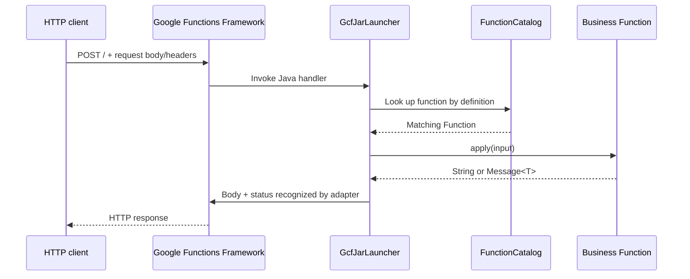
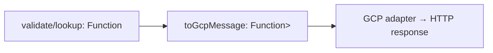
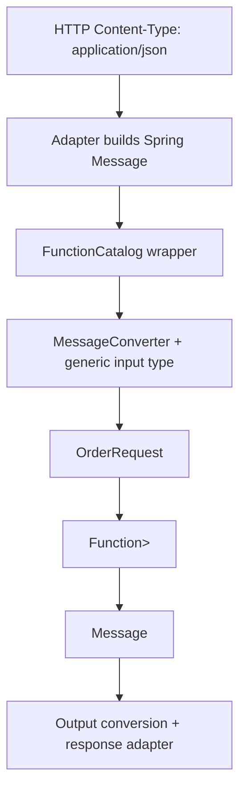

# Handling HTTP and Customizing Responses via `Message` on Google Cloud

## Lesson Objectives

In **Spring Cloud Function**, a business function can be written using `Supplier<O>`, `Function<I, O>`, or `Consumer<I>`, and then exposed by `FunctionCatalog` to an HTTP adapter, message/event adapter, or serverless environment. On **Google Cloud Functions / Cloud Run functions**, `spring-cloud-function-adapter-gcp` together with the Java Functions Framework connects incoming HTTP requests to a Spring function bean without forcing the business logic to know about servlets or the Google Cloud SDK.

By default, a `Function<String, String>` only represents the **business body**. When you want to return an intentional HTTP status code, the Spring Cloud Function GCP documentation introduces returning an **`org.springframework.messaging.Message<T>`** containing the payload and a dedicated header: **`FunctionInvoker.HTTP_STATUS_CODE`**.

After this lesson, you will be able to:

- Explain the flow **HTTP request → `GcfJarLauncher` → `FunctionCatalog` → function → HTTP response**.
- Distinguish between `Function<I,O>`, `Function<I, Message<O>>`, and `Function<Message<I>, Message<O>>`.
- Use `MessageBuilder` to produce a body and **HTTP status** such as 200, 400, or 404; understand that this is an adapter-specific contract, not a generic HTTP header.
- Select the function with `spring.cloud.function.definition`, configure the GCP local invoker, and inspect responses with `curl -i`.
- Understand the role of `contentType`, generic types, `MessageConverter`, request headers, and the limits of forwarding output message headers to HTTP.
- Test both the logic/catalog and **actual HTTP responses** via the Google Functions Framework, while diagnosing differences between the GCP adapter and Spring Cloud Function Web.

**Version note:** the material on `FunctionInvoker.HTTP_STATUS_CODE` is based on the *Setting custom HTTP statusCode* section of the Spring Cloud Function GCP adapter documentation. APIs, class locations, trigger types, and response mapping can vary across Spring Cloud Function, Spring Boot, and Google Cloud versions. Always verify against the exact artifact and Java runtime you are using.

## 1. Which Layers Process HTTP?

When an HTTP function is configured to use the Spring Cloud Function GCP adapter, the Google Functions Framework calls the Java handler provided by the adapter, typically **`org.springframework.cloud.function.adapter.gcp.GcfJarLauncher`**. The handler prepares or reuses the Spring context, retrieves the registered function from the catalog, and converts inputs and outputs.



The diagram illustrates responsibilities and does not claim that the Spring context is recreated on every request. A serverless instance can handle multiple invocations, and its lifecycle is managed by the runtime.

| Layer | Example | What It Does |
| --- | --- | --- |
| HTTP runtime | Google Functions Framework | Receives the request method, URL, headers, and body |
| Java entry point | `GcfJarLauncher` | Bridges to the Spring Cloud Function GCP adapter |
| Spring application | `OrderHttpApplication` | Configures the context and registers `@Bean`s |
| Function selection | `spring.cloud.function.definition=orderLookup` | Selects the registered function |
| `FunctionCatalog` | `lookup("orderLookup")` | Applies appropriate wrapping, conversion, and composition |
| Business function | `Function<String, Message<String>>` | Computes the result body and metadata |

Important: **The Google Java entry point is different from the Spring function name.** Do not set `--entry-point=orderLookup` when the runtime requires the handler class name. Conversely, `spring.cloud.function.definition=GcfJarLauncher` makes no sense because that is not a business bean.

## 2. What Is `Message<T>` and How Does It Differ from `HttpResponse`?

In Spring Messaging, `Message<T>` has two parts:

- **`getPayload()`**: the business data, for example `"FOUND:ORD-42"`.
- **`getHeaders()`**: key/value metadata created or forwarded by functions and adapters.

Java example:

```java
import org.springframework.messaging.Message;
import org.springframework.messaging.support.MessageBuilder;

Message<String> result = MessageBuilder
        .withPayload("FOUND:ORD-42")
        .setHeader("traceId", "demo-001")
        .build();

String body = result.getPayload();
Object traceId = result.getHeaders().get("traceId");
```

`Message<String>` here is **not** `com.google.cloud.functions.HttpResponse`, and **not** `org.springframework.http.ResponseEntity<String>`. It is Spring Messaging's **protocol-independent** structure, usable even when a function is triggered by a message broker or composed with another function.

If an HTTP adapter recognizes certain message headers as HTTP directives, the adapter **may** translate them into an HTTP status code or HTTP headers. However, **do not assume all message headers are mapped to HTTP**: that depends on the specific adapter and version.

### Three Ways to Declare the Signature

| Signature | When to Use? | Meaning |
| --- | --- | --- |
| `Function<String, String>` | Only body transformation is needed | Input and output do not directly carry metadata |
| `Function<String, Message<String>>` | Need to **customize the output message/status** | Receives Java data, returns payload with headers |
| `Function<Message<String>, Message<String>>` | Need to read **input message headers** and build an output message | Function uses Spring Messaging without depending on HTTP servlets |

You do not need to change `GcfJarLauncher` just because the return type changes from `String` to `Message<String>`. What you must verify is that the catalog recognizes the types properly and that the GCP adapter supports mapping the header you use.

## 3. Controlling HTTP Status with `FunctionInvoker.HTTP_STATUS_CODE`

The **Spring Cloud Function GCP** documentation explicitly notes that a function can request a custom HTTP status code by setting **`FunctionInvoker.HTTP_STATUS_CODE`** in the returned `Message` headers. Basic example:

```java
@Bean
public Function<String, Message<String>> notFoundExample() {
    return input -> MessageBuilder
            .withPayload("Not found: " + input)
            .setHeader(FunctionInvoker.HTTP_STATUS_CODE, 404)
            .build();
}
```

The required imports are `java.util.function.Function`, `org.springframework.messaging.Message`, and `org.springframework.messaging.support.MessageBuilder`. **`FunctionInvoker` here must be the API from the matching version of the GCP adapter**, not a similarly named class from the AWS adapter. Verify the class and the `HTTP_STATUS_CODE` constant in your `spring-cloud-function-adapter-gcp` dependency before compiling.

Key points:

1. `MessageBuilder.withPayload(...)` sets the **body**.
2. `.setHeader(FunctionInvoker.HTTP_STATUS_CODE, 404)` adds **HTTP status directive metadata** without turning the body into an `HttpResponse` object.
3. `.build()` constructs the `Message<String>`.
4. The GCP adapter reads that dedicated header and can set the HTTP status code on the response; this pattern is demonstrated in the **GCP adapter documentation**.

**Do not use** `.setHeader("status", 404)`, `.setHeader("httpStatus", 404)`, or `.setHeader("HTTP_STATUS_CODE", 404)` assuming they match the API constant. The **actual header key** is the value of `FunctionInvoker.HTTP_STATUS_CODE`, not the Java constant name as a string literal.

### Which Status Codes Should You Return?

| Scenario | Reference Status | Notes |
| --- | --- | --- |
| Data found and body returned | `200 OK` | Can rely on default if the adapter returns 200 per its contract |
| Malformed request or missing order ID | `400 Bad Request` | Client-caused input data error |
| Valid order ID that does not exist | `404 Not Found` | Intentional business error, **distinct** from an HTTP route 404 |
| Resource created successfully | `201 Created` | Verify whether setting `Location` is supported if the client needs it |
| No payload | `204 No Content` | Do not attach a dummy payload assuming the adapter will strip the body |
| Unexpected system failure | `500 Internal Server Error` | Usually from a runtime/adapter exception; do not expose internal details |

Do not return `404` for every exception. Classify business outcomes cleanly and avoid mixing client errors with server errors.

## 4. Java Example: Returning 200, 400, and 404 Based on Input

Create a simple HTTP function that accepts an **order ID from a text body**. In our test dataset, only `ORD-42` is considered to exist. This example uses Java 17+ and a Spring Cloud Function version providing `FunctionInvoker.HTTP_STATUS_CODE` as documented for GCP.

To focus on behavior, we write **a single function bean** without needing a controller or repository:

```java
package example.gcp;

import java.util.Locale;
import java.util.function.Function;

import org.springframework.boot.SpringApplication;
import org.springframework.boot.autoconfigure.SpringBootApplication;
import org.springframework.context.annotation.Bean;
import org.springframework.messaging.Message;
import org.springframework.messaging.support.MessageBuilder;

// Import FunctionInvoker from the GCP adapter in use;
// verify the package/API in your project's version.

@SpringBootApplication(proxyBeanMethods = false)
public class OrderHttpApplication {

    public static void main(String[] args) {
        SpringApplication.run(OrderHttpApplication.class, args);
    }

    @Bean
    public Function<String, Message<String>> orderLookup() {
        return raw -> {
            if (raw == null || raw.isBlank()) {
                return response("INVALID_ORDER_ID", 400);
            }

            String id = raw.trim().toUpperCase(Locale.ROOT);
            if (!"ORD-42".equals(id)) {
                return response("NOT_FOUND:" + id, 404);
            }

            return response("FOUND:" + id, 200);
        };
    }

    private static Message<String> response(String body, int status) {
        return MessageBuilder.withPayload(body)
                .setHeader(FunctionInvoker.HTTP_STATUS_CODE, status)
                .build();
    }
}
```

**On compiling this example:** `FunctionInvoker` must be imported from the GCP adapter API for your version. The GCP documentation shows `FunctionInvoker.HTTP_STATUS_CODE` without listing its import in the snippet. Before using this in a real project, confirm the exact class/constant and import via your IDE or JAR dependency; do not import a `FunctionInvoker` from another adapter just because it shares the name. The rest of the Java code is standard application code and **does not require** an HTTP controller.

Expected inputs and outputs:

| Request Body (`text/plain`) | Returned Payload | Expected HTTP Status |
| --- | --- | --- |
| `ord-42` | `FOUND:ORD-42` | `200` |
| `  ORD-42  ` | `FOUND:ORD-42` | `200` |
| `ord-99` | `NOT_FOUND:ORD-99` | `404` |
| Empty string | `INVALID_ORDER_ID` | `400` |

These values reflect the business contract plus the header mapping **supported by the GCP adapter in compatible versions**. No real Google Cloud project or database is queried in this demo.

### Is the Function "Tightly Coupled" to Google Cloud?

The `orderLookup` logic never touches `com.google.cloud.functions.HttpRequest` or `HttpResponse`. However, **the `FunctionInvoker.HTTP_STATUS_CODE` constant belongs to the GCP adapter layer**, so if you move the function unchanged to a different environment, that header might not carry the same meaning.

When higher protocol independence is needed, split it:



`OrderOutcome` can be a Java record representing the business outcome with `status`, `description`, and `payload`. With this design, only the final function knows about the adapter header; the remaining business functions can be reused across HTTP, events, or other serverless platforms.

## 5. Configuring Function Selection and the Java Entry Point

In `src/main/resources/application.properties`:

```properties
spring.cloud.function.definition=orderLookup
```

Under the standard GCP adapter setup:

- **Java Functions Framework entry point:** `org.springframework.cloud.function.adapter.gcp.GcfJarLauncher`.
- **Spring configuration class:** `example.gcp.OrderHttpApplication`.
- **Function bean:** `orderLookup`.
- **Function definition:** `orderLookup`.

Source manifest following the adapter pattern:

```text
Manifest-Version: 1.0
Main-Class: example.gcp.OrderHttpApplication

```

Sample file: `src/main/resources/META-INF/MANIFEST.MF`. Remember to check the manifest **inside the post-build artifact**, because the Spring Boot Maven plugin can generate a different manifest when repackaging an executable JAR.

Do not set `Main-Class: orderLookup` or `--entry-point=orderLookup`. The business function name is for `FunctionCatalog`, not a replacement for the Java handler or Spring configuration class.

## 6. Maven Dependencies and Running Locally with the Functions Framework

For a project already configured with a compatible Spring Boot parent/BOM and Spring Cloud release train, an illustrative dependencies block is:

```xml
<dependencies>
    <dependency>
        <groupId>org.springframework.cloud</groupId>
        <artifactId>spring-cloud-function-adapter-gcp</artifactId>
    </dependency>
    <dependency>
        <groupId>org.springframework.cloud</groupId>
        <artifactId>spring-cloud-function-context</artifactId>
    </dependency>
    <dependency>
        <groupId>org.springframework.boot</groupId>
        <artifactId>spring-boot-starter-test</artifactId>
        <scope>test</scope>
    </dependency>
</dependencies>
```

Depending on the dependency tree, the GCP adapter may pull Context transitively; listing it explicitly is helpful when project code imports `FunctionCatalog`. **This is only an illustrative POM fragment**, without the full parent, version management, and build plugins. Always use compatible versions of Spring Boot, Cloud Function, and the GCP adapter rather than mixing versions arbitrarily.

To run locally, configure the Google Functions Framework Maven plugin:

```xml
<plugin>
    <groupId>com.google.cloud.functions</groupId>
    <artifactId>function-maven-plugin</artifactId>
    <version>COMPATIBLE_FUNCTION_PLUGIN_VERSION</version>
    <configuration>
        <functionTarget>org.springframework.cloud.function.adapter.gcp.GcfJarLauncher</functionTarget>
        <port>8080</port>
    </configuration>
</plugin>
```

`COMPATIBLE_FUNCTION_PLUGIN_VERSION` is a placeholder that must be replaced with an appropriate version. Some GCP adapter docs use `0.9.1` as an example, though that should not be assumed to be the latest version for every JDK.

When preparing a deployment package following the Spring Cloud Function GCP layout, the docs also configure **`spring-boot-maven-plugin` with the GCP adapter as a plugin dependency** and can output the JAR to `target/deploy`. That serves a different purpose from the local runner plugin; verify the packaging mechanism against your adapter version and target runtime.

### Running with Two Terminals

First terminal:

```bash
./mvnw test
./mvnw function:run
```

`function:run` starts the local Functions Framework on port 8080 per the configuration. This command only works once the Maven plugin is declared and dependencies are resolved. If you do not have the Maven Wrapper, use `mvn` instead.

Second terminal:

```bash
curl -i -X POST http://localhost:8080/ \
  -H "Content-Type: text/plain" \
  --data-binary "ord-42"
```

Expected example output (actual headers may vary):

```text
HTTP/1.1 200 OK
...

FOUND:ORD-42
```

Test the **not found** case:

```bash
curl -i -X POST http://localhost:8080/ \
  -H "Content-Type: text/plain" \
  --data-binary "ord-99"
```

Expected status is **404**, business body `NOT_FOUND:ORD-99`. Finally, test an empty request:

```bash
curl -i -X POST http://localhost:8080/ \
  -H "Content-Type: text/plain" \
  --data-binary ""
```

Expected status is **400**, body `INVALID_ORDER_ID`. Observe the **actual** logs and statuses; do not assume every GCP adapter version behaves identically just because the function returns a `Message`.

**Why call `/` instead of `/orderLookup`?** When using the local **Google Functions Framework** with a Java handler, the GCP adapter sample accepts requests at the root path. `/orderLookup` is a route style seen in the **Spring Cloud Function Web adapter** and should not be applied blindly to the GCP handler.

## 7. How Does the Status Header Differ from Ordinary Headers?

`MessageHeaders` is Spring Messaging's general metadata container; it **does not prescribe HTTP status codes**. `FunctionInvoker.HTTP_STATUS_CODE` is a **GCP-adapter-specific** documented contract.

| Header / Metadata | Meaning | Guaranteed for GCP to Turn into HTTP Response Header/Status? |
| --- | --- | --- |
| `FunctionInvoker.HTTP_STATUS_CODE` | Requests a specific **HTTP status code** | Documented by the GCP adapter |
| `MessageHeaders.CONTENT_TYPE` / `contentType` | Hints payload data type during conversion | **Not guaranteed** to directly set HTTP `Content-Type` in all cases |
| `traceId`, `correlationId` | Traces an invocation across layers | Not automatically guaranteed to become `X-Trace-Id` on the HTTP response |
| `X-Custom-Header` | Function-created metadata | Must be tested specifically; may be ignored by the GCP adapter |
| `id`, `timestamp` | Internal Spring `Message` metadata | Not an HTTP status code or default HTTP request ID |

You can attach custom metadata like this:

```java
Message<String> message = MessageBuilder.withPayload("FOUND:ORD-42")
        .setHeader("correlationId", "request-demo-7")
        .build();
```

Another Java function can read `message.getHeaders().get("correlationId")`. But that **does not prove** `GcfJarLauncher`'s HTTP response will automatically include a `correlationId` header.

### Real HTTP Headers May Require a Dedicated Solution

If your system *must* control `Cache-Control`, `Set-Cookie`, `Location`, CORS, or security headers, you should:

1. Check specifically which output message headers the GCP adapter supports and how they map to HTTP.
2. Write integration tests through the **Functions Framework/GCP handler**, not just assertions on `Message.getHeaders()`.
3. If the adapter does not support what you need, consider a **custom Java `HttpFunction`** using `HttpResponse` directly or switch to an appropriate web adapter/controller while delegating business logic to `FunctionCatalog`.

Do not take characteristics of **`spring-cloud-function-web`**—where output message headers are commonly mapped to HTTP headers—and assume the GCP adapter behaves identically.

## 8. Reading Request Headers via `Function<Message<I>, Message<O>>`

If your logic needs to inspect input metadata, Spring Cloud Function lets you declare a function accepting **`Message<I>`**:

```java
@Bean
public Function<Message<String>, Message<String>> echoWithTrace() {
    return input -> {
        String body = input.getPayload().trim();
        Object requestTrace = input.getHeaders().get("X-Trace-Id");

        return MessageBuilder.withPayload(body)
                .setHeader("traceId", requestTrace == null
                        ? "not-provided" : requestTrace.toString())
                .build();
    };
}
```

This code illustrates **how to read and create Spring Message metadata**. Whether HTTP request headers actually arrive under the exact key `X-Trace-Id` in `MessageHeaders` depends on the GCP adapter, header case normalization, and runtime policies. Test under the Functions Framework before relying on it in business logic.

When switching to the `echoWithTrace` bean, update:

```properties
spring.cloud.function.definition=echoWithTrace
```

Do not leave both `orderLookup` and `echoWithTrace` targeting the same HTTP handler without clearly specifying which function is selected. Create separate tests or set the appropriate definition per test.

**Security:** never trust client-supplied headers as verified identity. Headers like `X-User-Id` can be spoofed unless validated by a trusted ingress layer. Authentication and authorization must rely on IAM policies or a trusted application mechanism, not merely on a string inside a Spring `Message`.

## 9. Content Type and Message Conversion

Spring Cloud Function needs to know **input/output types** and sometimes **`contentType`** to pick a converter. With `Function<String, Message<String>>`, the payload is text; with `Function<OrderRequest, Message<OrderResult>>`, the adapter typically needs to deserialize a JSON request into a DTO.



### JSON DTO Example

File `OrderRequest.java`:

```java
package example.gcp;

public record OrderRequest(String orderId, int quantity) {
}
```

File `OrderResult.java`:

```java
package example.gcp;

public record OrderResult(String orderId, long totalCents) {
}
```

Add an example bean (requiring imports for `Function`, `Message`, `MessageBuilder`, and the corresponding GCP `FunctionInvoker`):

```java
@Bean
public Function<OrderRequest, Message<OrderResult>> calculateOrder() {
    return request -> {
        if (request == null || request.quantity() <= 0) {
            // Do not use a null payload; use a dedicated error response type
            // or an appropriate response DTO contract.
            throw new IllegalArgumentException("Invalid quantity");
        }

        OrderResult result = new OrderResult(
                request.orderId(),
                Math.multiplyExact(
                        (long) request.quantity(), 12_000L));

        return MessageBuilder.withPayload(result)
                .setHeader(FunctionInvoker.HTTP_STATUS_CODE, 200)
                .build();
    };
}
```

To select this function instead of `orderLookup`:

```properties
spring.cloud.function.definition=calculateOrder
```

Test sending JSON:

```bash
curl -i -X POST http://localhost:8080/ \
  -H "Content-Type: application/json" \
  --data-binary '{"orderId":"ORD-42","quantity":2}'
```

The expected business result is `OrderResult("ORD-42", 24000)` and HTTP status 200. **The actual JSON response body shape** depends on the adapter, codec, and type exposed by the catalog. Do not assume passing Java unit tests means the JSON wire format is right; test over local HTTP.

A `Function` declared as raw `Function` rather than `Function<OrderRequest, Message<OrderResult>>` can prevent the converter from inferring the `OrderRequest` type. Also avoid sending `Content-Type: text/plain` for JSON or vice versa if the adapter requires a matching media type.

### Status Headers and Exceptions Are Two Different Paths

A function **returning a `Message`** with a status header is an explicit decision. A function **throwing an exception** does not guarantee that the adapter automatically converts an `IllegalArgumentException` into a 400 in every version. Mapping exceptions to HTTP statuses/responses belongs to the runtime/adapter error-handling layer.

For APIs with multiple error conditions, define a dedicated **outcome type** or a final adapter layer that inspects the business result and picks the right HTTP status code. Never leak stack traces or secrets in responses when unexpected errors occur.

## 10. Composition to Separate Business Logic from HTTP Status

A design reusable across both HTTP and message brokers has the business function return a **pure Java domain result**, leaving only the final function to construct the `Message`.

Example record:

```java
public record LookupOutcome(String orderId, boolean found) {
}
```

Business function:

```java
@Bean
public Function<String, LookupOutcome> findOrder() {
    return id -> new LookupOutcome(
            id.trim().toUpperCase(Locale.ROOT),
            "ORD-42".equalsIgnoreCase(id.trim()));
}
```

Function translating the domain outcome to HTTP metadata:

```java
@Bean
public Function<LookupOutcome, Message<String>> toGcpResponse() {
    return outcome -> MessageBuilder
            .withPayload(outcome.found()
                    ? "FOUND:" + outcome.orderId()
                    : "NOT_FOUND:" + outcome.orderId())
            .setHeader(FunctionInvoker.HTTP_STATUS_CODE,
                    outcome.found() ? 200 : 404)
            .build();
}
```

With both beans registered and matching generics, Spring Cloud Function can compose them:

```properties
spring.cloud.function.definition=findOrder|toGcpResponse
```

This pipeline **does not create two Google Cloud Functions**; Google still invokes **one** GCP Java handler. `FunctionCatalog` selects a chain for logic and response formatting. The signatures `Function<String, LookupOutcome>` and `Function<LookupOutcome, Message<String>>` state the composition contract clearly.

When moving the logic to a message broker or another serverless adapter, `findOrder` can be reused without dragging in Google-specific status codes. Only `toGcpResponse` is replaced with the adapter matching the new environment.

**Limitation to watch:** composition can affect how wrappers preserve or transform metadata. Verify that the `FunctionInvoker.HTTP_STATUS_CODE` header survives composition via a **local HTTP integration test**, rather than inferring it solely from the two function signatures.

## 11. Testing at Two Layers: Spring `Message` and Real HTTP

### 11.1. Unit Testing Logic and Message Status

In JUnit 5, you can call the function bean directly through its factory method:

```java
package example.gcp;

import static org.junit.jupiter.api.Assertions.assertEquals;
import org.junit.jupiter.api.Test;
import org.springframework.messaging.Message;

class OrderLookupTest {

    @Test
    void foundAndNotFoundHaveDifferentMessageStatus() {
        OrderHttpApplication config = new OrderHttpApplication();

        Message<String> found = config.orderLookup().apply("ord-42");
        assertEquals("FOUND:ORD-42", found.getPayload());
        assertEquals(200,
                found.getHeaders().get(FunctionInvoker.HTTP_STATUS_CODE));

        Message<String> missing = config.orderLookup().apply("ord-99");
        assertEquals("NOT_FOUND:ORD-99", missing.getPayload());
        assertEquals(404,
                missing.getHeaders().get(FunctionInvoker.HTTP_STATUS_CODE));
    }
}
```

The test must reference the same GCP adapter `FunctionInvoker.HTTP_STATUS_CODE` constant as the application class, per your actual API. It proves the function **produces the right metadata**, **not** that the Java Functions Framework translates that header into an HTTP status.

### 11.2. Testing the Spring Context and `FunctionCatalog`

```java
package example.gcp;

import static org.junit.jupiter.api.Assertions.assertNotNull;
import org.junit.jupiter.api.Test;
import org.springframework.beans.factory.annotation.Autowired;
import org.springframework.boot.test.context.SpringBootTest;
import org.springframework.cloud.function.context.FunctionCatalog;

@SpringBootTest(
        classes = OrderHttpApplication.class,
        webEnvironment = SpringBootTest.WebEnvironment.NONE)
class OrderCatalogTest {

    @Autowired
    FunctionCatalog catalog;

    @Test
    void findsFunctionByName() {
        assertNotNull(catalog.lookup("orderLookup"));
    }
}
```

For the catalog test, compatible `spring-cloud-function-context`/auto-configuration is required. If this test PASSES, you know the bean and catalog infrastructure exist, **not whether the HTTP status is read by the GCP adapter**.

### 11.3. Manual Integration Testing with the Functions Framework

Run:

```bash
./mvnw function:run
```

Send three requests to `/` and observe `curl -i`. You can add `--fail-with-body` in sufficiently recent curl versions, but **do not use plain `-f`** if you want to inspect 400/404 response bodies because it can suppress body output.

| Test | Request Body | Expected Status | Expected Payload |
| --- | --- | --- | --- |
| OK | `ord-42` | `200` | `FOUND:ORD-42` |
| Not Found | `ord-99` | `404` | `NOT_FOUND:ORD-99` |
| Invalid | empty | `400` | `INVALID_ORDER_ID` |

If all three cases work through the Functions Framework, you have verified **GCP Java handler + Spring context + FunctionCatalog + output Message → HTTP status** locally. A smoke test on the real Google Cloud runtime is still needed to verify deployment, trigger, and IAM configuration.

### 11.4. Testing Other Headers — Avoid Premature Conclusions

Try placing `"correlationId"` in the output `Message`, then run:

```bash
curl -i -X POST http://localhost:8080/ \
  -H "Content-Type: text/plain" \
  --data-binary "ord-42"
```

Inspect the response headers. If `correlationId` does not appear, that is **not necessarily a `MessageBuilder` bug**: the GCP adapter may only process a defined subset of headers rather than automatically mapping arbitrary metadata.

## 12. Comparing with Spring Cloud Function Web and `ResponseEntity`

| Characteristic | GCP Adapter + `GcfJarLauncher` | Spring Cloud Function Web Adapter |
| --- | --- | --- |
| Runtime | Java Functions Framework / Google Cloud Functions | Spring Boot application with an HTTP server |
| Sample HTTP route | `POST /` in the local invoker | Can be `POST /{functionName}` |
| Function selection | `spring.cloud.function.definition` | Catalog / routing / web configuration |
| Custom status | GCP docs describe `FunctionInvoker.HTTP_STATUS_CODE` | Has the Web adapter's own HTTP response/header mechanism |
| Output `Message` headers | Only mappings supported by the adapter | Web adapter docs describe mapping output message headers to HTTP headers |
| `ResponseEntity` | Not the default contract for a GCP function | `ResponseEntity` belongs to Spring Web, better suited to controllers/HTTP stacks |
| HTTP application setup | GCP adapter + Google handler; no Spring MVC server required | Usually requires an appropriate Spring Boot web stack |

**Do not replace `Message<String>` with `ResponseEntity<String>`** just to return a 404 inside `GcfJarLauncher`. A function can return `ResponseEntity` as a Java object, but that **does not guarantee the GCP adapter interprets it as an HTTP response**. Follow the contract documented by the GCP adapter or write a custom Java HTTP handler if you need low-level control over requests and responses.

## 13. Security Boundaries and HTTP Standards

Returning the right HTTP status code **does not replace security checks**:

- **401 Unauthorized** and **403 Forbidden** concern authentication and authorization; on Google Cloud, IAM, identity tokens, and ingress also enforce checks at the runtime layer. A function returning status 403 does not prove access is properly locked down.
- A **business 404** is not the same as a **404 for a nonexistent route/function URL**. Both share the code, yet originate at two different layers; use appropriate logging and correlation to tell them apart.
- **CORS** is more than adding `"Access-Control-Allow-Origin"` metadata to a Spring `Message`: you must prove the adapter/runtime emits that header and handles `OPTIONS` preflight requests from browsers.
- **`Set-Cookie`, `Location`, caching, and security headers** must be tested end to end. Do not rely on an assumption that all output message headers automatically become HTTP headers.
- Never return exception stack traces, secrets, or payloads containing sensitive data in error bodies sent to clients.
- Under retries and concurrency, a singleton bean can serve multiple invocations; avoid storing per-request state in unsynchronized mutable fields.

If a complex HTTP API needs multi-level routing, multipart uploads, streaming, authentication middleware, or advanced content negotiation, an **HTTP controller** or **custom Google `HttpFunction`** may be a better fit. You can still use `FunctionCatalog` for reusable business logic.

## 14. Common Errors and How to Fix Them

| Symptom | Possible Cause | Resolution |
| --- | --- | --- |
| Status stays 200 even though `Message` sets 404 | Wrong constant, output message transformed, or adapter version does not read the header as expected | Verify GCP's `FunctionInvoker.HTTP_STATUS_CODE`, inspect output headers, and test with `curl -i` |
| Java fails to compile `FunctionInvoker` | Wrong package import or incompatible GCP adapter dependency/version | Inspect actual classes in `spring-cloud-function-adapter-gcp`; **do not** import AWS `FunctionInvoker` |
| Function returns the string `"404"`, HTTP stays 200 | Status is in the body instead of the dedicated header | Return `Message<String>` and call `setHeader` with the right key |
| `catalog.lookup("orderLookup")` returns `null` | Bean not registered or wrong name/definition | Check `@Bean`, configuration, and Spring context |
| Response body serializes as a headers/payload object | Adapter/wrapper does not handle `Message` as in the version example | Check function output type, converters, and GCP integration tests |
| JSON to DTO conversion fails | Missing generic types, wrong content type, or missing converter | Use `Function<OrderRequest, Message<OrderResult>>`, send `application/json`, and verify the codec |
| Output header `traceId` missing from HTTP response | Adapter does not map custom headers or gateway strips it | Do not assume mapping; verify the contract and use a dedicated handler if required |
| Reading request header returns `null` | Adapter does not forward that header key or normalizes its case | Inspect actual headers in `Message` and use supported mappings |
| HTTP 404 even when `orderLookup` never ran | Wrong local URL/route; calling `/orderLookup` instead of `/` | Check local Functions Framework, port, and Java target |
| `No plugin found for prefix function` | Missing Google `function-maven-plugin` | Configure the plugin with a compatible version |
| `ClassNotFoundException: GcfJarLauncher` | GCP adapter missing from classpath/runtime | Check dependencies, plugin target, and packaging |
| Wrong `Main-Class` | Source manifest or final artifact does not point to the Spring class | Check main class name, Maven plugin, and JAR manifest |
| HTTP 401/403 on Google Cloud while local works | IAM, auth token, audience, or ingress | Check cloud security; do not tweak business status headers to solve IAM issues |
| HTTP 500 on bad input | Runtime catches an exception instead of the function returning a 400 `Message` | Handle validation in the function or configure appropriate error handling |
| Composition drops status header | Wrapper/converter or downstream function overwrites metadata | Inspect the final pipeline message and run real HTTP tests |

Debugging sequence:

1. Is the **function bean** registered and found by `FunctionCatalog`?
2. Does a **Java method test** return the expected `Message.getPayload()` and `HTTP_STATUS_CODE` header?
3. Does the **local Functions Framework** load `GcfJarLauncher` and accept `POST /`?
4. Does the **GCP adapter** read the header and convert it to a real HTTP status?
5. Does **response conversion** produce the right text/JSON content type?
6. If local works but cloud fails, check **runtime, IAM, ingress, deployment, and gateway**.

Separating layers avoids changing business logic when the real fault is an unloaded Java handler, or tweaking Maven packaging when the only mistake was the header key name.

## 15. Exercises and Self-Check Questions

### Exercise 1 — Test 200, 400, and 404

Using the `orderLookup` bean, send requests for `ord-42`, `ord-99`, and an empty body via `curl -i`. Record the actual HTTP status and response body. Explain the difference between a `Message` carrying a 404 header and an HTTP 404 caused by a missing route.

### Exercise 2 — Distinguish Body from Header

Replace `.setHeader(FunctionInvoker.HTTP_STATUS_CODE, 404)` with a **string payload** `"404"`. Test and explain why putting `404` in the body does not automatically change the response status to 404.

### Exercise 3 — Request Metadata

Create a `Function<Message<String>, Message<String>>` that reads `X-Trace-Id` if supplied in message headers by the adapter. Put `traceId` on the output message, then check two **separate** things: (a) whether the header exists in the Spring `Message`; (b) whether the header appears on the HTTP response.

### Exercise 4 — Composition

Write `findOrder: String -> LookupOutcome` and `toGcpResponse: LookupOutcome -> Message<String>`, configure `spring.cloud.function.definition=findOrder|toGcpResponse`, and run unit tests and local HTTP tests. Explain which component can be reused outside Google Cloud.

### Exercise 5 — JSON and Validation

Switch to `Function<OrderRequest, Message<OrderResult>>`. Send one valid request and one request with an invalid quantity. Design an error contract that avoids returning a `null` payload, pick intentional status codes, and verify actual converter/serialization behavior.

### Self-Check Questions

1. **What are the two parts of `Message<T>`?** Payload and headers.
2. **How do you request HTTP 404 according to the GCP adapter docs?** Return a `Message` whose `FunctionInvoker.HTTP_STATUS_CODE` header is set to 404.
3. **Can you simply return the string `"404"` instead of setting an HTTP status?** No; that is only the response body.
4. **Is `FunctionInvoker.HTTP_STATUS_CODE` a standard Spring Web or Google HTTP API header name?** No; it is a specialized key documented for the GCP adapter.
5. **Does putting `traceId` on an output message guarantee the HTTP response has that header?** No; verify the adapter and test over real HTTP.
6. **Can `ResponseEntity<String>` be used as a drop-in replacement?** Not by default with `GcfJarLauncher`; follow the adapter contract or write a custom Java HTTP handler.
7. **Are `POST /orderLookup` and `POST /` the same?** No; the GCP local invoker in the sample listens on `/`, whereas the Web adapter has its own routing.
8. **Why is a unit test checking `Message` alone not enough?** Because it does not verify that the GCP adapter turns the header into an HTTP status.
9. **Should stack traces be returned in a 500 body?** No; that can expose secrets or internal details.

## 16. Summary and References

In the Spring Cloud Function GCP adapter, **`Message<T>` is the way to express payloads and metadata without coupling business functions directly to `HttpResponse`**. For HTTP functions, the Spring Cloud Function docs support customizing the **HTTP status** via the **`FunctionInvoker.HTTP_STATUS_CODE`** header. The bean is selected with `spring.cloud.function.definition`; `GcfJarLauncher` receives invocations from the Google Functions Framework; and `FunctionCatalog` coordinates function lookup and payload conversion.

To deploy safely: **register the function → select the definition → build a `Message` with the status → unit-test headers in Java → run Functions Framework and `curl -i` → verify the real response → test on Google Cloud with actual IAM/triggers**. Do not confuse the status customization documented by the GCP adapter with automatic support for every HTTP header or the full Spring MVC stack.

Official documentation:

- [Spring Cloud Function — Google Cloud Functions adapter](https://docs.spring.io/spring-cloud-function/reference/5.0/adapters/gcp-intro.html): *HTTP Functions* and *Setting custom HTTP statusCode* sections, `GcfJarLauncher`, local framework, and packaging.
- [Spring Cloud Function — Programming Model](https://docs.spring.io/spring-cloud-function/reference/spring-cloud-function/programming-model.html): `FunctionCatalog`, `MessageConverter`, content types, and message headers.
- [Spring Cloud Function — Standalone Web Applications](https://docs.spring.io/spring-cloud-function/reference/spring-cloud-function/standalone-web-applications.html): different HTTP behavior of the Web adapter and mapping output `Message` headers.
- [Google Functions Framework for Java](https://github.com/GoogleCloudPlatform/functions-framework-java): Java `HttpFunction` contract, local invoker, and testing.
- [Google Cloud — Cloud Run functions](https://cloud.google.com/run/docs/functions): runtime environment, HTTP triggers, ingress, IAM, and deployment differences.

**Version note:** the illustrative code depends on the GCP adapter's `FunctionInvoker.HTTP_STATUS_CODE` constant. This lesson does not have build/QA access to a live project; verify imports and APIs in the actual JAR and run integration tests against your Spring Cloud Function and Google Functions Framework versions before using in production.
