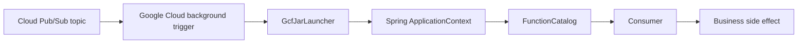
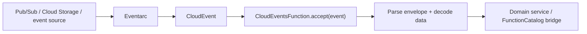
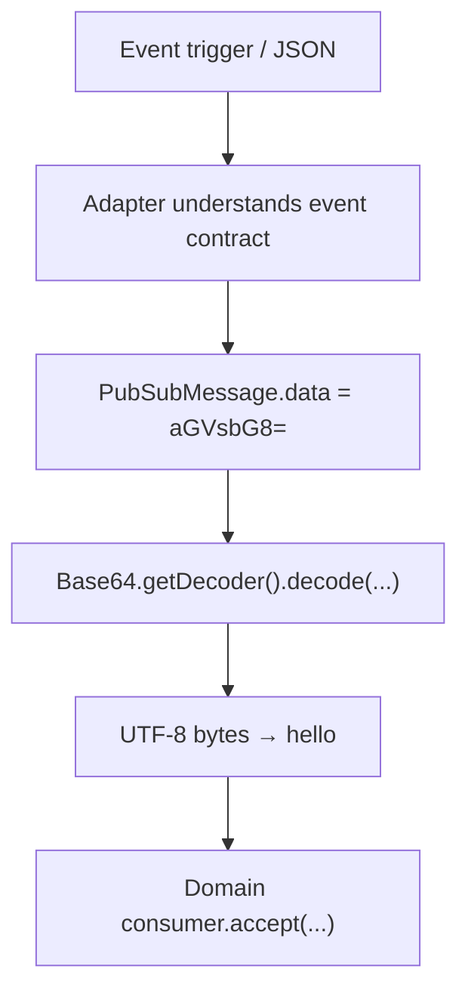
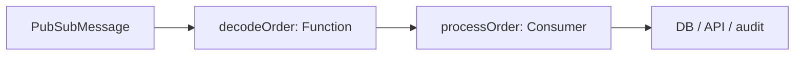
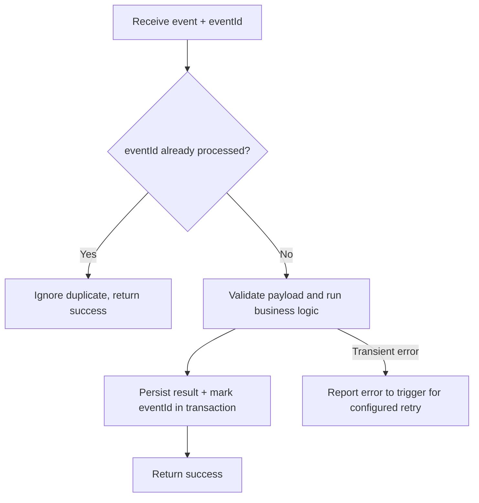

# Background Event Handling and Data Conversion Supported by the Adapter

## Learning Objectives

**Spring Cloud Function** organizes business logic into `Supplier<O>`, `Function<I, O>`, and `Consumer<I>`, registers them in the Spring context, and exposes them via `FunctionCatalog`. The same logic can serve HTTP, events, or serverless runtimes as long as **an adapter accepts the invocation and converts payloads according to the contract**. In the **Google Cloud** chapter, this is especially important when handling **background events**, such as Cloud Pub/Sub messages, rather than ordinary HTTP requests.

This lesson covers two **distinct** integration paths that must not be mixed:

1. **Background functions following the Spring Cloud Function GCP adapter pattern:** `spring-cloud-function-adapter-gcp`, `GcfJarLauncher`, and a `Consumer<PubSubMessage>` bean, as documented for Google Cloud Functions background triggers.
2. **Modern event-driven functions with Eventarc/CloudEvents:** the Java Functions Framework uses `CloudEventsFunction`, which receives a `CloudEvent` with its own envelope. Reusing `FunctionCatalog` along this path requires a **compatible bridge/bootstrap**; never assume a legacy background handler automatically understands every CloudEvent.

After this lesson, you will be able to explain how data flows from the trigger to `Consumer`; write an event DTO and decode Pub/Sub Base64 payloads; configure beans, the manifest, Maven, and `spring.cloud.function.definition`; distinguish event metadata from message payloads; test through Java, the Spring context, the local Functions Framework, and the cloud environment; and handle errors, retries, and idempotency.

**Version limitation:** the term *background function* and the `GcfJarLauncher` pattern in the Spring Cloud Function GCP reference originate from an earlier Google Cloud Functions contract. Google Cloud Run functions currently use **CloudEvents** for functions triggered by Eventarc. Always confirm the supported Spring Cloud Function version, Java runtime, trigger type, and handler before applying examples to production.

## 1. How Do Background Events Differ from HTTP Requests?

An HTTP function typically receives a request sent directly by a caller and returns a response immediately to that caller. An event-driven function is triggered **indirectly** when an event occurs: for instance, Pub/Sub receives a message, Cloud Storage receives a new object, or an Eventarc source emits an event.

| Aspect | HTTP Function | Background / Event-Driven Function |
| --- | --- | --- |
| Trigger actor | Client sending an HTTP request | Event source + trigger infrastructure |
| Input data | Body, headers, method, URL | Event data **and metadata** per trigger type |
| Spring Cloud Function logic | Typically `Function<I,O>` | Typically `Consumer<I>`, or a composition ending in `Consumer` |
| Output | Response body/status for the client | Usually side effects: writing data, calling APIs, emitting other events |
| Retries | Depends on HTTP client/gateway | Depends on the trigger's delivery/retry policy |
| Duplicate risk | Client may resend | Events may be redelivered; idempotency is required |
| Adapter contract | HTTP handler/routing | Background handler or compatible CloudEvents handler |

**`Consumer<I>` returns no business response** because `accept(I)` returns `void`. That does not mean the platform ignores the outcome: whether the handler **returns normally or throws an exception** can affect how the runtime records success/failure and performs configured retries.

A function does not automatically acquire a Pub/Sub subscription merely by being declared:

```java
@Bean
Consumer<String> auditEvent() {
    return value -> System.out.println(value);
}
```

Actually receiving events requires the **corresponding trigger**, access permissions, adapter/handler, and properly formatted payload mapping. `FunctionCatalog` is only responsible for discovering, selecting, and invoking functions inside Spring.

## 2. Two Google Cloud Models That Must Stay Separate

### 2.1. Background Function with the Spring Cloud Function GCP Adapter

The Spring Cloud Function documentation describes this model:



In this pattern:

- The **Java entry point** is `org.springframework.cloud.function.adapter.gcp.GcfJarLauncher`.
- The **Spring application class** registers `Consumer<PubSubMessage>`.
- **`spring.cloud.function.definition`** selects the bean name to invoke.
- The **`PubSubMessage` DTO** models the fields shown in the background event sample.
- The Google Functions Framework can run locally and accept JSON simulating an event.

These details reflect the **background adapter path documented by Spring Cloud Function**, not a claim that every Google Cloud generation uses the same signature.

### 2.2. Cloud Run Functions, Eventarc, and CloudEvents

In modern Google Cloud Run functions guidance, an event-triggered Java function typically implements:

```java
import com.google.cloud.functions.CloudEventsFunction;
import io.cloudevents.CloudEvent;

public final class EventarcEntryPoint implements CloudEventsFunction {
    @Override
    public void accept(CloudEvent event) throws Exception {
        // Process CloudEvent metadata and data here.
    }
}
```

The entry point is the **fully qualified Java class name `EventarcEntryPoint`** and must satisfy the `CloudEventsFunction` contract. The Pub/Sub payload inside a CloudEvent typically sits **inside a JSON envelope**, not as a `PubSubMessage` object at the root.



**Do not blindly set `--entry-point=GcfJarLauncher` for a new CloudEvent handler** if your adapter version has not confirmed support for `CloudEventsFunction` and the trigger schema. Never assume changing `--trigger-topic` or `Content-Type` is enough to move a legacy background handler onto Eventarc.

### Quick Comparison Table

| Question | GCP Background Adapter Pattern | Modern Eventarc Pattern |
| --- | --- | --- |
| Edge handler | `GcfJarLauncher` per SCF docs | Class `implements CloudEventsFunction` |
| Java parameter at handler layer | Adapter handles request/event from Functions Framework | `CloudEvent` with `id`, `type`, `source`, `data` |
| Typical Spring bean | `Consumer<PubSubMessage>` | Can use `Consumer<DomainEvent>` **after bridging** |
| Pub/Sub data | `PubSubMessage.data` | `CloudEvent.data` → JSON `message.data` |
| Event metadata | DTO/adapter mechanism depending on version | `CloudEvent` metadata and nested message metadata |
| Conversion | Adapter → DTO → business | CloudEvent parser → nested payload → domain |
| Compatibility | Must check matching SCF/GCF version | Must check matching Java Functions Framework/Eventarc |

## 3. Pub/Sub Data Contract: How Many Conversion Layers?

A message from Pub/Sub can contain:

- `data`: **Base64-encoded** payload inside the event JSON.
- `attributes`: key/value metadata pairs added by the publisher.
- `messageId`: message identifier used for observability and helping prevent duplicate processing.
- `publishTime`: timestamp when Pub/Sub recorded the publish.

Example legacy background message that a bean may receive after adapter deserialization:

```json
{
  "data": "aGVsbG8=",
  "attributes": {
    "source": "orders"
  },
  "messageId": "msg-001",
  "publishTime": "2026-01-01T00:00:00Z"
}
```

`aGVsbG8=` is the Base64 encoding of `hello`. To bring it into text-based business processing, there are **three layers**:

1. **Transport/event decoding:** the Google handler receives the body/envelope according to the trigger type.
2. **JSON-to-DTO binding:** the adapter or parser maps event fields into `PubSubMessage` or a CloudEvent DTO.
3. **Base64 + domain conversion:** application code decodes `data` and then parses it into `String`, `OrderEvent`, or domain data.



**Do not assume Spring Cloud Function automatically decodes Base64** if you merely declare `Consumer<String>`. The framework can perform message/JSON conversion based on generics, but decoding `PubSubMessage.data` and mapping the envelope is a choice of the adapter or application code. Verify the contract rather than guessing input types at random.

## 4. Implementing a `Consumer<PubSubMessage>` Background Function Example

This example focuses on the **GCP background adapter path** documented by Spring Cloud Function. It uses Java 17+ and compatible Spring Boot/Cloud Function versions. You do not need a Google Cloud account to run the unit tests and local Functions Framework.

### 4.1. Java DTO for Pub/Sub Events

File `src/main/java/example/gcp/PubSubMessage.java`:

```java
package example.gcp;

import java.util.Map;

public final class PubSubMessage {
    private String data;
    private Map<String, String> attributes;
    private String messageId;
    private String publishTime;

    public String getData() {
        return data;
    }

    public void setData(String data) {
        this.data = data;
    }

    public Map<String, String> getAttributes() {
        return attributes;
    }

    public void setAttributes(Map<String, String> attributes) {
        this.attributes = attributes;
    }

    public String getMessageId() {
        return messageId;
    }

    public void setMessageId(String messageId) {
        this.messageId = messageId;
    }

    public String getPublishTime() {
        return publishTime;
    }

    public void setPublishTime(String publishTime) {
        this.publishTime = publishTime;
    }
}
```

This is an **application DTO** modeling the Pub/Sub background event schema from the GCP adapter docs, not a class automatically provided by every dependency. `getData()` returns a **Base64 string**, not necessarily the decoded message.

Field names such as `messageId` and `publishTime` may appear in different locations or formats in CloudEvents or newer adapters. Do not treat this DTO as a universal schema for all Google Cloud Storage, Firebase, or Eventarc triggers.

### 4.2. Base64 → UTF-8 String Helper

File `src/main/java/example/gcp/PubSubPayloads.java`:

```java
package example.gcp;

import java.nio.charset.StandardCharsets;
import java.util.Base64;

public final class PubSubPayloads {
    private PubSubPayloads() {
    }

    public static String decodeUtf8(String encoded) {
        if (encoded == null) {
            throw new IllegalArgumentException("Pub/Sub data is missing");
        }
        try {
            byte[] bytes = Base64.getDecoder().decode(encoded);
            return new String(bytes, StandardCharsets.UTF_8);
        } catch (IllegalArgumentException ex) {
            throw new IllegalArgumentException(
                    "Pub/Sub data is not valid Base64", ex);
        }
    }
}
```

This function performs **one specific task**, making it easy to unit-test and reuse with CloudEvents adapters. When business logic handles binary data (images, protobuf, ZIP), **do not convert bytes to `String`** by default; use `byte[]` and the appropriate decoder. For real text, ensure publisher and consumer agree on the charset.

In production, enforce **message size controls**, post-decode limits, empty-payload policies, and careful logging so malformed data does not cause excessive resource consumption.

### 4.3. Spring Boot Class and `Consumer` Bean

File `src/main/java/example/gcp/BackgroundApplication.java`:

```java
package example.gcp;

import java.util.function.Consumer;
import java.util.logging.Logger;

import org.springframework.boot.SpringApplication;
import org.springframework.boot.autoconfigure.SpringBootApplication;
import org.springframework.context.annotation.Bean;

@SpringBootApplication(proxyBeanMethods = false)
public class BackgroundApplication {

    private static final Logger LOG =
            Logger.getLogger(BackgroundApplication.class.getName());

    public static void main(String[] args) {
        SpringApplication.run(BackgroundApplication.class, args);
    }

    @Bean
    public Consumer<PubSubMessage> consumePubSub() {
        return message -> {
            if (message == null) {
                throw new IllegalArgumentException("Message is missing");
            }

            String text = PubSubPayloads.decodeUtf8(message.getData());
            if (text.isBlank()) {
                throw new IllegalArgumentException("Payload is empty");
            }

            // Demo: only log ID and length; avoid logging sensitive data.
            LOG.info(() -> "Consumed Pub/Sub messageId="
                    + message.getMessageId()
                    + ", utf8Length=" + text.length());

            // Production: call order processing service and persist durable state.
        };
    }
}
```

**Why choose `Consumer`?** An event typically triggers an action such as persisting data, emitting a notification, or updating an order. `Consumer<PubSubMessage>.accept(...)` produces no business response for an HTTP client; success or failure of the invocation is part of the handler/trigger contract.

**Generic type information** on `Consumer<PubSubMessage>` tells Spring Cloud Function what input type the adapter must supply. Replacing it with a raw `Consumer` can make JSON-to-DTO deserialization harder to infer.

### 4.4. Selecting the Function and Declaring the Manifest

In `src/main/resources/application.properties`:

```properties
spring.cloud.function.definition=consumePubSub
```

In `src/main/resources/META-INF/MANIFEST.MF`, following the GCP adapter pattern:

```text
Manifest-Version: 1.0
Main-Class: example.gcp.BackgroundApplication

```

Distinguish the three values:

| Value | Meaning |
| --- | --- |
| `example.gcp.BackgroundApplication` | Spring configuration class in the pattern manifest |
| `org.springframework.cloud.function.adapter.gcp.GcfJarLauncher` | Java handler invoked by the Google Functions Framework |
| `consumePubSub` | Spring bean looked up by `FunctionCatalog` per `definition` |

**Do not** use `--entry-point=consumePubSub` when the runtime requires the handler class name, and do not put `Main-Class: GcfJarLauncher` in the source manifest meant to identify the Spring application. Build plugins may rewrite the manifest in the final JAR; inspect **the post-build artifact**.

## 5. Maven Dependencies, Packaging, and Local Functions Framework

In a Spring Boot Maven project that already declares a parent/BOM and a **compatible Spring Cloud BOM**, the core dependencies section is:

```xml
<dependencies>
    <dependency>
        <groupId>org.springframework.cloud</groupId>
        <artifactId>spring-cloud-function-adapter-gcp</artifactId>
    </dependency>
    <dependency>
        <groupId>org.springframework.cloud</groupId>
        <artifactId>spring-cloud-function-context</artifactId>
    </dependency>
    <dependency>
        <groupId>org.springframework.boot</groupId>
        <artifactId>spring-boot-starter-test</artifactId>
        <scope>test</scope>
    </dependency>
</dependencies>
```

`spring-cloud-function-context` supplies `FunctionCatalog`; the GCP adapter connects Spring Cloud Function to the Google Functions Framework runtime. Some dependencies are pulled transitively depending on the version; explicitly declaring APIs imported directly by the project remains good practice.

To run locally, configure the Google Functions Framework Maven plugin under `<build><plugins>`:

```xml
<plugin>
    <groupId>com.google.cloud.functions</groupId>
    <artifactId>function-maven-plugin</artifactId>
    <version>COMPATIBLE_FUNCTION_PLUGIN_VERSION</version>
    <configuration>
        <functionTarget>org.springframework.cloud.function.adapter.gcp.GcfJarLauncher</functionTarget>
        <port>8080</port>
    </configuration>
</plugin>
```

`COMPATIBLE_FUNCTION_PLUGIN_VERSION` **must be replaced** with a version matching your project's Java toolchain and SCF version. In the Spring Cloud Function GCP docs, `0.9.1` is used as an example—**never a guarantee that it is the latest version for every environment**.

To package following the GCP adapter guide, the Spring Boot Maven plugin may need the **GCP adapter as a plugin dependency**:

```xml
<plugin>
    <groupId>org.springframework.boot</groupId>
    <artifactId>spring-boot-maven-plugin</artifactId>
    <configuration>
        <outputDirectory>target/deploy</outputDirectory>
    </configuration>
    <dependencies>
        <dependency>
            <groupId>org.springframework.cloud</groupId>
            <artifactId>spring-cloud-function-adapter-gcp</artifactId>
            <version>COMPATIBLE_SCF_ADAPTER_VERSION</version>
        </dependency>
    </dependencies>
</plugin>
```

`COMPATIBLE_SCF_ADAPTER_VERSION` is a placeholder. Maven **plugin dependencies** should not be assumed to inherit every version from the project's `dependencyManagement`. Keep the adapter version aligned between the application and plugin sections.

These XML fragments **are not a complete `pom.xml`**. You still need `<project>`, `<parent>`, plugin/lifecycle configuration, and version management matching your Spring Boot/Cloud line.

## 6. Testing the Background Function Locally with a JSON Event

In the sample project with plugins configured and Maven Wrapper present, run:

```bash
./mvnw test
./mvnw package
./mvnw function:run
```

`function:run` is a goal of the **Google Functions Framework Maven plugin**. The local invoker process serves requests on port `8080` per configuration; keep this terminal open and send events from another terminal.

For the GCP background adapter pattern, the Spring Cloud Function docs illustrate an **HTTP POST to the local invoker** carrying event JSON. To match real Base64-encoded data, use:

```bash
curl -i -X POST http://localhost:8080/ \
  -H "Content-Type: application/json" \
  --data-binary '{"data":"aGVsbG8=","messageId":"msg-local-01"}'
```

`aGVsbG8=` decodes to `hello`. Check the **console logs** of the local process; the `consumePubSub` bean in the example logs the `messageId` and the decoded character count.

### Why Not Expect a Response Body Containing `hello`?

This is a `Consumer<PubSubMessage>`, which returns `void`. **Side effects/logs** are what the example needs to verify. The HTTP response from the Functions Framework is a technical signal about the handler invocation result, not a business output like `Function<I,O>`.

### Distinguishing Local Sample JSON from Real Pub/Sub Events

The Spring Cloud Function docs include a minimal example sending `{"data":"hello"}` to the local background handler. That example illustrates deserialization and bean invocation, **not the Base64 encoding of a real Pub/Sub message**. In this lesson, the code explicitly decodes Base64, so local requests must send `"aGVsbG8="` rather than `"hello"` directly.

**Do not confuse a local background POST with an HTTP Function:** the local invoker accepts HTTP to simulate an event, whereas in the cloud the real trigger is Pub/Sub, Storage, and so on. No user needs to send an HTTP request directly to a business endpoint for a background function to fire.

## 7. Moving the Background Function to Google Cloud: Triggers and Limitations

The Spring Cloud Function GCP background adapter documentation illustrates a historical pattern using:

```bash
gcloud functions deploy orders-background \
  --entry-point=org.springframework.cloud.function.adapter.gcp.GcfJarLauncher \
  --runtime=SUPPORTED_JAVA_RUNTIME \
  --trigger-topic=YOUR_PUBSUB_TOPIC \
  --source=target/deploy \
  --region=YOUR_REGION
```

`SUPPORTED_JAVA_RUNTIME`, `YOUR_PUBSUB_TOPIC`, and `YOUR_REGION` are **mandatory placeholders to replace**. The command above only conveys the idea of the **documented GCP adapter pattern**, without guaranteeing compatibility across every Cloud Functions/Cloud Run functions generation or every Java version. On modern platforms, Eventarc may require a **CloudEvents handler** and a different deployment command.

Before deploying, check:

1. Trigger type (`Pub/Sub`, Cloud Storage, Eventarc) and the **event signature** provided by the runtime.
2. A Java entry point compatible with that exact signature.
3. Adapter packaging and the `target/deploy` artifact layout.
4. A Java runtime compatible with your project's bytecode and Spring libraries.
5. That the topic/trigger exists and the deploying account has permission to create and attach triggers.
6. That the **runtime service account** has least-privilege permissions to perform its side effects.
7. That retry behavior, dead-letter/quarantine handling, and idempotency mechanisms are designed in.

A message published to a Pub/Sub topic is not guaranteed to be processed exactly once; infrastructure and clients can retry. Therefore, never use singleton in-memory storage as the sole record of processed messages.

## 8. Data Conversion: From Base64 Text to a Business DTO

Suppose the publisher sends a JSON text payload:

```json
{
  "orderId": "ORD-42",
  "action": "CREATED"
}
```

The publisher **encodes the entire UTF-8 JSON into Base64**, then places that Base64 string into the `data` field of `PubSubMessage`. The consumer must:

1. Parse the event envelope per the adapter.
2. Read the `data` field and Base64-decode it to bytes.
3. Decode the bytes as UTF-8 into JSON text.
4. Use Jackson or another JSON mapper to map it to the `OrderEvent` DTO.
5. Validate `orderId` and `action` and execute business logic.

File `src/main/java/example/gcp/OrderEvent.java`:

```java
package example.gcp;

public record OrderEvent(String orderId, String action) {
}
```

Example conversion helper:

```java
import com.fasterxml.jackson.databind.ObjectMapper;
import java.io.IOException;

static OrderEvent toOrderEvent(
        PubSubMessage message, ObjectMapper mapper) {
    String json = PubSubPayloads.decodeUtf8(message.getData());
    try {
        return mapper.readValue(json, OrderEvent.class);
    } catch (IOException ex) {
        throw new IllegalArgumentException(
                "Pub/Sub payload is not valid OrderEvent JSON", ex);
    }
}
```

Spring Boot can provide a Jackson `ObjectMapper` when the corresponding dependencies and auto-configuration are present; if a minimal project lacks Jackson, declare the appropriate JSON mapper dependency. **Do not treat `spring-cloud-function-adapter-gcp` as a guarantee that every codec and DTO is configured automatically.**

When constructing test messages, you can compute Base64 in Java instead of encoding manually:

```java
String json = "{\"orderId\":\"ORD-42\",\"action\":\"CREATED\"}";
String encoded = Base64.getEncoder().encodeToString(
        json.getBytes(StandardCharsets.UTF_8));
```

To use this snippet, you need `java.util.Base64` and `java.nio.charset.StandardCharsets`. The `encoded` string goes into the `data` field of the local JSON envelope.

### Which Steps Is the Adapter Responsible For?

| Conversion | Responsible Component | What to Test? |
| --- | --- | --- |
| HTTP/event bytes → event contract | Google Functions Framework / adapter | Handler receives the right signature and schema |
| JSON event → `PubSubMessage` | Adapter and JSON binding | `data`, `attributes`, and `messageId` map properly |
| Base64 → raw bytes | Application or explicitly configured converter | Valid, empty, and malformed data |
| Bytes → UTF-8 text | Application | Character encoding and binary payloads |
| JSON text → `OrderEvent` | Jackson / JSON mapper in application | DTO type, field names, and validation |
| `OrderEvent` → side effect | Domain service / `Consumer` | Idempotency, transactions, and retries |

Do not declare `Consumer<OrderEvent>` and assume the GCP adapter will automatically **skip `PubSubMessage` and decode nested Base64 JSON**. If you want to work directly with domain types, add an explicit conversion step.

## 9. Separating Conversion from Business Processing via Composition

A cleaner architecture is:



In a Spring configuration, with `ObjectMapper` appropriately provided:

```java
@Bean
public Function<PubSubMessage, OrderEvent> decodeOrder(
        ObjectMapper mapper) {
    return message -> toOrderEvent(message, mapper);
}

@Bean
public Consumer<OrderEvent> processOrder(OrderService service) {
    return event -> service.process(event);
}
```

`OrderService` is an **application-defined business service** with a `process(OrderEvent)` method; it must be registered in the Spring context. This snippet illustrates the architecture, not a standalone complete Java file.

If your Spring Cloud Function version supports **`Function`-to-`Consumer`** composition with these types, the adapter can select:

```properties
spring.cloud.function.definition=decodeOrder|processOrder
```

**Important note:** this is an **alternative** to `consumePubSub` in section 4. If all three beans exist in the application, configure `definition` explicitly to avoid ambiguity. Verify directly that the catalog looks up the composition and that the background adapter invokes the pipeline properly.

Benefit: `decodeOrder` handles the protocol/format, while `processOrder` knows only domain types. When moving to HTTP or CloudEvents, you can keep `processOrder` and replace only the decoding step.

## 10. CloudEvents/Eventarc: Different Envelope, Still-Reusable Logic

For a Pub/Sub event delivered through Eventarc, data enters `CloudEventsFunction.accept(CloudEvent)`. A typical `event.getData()` payload has a structure similar to:

```json
{
  "message": {
    "data": "aGVsbG8=",
    "messageId": "msg-001",
    "attributes": {
      "source": "orders"
    },
    "publishTime": "2026-01-01T00:00:00Z"
  },
  "subscription": "projects/demo-project/subscriptions/demo-sub"
}
```

This is the **data of the Pub/Sub CloudEvent**. It does not contain all CloudEvent metadata such as `id`, `source`, `type`, and `specversion`, which reside in the separate **event envelope**. The handler should use `event.getId()`, `event.getType()`, and `event.getSource()` to track the event.

### Java Entry Point Receiving a CloudEvent

A modern example using `CloudEventsFunction` to process the **Eventarc Pub/Sub schema** directly:

```java
package example.gcp.eventarc;

import com.fasterxml.jackson.databind.JsonNode;
import com.fasterxml.jackson.databind.ObjectMapper;
import com.google.cloud.functions.CloudEventsFunction;
import io.cloudevents.CloudEvent;
import java.nio.charset.StandardCharsets;
import java.util.Base64;
import java.util.logging.Logger;

public final class PubSubCloudEventHandler implements CloudEventsFunction {

    private static final Logger LOG =
            Logger.getLogger(PubSubCloudEventHandler.class.getName());
    private static final ObjectMapper MAPPER = new ObjectMapper();

    @Override
    public void accept(CloudEvent event) throws Exception {
        if (event.getData() == null) {
            throw new IllegalArgumentException("CloudEvent has no data");
        }

        JsonNode root = MAPPER.readTree(event.getData().toBytes());
        JsonNode encodedNode = root.path("message").path("data");
        if (!encodedNode.isTextual()) {
            throw new IllegalArgumentException(
                    "Pub/Sub CloudEvent is missing message.data");
        }

        byte[] raw = Base64.getDecoder().decode(
                encodedNode.asText());
        String value = new String(raw, StandardCharsets.UTF_8);

        LOG.info(() -> "CloudEvent id=" + event.getId()
                + ", chars=" + value.length());

        // Pass value to domain service; do not log sensitive data.
    }
}
```

This sample uses `com.google.cloud.functions.CloudEventsFunction`, `io.cloudevents.CloudEvent`, and Jackson. The **Functions Framework API**, **CloudEvents API**, and **JSON mapper** dependencies must exist in the project or be provided transitively at compatible versions.

This snippet is **a Java CloudEvent handler**, **not yet** a Spring Cloud Function application. It illustrates how to read the Eventarc envelope properly; do not paste it verbatim into a GCP background project and assume `GcfJarLauncher` will call it automatically. When using `CloudEventsFunction`, **the entry point must be `example.gcp.eventarc.PubSubCloudEventHandler`** and the runtime must be configured with the matching signature type.

### How to Reuse `FunctionCatalog` in a CloudEvents Handler?

There are two strategies:

1. **Extract a pure Java domain processor:** the CloudEvent handler calls the same service used by the Spring `Consumer<OrderEvent>`. This avoids depending on Spring startup mechanics inside the handler.
2. **Write a bridge to the Spring context:** when the handler is invoked, initialize or reuse a compatible Spring `ApplicationContext`, obtain `FunctionCatalog`, call `lookup("processOrder")`, and pass `OrderEvent` to `Consumer<OrderEvent>`. You must manage lifecycle, concurrency, exceptions, and cold starts appropriately.

A conceptual snippet **once `catalog` has been properly supplied**:

```java
Consumer<OrderEvent> handler = catalog.lookup("processOrder");
if (handler == null) {
    throw new IllegalStateException("processOrder not found");
}
handler.accept(orderEvent);
```

**Do not assume Spring automatically injects `FunctionCatalog` into a `CloudEventsFunction` class instantiated directly by the Google Functions Framework.** You need an explicit bootstrap/bridge or an adapter proven to support CloudEvents in your version.

## 11. `Message<T>` and Event Metadata: When Should You Use It?

A Spring function can accept `Message<PubSubMessage>` to read both payload and message headers:

```java
@Bean
public Consumer<Message<PubSubMessage>> inspectMessage() {
    return springMessage -> {
        PubSubMessage payload = springMessage.getPayload();
        Object correlationId =
                springMessage.getHeaders().get("correlationId");
        // Handle payload and correlationId if actually provided by the adapter.
    };
}
```

However, **Spring's `MessageHeaders` are not identical to CloudEvent attributes or Pub/Sub attributes**:

| Metadata | Where It Appears | Notes |
| --- | --- | --- |
| `PubSubMessage.attributes` | Part of Pub/Sub event data | Supplied by publisher/transport |
| `PubSubMessage.messageId` | Part of message/event data in the DTO sample | Aids observability and deduplication when present |
| `CloudEvent.id` | Part of the CloudEvent envelope | Event ID; may differ from the inner message ID |
| `CloudEvent.source`, `type` | Part of the CloudEvent envelope | Identifies the event source and type |
| Spring `Message.headers` | Spring Messaging metadata | Contains only values actually populated by the adapter |

If the GCP adapter in your version does not copy CloudEvent/Pub/Sub metadata into Spring `MessageHeaders`, `getHeaders().get("...")` may return `null`. Never rely on assumed headers for access control or idempotency logic.

**Relation to composition:** a `Function<Message<I>, Message<O>>` can preserve or alter metadata across the chain; when metadata matters to business decisions, test through the real adapter rather than assuming every header propagates automatically across every step.

## 12. Retries, Idempotency, and Error Reporting

An event can be redelivered due to platform retry policies, network interruptions, or processing failures. Never design side effects as if each event runs strictly once.

### 12.1. Idempotent Processing Pattern

Suppose an event carries a reliable `eventId`. Processing flow:



In production, checking and marking should rely on a **database or durable store with appropriate uniqueness constraints and transactions**, not a `static Set` or in-memory cache of a single function instance. When triggering side effects in external systems, use an idempotency key or an outbox pattern to avoid calling a service without recording completion.

### 12.2. Do Not Swallow Transient Errors

```java
try {
    processOrder(event);
} catch (TransientStorageException ex) {
    // Log safely; propagate error to handler so the platform can retry.
    throw ex;
}
```

`TransientStorageException` and `processOrder` here are **application-level illustrative symbols**. When handling real errors, distinguish:

- **Permanently invalid payloads:** infinite retries will not fix them; send to quarantine/dead-letter/alerting per policy.
- **Transient failures (timeouts, unavailable dependencies):** safe to retry with limits/backoff and idempotency.
- **Duplicate events:** already processed successfully—skip safely without repeating side effects.

**Throwing an exception does not automatically guarantee a retry.** Retry policy, retention duration, delivery attempts, and dead-letter behavior depend on trigger type and platform configuration. If retries are disabled, a failed invocation may not be retried at all.

### 12.3. Avoid Spawning Background Work and Returning Early

In serverless runtimes, do not spin up a thread/future to do business work and return from `accept(...)` while the work is still running. The platform may consider the invocation finished and does not guarantee the background task will continue. Wait for side effects to reach a durable state before the handler returns successfully, or hand the work off to a separate durable queue.

## 13. Layered Testing, Not Just `Consumer.accept`

### 13.1. Unit Testing the Decoder Class

With JUnit 5:

```java
package example.gcp;

import static org.junit.jupiter.api.Assertions.assertEquals;
import static org.junit.jupiter.api.Assertions.assertThrows;

import org.junit.jupiter.api.Test;

class PubSubPayloadsTest {

    @Test
    void decodesBase64Utf8() {
        assertEquals("hello",
                PubSubPayloads.decodeUtf8("aGVsbG8="));
    }

    @Test
    void rejectsInvalidBase64() {
        assertThrows(IllegalArgumentException.class,
                () -> PubSubPayloads.decodeUtf8("not-base64!"));
    }
}
```

This test verifies pure Java decoding code; it **does not** test the Google event envelope, Spring bean registration, or the handler.

### 13.2. Spring Context + `FunctionCatalog`

```java
package example.gcp;

import static org.junit.jupiter.api.Assertions.assertNotNull;

import java.util.function.Consumer;
import org.junit.jupiter.api.Test;
import org.springframework.beans.factory.annotation.Autowired;
import org.springframework.boot.test.context.SpringBootTest;
import org.springframework.cloud.function.context.FunctionCatalog;

@SpringBootTest(
        classes = BackgroundApplication.class,
        webEnvironment = SpringBootTest.WebEnvironment.NONE)
class BackgroundCatalogTest {

    @Autowired
    FunctionCatalog catalog;

    @Test
    void findsNamedConsumer() {
        Consumer<PubSubMessage> consumer =
                catalog.lookup("consumePubSub");
        assertNotNull(consumer);

        PubSubMessage event = new PubSubMessage();
        event.setData("aGVsbG8=");
        event.setMessageId("msg-test-1");
        consumer.accept(event);
    }
}
```

The test confirms the catalog finds `Consumer<PubSubMessage>` and invokes the bean. It **still bypasses `GcfJarLauncher`**. For real side effects (writing to a database, publishing messages), use controlled fakes or test infrastructure to assert outcomes rather than relying solely on logs.

### 13.3. Local Functions Framework Test

Run `./mvnw function:run` with `functionTarget=org.springframework.cloud.function.adapter.gcp.GcfJarLauncher`, then send background JSON:

```bash
curl -i -X POST http://localhost:8080/ \
  -H "Content-Type: application/json" \
  --data-binary '{"data":"aGVsbG8=","messageId":"msg-local-01"}'
```

Verify that the handler loads, the Spring context starts, the catalog locates the consumer, and the expected log/side effect occurs. **Do not claim every version of the local invoker returns the exact same HTTP status/body** for background functions; the key check is that the consumer received the event.

### 13.4. Cloud Smoke Test

Once deployed, publish a test Pub/Sub message to the real topic/trigger in a controlled environment, and inspect logs and durable state. For Eventarc, use the **real trigger's CloudEvent format** rather than sending the legacy background handler's root JSON.

Test retries/duplicates separately by simulating events with the same ID or using a suitable test environment; avoid duplicating real production transactions while verifying idempotency.

## 14. Common Issues and How to Diagnose Them

| Symptom | Possible Cause | Resolution |
| --- | --- | --- |
| Local Functions Framework cannot find handler | Wrong `functionTarget` or adapter missing from classpath | Check `GcfJarLauncher`, dependencies, and plugin |
| Spring runs, but catalog lacks consumer | Wrong `@Bean` name, `definition`, or missing Function Context | Test `FunctionCatalog.lookup("consumePubSub")` |
| `Consumer<PubSubMessage>` receives `data=null` | Wrong event envelope or JSON field name | Check actual payload, DTO model, and adapter |
| Base64 decode error | Sent `"hello"` instead of `"aGVsbG8="`, or corrupted data | Send valid Base64 and check publisher schema |
| `Consumer<String>` does not receive decoded text | Adapter does not automatically unwrap `PubSubMessage`/Base64 | Use the proper DTO and an explicit decode step |
| Jackson cannot parse `OrderEvent` | Decoded payload is not JSON, field/type mismatch, or missing mapper | Test Base64 → JSON string → DTO step by step |
| Background local demo works, CloudEvent deploy fails | Confused legacy background handler with `CloudEventsFunction` | Switch entry point/adapter and parser to match Eventarc schema |
| `CloudEventsFunction` sees `message.data` missing | Wrong envelope sent, or reading root `data` directly | Inspect `event.getData()` and JSON `message.data` |
| Duplicate message processed twice | Retry/redelivery without idempotency | Deduplicate by event ID / message ID in durable storage |
| Function returns success before data is persisted | Spawned thread/future and returned before completion | Wait for side effect commit or use a durable queue |
| Exception thrown, but no retry occurs | Trigger retries disabled or policy does not retry | Check Eventarc/Pub/Sub configuration and delivery behavior |
| Event keeps retrying indefinitely on bad payload | Permanent failure not distinguished from transient failure | Send to quarantine/dead-letter and alert per policy |
| Cloud 401/403 or events never arrive | IAM, service account, or trigger permissions/ingress | Check runtime permissions, event source, and trigger config |
| Wrong Java runtime or packaging | Artifact version/format mismatch or incompatible Java bytecode | Check BOM, JAR, manifest, runtime, and GCP adapter version |
| Logs lack metadata for tracing | Logged only payload, omitted `messageId`/`CloudEvent.id` | Safely log IDs along with correlation and processing status |

Diagnostic order to follow:

1. **Trigger/Java handler:** does the event reach the right entry point with the right signature?
2. **Spring context/catalog:** is the declared `consumePubSub` bean or composition present?
3. **Envelope:** legacy root JSON background payload or CloudEvent nested `message.data`?
4. **Conversion:** are Base64, charset, JSON mapper, and validation working?
5. **Side effects:** are transactions, idempotency, and external systems working?
6. **Runtime:** IAM, timeout, retries, concurrency, packaging, and logs?

Do not tweak `spring.cloud.function.definition` to fix a CloudEvent envelope mismatch; likewise, do not debug Base64 decoding if the Google Functions Framework cannot even find the Java handler.

## 15. Operations: Security, Observability, and Performance

- **IAM and service accounts:** grant least-privilege permissions for trigger sources and business actions. Having the GCP adapter dependency does not automatically grant Pub/Sub, Storage, or Secret Manager access.
- **Secrets:** never embed credentials in source/JARs or write them to logs; use Google Cloud's secure configuration mechanisms.
- **Logging:** prioritize `messageId`, `CloudEvent.id`, event type, and processing status; avoid logging payloads containing PII.
- **Concurrency:** singleton Spring beans can be invoked concurrently; avoid storing in-flight message state in non-thread-safe mutable fields.
- **Cold starts:** Spring context, JSON mappers, network clients, and adapters all impact startup. Measure on the actual runtime rather than extrapolating only from local runs.
- **Timeouts and batches:** bound payload size, outbound service requests, memory usage, and execution duration.
- **Observability:** separate handler/bootstrap errors, conversion errors, domain errors, and side-effect errors; avoid collapsing every exception into one generic message.

Background events usually lack a synchronous user waiting for a response, yet they still need a **clear success/failure processing contract** and auditability to decide whether to retry or move to dead-letter/quarantine.

## 16. Exercises and Self-Check Questions

### Exercise 1 — Create a Background Consumer

Create `Consumer<PubSubMessage> consumePubSub`, configure `spring.cloud.function.definition=consumePubSub`, manifest the main Spring class, and set `GcfJarLauncher` as the Functions Framework Java target. Send JSON with `data="aGVsbG8="` via `POST /` and observe the logs. Explain why you should not expect a business response body like `Function<String,String>`.

### Exercise 2 — Base64 and JSON Conversion

Create `OrderEvent("ORD-42","CREATED")`, serialize it to UTF-8 JSON, Base64-encode it, and place it in Pub/Sub `data`. Write tests following the sequence: JSON envelope → `PubSubMessage` → Base64 bytes → JSON text → `OrderEvent`.

### Exercise 3 — Distinguish Background from CloudEvent

Compare the two payloads:

```json
{"data":"aGVsbG8=","messageId":"msg-001"}
```

```json
{"message":{"data":"aGVsbG8=","messageId":"msg-001"}}
```

Why can't you use the same `root.data` JSON path to read both? **Because a Pub/Sub CloudEvent nests the message inside the data envelope**, whereas the legacy background example maps directly to the DTO. With CloudEvents, you must also consider `id`, `type`, and `source` metadata.

### Exercise 4 — Composition

Create `decodeOrder: Function<PubSubMessage, OrderEvent>` and `processOrder: Consumer<OrderEvent>`, and test the `decodeOrder|processOrder` composition with your version's `FunctionCatalog`. If the catalog does not recognize it, check types, names, registration, and the adapter contract before switching to manual invocation.

### Exercise 5 — Retries and Idempotency

A Pub/Sub event `msg-001` is delivered twice. Design a handler that writes the order only once using a unique key and database transaction. Describe the behavior when a failure occurs **after the side effect but before marking the event processed**, and how to minimize duplicates.

### Self-Check Questions

1. **Must a background function return a business HTTP body?** No; `Consumer<I>` has no business output.
2. **Does `Consumer<String>` automatically decode Pub/Sub Base64 by default?** Never assume so; check the adapter and conversion contract.
3. **What does `aGVsbG8=` represent?** The string `hello` encoded in Base64.
4. **Are Spring `MessageHeaders` and Pub/Sub `attributes` the same?** No; they align only when a specific adapter mapping populates them.
5. **Can `GcfJarLauncher` and `CloudEventsFunction` be swapped arbitrarily?** No; it depends on the event signature and adapter/runtime.
6. **Where does a Pub/Sub CloudEvent's `data` hold the message?** Typically nested at `message.data` inside the CloudEvent's JSON data.
7. **Does throwing an exception automatically guarantee a retry?** No; retries depend on the trigger type and enabled policy.
8. **Why shouldn't you use a `static Set` to prevent duplicates in production?** In-memory state is neither durable nor shared across instances.
9. **Does a passing `Consumer.accept` unit test prove Cloud Run functions deployment works?** No; there are still the handler, packaging, trigger, schema, IAM, and real runtime.

## 17. Summary and References

**Handling background events with Spring Cloud Function on Google Cloud** requires cleanly separating the **event transport/handler**, **JSON envelope**, **Base64 decoding**, **DTO/domain conversion**, and **business consumer**. The `spring-cloud-function-adapter-gcp` pattern uses `GcfJarLauncher` to wire background events to a `Consumer<PubSubMessage>` bean; with modern **Eventarc/CloudEvents**, the handler receives a `CloudEvent` and must read the nested `message.data`. They are **not automatically interchangeable**.

Keep business logic protocol-independent by separating decoding from `Consumer<OrderEvent>`, using `FunctionCatalog` and composition where supported by the adapter. Test from unit → catalog → local Functions Framework → cloud smoke test, and design retries and idempotency as mandatory parts of real-world event processing.

**Official references for version verification:**

- [Spring Cloud Function — Google Cloud Functions adapter](https://docs.spring.io/spring-cloud-function/reference/adapters/gcp-intro.html): *Background Functions*, `Consumer<PubSubMessage>`, `GcfJarLauncher`, local invoker, and packaging.
- [Google Cloud — Write Cloud Run functions](https://docs.cloud.google.com/run/docs/write-functions): Java `CloudEventsFunction`, event data, and completing execution.
- [Google Cloud — Trigger Pub/Sub functions through Eventarc](https://docs.cloud.google.com/run/docs/tutorials/pubsub-eventdriven): nested Pub/Sub CloudEvent envelope and Base64.
- [Google Cloud — Function triggers](https://docs.cloud.google.com/run/docs/function-triggers): HTTP versus Eventarc event-driven triggers.
- [Google Cloud — First-generation Pub/Sub functions](https://docs.cloud.google.com/functions/1stgendocs/tutorials/pubsub-1st-gen): legacy background schema and differences from CloudEvents.
- [Spring Cloud Function Reference](https://docs.spring.io/spring-cloud-function/reference/): `FunctionCatalog`, composition, and message conversion.

**Note:** in STEP 4, this article has been completed in content and file-verified; it does not replace subsequent build tests or expert Content QA passes. When applying it, verify the exact Java bytecode, Maven plugins, event schemas, trigger configuration, and adapter contract for your project.
