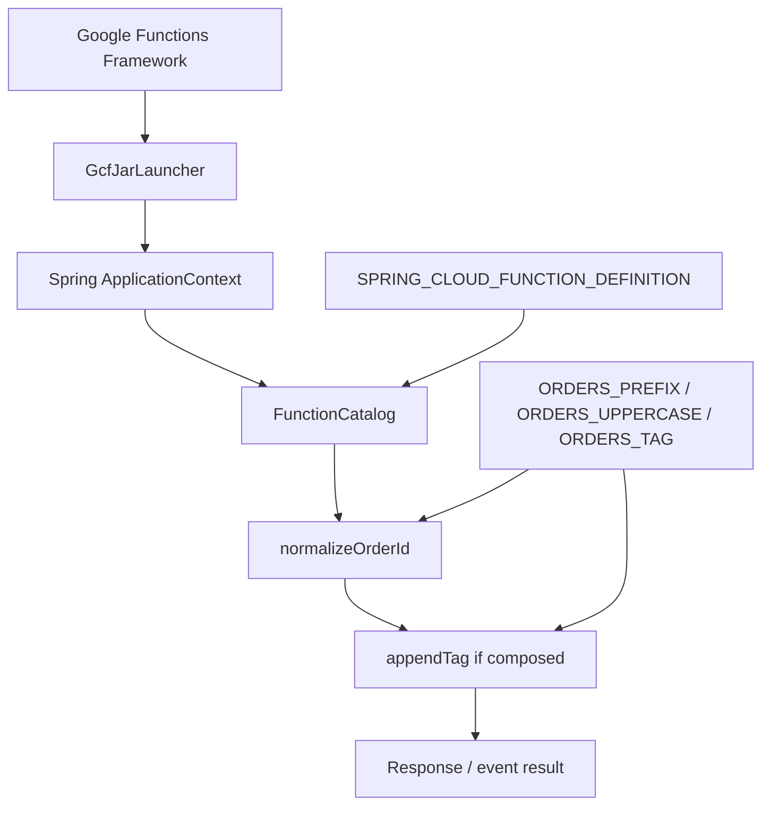

# Selecting Functions and Passing Properties via Environment Variables

## Learning Objectives

In **Spring Cloud Function**, business logic is packaged as a `Supplier<O>`, `Function<I, O>`, or `Consumer<I>`. These functions are registered in the Spring context and looked up through `FunctionCatalog`, supporting composition, message conversion, and reuse over HTTP, events, or serverless platforms. When deploying to **Google Cloud Functions / Cloud Run functions**, we often need to **select which function will be invoked** and **adjust configuration per environment** without recompiling Java code.

The two most important mechanisms are:

- **`spring.cloud.function.definition`**: selects a registered function name or composition expression, such as `normalizeOrderId` or `normalizeOrderId|appendTag`.
- **Runtime environment variables**: supply properties to Spring Boot, such as `SPRING_CLOUD_FUNCTION_DEFINITION`, `ORDERS_PREFIX`, `ORDERS_UPPERCASE`, and `ORDERS_TAG`.

After this lesson, you will be able to:

1. Distinguish between the **Java entry point `GcfJarLauncher`**, the Spring application class, bean names, and the function definition.
2. Map environment variables to Spring properties using **relaxed binding** rules and know when to use `@ConfigurationProperties`.
3. Build an application with two `Function<String,String>` beans, switch the active function, and configure business behavior entirely via environment variables.
4. Test locally with the Google Functions Framework and run `curl` against each definition.
5. Deploy using the `gcloud functions deploy` model with `--set-env-vars`, `--update-env-vars`, or `--env-vars-file`, while distinguishing it from Cloud Run service configuration.
6. Avoid putting secrets in plain environment variables, confusing platform-provided variables, or assuming updating a variable hot-reloads a running function immediately.
7. Test `FunctionCatalog`, property binding, and composition, and troubleshoot common errors.

**Scope:** examples focus on `spring-cloud-function-adapter-gcp` and the GCP adapter workflow described in the Spring Cloud Function documentation. Handler names, packaging steps, and deploy commands may need adjustments for your actual Spring Boot/Spring Cloud Function version, Java runtime, and Google Cloud Functions/Cloud Run functions generation.

## 1. Four Concepts That Must Not Be Confused

Suppose an application has two beans: `normalizeOrderId` and `appendTag`. There are four names with four distinct responsibilities:

| Component | Example | Where It Is Used |
| --- | --- | --- |
| **Google Java function entry point** | `org.springframework.cloud.function.adapter.gcp.GcfJarLauncher` | Java Functions Framework / Google Cloud invokes the handler |
| **Main Spring application class** | `example.gcp.OrderCloudApplication` | Initializes the Spring `ApplicationContext` and declares beans |
| **`Function` bean name** | `normalizeOrderId`, `appendTag` | `FunctionCatalog.lookup("normalizeOrderId")` |
| **Function definition** | `normalizeOrderId|appendTag` | Selects the registered function or chain for the adapter to invoke |



This diagram shows the conceptual chain of responsibility; a definition containing only `normalizeOrderId` will **not invoke** `appendTag`.

**Do not put a bean name into `--entry-point`.** Under this GCP adapter deployment pattern, `--entry-point` specifies the **Java handler class** invoked by the Functions Framework. `SPRING_CLOUD_FUNCTION_DEFINITION` is an **internal Spring** configuration variable and does not change the Java entry point.

On the other hand, an environment variable holding a function name **does not create a bean**: if the application has not registered `appendTag`, setting the definition to that name simply causes lookup to fail.

## 2. Selecting a Function with `spring.cloud.function.definition`

### 2.1. Selecting a Single Function

In `application.properties`:

```properties
spring.cloud.function.definition=normalizeOrderId
```

Or `application.yml`:

```yaml
spring:
  cloud:
    function:
      definition: normalizeOrderId
```

When the runtime adapter needs to know which function handles an invocation, this property specifies the **function name in `FunctionCatalog`**. If exactly one `Function` exists, some adapters can pick it automatically, but **explicit declaration** reduces ambiguity as the application grows to include more beans.

### 2.2. Selecting Composition

With two functions having compatible input/output types:

```properties
spring.cloud.function.definition=normalizeOrderId|appendTag
```

The value `normalizeOrderId|appendTag` represents a pipeline: the output of `normalizeOrderId` flows into `appendTag`. This is **Spring Cloud Function internal composition**, not two separate Google Cloud functions.

In Java:

```java
Function<String, String> pipeline =
        catalog.lookup("normalizeOrderId|appendTag");
String output = pipeline.apply(" a7 ");
```

For expressions containing `|`, **always quote them in a shell**; if entered unquoted in Bash or PowerShell, `|` can be interpreted as a shell pipe operator instead of a literal character in the configuration value.

### 2.3. `definition` Is Not `routing-expression`

`spring.cloud.function.definition` selects a function name or composition. It does not perform per-request routing based on JSON body values or headers. If you need dynamic per-message routing, Spring Cloud Function has separate routing features depending on the version, which is distinct from **choosing a fixed function for a deployment**.

If the same artifact runs across multiple environments:

| Environment | Definition | Effect |
| --- | --- | --- |
| Minimal test | `normalizeOrderId` | Normalizes the ID only |
| Staging | `normalizeOrderId|appendTag` | Normalizes and appends a tag |
| Production | `normalizeOrderId|appendTag` | Same pipeline, different tag/prefix configuration |

The key advantage is that the **same Java logic** can be reused; you do not need another controller or JAR just to change which function is selected, provided the adapter, types, and dependencies align.

## 3. How Does Spring Boot Read Environment Variables?

Spring Boot aggregates configuration from multiple sources: `application.properties`/`application.yml`, environment variables, Java system properties, command-line arguments, and other configured property sources. **OS environment variables** can generally override defaults defined in `application.properties`.

Common mapping:

```text
spring.cloud.function.definition
              ⇅
SPRING_CLOUD_FUNCTION_DEFINITION
```

Example:

```bash
export SPRING_CLOUD_FUNCTION_DEFINITION='normalizeOrderId|appendTag'
```

When Spring Boot builds the `Environment`, a bean or adapter reading `spring.cloud.function.definition` receives `normalizeOrderId|appendTag`.

### Environment Variable Naming Rules

For **`@ConfigurationProperties`** and relaxed binding, Spring Boot defines canonical rules:

1. Replace **dots** `.` with underscores `_`.
2. **Remove** dashes `-` in property names.
3. Convert to **UPPERCASE**.

| Canonical Property | Recommended Environment Variable |
| --- | --- |
| `spring.cloud.function.definition` | `SPRING_CLOUD_FUNCTION_DEFINITION` |
| `orders.prefix` | `ORDERS_PREFIX` |
| `orders.uppercase` | `ORDERS_UPPERCASE` |
| `orders.tag` | `ORDERS_TAG` |
| `orders.max-length` | `ORDERS_MAXLENGTH` |
| `spring.main.log-startup-info` | `SPRING_MAIN_LOGSTARTUPINFO` |

For `orders.max-length`, **do not assume** you replace the dash with an underscore to get `ORDERS_MAX_LENGTH`: Spring Boot's canonical rule is to **remove `-`**. Non-canonical forms can behave differently across binding mechanisms, so it is best to use canonical names and verify with tests.

In `application.properties`, prefer lowercase/kebab-case; in deployment environments, use uppercase names with underscores following the rules above.

### Configuration Precedence Order

Typically in Spring Boot:

```text
application.properties (defaults)
    < environment variables
    < Java system properties / SPRING_APPLICATION_JSON / command-line args
```

This is a **simplified illustration**, not an exhaustive list of every `PropertySource`. Test properties, `@DynamicPropertySource`, and custom bootstrap mechanisms can take higher precedence. When an env var seems to have no effect, check whether a property with the same name is being overridden by a command-line argument, system property, or another configuration source.

## 4. Complete Java Example: Two Functions and Business Properties

Let's build an order ID normalization service. An input `" a7 "` enters the first function and can become `"PO-A7"`; the second function appends a tag to yield `"PO-A7-READY"`. All values `PO`, `true`, and `READY` are read from Spring configuration rather than hard-coded in the functions.

This example uses Java 17+ and compatible Spring Boot/Spring Cloud Function versions. Place the files in package `example.gcp`.

### 4.1. `OrderSettings` Using `@ConfigurationProperties`

File `src/main/java/example/gcp/OrderSettings.java`:

```java
package example.gcp;

import org.springframework.boot.context.properties.ConfigurationProperties;

@ConfigurationProperties(prefix = "orders")
public class OrderSettings {

    private String prefix = "ORD";
    private boolean uppercase = true;
    private String tag = "RECEIVED";

    public String getPrefix() {
        return prefix;
    }

    public void setPrefix(String prefix) {
        this.prefix = prefix;
    }

    public boolean isUppercase() {
        return uppercase;
    }

    public void setUppercase(boolean uppercase) {
        this.uppercase = uppercase;
    }

    public String getTag() {
        return tag;
    }

    public void setTag(String tag) {
        this.tag = tag;
    }
}
```

`@ConfigurationProperties(prefix = "orders")` groups the three values into a strongly typed object. The Spring Boot binder can convert `"true"` or `"false"` strings into `boolean`. For configurations with multiple fields, this approach scales and tests much more cleanly than scattering `System.getenv(...)` calls.

The defaults `ORD`, `true`, and `RECEIVED` apply when configuration sources **do not set** the corresponding keys. In production, add validation for prefix/tag values, length limits, and allowed characters.

### 4.2. Spring Application Declaring Two `Function` Beans

File `src/main/java/example/gcp/OrderCloudApplication.java`:

```java
package example.gcp;

import java.util.Locale;
import java.util.function.Function;

import org.springframework.boot.SpringApplication;
import org.springframework.boot.autoconfigure.SpringBootApplication;
import org.springframework.boot.context.properties.EnableConfigurationProperties;
import org.springframework.context.annotation.Bean;

@SpringBootApplication(proxyBeanMethods = false)
@EnableConfigurationProperties(OrderSettings.class)
public class OrderCloudApplication {

    public static void main(String[] args) {
        SpringApplication.run(OrderCloudApplication.class, args);
    }

    @Bean
    public Function<String, String> normalizeOrderId(
            OrderSettings settings) {
        return input -> {
            if (input == null || input.isBlank()) {
                throw new IllegalArgumentException(
                        "Order ID must not be blank");
            }

            String normalized = input.trim();
            if (settings.isUppercase()) {
                normalized = normalized.toUpperCase(Locale.ROOT);
            }

            String prefix = settings.getPrefix();
            if (prefix == null || prefix.isBlank()) {
                throw new IllegalStateException(
                        "orders.prefix is not valid");
            }
            return prefix + "-" + normalized;
        };
    }

    @Bean
    public Function<String, String> appendTag(
            OrderSettings settings) {
        return normalizedId -> {
            String tag = settings.getTag();
            if (tag == null || tag.isBlank()) {
                throw new IllegalStateException(
                        "orders.tag is not valid");
            }
            return normalizedId + "-" + tag;
        };
    }
}
```

Explanation:

- `@SpringBootApplication` creates the Spring application in the standard way.
- `@EnableConfigurationProperties(OrderSettings.class)` registers the configuration bean so Spring Boot binds `orders.*` values.
- Two `@Bean` methods register **two differently named functions**; the `Function<String,String>` signatures keep generics explicit.
- `normalizeOrderId` and `appendTag` process only Java data and have no knowledge of whether requests arrive via HTTP, Pub/Sub, or a serverless runtime.
- `FunctionCatalog` can look up each function by name or via the composition `normalizeOrderId|appendTag`.

**Not** every function in the catalog runs automatically. Which function the GCP adapter invokes depends on the **function definition** and the trigger contract.

### 4.3. Defaults in `application.properties`

File `src/main/resources/application.properties`:

```properties
spring.cloud.function.definition=normalizeOrderId
orders.prefix=ORD
orders.uppercase=true
orders.tag=RECEIVED
```

Under the default configuration, sending body `" a7 "` to the selected function yields the business result:

```text
ORD-A7
```

If the environment sets:

```text
SPRING_CLOUD_FUNCTION_DEFINITION=normalizeOrderId|appendTag
ORDERS_PREFIX=PO
ORDERS_UPPERCASE=true
ORDERS_TAG=READY
```

then the output becomes:

```text
PO-A7-READY
```

An **identical Java artifact** can run both configurations. That is the core benefit of **externalized configuration**: changing behavior per runtime without rewriting the `Function`.

## 5. Declaring the Entry Point and Packaging for the GCP Adapter

In the `spring-cloud-function-adapter-gcp` model described in the Spring Cloud Function docs:

- **Google Functions Framework entry point:** `org.springframework.cloud.function.adapter.gcp.GcfJarLauncher`.
- **Spring application class:** `example.gcp.OrderCloudApplication`.
- **Bean names:** `normalizeOrderId` and `appendTag`.
- **Definition values:** `normalizeOrderId` or `normalizeOrderId|appendTag`.

Source manifest `src/main/resources/META-INF/MANIFEST.MF` per the pattern:

```text
Manifest-Version: 1.0
Main-Class: example.gcp.OrderCloudApplication

```

**Do not confuse with a Spring Boot executable JAR:** a standard `java -jar` JAR can have Spring Boot's `JarLauncher` as `Main-Class` and the application class as `Start-Class`. The Google Cloud adapter package has its own packaging convention; inspect the manifest and classpath **inside the final artifact**, not just the source files.

### Required Maven Dependencies and Plugins

In a project already managing compatible Boot/Cloud versions:

```xml
<dependencies>
    <dependency>
        <groupId>org.springframework.cloud</groupId>
        <artifactId>spring-cloud-function-adapter-gcp</artifactId>
    </dependency>
    <dependency>
        <groupId>org.springframework.cloud</groupId>
        <artifactId>spring-cloud-function-context</artifactId>
    </dependency>
    <dependency>
        <groupId>org.springframework.boot</groupId>
        <artifactId>spring-boot-starter-test</artifactId>
        <scope>test</scope>
    </dependency>
</dependencies>
```

To run the Functions Framework locally, add `com.google.cloud.functions:function-maven-plugin` under `<build><plugins>`:

```xml
<plugin>
    <groupId>com.google.cloud.functions</groupId>
    <artifactId>function-maven-plugin</artifactId>
    <version>COMPATIBLE_FUNCTION_PLUGIN_VERSION</version>
    <configuration>
        <functionTarget>org.springframework.cloud.function.adapter.gcp.GcfJarLauncher</functionTarget>
        <port>8080</port>
    </configuration>
</plugin>
```

The Google Cloud deployment package per the adapter pattern may also require the **GCP adapter extension in `spring-boot-maven-plugin`'s dependencies**, outputting the package to `target/deploy`. That is **packaging** configuration, distinct from the `function:run` plugin used for local runs.

`COMPATIBLE_FUNCTION_PLUGIN_VERSION` is a placeholder to replace. These XML snippets **are not a complete POM**; the project still needs a Spring Boot parent/plugin management, Spring Cloud BOM, Java toolchain, and compatible release train.

## 6. Testing Environment Variables on Your Development Machine

### 6.1. Bash or zsh (Linux/macOS)

In the terminal that will run the Functions Framework:

```bash
export SPRING_CLOUD_FUNCTION_DEFINITION='normalizeOrderId|appendTag'
export ORDERS_PREFIX='PO'
export ORDERS_UPPERCASE='true'
export ORDERS_TAG='READY'

./mvnw function:run
```

Keep this terminal running. In **another** terminal, send:

```bash
curl -i -X POST http://localhost:8080/ \
  -H 'Content-Type: text/plain' \
  --data-binary ' a7 '
```

Expected business result is **`PO-A7-READY`**. Check the HTTP status, body, and logs; the request flows through **Google Functions Framework → GcfJarLauncher → Spring context → FunctionCatalog** if the adapter is configured properly.

**Common pitfall:** variables exported in the server terminal must exist inside the **Java process launched by the Maven plugin**. Exporting them in a different terminal **after** the server has already started does not update the `Environment` of the running process.

To rerun with just a single function:

```bash
export SPRING_CLOUD_FUNCTION_DEFINITION='normalizeOrderId'
./mvnw function:run
```

You must **stop the previous local process first**, then start the new one so it reads the updated variable set. If both try to use port 8080, the second process will fail to bind the port.

### 6.2. Windows PowerShell

```powershell
$env:SPRING_CLOUD_FUNCTION_DEFINITION = 'normalizeOrderId|appendTag'
$env:ORDERS_PREFIX = 'PO'
$env:ORDERS_UPPERCASE = 'true'
$env:ORDERS_TAG = 'READY'

.\mvnw.cmd function:run
```

In another PowerShell window:

```powershell
curl.exe -i -X POST http://localhost:8080/ -H "Content-Type: text/plain" --data-binary " a7 "
```

In older Windows PowerShell, `curl` can be an alias for `Invoke-WebRequest`; use **`curl.exe`** so curl flags are parsed properly. The `|` character inside the definition value is enclosed in single quotes so PowerShell does not interpret it as a pipeline.

### 6.3. Using Command-Line Arguments or Java System Properties

Spring Boot can accept properties from command-line arguments and Java system properties:

```bash
java -Dspring.cloud.function.definition=normalizeOrderId \
  -Dorders.prefix=WEB \
  -jar app.jar
```

This is only an example **for a Spring Boot executable JAR artifact that supports `java -jar`**; do not assume a separately packaged GCP adapter JAR bootstraps the same way. With the local Functions Framework, **environment variables** are the more faithful way to test what will be deployed to Google Cloud.

If a command-line argument or system property sets the same key with higher precedence, the env var may be ignored. When debugging, verify the **final effective value** from the Spring `Environment`.

## 7. Passing Environment Variables When Deploying Google Cloud Functions

The Google Cloud CLI supports `--set-env-vars`, `--update-env-vars`, and `--env-vars-file` for compatible `gcloud functions deploy` workflows. Before using them, confirm the right **project, region, Java runtime, generation, Java entry point, source artifact, and trigger**.

### 7.1. Configuration on Initial Deployment

Command template for environments where the GCP adapter version and Java runtime are **confirmed to be supported**:

```bash
gcloud functions deploy order-normalizer \
  --gen2 \
  --region=REGION_ID \
  --runtime=SUPPORTED_JAVA_RUNTIME \
  --source=target/deploy \
  --entry-point=org.springframework.cloud.function.adapter.gcp.GcfJarLauncher \
  --trigger-http \
  --set-env-vars='SPRING_CLOUD_FUNCTION_DEFINITION=normalizeOrderId|appendTag,ORDERS_PREFIX=PO,ORDERS_UPPERCASE=true,ORDERS_TAG=READY'
```

`REGION_ID` and `SUPPORTED_JAVA_RUNTIME` are **placeholders**, not ready-to-deploy values. Older documented GCP adapter/packaging workflows may **not** work unchanged on Cloud Functions gen2 or every Cloud Run functions runtime. Use this template only after verifying the Java handler contract, manifest, buildpack, Java runtime, and exact deployment mechanism.

**`--set-env-vars` replaces the entire set**: the `gcloud functions deploy` documentation states that previously set runtime environment variables **are cleared** before setting the new pairs. Therefore, when updating a live function, do not pass only `ORDERS_TAG=READY` with `--set-env-vars` and accidentally wipe out your other configuration variables.

### 7.2. Updating a Few Variables Without Deleting Others

For an **existing** function in a supported deployment style, you can use:

```bash
gcloud functions deploy order-normalizer \
  --gen2 \
  --region=REGION_ID \
  --update-env-vars='ORDERS_TAG=SHIPPED,SPRING_CLOUD_FUNCTION_DEFINITION=normalizeOrderId|appendTag'
```

`--update-env-vars` updates only the specified pairs without requiring you to re-supply every remaining variable. Other flags during updates depend on the generation/platform and current setup; check `gcloud functions deploy --help` in your CLI before running.

For a standard Cloud Run **service**, variable management uses a different command surface:

```bash
gcloud run services update SERVICE_NAME \
  --region=REGION_ID \
  --update-env-vars='ORDERS_TAG=SHIPPED'
```

**Do not confuse** `gcloud functions deploy` with `gcloud run services update`: they target different deployment resources, flags, and revision workflows. Pick the command matching the runtime you actually use.

### 7.3. Using a YAML Env File for Many Settings

Example contents of a **Google Cloud CLI configuration file**, say `runtime-env.yaml`:

```yaml
SPRING_CLOUD_FUNCTION_DEFINITION: "normalizeOrderId|appendTag"
ORDERS_PREFIX: "PO"
ORDERS_UPPERCASE: "true"
ORDERS_TAG: "READY"
```

Then deploy with:

```bash
gcloud functions deploy order-normalizer \
  --gen2 \
  --region=REGION_ID \
  --runtime=SUPPORTED_JAVA_RUNTIME \
  --source=target/deploy \
  --entry-point=org.springframework.cloud.function.adapter.gcp.GcfJarLauncher \
  --trigger-http \
  --env-vars-file=runtime-env.yaml
```

The YAML file above is a **sample configuration file created by the deployer in an appropriate project**; this lesson does not require creating an actual file. Per Google Cloud CLI docs, `--env-vars-file` also **replaces the existing runtime environment variables**. Never put passwords or API keys into the file and commit it to Git.

### 7.4. Avoiding Mis-Split Commas and Special Characters

`gcloud --set-env-vars` uses **commas** to separate `KEY=VALUE` pairs. If the value of **a single variable** contains a comma, do not pass it directly as a plain list; use `--env-vars-file` or the custom delimiter syntax supported by the Google Cloud CLI.

Compositions with `|` **do not contain commas**, yet still need to be **quoted** in the shell:

```bash
--set-env-vars='SPRING_CLOUD_FUNCTION_DEFINITION=normalizeOrderId|appendTag'
```

If a value contains `$`, spaces, quotes, or other special characters, escape or quote it per your shell. Never let a definition value accidentally trigger a shell pipe.

## 8. Distinguishing Runtime Env Vars from Google System Variables

On Cloud Run functions, the platform reserves specific environment variables for the runtime/Functions Framework. Notably:

| Variable | Managed By | Role |
| --- | --- | --- |
| `FUNCTION_TARGET` | Google runtime / Functions Framework | Java function handler target invoked by the platform |
| `FUNCTION_SIGNATURE_TYPE` | Google runtime / Functions Framework | Handler contract type, such as `http` or `event` |
| `PORT` | Cloud Run runtime | HTTP port assigned by the runtime |
| `SPRING_CLOUD_FUNCTION_DEFINITION` | Application / deployer | Selects a bean or composition in Spring Cloud Function |
| `ORDERS_PREFIX`, `ORDERS_TAG` | Application / deployer | Business configuration |

**Do not set `FUNCTION_TARGET=normalizeOrderId` instead of `SPRING_CLOUD_FUNCTION_DEFINITION=normalizeOrderId`.** `FUNCTION_TARGET` at the Google Functions Framework boundary expects the Java handler name; in the GCP adapter model that is the launcher class, not a Spring bean.

Platform-supplied runtime variables such as `PORT` and `FUNCTION_TARGET` may be **protected or overwritten by the platform**. Do not modify them as ordinary application variables. When building a Cloud Run service (rather than a function), `PORT` remains part of the runtime contract; make sure your HTTP server listens on the port provided by the platform.

### Do Not Confuse Build-Time Variables with Runtime Variables

Some Google Cloud tools let you configure **build environment variables** separately from **runtime environment variables**. `spring.cloud.function.definition` for runtime invocation selection in this pattern must exist in the **Spring `Environment` when the context runs**, not merely during the container/JAR build step.

If the application is built as an AOT/native image, some bean-graph and `@ConditionalOnProperty` decisions are frozen at AOT build time. Runtime environment variables should only vary properties meant to change at runtime; **do not expect a runtime variable to materialize a `@Bean` that AOT excluded at build time**.

## 9. Managing Secrets and Access Control

Environment variables are convenient for **ordinary configuration**, but they are **not a dedicated secret store**. Do not pass database passwords, API keys, private keys, or tokens via `--set-env-vars` just because the command is easy to type:

```bash
# Do not run a command like this in production:
gcloud functions deploy order-normalizer \
  --set-env-vars='ORDERS_API_KEY=plaintext-secret'
```

Instead:

- Use **Google Secret Manager** and configure secret injection or volume mounting appropriate for your runtime.
- Grant **Secret Manager Secret Accessor** only to the runtime service account that actually needs it.
- Never write secrets, full environment variable dumps, or payloads containing sensitive data into logs.
- Watch out for shell history, CI/CD logs, configuration tool outputs, and committed env files.
- Distinguish the **deploy account** from the **runtime service account**; their permission sets should not automatically match.

For Cloud Run services using service identity to call Google APIs, Google documentation recommends **not manually setting `GOOGLE_APPLICATION_CREDENTIALS`**; instead configure the appropriate service account and use platform-provided Application Default Credentials.

When rotating a secret, how the new version takes effect depends on how the secret is mounted/injected and on instance lifetimes. Do not assume every invocation automatically reads the latest secret version if a bean cached the value at startup.

## 10. What Changes When You Update Environment Variables?

Common misconceptions when running serverless:

1. **Changing an env var on your local machine does not change the cloud function.** You must update the deployment configuration via Google Cloud tooling.
2. **Changing a variable in the cloud does not make a running singleton Spring bean re-read every property.** `OrderSettings` is bound when the Spring context initializes; lambdas in the example hold a reference to that object.
3. **Updating Cloud Run configuration usually creates a new revision.** Old instances may keep serving during traffic transitions depending on policy, so roll out changes carefully.
4. **Calling `System.getenv(...)` on every request** does not magically hot-reload OS env vars inside an already-running process.
5. **`spring.cloud.function.definition` is not a per-request function toggle.** It selects the function for the runtime/adapter, typically applied when the context/wrapper is constructed.

If you need dynamic per-event routing among multiple functions, look into Spring Cloud Function's metadata-based routing features and test with your specific adapter. Never mutate the definition in a global process environment per request; that introduces race conditions and is not supported by the runtime.

### What Is the Benefit of Changing Config Without Changing Code?

One artifact deployed to staging and production can use:

| Property | Staging | Production |
| --- | --- | --- |
| `SPRING_CLOUD_FUNCTION_DEFINITION` | `normalizeOrderId` | `normalizeOrderId|appendTag` |
| `ORDERS_PREFIX` | `STG` | `PO` |
| `ORDERS_UPPERCASE` | `false` | `true` |
| `ORDERS_TAG` | `TEST` | `READY` |

With input `" a7 "`, staging selects one function producing `STG-a7`, while production selects the composition producing `PO-A7-READY`. Here the **code version and dependencies remain identical**; the difference lives solely in deployment configuration.

In audited environments, log the **selected function name and profile/config revision name** (without logging secrets) so incidents clearly show which workload config handled the call.

## 11. Selecting `Supplier`, `Function`, or `Consumer` via Environment Variables

`FunctionCatalog` can expose all three function types; however, how the adapter invokes them depends on their input/output contracts:

| Bean Type | Java Invocation | Use Case |
| --- | --- | --- |
| `Supplier<T>` | `get()` | Produces data without taking input |
| `Function<I,O>` | `apply(input)` | Takes input and returns output; convenient for HTTP |
| `Consumer<I>` | `accept(input)` | Receives an event and performs side effects |

If the project also includes:

```java
@Bean
public Supplier<String> generateHeartbeat() {
    return () -> "ok";
}

@Bean
public Consumer<String> auditOrder() {
    return id -> System.out.println("Audited: " + id);
}
```

then `spring.cloud.function.definition=generateHeartbeat` or `auditOrder` can be looked up by **function name** once the beans are registered. However, **do not assume every HTTP/event adapter triggers a `Supplier` or `Consumer` the same way**. A `Supplier` does not gain a polling schedule automatically; a `Consumer` does not produce a business HTTP response; and a Pub/Sub trigger still needs its own configuration.

Thus, selecting a function via environment variables must align with the **trigger type and adapter contract**. Switching from an HTTP `Function` to a Pub/Sub `Consumer` is more than changing `SPRING_CLOUD_FUNCTION_DEFINITION`; you also need the right Java handler, event schema, and IAM setup.

## 12. Testing: Property Binding, Catalog, and Local HTTP

### 12.1. Testing Spring `FunctionCatalog` with Explicit Configuration

With JUnit 5 and Spring Boot Test:

```java
package example.gcp;

import static org.junit.jupiter.api.Assertions.assertEquals;
import static org.junit.jupiter.api.Assertions.assertNotNull;

import java.util.function.Function;
import org.junit.jupiter.api.Test;
import org.springframework.beans.factory.annotation.Autowired;
import org.springframework.boot.test.context.SpringBootTest;
import org.springframework.cloud.function.context.FunctionCatalog;

@SpringBootTest(
        classes = OrderCloudApplication.class,
        webEnvironment = SpringBootTest.WebEnvironment.NONE,
        properties = {
            "spring.cloud.function.definition=normalizeOrderId|appendTag",
            "orders.prefix=PO",
            "orders.uppercase=true",
            "orders.tag=READY"
        })
class OrderFunctionCatalogTest {

    @Autowired
    FunctionCatalog catalog;

    @Autowired
    OrderSettings settings;

    @Test
    void composesFunctionWithConfiguredValues() {
        assertEquals("PO", settings.getPrefix());
        assertEquals("READY", settings.getTag());

        Function<String, String> fn =
                catalog.lookup("normalizeOrderId|appendTag");
        assertNotNull(fn);
        assertEquals("PO-A7-READY", fn.apply(" a7 "));
    }
}
```

This test verifies that:

- Spring Boot bound `orders.*` into `OrderSettings`.
- Spring Cloud Function Context supplied `FunctionCatalog`.
- Both beans can be looked up via the composition expression.
- The pipeline uses the configured values from the context.

**It does not prove that OS env vars are actually passed in by Google**, because `@SpringBootTest(properties = ...)` supplies values via a test property source. To test the OS environment variable path, run the local Functions Framework with `export`/`$env:` or launch a separate test process with real environment variables.

### 12.2. Testing the Resolved Property via `Environment`

In an integration test, you can inject `@Autowired Environment`:

```java
@Autowired
Environment environment;

@Test
void readsFinalPropertyValue() {
    assertEquals(
            "normalizeOrderId|appendTag",
            environment.getProperty(
                    "spring.cloud.function.definition"));
}
```

`Environment` is `org.springframework.core.env.Environment`. This test only checks the **final resolved property value across the test's property sources**; it does not verify that the value came from an OS environment variable. In production, reading `Environment` can aid diagnostics, **but never log its entire contents** because it may hold secrets.

### 12.3. Testing Through the GCP Handler Path

In the terminal before starting the local server:

```bash
export SPRING_CLOUD_FUNCTION_DEFINITION='normalizeOrderId|appendTag'
export ORDERS_PREFIX=PO
export ORDERS_UPPERCASE=true
export ORDERS_TAG=READY
./mvnw function:run
```

Then:

```bash
curl -i -X POST http://localhost:8080/ \
  -H "Content-Type: text/plain" \
  --data-binary " a7 "
```

Expected business response: **`PO-A7-READY`**. If the `FunctionCatalog` test PASSES while `curl` fails, inspect **`GcfJarLauncher`**, the manifest, plugins, classpath, HTTP payload conversion, and the environment variables of the **process actually running the handler**.

If you run `spring-cloud-function-web` instead of the GCP adapter, the URL might be `/normalizeOrderId` depending on routing. **Do not use results from the web adapter to conclude the GCP handler has been verified.**

## 13. Verifying Configuration Values at Deployment Time

A controlled verification workflow:

1. Check the **runtime env var names** in the Google Cloud function/service configuration; never copy secrets into logs.
2. Confirm the **definition** matches an actually registered bean or composition string.
3. Confirm the **main Spring class** and `GcfJarLauncher` handler are packaged and initialized properly.
4. Send an HTTP request or test event with an input whose output is predictable.
5. Check logs by function name (without exposing sensitive data), build/revision, and version configuration.
6. After changing env vars, confirm the **new revision/instance** received the updated config before comparing results.

For an active `gcloud functions` deployment, you can inspect its configuration metadata:

```bash
gcloud functions describe order-normalizer \
  --gen2 \
  --region=REGION_ID
```

Google Cloud CLI outputs across generations may place environment variables under different metadata fields; never write scripts relying on a JSON field without verifying the actual output first. Also, having permission to describe a resource does not mean you should copy its entire configuration into public spaces.

For a Cloud Run service, use the **Cloud Run** describe command or Cloud Console rather than assuming `gcloud functions describe` applies.

## 14. Common Errors When Selecting Functions and Passing Env Vars

| Symptom | Possible Cause | Resolution |
| --- | --- | --- |
| Function runs with defaults despite setting new variables | Variable set in wrong scope / build time, old process not restarted, or higher-precedence config exists | Verify runtime env, Spring `Environment`, and restart/revision |
| `SPRING_CLOUD_FUNCTION_DEFINITION` does not select the function | Typo, wrong bean name, or variable not passed to handler process | Check catalog lookup and variables inside the running process |
| `catalog.lookup("appendTag")` returns `null` | `@Bean` not created or wrong name | Check config class/package, bean name, and types |
| Shell errors on `normalizeOrderId|appendTag` | `|` character was not quoted | Wrap the entire value in quotes |
| Result is `PO-A7` instead of `PO-A7-READY` | Definition still selects only a single function | Check `SPRING_CLOUD_FUNCTION_DEFINITION` and effective config |
| `ORDERS_PREFIX` has no effect | `OrderSettings` not registered or env var overridden | Check `@EnableConfigurationProperties` and `Environment` |
| `ORDERS_UPPERCASE` fails to bind | Value cannot convert to boolean or variable name is wrong | Use `true`/`false` and test binding |
| `ORDERS_MAX_LENGTH` does not map as expected | Mistook dashed-property naming rule | Follow `orders.max-length → ORDERS_MAXLENGTH` |
| `--set-env-vars` makes other variables disappear | Flag replaces the entire runtime env set | Use `--update-env-vars` for partial updates or pass the full list |
| Value containing a comma splits into multiple variables | CLI splits env pairs on commas | Use `--env-vars-file` or an alternate delimiter |
| Set `FUNCTION_TARGET=normalizeOrderId` and handler fails to run | Confused Java handler target with Spring function name | Let platform manage `FUNCTION_TARGET`; set `SPRING_CLOUD_FUNCTION_DEFINITION` |
| Changed env in local shell, GCP unchanged | Local shell has no effect on cloud revisions | Update deployment via CLI/Console |
| `spring.cloud.function.definition` points to a `Consumer`, but no events arrive | Missing corresponding Pub/Sub/Eventarc trigger | Configure event source, handler, payload, and IAM |
| Compilation/deploy missing `GcfJarLauncher` | Missing GCP adapter or wrong packaging | Check dependencies, entry point, manifest, and artifact |
| HTTP 404 on local `/normalizeOrderId` | Confused Web adapter route with Functions Framework root | For the local GCP sample, use `POST /` |
| HTTP 401/403 in the cloud | IAM, identity token, or ingress, not function definition | Check caller permissions and cloud access policy |
| API key leaked in logs or config | Secret stored in plain env var or entire environment printed | Move to Secret Manager and restrict logs/access |
| Native image env change still misses bean | Bean was excluded during Spring AOT build | Adjust build/native config and rebuild the image when needed |

### Ordered Diagnostic Steps

1. **Names:** are Java handler, Spring application, bean name, and definition being confused?
2. **Dependencies/bootstrap:** does `FunctionCatalog` exist and does `lookup` find both functions?
3. **Binding:** does `OrderSettings` receive `orders.*` properly?
4. **Config source:** were runtime env vars passed to the right process/revision, or does a higher-precedence source override them?
5. **Transport:** does the GCP handler receive HTTP/events per the right contract?
6. **Operations:** are IAM, secrets, runtime, cold starts, and revision rollouts configured properly?

If a Java test returns `PO-A7-READY` while cloud HTTP returns `ORD-A7`, the issue may simply be that the **deployment uses a different definition/config**, not necessarily a bug in either Java function.

## 15. Practice Exercises

### Exercise 1 — Select One Function via Environment Variable

Keep both `@Bean` methods in `OrderCloudApplication`, and set `SPRING_CLOUD_FUNCTION_DEFINITION=normalizeOrderId`, `ORDERS_PREFIX=DEV`, and `ORDERS_UPPERCASE=false`. With input `" a7 "`, verify the output `DEV-a7` via the local Functions Framework.

### Exercise 2 — Enable Composition Without Editing Java Code

Set `SPRING_CLOUD_FUNCTION_DEFINITION='normalizeOrderId|appendTag'` and `ORDERS_TAG=READY`. Without modifying Java code, predict the output and test with `curl`. Explain why the new definition **does not create a second Google function**.

### Exercise 3 — Test Relaxed Binding

Add `private int maxLength` with getter/setter to `OrderSettings` and configure `orders.max-length`. Test `ORDERS_MAXLENGTH=40`, verify binding, and compare against a variable name that does not follow the canonical rule.

### Exercise 4 — Test Property Source Precedence

Set default `orders.prefix=ORD` in `application.properties`, then set env `ORDERS_PREFIX=PO`. Write a test or run locally to verify the final value. Next, run a Spring Boot executable JAR with system property `-Dorders.prefix=SYS` to observe how sources override one another.

### Exercise 5 — Avoid Accidentally Deleting Env Vars on Update

Suppose a function already has `ORDERS_PREFIX`, `ORDERS_UPPERCASE`, `ORDERS_TAG`, and `SPRING_CLOUD_FUNCTION_DEFINITION`. You only want to change `ORDERS_TAG`. Compare the effects of `--set-env-vars` and `--update-env-vars` in the Google Cloud CLI docs, and pick the approach that preserves the remaining variables.

### Exercise 6 — Protect Secrets

Suppose the function needs a credential to call an external API. Explain how to grant permissions to the runtime service account and use Secret Manager instead of putting `API_KEY` inside a `runtime-env.yaml` file committed to the repository. Describe how to verify configuration without logging the secret.

### Exercise 7 — Switch from HTTP to Events

Add `Consumer<String> auditOrder` and set the definition to `auditOrder`. Analyze why you need the right **trigger, handler, and payload type** to receive Pub/Sub/Eventarc events; changing only an environment variable does not turn an HTTP function into a complete event-driven deployment.

### Self-Check Questions

1. **What environment variable corresponds to `spring.cloud.function.definition`?** `SPRING_CLOUD_FUNCTION_DEFINITION`.
2. **Does `--entry-point` accept `normalizeOrderId`?** Not in the GCP adapter model; it takes the Java handler class.
3. **Does `SPRING_CLOUD_FUNCTION_DEFINITION` create a new bean automatically?** No, it only selects a registered bean or composition.
4. **Why must `normalizeOrderId|appendTag` be quoted?** Because the shell can interpret `|` as a pipe.
5. **What is the canonical relaxed-binding variable for `orders.max-length`?** `ORDERS_MAXLENGTH`.
6. **How do `--set-env-vars` and `--update-env-vars` differ?** One replaces the entire current env var set; the other updates selectively.
7. **Does changing an env var in another terminal after the Java server starts update the running function?** No; a running process does not pick up external shell changes that way.
8. **Should real API keys be placed in `--set-env-vars` or a YAML env file?** No; use Secret Manager.
9. **Are `FUNCTION_TARGET` and `SPRING_CLOUD_FUNCTION_DEFINITION` the same variable?** No; one belongs to the platform's Java handler, while the other selects the Spring function.
10. **Does a passing local `FunctionCatalog` test prove Google Cloud deployment is valid?** No; there are still the handler, packaging, runtime, IAM, and real runtime env vars.

## 16. Summary and References

**Selecting functions and passing properties via environment variables** lets you run the same Spring Cloud Function code across Google Cloud environments without hard-coding pipeline names or business parameters. **`SPRING_CLOUD_FUNCTION_DEFINITION`** selects the bean or composition in `FunctionCatalog`; variables such as **`ORDERS_PREFIX`**, **`ORDERS_UPPERCASE`**, and **`ORDERS_TAG`** are bound by Spring Boot into `@ConfigurationProperties`. **`GcfJarLauncher`** remains the adapter's Java entry point in compatible deployments, completely separate from business function names.

Reliable workflow: **register beans → set defaults in `application.properties` → bind environment variables → test the catalog → run the local Functions Framework → configure runtime env at deploy time → verify revision, IAM, and payloads**. When updating configuration, remember that **`--set-env-vars` replaces the entire env set**, whereas `--update-env-vars` performs selective updates; never put secrets in plain configuration or logs.

Official documentation:

- [Spring Cloud Function Reference](https://docs.spring.io/spring-cloud-function/reference/): `FunctionCatalog`, function definitions, composition, and message conversion.
- [Spring Cloud Function — Google Cloud Functions adapter](https://docs.spring.io/spring-cloud-function/reference/adapters/gcp-intro.html): `GcfJarLauncher`, packaging, local Functions Framework, and GCP deployment.
- [Spring Boot — Externalized Configuration](https://docs.spring.io/spring-boot/reference/features/external-config.html): source precedence, relaxed binding, `@ConfigurationProperties`, and environment variable rules.
- [Google Cloud CLI — `gcloud functions deploy`](https://docs.cloud.google.com/sdk/gcloud/reference/functions/deploy): `--set-env-vars`, `--update-env-vars`, `--env-vars-file`, and `--entry-point`.
- [Google Cloud Run — Environment variables](https://docs.cloud.google.com/run/docs/configuring/services/environment-variables): revision configuration, `FUNCTION_TARGET`/`FUNCTION_SIGNATURE_TYPE`, reserved variables, and guidance on avoiding secrets in env vars.
- [Google Cloud — Secret Manager](https://cloud.google.com/secret-manager/docs/overview): storing and controlling access to sensitive data.

**Version note:** Maven fragments, deploy commands, and Java handler selection must be verified against your actual Spring Boot/Spring Cloud Function, Google Java Functions Framework, and Cloud Functions/Cloud Run functions versions. This article belongs to the Knowledge authoring step; subsequent project testing and expert Content QA passes are separate stages.
