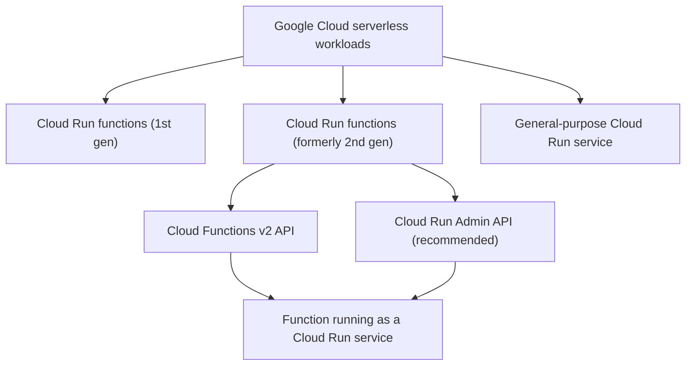
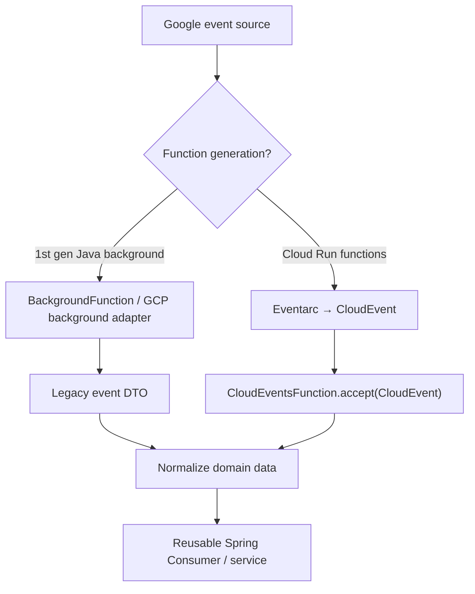
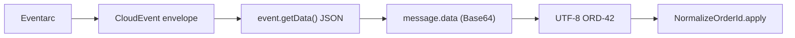
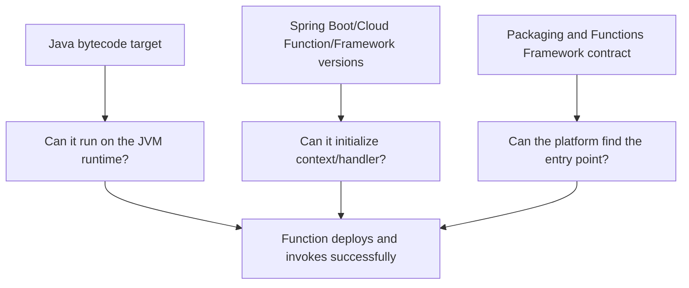
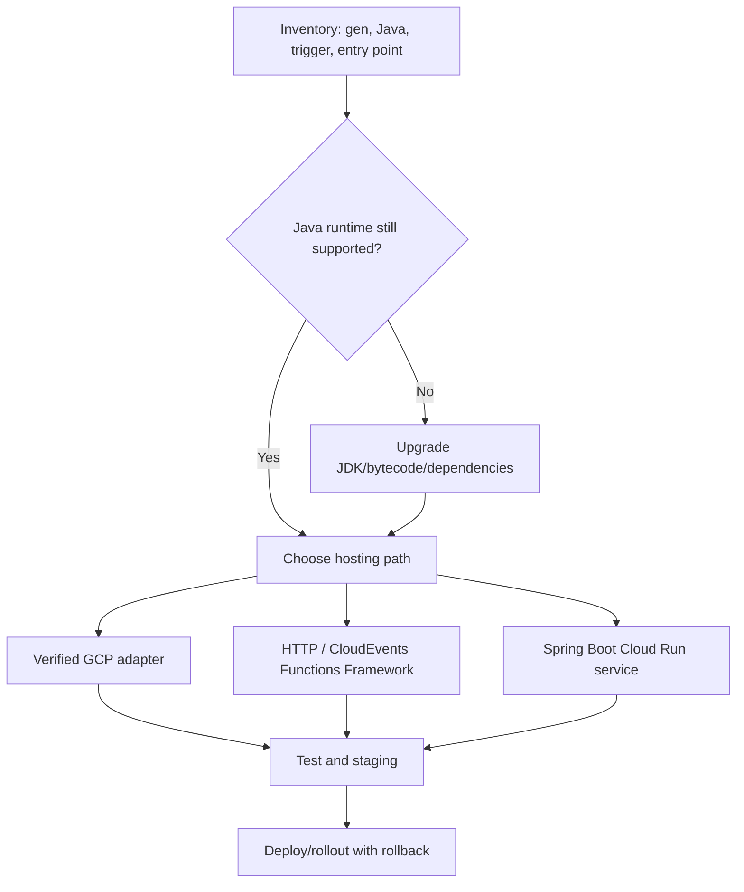

# Comparing Cloud Functions Generations, Cloud Run Functions, and Java Runtimes

## Learning Objectives

**Spring Cloud Function** lets you implement business logic as a `Supplier<O>`, `Function<I,O>`, and `Consumer<I>`, register it through Spring, and reuse it via `FunctionCatalog`, composition, message conversion, or HTTP/event/serverless adapters. However, **Google Cloud Functions** has evolved its product naming, execution architecture, deployment APIs, and supported event types. A Spring Cloud Function project that works in an older example cannot necessarily be dropped as-is as a JAR onto a newer runtime.

In the **Google Cloud** chapter, this lesson provides an accurate side-by-side comparison of:

- **Cloud Functions (1st gen)**, now called **Cloud Run functions (1st gen)**.
- **Cloud Functions (2nd gen)**, now called **Cloud Run functions**, including the two management paths via the **Cloud Functions v2 API** and the **Cloud Run Admin API**.
- Supported Java runtimes—specifically `java17`, `java21`, `java25`, and the status of `java11`.
- The difference between legacy Java background functions and modern **CloudEvents/Eventarc**.
- Where `spring-cloud-function-adapter-gcp`, `GcfJarLauncher`, the Java Functions Framework, `FunctionCatalog`, and various artifact types apply.

By the end of this lesson, you will be able to read older guides without mixing up terminology, select an appropriate Java runtime, identify the right Java entry point and trigger, write a business function reusable across both deployment models, and plan a migration with proper testing.

**Reference baseline:** the Google Cloud runtime and terminology details below were verified against official documentation as of **November 24, 2026**. Runtime lifecycle schedules, resource limits, and `gcloud` commands are subject to change; before every deployment, check Google Cloud's support tables listed at the end of this lesson.

## 1. Product Names and Generations: Do Not Read "2nd gen" as a Different Product

On **August 21, 2024**, Google Cloud announced the rebranding:

| Historical Name | Current Documentation Name | Essence |
| --- | --- | --- |
| **Cloud Functions (1st gen)** | **Cloud Run functions (1st gen)** | Original functions generation; separate API, runtimes, and limits |
| **Cloud Functions (2nd gen)** | **Cloud Run functions** | Functions built on Cloud Run infrastructure using containers built from source |
| Cloud Run services | Cloud Run services | General-purpose HTTP/container services; not synonymous with a Functions Framework function |

Therefore, when documentation or a blog post refers to **Cloud Functions gen2**, understand it as the **current Cloud Run functions model**, while still checking **which API created it**. Two functions both running on Cloud Run can have different management capabilities depending on whether they were created through the Cloud Run Admin API or the Cloud Functions v2 API.



**Do not confuse layers:** *generation* describes the execution platform; *API* describes how the resource is created and managed; *runtime ID* describes the Java/stack version; *function target* describes the Java class invoked by the Functions Framework. All four must be decided and verified independently.

## 2. Comparing Generations by Architecture and Operations

According to Google Cloud's **Compare Cloud Run functions** documentation:

| Criterion | Cloud Run functions (1st gen) | Cloud Run functions (formerly 2nd gen) |
| --- | --- | --- |
| Infrastructure | Original Cloud Functions platform | Function built into a container and deployed as a Cloud Run service |
| Primary creation/management | Cloud Functions API | Cloud Run Admin API or Cloud Functions v2 API |
| HTTP endpoint | Primarily `cloudfunctions.net` | `run.app`; functions created via v2 API also have a `cloudfunctions.net` endpoint |
| Triggers | More limited direct event sources | Eventarc integration with many event sources |
| Java event signature | Background functions for Java in 1st gen | `CloudEventsFunction` for event-driven Java |
| Max HTTP timeout per comparison table | **9 minutes** | **60 minutes** for HTTP functions |
| Event-driven timeout | **9 minutes** | Functions created via Cloud Functions v2 API: up to **9 minutes**; verify other APIs/triggers individually |
| Concurrent requests per instance | **1** | Configurable up to **1,000** per Cloud Run functions limits |
| Traffic splitting across revisions | Not supported per comparison model | Supports Cloud Run revisions / traffic splitting |
| Max RAM/CPU in comparison table | 8 GB / 2 vCPU | 16 GiB / 4 vCPU |
| Platform-built image registry | Historical registry supported | Artifact Registry |
| Networking/scaling controls | More limited | Richer Cloud Run options depending on function type and organization policies |

**The figures above are Google's documented table limits as of the verification date, not defaults for every service.** Regional quotas, API choice, trigger settings, concurrency, and release limits can result in lower effective values. An event-driven function does not automatically inherit a 60-minute timeout simply by running on Cloud Run.

### 2.1. Impact on Spring Cloud Function

In 1st gen, a Java instance typically processes one request at a time, so thread-safety bugs might remain hidden. On Cloud Run functions, **multiple requests can run concurrently on the same instance** depending on concurrency settings:

```java
@Bean
Function<String, String> normalizeOrderId() {
    return input -> input.trim().toUpperCase(Locale.ROOT);
}
```

A stateless function like the one above is easy to reuse. Conversely, a `Consumer` storing current request data in an unsynchronized mutable singleton field can corrupt data as concurrency rises.

Allowing multiple requests per instance **does not add any exactly-once guarantee** for Pub/Sub/Eventarc. Retries and duplicate handling still require idempotency by design.

## 3. Two Paths to Create Modern Cloud Run Functions

Google distinguishes two ways of managing functions on Cloud Run:

### 3.1. Cloud Run Admin API — The Recommended Path

Functions created via the Cloud Run console, `gcloud run`, the `run.googleapis.com` API, or Cloud Run-style Terraform. Google recommends this path for new functions, where source code is built into a container/Cloud Run service.

Sample CLI for a suitable **Java Functions Framework handler**:

```bash
gcloud run deploy order-event-handler \
  --source . \
  --function example.gcp.PubSubCloudEventFunction \
  --base-image java21 \
  --region REGION_ID
```

`REGION_ID` and `example.gcp.PubSubCloudEventFunction` are examples/placeholders to replace with your region and an actual class in your source. **`--function` selects the Java Functions Framework entry point**, not a bean name in `FunctionCatalog`. For HTTP functions, you may need to configure authentication/ingress; for event-driven functions, you need to set up the **appropriate Eventarc trigger**, often as a separate step after deploying via `gcloud run`.

The Admin API path **does not mean** you must write a Dockerfile by hand; `--source` can use source-based buildpacks. However, your source and dependencies must follow the modern Java Functions Framework build mechanism.

### 3.2. Cloud Functions v2 API — Compatible with Older gen2 Workflows

A function created through the Cloud Functions v2 API can be managed via both the **Cloud Functions v2 API** and the **Cloud Run Admin API**. Sample CLI:

```bash
gcloud functions deploy order-event-handler \
  --gen2 \
  --region REGION_ID \
  --runtime java21 \
  --source . \
  --entry-point example.gcp.PubSubCloudEventFunction \
  TRIGGER_FLAGS
```

`TRIGGER_FLAGS` is a placeholder representing valid trigger flags; **do not paste that line verbatim to deploy**. With the Cloud Functions v2 API, the trigger is usually specified at creation time, such as HTTP or an appropriate Eventarc event source.

### 3.3. Differences in Management Capability

**Asymmetric management direction:**

- Functions created via the **Cloud Functions v2 API** can be managed using both Cloud Run tooling and the Cloud Functions v2 API per Google's docs.
- Functions created directly via the **Cloud Run Admin API** **cannot** be edited using the Cloud Functions API.
- A v2 API function can be **detached** to be managed exclusively through the Cloud Run Admin API following Google's workflow; do not assume renaming or redeploying is equivalent to detaching.

| Need | Suggested Starting Point |
| --- | --- |
| Create a new Java function using Google's modern model | Cloud Run Admin API + Functions Framework |
| Maintain deployments already using `gcloud functions --gen2` | Keep v2 API under control or plan management migration |
| Maintain `--no-gen2` functions | Check 1st gen limits and upgrade roadmap |
| Run a full Spring Boot MVC/Netty app as an HTTP server | Consider a standard Cloud Run **service**, not necessarily a function handler |

## 4. Java Runtime Table as of November 24, 2026

According to Google Cloud Run functions' **Runtime support** page:

| Java Runtime | Runtime ID | Generation per Google Table | Documented Status / Schedule |
| --- | --- | --- | --- |
| **Java 25** | `java25` | Newer Cloud Run functions | Listed in current runtimes; scheduled deprecation **October 2031** |
| **Java 21** | `java21` | Newer Cloud Run functions | Listed in current runtimes; scheduled deprecation **September 2031** |
| **Java 17** | `java17` | 1st gen **and** newer Cloud Run functions | Listed; scheduled deprecation **October 2027** |
| **Java 11** | `java11` | 1st gen and Cloud Run functions (historical) | Deprecated **October 31, 2024**, decommissioned **October 31, 2025** |

**Practical takeaway as of November 2026:** do not use `--runtime java11` from older Spring Cloud Function GCP examples to create or redeploy new functions. Google specifies that **decommissioned** runtimes can no longer be used to create or update workloads, and existing workloads may be shut down. Do not build a new service on the Java 11 runtime.

Choosing Java 21 for a modern project is usually a manageable starting point **if** Spring Boot, Spring Cloud Function, the Java Functions Framework, and all libraries are compatible. Java 25 is an available Cloud Run functions runtime option in 2026, yet **runtime support does not mean every Spring library/plugin already has full Java 25 compatibility**. Java 17 can still fit systems needing 1st gen support, though keep its remaining lifecycle window in mind.

### 4.1. Runtime ID Is Different from Java Compiler Target

Example:

```text
JDK running Maven:       21
Maven --release:         17
Google Cloud runtime:    java21
Spring Boot version:     project-compatible version
Spring Cloud Function:   project-compatible version
```

Java source compiled for Java 17 can generally run on a Java 21 runtime if dependencies are compatible; however, bytecode compiled for Java 21 **will not** run on Java 17.

With Maven:

```xml
<properties>
    <maven.compiler.release>17</maven.compiler.release>
</properties>
```

Or when using Java 21 for both build and runtime:

```xml
<properties>
    <maven.compiler.release>21</maven.compiler.release>
</properties>
```

This is only a bytecode configuration snippet, **not a complete `pom.xml`**. `maven.compiler.release` does not select the Google runtime automatically, and `--runtime java21` does not change Maven's target bytecode.

| `javac --release` | Class File Major Version | Minimum Corresponding JVM |
| --- | --- | --- |
| 11 | 55 | Java 11 |
| 17 | 61 | Java 17 |
| 21 | 65 | Java 21 |
| 25 | 69 | Java 25 |

When encountering `UnsupportedClassVersionError`, compare the **build JDK**, `--release`, and **active runtime** rather than just renaming the artifact.

### 4.2. Runtime Lifecycle and Patching

Google publishes **GA → deprecated → decommissioned** states. During deprecation, deployments/redeployments may still be allowed while the runtime moves toward end of support; after decommissioning, workloads cannot be created or updated on that runtime. Base-image update and security policies also affect how Java/OS patches are applied.

**Do not hard-code support schedules as permanent constants** in operational runbooks. Before a release, run:

```bash
gcloud functions runtimes list
```

And check Google's updated **Runtime support** page. Exact CLI command/listing behavior and extra flags depend on your CLI version; Google's runtime documentation remains the canonical source for supported generations and runtimes.

## 5. Java Functions Framework: `HttpFunction`, `BackgroundFunction`, `CloudEventsFunction`

The Java Functions Framework defines distinct handler contracts:

| Java Contract | Primary Input | Common Model |
| --- | --- | --- |
| `HttpFunction` | `HttpRequest`, `HttpResponse` | HTTP functions across supported generations |
| `BackgroundFunction<T>` | Event DTO + background context | Legacy 1st gen Java event functions |
| `CloudEventsFunction` | `CloudEvent` | Eventarc/CloudEvents on modern Cloud Run functions |

**Do not simply swap `BackgroundFunction<T>` for `CloudEventsFunction` while keeping the exact same payload parsing code.** The signature, envelope, metadata, triggers, and retries all differ.



With Spring Cloud Function, the **adapter** is what bridges data from the handler contract into `FunctionCatalog`. Once converted into `OrderEvent`, business `Function`/`Consumer` components remain reusable.

## 6. `spring-cloud-function-adapter-gcp` and `GcfJarLauncher`: In What Context Should You Understand Them?

The Spring Cloud Function 5.0 documentation still includes the **Google Cloud Functions adapter** chapter, showing:

```xml
<dependency>
    <groupId>org.springframework.cloud</groupId>
    <artifactId>spring-cloud-function-adapter-gcp</artifactId>
</dependency>
```

According to this guide, the **Java entry point** for the local Google Functions Framework is:

```text
org.springframework.cloud.function.adapter.gcp.GcfJarLauncher
```

The Spring Boot application class is declared via the manifest per the GCP adapter packaging pattern; `FunctionCatalog` selects the business bean via `spring.cloud.function.definition`.

Plugin sample:

```xml
<plugin>
    <groupId>com.google.cloud.functions</groupId>
    <artifactId>function-maven-plugin</artifactId>
    <version>COMPATIBLE_PLUGIN_VERSION</version>
    <configuration>
        <functionTarget>org.springframework.cloud.function.adapter.gcp.GcfJarLauncher</functionTarget>
        <port>8080</port>
    </configuration>
</plugin>
```

`COMPATIBLE_PLUGIN_VERSION` is a placeholder; choose a version of the Functions Framework Maven plugin that is actually compatible. The Spring Cloud Function guide uses `0.9.1` in its example, **which does not mean it is the latest version or suited for every Java 21/25 runtime**.

### 6.1. Why Does the Documentation Example Show `java11`?

The `gcloud functions deploy` example on Spring Cloud Function's GCP adapter page still illustrates:

```bash
# HISTORICAL COMMAND — do not use for new deployments in 2026:
gcloud functions deploy function-sample-gcp-http \
  --entry-point org.springframework.cloud.function.adapter.gcp.GcfJarLauncher \
  --runtime java11 \
  --trigger-http \
  --source target/deploy
```

**This is a historical example, not current runtime guidance.** Java 11 was decommissioned on October 31, 2025 per Google's table. To move to Java 17/21/25, verify **the function generation, dependencies, plugin packaging, and handler contract together**, not just `--runtime`.

### 6.2. GCP Adapter JAR Packages Differ from Modern Source-Based Builds

Spring Cloud Function's GCP page describes `spring-boot-maven-plugin` extended with the `spring-cloud-function-adapter-gcp` dependency, outputting a JAR in `target/deploy`, along with a source manifest:

```text
Manifest-Version: 1.0
Main-Class: example.gcp.OrderFunctionsApplication

```

However, modern Cloud Run functions use `gcloud run deploy --source . --function ... --base-image java21` to build from a **source directory** using buildpacks and the Functions Framework. There is no guarantee that a **`target/deploy` package built per the historical GCF mechanism** will be processed the same way by newer buildpacks.

Therefore:

- **Historical GCP adapter path:** verify the compatible Spring Cloud Function/Boot/GCF version set and artifact-building plugin; `GcfJarLauncher` is the target documented by the adapter.
- **Newer Cloud Run functions path:** start from Google-supported `HttpFunction` or `CloudEventsFunction` contracts and source layout; when using Spring, have an explicit, verified adapter/bridge.
- **Cloud Run service path:** if you want to keep a full Spring Boot web server and controllers, deploy Spring Boot as a Cloud Run service/container; `GcfJarLauncher` is not required.

Do not conclude that a library named "adapter-gcp" automatically supports **every** CloudEvents signature and every Cloud Run Admin API deployment.

## 7. Shared Logic Example: A `Function` Reusable Across Both Generations

To keep business logic decoupled from Google Java handlers, write a Java class independent of Spring and transport protocols.

File `src/main/java/example/gcp/NormalizeOrderId.java`:

```java
package example.gcp;

import java.util.Locale;
import java.util.function.Function;

public final class NormalizeOrderId implements Function<String, String> {

    @Override
    public String apply(String rawId) {
        if (rawId == null || rawId.isBlank()) {
            throw new IllegalArgumentException("orderId must not be blank");
        }
        String normalized = rawId.trim().toUpperCase(Locale.ROOT);
        if (normalized.length() > 64) {
            throw new IllegalArgumentException("orderId is too long");
        }
        return normalized;
    }
}
```

This class depends only on Java's `Function`. It can be:

- Registered as a Spring bean and invoked through `FunctionCatalog`.
- Called directly by a pure Google Java `HttpFunction` if you want to avoid Spring startup overhead.
- Called by a `CloudEventsFunction` **after parsing the event properly**.
- Unit-tested without a Google Cloud project or HTTP server.

### 7.1. Registering with Spring Cloud Function

File `src/main/java/example/gcp/OrderFunctionsApplication.java`:

```java
package example.gcp;

import org.springframework.boot.SpringApplication;
import org.springframework.boot.autoconfigure.SpringBootApplication;
import org.springframework.context.annotation.Bean;

@SpringBootApplication(proxyBeanMethods = false)
public class OrderFunctionsApplication {

    public static void main(String[] args) {
        SpringApplication.run(OrderFunctionsApplication.class, args);
    }

    @Bean
    public NormalizeOrderId normalizeOrderId() {
        return new NormalizeOrderId();
    }
}
```

And `src/main/resources/application.properties`:

```properties
spring.cloud.function.definition=normalizeOrderId
```

The bean type **`NormalizeOrderId`** implements `Function<String,String>`, so the catalog recognizes the business function. To invoke it:

```java
Function<String, String> fn = catalog.lookup("normalizeOrderId");
if (fn == null) {
    throw new IllegalStateException("normalizeOrderId not found");
}
String result = fn.apply(" ord-42 ");
// "ORD-42"
```

This example assumes `catalog` was injected or retrieved from the Spring context. **Do not use `--entry-point=normalizeOrderId`** when the platform expects the Java Functions Framework handler name.

### 7.2. Small Logic Unit Test

```java
package example.gcp;

import static org.junit.jupiter.api.Assertions.assertEquals;
import static org.junit.jupiter.api.Assertions.assertThrows;

import org.junit.jupiter.api.Test;

class NormalizeOrderIdTest {

    private final NormalizeOrderId fn = new NormalizeOrderId();

    @Test
    void normalizesInput() {
        assertEquals("ORD-42", fn.apply(" ord-42 "));
    }

    @Test
    void rejectsBlankId() {
        assertThrows(IllegalArgumentException.class,
                () -> fn.apply(" "));
    }
}
```

This is a logic unit test and does not verify running on the Google runtime. Catalog, handler, and deployment tests are covered later.

## 8. HTTP Path: Modern `HttpFunction` and the Spring GCP Adapter

### 8.1. Spring-Independent Java HTTP Handler

A Java function using Google's contract:

```java
package example.gcp;

import com.google.cloud.functions.HttpFunction;
import com.google.cloud.functions.HttpRequest;
import com.google.cloud.functions.HttpResponse;
import java.io.IOException;
import java.io.Writer;

public final class NormalizeOrderHttpFunction implements HttpFunction {

    private final NormalizeOrderId rules = new NormalizeOrderId();

    @Override
    public void service(HttpRequest request, HttpResponse response)
            throws IOException {
        if (!"POST".equals(request.getMethod())) {
            response.setStatusCode(405);
            return;
        }

        String input = request.getReader().lines()
                .collect(java.util.stream.Collectors.joining("\n"));

        response.appendHeader("Content-Type", "text/plain; charset=utf-8");
        Writer writer = response.getWriter();
        try {
            writer.write(rules.apply(input));
        } catch (IllegalArgumentException ex) {
            response.setStatusCode(400);
            writer.write("INVALID_ORDER_ID");
        }
    }
}
```

This class implements `com.google.cloud.functions.HttpFunction`, so its **entry point** is `example.gcp.NormalizeOrderHttpFunction`. It **does not initialize a Spring context** and does not expose `FunctionCatalog`; its purpose is to show the modern Google Functions Framework contract. Design explicit status/header/error contracts and avoid logging sensitive data.

### 8.2. Spring Cloud Function GCP Adapter Handling HTTP

If you continue using a verified GCP adapter path:

```text
Google Functions Framework
    → GcfJarLauncher
    → Spring ApplicationContext
    → FunctionCatalog.lookup("normalizeOrderId")
    → NormalizeOrderId.apply(...)
```

The adapter guide uses `mvn function:run` and then tests `POST http://localhost:8080/` with a text body. **Do not confuse the local Google Functions Framework `/` path with Spring Cloud Function Web adapter's `/normalizeOrderId`**; they are two different web adapters.

**Selection rule:** if you need `FunctionCatalog` reuse, composition, and Spring configuration, use a verified adapter or bridge. If you only need a tiny HTTP endpoint on Cloud Run functions, a pure Java `HttpFunction` may be a better fit. If you need a multi-route API or full Spring MVC/WebFlux, consider a Cloud Run service.

## 9. Event Path: Background Pub/Sub vs. Eventarc CloudEvents

### 9.1. Legacy Background Data

A historical Spring Cloud Function GCP adapter `Consumer<PubSubMessage>` sample can receive data like:

```json
{
  "data": "T1JELTQy",
  "messageId": "msg-001",
  "attributes": {"source": "orders"}
}
```

`T1JELTQy` is the Base64 encoding of `ORD-42`. The `PubSubMessage` DTO with `getData()`, `getMessageId()`, and `getAttributes()` must match the payload of your chosen handler/adapter. **Do not assume** a `Consumer<String>` automatically parses JSON events and decodes Base64.

### 9.2. Data in an Eventarc CloudEvent

With Google Cloud Run functions, Pub/Sub messages are delivered inside a **`CloudEvent`**. Its `event.getData()` is JSON containing a nested `message` object:

```json
{
  "message": {
    "data": "T1JELTQy",
    "messageId": "msg-001",
    "attributes": {"source": "orders"}
  },
  "subscription": "projects/example/subscriptions/orders-sub"
}
```

This is the **data section of the CloudEvent**, excluding envelope attributes such as `specversion`, `id`, `type`, and `source`.



### 9.3. Java CloudEvents Handler Example

File `src/main/java/example/gcp/PubSubCloudEventFunction.java`. This snippet uses Jackson and the CloudEvents API from a compatible Functions Framework:

```java
package example.gcp;

import com.fasterxml.jackson.databind.JsonNode;
import com.fasterxml.jackson.databind.ObjectMapper;
import com.google.cloud.functions.CloudEventsFunction;
import io.cloudevents.CloudEvent;
import java.nio.charset.StandardCharsets;
import java.util.Base64;
import java.util.logging.Logger;

public final class PubSubCloudEventFunction implements CloudEventsFunction {

    private static final Logger LOG =
            Logger.getLogger(PubSubCloudEventFunction.class.getName());
    private final ObjectMapper mapper = new ObjectMapper();
    private final NormalizeOrderId rules = new NormalizeOrderId();

    @Override
    public void accept(CloudEvent event) throws Exception {
        if (event.getData() == null) {
            throw new IllegalArgumentException("CloudEvent has no data");
        }

        JsonNode root = mapper.readTree(event.getData().toBytes());
        JsonNode data = root.path("message").path("data");
        if (!data.isTextual()) {
            throw new IllegalArgumentException(
                    "Pub/Sub CloudEvent is missing message.data");
        }

        byte[] bytes = Base64.getDecoder().decode(data.asText());
        String raw = new String(bytes, StandardCharsets.UTF_8);
        String normalized = rules.apply(raw);

        LOG.info(() -> "CloudEvent " + event.getId()
                + " normalizedIdLength=" + normalized.length());
        // Demo: only log length; in production call an idempotent service.
    }
}
```

This class is a **Google Java `CloudEventsFunction`**, not an automatic Spring bean. When deploying from source via the Cloud Run Admin API, the entry point is **`example.gcp.PubSubCloudEventFunction`**, and you must create an Eventarc trigger matching the Pub/Sub/CloudEvent schema.

**Do not change `--function` to `GcfJarLauncher` here** unless you have a tested adapter/bridge whose handler actually implements `CloudEventsFunction` for your runtime. The two processing paths have different contracts.

### 9.4. What If You Want to Use `FunctionCatalog` Inside a CloudEvent Handler?

In the example above, the handler calls the **same Java `NormalizeOrderId` class** used by Spring, so logic is reused without Spring startup. If you genuinely need to invoke **`FunctionCatalog`**, you need an explicit bridge:

1. Initialize or reuse a Spring `ApplicationContext` with an appropriate lifecycle.
2. Obtain the `FunctionCatalog` bean from that context.
3. Parse and validate the CloudEvent first; then look up and invoke the corresponding `Function` or `Consumer`.
4. Manage lifecycle, concurrency, errors, and cold starts.

Example **once the context has been created and `catalog` obtained**:

```java
Function<String, String> fn =
        catalog.lookup("normalizeOrderId");
if (fn == null) {
    throw new IllegalStateException(
            "normalizeOrderId not found");
}
String normalized = fn.apply(decodedOrderId);
```

Do not assume a `CloudEventsFunction` instantiated by the Google Functions Framework will automatically get Spring `@Autowired` injection. Providing the catalog requires a real bootstrap mechanism or an adapter that explicitly supports CloudEvents.

## 10. Packaging, Maven, and Runtime: Three Compatibility Axes

A Java deployment must satisfy all three simultaneously:



| Check | Example Mistake | How to Fix |
| --- | --- | --- |
| Java bytecode | Built for Java 21, deployed on `java17` | Pick Java 21 runtime or build targeting 17 |
| Spring frameworks | Mismatched Spring Cloud Function and Boot versions | Use a compatible BOM; inspect dependency tree |
| Java handler | Bean name used as `--entry-point` | Use the FQCN of `HttpFunction`, `CloudEventsFunction`, or `GcfJarLauncher` |
| Trigger signature | CloudEvents JSON sent to a legacy background Java handler | Pick the right handler/event contract and parse the right envelope |
| Artifact layout | Arbitrary Boot fat JAR treated as a GCP adapter package | Inspect manifest/classpath and packaging plugin |
| Runtime lifecycle | `--runtime java11` in 2026 | Upgrade to a Google-supported runtime |

### 10.1. Dependencies for the Java Functions Framework

For a **pure** `HttpFunction`/`CloudEventsFunction` Java handler, you need the API dependency supplied by the Google Functions Framework; example Maven snippet:

```xml
<dependency>
    <groupId>com.google.cloud.functions</groupId>
    <artifactId>functions-framework-api</artifactId>
    <version>COMPATIBLE_FRAMEWORK_VERSION</version>
</dependency>
```

`COMPATIBLE_FRAMEWORK_VERSION` is a placeholder; pick a current version compatible with your project's Java runtime and plugins. `PubSubCloudEventFunction` also requires the **CloudEvents API** (possibly transitive depending on the framework version) and **Jackson databind**. Inspect the dependency tree rather than assuming every API is pulled in automatically.

For the Spring Cloud Function GCP adapter, use `org.springframework.cloud:spring-cloud-function-adapter-gcp` with compatible Function/Boot modules; some packaging patterns also require the adapter **in `spring-boot-maven-plugin`'s plugin dependencies**, not solely in application dependencies.

### 10.2. Why Isn't a Native Image Just Another `javaXX` Runtime ID?

`java17`, `java21`, and `java25` are **JVM Java** runtimes provided by Google in Cloud Run functions. A **GraalVM Native Image** executable is a different build artifact that typically requires deploying via a **container/custom runtime** suited to the platform; it does not run automatically merely by specifying `--runtime java21`.

Spring AOT, `FunctionCatalog`, and GraalVM `RuntimeHints` are separate topics. If a project needs a native image, verify the compatible container build/deployment path rather than changing only a property or Java runtime ID.

## 11. Local Testing and Smoke Testing by Generation

### 11.1. Layer 1 — Logic Unit Tests

Run `NormalizeOrderIdTest` with JUnit on an appropriate JVM. If it fails, the bug is in business logic, unrelated to Google generations.

### 11.2. Layer 2 — Spring `FunctionCatalog` Test

If using a Spring adapter, test the bean:

```java
@SpringBootTest(
        classes = OrderFunctionsApplication.class,
        webEnvironment = SpringBootTest.WebEnvironment.NONE)
class OrderCatalogTest {

    @Autowired
    FunctionCatalog catalog;

    @Test
    void findsOrderNormalizer() {
        Function<String, String> fn =
                catalog.lookup("normalizeOrderId");
        assertNotNull(fn);
        assertEquals("ORD-42", fn.apply(" ord-42 "));
    }
}
```

This example needs JUnit 5, Spring Boot Test, Function Context, and static imports for `assertNotNull`/`assertEquals`. This test **does not test** the Google Java handler/entry point.

### 11.3. Layer 3 — Functions Framework Handler Test

**GCP adapter path:**

```bash
./mvnw function:run
curl -i -X POST http://localhost:8080/ \
  -H 'Content-Type: text/plain' \
  --data-binary ' ord-42 '
```

Configure `functionTarget=org.springframework.cloud.function.adapter.gcp.GcfJarLauncher` and a manifest pointing to the right Spring class per the adapter docs. The local invoker uses the Google Functions Framework `/` path, **not** Spring Cloud Function Web's `/normalizeOrderId`.

**Newer handler path:** run the Google Java Functions Framework local invoker with `functionTarget` set to **`example.gcp.NormalizeOrderHttpFunction`** or **`example.gcp.PubSubCloudEventFunction`**, matching the HTTP/event signature. For CloudEvents, test requests must follow the **CloudEvents binary/structured-mode contract** and the trigger's real data envelope—not legacy root background JSON.

### 11.4. Layer 4 — Cloud Smoke Test

After deploying, verify:

- **HTTP:** assigned URL, caller IAM/identity token, method/headers/body, timeout, content type, and status.
- **Eventarc:** matching event type/source, JSON `message.data` and CloudEvent metadata, retries, and idempotency.
- **Cold start:** handler and (if applicable) Spring context initialize within memory/time limits.
- **Concurrency:** send concurrent requests to uncover mutable singleton state, connection pools, or non-thread-safe payload mapping.
- **Observability:** measure startup, success/errors, retries, and correlation IDs; never log tokens or sensitive payloads.

**Never use a passing `FunctionCatalog` test as proof that Cloud Run functions deployed properly.** It only tests logic/beans on a local JVM.

## 12. Migration Plan from 1st gen / Java 11 to Cloud Run Functions

A safe roadmap takes multiple steps instead of merely changing `--runtime`:

1. **Inventory workloads:** function name, region, runtime ID, generation, HTTP/background trigger type, event schema, Java handler name, secrets/env vars.
2. **Check current runtime tables:** recognize that Java 11 is decommissioned; select `java17`/`java21`/`java25` based on generation and library compatibility.
3. **Upgrade dependencies:** Spring Boot, Spring Framework, Spring Cloud Function/adapter, Google Functions Framework, CloudEvents/Jackson, and build plugins to compatible releases.
4. **Isolate business logic:** implement HTTP/event-independent pure Java services/`Function`s like `NormalizeOrderId`.
5. **Choose the hosting model:** keep the GCP adapter if compatibility is verified; if moving to modern CloudEvents, create a `CloudEventsFunction` or signature-compliant bridge; for full web apps, pick a Cloud Run service.
6. **Normalize event envelopes:** account for the shift from root `data` in legacy background events to nested `message.data` in Pub/Sub CloudEvents.
7. **Reconfigure triggers/IAM:** Eventarc, Pub/Sub, runtime and deploy service accounts, ingress, region, secrets, retries/dead-letter.
8. **Test continuously:** unit → catalog → local Java handler → cloud staging → concurrency/cold starts → compare logs and metrics.
9. **Cut over traffic:** use planned rollouts or controlled parallel runs while preventing duplicate side effects; define a rollback path.
10. **Retire old resources:** only after confirming URLs, triggers, consumers, and dependencies no longer reference the 1st gen function.



### Migration Compatibility Checklist

| Question | Required Evidence |
| --- | --- |
| Which Java releases does the target runtime support? | Google's runtime support table as of deploy date |
| Does bytecode match the JVM runtime? | Maven/Gradle compiler target and tests on that JDK |
| Do Spring Cloud Function/GCP adapter run with the newer Boot/JDK? | BOM, dependency tree, and integration tests |
| Does the handler implement the right interface? | `HttpFunction` / `CloudEventsFunction` / `GcfJarLauncher` per chosen path |
| Did legacy payloads shift to CloudEvents? | Event schema/docs and envelope tests |
| Which API created the function? | Cloud Functions v2 vs. Cloud Run Admin, avoiding mismatched management commands |
| Do IAM and triggers have needed permissions? | Cloud deploy + event smoke test |
| Is concurrency safe? | Multi-request tests / no mutable request state |
| Can retries duplicate side effects? | Transactions / idempotency keys + metrics |
| Is there a clear rollback path? | Traffic/trigger plan avoiding unintended parallel execution |

## 13. Common Errors by Generation and Runtime

| Symptom | Common Cause | How to Investigate |
| --- | --- | --- |
| `--runtime java11` rejected in 2026 | Java 11 is decommissioned | Choose a supported runtime and upgrade bytecode/dependencies |
| `UnsupportedClassVersionError` | Build JDK is newer than JVM runtime | Check `javac --release`, class file major version, and runtime |
| Cloud Run Admin API function cannot be updated via `gcloud functions` | Resource was created via a different API | Manage via `gcloud run` / Cloud Run Admin API |
| 1st gen lacks needed features or Eventarc | Generation limitation | Plan migration to modern Cloud Run functions |
| Increasing concurrency corrupts data | Mutable singleton, shared state | Use stateless functions, transactions, and thread-safe resources |
| Event-driven function uses `BackgroundFunction<T>` on Cloud Run functions and gets no events | Handler signature does not match CloudEvents | Use `CloudEventsFunction` or a compatible adapter |
| `message.data` is `null` | Parsing legacy root JSON instead of nested CloudEvent | Read `event.getData()` → `message.data` |
| Base64 decode error | Sent `hello` instead of Base64 or wrong event envelope | Check publisher, `data`, and UTF-8/binary contract |
| `GcfJarLauncher` missing at runtime | Package/classpath lacks the adapter | Check packaging, plugins, source, and Java function target |
| `FunctionCatalog.lookup(...)` returns `null` | Wrong bean name/definition/context | Test catalog and `spring.cloud.function.definition` |
| `Main-Class` becomes Boot `JarLauncher` | Using an executable JAR not matching the GCP adapter layout | Check `target/deploy`, manifest, and plugins |
| `ClassNotFoundException` in Cloud Run functions | Entry point missing from source-build classpath | Check source layout, Maven/Gradle dependencies, and FQCN |
| HTTP 404 due to wrong route | Confused local Google Functions Framework `/` with Web adapter | Verify handler and actual URL |
| Event trigger does not fire | Wrong Eventarc/Pub/Sub IAM or filter | Check trigger resource, service account, and event source |
| Function invoked repeatedly creates duplicate transactions | Retries/redeliveries | Design idempotency with durable storage |
| Passes locally, times out in cloud runtime | Cold start, I/O, insufficient memory/CPU | Measure cloud startup and tune timeout/resources |
| HTTP 403 only in the cloud | IAM / identity token / ingress | Check caller and invoke permissions; do not tweak bean names blindly |
| AOT/native JAR deploy fails on `java21` | Confused native executable with JVM runtime | Pick an appropriate container/custom runtime option |

Diagnostic order: **generation/API → Java runtime → handler interface → artifact/classpath → Spring context/`FunctionCatalog` → input envelope → domain/side effects → IAM/retries/observability**. Troubleshooting in this order prevents changing `definition` when the real issue is an end-of-life Java runtime.

## 14. Practice Exercises

### Exercise 1 — Read Product Names Accurately

A guide says "Deploy Cloud Functions 2nd gen with `gcloud functions deploy --gen2`." Identify the current product name, the API used, and an alternative deploy/management path via the Cloud Run Admin API. Explain why a function created with the Admin API cannot be edited via the Cloud Functions API.

### Exercise 2 — Pick Runtimes for Two Projects

Project A uses Java 17 and must run on 1st gen; Project B is a new Cloud Run function wanting Java 21 or 25. Using Google's November 2026 runtime table, identify the right IDs and explain why new projects must not start on `java11`.

### Exercise 3 — Distinguish Java Bytecode from Runtime

Build an application with `maven.compiler.release=21`, then try running it on JVM 17. Predict the exception and major class file version. Revert the target to 17 and run on JVM 21. Record actual evidence; do not modify production environments in this exercise.

### Exercise 4 — Keep Logic, Swap the Adapter

Create `NormalizeOrderId implements Function<String,String>`. Register it as a Spring `@Bean`, then invoke that class inside `NormalizeOrderHttpFunction` and `PubSubCloudEventFunction`. Explain what stays unchanged and what must change when moving from HTTP to Eventarc.

### Exercise 5 — Background Event vs. CloudEvent

Compare:

```json
{"data":"T1JELTQy","messageId":"msg-001"}
```

and:

```json
{"message":{"data":"T1JELTQy","messageId":"msg-001"}}
```

Identify the JSON path to Base64 data in each model, where CloudEvent `id`/`type`/`source` metadata lives, and the risks of reusing a single DTO for both.

### Exercise 6 — Build a Migration Plan

A legacy Java 11 function processes Pub/Sub and writes to a database. Create a checklist covering Java runtime upgrade, generation/API choice, event contract change, IAM, secrets, retry/idempotency, and rollback. Why is changing only `--runtime java21` insufficient?

### Self-Check Questions

1. **What is Cloud Functions (2nd gen) called now?** Cloud Run functions.
2. **What is Cloud Functions (1st gen) called now?** Cloud Run functions (1st gen).
3. **What are the two APIs for creating new Cloud Run functions?** The Cloud Run Admin API and the Cloud Functions v2 API.
4. **Which API does Google recommend for new functions?** The Cloud Run Admin API.
5. **Does the runtime table list Java 21 for 1st gen?** No; it belongs to newer Cloud Run functions.
6. **What is the Runtime ID for Java 25?** `java25`.
7. **Is Java 11 still suitable for creating new functions in November 2026?** No; it was decommissioned on October 31, 2025.
8. **Which generations include Java 17?** 1st gen and newer Cloud Run functions, per Google's current table.
9. **Is `GcfJarLauncher` a `FunctionCatalog` bean name?** No; it is the GCP adapter's Java handler.
10. **Which handler does Eventarc Java use?** `CloudEventsFunction` per the Functions Framework contract.
11. **Is a passing `FunctionCatalog` unit test enough to conclude a new deployment is compatible?** No; runtime, handler, artifact, trigger, and IAM still remain.
12. **Can Cloud Run functions have higher concurrency than 1st gen?** Yes; provided bean/thread safety is ensured.
13. **Does changing `--runtime` automatically turn a background event into a CloudEvent?** No.
14. **Does a native image run directly like Java bytecode on the `java21` runtime?** No; those are two different build/deployment models.

## 15. Summary and References

When reading documentation on **Spring Cloud Function on Google Cloud**, treat *platform generation*, *management API*, *Java runtime*, and *Java handler contract* as **four independent axes**. **Cloud Functions (2nd gen)** is now named **Cloud Run functions**; new functions can be created via the Cloud Run Admin API (recommended by Google) or the Cloud Functions v2 API. In Google's Java runtime table as of **November 2026**, `java25`/`java21` belong to newer Cloud Run functions, `java17` spans both 1st gen and newer generations, and `java11` is decommissioned.

**`spring-cloud-function-adapter-gcp` and `GcfJarLauncher`** remain documented by Spring Cloud Function for integrating with the Google Functions Framework, though historical `java11` examples are no longer current deployment guidance. When adopting **CloudEvents/Eventarc**, pick the right Java handler, event schema, packaging, and Spring bootstrap while keeping business logic in protocol-independent `Supplier`, `Function`, `Consumer`, or pure Java services for reuse.

Official sources to re-check before deploying:

- [Google Cloud — Compare Cloud Run functions](https://docs.cloud.google.com/run/docs/functions/comparison): 1st gen/2nd gen terminology, management APIs, HTTP/events, timeouts, concurrency, and deployment.
- [Google Cloud — Runtime support](https://docs.cloud.google.com/functions/docs/runtime-support): Java runtime table by generation and deprecation/decommission lifecycle.
- [Google Cloud — Cloud Run functions runtimes](https://docs.cloud.google.com/run/docs/runtimes/function-runtimes): current runtime IDs and base images.
- [Google Cloud — Deploy a Cloud Run function](https://docs.cloud.google.com/run/docs/deploy-functions): `gcloud run deploy --source ... --function ... --base-image ...`.
- [Google Cloud — Write Cloud Run functions](https://docs.cloud.google.com/run/docs/write-functions): Functions Framework contracts for HTTP and CloudEvents.
- [Google Cloud — Pub/Sub CloudEvent Java sample](https://docs.cloud.google.com/functions/docs/samples/functions-cloudevent-pubsub): `message.data` schema, Base64, and `CloudEventsFunction`.
- [Spring Cloud Function — Google Cloud Functions adapter](https://docs.spring.io/spring-cloud-function/reference/adapters/gcp-intro.html): `GcfJarLauncher`, Maven packaging, local tests, and historical deployment examples.
- [Google Cloud — Cloud Run functions release notes](https://docs.cloud.google.com/functions/docs/release-notes): confirms the August 21, 2024 rename milestone.

**Application note:** runtime IDs, end-of-support schedules, resource limits, CLI flags, and support across individual adapters/Java libraries can change. This lesson was completed during STEP 4 for content and files; build tests and the module's Content QA pass are performed separately according to the workflow.
