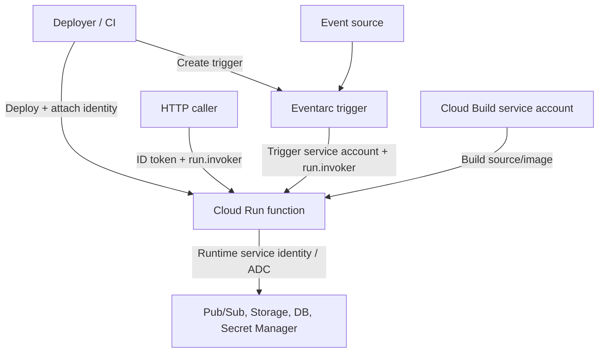

# Configuring Invocation Permissions, Triggers, and Post-Deployment Verification

## Learning Objectives

**Spring Cloud Function** lets you write business logic as a `Supplier<O>`, `Function<I,O>`, and `Consumer<I>`, register it in the Spring context, and look it up via `FunctionCatalog`. Through adapters, the same function can serve HTTP, messages/events, or serverless environments. When deploying to **Google Cloud**, configuring the Java entry point and function definition alone is not enough: you must also configure **invocation permissions, trigger identity, runtime identity, trigger type, and post-deployment verification**.

After this lesson, you will be able to:

- Distinguish between the deployer account, HTTP caller, Eventarc trigger service account, function service identity, and build service account.
- Pick the right IAM roles for Cloud Functions 1st gen, Cloud Run functions (2nd gen), and the Cloud Run Admin API.
- Protect HTTP functions with IAM, send ID tokens, and allow public access only when genuinely required by business needs.
- Configure Eventarc triggers for Pub/Sub, Cloud Storage, or other event sources, and grant proper permissions to the trigger service account.
- Deploy an HTTP function and an event-driven function using the Google Cloud CLI, understanding what changes across generations/APIs.
- Verify service/revision status, IAM policies, triggers, logs, HTTP responses, and event side effects.
- Troubleshoot 401/403 errors, active triggers not delivering events, missing Google API permissions, retries, and duplicate handling.
- Design a release checklist, smoke tests, rollback plan, and least-privilege setup.

**Scope:** examples prioritize **Cloud Run functions** using the modern Cloud Run Admin API and Eventarc, with comparisons against the Cloud Functions v2 API and 1st gen where IAM differs. For Spring Cloud Function, examples use `FunctionCatalog` and business beans; **`GcfJarLauncher` should only be used when your GCP adapter/Functions Framework version is verified compatible with the target trigger type and runtime**. Pure Java HTTP handlers and CloudEvents handlers follow different contracts.

## 1. Before Granting Permissions, Identify the Five Distinct Identities

A function typically involves multiple principals. Collapsing all of them into one broad-permission service account makes incident investigation and blast-radius containment much harder.

| Identity | Who Uses It? | Responsibility | Typical Permissions |
| --- | --- | --- | --- |
| **Deployer** | Human or CI/CD pipeline | Creates/updates functions, attaches service accounts, creates triggers | Cloud Run Source Developer or Cloud Functions Developer/Admin; Service Account User; Eventarc permissions when creating triggers |
| **HTTP caller / invoker** | User or calling service | Sends requests to protected endpoints | `roles/run.invoker` on the Cloud Run service/function; 1st gen uses `roles/cloudfunctions.invoker` |
| **Eventarc trigger service account** | Eventarc when delivering events to the function | Receives events from providers and invokes the target service | `roles/run.invoker` on the service; `roles/eventarc.eventReceiver` for applicable Eventarc sources |
| **Runtime service identity** | Code running inside the function | Calls Google APIs such as Pub/Sub, Storage, Secret Manager, Cloud SQL | Only the data permissions required by business logic |
| **Build service account / service agents** | Cloud Build, Eventarc, Cloud Functions | Builds source, manages transport/triggers, and manages platform resources | Corresponding build/service-agent roles; typically configured separately |

These identities are **not automatically interchangeable**:

- A deployer having deploy permissions does not mean that user can invoke the endpoint.
- An HTTP caller having `run.invoker` does not mean code inside the function can read Cloud Storage.
- A runtime service account having bucket-read access does not mean Eventarc is allowed to invoke the function.
- A trigger service account having `run.invoker` does not mean it can read the database used by the function.
- The build service account building the container image is not the runtime business identity of the running code.



**Principle:** use dedicated service accounts per workload or responsibility wherever possible, granting only the narrowest necessary roles. Avoid personal user accounts, downloaded JSON keys, or default `Editor`-privileged service accounts as long-lived production identities.

## 2. Choosing the Right IAM Role by Generation

A common mistake is granting `roles/cloudfunctions.invoker` for a newer-generation function. That role applies to **1st gen HTTP functions**; 2nd gen and functions created via Cloud Run require **Cloud Run Invoker**.

| Platform / Creation Path | Role for Principal to Call HTTP | Resource Policy Is Attached To |
| --- | --- | --- |
| Cloud Functions **1st gen** | `roles/cloudfunctions.invoker` | 1st gen Cloud Function |
| Cloud Functions **2nd gen** via Cloud Functions v2 API | `roles/run.invoker` | Underlying Cloud Run service of the function |
| Cloud Run functions via **Cloud Run Admin API** | `roles/run.invoker` | Cloud Run service/function |
| General Cloud Run service | `roles/run.invoker` | Cloud Run service |

The Cloud Functions v2 API also relies on the `run.routes.invoke` permission, typically granted via `roles/run.invoker`. Therefore, **do not look only at the product name**: know whether the function was created through the Cloud Functions API or the Cloud Run API so you use the right IAM commands.

### 2.1. Key Roles to Distinguish

| Role | Typical Assignee | Purpose |
| --- | --- | --- |
| `roles/cloudfunctions.invoker` | 1st gen HTTP caller | Authenticated invocation of a 1st gen HTTP function |
| `roles/run.invoker` | HTTP caller or Eventarc trigger service account | Authenticated invocation of a Cloud Run function/service |
| `roles/eventarc.eventReceiver` | Eventarc trigger service account | Receives events from event providers per the Eventarc contract |
| `roles/eventarc.admin` | Deployer/operator managing triggers | Creates, updates, deletes, and manages Eventarc triggers |
| `roles/iam.serviceAccountUser` | Deployer | Attaches / acts as a service account as runtime or trigger identity |
| `roles/run.sourceDeveloper` | Deployer using Cloud Run source deploy | Deploys Cloud Run from source |
| `roles/serviceusage.serviceUsageConsumer` | Deployer | Uses project/APIs during deployment |
| `roles/run.builder` | Build service account | Builds source into an image in Cloud Run source deployments |

The roles above are a **common baseline**, not an exhaustive list for every project. Enabled APIs, build service accounts, Artifact Registry, organization policies, and trigger types may require additional permissions. Grant roles at the project level only when needed; prefer binding roles on specific services or service accounts.

### 2.2. What Permissions Does the Deployer Need?

For deploying a Cloud Run function from source via `gcloud run deploy`, Google's documentation lists for the deployer:

- **Cloud Run Source Developer** — `roles/run.sourceDeveloper` on the project.
- **Service Usage Consumer** — `roles/serviceusage.serviceUsageConsumer` on the project.
- **Service Account User** — `roles/iam.serviceAccountUser` on the service identity the deployer needs to attach.

The default Cloud Build service account or a designated build service account also needs **Cloud Run Builder** — `roles/run.builder` per the source build setup. If the deployer also creates an Eventarc trigger, they need Eventarc management permissions and permission to use the trigger service account.

With `gcloud functions deploy` / Cloud Functions v2 API, the corresponding management roles are **Cloud Functions Developer** or **Cloud Functions Admin**. Do not mix deployment roles from the two APIs in one command and assume they apply uniformly to every resource.

### 2.3. Service Account User Is Not Function Invoke Permission

`roles/iam.serviceAccountUser` contains the `iam.serviceAccounts.actAs` permission. It lets a deployer **attach/act as a service account** in a workload's configuration. It does not grant `run.routes.invoke`, does not permit calling the HTTP endpoint, and does not grant Cloud Storage read access.

Example granting a deployer permission to attach a specific runtime service account:

```bash
gcloud iam service-accounts add-iam-policy-binding \
  runtime-orders@PROJECT_ID.iam.gserviceaccount.com \
  --member="user:DEPLOYER_EMAIL" \
  --role="roles/iam.serviceAccountUser"
```

`PROJECT_ID` and `DEPLOYER_EMAIL` are placeholders to replace. Binding at the **service account** level narrows permissions compared to granting `roles/iam.serviceAccountUser` project-wide.

## 3. Configuring HTTP Function Invocation Permissions

### 3.1. Private Should Be the Default for Internal APIs

Cloud Run functions require authentication by default. A caller needs both:

1. A **valid ID token** proving identity.
2. **Cloud Run Invoker** permission on the service, typically `roles/run.invoker`.

If the function uses the Cloud Functions v2 API, the invocation docs also confirm `roles/run.invoker`. For 1st gen, the corresponding role is `roles/cloudfunctions.invoker`.

Example granting invoke permission to a specific service account on a Cloud Run service:

```bash
gcloud run services add-iam-policy-binding order-http \
  --region=REGION_ID \
  --member="serviceAccount:api-caller@PROJECT_ID.iam.gserviceaccount.com" \
  --role="roles/run.invoker"
```

If the caller is a human user:

```bash
gcloud run services add-iam-policy-binding order-http \
  --region=REGION_ID \
  --member="user:CALLER_EMAIL" \
  --role="roles/run.invoker"
```

This policy sits on the **target service**, not on a Pub/Sub topic or the runtime service account. Replace the service name, region, project, and principal with real values.

### 3.2. When Should Public Access Be Allowed?

A public webhook or unauthenticated public endpoint may allow unauthenticated invocation. On Cloud Run, this corresponds to granting `roles/run.invoker` to the special principal **`allUsers`**:

```bash
gcloud run services add-iam-policy-binding order-webhook \
  --region=REGION_ID \
  --member="allUsers" \
  --role="roles/run.invoker"
```

This command makes the endpoint callable by anyone on the Internet. Use it only when business requirements truly require public access, appropriate webhook signature/auth verification is in place where needed, and organization policies permit it. **Do not** make a service public just to bypass 401/403 errors during testing.

For functions created with the Cloud Functions v2 API, public access can be configured at deploy time via `--allow-unauthenticated`; this option alters the IAM policy. For functions created via the Cloud Run Admin API, use Cloud Run's access management controls.

An organization policy such as **Domain Restricted Sharing** may prevent adding `allUsers`. In such environments, keep the endpoint private and grant access to specific users or service accounts.

### 3.3. Calling a Private HTTP Endpoint with an ID Token

In development, if the Google Cloud CLI is logged in as a principal holding `roles/run.invoker`, you can fetch the URL and send a request:

```bash
SERVICE_URL="$(gcloud run services describe order-http \
  --region=REGION_ID \
  --format='value(status.url)')"

ID_TOKEN="$(gcloud auth print-identity-token)"

curl -i -X POST "$SERVICE_URL/" \
  -H "Authorization: Bearer $ID_TOKEN" \
  -H "Content-Type: text/plain" \
  --data-binary "ord-42"
```

`gcloud auth print-identity-token` is handy for **developer smoke tests**. For production service-to-service calls, mint ID tokens for the calling service account with the **audience set to the target service URL**, and grant `roles/run.invoker` to that calling service account. Never store tokens long-term, and never write tokens to logs or source control.

If a token is valid yet lacks invoke permission, the request is still rejected. Conversely, a principal with the role who fails to send a valid token will fail authentication as well.

## 4. Separating Runtime Service Identity from Callers and Triggers

When Spring Cloud Function code calls Google APIs, it uses the Cloud Run function's **service identity**. This is the identity of the running workload, used by Application Default Credentials (ADC) to obtain credentials; the application does not need to store a service account JSON key.

For example, if a function needs to read objects from Cloud Storage:

- The external caller needs `roles/run.invoker` to call the function.
- The runtime service account needs an object/bucket read role, such as an appropriately scoped Storage role.
- The deployer needs `roles/iam.serviceAccountUser` on the runtime service account to attach it at deploy time.

These three permissions serve three distinct purposes.

### 4.1. Creating a Dedicated Runtime Service Account

```bash
gcloud iam service-accounts create runtime-orders \
  --display-name="Runtime identity for order function"
```

The service account email takes the form:

```text
runtime-orders@PROJECT_ID.iam.gserviceaccount.com
```

Grant that identity **only the required data roles**. For instance, if the function reads objects from one specific bucket, grant the role on that bucket rather than project-wide.

Deploy the function and attach the runtime service account:

```bash
gcloud run deploy order-http \
  --source . \
  --function example.gcp.OrderHttpFunction \
  --base-image java21 \
  --region REGION_ID \
  --service-account=runtime-orders@PROJECT_ID.iam.gserviceaccount.com
```

This is a **Cloud Run Admin API source deployment** example for the Java Functions Framework. `example.gcp.OrderHttpFunction` must be an actual Java entry point implementing the corresponding handler contract. If your project uses the Spring Cloud Function GCP adapter with `GcfJarLauncher`, swap in that class only after confirming adapter compatibility with your target runtime and trigger; **the bean name `normalizeOrderId` is not an entry point**.

For the Cloud Functions v2 API, `gcloud functions deploy` provides `--service-account` to specify the runtime service account. Exact commands and flags depend on which API manages the resource.

### 4.2. Never Grant `Editor` to the Runtime by Default

Avoid these practices in production:

- Assigning `roles/owner` or `roles/editor` to the runtime service account "just to be safe".
- Using the default Compute Engine service account without auditing its granted roles.
- Downloading a service account JSON key and embedding it inside the JAR.
- Sharing one catch-all service account with read/write access across every bucket, topic, secret, and database.

If the function calls no Google APIs, the runtime identity may need no extra data roles at all. If the function accesses Secret Manager, grant `roles/secretmanager.secretAccessor` on the needed secret to the **runtime service account**, not to the HTTP caller.

## 5. Configuring the HTTP Trigger at Deployment Time

With newer Cloud Run functions, you can deploy a Java function from source:

```bash
gcloud run deploy order-http \
  --source . \
  --function example.gcp.OrderHttpFunction \
  --base-image java21 \
  --region REGION_ID \
  --service-account=runtime-orders@PROJECT_ID.iam.gserviceaccount.com
```

Notice that `--allow-unauthenticated` is **omitted** here, because endpoints should require authentication by default. If this is intentionally a public webhook, add `--allow-unauthenticated` deliberately and review the resulting IAM policy after deployment.

If using the Cloud Functions v2 API for an existing HTTP function or legacy workflow compatibility:

```bash
gcloud functions deploy order-http \
  --gen2 \
  --region=REGION_ID \
  --runtime=SUPPORTED_JAVA_RUNTIME \
  --source=. \
  --entry-point=JAVA_HANDLER_FQCN \
  --trigger-http \
  --service-account=runtime-orders@PROJECT_ID.iam.gserviceaccount.com
```

`SUPPORTED_JAVA_RUNTIME` and `JAVA_HANDLER_FQCN` are placeholders. With the Cloud Functions v2 API, `--entry-point` must point to the appropriate Java function target, not a Spring bean name. **Do not copy old Java 11 commands** from legacy GCP adapter docs onto a modern runtime.

### 5.1. Configuring One Private Endpoint and One Public Endpoint

| Endpoint Type | Intended IAM | How to Verify |
| --- | --- | --- |
| Internal API | Only approved callers/service accounts hold `roles/run.invoker` | Request with a valid ID token |
| Public webhook | `allUsers` holds `roles/run.invoker`, plus signature verification if needed | Unauthenticated requests reach the handler, while business auth is still enforced |
| Event-driven function | Event source/trigger identity has invoke permission | Publish an event from the real source; do not open public HTTP just to test |

**Having an HTTP URL does not prove the function is callable.** Verify auth mode, IAM policy, ingress, and token/audience.

## 6. Configuring Eventarc Triggers for Event-Driven Functions

For event-driven functions on Cloud Run, Eventarc delivers events as an **HTTP POST carrying a CloudEvent envelope** to the function. In Spring Cloud Function, the bean is typically `Consumer<CloudEvent>` or `Consumer<DomainEvent>` after an adapter/handler converts the payload. Choose the Java entry point matching the event contract; an HTTP handler does not automatically become a CloudEvents handler simply because a trigger was created.

### 6.1. Enable Required APIs

For Pub/Sub/Eventarc and Cloud Run source deployments:

```bash
gcloud services enable \
  run.googleapis.com \
  cloudbuild.googleapis.com \
  artifactregistry.googleapis.com \
  logging.googleapis.com \
  eventarc.googleapis.com \
  eventarcpublishing.googleapis.com \
  pubsub.googleapis.com
```

Enable only the APIs needed by your actual services. Enabling APIs may require `serviceusage.services.enable` and a project linked to billing per build/deploy requirements.

### 6.2. Create a Dedicated Service Account for the Eventarc Trigger

```bash
gcloud iam service-accounts create eventarc-orders \
  --display-name="Eventarc identity for order events"
```

The trigger identity email will be:

```text
eventarc-orders@PROJECT_ID.iam.gserviceaccount.com
```

This is the identity **Eventarc uses to invoke the target function**, not necessarily the function's runtime service account.

If the event source requires permission to receive events from the Eventarc provider, grant:

```bash
gcloud projects add-iam-policy-binding PROJECT_ID \
  --member="serviceAccount:eventarc-orders@PROJECT_ID.iam.gserviceaccount.com" \
  --role="roles/eventarc.eventReceiver"
```

**Important exception:** Google explicitly notes that `roles/eventarc.eventReceiver` is not required when a trigger receives **direct events from Cloud Pub/Sub** per the Eventarc Pub/Sub guide. For other Eventarc sources, check provider/trigger roles in the corresponding documentation.

### 6.3. Grant Invoke Permission on the Target Function to the Trigger Identity

If the target function requires authentication, the Eventarc trigger service account must hold **Cloud Run Invoker** on the service:

```bash
gcloud run services add-iam-policy-binding order-events \
  --region=REGION_ID \
  --member="serviceAccount:eventarc-orders@PROJECT_ID.iam.gserviceaccount.com" \
  --role="roles/run.invoker"
```

Do not grant this role to the runtime service account just because it processes events. **The principal in `--member` must be the service account configured on the Eventarc trigger.**

### 6.4. Create an Eventarc Trigger for an Existing Pub/Sub Topic

Assume:

- Target Cloud Run service: `order-events`.
- Pub/Sub topic: `orders-topic`.
- Eventarc trigger identity: `eventarc-orders@PROJECT_ID.iam.gserviceaccount.com`.

Command:

```bash
gcloud eventarc triggers create orders-published \
  --location=REGION_ID \
  --destination-run-service=order-events \
  --destination-run-region=REGION_ID \
  --event-filters="type=google.cloud.pubsub.topic.v1.messagePublished" \
  --transport-topic=projects/PROJECT_ID/topics/orders-topic \
  --service-account=eventarc-orders@PROJECT_ID.iam.gserviceaccount.com
```

This is a **Pub/Sub direct event** example using an existing topic. The trigger and topic must follow Eventarc location/project rules; Eventarc Pub/Sub triggers only support single-region locations. The destination service receives HTTP POST requests at the root path `/` unless a different path is configured.

Do not add `--max-retry-attempts=1` if you want standard retry behavior. Per Eventarc documentation, that flag limits delivery to **a single attempt**; it is not a sensible default for production consumers.

### 6.5. Triggers for Cloud Storage or Other Eventarc Sources

For sources other than direct Pub/Sub, the command typically looks like:

```bash
gcloud eventarc triggers create storage-object-created \
  --location=REGION_ID \
  --destination-run-service=order-events \
  --destination-run-region=REGION_ID \
  --event-filters="type=EVENT_TYPE" \
  --event-filters="bucket=BUCKET_NAME" \
  --service-account=eventarc-orders@PROJECT_ID.iam.gserviceaccount.com
```

`EVENT_TYPE` must come from Google's **Event types supported by Eventarc** reference for that exact provider and event kind; `BUCKET_NAME` is a real bucket. Never guess event type names. For direct Cloud Storage events, the Cloud Storage service agent may need `roles/pubsub.publisher` to publish events over transport; verify role requirements for your specific trigger.

### 6.6. Trigger Rules to Remember

- An Eventarc trigger needs a **dedicated identity**; Google recommends a user-managed service account.
- The trigger identity needs `roles/run.invoker` if the destination service requires authentication.
- `roles/eventarc.eventReceiver` is granted for event providers that require it; direct Pub/Sub is a documented exception.
- Trigger location must be compatible with the event source; in particular, Pub/Sub Eventarc triggers support single-region locations only.
- Event filters act as an **AND condition**: an event must match all configured filters.
- The primary event type filter cannot be changed after trigger creation; to change event types, create a new trigger, migrate traffic/sources, and delete the old trigger in a planned way.
- After creation, a trigger can take **up to two minutes or more** to propagate and start filtering events; do not jump to conclusions immediately.
- An active trigger does not prove it can invoke the service; verify IAM and send a real test event.

## 7. Configuring Permissions for Eventarc and Service Agents

Google service agents manage underlying platform transport and resources. When creating Eventarc resources for the first time, the **Eventarc Service Agent** role is typically granted automatically. With the Cloud Functions v2 API, the **Cloud Functions Service Agent** also receives its own role when the API is enabled.

Never remove service agent roles arbitrarily. If a role was stripped or a service agent lost permissions, triggers may be created yet fail to deliver; restore the proper predefined service-agent role per Google documentation instead of granting `Editor`.

### Permission Matrix Across the Eventarc Flow

| Principal | Role | Where Bound? | When Required? |
| --- | --- | --- | --- |
| Deployer | `roles/eventarc.admin` or equivalent | Project / Eventarc resource | Creating or managing triggers |
| Deployer | `roles/iam.serviceAccountUser` | Trigger service account | Attaching the trigger identity |
| Trigger service account | `roles/eventarc.eventReceiver` | Project | When required by the event provider; not needed for direct Pub/Sub |
| Trigger service account | `roles/run.invoker` | Target Cloud Run service | When the target service requires authenticated invocation |
| Eventarc service agent | `roles/eventarc.serviceAgent` | Project | Manages transport; typically granted automatically by Google |
| Cloud Storage service agent | `roles/pubsub.publisher` | Project | Required by certain direct Cloud Storage triggers to publish transport messages |
| Runtime service account | Business data roles | Specific data resources | When function code calls Google APIs |

**Do not collapse all of these roles into a single service account.** Cross-project service accounts also introduce specific IAM and organization policy requirements; read Google's cross-project guidance before creating cross-project triggers.

## 8. Verifying After Deployment: Look Past the "Deploying… done" Line

After deploying, inspect the **resource, revision, IAM, trigger, request/event, and logs**. A deploy command exiting with code 0 proves only that the API accepted the deployment; it does not prove callers are authorized or that Eventarc delivers the expected payload.

### 8.1. Inspecting the Cloud Run Service and Revision

```bash
gcloud run services describe order-http \
  --region=REGION_ID \
  --format=yaml
```

Inspect key fields:

- `status.url`: assigned service URL.
- `status.conditions`: Ready status and any error messages.
- `status.latestReadyRevisionName`: latest ready revision.
- `spec.template.spec.serviceAccountName`: attached runtime service account.
- `spec.template.spec.containers`: relevant image/env/port configuration.

Fetch just the URL:

```bash
gcloud run services describe order-http \
  --region=REGION_ID \
  --format='value(status.url)'
```

For resources created through the **Cloud Functions v2 API**, you can inspect them with:

```bash
gcloud functions describe order-http \
  --gen2 \
  --region=REGION_ID
```

For the **Cloud Run Admin API**, use `gcloud run services describe`; do not use Cloud Functions commands to manage resources created directly with the Cloud Run API.

### 8.2. Inspecting the Endpoint's IAM Policy

```bash
gcloud run services get-iam-policy order-http \
  --region=REGION_ID
```

Verify:

- Intended callers/service accounts have `roles/run.invoker`.
- Private endpoints do not accidentally include `allUsers`.
- If an endpoint is intentionally public, the `allUsers` binding is deliberate and reviewed.
- The Eventarc trigger service account has `roles/run.invoker` on the target service.

For Cloud Functions 1st gen, check the function's IAM policy using the corresponding Cloud Functions command and verify `roles/cloudfunctions.invoker` is granted to the intended principals.

### 8.3. Inspecting the Eventarc Trigger

List triggers:

```bash
gcloud eventarc triggers list --location=-
```

Describe a specific trigger:

```bash
gcloud eventarc triggers describe orders-published \
  --location=REGION_ID \
  --format=yaml
```

Check:

- The trigger exists and its status/conditions report no errors.
- `eventFilters` specify the right event type and topic/bucket/resource.
- `destination` points to the right service and region.
- `serviceAccount` is the authorized trigger identity.
- The transport topic/subscription was created as expected.

If the trigger was just created, wait for the documented propagation window before concluding events are lost. If the trigger is active yet function logs show no requests, check source, filters, location, and invoke permissions.

### 8.4. Inspecting Function Logs

For a Cloud Run service/function:

```bash
gcloud run services logs read order-http \
  --region=REGION_ID \
  --limit=50
```

Or query via Cloud Logging:

```bash
gcloud logging read \
  'resource.type="cloud_run_revision" AND resource.labels.service_name="order-http"' \
  --limit=50
```

For the Cloud Functions v2 API, you can use:

```bash
gcloud functions logs read order-http \
  --gen2 \
  --region=REGION_ID \
  --limit=50
```

Logs should help distinguish:

- Startup, bean registration, and `FunctionCatalog` errors.
- Whether an HTTP request or an event trigger invoked the handler.
- JSON/CloudEvent parsing or message conversion errors.
- Business errors versus Google API errors caused by missing runtime identity permissions.
- Retries/duplicates and side-effect outcomes.

Never log tokens, secrets, or full payloads containing personal data. Log correlation IDs, event IDs, function name, revision, and processing outcomes safely.

## 9. HTTP Smoke Test After Deployment

For a private endpoint, retrieve the URL and an ID token:

```bash
SERVICE_URL="$(gcloud run services describe order-http \
  --region=REGION_ID \
  --format='value(status.url)')"
ID_TOKEN="$(gcloud auth print-identity-token)"

curl -i -X POST "$SERVICE_URL/" \
  -H "Authorization: Bearer $ID_TOKEN" \
  -H "Content-Type: text/plain" \
  --data-binary " ord-42 "
```

With the Spring Cloud Function HTTP adapter, verify the response against the function's contract:

- HTTP status matches business logic.
- Body is converted to the expected type.
- Function definition selects the right bean or composition.
- Logs confirm the handler and bean ran on the new revision.

If the code accepts a JSON DTO, send `Content-Type: application/json` and verify the actual JSON response. If the function returns `Message<T>`, only headers/status supported by the adapter are mapped; do not assume every Spring `MessageHeaders` entry becomes an HTTP response header.

### 9.1. Distinguishing 401, 403, and 404

| Code | Common Cause | What to Check |
| --- | --- | --- |
| **401 Unauthorized** | Missing token, invalid/expired token, or wrong audience | `Authorization` header, ID token, audience/issuer |
| **403 Forbidden** | Token identifies principal, but principal lacks `run.invoker`, or ingress/org policy blocks it | IAM policy on the service, principal, ingress |
| **404 Not Found** | Wrong URL/route, service not ready, or function has no matching endpoint | `status.url`, root path, revision, handler |
| **500 Internal Server Error** | Exception in handler, Spring context, converter, or business logic | Cloud Run logs and safe stack traces |
| **502/503** | Container not ready, startup/timeout failure, or upstream issue | Revision conditions, startup logs, health/startup behavior |

Opening the URL in a browser may return 403 because browsers do not automatically attach an ID token. That does not prove the service URL is wrong.

## 10. Eventarc and Pub/Sub Smoke Testing

### 10.1. Publishing a Test Event

With a Pub/Sub topic wired to Eventarc:

```bash
gcloud pubsub topics publish orders-topic \
  --message='{"orderId":"ORD-42","action":"CREATED"}'
```

The publisher sends **message data**; Pub/Sub and Eventarc wrap it into a CloudEvent when delivering to Cloud Run. If your application expects JSON inside `message.data`, the handler must read the CloudEvent envelope and Base64-decode it per the contract. Do not manually Base64-encode the payload before publishing unless your business contract intentionally expects a Base64 string as the inner payload.

### 10.2. Verifying the Event Reached the Right Function

1. Open the Cloud Run service logs and locate the new request.
2. Confirm the event type/source and event ID are logged safely.
3. Confirm the `Consumer`/function selected from `FunctionCatalog` actually ran.
4. Check the resulting side effect in the target system (database, object, or business state).
5. Check trigger health and retries if the event was not processed.

**An active trigger does not mean the event was processed.** Prove the full path: source → Eventarc → authenticated HTTP invocation → handler → function → side effect.

### 10.3. Retries and Duplicate Handling

Eventarc retries deliveries according to its configuration. If delivery fails, an event can be redelivered. Therefore:

- Use `CloudEvent.id` or an appropriate message ID as the idempotency key.
- Record processing state in durable storage using transactions or unique constraints.
- Return success only after the side effect reaches a durable state.
- Separate transient errors from unrecoverable malformed payloads; use dead-lettering or quarantine per system policy.
- Never rely on a `static Set` or singleton memory as the sole deduplication store across multiple instances.

In Eventarc commands, `--max-retry-attempts=1` means only one delivery attempt per the documentation; do not enable it merely to hide processing bugs.

## 11. Verifying Spring Cloud Function in the Cloud Environment

Once IAM and triggers are confirmed, verify the Spring layer:

### 11.1. Function Bean Registration

Application example:

```java
@Bean
public Function<String, String> normalizeOrderId() {
    return value -> value.trim().toUpperCase(Locale.ROOT);
}
```

And `application.properties`:

```properties
spring.cloud.function.definition=normalizeOrderId
```

If using composition:

```properties
spring.cloud.function.definition=normalizeOrderId|appendTag
```

Verify that bean names match `FunctionCatalog`, input/output types are compatible, and the adapter invokes the intended function definition. **`GcfJarLauncher` is the GCP adapter's Java handler in compatible setups, not a bean name.** If deploying a pure Java `CloudEventsFunction`, the handler class is the entry point; using `FunctionCatalog` requires a tested Spring bridge/bootstrap.

### 11.2. Verifying the Runtime Service Account

Check the attached service account in the service/revision configuration using `gcloud run services describe`. Then inspect that identity's roles on the resources accessed by the function.

If the function calls Cloud Storage:

- An HTTP caller having `roles/run.invoker` is not enough to read a bucket.
- An Eventarc trigger identity having `roles/run.invoker` is not enough to read a bucket.
- The **runtime service account** is what needs appropriate Storage permissions so the code can read objects.

If the application uses Cloud Client Libraries, prefer **Application Default Credentials** from the runtime service identity. Never create manual JSON keys just to bypass permission errors.

### 11.3. Verifying Configuration and Secrets Without Exposing Data

You may log safe metadata such as function definition, build version, revision, or profile name. Never print all of `System.getenv()`, which can expose secrets and tokens. For Secret Manager, verify the runtime service account holds `roles/secretmanager.secretAccessor` on the specific secret, and verify in a controlled smoke test that the code reads it properly.

## 12. Common Errors and How to Fix Them

| Symptom | Possible Cause | Resolution |
| --- | --- | --- |
| HTTP 403 even after granting `roles/cloudfunctions.invoker` on gen2 | Used the 1st gen role for a 2nd gen function | Grant `roles/run.invoker` on the Cloud Run service |
| HTTP 403 on a Cloud Run Admin API function | Caller lacks `run.routes.invoke`, or ingress/org policy blocks it | Check `roles/run.invoker`, token, and ingress |
| HTTP 401 | Missing ID token or wrong token audience/issuer | Send a valid token with the service URL as audience |
| Browser shows 403 while curl with token works | Browser does not attach an Authorization ID token | Test with an authenticated client |
| Eventarc trigger created, but never calls the service | Trigger identity lacks `roles/run.invoker` | Grant the role on the target service to the trigger SA |
| Eventarc source does not emit events | Missing `roles/eventarc.eventReceiver` or service agent/provider permissions | Check roles for that source; direct Pub/Sub is the `eventReceiver` exception |
| Trigger active, but no logs appear | Wrong event filter/topic/location or still propagating | Check `triggers describe`, publish a new event, wait for propagation |
| Event delivered, but function cannot parse it | Wrong CloudEvent envelope/`Content-Type` or Java handler signature | Check `CloudEventsFunction`, payload parser, and adapter |
| Function runs, but cannot access bucket/topic | Runtime service account lacks data permissions | Grant least-privilege role on the resource to the runtime identity |
| Deploy fails saying it cannot attach service account | Deployer lacks `roles/iam.serviceAccountUser` on the service account | Grant the role on that specific service account |
| Cloud Build fails to build source | Build service account lacks `roles/run.builder` or Artifact Registry access | Check build identity and build logs |
| Event processed twice | Retries/redelivery while side effect is not idempotent | Deduplicate by event ID in durable storage |
| Event lost after an exception | Retries disabled or handler swallowed the error | Check retry policy and propagate transient errors |
| Function returns 500 due to Secret Manager | Runtime identity lacks `secretAccessor` or wrong secret version | Check IAM on the secret and its version |
| Cloud Run function fails to start after deploy | Wrong entry point, dependencies, or Spring context | Check revision conditions, startup logs, classpath, and `FunctionCatalog` |
| Works locally, fails in the cloud | Different runtime, IAM, env, ingress, or trigger | Compare revision config, service identity, and cloud logs |
| Bean not found despite valid definition | Bean not registered or wrong package/component scan | Check `@Bean`, component scan, and catalog tests |
| Eventarc trigger service account mistakenly used as runtime SA | Collapsed two identities into one | Separate trigger identity and runtime identity with distinct roles |
| Removing Eventarc service agent role breaks triggers | Service agent lost transport management permissions | Restore the proper service-agent role per Google docs |

### Layered Troubleshooting Workflow

1. **Resource:** is the function/service Ready with a URL and revision?
2. **Caller:** are the principal, token, audience, and `run.invoker`/`cloudfunctions.invoker` correct?
3. **Trigger:** are the event source, filters, location, trigger identity, and retry policy correct?
4. **Target invocation:** does the trigger service account hold `roles/run.invoker` on the destination?
5. **Runtime identity:** does the code have permission to read/write the required Google APIs?
6. **Spring:** are the entry point, context, `FunctionCatalog`, function definition, and conversion correct?
7. **Business:** do validation, transactions, idempotency, and side effects succeed?

Never edit bean names to fix an IAM 403; never grant Editor to the runtime just because Storage returned access denied; never make an endpoint public to work around Eventarc missing `run.invoker`.

## 13. Rollback and Release Verification

Before deploying to production:

- Record the **revision/source commit**, Java runtime, entry point, function definition, trigger filters, and service account identities.
- Keep IAM least-privileged, knowing explicitly which caller, trigger, and runtime accounts hold permissions.
- Run unit tests, Spring context/catalog tests, and local Functions Framework tests.
- After deploying, verify Ready conditions, IAM policy, trigger health, HTTP or event smoke tests, and logs.
- Verify real side effects using identifiable test data rather than real customer transactions.
- For Eventarc, test retries and duplicate handling before ramping traffic.
- Keep the prior source/config ready along with a procedure to shift traffic or redeploy a known-good revision.

Cloud Run supports revisions and traffic management; however, rolling back code does not automatically undo **database migrations, already-processed events, IAM policies, or trigger filters**. When changing schemas or side effects, plan data rollbacks and backward compatibility explicitly.

### Release Checklist

| Item | PASS Criteria |
| --- | --- |
| Deployer | Holds API-appropriate roles; can `actAs` only necessary service accounts |
| Build | Build service account has required build and Artifact Registry write permissions |
| Runtime service identity | Holds only required business data roles |
| HTTP caller | Proper principals hold `roles/run.invoker` or corresponding 1st gen role |
| Public access | `allUsers` enabled only if public access was explicitly approved |
| Eventarc identity | Dedicated trigger SA with `run.invoker` and Event Receiver role when required |
| Service agents | Required default roles remain intact |
| Trigger | Event type, filter, topic, region, and destination are exact |
| Handler | Java entry point and signature type match the trigger/runtime |
| Spring | Function bean, `FunctionCatalog`, definition, and conversion work |
| Runtime | Service Ready, new revision active, right runtime service account attached |
| HTTP smoke test | ID token or public policy works; body and status match |
| Event smoke test | Test event published and side effects/logs verified |
| Retry/idempotency | Duplicates do not cause duplicate side effects |
| Observability | Logs suffice for diagnosis without exposing tokens, secrets, or sensitive payloads |
| Rollback | Prior revision/source/config and compatible data plan ready |

## 14. Practice Exercises

### Exercise 1 — Classify Identities

A function receives HTTP requests and writes a file to Cloud Storage. Identify:

- The deployer account.
- The HTTP caller.
- The runtime service account.

List the role each identity needs. Explain why `roles/run.invoker` does not grant bucket-write access and why the runtime service account should not receive function invoke permissions unless actually needed.

### Exercise 2 — Fix HTTP 403

A Cloud Run function deploys cleanly, yet callers receive 403. The IAM policy currently grants `roles/cloudfunctions.invoker` to the caller. Identify the mistake if the function was created with the Cloud Run Admin API, then write the command to grant `roles/run.invoker` on the service to the right principal.

### Exercise 3 — Configure Eventarc Pub/Sub

Create service account `eventarc-orders`, grant `roles/run.invoker` on the target service, and create an Eventarc trigger with event type `google.cloud.pubsub.topic.v1.messagePublished`. Explain why direct Pub/Sub events do not require `roles/eventarc.eventReceiver` according to Google's guide.

### Exercise 4 — Distinguish Two Service Accounts

The trigger service account has permission to invoke the service, and the runtime service account has permission to read the bucket. Someone accidentally swaps the two emails in configuration. Predict the failures and explain how to spot the mix-up via IAM policies and logs.

### Exercise 5 — Post-Deploy Verification

Write a checklist using:

- `gcloud run services describe`.
- `gcloud run services get-iam-policy`.
- `gcloud eventarc triggers describe`.
- `gcloud run services logs read`.
- An HTTP request with an ID token or a Pub/Sub publish.

Distinguish evidence that the resource is Ready from evidence that the business function processed the input properly.

### Exercise 6 — Retries and Idempotency

A Pub/Sub event causes a function to write an order to a database. After committing, the function times out before returning success, so the event is redelivered. Design the idempotency key, transaction/unique constraint, and how to observe duplicates.

### Self-Check Questions

1. **What is the invoke role for a 1st gen HTTP function?** `roles/cloudfunctions.invoker`.
2. **What is the invoke role for Cloud Run functions / gen2?** `roles/run.invoker`.
3. **What does a caller need besides the invoke role?** A valid ID token when the endpoint requires authentication.
4. **What is the runtime service account for?** Calling Google APIs from running function code.
5. **What is the Eventarc trigger service account for?** Receiving/delivering events and invoking the target function.
6. **Does a direct Pub/Sub Eventarc trigger need `roles/eventarc.eventReceiver`?** Per Google's guide, that role is not needed for direct Pub/Sub events; target invoke permission is still required if the target is private.
7. **Why does a deployer need `roles/iam.serviceAccountUser`?** To attach / act as a service account, not to invoke the endpoint.
8. **Why is an active trigger not enough to prove events are processed?** You still need the right filter, identity, target invocation, handler, conversion, and side effects.
9. **When should `allUsers` be used?** Only when the endpoint truly requires public access and organization policy allows it.
10. **Why shouldn't `roles/editor` be used for the runtime?** It is overly broad and violates least privilege.
11. **If Spring `FunctionCatalog` tests pass while the cloud returns 403, what should you check?** Caller/trigger IAM, ID token, ingress, and service policy first.
12. **When an event is redelivered, what must the consumer guarantee?** Idempotency and durable side effects.

## 15. Summary and References

Deploying Spring Cloud Function to Google Cloud requires distinguishing **who deploys**, **who invokes**, **who delivers events**, and **under which identity the code runs**. HTTP callers need invoke permission; the Eventarc trigger service account needs applicable event-receiver and service-invoke permissions; the runtime service identity needs data permissions for business operations; and the deployer needs resource management and service-account attachment permissions. **Cloud Functions 1st gen** uses `roles/cloudfunctions.invoker`, whereas **Cloud Run functions / Cloud Functions v2 API** uses `roles/run.invoker`.

A reliable workflow is: **pick API/trigger → prepare service accounts and IAM → deploy function with the right handler → create trigger → inspect service/revision/policy/trigger → HTTP or event smoke test → read logs and verify side effects → test retries/idempotency → prepare rollback**. Never treat a successful deploy command as proof that the endpoint or event pipeline is working.

Official documentation:

- [Google Cloud — Deploy a Cloud Run function](https://docs.cloud.google.com/run/docs/deploy-functions): source deployment, APIs, deployer/build/runtime service accounts, and authentication.
- [Google Cloud — Roles and permissions for Cloud Run functions targets](https://docs.cloud.google.com/eventarc/standard/docs/functions/roles-permissions): Eventarc trigger identity, `roles/eventarc.eventReceiver`, `roles/run.invoker`, and service agents.
- [Google Cloud — Route Pub/Sub events to Cloud Run](https://docs.cloud.google.com/eventarc/standard/docs/run/route-trigger-cloud-pubsub): creating Pub/Sub triggers, `--transport-topic`, event types, identity, and trigger verification.
- [Google Cloud — Authenticate for invocation](https://docs.cloud.google.com/functions/docs/securing/authenticating): ID tokens and `run.routes.invoke` for the Cloud Functions v2 API.
- [Google Cloud — IAM roles for Cloud Functions](https://docs.cloud.google.com/iam/docs/roles-permissions/cloudfunctions): `roles/cloudfunctions.invoker` for 1st gen and differences from gen2.
- [Google Cloud — Configure service identity for services](https://docs.cloud.google.com/run/docs/configuring/services/service-identity): runtime service identity, ADC, and accessing Google APIs.
- [Google Cloud — Create triggers with Eventarc](https://docs.cloud.google.com/run/docs/triggering/trigger-with-events): trigger location, service account, retries, and propagation time.
- [Google Cloud — Manage Cloud Run services](https://docs.cloud.google.com/run/docs/managing/services): describing services, URLs, revisions, and IAM.
- [Google Cloud — Logging and viewing logs in Cloud Run](https://docs.cloud.google.com/run/docs/logging): Logs Explorer and `gcloud run services logs read`.
- [Spring Cloud Function — Google Cloud Functions adapter](https://docs.spring.io/spring-cloud-function/reference/adapters/gcp-intro.html): `GcfJarLauncher`, function model, HTTP/background adapters, and packaging.

**Version note:** role names, CLI flags, management APIs, and event contracts depend on generation and API. The Cloud Run Admin API examples in this lesson use modern Eventarc; if managing functions via the Cloud Functions v2 API or 1st gen, use the commands and roles for that generation. The module's build verification and expert Content QA steps are performed separately after STEP 4.
