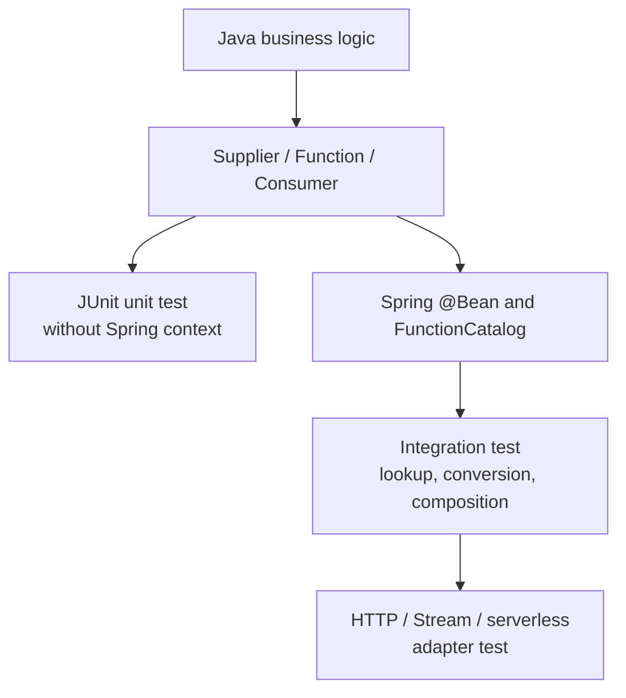

# Unit Testing Java Functions Without Starting Spring

**Chapter:** Testing  
**Module:** Spring Cloud Function (`SPRING_CLOUD_FUNCTION`)

Spring Cloud Function allows business logic to be expressed using standard Java interfaces: `Supplier<T>`, `Function<T,R>`, and `Consumer<T>`. That same logic can be registered in `FunctionCatalog` and then invoked via Java code, HTTP, events, or serverless environments. However, **a Java function does not need Spring to start in order to run or to be tested**.

When you need to verify order ID normalization rules, result calculations, or forwarding data to a business port, JUnit can instantiate the function and invoke `get()`, `apply(...)`, or `accept(...)` directly. This approach keeps tests fast and isolated, without depending on a database, broker, HTTP server, or `ApplicationContext`.

This lesson builds a complete JUnit 5 test suite **without using `@SpringBootTest`, without injecting Spring beans, and without looking up via `FunctionCatalog`**. Afterward, we point out the contracts that still require integration testing when deploying functions through adapters.

## 1. Scope: What Does a Unit Test Verify?

After this lesson, you will be able to:

1. Test a `Function` with valid inputs, invalid inputs, and edge cases.
2. Test a `Supplier` using a fake data source, verifying when the source is read.
3. Test a `Consumer` using a fake/spy, verifying side effects and invocation counts.
4. Test Java composition with `andThen(...)` without creating a Spring context.
5. Control non-deterministic sources such as clocks, random numbers, and I/O.
6. Distinguish business unit tests from integration tests for the catalog, message conversion, and adapters.

| What to Verify | Plain Java JUnit | Integration Test |
| --- | --- | --- |
| `"  ord-42  "` is normalized to `"ORD-42"` | **Yes** | Not required for logic alone |
| Blank string is rejected | **Yes** | Not required for logic alone |
| `Supplier` reads data only when `get()` is called | **Yes**, via fake source | When verifying the real source |
| `Consumer` sends the expected ID to the recording port | **Yes**, via fake | When verifying a real database/broker |
| Does `@Bean` create a bean with the right name? | No | **Yes** |
| Can `FunctionCatalog.lookup(...)` find the definition? | No | **Yes** |
| Is JSON/`Message<byte[]>` converted into the DTO properly? | No, if the test only passes DTOs | **Yes** |
| Can HTTP, Stream, or serverless invoke the function? | No | **Yes** |



**Principle:** only start the components that the test question actually requires. A string-output check generally does not need to boot an entire Spring Boot application.

## 2. Contracts of the Three Functional Interfaces

| Type | Java Signature | Call in Test | What to Assert |
| --- | --- | --- | --- |
| `Function<T,R>` | `R apply(T input)` | `function.apply(value)` | Return value, exceptions, data rules |
| `Supplier<T>` | `T get()` | `supplier.get()` | Value, when the source is read, invocation count |
| `Consumer<T>` | `void accept(T input)` | `consumer.accept(value)` | Sent data, side effects, invocation count |

Minimal example:

```java
import java.util.function.Function;
import static org.junit.jupiter.api.Assertions.assertEquals;

Function<String, Integer> length = String::length;
assertEquals(6, length.apply("ORD-42").intValue());
```

This is a plain Java check. Writing `Function<String,Integer>` clearly defines the input and output of the business code. A unit test does not need to know what bean name Spring will assign or how it will wrap the function.

For a `Consumer`, a lone `assertDoesNotThrow(...)` is usually not enough: if the requirement is to record exactly one order ID, the test must **inspect which value the receiving port received and how many times**.

## 3. Designing Business Classes for Isolated Testing

Instead of placing logic only inside a framework-dependent bean, extract the logic into a plain Java factory. The class below provides:

- `normalizeOrderId()`: trims leading/trailing whitespace, converts to uppercase, and rejects blank IDs.
- `orderIdLength()`: counts the number of characters in the ID.
- `normalizedOrderIdSupplier(source)`: reads a value from the provided source and normalizes it.
- `auditOrderId(sink)`: normalizes and sends the ID to a recording port.

**File:** `src/main/java/example/functions/OrderFunctions.java`

```java
package example.functions;

import java.util.Locale;
import java.util.Objects;
import java.util.function.Consumer;
import java.util.function.Function;
import java.util.function.Supplier;

public final class OrderFunctions {

    private OrderFunctions() {
        // Provides only function factory methods.
    }

    public interface AuditSink {
        void record(String normalizedOrderId);
    }

    public static Function<String, String> normalizeOrderId() {
        return raw -> {
            if (raw == null) {
                throw new IllegalArgumentException(
                    "Order ID must not be null");
            }

            String trimmed = raw.trim();
            if (trimmed.isBlank()) {
                throw new IllegalArgumentException(
                    "Order ID must not be blank");
            }

            return trimmed.toUpperCase(Locale.ROOT);
        };
    }

    public static Function<String, Integer> orderIdLength() {
        return String::length;
    }

    public static Supplier<String> normalizedOrderIdSupplier(
            Supplier<String> source) {
        Objects.requireNonNull(source, "source");

        Function<String, String> normalize = normalizeOrderId();
        return () -> normalize.apply(source.get());
    }

    public static Consumer<String> auditOrderId(AuditSink sink) {
        Objects.requireNonNull(sink, "sink");

        Function<String, String> normalize = normalizeOrderId();
        return raw -> sink.record(normalize.apply(raw));
    }
}
```

The sample uses Java 17-compatible APIs; `String.isBlank()` has been available since Java 11. In this example, whitespace stripping uses `trim()`; if business rules require stripping Unicode whitespace, redefine the contract and consider `strip()` along with corresponding tests.

### 3.1. Why Does This Design Decouple Spring?

The `OrderFunctions` class does not import Spring and does not directly access an HTTP client, database, or message broker. Parts that could cause side effects are externalized as dependencies:

- `Supplier<String> source` can be replaced with a lambda returning fixed data.
- `AuditSink` can be replaced with an in-memory fake that records calls.
- `Function<String,String>` is completely deterministic with one input and a clear normalization rule.

When creating the `Supplier`, **`source.get()` is not called yet**. The source is read only when `get()` is invoked on the resulting supplier.

`Objects.requireNonNull(...)` makes the dependency contract explicit: a `null` source or sink must not be provided. This contract can also be tested.

### 3.2. Exposing That Same Logic to Spring Cloud Function

In the real application, you can use a **separate** configuration class:

```java
package example.functions;

import java.util.function.Function;
import org.springframework.context.annotation.Bean;
import org.springframework.context.annotation.Configuration;

@Configuration
public class OrderFunctionConfiguration {

    @Bean("normalizeOrderId")
    public Function<String, String> normalizeOrderId() {
        return OrderFunctions.normalizeOrderId();
    }

    @Bean("orderIdLength")
    public Function<String, Integer> orderIdLength() {
        return OrderFunctions.orderIdLength();
    }
}
```

In unit tests, you **do not need to import or instantiate** `OrderFunctionConfiguration`. Tests call the Java factory directly. When you need to verify that Spring registers the two beans with the right names or that `FunctionCatalog` can find them, write a separate integration test.

## 4. Testing Library: JUnit Jupiter

In a Spring Boot project, `spring-boot-starter-test` typically includes JUnit Jupiter and the required testing libraries.

**Maven** (using Spring Boot dependency management):

```xml
<dependency>
    <groupId>org.springframework.boot</groupId>
    <artifactId>spring-boot-starter-test</artifactId>
    <scope>test</scope>
</dependency>
```

**Gradle Kotlin DSL** (where the project already manages the Spring Boot version):

```kotlin
dependencies {
    testImplementation("org.springframework.boot:spring-boot-starter-test")
}

tasks.test {
    useJUnitPlatform()
}
```

Java projects not using Spring Boot can use JUnit Jupiter directly with an appropriate version. Having Spring libraries on the classpath **does not automatically create a Spring context**; only tests that actually initialize a context incur that cost.

In this lesson, tests use `@Test`, `@ParameterizedTest`, `@MethodSource`, and JUnit assertions. `@SpringBootTest`, `@ContextConfiguration`, `@Autowired`, and `SpringExtension` are not needed.

## 5. Complete Test Suite: OrderFunctionsTest.java

**File:** `src/test/java/example/functions/OrderFunctionsTest.java`

```java
package example.functions;

import static org.junit.jupiter.api.Assertions.*;

import java.util.ArrayList;
import java.util.List;
import java.util.concurrent.atomic.AtomicInteger;
import java.util.function.Consumer;
import java.util.function.Function;
import java.util.function.Supplier;
import java.util.stream.Stream;

import org.junit.jupiter.api.Test;
import org.junit.jupiter.params.ParameterizedTest;
import org.junit.jupiter.params.provider.Arguments;
import org.junit.jupiter.params.provider.MethodSource;

class OrderFunctionsTest {

    static Stream<Arguments> validOrderIds() {
        return Stream.of(
            Arguments.of("  ord-42  ", "ORD-42"),
            Arguments.of("ab-9", "AB-9"),
            Arguments.of("  x-1", "X-1"),
            Arguments.of("café", "CAFÉ")
        );
    }

    @ParameterizedTest
    @MethodSource("validOrderIds")
    void normalizerProducesExpectedValue(
            String raw, String expected) {
        Function<String, String> normalize =
            OrderFunctions.normalizeOrderId();

        assertEquals(expected, normalize.apply(raw));
    }

    @Test
    void normalizerRejectsNullAndBlankValues() {
        Function<String, String> normalize =
            OrderFunctions.normalizeOrderId();

        assertThrows(
            IllegalArgumentException.class,
            () -> normalize.apply(null));
        assertThrows(
            IllegalArgumentException.class,
            () -> normalize.apply(""));
        assertThrows(
            IllegalArgumentException.class,
            () -> normalize.apply(" \t "));
    }

    @Test
    void normalizerUsesLocaleIndependentRule() {
        Function<String, String> normalize =
            OrderFunctions.normalizeOrderId();
        assertEquals("I", normalize.apply(" i "));
    }

    @Test
    void functionsCanComposeWithoutSpring() {
        Function<String, Integer> pipeline =
            OrderFunctions.normalizeOrderId()
                .andThen(OrderFunctions.orderIdLength());

        assertEquals(6, pipeline.apply("  ord-42  ").intValue());
    }

    @Test
    void supplierReadsSourceOnlyOnGet() {
        AtomicInteger calls = new AtomicInteger();
        Supplier<String> fakeSource = () -> {
            int current = calls.incrementAndGet();
            return current == 1 ? "  ord-42  " : "  ab-9  ";
        };

        Supplier<String> subject =
            OrderFunctions.normalizedOrderIdSupplier(fakeSource);

        assertEquals(0, calls.get());
        assertEquals("ORD-42", subject.get());
        assertEquals(1, calls.get());
        assertEquals("AB-9", subject.get());
        assertEquals(2, calls.get());
    }

    @Test
    void supplierRejectsInvalidSourceData() {
        Supplier<String> subject =
            OrderFunctions.normalizedOrderIdSupplier(() -> "   ");

        assertThrows(
            IllegalArgumentException.class,
            subject::get);
    }

    @Test
    void consumerRecordsNormalizedValueOnce() {
        RecordingAuditSink sink = new RecordingAuditSink();
        Consumer<String> subject =
            OrderFunctions.auditOrderId(sink);

        subject.accept("  ord-42  ");

        assertEquals(List.of("ORD-42"), sink.values);
    }

    @Test
    void consumerDoesNotWriteInvalidValue() {
        RecordingAuditSink sink = new RecordingAuditSink();
        Consumer<String> subject =
            OrderFunctions.auditOrderId(sink);

        assertThrows(
            IllegalArgumentException.class,
            () -> subject.accept("  \t "));
        assertTrue(sink.values.isEmpty());
    }

    @Test
    void consumerPropagatesSinkFailure() {
        IllegalStateException failure =
            new IllegalStateException("Audit unavailable");
        OrderFunctions.AuditSink broken = value -> {
            throw failure;
        };

        Consumer<String> subject =
            OrderFunctions.auditOrderId(broken);

        IllegalStateException observed = assertThrows(
            IllegalStateException.class,
            () -> subject.accept(" ord-42 "));

        assertSame(failure, observed);
    }

    @Test
    void collaboratorsMustNotBeNull() {
        assertThrows(
            NullPointerException.class,
            () -> OrderFunctions.normalizedOrderIdSupplier(null));
        assertThrows(
            NullPointerException.class,
            () -> OrderFunctions.auditOrderId(null));
    }

    private static final class RecordingAuditSink
            implements OrderFunctions.AuditSink {

        private final List<String> values = new ArrayList<>();

        @Override
        public void record(String normalizedOrderId) {
            values.add(normalizedOrderId);
        }
    }
}
```

**Expected result:** all test cases pass when run against the `OrderFunctions` code in Section 3. Each data set from `validOrderIds()` creates a separate `@ParameterizedTest` execution.

Every object in the test is created in Java; there is no Spring context, web server, or broker. Anything that could affect real data is replaced with fixed values or an in-memory fake.

## 6. Interpreting Function Test Results

### 6.1. Normal Values and Boundary Data

A single check with `"ord-42"` cannot catch a missing `trim()` step or improper `null` input handling. The test suite above covers multiple cases:

| Input | Expected |
| --- | --- |
| `"ab-9"` | `"AB-9"` |
| `"  ord-42  "` | `"ORD-42"` |
| `"café"` | `"CAFÉ"` |
| `""` | `IllegalArgumentException` |
| `" \t "` | `IllegalArgumentException` |
| `null` | `IllegalArgumentException` |

Exceptions are part of the contract. If the product changes the rule to "empty string returns empty string", updating the code and tests must be an intentional business change.

### 6.2. Locale and Repeatability

`String.toUpperCase()` without a locale can be affected by the operating system's default locale. Using `Locale.ROOT` in the ID normalizer keeps results consistent for technical identifiers. The `normalizerUsesLocaleIndependentRule` test verifies the rule with the letter `i`.

If the product processes natural-language text, locale rules will differ; do not assume every string value should use `Locale.ROOT`.

### 6.3. Java Composition Is Not Catalog Composition

```java
Function<String, Integer> pipeline =
    OrderFunctions.normalizeOrderId()
        .andThen(OrderFunctions.orderIdLength());

assertEquals(6, pipeline.apply("  ord-42  ").intValue());
```

This is plain Java composition with `andThen(...)`. It proves the business result and `String → String → Integer` type compatibility; it **does not prove** that Spring Cloud Function can look up the definition string `"normalizeOrderId|orderIdLength"`. That lookup requires an integration test with Spring-registered beans.

## 7. Testing Supplier: Controlling the Source and Read Timing

`Supplier<T>` takes no parameters in `get()`, but **that does not mean it has no external dependencies**. An order ID source might read from an API, a database table, a random number generator, or a message broker.

If a test calls the real source directly, results can depend on the network, current data, or service state. That is no longer an isolated unit test.

### 7.1. Replacing the Real Source with a Lambda

```java
Supplier<String> fakeSource = () -> "  ord-42  ";
Supplier<String> subject =
    OrderFunctions.normalizedOrderIdSupplier(fakeSource);

assertEquals("ORD-42", subject.get());
```

Calling `OrderFunctions.normalizedOrderIdSupplier(fakeSource)` only constructs the function object; the factory does not access the source immediately. The `supplierReadsSourceOnlyOnGet` test uses `AtomicInteger` to track calls:

| State | `source.get()` Call Count |
| --- | --- |
| Right after creating `subject` | 0 |
| After first `subject.get()` | 1 |
| After second `subject.get()` | 2 |

`AtomicInteger` is used here only as an observable counter. This test is **not** a thread-safety test for concurrent calls to the supplier.

### 7.2. Failure Scenarios to Test

Beyond a fixed source, also test these scenarios:

- The source returns `null`, `""`, or a whitespace-only string.
- The source throws an exception, such as `IllegalStateException` to simulate an outage.
- The source returns different IDs across calls, if the contract requires re-reading.
- A `null` source dependency passed at factory creation time; in the example, this must be rejected by `Objects.requireNonNull`.

Example source-failure test:

```java
IllegalStateException failure =
    new IllegalStateException("Source unavailable");
Supplier<String> broken = () -> {
    throw failure;
};

Supplier<String> subject =
    OrderFunctions.normalizedOrderIdSupplier(broken);

assertSame(
    failure,
    assertThrows(IllegalStateException.class, subject::get));
```

The sample function propagates exceptions from the source. If business rules require retries, timeouts, or a fallback ID, place that policy in a dedicated component and test its policy explicitly. **Do not assume every Supplier retries** just because it may be invoked from a broker.

## 8. Testing Consumer: Observing Side Effects

`Consumer<T>` returns `void`. Therefore, test assertions must rely on **controlled side effects** rather than a return value.

In the example, `AuditSink` defines the recording port:

```java
public interface AuditSink {
    void record(String normalizedOrderId);
}
```

The fake in `OrderFunctionsTest` records received values into a `List<String>`. This is a simple form of *test double*:

```java
RecordingAuditSink sink = new RecordingAuditSink();
Consumer<String> subject = OrderFunctions.auditOrderId(sink);

subject.accept("  ord-42  ");

assertEquals(List.of("ORD-42"), sink.values);
```

A list with **one element** verifies both the content and the invocation count. A test containing only `assertDoesNotThrow(() -> subject.accept(...))` will not catch code that forgets to write or writes twice.

### 8.1. Avoiding Real Writes in Unit Tests

If production uses:

```java
@Bean
public Consumer<String> auditOrderId(AuditRepository repository) {
    return id -> repository.save(id);
}
```

invoking that bean with a real repository can create unwanted records. For unit test goals, pass a fake recording port or mock repository instead of connecting to a database. Verifying the real repository, transactions, and schema belongs in integration tests.

### 8.2. Fakes and Mockito

In many cases, a manual fake is clear enough. If the project already includes Mockito, you can also verify interactions with a mock:

```java
OrderFunctions.AuditSink sink =
    org.mockito.Mockito.mock(OrderFunctions.AuditSink.class);

Consumer<String> subject = OrderFunctions.auditOrderId(sink);
subject.accept("  ord-42  ");

org.mockito.Mockito.verify(sink, org.mockito.Mockito.times(1))
    .record("ORD-42");
```

Mockito does not require starting Spring. The `Mockito.mock(...)` API creates test doubles directly; annotations that replace beans inside a Spring context such as `@MockBean` or `@MockitoBean` are tools for a different scope.

**Do not mock the function under test itself.** If a test stubs a mock `Function` to return `"ORD-42"` and only asserts that the mock returned the pre-programmed value, you have not executed the actual normalization logic at all.

### 8.3. Exceptions and Side-Effect Policies

`auditOrderId` invokes `normalizeOrderId` **before** calling `sink.record(...)`. Thus, when the input is invalid, the test must observe an exception and **zero recorded entries**:

```java
RecordingAuditSink sink = new RecordingAuditSink();
Consumer<String> subject = OrderFunctions.auditOrderId(sink);

assertThrows(
    IllegalArgumentException.class,
    () -> subject.accept("  \t "));
assertTrue(sink.values.isEmpty());
```

In this example, the error policy from `AuditSink.record(...)` is to **propagate the exception**. The `consumerPropagatesSinkFailure` test uses `assertSame(...)` to prove that exceptions from the port are not swallowed or turned into a false success.

If retries or dead-letter queue publishing are introduced later, define the handling boundary clearly and write corresponding tests. Do not add such behaviors merely to "make the test green".

## 9. Java DTOs Can Still Be Tested Without a JSON Converter

A `Function<OrderRequest,OrderDecision>` is also a Java function that can be invoked directly. With Java 17, consider `OrderPolicy.java`:

```java
package example.functions;

import java.util.function.Function;

public final class OrderPolicy {

    private OrderPolicy() {}

    public record Request(String orderId, int quantity) {}
    public record Decision(String orderId, boolean accepted) {}

    public static Function<Request, Decision> decide() {
        return request -> {
            String id = OrderFunctions.normalizeOrderId()
                .apply(request.orderId());
            return new Decision(id, request.quantity() > 0);
        };
    }
}
```

Unit test:

```java
import static org.junit.jupiter.api.Assertions.assertEquals;
import org.junit.jupiter.api.Test;

class OrderPolicyTest {
    @Test
    void positiveQuantityIsAccepted() {
        OrderPolicy.Decision result =
            OrderPolicy.decide().apply(
                new OrderPolicy.Request(" ord-42 ", 3));

        assertEquals(
            new OrderPolicy.Decision("ORD-42", true),
            result);
    }
}
```

The test passes only a Java DTO already constructed with the right type. It verifies the business rule and how functions combine, **not** the process of receiving HTTP JSON or `Message<byte[]>` and converting it into `OrderPolicy.Request`.

When testing conversion, you need a different context: type metadata, content type, converters, Spring Cloud Function wrappers, and the actual adapter. Do not infer that JSON configuration is correct just because a function handles DTOs cleanly in a unit test.

## 10. Eliminating Sources of Non-Determinism in Tests

### 10.1. Time

Avoid calling `Instant.now()` directly inside a function whose output depends on time. Inject a `Clock` instead:

```java
import java.time.Clock;
import java.time.Instant;
import java.util.function.Supplier;

// Method placed in an appropriate Java class:
public static Supplier<Instant> timestampSupplier(Clock clock) {
    return clock::instant;
}
```

And in the test:

```java
Clock clock = Clock.fixed(
    Instant.parse("2026-01-01T00:00:00Z"),
    java.time.ZoneOffset.UTC);

assertEquals(
    Instant.parse("2026-01-01T00:00:00Z"),
    timestampSupplier(clock).get());
```

The timestamp is fixed, so the test does not depend on when it runs. These two snippets are illustrative examples; if used in a project, place the method along with appropriate imports in the corresponding source class.

### 10.2. Random Numbers and UUIDs

If a supplier calls `UUID.randomUUID()`, do not expect a fixed UUID value. You can assert format/uniqueness as required, or pass the UUID generator as a dependency so unit tests supply predictable data.

A test that passes on a developer machine only because random data "happened to match" is a sign of an unreliable test.

### 10.3. Global State

Do not use a shared static `List` to record events across multiple tests; data can leak between tests, causing order dependencies or failures when tests run in parallel.

In the sample test suite, each `@Test` creates a new `RecordingAuditSink`. That is a simple yet effective way to isolate state.

### 10.4. I/O and Waiting

Avoid `Thread.sleep(...)` to "stabilize" tests of synchronous functions. If production code has asynchronous work, use an explicit synchronization model or an appropriate test scheduler rather than an arbitrary wait duration.

Plain unit tests should not make API calls or write to databases just to prove normalization and object construction. Real integration checks are valuable, but run them in a separate test suite.

## 11. Boundary with FunctionCatalog and Message Conversion

When the application registers `OrderFunctions.normalizeOrderId()` under the bean name `normalizeOrderId`, the following two checks belong to different layers:

**Unit test:**

```java
Function<String, String> normalize =
    OrderFunctions.normalizeOrderId();
assertEquals("ORD-42", normalize.apply(" ord-42 "));
```

**Integration test (illustrative):**

```java
// Assumes a Spring test has created the context and injected FunctionCatalog catalog.
Function<String, String> normalize =
    catalog.lookup(Function.class, "normalizeOrderId");
assertNotNull(normalize);
assertEquals("ORD-42", normalize.apply(" ord-42 "));
```

| What Needs Proof | Layer to Use |
| --- | --- |
| Normalization logic, input validation, calculation | Java unit test |
| `@Bean` name, bean discovery in `FunctionCatalog` | Spring integration test |
| Composition via function definition `"a|b"` | Spring integration test |
| Conversion from JSON/`Message<byte[]>` to DTO | Integration test with converter/wrapper |
| `spring.cloud.function.definition` and Stream binding | Spring Cloud Stream integration test |
| HTTP mapping, method, and status code | Web adapter test |
| Serverless handler and deployment configuration | Serverless/deployment test |

Some integration tests can use a lightweight context via `ApplicationContextRunner` instead of a full-application `@SpringBootTest`. However, **once a Spring context is created, it is no longer a plain unit test within the scope of this lesson**.

### 11.1. Using Spring Message as a Plain Java Object Still Works

If the business contract itself is `Function<Message<String>,String>`, you can still test it directly without starting Spring, provided the `spring-messaging` dependency is present:

```java
import java.util.function.Function;
import org.springframework.messaging.Message;
import org.springframework.messaging.support.MessageBuilder;

Function<Message<String>, String> withSource = message ->
    message.getHeaders().getOrDefault("source", "unknown")
        + ":" + message.getPayload();

Message<String> input = MessageBuilder.withPayload("ORD-42")
    .setHeader("source", "unit-test")
    .build();

assertEquals("unit-test:ORD-42", withSource.apply(input));
```

This is still testing logic on a `Message` object already constructed with the right type. It **does not** test the converter that turns JSON/bytes into a `String` or DTO payload.

### 11.2. Do Not Infer Endpoints from Unit Test Results Alone

`OrderFunctions.normalizeOrderId()` passing **does not guarantee** that:

- Spring has registered a bean named `normalizeOrderId`.
- That bean has not been excluded via `spring.cloud.function.ineligible-definitions`.
- `FunctionCatalog.lookup("normalizeOrderId")` resolves successfully.
- The function definition for the adapter has the right name and signature.
- An HTTP route, Stream binding, or serverless entry point exists.

Those are separate contracts and must be tested at the appropriate layer. This separation helps the team pinpoint whether an integration test failure stems from registration, conversion, an adapter, or business logic.

## 12. Running Only the Unit Test Suite

Typical file structure:

```text
src/
  main/java/example/functions/
    OrderFunctions.java
  test/java/example/functions/
    OrderFunctionsTest.java
```

In a Maven project with Maven Wrapper:

```bash
./mvnw -Dtest=OrderFunctionsTest test
```

In a Gradle project with Gradle Wrapper:

```bash
./gradlew test --tests "example.functions.OrderFunctionsTest"
```

On Windows, use `mvnw.cmd` or `gradlew.bat`. These commands are **usage guidance**, not the output of an actual test run. This article does not require running a build or tests in order to author the Markdown.

If the project configures JUnit directly instead of via the Spring Boot Test starter, ensure the test runner supports JUnit Platform. With Gradle, `useJUnitPlatform()` enables Jupiter test discovery.

### 12.1. Reading a Test Failure

If the output is:

```text
Expected: ORD-42
Actual:   ord-42
```

investigate the uppercasing logic or which function is being invoked. There is no need to change `FunctionCatalog` or HTTP configuration.

If the audit fake reports:

```text
Expected: [ORD-42]
Actual:   [ORD-42, ORD-42]
```

that indicates the `Consumer` wrote twice instead of once. Inspect the `sink.record(...)` call path and control flow; this test does not use a broker, so the failure cannot be blamed on broker redelivery.

If you encounter a `NoClassDefFoundError` related to JUnit, check the classpath/dependencies and test runner first; that is a test environment error, not evidence that the business function is wrong.

## 13. Common Test Design Mistakes

| Misconception | Issue | Better Approach |
| --- | --- | --- |
| "Because we use Spring Cloud Function, every test needs `@SpringBootTest`." | Logic relies on standard Java interfaces | Instantiate and invoke functions directly with JUnit |
| "Having the Spring Boot Test dependency automatically starts a context." | The dependency only provides libraries | Avoid annotations/mechanisms that create a context in unit tests |
| "A Supplier takes no arguments so it has no dependencies." | It may read a clock, network, or database | Pass the source as a dependency and fake it |
| "A Consumer returns `void` so `assertDoesNotThrow` is enough." | Does not prove the right side effect occurred | Use a fake/spy to check content and invocation count |
| "Mock the Function itself and assert the result." | Does not run the real implementation | Call the real Function; mock only external dependencies |
| "Testing `andThen(...)` already tests `a|b` in FunctionCatalog." | Two different composition layers | Test the catalog with a separate Spring context |
| "Green DTO unit tests mean HTTP JSON works." | Serialization/conversion not tested | Write integration tests with actual payloads |
| "`Thread.sleep(...)` eliminates flakiness." | Time or async behavior is still uncontrolled | Inject `Clock`/scheduler or use proper synchronization |
| "Tests can share a static fake." | Leaks state and creates order dependencies | Create a fresh fake per test |
| "No assertions needed because the test called the method." | Does not verify business outcome | Write specific, predictable assertions |

## 14. Checklist for Unit Tests in CI

- [ ] Tests execute real Java code without starting Spring when only pure logic is needed.
- [ ] Normal values, boundary cases, and error cases are covered per contract.
- [ ] `Supplier` uses a fake source without relying on real APIs or clocks.
- [ ] `Consumer` uses a fake/spy to verify data, invocation counts, and exceptions.
- [ ] No unnecessary real I/O or shared static state across tests.
- [ ] Assertions express requirements clearly rather than checking only "no error".
- [ ] Generic types `Supplier`/`Function`/`Consumer` match the actual logic.
- [ ] Java composition tests are not confused with catalog definition tests.
- [ ] JSON/Message conversion, bindings, and adapters are tested at a separate integration layer.
- [ ] Tests run independently without relying on execution order or wall-clock timing.

## 15. Practice Exercises

1. **Function:** add the test case `"  abc-009  "` and a string containing tabs; verify both normal output and exceptions for invalid inputs.
2. **Unicode:** test Unicode whitespace on both ends of an ID. Compare `trim()` and `strip()`, then define the business rule before changing source code.
3. **Supplier:** create a fake source returning a valid value on the first call and `null` on the second; verify read timing and error policy.
4. **Consumer:** use a fake that counts invocations and stores the list of IDs. Test a valid input, a blank input, and a sink failure in turn.
5. **Composition:** test `normalizeOrderId().andThen(orderIdLength())` with three inputs; explain why the output type is `Integer`.
6. **Integration:** register `normalizeOrderId` with `@Bean`, then write a separate integration test verifying lookup in `FunctionCatalog` while keeping the original unit tests intact.
7. **DTO:** add tests for `OrderPolicy.decide()` with negative, zero, and positive quantities; then design a JSON integration test for the same function.
8. **Anti-flaky:** write a `Supplier<Instant>` accepting a `Clock` and test it with `Clock.fixed(...)` instead of reading real time.

### Interview Questions

**Q:** Why can Spring Cloud Function logic be unit tested without Spring?

**A:** Because `Supplier`, `Function`, and `Consumer` are standard Java interfaces. Objects implementing them can be instantiated and invoked directly. Spring Cloud Function only adds bean discovery, catalog lookup, conversion, and adapters; those parts can be tested in a separate integration layer.

**Q:** If you want to unit test a `Consumer` that publishes events to a broker, what should you do?

**A:** Move the event publishing operation behind a port/interface, and use a fake or mock to verify the payload and number of sends. Verifying that a real broker receives the event belongs in a separate integration test.

## 16. Summary

- **Unit testing Java functions does not require a Spring context** when the logic and its dependencies can be instantiated directly.
- `Function.apply(...)` tests outputs and exceptions; `Supplier.get()` requires checking the source and read timing; `Consumer.accept(...)` requires observing side effects.
- Passing dependencies via constructors/factories isolates logic from I/O and non-deterministic data.
- JUnit 5 with `@Test`, `@ParameterizedTest`, `assertEquals`, and `assertThrows` suffices for most business rules in simple functions.
- Composition via `andThen(...)` is Java composition; `FunctionCatalog`, `"a|b"` definitions, message conversion, and HTTP/Stream/serverless adapters require separate integration tests.
- Layering tests keeps unit tests fast and easy to debug while still thoroughly verifying the same logic when reused across multiple protocols.

### References

- [Java 17 — java.util.function](https://docs.oracle.com/en/java/javase/17/docs/api/java.base/java/util/function/package-summary.html): `Supplier`, `Function`, `Consumer` interfaces and functional methods.
- [JUnit 5 User Guide](https://junit.org/junit5/docs/current/user-guide/): `@Test`, `@ParameterizedTest`, `@MethodSource`, and assertions.
- [Spring Cloud Function — Programming Model](https://docs.spring.io/spring-cloud-function/reference/spring-cloud-function/programming-model.html): functional beans, catalog, conversion, and composition.
- [Spring Cloud Function — Functional Bean Definitions](https://docs.spring.io/spring-cloud-function/reference/functional.html): registering and observing functional beans in the catalog.
