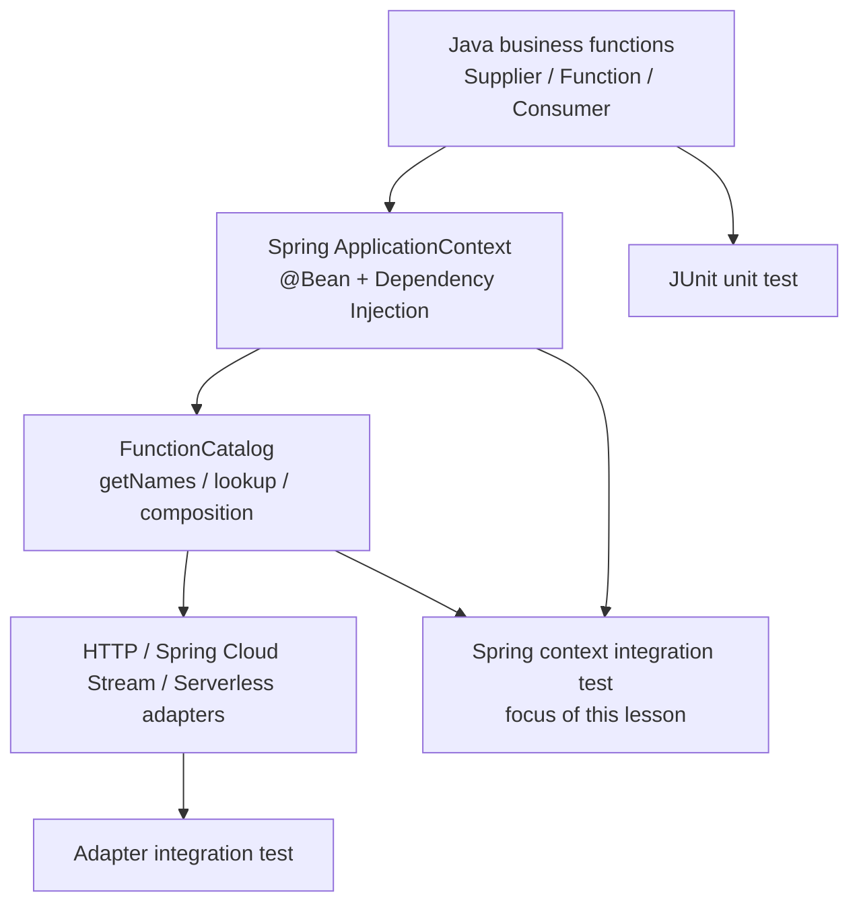
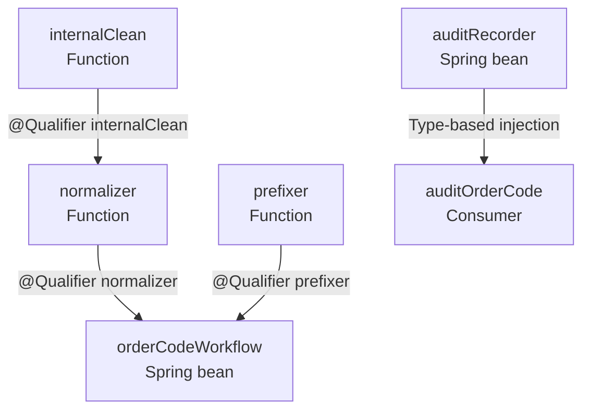
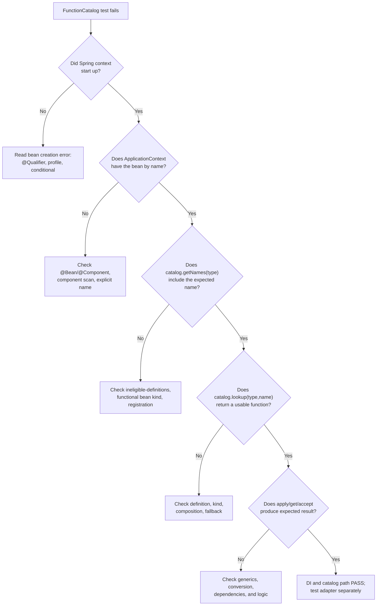

# Testing Dependency Injection and FunctionCatalog Registration

**Chapter:** Testing  
**Module:** Spring Cloud Function (`SPRING_CLOUD_FUNCTION`)

In Spring Cloud Function, developers typically express business logic using three standard Java interfaces: `Supplier<T>`, `Function<T,R>`, and `Consumer<T>`. That logic can be managed by Spring as beans, looked up by name through `FunctionCatalog`, and reused from Java code, HTTP, events in Spring Cloud Stream, or serverless environments.

Plain Java unit tests prove that a function returns the expected result for deterministic inputs. However, they **do not prove** that Spring created the beans properly, that dependency injection wired the right objects, or that `FunctionCatalog` can resolve the function name and kind expected by an adapter.

This lesson focuses on **integration testing at the Spring context and FunctionCatalog layer**: creating a lightweight application context, injecting functional beans, verifying registered names, looking up functions, and checking the path from dependency injection to business logic. We do not need to start an HTTP server or message broker yet.

## 1. Goals and Scope

After this lesson, you will be able to:

1. Verify that Spring creates all `Supplier`, `Function`, and `Consumer` beans and their related dependencies.
2. Verify constructor injection and `@Qualifier` selecting the intended bean when multiple `Function` beans share the same raw type.
3. Cross-check `ApplicationContext` against the name list in `FunctionCatalog`.
4. Look up a function by name and kind, and verify the result from the catalog wrapper.
5. Verify composition via definitions, without confusing it with plain Java composition.
6. Write negative tests for wrong names, excluded beans, profile configuration, and wiring errors.
7. Know which parts require HTTP, message converter, or serverless adapter testing at a higher integration level.

| What to Prove | Plain Java Unit Test | Spring Context + FunctionCatalog Test |
| --- | --- | --- |
| `normalizeOrderCode.apply(" ord-42 ")` returns `ORD-42` | Yes | Yes, though starting a context is unnecessary for logic alone |
| `@Bean("normalizer")` creates a Spring bean with the right name | No | **Yes** |
| `@Qualifier("normalizer")` injects the right function into a service | No | **Yes** |
| Catalog recognizes `normalizer` as a `Function` | No | **Yes** |
| `catalog.lookup("normalizer")` returns a usable function | No | **Yes** |
| `"normalizer|prefixer"` is validly composed by the catalog | No | **Yes** |
| HTTP POST JSON is converted properly into a DTO | No | Incomplete; requires converter/Web adapter test |
| Stream binding delivers events to a broker | No | Incomplete; requires Stream/binder test |

**Core goal:** verify the **registration and wiring contract**, rather than merely checking the output of a manually constructed Java lambda.

## 2. Testing Architecture: Distinguishing Three Layers



**`ApplicationContext`** manages beans, dependencies, scopes, and Spring lifecycle. A `Function<String,String>` bean can be injected directly by name or qualifier.

**`FunctionCatalog`** discovers eligible functional beans and provides lookup by name, kind, or function definition. A function looked up through the catalog may be a wrapper managed by Spring Cloud Function, with additional capabilities such as conversion and composition.

**Adapters** form the next layer: Spring Cloud Function Web maps HTTP, Spring Cloud Stream creates event bindings, and serverless adapters translate platform invocations into function calls. A green catalog test **does not prove** that adapters are configured accurately.

## 3. Preparing the JUnit and Spring Cloud Function Environment

The examples assume a Spring Boot project with a **compatible** Spring Cloud Function version. Use a BOM or your project's dependency management to resolve versions; do not arbitrarily mix incompatible Spring Boot and Spring Cloud Function major versions.

### 3.1. Maven

Typical dependencies:

```xml
<dependencies>
    <dependency>
        <groupId>org.springframework.boot</groupId>
        <artifactId>spring-boot-starter</artifactId>
    </dependency>
    <dependency>
        <groupId>org.springframework.cloud</groupId>
        <artifactId>spring-cloud-function-context</artifactId>
    </dependency>
    <dependency>
        <groupId>org.springframework.boot</groupId>
        <artifactId>spring-boot-starter-test</artifactId>
        <scope>test</scope>
    </dependency>
</dependencies>
```

This snippet shows only the `dependencies` section, not a full POM: the project needs the corresponding parent/BOM and build configuration. `spring-cloud-function-context` is sufficient for catalog examples; no Web adapter or broker is needed.

### 3.2. Gradle Kotlin DSL

In a project with dependency versions already managed:

```kotlin
dependencies {
    implementation("org.springframework.boot:spring-boot-starter")
    implementation("org.springframework.cloud:spring-cloud-function-context")
    testImplementation("org.springframework.boot:spring-boot-starter-test")
}

tasks.test {
    useJUnitPlatform()
}
```

Testing uses **JUnit Jupiter (JUnit 5)** and Spring Boot Test. `@SpringBootTest` creates a real `ApplicationContext` for the specified fixture; thus, this is a Spring-level integration test rather than a plain Java unit test.

### 3.3. Why `webEnvironment = NONE`?

In this lesson, the goal is DI and the catalog. We use:

```java
@SpringBootTest(
    classes = FunctionRegistrationApplication.class,
    webEnvironment = SpringBootTest.WebEnvironment.NONE
)
```

`webEnvironment = NONE` instructs the test not to start an embedded web server. It **still creates a Spring context**, runs the required auto-configuration, and allows `FunctionCatalog` to be injected.

## 4. Sample Application: Multiple Functions, Explicit Dependencies

We intentionally register **multiple functional beans**. This ensures that wrong-name tests are not masked by the *single-function fallback* behavior in single-function applications.

**File:** `src/main/java/example/testing/FunctionRegistrationApplication.java`

```java
package example.testing;

import java.util.List;
import java.util.Locale;
import java.util.concurrent.CopyOnWriteArrayList;
import java.util.function.Consumer;
import java.util.function.Function;
import java.util.function.Supplier;

import org.springframework.beans.factory.annotation.Qualifier;
import org.springframework.boot.SpringApplication;
import org.springframework.boot.autoconfigure.SpringBootApplication;
import org.springframework.context.annotation.Bean;

@SpringBootApplication(proxyBeanMethods = false)
public class FunctionRegistrationApplication {

    public static void main(String[] args) {
        SpringApplication.run(
            FunctionRegistrationApplication.class, args);
    }

    // Helper function is also a functional bean in Spring.
    @Bean("internalClean")
    public Function<String, String> internalClean() {
        return String::trim;
    }

    // Bean name is "normalizer"; Java method name differs from bean name.
    @Bean("normalizer")
    public Function<String, String> normalizeOrderCode(
            @Qualifier("internalClean")
            Function<String, String> clean) {
        return raw -> {
            if (raw == null || raw.isBlank()) {
                throw new IllegalArgumentException("Invalid order ID");
            }
            return clean.apply(raw).toUpperCase(Locale.ROOT);
        };
    }

    @Bean("prefixer")
    public Function<String, String> addPrefix() {
        return value -> "ID-" + value;
    }

    @Bean("orderCodeSupplier")
    public Supplier<String> orderCodeSupplier() {
        return () -> "  ord-42  ";
    }

    @Bean("auditOrderCode")
    public Consumer<String> auditOrderCode(AuditRecorder recorder) {
        return recorder::record;
    }

    @Bean
    public AuditRecorder auditRecorder() {
        return new AuditRecorder();
    }

    @Bean
    public OrderCodeWorkflow orderCodeWorkflow(
            @Qualifier("normalizer")
            Function<String, String> normalize,
            @Qualifier("prefixer")
            Function<String, String> prefix) {
        return new OrderCodeWorkflow(normalize, prefix);
    }

    public static final class OrderCodeWorkflow {
        private final Function<String, String> normalize;
        private final Function<String, String> prefix;

        public OrderCodeWorkflow(
                Function<String, String> normalize,
                Function<String, String> prefix) {
            this.normalize = normalize;
            this.prefix = prefix;
        }

        public String format(String value) {
            return prefix.apply(normalize.apply(value));
        }
    }

    public static final class AuditRecorder {
        private final List<String> events =
            new CopyOnWriteArrayList<>();

        public void record(String event) {
            events.add(event);
        }

        public List<String> snapshot() {
            return List.copyOf(events);
        }

        public void clear() {
            events.clear();
        }
    }
}
```

### 4.1. Understanding Each Bean's Role

| Spring Bean | Kind | Contract | Role |
| --- | --- | --- | --- |
| `internalClean` | `Function<String,String>` | `" ord-42 " → "ord-42"` | Helper, injected into `normalizer` |
| `normalizer` | `Function<String,String>` | `" ord-42 " → "ORD-42"` | Business normalization |
| `prefixer` | `Function<String,String>` | `"ORD-42" → "ID-ORD-42"` | Adds prefix |
| `orderCodeSupplier` | `Supplier<String>` | `get() → "  ord-42  "` | Supplies test code |
| `auditOrderCode` | `Consumer<String>` | `accept(code)` | Writes to fake port |
| `auditRecorder` | Regular Java class | Record/read event list | Collaborator, **not** a functional bean |
| `orderCodeWorkflow` | Regular Java class | `format(input)` | Demonstrates constructor injection |

`AuditRecorder` is a stateful object for testing the `Consumer` without a database or broker. It is not a mock replacing a Spring bean; Spring creates it as a real bean, and tests can inspect its state via `snapshot()`.

**Note:** `internalClean` is a `Function`, so the catalog can discover it as a candidate. If you only want to use it as an internal helper, you can set `spring.cloud.function.ineligible-definitions=internalClean` in the appropriate configuration; this lesson tests that case separately.

### 4.2. Dependency Paths That Must Be Wired Correctly



`OrderCodeWorkflow` depends on **two beans of the same type `Function<String,String>`**. Specifying `@Qualifier` on both parameters prevents Spring from picking the wrong one or failing due to ambiguity. If a bean is renamed without updating the qualifier, test context startup can fail before any `@Test` runs.

## 5. Registration and Dependency Injection Test Suite

**File:** `src/test/java/example/testing/FunctionRegistrationTest.java`

```java
package example.testing;

import static org.junit.jupiter.api.Assertions.*;

import java.util.Set;
import java.util.function.Consumer;
import java.util.function.Function;
import java.util.function.Supplier;

import org.junit.jupiter.api.BeforeEach;
import org.junit.jupiter.api.Test;
import org.springframework.beans.factory.annotation.Autowired;
import org.springframework.beans.factory.annotation.Qualifier;
import org.springframework.boot.test.context.SpringBootTest;
import org.springframework.cloud.function.context.FunctionCatalog;
import org.springframework.context.ApplicationContext;

@SpringBootTest(
    classes = FunctionRegistrationApplication.class,
    webEnvironment = SpringBootTest.WebEnvironment.NONE
)
class FunctionRegistrationTest {

    @Autowired
    private ApplicationContext context;

    @Autowired
    private FunctionCatalog catalog;

    @Autowired
    @Qualifier("normalizer")
    private Function<String, String> directNormalizer;

    @Autowired
    @Qualifier("prefixer")
    private Function<String, String> directPrefixer;

    @Autowired
    @Qualifier("orderCodeSupplier")
    private Supplier<String> supplier;

    @Autowired
    @Qualifier("auditOrderCode")
    private Consumer<String> auditConsumer;

    @Autowired
    private FunctionRegistrationApplication.OrderCodeWorkflow workflow;

    @Autowired
    private FunctionRegistrationApplication.AuditRecorder recorder;

    @BeforeEach
    void resetRecorder() {
        recorder.clear();
    }

    @Test
    void springContextContainsExpectedBeans() {
        assertTrue(context.containsBean("internalClean"));
        assertTrue(context.containsBean("normalizer"));
        assertTrue(context.containsBean("prefixer"));
        assertTrue(context.containsBean("orderCodeSupplier"));
        assertTrue(context.containsBean("auditOrderCode"));
        assertTrue(context.containsBean("orderCodeWorkflow"));

        // normalizer is the bean name, not normalizeOrderCode.
        assertFalse(context.containsBean("normalizeOrderCode"));
    }

    @Test
    void qualifierWiresCorrectFunctions() {
        assertEquals(
            "ORD-42", directNormalizer.apply("  ord-42  "));
        assertEquals("ID-ORD-42", directPrefixer.apply("ORD-42"));
        assertEquals("ID-ORD-42", workflow.format("  ord-42  "));
    }

    @Test
    void catalogListsExpectedNamesByKind() {
        Set<String> functions = catalog.getNames(Function.class);
        Set<String> suppliers = catalog.getNames(Supplier.class);
        Set<String> consumers = catalog.getNames(Consumer.class);

        assertTrue(functions.containsAll(
            Set.of("internalClean", "normalizer", "prefixer")));
        assertTrue(suppliers.contains("orderCodeSupplier"));
        assertTrue(consumers.contains("auditOrderCode"));
    }

    @Test
    void catalogLookupExecutesRegisteredFunction() {
        Function<String, String> fromCatalog =
            catalog.lookup(Function.class, "normalizer");

        assertNotNull(fromCatalog);
        assertEquals("ORD-42", fromCatalog.apply("  ord-42  "));
        assertEquals(
            directNormalizer.apply("  ord-42  "),
            fromCatalog.apply("  ord-42  "));
    }

    @Test
    void catalogCanResolveComposition() {
        Function<String, String> pipeline =
            catalog.lookup(Function.class, "normalizer|prefixer");

        assertNotNull(pipeline);
        assertEquals("ID-ORD-42", pipeline.apply("  ord-42  "));
        assertEquals("ID-ORD-42", workflow.format("  ord-42  "));
    }

    @Test
    void supplierAndConsumerUseTheirOwnInterfaces() {
        assertEquals("  ord-42  ", supplier.get());

        Function<String, String> normalize =
            catalog.lookup(Function.class, "normalizer");
        assertNotNull(normalize);

        auditConsumer.accept(normalize.apply(supplier.get()));
        assertEquals(Set.of("ORD-42"),
            Set.copyOf(recorder.snapshot()));
        assertEquals(1, recorder.snapshot().size());
    }

    @Test
    void catalogAlsoResolvesSupplierAndConsumer() {
        Supplier<String> fromCatalog =
            catalog.lookup(Supplier.class, "orderCodeSupplier");
        Consumer<String> sinkFromCatalog =
            catalog.lookup(Consumer.class, "auditOrderCode");

        assertNotNull(fromCatalog);
        assertNotNull(sinkFromCatalog);
        assertEquals("  ord-42  ", fromCatalog.get());

        sinkFromCatalog.accept("ORD-42");
        assertEquals(1, recorder.snapshot().size());
        assertEquals("ORD-42", recorder.snapshot().get(0));
    }

    @Test
    void catalogDoesNotInventAnUnknownName() {
        String unknown = "notARegisteredFunction";
        assertFalse(catalog.getNames(null).contains(unknown));

        // Multiple eligible functional beans: do not rely on
        // the single-function fallback of single-function apps.
        assertNull(catalog.lookup(Function.class, unknown));
    }

    @Test
    void beanNamesAreNotJavaMethodNames() {
        assertTrue(catalog.getNames(Function.class)
            .contains("normalizer"));
        assertFalse(catalog.getNames(Function.class)
            .contains("normalizeOrderCode"));
    }
}
```

The tests share the same application context to observe real beans and catalog wrappers. In tests that read/write `AuditRecorder`, `@BeforeEach` clears data from the previous test. Reusing stateful objects in a cached context is only appropriate with explicit isolation like this; for parallel tests or complex applications, consider test doubles and separate context management.

### 5.1. Do Not Test the Catalog Using Exact Counts

Do not write:

```java
// Brittle, not recommended:
// assertEquals(5, catalog.size());
// assertEquals(5, catalog.getNames(null).size());
```

Some Spring Cloud Function versions include infrastructure functions such as `functionRouter`; the registry also applies its own filtering and registration rules. Therefore, **checking for the required business names** is safer than asserting that the catalog has exactly five entries.

### 5.2. Do Not Assume the Wrapper Is the Same Object as the Direct Bean

```java
Function<String, String> direct =
    context.getBean("normalizer", Function.class);

Function<String, String> wrapped =
    catalog.lookup(Function.class, "normalizer");
```

Both objects may produce the same result, yet the catalog can return an instrumented wrapper to support conversion/composition. You should not treat `assertSame(direct, wrapped)` as a stable contract. Testing by output, name, and function kind better reflects the integration goal.

## 6. Distinguishing Registration from Dependency Injection

There are at least **two distinct questions** to ask when a function fails to run:

1. **Is Spring DI working?** Was `OrderCodeWorkflow` created and injected with the right `normalizer` and `prefixer`?
2. **Is the catalog working?** Were the functional beans discovered by Spring Cloud Function and resolvable by name?

| Observation | Meaning |
| --- | --- |
| `context.containsBean("normalizer") == true` | The bean exists in the Spring context |
| `workflow.format(" ord-42 ")` returns expected value | Constructor injection and service execution path work |
| `catalog.getNames(Function.class).contains("normalizer")` | The catalog recognizes the name under the `Function` group |
| `catalog.lookup(Function.class, "normalizer") != null` | The catalog can resolve the name/definition |
| `wrapped.apply(...)` returns expected value | The function retrieved from the catalog actually executes |

A `Function` can exist in the Spring context yet be absent from the catalog due to the `ineligible-definitions` filter or registration style. Conversely, a function present in the catalog does not guarantee that any service injected the right one.

### 6.1. Constructor Injection Is Better Than Ordering Beans

`OrderCodeWorkflow` requires two beans:

```java
@Bean
public OrderCodeWorkflow orderCodeWorkflow(
        @Qualifier("normalizer")
        Function<String, String> normalize,
        @Qualifier("prefixer")
        Function<String, String> prefix) {
    return new OrderCodeWorkflow(normalize, prefix);
}
```

If `@Qualifier` is omitted and there is no explicit bean selection mechanism, Spring can encounter multiple `Function` beans and report ambiguity. Do not solve this by relying on declaration order or catalog name order: neither expresses business intent.

Valid alternatives include dedicated collaborator interfaces, `@Primary` when a true default exists, or placing pure logic in a service that is not a functional bean. All of these should be verified with injection tests.

### 6.2. BeanFactory and FunctionCatalog Have Different Scopes

```java
String[] rawSpringNames =
    context.getBeanNamesForType(Function.class);

Set<String> catalogNames =
    catalog.getNames(Function.class);
```

The first API asks Spring for beans assignable to `Function`; the second asks Spring Cloud Function for recognized functional names. Do not assume the two lists are always identical: the framework may filter ineligible beans or have its own functional registrations.

## 7. Looking Up by Name, by Kind, and Checking Signatures

When querying:

```java
Function<String, String> operation =
    catalog.lookup(Function.class, "normalizer");
```

`Function.class` specifies the **interface group**, while `"normalizer"` is the name/definition. Java type erasure means the `Function.class` parameter **cannot verify** the full `String → String` generic signature.

For instance, if the actual bean is:

```java
@Bean("orderIdLength")
public Function<String, Integer> orderIdLength() {
    return String::length;
}
```

assigning it to a `Function<String,String>` variable violates the contract, even though the compiler may infer the generic type from the target variable when calling the `lookup` overload. Tests must verify the actual type from the bean signature or exercise it with test data to check the output.

For the three interfaces, inspect them with the appropriate API:

```java
Set<String> supplierNames = catalog.getNames(Supplier.class);
Set<String> functionNames = catalog.getNames(Function.class);
Set<String> consumerNames = catalog.getNames(Consumer.class);
```

In the fixture:

- `orderCodeSupplier` belongs to `Supplier`; invoke `get()`.
- `normalizer` and `prefixer` belong to `Function`; invoke `apply(input)`.
- `auditOrderCode` belongs to `Consumer`; invoke `accept(input)`.

The wrapper inside the catalog may implement multiple interfaces to support a unified execution mechanism. Therefore, do not rely solely on `instanceof Function` on a wrapper object to conclude that a business function is a `Supplier` or `Consumer`.

## 8. Testing Composition via FunctionCatalog

Given the two beans `normalizer` and `prefixer`, Spring Cloud Function can resolve:

```java
Function<String, String> pipeline =
    catalog.lookup(Function.class, "normalizer|prefixer");
assertNotNull(pipeline);
assertEquals("ID-ORD-42", pipeline.apply(" ord-42 "));
```

This is **different** from testing plain Java code:

```java
Function<String, String> manual =
    directNormalizer.andThen(directPrefixer);
assertEquals("ID-ORD-42", manual.apply(" ord-42 "));
```

The output may be identical, but only the first test verifies that the catalog understands both names and composes them as a valid definition. That is why registration tests need composition cases.

An additional negative test can check each segment of a definition like `normalizer|notRegistered` via `getNames(Function.class)` before calling lookup, rather than expecting every framework version to throw the exact same exception type when a step is missing.

## 9. Negative Test: Bean Exists in Spring but Is Excluded from the Catalog

An application may use a `Function<String,String>` as an internal helper without wanting the framework to expose it as an adapter-facing function. Spring Cloud Function supports an ineligible bean name list:

```properties
spring.cloud.function.ineligible-definitions=internalClean
```

**What to test:** this property filters candidates in `FunctionCatalog`; it **does not remove the bean from the Spring `ApplicationContext`**. The `normalizer` bean can still inject and invoke `internalClean` directly.

Create a second test class with a **separately configured context**:

**File:** `src/test/java/example/testing/IneligibleFunctionTest.java`

```java
package example.testing;

import static org.junit.jupiter.api.Assertions.*;

import java.util.function.Function;
import org.junit.jupiter.api.Test;
import org.springframework.beans.factory.annotation.Autowired;
import org.springframework.boot.test.context.SpringBootTest;
import org.springframework.cloud.function.context.FunctionCatalog;
import org.springframework.context.ApplicationContext;

@SpringBootTest(
    classes = FunctionRegistrationApplication.class,
    webEnvironment = SpringBootTest.WebEnvironment.NONE,
    properties = {
        "spring.cloud.function.ineligible-definitions=internalClean"
    }
)
class IneligibleFunctionTest {

    @Autowired
    ApplicationContext context;

    @Autowired
    FunctionCatalog catalog;

    @Test
    void helperBeanRemainsInjectableInSpring() {
        assertTrue(context.containsBean("internalClean"));
        assertNotNull(context.getBean("internalClean"));
    }

    @Test
    void helperIsNotARegularCatalogCandidate() {
        assertFalse(catalog.getNames(Function.class)
            .contains("internalClean"));
        assertTrue(catalog.getNames(Function.class)
            .contains("normalizer"));
        assertTrue(catalog.getNames(Function.class)
            .contains("prefixer"));
    }

    @Test
    void normalizerStillUsesTheExcludedCollaborator() {
        Function<String, String> normalize =
            catalog.lookup(Function.class, "normalizer");
        assertNotNull(normalize);
        assertEquals("ORD-42", normalize.apply("  ord-42  "));
    }
}
```

This test is valuable because it separates two easily confused states: **the bean is still created by Spring** and **the bean is no longer a catalog candidate**. Checking that a name is absent from `catalog.getNames(...)` is better suited to verifying filtering than only asserting `lookup("internalClean") == null`.

In an application context with only one eligible functional bean, Spring Cloud Function may enable *single-function fallback*: a lookup with an unrecognized name still resolves to that single function. Therefore, **`lookup("internalClean") != null` does not always prove that a filtered bean remained registered in the catalog**. Our lesson's fixture intentionally has multiple functional beans, yet checking the catalog name set remains clearer.

### 9.1. Do the Two Test Classes Use Different Contexts?

`FunctionRegistrationTest` uses the default configuration, whereas `IneligibleFunctionTest` declares a different property. Spring Boot Test caches contexts across tests sharing the same configuration to speed up execution; tests with different property sets receive distinct context cache keys and should not be treated as sharing a single mutable catalog whose properties change on the fly.

Do not edit `application.yml` between two test runs expecting an already-initialized catalog to reload and re-filter immediately. In registration tests, environment changes must be applied **before the context is created**.

## 10. Negative Test: Dependency Injection Fails at Startup

Another class of problem is a test that **fails to start** because Spring cannot create a service. For example:

```java
@Bean
public OrderCodeWorkflow orderCodeWorkflow(
        @Qualifier("normaliser") // This name does not exist.
        Function<String, String> normalize,
        @Qualifier("prefixer")
        Function<String, String> prefix) {
    return new OrderCodeWorkflow(normalize, prefix);
}
```

The real bean name is `normalizer`; `normaliser` is a typo. With a `@Qualifier` parameter that has no matching bean, Spring reports a wiring failure such as `UnsatisfiedDependencyException`, wrapping the underlying missing-bean cause.

If you use `@SpringBootTest` directly on an intentionally broken configuration, the test fails during context startup, making it awkward to write normal assertions inside a test method. To **test an intentionally broken configuration**, Spring Boot provides `ApplicationContextRunner`.

### 10.1. ApplicationContextRunner for Negative DI Tests

This is a **standalone example**; it does not use `FunctionRegistrationApplication` and **does not test the catalog**. Place it in package `example.wiringprobe` (outside the default component-scan scope of `example.testing`) so the broken configuration is not accidentally picked up by other integration tests. It only tests Spring DI when a qualifier does not exist:

```java
package example.wiringprobe;

import static org.assertj.core.api.Assertions.assertThat;

import java.util.function.Function;
import org.junit.jupiter.api.Test;
import org.springframework.beans.factory.NoSuchBeanDefinitionException;
import org.springframework.beans.factory.annotation.Qualifier;
import org.springframework.boot.test.context.runner.ApplicationContextRunner;
import org.springframework.context.annotation.Bean;
import org.springframework.context.annotation.Configuration;

class MissingQualifierTest {

    private final ApplicationContextRunner runner =
        new ApplicationContextRunner()
            .withUserConfiguration(BrokenWiring.class);

    @Test
    void missingQualifierMakesContextFail() {
        runner.run(context -> {
            assertThat(context).hasFailed();
            assertThat(context.getStartupFailure())
                .hasRootCauseInstanceOf(
                    NoSuchBeanDefinitionException.class);
        });
    }

    @Configuration(proxyBeanMethods = false)
    static class BrokenWiring {
        @Bean("available")
        Function<String, String> available() {
            return String::trim;
        }

        @Bean
        NeedsFunction needsFunction(
                @Qualifier("missing")
                Function<String, String> function) {
            return new NeedsFunction(function);
        }
    }

    static class NeedsFunction {
        private final Function<String, String> delegate;

        NeedsFunction(Function<String, String> delegate) {
            this.delegate = delegate;
        }
    }
}
```

`ApplicationContextRunner` builds a minimal Spring context with the specified beans, runs assertions inside the callback, and closes the context. It is well-suited for testing auto-configuration or conditional wiring under different property sets.

**Important:** merely running `ApplicationContextRunner` with `BrokenWiring` above **does not include Spring Cloud Function auto-configuration or FunctionCatalog**. This is a negative **DI** test and cannot be used to conclude whether `FunctionCatalog.lookup(...)` works. If you want to test the catalog with a runner, you must configure the appropriate Spring Cloud Function configurations for your actual version.

### 10.2. Distinguishing Startup Failures from Lookup Failures

| Where Did the Test Fail? | Where to Investigate |
| --- | --- |
| Context fails to start | Missing bean, wrong qualifier, circular dependency, configuration not loaded |
| Context starts, but catalog lacks the name | Bean is not a functional bean, filtered out, wrong name/registration |
| Catalog returns function, but execution gives wrong result | Signature, conversion, or business logic |
| Catalog passes, but HTTP/Stream fails | Adapter, route, binding, binder, or serialization |

Do not try to fix a `@Qualifier` error by editing a catalog definition. The two mechanisms operate at different layers.

## 11. Profiles, Conditionals, and Bean Names: Testing Under the Right Context

Beans may appear only when a condition is satisfied. For example:

```java
@Bean("premiumNormalizer")
@Profile("premium")
public Function<String, String> premiumNormalizer() {
    return value -> "PREMIUM-" + value;
}
```

This bean snippet is an **optional extension** to the sample application; to use it, import `org.springframework.context.annotation.Profile` and place the method inside a Spring configuration class.

For a profile-scoped bean, tests must verify **both states**:

- Without `premium` active: the bean should not exist in `ApplicationContext`; the catalog should not list that name either.
- With `premium` active: the bean is created and can be recognized by name in the catalog if not filtered out.

You can use two test classes—one with `@ActiveProfiles("premium")` for the enabled case and one without the profile for the default case—or use a context runner with different property sets.

**Do not activate profiles unintentionally in global tests.** During CI runs, an environment variable or property can alter eligible beans, changing the catalog list and fallback behavior.

Similarly, `@ConditionalOnProperty` can cause a bean **not to be created**; that is a different situation from `spring.cloud.function.ineligible-definitions`, where the bean may still exist in the Spring context but is excluded from catalog candidates.

## 12. What Not to Do When Testing Registration

### 12.1. Testing Only One Function and Relying on a Dummy Name

Spring Cloud Function has a *single-function fallback* mechanism in configurations with only one eligible functional bean. When fallback is active, the catalog can return that single function even when queried with an empty or non-matching name.

Therefore, the following check is insufficient to prove that a name was registered:

```java
Function<String, String> candidate =
    catalog.lookup(Function.class, "possiblyWrongName");

assertNotNull(candidate); // Does not prove the name is correct.
```

Require the real name to appear in `catalog.getNames(Function.class)`, and include multiple functional beans in your fixture to avoid relying on fallback. If your project uses a version supporting `spring.cloud.function.single-function-fallback-enabled=false`, you can also configure strict mode and verify it with a dedicated test.

### 12.2. Using @MockBean/@MockitoBean to Replace the Very Function Being Registered

When the goal is to verify that Spring Cloud Function recognizes a real `Function<String,String>` bean, do not replace that bean itself with a mock. A mock can alter type metadata or reduce the test to verifying stubbed calls rather than testing real logic and registration.

If you need to isolate external dependencies, mock the **collaborators**: repositories, HTTP clients, gateways, or recording ports, while keeping the functional bean under test intact. Mock bean annotations vary across Spring Boot/Spring Test versions (for example `@MockBean` in older lines and `@MockitoBean` in newer ones); consult the documentation for your project's version.

In our fixture, `AuditRecorder` is already an in-memory collaborator, so no broker mock is needed.

### 12.3. Using ApplicationContext Directly and Bypassing the Catalog

If the goal is **FunctionCatalog registration**, this test:

```java
Function<String, String> direct =
    context.getBean("normalizer", Function.class);

assertEquals("ORD-42", direct.apply(" ord-42 "));
```

is not enough. You must also check:

```java
assertTrue(catalog.getNames(Function.class)
    .contains("normalizer"));

Function<String, String> fromCatalog =
    catalog.lookup(Function.class, "normalizer");

assertNotNull(fromCatalog);
assertEquals("ORD-42", fromCatalog.apply(" ord-42 "));
```

Reason: a Spring bean may exist yet be excluded from the catalog or registered differently. Each API answers a separate question.

### 12.4. Requiring Wrapper Object Identity

Do not assert:

```java
// Not a stable contract:
// assertSame(direct, fromCatalog);
```

The catalog may return a wrapper instrumented by Spring Cloud Function to support conversion, composition, and metadata. Verify the name, kind, and business result instead of relying on the implementation class or object identity.

### 12.5. Using a Heavy Test Context When Unnecessary

If you only need to verify `String::trim` or `normalize.apply(...)`, a Spring-free Java unit test is faster and easier to debug. Only create a Spring context for contracts involving Spring: dependency injection, auto-configuration, bean names, catalog lookup, or property filtering.

## 13. Diagnostic Path for Registration and DI Failures



| Symptom | Possible Cause | Focused Check |
| --- | --- | --- |
| `NoSuchBeanDefinitionException` | Bean/qualifier does not exist | `@Bean` name, profile, import, component scan |
| `NoUniqueBeanDefinitionException` | Multiple `Function` beans of same type, ambiguous injection | `@Qualifier`, dedicated interface, or intentional default |
| Context lacks `FunctionCatalog` | Missing dependency or matching Spring Cloud Function config | Dependency tree, compatible Spring Boot/SCF versions, auto-configuration |
| Bean in Spring but absent from catalog | Filtered out, wrong kind, different registration | `getBeanNamesForType`, `getNames`, `ineligible-definitions` |
| Catalog has name, but lookup fails on name | Confused Java method name with bean name | `@Bean("...")`, function definition |
| Wrong name still returns a function | Single-function fallback | Check name list, add more candidates in fixture |
| Composition fails to run | Missing step or incompatible types | Verify each name and input/output signatures |
| Supplier/Consumer test depends on time or I/O | Using real service or shared state | Use fake/test double, isolate data |
| Test PASSES, but HTTP/Stream fails | Registration works, adapter misconfigured | Route, binding, binder, content type, serialization |

### 13.1. Read the Startup Log First

If Spring cannot build the context, assertions inside test methods may never execute. The first message to locate is the *root cause* in the bean-creation exception chain.

For example, a typo `@Qualifier("normaliser")` instead of `@Qualifier("normalizer")` can make Spring report a missing bean even when `normalizer` is declared correctly. Changing an adapter's function definition will not fix that injection error.

### 13.2. Check Dependencies When the Catalog Is Missing

Do not create a mock `FunctionCatalog` and treat it as proof that Spring Cloud Function is configured. If `@Autowired FunctionCatalog` fails, verify:

1. The `spring-cloud-function-context` dependency is on the runtime classpath.
2. Auto-configuration for the version in use is enabled.
3. The test loads the right application/configuration class.
4. No configuration excludes the catalog bean or replaces it via another fixture.

This is a **context setup** issue, not a business logic bug.

## 14. Improving Test Suite Efficiency and Stability

### 14.1. Context Reuse and State Isolation

Spring Boot Test typically caches contexts across tests with the same configuration to reduce startup time. This is good for performance, but data inside singleton beans can persist across tests.

In the example, `AuditRecorder` is a singleton holding an event list; `@BeforeEach` clears state before each test. For parallel test execution, clearing state on a shared singleton can still race, so use more isolated fixtures or disable parallel execution for this test group.

Only use `@DirtiesContext` when you genuinely need to discard the context after a test; overusing it forces Spring to re-initialize frequently and slows down the suite unnecessarily.

### 14.2. No Need for a Full Web Environment

`SpringBootTest.WebEnvironment.NONE` is sufficient for testing DI and the catalog, whereas `RANDOM_PORT` starts an HTTP server for a different purpose. Using Spring Cloud Function does not automatically require a web stack.

### 14.3. Splitting Suites by Contract

| Test Suite | Components | Appropriate Frequency |
| --- | --- | --- |
| Java `Function` unit tests | JUnit Jupiter, no Spring | On every logic change |
| Registration/DI tests | Spring context and `FunctionCatalog` | On bean/config changes or in CI |
| Converter tests | Message converters and DTO metadata | When changing payloads, DTOs, or content types |
| Stream/Web/serverless tests | Adapters, bindings/routes/handlers | When changing integration config and before deployment |

The goal is not to minimize the number of tests at all costs, but to ensure that when a test fails, the error pinpoints the component that needs fixing.

## 15. How to Run Tests and Interpret Results

With the project structure:

```text
src/
  main/java/example/testing/
    FunctionRegistrationApplication.java
  test/java/example/testing/
    FunctionRegistrationTest.java
    IneligibleFunctionTest.java
  test/java/example/wiringprobe/
    MissingQualifierTest.java
```

Run a single test class with Maven Wrapper:

```bash
./mvnw -Dtest=FunctionRegistrationTest test
```

Or Gradle Wrapper:

```bash
./gradlew test --tests "example.testing.FunctionRegistrationTest"
```

Run the full integration suite whenever configuration or beans change. These commands are **guidance for learners**; this article does not execute a build or connect to external systems.

When reading the report:

- **Context startup failure:** check missing beans, qualifier typos, or configuration first.
- **Assertion in `getNames(...)` fails:** check registration, bean name, interface kind, and filtering configuration.
- **Assertion in `lookup(...)` fails:** check name/definition and lookup rules.
- **Assertion in `apply(...)` fails:** check input/output data, generics, conversion, and business logic.
- **Only adapter tests fail:** check HTTP/Stream/serverless configuration; do not assume the catalog is wrong.

### 15.1. Checking Resolved Dependencies When Machine and CI Differ

In Maven:

```bash
./mvnw dependency:tree -Dincludes=org.springframework.cloud:spring-cloud-function-context
```

In Gradle:

```bash
./gradlew dependencyInsight --dependency spring-cloud-function-context --configuration runtimeClasspath
```

Compare the actually resolved artifact against the documentation for the exact version. Differences in infrastructure function lists, fallback behavior, or wrapper APIs can break assertions that are overly coupled to implementation details after an upgrade.

## 16. Practice Exercises

1. **Check bean:** add a `Function<String,Integer>` bean named `codeLength`. Write tests verifying that both `ApplicationContext` and `FunctionCatalog.getNames(Function.class)` recognize it properly.
2. **Wrong qualifier:** change `@Qualifier("normalizer")` to `@Qualifier("normaliser")` in an isolated fixture. Use `ApplicationContextRunner` to verify the context fails due to a missing dependency.
3. **Add condition:** add a `@Profile("premium")` bean to the configuration. Write two tests—with and without the profile—to verify names and registration.
4. **Filter helper:** set `spring.cloud.function.ineligible-definitions=internalClean`. Prove that `internalClean` remains a Spring bean while no longer appearing as a catalog candidate.
5. **Composition:** test `normalizer|prefixer` and `prefixer|normalizer` with the same input. Explain why reversing the order produces a different result even though both functions have the same signature.
6. **Supplier/Consumer:** use a supplier to produce a code, the normalizer function, and the consumer to record into `AuditRecorder`. Verify the value and write count without sending real events to a broker.
7. **Scope boundary:** write a plain Java unit test for the normalization logic and compare execution speed and verification scope against `@SpringBootTest`.
8. **Adapter:** add Spring Cloud Function Web or Spring Cloud Stream in a sandbox project. Write a separate test verifying HTTP mapping or message binding after the catalog tests pass.

### Interview Questions

**Q:** A `Function<String,String>` works in a Java unit test, but `FunctionCatalog.lookup("normalizer")` returns `null`. What do you check?

**A:** First verify that the Spring context has a bean named `normalizer`, then check that the bean implements the right functional interface, is not excluded by `ineligible-definitions`, appears in `catalog.getNames(Function.class)`, and that the function definition is written correctly. Java unit tests do not prove registration.

**Q:** When there are three `Function<String,String>` beans, how do you ensure a service gets the right function injected?

**A:** Use explicit dependency injection with `@Qualifier` or distinct interface types, and write tests invoking the service to verify the output. Do not rely on bean declaration order or catalog name ordering.

**Q:** If `ApplicationContextRunner` tests a wrong qualifier, does it automatically verify `FunctionCatalog`?

**A:** No. The runner initializes only the configurations provided to it. Our lesson's test uses it to check Spring DI; verifying the catalog requires registering the full Spring Cloud Function components or using a Spring Boot test with an appropriate context.

## 17. Summary

- **Dependency injection and FunctionCatalog registration are two separate contracts**: Spring must create and wire beans properly, while the catalog must discover and resolve the corresponding names, kinds, and definitions.
- Use `@SpringBootTest(webEnvironment = NONE)` to test both DI and the catalog without starting an HTTP server or message broker.
- Verify `ApplicationContext.containsBean(...)`, `catalog.getNames(type)`, `lookup(type,name)`, and **the output of an actual invocation**. Do not rely solely on `lookup(...) != null`.
- When multiple beans share the `Function` type, `@Qualifier` makes wiring intent explicit. Startup failure tests can be isolated with `ApplicationContextRunner`.
- Distinguish a bean filtered from the catalog from a bean absent from the Spring context, and distinguish *single-function fallback* from a genuinely registered name.
- Registration tests do not automatically prove JSON/Message conversion, HTTP routing, Stream binding, or serverless entry points. Those require adapter integration tests.

### References

- [Spring Cloud Function — Programming Model](https://docs.spring.io/spring-cloud-function/reference/spring-cloud-function/programming-model.html): `FunctionCatalog` model, composition, single-function fallback, and `ineligible-definitions`.
- [Spring Cloud Function — Functional Bean Definitions](https://docs.spring.io/spring-cloud-function/reference/functional.html): inspecting name lists, lookup, and testing functions through the catalog.
- [Spring Boot — Testing Spring Boot Applications](https://docs.spring.io/spring-boot/reference/testing/spring-boot-applications.html): using `@SpringBootTest` and context creation options.
- [Spring Boot — ApplicationContextRunner API](https://docs.spring.io/spring-boot/api/java/org/springframework/boot/test/context/runner/ApplicationContextRunner.html): testing configuration per scenario and observing context startup failures.
