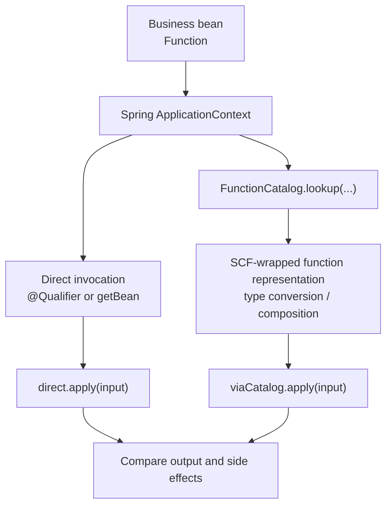
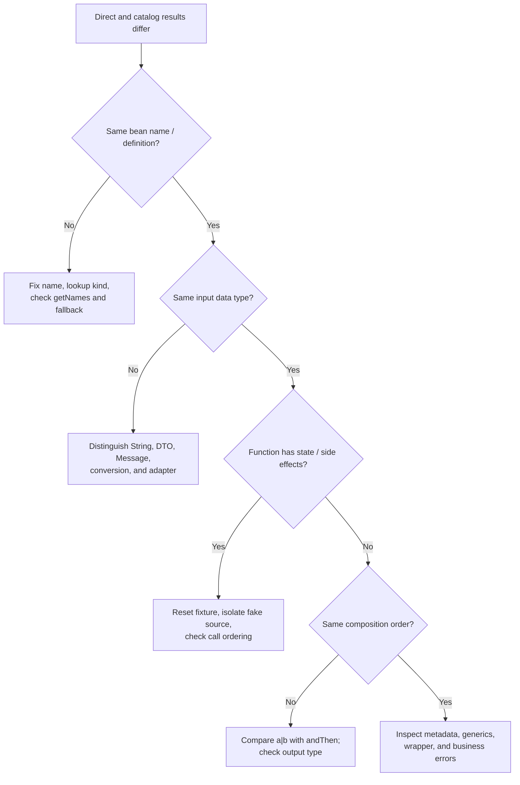

# Comparing Direct Bean Invocation with Catalog Invocation Results

**Chapter:** Testing  
**Module:** Spring Cloud Function (`SPRING_CLOUD_FUNCTION`)

Spring Cloud Function allows business logic to be written using `Supplier<T>`, `Function<T,R>`, or `Consumer<T>`, and then reused across Java code, HTTP, event processing, and serverless environments. A functional bean can be invoked **directly** via dependency injection or `ApplicationContext`; it can also be looked up **through `FunctionCatalog`** to leverage Spring Cloud Function's wrapper, composition, and data conversion mechanisms.

A common testing question is: **"Given the same function and the same input, does invoking the Spring bean directly produce the same result as invoking it through the catalog?"** The answer is: for inputs matching the Java contract and a deterministic function, both paths should generally produce the **same business result**. However, value equivalence alone cannot be used to conclude that the two paths are completely identical. The catalog may provide an object that is wrapped (*wrapped/instrumented*) and adapts to `Message<?>`, conversion, or function definitions according to its own rules.

This lesson guides you through building a Spring context-layer integration test suite to compare **return values, exceptions, side effects, and composition**, while pointing out what **should not be compared**, such as object identity or headers without an explicit preservation contract.

## 1. Goals, Scope, and Comparison Criteria

After this lesson, you will be able to:

1. Obtain the right bean with `@Qualifier` and the right function via `FunctionCatalog.lookup(...)`.
2. Pass **the same input and the same initial state** to both invocation paths for a fair comparison.
3. Write JUnit 5/Spring Boot tests comparing `Function`, `Supplier`, and `Consumer`.
4. Compare DTO values using meaningful value equality rather than object reference equality.
5. Compare Java composition via `andThen(...)` against catalog composition via `a|b`.
6. Distinguish business logic bugs from differences caused by wrappers, converters, or adapters.
7. Spot a "green" test that does not actually verify the right name, right kind, or right invocation path.

**Primary scope:** starts a Spring context and `FunctionCatalog`, but **does not start an HTTP server, does not connect to a broker, and does not deploy serverless handlers**. This lesson only compares two ways of invoking the same logic within a Java/Spring environment. When verifying JSON, `Message<byte[]>`, or actual bindings, write appropriate additional integration tests.

| Comparison | Should You Do It? | Reason |
| --- | --- | --- |
| Same `String` input, both paths return expected `String` | **Yes** | Verifies business result |
| Same DTO input, both paths return DTOs with equal values | **Yes** | Verifies data contract |
| Same initial state, `Consumer` produces same side effect | **Yes** | Compares observable effect |
| Same deterministic `Supplier`, both paths return expected value | **Yes** | Verifies source behavior |
| Java `a.andThen(b)` and catalog `a|b` return equivalent results | **Yes** | Verifies composition |
| `assertSame(directBean, catalogFunction)` | **No** | Catalog may return a wrapper |
| Comparing class names of direct bean and catalog wrapper | **No** | Implementation class is a framework detail |
| Comparing all `Message<?>` headers without a defined contract | **No** | Wrapper/adapter may transform envelope and headers |
| Concluding HTTP/Stream/serverless works from one `apply(String)` call | **No** | Protocol and converter are untested |

## 2. Model: One Logic, Two Execution Paths



The direct path is a Java call to the Spring bean (which may still have a standard Spring AOP proxy). The catalog path uses the function recognized by `FunctionCatalog`, which may be wrapped by Spring Cloud Function. When the input already has the expected type and the function has no environment-dependent behavior, the business results should match.

**Definition of "equivalent" in this lesson:**

- For `Function<T,R>`: both paths return **the same business value `R`** for a valid `T`.
- For `Supplier<R>`: results are equivalent when the source is **deterministic** and read state is controlled.
- For `Consumer<T>`: compare **observable side effects** after each call rather than the `void` return.
- For composition: compare the output of **the same sequence of operations in the same order**.

When using wall-clock time, random numbers, I/O, or mutable state, two consecutive calls can return different results even when the logic is completely correct. Control or reset state before drawing conclusions.

## 3. Preparing Dependencies and JUnit

The examples use Spring Boot, `spring-cloud-function-context`, and JUnit Jupiter, with **compatible** versions managed by your project. Use `spring-cloud-function-context` to get the catalog; Web/Stream dependencies are unnecessary when testing only Java invocation paths.

**Maven** (dependencies excerpt; a real POM requires a parent/BOM):

```xml
<dependencies>
    <dependency>
        <groupId>org.springframework.boot</groupId>
        <artifactId>spring-boot-starter</artifactId>
    </dependency>
    <dependency>
        <groupId>org.springframework.cloud</groupId>
        <artifactId>spring-cloud-function-context</artifactId>
    </dependency>
    <dependency>
        <groupId>org.springframework.boot</groupId>
        <artifactId>spring-boot-starter-test</artifactId>
        <scope>test</scope>
    </dependency>
</dependencies>
```

**Gradle Kotlin DSL** (versions already managed by the project):

```kotlin
dependencies {
    implementation("org.springframework.boot:spring-boot-starter")
    implementation("org.springframework.cloud:spring-cloud-function-context")
    testImplementation("org.springframework.boot:spring-boot-starter-test")
}

tasks.test {
    useJUnitPlatform()
}
```

The test suite uses:

```java
@SpringBootTest(
    classes = DirectCatalogComparisonApplication.class,
    webEnvironment = SpringBootTest.WebEnvironment.NONE
)
```

This test **does create a Spring ApplicationContext**; it is not a plain Java unit test. `WebEnvironment.NONE` only states that no embedded web server is started, while Spring DI and `FunctionCatalog` remain active.

## 4. Sample Application: Function, Supplier, Consumer, and DTOs

We declare multiple functional beans up front so we do not depend on *single-function fallback*. Bean names are explicit, and functions are deterministic so comparisons are meaningful.

**File:** `src/main/java/example/testing/DirectCatalogComparisonApplication.java`

```java
package example.testing;

import java.util.List;
import java.util.Locale;
import java.util.concurrent.CopyOnWriteArrayList;
import java.util.function.Consumer;
import java.util.function.Function;
import java.util.function.Supplier;

import org.springframework.beans.factory.annotation.Qualifier;
import org.springframework.boot.SpringApplication;
import org.springframework.boot.autoconfigure.SpringBootApplication;
import org.springframework.context.annotation.Bean;

@SpringBootApplication(proxyBeanMethods = false)
public class DirectCatalogComparisonApplication {

    public static void main(String[] args) {
        SpringApplication.run(
            DirectCatalogComparisonApplication.class, args);
    }

    public record OrderInput(String code, int quantity) {}

    public record OrderDecision(
        String normalizedCode, boolean accepted) {}

    @Bean("normalizeOrderCode")
    public Function<String, String> normalizeOrderCode() {
        return raw -> {
            if (raw == null || raw.isBlank()) {
                throw new IllegalArgumentException(
                    "Order code must not be blank");
            }
            return raw.trim().toUpperCase(Locale.ROOT);
        };
    }

    @Bean("addPrefix")
    public Function<String, String> addPrefix() {
        return code -> "ID-" + code;
    }

    @Bean("codeLength")
    public Function<String, Integer> codeLength() {
        return String::length;
    }

    @Bean("validateOrder")
    public Function<OrderInput, OrderDecision> validateOrder(
            @Qualifier("normalizeOrderCode")
            Function<String, String> normalize) {
        return input -> new OrderDecision(
            normalize.apply(input.code()),
            input.quantity() > 0
        );
    }

    @Bean("issueOrderCode")
    public Supplier<String> issueOrderCode() {
        return () -> "  ord-42  ";
    }

    @Bean("auditLog")
    public AuditLog auditLog() {
        return new AuditLog();
    }

    @Bean("auditOrderCode")
    public Consumer<String> auditOrderCode(AuditLog log) {
        return log::record;
    }

    public static final class AuditLog {

        private final List<String> entries =
            new CopyOnWriteArrayList<>();

        public void record(String code) {
            entries.add(code);
        }

        public List<String> snapshot() {
            return List.copyOf(entries);
        }

        public void clear() {
            entries.clear();
        }
    }
}
```

`record` classes require Java 16 or higher; Java 17 is a suitable choice for this example. `AuditLog` is a regular Spring bean that does not implement `Supplier`, `Function`, or `Consumer`; it lets us observe side effects without writing to a real database or publishing real events.

### 4.1. Contract of Each Bean

| Bean | Kind | Example Behavior |
| --- | --- | --- |
| `normalizeOrderCode` | `Function<String,String>` | `"  ord-42  " → "ORD-42"` |
| `addPrefix` | `Function<String,String>` | `"ORD-42" → "ID-ORD-42"` |
| `codeLength` | `Function<String,Integer>` | `"ID-ORD-42" → 9` |
| `validateOrder` | `Function<OrderInput,OrderDecision>` | Normalizes code and evaluates `quantity > 0` |
| `issueOrderCode` | `Supplier<String>` | Always returns `"  ord-42  "` |
| `auditOrderCode` | `Consumer<String>` | Records value into `AuditLog` |

Two design traits keep tests unambiguous:

1. **Multiple eligible candidates**: a wrong name is not masked by single-function fallback.
2. **Deterministic output**: `issueOrderCode` avoids clocks/UUIDs; `auditOrderCode` writes to a list that can be cleared between tests.

### 4.2. Why Does `validateOrder` Inject Another Function?

`validateOrder` declares:

```java
@Qualifier("normalizeOrderCode")
Function<String, String> normalize
```

Because the context contains multiple `Function` beans, `@Qualifier` forces Spring to inject the exact normalizer function. The test suite compares **the `validateOrder` bean constructed by Spring with its proper dependency** against **the wrapper returned by the catalog**, rather than building a separate lambda in the test.

If `@Qualifier` is wrong, Spring can fail to construct the context. In that case, failure happens **before any output-comparison test runs**, and should be treated as a registration/DI error rather than a behavioral difference between direct and catalog paths.

## 5. Full Test Suite Comparing Direct and Catalog Calls

**File:** `src/test/java/example/testing/DirectVsCatalogTest.java`

```java
package example.testing;

import static org.junit.jupiter.api.Assertions.*;

import java.util.List;
import java.util.Set;
import java.util.function.Consumer;
import java.util.function.Function;
import java.util.function.Supplier;
import java.util.stream.Stream;

import org.junit.jupiter.api.BeforeEach;
import org.junit.jupiter.api.Test;
import org.junit.jupiter.params.ParameterizedTest;
import org.junit.jupiter.params.provider.Arguments;
import org.junit.jupiter.params.provider.MethodSource;
import org.springframework.beans.factory.annotation.Autowired;
import org.springframework.beans.factory.annotation.Qualifier;
import org.springframework.boot.test.context.SpringBootTest;
import org.springframework.cloud.function.context.FunctionCatalog;
import org.springframework.context.ApplicationContext;

@SpringBootTest(
    classes = DirectCatalogComparisonApplication.class,
    webEnvironment = SpringBootTest.WebEnvironment.NONE
)
class DirectVsCatalogTest {

    @Autowired
    ApplicationContext context;

    @Autowired
    FunctionCatalog catalog;

    @Autowired
    @Qualifier("normalizeOrderCode")
    Function<String, String> directNormalize;

    @Autowired
    @Qualifier("addPrefix")
    Function<String, String> directPrefix;

    @Autowired
    @Qualifier("codeLength")
    Function<String, Integer> directLength;

    @Autowired
    @Qualifier("validateOrder")
    Function<
        DirectCatalogComparisonApplication.OrderInput,
        DirectCatalogComparisonApplication.OrderDecision
    > directValidate;

    @Autowired
    @Qualifier("issueOrderCode")
    Supplier<String> directSupplier;

    @Autowired
    @Qualifier("auditOrderCode")
    Consumer<String> directConsumer;

    @Autowired
    DirectCatalogComparisonApplication.AuditLog auditLog;

    @BeforeEach
    void resetLog() {
        auditLog.clear();
    }

    static Stream<Arguments> orderCodes() {
        return Stream.of(
            Arguments.of("  ord-42  ", "ORD-42"),
            Arguments.of("ab-9", "AB-9"),
            Arguments.of(" x-1 ", "X-1")
        );
    }

    @ParameterizedTest
    @MethodSource("orderCodes")
    void directAndCatalogNormalizeToSameValue(
            String input, String expected) {
        Function<String, String> viaCatalog =
            catalog.lookup(
                Function.class, "normalizeOrderCode");

        assertNotNull(viaCatalog);
        assertEquals(expected, directNormalize.apply(input));
        assertEquals(expected, viaCatalog.apply(input));
        assertEquals(
            directNormalize.apply(input),
            viaCatalog.apply(input));
    }

    @Test
    void catalogUsesTheSameRegisteredBusinessName() {
        assertTrue(context.containsBean("normalizeOrderCode"));
        Set<String> names = catalog.getNames(Function.class);
        assertTrue(names.contains("normalizeOrderCode"));
        assertTrue(names.contains("addPrefix"));
        assertTrue(names.contains("codeLength"));
        assertTrue(names.contains("validateOrder"));
    }

    @Test
    void directAndCatalogSupplierReturnSameValue() {
        Supplier<String> viaCatalog =
            catalog.lookup(Supplier.class, "issueOrderCode");

        assertNotNull(viaCatalog);
        assertEquals("  ord-42  ", directSupplier.get());
        assertEquals(directSupplier.get(), viaCatalog.get());
    }

    @Test
    void directAndCatalogConsumerProduceSameEffect() {
        Consumer<String> viaCatalog =
            catalog.lookup(Consumer.class, "auditOrderCode");

        assertNotNull(viaCatalog);

        directConsumer.accept("ORD-42");
        List<String> directEvents = auditLog.snapshot();

        auditLog.clear();
        viaCatalog.accept("ORD-42");
        List<String> catalogEvents = auditLog.snapshot();

        assertEquals(List.of("ORD-42"), directEvents);
        assertEquals(directEvents, catalogEvents);
    }

    @Test
    void directAndCatalogDtoResultsMatchByValue() {
        Function<
            DirectCatalogComparisonApplication.OrderInput,
            DirectCatalogComparisonApplication.OrderDecision
        > viaCatalog = catalog.lookup(
            Function.class, "validateOrder");

        assertNotNull(viaCatalog);

        var input =
            new DirectCatalogComparisonApplication.OrderInput(
                "  ord-42  ", 3);
        var expected =
            new DirectCatalogComparisonApplication.OrderDecision(
                "ORD-42", true);

        assertEquals(expected, directValidate.apply(input));
        assertEquals(expected, viaCatalog.apply(input));
        assertEquals(directValidate.apply(input),
            viaCatalog.apply(input));
    }

    @Test
    void catalogCompositionMatchesJavaComposition() {
        Function<String, String> directPipeline =
            directNormalize.andThen(directPrefix);
        Function<String, String> viaCatalog =
            catalog.lookup(
                Function.class, "normalizeOrderCode|addPrefix");

        assertNotNull(viaCatalog);
        assertEquals("ID-ORD-42",
            directPipeline.apply("  ord-42  "));
        assertEquals(directPipeline.apply("  ord-42  "),
            viaCatalog.apply("  ord-42  "));
    }

    @Test
    void compositionWithIntegerOutputAlsoMatches() {
        Function<String, Integer> directPipeline =
            directNormalize.andThen(directPrefix)
                .andThen(directLength);
        Function<String, Integer> viaCatalog =
            catalog.lookup(
                Function.class,
                "normalizeOrderCode|addPrefix|codeLength");

        assertNotNull(viaCatalog);
        assertEquals(9, directPipeline.apply("  ord-42  ")
            .intValue());
        assertEquals(directPipeline.apply("  ord-42  "),
            viaCatalog.apply("  ord-42  "));
    }

    @Test
    void unknownNamesMustNotBeMistakenForRegisteredNames() {
        String unknown = "normaliseOrderCode";
        assertFalse(catalog.getNames(null).contains(unknown));

        // Fixture has multiple eligible functional beans.
        assertNull(catalog.lookup(Function.class, unknown));
    }
}
```

**Expected result:** all value-comparison cases above produce identical business results. Tests do not require an HTTP/Stream adapter to run because `@SpringBootTest(webEnvironment = NONE)` already supplies beans and the catalog.

### 5.1. Assertions That Truly Matter

Every good check typically has three verification layers:

1. **Right name recognized:** `catalog.getNames(type).contains(name)`.
2. **Lookup succeeds:** `lookup(type,name)` returns non-`null`.
3. **Right behavior:** output or side effects match the business expectation and match the direct bean.

Writing only `assertNotNull(catalog.lookup(...))` does not verify behavior. Writing only `assertEquals(direct.apply(input), viaCatalog.apply(input))` is also insufficient if **both paths execute the same buggy logic**: add an independent expected value, such as `"ORD-42"` or `9`.

### 5.2. Do Not Infer That the Catalog Returns the Exact Spring Object

Do not write:

```java
// This is NOT a guaranteed contract:
// assertSame(directNormalize,
//     catalog.lookup(Function.class, "normalizeOrderCode"));
```

Spring Cloud Function can wrap a functional bean in a `FunctionInvocationWrapper` or equivalent implementation structure. The wrapper is responsible for adding metadata, conversion, and composition. Correct business values matter more than whether the two object references are identical.

## 6. Fair Comparisons: Same Input, Same Conditions

A comparison is meaningful only when both paths are tested with **the same input data** and **equivalent environment state**.

| Function Type | Conditions to Keep Equal |
| --- | --- |
| Pure `Function<String,String>` | Same string, encoding/locale, and processing rules |
| `Function<DTO,DTO>` | Same DTO data; avoid mutated objects |
| `Supplier` | Deterministic source or reset source before each call |
| `Consumer` | Reset destination and record invocation count/values |
| Composition | Same function order and input/output types |
| Functions with transactions or side effects | Isolate resources and test state; avoid duplicate writes to real data |

### 6.1. Avoiding Non-Deterministic Suppliers

Example of an unreliable comparison:

```java
@Bean("randomCode")
public Supplier<String> randomCode() {
    return () -> java.util.UUID.randomUUID().toString();
}
```

Two consecutive `get()` calls can return different UUIDs even when both the direct bean and catalog work properly. Hence:

```java
assertEquals(directSupplier.get(), catalogSupplier.get());
```

is valid only when the source is **deterministic or state-synchronized**. For random sources, inject a fake UUID source in the fixture or assert contract-guaranteed properties (such as format) instead of exact values.

### 6.2. Avoiding Double Side Effects from Consumers

If a `Consumer` writes to a database or publishes real messages, calling both direct and catalog consecutively will **execute two side effects**, potentially creating duplicate events and polluting test data.

In our example, `AuditLog` is an in-memory fake. We:

1. Invoke the direct consumer.
2. Capture a snapshot.
3. Clear state.
4. Invoke the consumer from the catalog with **the same input**.
5. Compare snapshots against each other and the independent expectation.

That way, the test verifies side effects without sending messages or writing to a real database. When you want to test a real broker, write a separate adapter integration test with proper resources and cleanup.

### 6.3. DTOs Should Implement Value Equality

In the example, `OrderInput` and `OrderDecision` are Java `record` types and therefore derive `equals/hashCode` from their components. The test:

```java
assertEquals(expected, directValidate.apply(input));
assertEquals(expected, viaCatalog.apply(input));
```

checks **business content**, not object identity. For ordinary DTO classes without value equality, compare individual fields or use property-based assertions; avoid `assertSame(expected, actual)` for newly allocated objects.

### 6.4. Do Not Only Compare Two Results Against Each Other

Suppose a bug causes both paths to produce `"Ord-42"`. A test containing only:

```java
assertEquals(direct.apply(input), fromCatalog.apply(input));
```

still passes because both sides are equally wrong. Combine it with an explicit expectation:

```java
assertEquals("ORD-42", direct.apply(input));
assertEquals("ORD-42", fromCatalog.apply(input));
```

This principle is especially important when the same underlying bean is invoked via two paths: equivalence does not replace the **oracle** of the expected business outcome.

## 7. When Results Do Not Necessarily Have the Same Shape

The biggest difference between a direct bean and the catalog is that **the catalog provides a representation wrapped by Spring Cloud Function**. Per official documentation, the wrapper can add type conversion, composition, and adaptation for the message formats provided by the caller.

| Context | Direct Bean Invocation | Invocation via FunctionCatalog |
| --- | --- | --- |
| Properly typed Java `String` input | Bean runs `apply(String)` | Wrapper delegates to logic, potentially without conversion |
| Properly typed Java DTO input | Bean receives DTO directly | Wrapper can invoke bean with matching DTO |
| `Message<String>` input to a `Function<String,String>` | **Does not match** direct signature; caller must extract payload | Wrapper can handle envelope unwrapping/type conversion |
| `Message<byte[]>` carrying JSON | DTO bean does not deserialize JSON itself | Can use converters when metadata and config match |
| Definition `normalizeOrderCode|addPrefix` | Caller must fetch and compose both beans manually | Catalog resolves composition string |
| Input/output headers | Direct logic sees headers only if signature accepts `Message` | Wrapper/adapter has its own header rules |

**Do not treat differences in passed object types as evidence that the two paths execute different business logic.** If direct receives `String` while catalog receives `Message<byte[]>`, you are testing **two different input contracts**. To compare the same logic, first pass properly typed Java data to both sides, then write separate conversion tests.

### 7.1. Observing the Wrapper When Input Is a Message

Spring Cloud Function can accept a `Message<?>`, use its payload and metadata for processing, and produce an appropriate result. The exploratory snippet below is only for **observing the catalog path**, not a test asserting that the output must be a specific class:

```java
import org.springframework.messaging.Message;
import org.springframework.messaging.MessageHeaders;
import org.springframework.messaging.support.MessageBuilder;
import org.springframework.cloud.function.context.catalog.SimpleFunctionRegistry.FunctionInvocationWrapper;

// Inside a method that has FunctionCatalog catalog.
FunctionInvocationWrapper wrapper =
    catalog.lookup("normalizeOrderCode");
if (wrapper == null) {
    throw new IllegalStateException("Missing normalizeOrderCode");
}

Message<String> input = MessageBuilder
    .withPayload("  ord-42  ")
    .setHeader(MessageHeaders.CONTENT_TYPE, "text/plain")
    .build();

Object result = wrapper.apply(input);
Object payload = result instanceof Message<?> message
    ? message.getPayload() : result;

System.out.println("Result type: " + result.getClass());
System.out.println("Payload type: " + payload.getClass());
System.out.println("Payload: " + payload);
```

This snippet references the implementation class `FunctionInvocationWrapper` for observation, so **verify the API against your exact dependency version**. In production tests, avoid coupling business assertions to this implementation class. Also, payload types can depend on content type and converters; for instance, a `byte[]` cannot be compared directly to a `String` with `assertEquals`.

Therefore:

- For **logic comparison** tests, pass `String` directly on both paths as in Section 5.
- For **conversion** tests, define expected input type, output type, content type, and converter upfront.
- For **HTTP or message adapter** tests, verify status/headers/serialization per the protocol contract rather than only comparing Java objects.

### 7.2. Do Not Assume Headers Are Preserved Automatically

Suppose an input includes the header `source=mobile`. When invoking a `Function<String,String>` through the catalog with a `Message<?>`, the framework may handle envelopes and headers according to version- and config-specific rules. Do not assume every input header is copied to the output.

If a business header must be preserved, use an explicit contract:

- Have the function accept and return `Message<T>`, copying required headers itself; or
- Use the header-propagation options supported by Spring Cloud Function/the adapter in your version; and
- Write a dedicated integration test asserting that the specific header actually remains in the output.

A test on `Function<String,String>` with `String` input provides no evidence whatsoever about header propagation.

## 8. Exceptions: Compare Contracts Instead of Stack Traces

In the fixture, `normalizeOrderCode` rejects `null` and whitespace-only strings. With the direct bean:

```java
assertThrows(
    IllegalArgumentException.class,
    () -> directNormalize.apply("  "));
```

When invoked through the catalog, the same business error may be propagated directly or surfaced inside a wrapper exception depending on execution path, version, and adapter. Do not assume both exceptions must share **the exact same class, stack trace, or full message**.

Distinguish among:

1. **Business contract error:** disallowed input explicitly rejected by business logic.
2. **Lookup error:** unresolvable name/definition, wrong functional interface, or invalid composition.
3. **Conversion error:** byte array/JSON/Message cannot be converted into the bean's expected type.
4. **Adapter error:** improper HTTP status, routing, binding, or serialization.

### 8.1. Checking the Right Thing at the Right Layer

For example, in the direct test:

```java
IllegalArgumentException failure = assertThrows(
    IllegalArgumentException.class,
    () -> directNormalize.apply(null));

assertEquals(
    "Order code must not be blank",
    failure.getMessage());
```

This is an explicit Java contract test. For the catalog, tests can confirm that invalid input is rejected, while the **outer exception type** may need its own contract if exposed as a stable API.

If the real application uses an HTTP adapter, you must also test how that error maps to an HTTP status and response body. Do not conclude from `assertThrows(...)` on a bean that HTTP returns `400 Bad Request`.

### 8.2. Different Output Shapes Are Not Always Bugs

Two common sources of confusion:

- The direct bean returns `OrderDecision`, while an adapter returns JSON representing `OrderDecision`. Different **representation**, potentially the same business content.
- The direct bean takes `String` and returns `String`, while the wrapper takes `Message<?>`, processes the payload, and returns another envelope. If a test forces both sides to have the exact same class, it can fail even when the business value is right.

To compare across protocols, normalize results against an **observable contract**—such as a JSON `normalizedCode` field or a specific payload—and compare domain values. Do not discard protocol-required assertions such as status, content type, or required headers.

## 9. Verifying Bean Names and Avoiding Single-Function Fallback

The two invocation paths resolve names differently:

| Direct Spring Bean | FunctionCatalog |
| --- | --- |
| `@Qualifier("normalizeOrderCode")` | `lookup(Function.class, "normalizeOrderCode")` |
| `context.getBean("normalizeOrderCode")` | `getNames(Function.class)` and `lookup(...)` |
| Missing name causes DI failure / `NoSuchBeanDefinitionException` | Missing name may fail to resolve, or fall back if only one function exists |

Thus, a comparison must first verify that **both paths target the intended bean name**.

```java
String name = "normalizeOrderCode";

assertTrue(context.containsBean(name));
assertTrue(catalog.getNames(Function.class).contains(name));

Function<String, String> fromCatalog =
    catalog.lookup(Function.class, name);
assertNotNull(fromCatalog);
```

Do not use `lookup("wrongName") != null` as proof that the real name exists. Under *single-function fallback*, in an application with only one eligible functional bean, the catalog can return that sole function even when queried with an empty or mismatched name.

Our lesson's fixture has multiple functional beans, making negative tests meaningful. In versions that support it, you can also disable fallback with:

```properties
spring.cloud.function.single-function-fallback-enabled=false
```

Verify this flag against the exact Spring Cloud Function version you use. Do not treat a property in a config file as proof that your current version honors it.

## 10. How to Compare When a Bean Is Excluded from the Catalog?

Spring Cloud Function supports filtering candidates:

```properties
spring.cloud.function.ineligible-definitions=internalClean
```

The `internalClean` bean can still exist in `ApplicationContext` and be invoked directly, while no longer appearing as a standard catalog candidate. In that case, **you cannot require both paths to return a function object**.

This is not "divergent business behavior": the difference is a **function exposure/registration rule**.

An appropriate test:

```java
assertTrue(context.containsBean("internalClean"));
assertFalse(catalog.getNames(Function.class)
    .contains("internalClean"));
```

**Do not write** a test expecting `catalog.lookup("internalClean")` to return that bean when the configuration explicitly marks it ineligible. Moreover, if the catalog has only one remaining candidate, single-function fallback can cause a lookup for the excluded name to return **a different function** rather than the helper.

When exposing functions over HTTP or Stream, also verify that `spring.cloud.function.definition` points to an **allowed function**. Filtering catalog candidates is also not a security boundary for custom controllers: a hand-written HTTP controller can still inject and invoke the helper directly.

## 11. Testing Composition: Same Order Is Required

In the sample application:

```java
Function<String, String> direct =
    directNormalize.andThen(directPrefix);

Function<String, String> catalogPipeline =
    catalog.lookup(
        Function.class, "normalizeOrderCode|addPrefix");
```

Both pipelines execute:

```text
Input
  -> normalizeOrderCode
  -> addPrefix
  -> Output
```

They are comparable because they share the **same order and data-type contract**.

If you reverse the catalog definition:

```java
Function<String, String> reversed =
    catalog.lookup(
        Function.class, "addPrefix|normalizeOrderCode");
```

you should not expect `reversed.apply(input)` to always equal `direct.apply(input)`. For strings with surrounding whitespace, adding the prefix before normalizing changes the output.

### 11.1. Three-Step Definition and Output Type Change

```java
Function<String, Integer> direct =
    directNormalize
        .andThen(directPrefix)
        .andThen(directLength);

Function<String, Integer> viaCatalog =
    catalog.lookup(
        Function.class,
        "normalizeOrderCode|addPrefix|codeLength");

assertNotNull(viaCatalog);
assertEquals(9, direct.apply("  ord-42  ").intValue());
assertEquals(
    direct.apply("  ord-42  "),
    viaCatalog.apply("  ord-42  "));
```

The result is an `Integer`, **not** a `String`. The return type of a composition is the output type of its final step. Assigning a `Function<String,Integer>` result to a `Function<String,String>` variable violates the contract; due to Java type erasure, the bug can surface at runtime if `lookup` generics are misused.

### 11.2. Do Not Confuse `|` with `;`

`spring.cloud.function.definition=normalizeOrderCode|addPrefix` describes **a single pipeline**. In adapters that support multiple definitions, `normalizeOrderCode;addPrefix` can specify **two independent definitions**, meaning the first function's output does not automatically feed into the second.

Therefore, tests comparing against Java `andThen(...)` must use definitions joined with `|`, not `;`.

## 12. What Should You Compare When Functions Use Reactive APIs?

For a reactive function:

```java
Function<Flux<String>, Flux<String>> normalizeStream =
    flux -> flux.map(
        s -> s.trim().toUpperCase(Locale.ROOT));
```

the output is a **publisher**, not a `String`. Two publishers can be completely distinct object instances while emitting the exact same sequence of elements.

In a project using Project Reactor and `reactor-test`, compare elements, terminal signals, and errors per contract:

```java
// Testing pseudocode when Reactor dependencies are present:
// StepVerifier.create(direct.apply(Flux.just(" ord-42 ")))
//     .expectNext("ORD-42")
//     .verifyComplete();
//
// StepVerifier.create(viaCatalog.apply(Flux.just(" ord-42 ")))
//     .expectNext("ORD-42")
//     .verifyComplete();
```

This is an extended illustration, not part of the runnable JUnit fixture in Section 5. With Reactive APIs, account for cold vs. hot publishers, subscription timing, backpressure, concurrency, and side effects. Never use `assertEquals(directPublisher, catalogPublisher)` to conclude two streams are equivalent.

In addition, Spring Cloud Function and its adapters follow different rules when invoking reactive functions versus imperative per-message functions. Thus, testing the catalog with a publisher does not prove that a Stream binder or serverless adapter manages subscriptions properly.

## 13. Diagnosing Mismatched Results



| Symptom | Common Cause | Verification Step |
| --- | --- | --- |
| Direct has function, `lookup` returns `null` | Wrong name, filtered out, wrong kind, or catalog registration | `containsBean`, `getNames(type)`, `@Bean` name |
| Lookup with wrong name still returns function | Single-function fallback | Check actual names in catalog, check candidate count |
| Two `String` results differ | Different inputs, different composition order, stateful logic | Print test input/output, fix test data |
| `Supplier` returns two different values | Clock, UUID, API, or counter | Fake source; reset before each call |
| `Consumer` creates two records | Test called direct then catalog without clearing state | Isolate/reset fake before comparing |
| DTO output has same data but `assertEquals` fails | DTO lacks value equality | Use `record` or compare fields individually |
| `Message<?>` input produces different output class | Wrapper/converter transforms payload and envelope | Check payload type, content type, header contract |
| Catalog call fails, direct bean succeeds | Conversion, metadata, or definition error | Test with properly typed Java input first |
| Java composition works, catalog composition fails | Missing bean, wrong definition, or swapped order | Check each name and `a|b` string |
| Catalog test PASSES, HTTP returns 404 | Wrong route or Web adapter export | Write dedicated HTTP integration test |

### 13.1. Read Logs by Layer

To isolate causes quickly, check in order:

1. **Context:** was the bean created by Spring?
2. **Registration:** are the name and kind present in `FunctionCatalog.getNames(...)`?
3. **Lookup:** does the catalog resolve the right name/definition?
4. **Payload:** are input type, data, and converter identical?
5. **Logic:** do output value and side effects match the contract?
6. **Adapter:** if running over HTTP/Stream/serverless, are route, binding, and serialization configured properly?

Do not modify the body of `normalizeOrderCode` just because HTTP returns `404` when a Java catalog invocation already works. The root cause is far more likely in Web mapping or adapter export settings.

### 13.2. When Comparing Exceptions, Find the Root Cause

If the direct bean throws `IllegalArgumentException` while the catalog wrapper surfaces a different outer exception, examine the root cause and the exact data passed in. A wrapper or adapter may enrich error metadata or throw during conversion **before the business function is even invoked**.

Distinguish the outcomes:

- Both invoke the same logic and reject the same input: likely consistent with the contract.
- Catalog never reaches business logic due to a conversion failure: a different issue from validation failure.
- Direct and catalog resolve to two different names: you are comparing two different functions, not two ways of calling one function.

## 14. Preventing Brittle Tests and Handling Shared State

### 14.1. Spring Contexts Can Be Cached

Spring Boot Test typically reuses a single context across tests sharing the same configuration. Singleton beans like `AuditLog` can retain data from previous tests. Therefore:

```java
@BeforeEach
void resetLog() {
    auditLog.clear();
}
```

ensures the tests in Section 5 start with clean state. However, if multiple tests run in parallel against the same singleton, clearing state can still cause race conditions. Control parallelism, separate fixtures, or use per-test fakes/mocks where appropriate.

### 14.2. Do Not Assert Catalog Size by Absolute Count

Avoid:

```java
// Not recommended:
// assertEquals(6, catalog.getNames(null).size());
// assertEquals(6, catalog.size());
```

Spring Cloud Function may register infrastructure functions or manage catalog entries differently across versions. Tests should assert **required business names** and **disallowed names** rather than total catalog size.

### 14.3. Do Not Force Generic Types Just Because `lookup` Compiles

```java
// The codeLength bean is actually Function<String, Integer>.
Function<String, String> wrong =
    catalog.lookup(Function.class, "codeLength");
```

This is a contract violation even if Java accepts it through generic type inference. Using the return value can fail at runtime because the actual type is `Integer`.

In comparison tests, keep types faithful to the bean signature:

```java
Function<String, Integer> correct =
    catalog.lookup(Function.class, "codeLength");

assertNotNull(correct);
assertEquals(6, correct.apply("ORD-42").intValue());
```

### 14.4. Do Not Replace the Real Function with a Mock

When the goal is to verify that the same business logic runs via direct bean and catalog, do not mock `normalizeOrderCode` or `validateOrder` themselves. Doing so can reduce your test to comparing two paths calling a pre-stubbed mock.

Keep functional beans real, and use test doubles for external collaborators such as repositories, HTTP clients, or broker gateways. If you want to verify real wiring, the test must not accidentally strip out all the logic under verification.

## 15. How to Run Tests and Read Results

Illustrative layout:

```text
src/
  main/java/example/testing/
    DirectCatalogComparisonApplication.java
  test/java/example/testing/
    DirectVsCatalogTest.java
```

Maven Wrapper:

```bash
./mvnw -Dtest=DirectVsCatalogTest test
```

Gradle Wrapper:

```bash
./gradlew test --tests "example.testing.DirectVsCatalogTest"
```

These commands are **guidance for learners**, not output from a run performed while authoring this article.

When a test fails:

- **Context fails to start:** check `@Bean`, `@Qualifier`, dependencies, and versions.
- **Name not found:** check `FunctionCatalog.getNames(...)`, bean name, and ineligibility settings.
- **Lookup succeeds, output is wrong:** check input, generics, business logic, and wrapper conversion.
- **Consumer comparison fails:** check `AuditLog.clear()` and invocation counts.
- **Composition fails:** check step ordering and each step's input/output types.

### 15.1. Checking Actual Resolved Versions When Results Differ

Maven:

```bash
./mvnw dependency:tree -Dincludes=org.springframework.cloud:spring-cloud-function-context
```

Gradle:

```bash
./gradlew dependencyInsight --dependency spring-cloud-function-context --configuration runtimeClasspath
```

If wrapper, converter, or fallback behavior differs between a local machine and CI, compare the actually resolved `spring-cloud-function-context` artifact. Do not guess the Spring Cloud Function version solely from the Spring Boot version or release train name.

## 16. Practice Exercises

1. **Function comparison:** add `"  ab-009  "` to `@MethodSource`; assert direct output, catalog output, and expected output simultaneously.
2. **DTO testing:** extend `validateOrder` to reject quantity 0; write a test with `OrderInput(" ord-42 ", 0)` and verify both paths produce the same `OrderDecision`.
3. **Value vs. identity:** print the classes of `directNormalize` and the catalog-looked-up function. Why should you not require them to share the same class or object identity?
4. **Supplier:** replace the fixed supplier with an incrementing counter source; explain why comparing two consecutive `get()` calls is no longer fair. Add a fake/reset mechanism to the fixture.
5. **Consumer:** call direct and then catalog with the same input without clearing `AuditLog`. Observe two recorded events; fix the test to compare side effects from equivalent initial states.
6. **Composition:** write a test for `normalizeOrderCode|addPrefix|codeLength` and compare it with `andThen(...)`. Verify the `Integer` output type.
7. **Wrong name:** try looking up `normaliseOrderCode`. Use `getNames(Function.class)` to explain the difference between the real name and the misspelled name.
8. **Message:** build a separate test using `Message<String>` with header `source=test`, observing the output payload type; add header assertions only after verifying the converter/propagation contract of your version.
9. **Adapter:** if your project includes Spring Cloud Function Web or Spring Cloud Stream, extend the suite with HTTP requests or message bindings to confirm the same logic is exposed properly. Do not treat the current catalog test as sufficient.

### Interview Questions

**Q:** Calling `direct.apply(input)` and `catalog.lookup(...).apply(input)` both return `ORD-42`. What does that prove?

**A:** For the tested input, the Java bean and the function resolved by the catalog produce the same business result. It does not prove that both objects share identity, that the wrapper performs no conversion, or that HTTP/Stream/serverless adapters are configured properly.

**Q:** Why shouldn't you use `assertSame(directBean, fromCatalog)`?

**A:** The catalog may return a function wrapped by Spring Cloud Function. The important contract is the resolved name/kind and business behavior, not the implementation class or object reference.

**Q:** If you want to compare two `Consumer` invocations that emit events, what should you do?

**A:** Pass the same input, isolate the event-publishing port with a fake or mock, reset state before each invocation path, and compare both the count and content of emitted events. Verifying that a real broker receives messages requires a separate integration test.

## 17. Summary

- **The direct path** invokes the Spring bean as declared; **the catalog path** invokes the function discovered by Spring Cloud Function, which may be wrapped for conversion, composition, and adapters.
- Given **the same properly typed input**, deterministic logic, and equivalent state, tests should verify **identical business results** from both paths.
- Compare outputs for `Function`, control the source for `Supplier`, reset and compare side effects for `Consumer`, and use value equality for DTOs.
- Do not assert object identity, specific wrapper classes, or arbitrary headers unless required by contract. Do not conflate `String`, `Message<?>`, JSON, and reactive publishers.
- For composition, compare Java `andThen(...)` against the matching `a|b` definition, in the same order and with the right output type.
- Combine **expected-value** assertions with **direct == catalog** assertions so two identically broken paths do not pass unnoticed.
- Spring context tests do not prove HTTP, message broker, or serverless execution; conversion and adapters need dedicated integration tests matched to your version and protocol.

### References

- [Spring Cloud Function — Programming Model](https://docs.spring.io/spring-cloud-function/reference/spring-cloud-function/programming-model.html): explains differences between direct bean access and catalog wrappers, conversion, composition, Message, and fallback.
- [Spring Cloud Function — Functional Bean Definitions](https://docs.spring.io/spring-cloud-function/reference/functional.html): inspecting `FunctionCatalog`, listing names, and looking up functions.
- [Spring Boot — Testing Spring Boot Applications](https://docs.spring.io/spring-boot/reference/testing/spring-boot-applications.html): `@SpringBootTest`, contexts, and `webEnvironment` modes.
- [JUnit 5 User Guide](https://junit.org/junit5/docs/current/user-guide/): parameterized tests, `@MethodSource`, and assertions.
- [Spring Cloud Function 4.3 — Programming Model](https://docs.spring.io/spring-cloud-function/reference/4.3/spring-cloud-function/programming-model.html): reference for Message envelopes and header propagation; verify against the exact version in use.
