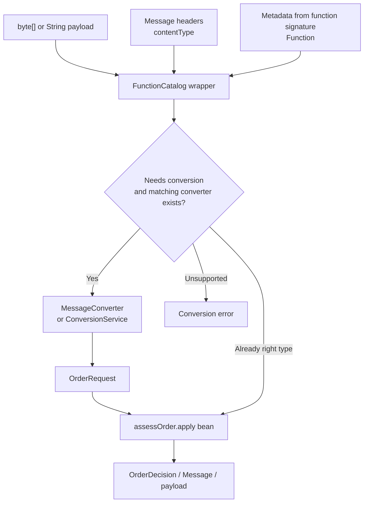
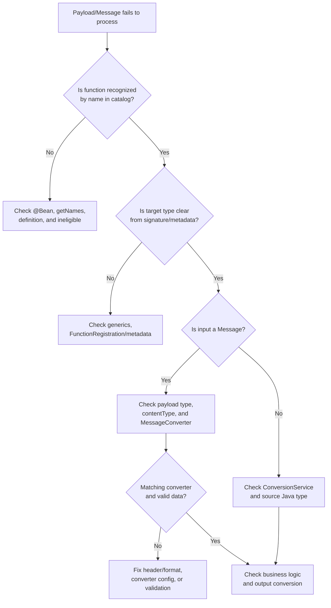

# Testing Data Types, contentType, and MessageConverter

**Chapter:** Testing  
**Module:** Spring Cloud Function (`SPRING_CLOUD_FUNCTION`)

Spring Cloud Function packages business logic as `Supplier`, `Function`, and `Consumer` so the same function can be invoked from Java, HTTP, event-driven systems, or serverless platforms. At those protocol boundaries, data can arrive in many forms: Java objects, strings, byte arrays, JSON, or `Message<?>` with headers.

While a `Function<OrderRequest, OrderDecision>` bean describes only the Java contract, `FunctionCatalog` provides a wrapped function representation that supports input and output conversion where appropriate. To be confident that a JSON request or an event message is handled properly, **testing `function.apply(new OrderRequest(...))` alone is not enough**.

This lesson guides you through writing targeted tests for **data types**, **`contentType` headers**, and **`MessageConverter`**, from testing `Message<byte[]>` containing JSON, `text/plain` payloads, and unconvertible inputs, to custom converters. It also clarifies the testing boundaries across Java logic, wrappers/catalogs, and HTTP or Spring Cloud Stream adapters.

## 1. Learning Objectives

After this lesson, you will be able to:

1. Explain the difference between **the payload's Java type**, **the function's input type**, and **the MIME type described by `contentType`**.
2. Build a `Message<byte[]>` with `contentType=application/json` and test the `FunctionCatalog` path into `Function<DTO, DTO>`.
3. Test `text/plain` and `application/octet-stream` with appropriate data types.
4. Write negative tests for malformed JSON, contract-violating inputs, and unsupported converters.
5. Separate converter tests from business-logic tests and adapter tests.
6. Register a custom `MessageConverter` in the Spring context and test when it is selected.
7. Diagnose conversion errors without mistaking them for function-name, binding, or business-logic errors.

**Prerequisites:** familiarity with declaring Spring Boot `@Bean` methods, `Function<T,R>` interfaces, and JUnit 5. Examples target Java 17 with compatible Spring Boot and Spring Cloud Function versions.

## 2. Three Pieces of Information That Drive Conversion

Imagine a business function:

```java
@Bean("assessOrder")
public Function<OrderRequest, OrderDecision> assessOrder() {
    return request -> new OrderDecision(
        request.orderCode(),
        request.quantity() > 0
    );
}
```

The function expects an `OrderRequest`. However, an adapter may receive raw bytes:

```text
7B 22 6F 72 64 65 72 43 6F 64 65 22 ... (UTF-8 JSON)
```

and pass the framework a `Message<byte[]>` with header:

```text
contentType = application/json
```

To select a converter, Spring Cloud Function considers:

| Information | Example | Purpose |
| --- | --- | --- |
| **Current payload type** | `byte[]` inside `Message<byte[]>` | Identifies the current representation of the data |
| **Function's target type** | `OrderRequest` from `Function<OrderRequest, OrderDecision>` | Identifies the object type needed to invoke the function |
| **`contentType`** | `application/json` | Hints how to interpret the payload and choose a converter |

**You cannot infer the Java target type from `contentType` alone.** A JSON message may need to be converted into `OrderRequest`, `Customer`, `Map`, or another type depending on the function signature. Conversely, an `OrderRequest` signature is not enough if the payload uses a custom format without a supporting converter.



This diagram is a conceptual model. Not every call invokes a converter: when the payload already matches the target type, the framework can pass it through directly. After the function executes, the result shape returned by the wrapper or adapter can also vary with configuration.

### 2.1. How Does `MessageConverter` Differ from `ConversionService`?

Spring Cloud Function documentation distinguishes:

- **`MessageConverter`:** converts from `Message<?>`, using payload, `contentType` header, and the required target type.
- **`ConversionService`:** converts Java values **not wrapped in `Message<?>`**, depending on registered converters/formatters and framework conversion rules.

If you want to prove that `MessageConverter` handles JSON bytes, pass a **`Message<byte[]>`** through the catalog/wrapper path or test the converter directly. If you pass `new OrderRequest(...)` directly, **no conversion may happen at all**.

### 2.2. Common Converters

| MIME Type | Typical Conversion Component | Sensible Scenario |
| --- | --- | --- |
| `application/json` | Spring Cloud Function JSON converter, typically Jackson or Gson | `byte[]`/JSON `String` to POJO when metadata matches |
| `text/plain` | String converter | Text payload to `String` |
| `application/octet-stream` | Byte-array converter | Preserving/passing raw byte payloads |
| `application/x-order-code` | Custom converter if registered | Application-specific non-JSON format |

A converter can only perform operations it supports. **`application/octet-stream` does not mean the framework knows how to parse an `OrderRequest` object from arbitrary bytes.**

### 2.3. When the `contentType` Header Is Missing

Spring Cloud Function documentation notes that the default is often `application/json` when a content type must be chosen. While helpful for some JSON payloads, omitting the header should not be treated as a universal test assumption across all adapters, versions, and payload shapes.

In our sample tests, we **set headers explicitly** so results reflect the exact scenario under test. Only test default JSON fallback in a dedicated test after pinning dependencies and configuration.

## 3. Choosing the Right Testing Level

| Check | Spring Context? | What Exactly Does It Test? |
| --- | --- | --- |
| `assessOrder.apply(new OrderRequest(...))` | Not required | Business logic with already-typed input |
| Calling `MessageConverter.fromMessage(message, OrderRequest.class)` | Not required | Whether a specific converter turns a message into the target type |
| `FunctionCatalog.lookup("assessOrder")` then `apply(Message<byte[]>)` | **Yes** | Type metadata, converter/wrapper, and function execution |
| Custom converter bean + catalog config | **Yes** | Framework discovers the custom converter and applies it on the catalog path |
| HTTP POST JSON to endpoint | Web adapter | Mapping, HTTP headers, request/response, and conversion |
| Sending message via Stream binder | Stream test/binder | Binding, destination, content type, serialization, and handler |
| Invoking serverless handler | Matching adapter | Event mapping, entry point, and packaging |

This lesson focuses on the **middle two layers**: standalone converters and the catalog inside a Spring context. They run without a real HTTP server or message broker, making failures faster to isolate.

## 4. Preparing the Spring Boot and JUnit 5 Project

The examples use Spring Boot, `spring-cloud-function-context`, and a JSON library such as Jackson. In real projects, use the Spring Cloud BOM and compatible Spring Boot/Spring Cloud Function versions.

### 4.1. Maven

Dependencies excerpt (parent/BOM configured in the outer POM):

```xml
<dependencies>
    <dependency>
        <groupId>org.springframework.boot</groupId>
        <artifactId>spring-boot-starter</artifactId>
    </dependency>
    <dependency>
        <groupId>org.springframework.cloud</groupId>
        <artifactId>spring-cloud-function-context</artifactId>
    </dependency>
    <dependency>
        <groupId>com.fasterxml.jackson.core</groupId>
        <artifactId>jackson-databind</artifactId>
    </dependency>
    <dependency>
        <groupId>org.springframework.boot</groupId>
        <artifactId>spring-boot-starter-test</artifactId>
        <scope>test</scope>
    </dependency>
</dependencies>
```

Spring Cloud Function can use different JSON mechanisms depending on classpath and configuration. This lesson **intentionally chooses Jackson** to decode/normalize JSON outputs in test assertions, rather than claiming every Spring Cloud Function application must use Jackson.

### 4.2. Gradle Kotlin DSL

In a project with matching dependency management:

```kotlin
dependencies {
    implementation("org.springframework.boot:spring-boot-starter")
    implementation("org.springframework.cloud:spring-cloud-function-context")
    implementation("com.fasterxml.jackson.core:jackson-databind")
    testImplementation("org.springframework.boot:spring-boot-starter-test")
}

tasks.test {
    useJUnitPlatform()
}
```

Neither `spring-cloud-function-web` nor Spring Cloud Stream is needed to test `FunctionCatalog` directly. Tests use `@SpringBootTest(webEnvironment = NONE)`, meaning **a Spring context is created without starting an HTTP server**.

## 5. Sample Application: One Function Accepting a DTO, One Accepting a String

**File:** `src/main/java/example/testing/ContentTypeTestingApplication.java`

```java
package example.testing;

import java.util.Locale;
import java.util.function.Function;

import org.springframework.boot.SpringApplication;
import org.springframework.boot.autoconfigure.SpringBootApplication;
import org.springframework.context.annotation.Bean;

@SpringBootApplication(proxyBeanMethods = false)
public class ContentTypeTestingApplication {

    public static void main(String[] args) {
        SpringApplication.run(ContentTypeTestingApplication.class, args);
    }

    // Nested records: convenient inside the fixture.
    public record OrderRequest(String orderCode, int quantity) {}

    public record OrderDecision(
            String normalizedCode, boolean accepted) {}

    @Bean("assessOrder")
    public Function<OrderRequest, OrderDecision> assessOrder() {
        return request -> {
            if (request == null || request.orderCode() == null
                    || request.orderCode().isBlank()) {
                throw new IllegalArgumentException(
                    "Order code must not be blank");
            }
            String code =
                request.orderCode().trim().toUpperCase(Locale.ROOT);
            return new OrderDecision(code, request.quantity() > 0);
        };
    }

    @Bean("normalizeCode")
    public Function<String, String> normalizeCode() {
        return raw -> raw.trim().toUpperCase(Locale.ROOT);
    }

    @Bean("rawSize")
    public Function<byte[], Integer> rawSize() {
        return bytes -> bytes.length;
    }

    @Bean("echoBytes")
    public Function<byte[], byte[]> echoBytes() {
        return bytes -> bytes;
    }
}
```

This example has **four eligible `Function` beans**, avoiding reliance on *single-function fallback*. Parameter and return types on each `@Bean` method are explicitly declared so Spring Cloud Function can infer metadata.

**Business contracts:**

| Bean | Java Input | Java Output | Example |
| --- | --- | --- | --- |
| `assessOrder` | `OrderRequest` | `OrderDecision` | `(" ord-42 ", 2) → ("ORD-42", true)` |
| `normalizeCode` | `String` | `String` | `" ord-42 " → "ORD-42"` |
| `rawSize` | `byte[]` | `Integer` | `{65,66,67} → 3` |
| `echoBytes` | `byte[]` | `byte[]` | `{65,66,67} → {65,66,67}` |

`assessOrder` verifies that the order code is non-blank, but **does not perform full JSON Schema validation**. Syntactically valid JSON may still omit fields, produce default values, or violate business constraints. Test those two error classes separately.

### 5.1. Direct Call to Verify "the Logic Still Works"

Example Java test against the bean:

```java
OrderRequest request = new OrderRequest(" ord-42 ", 2);

Function<OrderRequest, OrderDecision> direct =
    context.getBean("assessOrder", Function.class);

assertEquals(
    new OrderDecision("ORD-42", true),
    direct.apply(request));
```

In this snippet, `OrderRequest` and `OrderDecision` are the records imported from `ContentTypeTestingApplication`. Because the input **is already a DTO**, this test does not prove that conversion works. The more critical path passes JSON `byte[]` inside a `Message<?>` through the catalog.

## 6. Building a Message with an Explicit `contentType`

Spring Messaging provides `MessageBuilder` and `MessageHeaders.CONTENT_TYPE`:

```java
import java.nio.charset.StandardCharsets;
import org.springframework.messaging.Message;
import org.springframework.messaging.MessageHeaders;
import org.springframework.messaging.support.MessageBuilder;

String json = """
    {"orderCode":" ord-42 ","quantity":2}
    """;

Message<byte[]> message = MessageBuilder
    .withPayload(json.getBytes(StandardCharsets.UTF_8))
    .setHeader(MessageHeaders.CONTENT_TYPE, "application/json")
    .build();
```

Three facts to note here:

- `message.getClass()`: Spring's message implementation class.
- `message.getPayload().getClass()`: `byte[].class`, **not yet** `OrderRequest.class`.
- `message.getHeaders().get(MessageHeaders.CONTENT_TYPE)`: the content-type metadata typically used to choose how to decode.

Sanity check before passing the message into the catalog:

```java
assertInstanceOf(byte[].class, message.getPayload());
assertEquals(
    "application/json",
    message.getHeaders().get(MessageHeaders.CONTENT_TYPE));
```

The header assertion above works because we **set a string literal** in the example. In real adapters, the value may be normalized into a `MimeType`/`MediaType`; for general checks, compare MIME types semantically rather than always casting to `String`.

### 6.1. Do Not Confuse HTTP `Content-Type` with the Message Header Key

An HTTP request uses the header `Content-Type: application/json`. When an adapter turns the request into a Spring `Message<?>`, that information typically appears under Spring Messaging's `contentType` key (`MessageHeaders.CONTENT_TYPE`).

Tests in this lesson construct `Message<?>` directly and therefore **do not test HTTP header mapping**. In a Web integration test, verify that the actual request reaches the adapter with the expected `Content-Type` and path.

### 6.2. Why Use `byte[]` Instead of a JSON String?

Converting JSON into `byte[]` helps tests better simulate the raw payload form common in message transports. A JSON string can also be handled by converters, though behavior depends on the adapter and converter path.

Within the same suite, you can test both `Message<byte[]>` and `Message<String>` to verify your version's behavior. Do not assume every broker always delivers `byte[]`: some adapters may deserialize payloads before invoking the catalog.

## 7. Integration Test: JSON → DTO via `FunctionCatalog`

**File:** `src/test/java/example/testing/ContentTypeCatalogTest.java`

This test class performs three checks: the bean handles a direct DTO, the catalog accepts JSON bytes with a content type, and the catalog output carries the same business data. Output shape can be `OrderDecision`, `Message<OrderDecision>`, or serialized data depending on configuration, so a test helper **normalizes the output to the DTO** before asserting.

```java
package example.testing;

import static org.junit.jupiter.api.Assertions.*;

import java.nio.charset.StandardCharsets;
import java.util.function.Function;

import com.fasterxml.jackson.databind.ObjectMapper;
import org.junit.jupiter.api.Test;
import org.springframework.beans.factory.annotation.Autowired;
import org.springframework.beans.factory.annotation.Qualifier;
import org.springframework.boot.test.context.SpringBootTest;
import org.springframework.cloud.function.context.FunctionCatalog;
import org.springframework.messaging.Message;
import org.springframework.messaging.MessageHeaders;
import org.springframework.messaging.support.MessageBuilder;

import example.testing.ContentTypeTestingApplication.OrderRequest;
import example.testing.ContentTypeTestingApplication.OrderDecision;

@SpringBootTest(
    classes = ContentTypeTestingApplication.class,
    webEnvironment = SpringBootTest.WebEnvironment.NONE
)
class ContentTypeCatalogTest {

    @Autowired
    FunctionCatalog catalog;

    @Autowired
    @Qualifier("assessOrder")
    Function<OrderRequest, OrderDecision> direct;

    private final ObjectMapper jsonMapper = new ObjectMapper();

    private Message<byte[]> jsonMessage(String json) {
        return MessageBuilder
            .withPayload(json.getBytes(StandardCharsets.UTF_8))
            .setHeader(MessageHeaders.CONTENT_TYPE, "application/json")
            .build();
    }

    private OrderDecision asDecision(Object result)
            throws Exception {
        Object payload = result instanceof Message<?> m
            ? m.getPayload() : result;

        if (payload instanceof OrderDecision decision) {
            return decision;
        }
        if (payload instanceof byte[] bytes) {
            return jsonMapper.readValue(bytes, OrderDecision.class);
        }
        if (payload instanceof String text) {
            return jsonMapper.readValue(text, OrderDecision.class);
        }
        throw new AssertionError(
            "Unexpected result payload type: "
                + (payload == null ? "null" : payload.getClass()));
    }

    @Test
    void javaDtoWorksWithoutMessageConversion() {
        OrderDecision actual =
            direct.apply(new OrderRequest(" ord-42 ", 2));
        assertEquals(
            new OrderDecision("ORD-42", true), actual);
    }

    @Test
    void jsonBytesAreConvertedBeforeCallingBusinessFunction()
            throws Exception {
        assertTrue(catalog.getNames(Function.class)
            .contains("assessOrder"));

        Function<Message<byte[]>, Object> wrapped =
            catalog.lookup(Function.class, "assessOrder");
        assertNotNull(wrapped);

        Message<byte[]> incoming =
            jsonMessage("""
                {"orderCode":" ord-42 ","quantity":2}
                """);
        Object result = wrapped.apply(incoming);

        assertEquals(
            new OrderDecision("ORD-42", true),
            asDecision(result));
    }

    @Test
    void anotherValidJsonValueReachesTheSameFunction()
            throws Exception {
        Function<Message<byte[]>, Object> wrapped =
            catalog.lookup(Function.class, "assessOrder");
        assertNotNull(wrapped);

        Object result = wrapped.apply(
            jsonMessage("""
                {"orderCode":" ab-9 ","quantity":0}
                """));

        assertEquals(
            new OrderDecision("AB-9", false),
            asDecision(result));
    }
}
```

**What these tests prove:**

1. Spring has an `assessOrder` bean that works with Java DTOs.
2. `FunctionCatalog` recognizes the function name.
3. Given a `Message<byte[]>` containing JSON and `contentType=application/json`, the catalog path decodes into the target type and invokes the logic.
4. Output values reflect fields from the input JSON, not merely a hardcoded test object.

**What they do not prove:** which HTTP endpoint is exposed, which broker is connected, or that external systems send the right headers. Those are separate adapter contracts.

### 7.1. Why Is the `asDecision` Helper Needed?

If a test writes:

```java
// Tightly coupled to the representation returned by wrapper/adapter:
// assertInstanceOf(OrderDecision.class, wrapped.apply(incoming));
```

then a configuration change that serializes outputs to `Message<byte[]>` will break the assertion even when the business content is right. The `asDecision(...)` helper accepts the representations **expected by the test**, then compares `OrderDecision`.

Do not use helpers to mask unexpected bugs: if the payload has an unexpected type, it throws `AssertionError`. When testing a specific **serialization contract**, add explicit assertions on payload class, content type, and raw bytes instead of normalizing them away.

### 7.2. Tests Must Not "Manually Deserialize Input on Behalf of the Framework"

In `jsonBytesAreConvertedBeforeCallingBusinessFunction`, the test does not call `ObjectMapper.readValue(...)` on the **input** before calling the catalog. It builds `Message<byte[]>` and passes the entire message to the wrapper.

If a test deserializes JSON into `OrderRequest` itself and calls `direct.apply(request)`, it only verifies Jackson and Java logic separately; **it does not prove Spring Cloud Function wired a converter into `FunctionCatalog`**.

## 8. Testing `text/plain` → `String` and Binary Data

### 8.1. Byte Payload with `text/plain`

For `normalizeCode`, which takes `String`, test a `Message<byte[]>`:

```java
@Test
void textPlainBytesAreSeenAsText() {
    Function<Message<byte[]>, Object> wrapped =
        catalog.lookup(Function.class, "normalizeCode");
    assertNotNull(wrapped);

    Message<byte[]> incoming = MessageBuilder
        .withPayload(
            "  ord-42  ".getBytes(StandardCharsets.UTF_8))
        .setHeader(MessageHeaders.CONTENT_TYPE, "text/plain")
        .build();

    Object result = wrapped.apply(incoming);
    Object payload = result instanceof Message<?> m
        ? m.getPayload() : result;

    String output = payload instanceof byte[] bytes
        ? new String(bytes, StandardCharsets.UTF_8)
        : (String) payload;

    assertEquals("ORD-42", output);
}
```

Place this method inside `ContentTypeCatalogTest` to reuse its imports and `catalog` field. Across different versions or adapters, if the output payload has a specific representation, distinguish **text content** from **serialization** at the appropriate layer.

### 8.2. `application/octet-stream` and `echoBytes`

When a function genuinely accepts/returns `byte[]`, `application/octet-stream` is a natural fit. Use `echoBytes` to avoid mixing a byte-array test with `Integer` output serialization rules:

```java
@Test
void octetStreamPreservesRawPayloadForByteArrayFunction() {
    Function<Message<byte[]>, Object> wrapped =
        catalog.lookup(Function.class, "echoBytes");
    assertNotNull(wrapped);

    byte[] raw = new byte[] {65, 66, 67, 68};
    Message<byte[]> incoming = MessageBuilder
        .withPayload(raw)
        .setHeader(
            MessageHeaders.CONTENT_TYPE,
            "application/octet-stream")
        .build();

    Object result = wrapped.apply(incoming);
    Object payload = result instanceof Message<?> m
        ? m.getPayload() : result;

    assertInstanceOf(byte[].class, payload);
    assertArrayEquals(raw, (byte[]) payload);
}
```

This illustrative test verifies **byte-array contents** rather than object identity. To verify `rawSize`, write a separate test for `rawSize.apply(raw) == 4`; if invoking `rawSize` through the catalog with an `Integer` output, also verify content type and version-specific output serialization rules.

## 9. Testing a `MessageConverter` Directly

Sometimes you want to verify a converter independently of `FunctionCatalog`. In Spring Messaging, the converter interface has two central methods:

```java
Object fromMessage(Message<?> message, Class<?> targetClass);
Message<?> toMessage(Object payload, MessageHeaders headers);
```

Meaning: a converter is **allowed to reject** an unsupported combination of payload, target type, and MIME type. An individual converter may return `null` or throw an exception depending on implementation; the wrapper ultimately fails if no converter can resolve the input.

### 9.1. Testing Spring Messaging `StringMessageConverter`

An example unit test of the converter itself:

```java
import static org.junit.jupiter.api.Assertions.*;
import java.nio.charset.StandardCharsets;
import org.junit.jupiter.api.Test;
import org.springframework.messaging.Message;
import org.springframework.messaging.MessageHeaders;
import org.springframework.messaging.converter.StringMessageConverter;
import org.springframework.messaging.support.MessageBuilder;

class StandaloneConverterTest {

    @Test
    void stringConverterUsesTargetTypeAndTextMimeType() {
        Message<byte[]> message = MessageBuilder
            .withPayload(
                "ord-42".getBytes(StandardCharsets.UTF_8))
            .setHeader(
                MessageHeaders.CONTENT_TYPE, "text/plain")
            .build();

        StringMessageConverter converter =
            new StringMessageConverter();

        Object result =
            converter.fromMessage(message, String.class);

        assertEquals("ord-42", result);
    }
}
```

This test only proves that a **Spring Messaging** converter handles the `Message<byte[]>`/`String.class` pair with `text/plain`. It **does not replace** testing which converter Spring Cloud Function selects from its own converter stack.

### 9.2. Why Is Testing the Converter Alone Insufficient?

A converter may work when called directly yet **not be registered with Spring Cloud Function** or not be selected by the wrapper due to a different content type or target type.

Therefore, when adding a custom converter, include at least:

1. A **converter unit test** verifying the format and target type.
2. An **integration test with `FunctionCatalog`** confirming the converter bean is discovered and used in the function invocation path.
3. If an adapter is used, a **Web/Stream/serverless** test verifying payloads and headers supplied by the adapter.

## 10. Negative Tests: Bad JSON, Bad Data Types, and Mismatched `contentType`

A conversion test suite with only positive cases is incomplete. External callers can send malformed JSON, invalid structures, a `contentType` that does not match the payload, or unsupported payload types.

### 10.1. Malformed JSON

Add this test to `ContentTypeCatalogTest`:

```java
@Test
void malformedJsonCannotBecomeOrderRequest() {
    Function<Message<byte[]>, Object> wrapped =
        catalog.lookup(Function.class, "assessOrder");
    assertNotNull(wrapped);

    Message<byte[]> invalid =
        jsonMessage("{\"orderCode\":");

    assertThrows(
        RuntimeException.class,
        () -> wrapped.apply(invalid));
}
```

This is a negative test of the **catalog/conversion path**: an invalid JSON string cannot produce a valid `OrderRequest`. The test intentionally asserts `RuntimeException` rather than a specific Jackson or Spring exception class, because the outer exception can vary across converters and wrappers.

In a real project, if conversion errors map to a specific contract exception, you can assert more narrowly. Still, distinguish converter failures prior to bean invocation from validation errors thrown deliberately by the bean.

### 10.2. Syntactically Valid JSON with Invalid Business Data

For example:

```json
{"orderCode":"  ","quantity":2}
```

The payload is valid JSON. The converter can construct `OrderRequest("  ", 2)`, yet `assessOrder` rejects the blank code. A plain Java test only needs:

```java
assertThrows(
    IllegalArgumentException.class,
    () -> direct.apply(new OrderRequest("  ", 2)));
```

Meanwhile, the message-based test should prove that the JSON input **does not produce a successful result**, while checking logs/root cause to confirm the failure came from validation:

```java
@Test
void validJsonSyntaxCanStillViolateDomainRules() {
    Function<Message<byte[]>, Object> wrapped =
        catalog.lookup(Function.class, "assessOrder");
    assertNotNull(wrapped);

    Message<byte[]> invalidDomain =
        jsonMessage("""
            {"orderCode":"  ","quantity":2}
            """);

    assertThrows(RuntimeException.class,
        () -> wrapped.apply(invalidDomain));
}
```

Do not force the outer exception type to match direct bean invocation 100%: the wrapper may add context or perform conversion steps around the business function.

### 10.3. JSON Missing a Field Is Not Necessarily Rejected by the Converter

Consider:

```json
{"orderCode":"ord-42"}
```

With Java `record OrderRequest(String orderCode, int quantity)`, omitting `quantity` **may** be interpreted by the JSON mapper as the default value `0`, depending on deserialization settings. Do not write a test assuming "missing field always throws" unless required fields and matching mapper/validation rules are configured.

To require `quantity` to always be present, configure the JSON mapper, use nullable types with explicit validation, or add request validation at the adapter layer. Then write dedicated **JSON schema/input validation** tests rather than pushing all of that responsibility onto `MessageConverter`.

### 10.4. Mismatched `contentType`: Be Careful with Conclusions

Scenario:

```text
Actual payload: {"orderCode":"ord-42","quantity":2}
contentType: text/plain
Target type: OrderRequest
```

Do not assume "the converter will definitely throw" across every version. Some processing paths may fall back to another converter or use heuristics to recognize JSON strings. Conversely, others reject it because `text/plain` does not match `OrderRequest`.

**Good testing practice:**

1. Pin your Spring Cloud Function version and converter stack.
2. Send the same payload with `application/json` and `text/plain`.
3. Observe the output or exception in each case.
4. Assert **the contract your application actually requires**, rather than asserting an unverified general rule.

At the standalone converter layer, you can explicitly test whether a converter supports a MIME type. At the catalog layer, converter selection is also governed by wrapper/framework policies.

### 10.5. Distinguishing Pre-Conversion and Post-Conversion Errors

| Scenario | Conversion | Business Function | Primary Check |
| --- | --- | --- | --- |
| Valid JSON, valid DTO | Succeeds | Runs and returns decision | Expected output value |
| Malformed JSON | Cannot decode properly | Should not run as valid request | No successful output |
| Valid JSON, blank `orderCode` | May succeed | Rejects input | Business exception |
| JSON missing `quantity` | Depends on mapper config | May receive default `0` | Contract-based validation |
| Incompatible `contentType` | May reject or try another path | Depends on conversion | Verify version/stack |
| Bean absent from catalog | Conversion not reached | Not invoked | `getNames`/`lookup` |

## 11. Writing a Custom `MessageConverter`

Suppose a legacy system sends order codes in the format:

```text
ord-42|2
```

This **is not JSON**. The adapter uses a custom MIME type:

```text
contentType: application/x-order-pipe
```

If Spring Cloud Function needs to convert this `Message<byte[]>` into `OrderRequest`, we can implement a dedicated `MessageConverter`. Per official documentation, a custom `MessageConverter` is declared as a Spring bean to be added to the converter stack.

### 11.1. Implementing a Converter for One Target Type

**File:** `src/main/java/example/testing/OrderPipeMessageConverter.java`

```java
package example.testing;

import java.nio.charset.StandardCharsets;

import org.springframework.messaging.Message;
import org.springframework.messaging.converter.AbstractMessageConverter;
import org.springframework.util.MimeType;

import example.testing.ContentTypeTestingApplication.OrderRequest;

public final class OrderPipeMessageConverter
        extends AbstractMessageConverter {

    public OrderPipeMessageConverter() {
        super(new MimeType("application", "x-order-pipe"));
    }

    @Override
    protected boolean supports(Class<?> clazz) {
        return OrderRequest.class.equals(clazz);
    }

    @Override
    protected Object convertFromInternal(
            Message<?> message,
            Class<?> targetClass,
            Object conversionHint) {

        Object payload = message.getPayload();
        if (!(payload instanceof byte[] bytes)) {
            throw new IllegalArgumentException(
                "Expected byte[] for application/x-order-pipe");
        }

        String raw = new String(bytes, StandardCharsets.UTF_8);
        String[] parts = raw.split("\\|", -1);
        if (parts.length != 2 || parts[0].isBlank()) {
            throw new IllegalArgumentException(
                "Expected orderCode|quantity");
        }

        int quantity = Integer.parseInt(parts[1].trim());
        return new OrderRequest(parts[0], quantity);
    }
}
```

The converter supports only **`OrderRequest.class`** and MIME type **`application/x-order-pipe`**. It demonstrates format-specific conversion, **not** a mechanism for deserializing arbitrary Java classes from external input.

`convertFromInternal(...)` expects byte-array payloads. If an adapter has already decoded the payload to `String`, you can deliberately add `String` handling with tests. Avoid turning a custom converter into an unchecked catch-all for arbitrary data types.

### 11.2. Registering the Converter with Spring Cloud Function

Add **inside `ContentTypeTestingApplication`**:

```java
import org.springframework.messaging.converter.MessageConverter;

@Bean("orderPipeMessageConverter")
public MessageConverter orderPipeMessageConverter() {
    return new OrderPipeMessageConverter();
}
```

This snippet is an intentional extension to the fixture in Section 5; place the import at the top of the file and the method inside the application class when applying it. Do not create a new `Function` bean just to register a converter: a converter is a distinct Spring bean type.

Per Spring Cloud Function documentation, custom converters can be placed **ahead of** the built-in converter stack. That enables new formats or behavioral overrides, but also risks taking precedence over built-in converters if implemented too broadly. Testing `supports(...)` and MIME types helps prevent side effects.

### 11.3. Unit Testing the Custom Converter

**File:** `src/test/java/example/testing/OrderPipeMessageConverterTest.java`

```java
package example.testing;

import static org.junit.jupiter.api.Assertions.*;

import java.nio.charset.StandardCharsets;

import org.junit.jupiter.api.Test;
import org.springframework.messaging.Message;
import org.springframework.messaging.MessageHeaders;
import org.springframework.messaging.support.MessageBuilder;

import example.testing.ContentTypeTestingApplication.OrderRequest;

class OrderPipeMessageConverterTest {

    private final OrderPipeMessageConverter converter =
        new OrderPipeMessageConverter();

    private Message<byte[]> message(String data) {
        return MessageBuilder
            .withPayload(
                data.getBytes(StandardCharsets.UTF_8))
            .setHeader(
                MessageHeaders.CONTENT_TYPE,
                "application/x-order-pipe")
            .build();
    }

    @Test
    void convertsValidPipeFormatToOrderRequest() {
        Object result =
            converter.fromMessage(
                message(" ord-42 |2"), OrderRequest.class);

        assertEquals(
            new OrderRequest(" ord-42 ", 2), result);
    }

    @Test
    void rejectsMalformedPipeFormat() {
        assertThrows(
            IllegalArgumentException.class,
            () -> converter.fromMessage(
                message("invalid-format"), OrderRequest.class));
    }
}
```

The first test proves the converter builds the right DTO. The second verifies that malformed data is not accepted as valid. These tests do not start Spring or query the catalog.

### 11.4. Integration Testing the Custom Converter via the Catalog

After adding the converter bean in Section 11.2, add this method to `ContentTypeCatalogTest`:

```java
@Test
void customMimeTypeUsesRegisteredConverter()
        throws Exception {
    Function<Message<byte[]>, Object> wrapped =
        catalog.lookup(Function.class, "assessOrder");
    assertNotNull(wrapped);

    Message<byte[]> incoming = MessageBuilder
        .withPayload(
            " ord-42 |2".getBytes(StandardCharsets.UTF_8))
        .setHeader(
            MessageHeaders.CONTENT_TYPE,
            "application/x-order-pipe")
        .build();

    Object result = wrapped.apply(incoming);

    assertEquals(
        new OrderDecision("ORD-42", true),
        asDecision(result));
}
```

This test proves **Spring converter bean registration + selection via `FunctionCatalog` + invoking the target logic**. If the converter unit test PASSES while this integration test FAILS, inspect how Spring Cloud Function collects converters, the message's content type, the target type inferred by the wrapper, and your actual dependency version.

### 11.5. MIME Types with a `type` Parameter: Security Note

In Spring Cloud Function versions supporting `application/json;type=fully.qualified.ClassName`, the `type` parameter can supply a dynamic target type when the function signature alone does not specify one. Current documentation requires allowlisting permitted classes in:

```text
META-INF/deserializable.types
```

Example allowlist file contents when an application **truly needs** this mechanism:

```text
example.testing.ContentTypeTestingApplication$OrderRequest
```

Do not allow callers to specify arbitrary classes for deserialization without strict controls. For functions already declared as `Function<OrderRequest,OrderDecision>`, **prefer type metadata from the function signature** and avoid unnecessarily broadening dynamic class allowlists.

## 12. Headers and Output Types: Do Not Assert by Assumption

A `Message<?>` may carry extra headers:

```java
Message<byte[]> incoming = MessageBuilder
    .withPayload(json.getBytes(StandardCharsets.UTF_8))
    .setHeader(MessageHeaders.CONTENT_TYPE, "application/json")
    .setHeader("source", "order-service")
    .build();
```

The `source` header may matter for routing, tracing, or business rules. However, **do not assume the wrapper always copies all input headers to the output**.

Per Spring Cloud Function documentation, if you need to propagate required headers, you can:

- Declare the function to accept/return `Message<T>` and read/build output headers explicitly.
- Use the header-propagation property supported for your specific function and version, such as `spring.cloud.function.configuration.assessOrder.copy-input-headers=true` if supported.
- Write an adapter integration test verifying actual headers entering and leaving over HTTP or Stream.

### 12.1. A Function Explicitly Accepting `Message`

Example of a function that reads headers without converting the message into a DTO:

```java
@Bean("identifySource")
public Function<Message<String>, String> identifySource() {
    return input -> input.getHeaders()
        .getOrDefault("source", "unknown")
        + ":" + input.getPayload();
}
```

Import `org.springframework.messaging.Message` and `java.util.function.Function`. Here, **the Java bean already accepts `Message` in its signature**, so a direct unit test can pass `Message<String>` and verify header logic without the catalog.

### 12.2. Distinguishing the Two Test Kinds

| Test | Appropriate Assertion |
| --- | --- |
| Direct `Function<Message<String>,String>` | Correct header-reading and payload logic |
| `Function<OrderRequest,OrderDecision>` via catalog | JSON payload converts to DTO and business output is right |
| Wrapper with `copy-input-headers` config | Required header remains on output per config/version |
| HTTP/Stream adapter | Header mapping, content type, encoding, and serialization at protocol boundary |

If your goal is testing content-type negotiation, you do not have to assert every header. Choose assertions strict enough to prove the target behavior without over-coupling to non-contractual metadata.

## 13. Conversion in Function Composition

Spring Cloud Function can compose functions using definitions like `a|b`. Conversion is useful not only on the initial input, but sometimes also at **type boundaries between steps**.

Example:

```java
@Bean("normalizeCode")
public Function<String, String> normalizeCode() {
    return value -> value.trim().toUpperCase(Locale.ROOT);
}

@Bean("codeLength")
public Function<String, Integer> codeLength() {
    return String::length;
}
```

Definition:

```properties
spring.cloud.function.definition=normalizeCode|codeLength
```

represents:

```text
String -> normalizeCode -> String -> codeLength -> Integer
```

Simple test:

```java
Function<String, Integer> pipeline =
    catalog.lookup(
        Function.class, "normalizeCode|codeLength");

assertNotNull(pipeline);
assertEquals(
    6, pipeline.apply("  ord-42  ").intValue());
```

To run this example, also register the `codeLength` bean in the Section 5 fixture. This is an **extended** example and should not be confused with the original beans in that file.

When composition involves `Message<byte[]>` or intermediate types that are not directly compatible, test separately:

1. Each function with its declared Java types.
2. The definition has all names in the right order.
3. Intermediate boundary conversion is supported by metadata, converters, and version.
4. The final result matches the final step's output type.

**Do not treat conversion as a Band-Aid for an inconsistent data model.** A clean pipeline should have explicit contracts between steps; the framework's ability to coerce types does not replace sound input/output design.

## 14. What Else Do HTTP, Spring Cloud Stream, and Serverless Need?

Testing directly against the catalog is a valuable middle layer, yet adapters are responsible for bringing protocol data into the Spring Cloud Function model.

| Adapter | Real Input | Additional Verification |
| --- | --- | --- |
| Spring Cloud Function Web | HTTP method, path, headers, body | `Content-Type`, route/export, status code, response serialization |
| Spring Cloud Stream | Message from binder, destination, and binding | Header mapping, producer/consumer content type, converter, output binding |
| Serverless adapter | Cloud-provider event format | Entry point, envelope/event mapping, packaging, and serialization |
| Direct Java | In-memory DTO/primitive | No adapter needed; test logic and catalog separately |

### 14.1. Illustrative HTTP Test

When a project includes Spring Cloud Function Web and exports the endpoint appropriately, an example request is:

```bash
curl -i \
  -H "Content-Type: application/json" \
  --data '{"orderCode":" ord-42 ","quantity":2}' \
  http://localhost:8080/assessOrder
```

In an automated Web integration test, beyond the `accepted` value, verify:

- HTTP method/path map properly.
- Request `Content-Type` is translated by the adapter into the right message header.
- HTTP status and body when JSON is malformed.
- Response `Content-Type` and JSON fields.

The `curl` snippet illustrates an app with the Web adapter; **this lesson does not start a server or send live HTTP requests**.

### 14.2. Testing Spring Cloud Stream

With function definition:

```properties
spring.cloud.function.definition=assessOrder
```

Spring Cloud Stream can create the corresponding bindings when a binder and configuration are present. To test content types end-to-end, use the Spring Cloud Stream Test Binder matching your project version, send a message to the test input destination, receive the output, and inspect both payload and headers.

**Do not infer from a passing catalog test that the binder is configured properly.** Binding names, destinations, partitions, consumer groups, and producer/consumer content types can all make message flow behave differently from a Java call.

### 14.3. Serverless and Envelopes

In serverless environments, events typically carry a cloud-provider envelope that the adapter must unwrap before invoking the function. Handling `OrderRequest` in the catalog inside a Spring context does not prove that the serverless handler receives the right event shape. Test the entry point with platform sample payloads and packaging/deployment where appropriate.

## 15. Test Matrix to Keep Across Version Upgrades

| ID | Function | Input Payload | `contentType` | Primary Expectation |
| --- | --- | --- | --- | --- |
| T01 | `assessOrder` | Java `OrderRequest` | No `Message` | Logic produces right `OrderDecision` |
| T02 | `assessOrder` | Valid JSON `Message<byte[]>` | `application/json` | Converts to DTO and returns right decision |
| T03 | `assessOrder` | JSON with `quantity=0` | `application/json` | Decision `accepted=false` |
| T04 | `assessOrder` | Malformed JSON | `application/json` | No successful result |
| T05 | `assessOrder` | Valid JSON, blank `orderCode` | `application/json` | Business validation rejects |
| T06 | `normalizeCode` | Text `Message<byte[]>` | `text/plain` | Output content `ORD-42` |
| T07 | `echoBytes` | `Message<byte[]>` | `application/octet-stream` | Byte contents preserved |
| T08 | `assessOrder` | `Message<byte[]>` `ord-42|2` | `application/x-order-pipe` | Custom converter yields `OrderRequest` |
| T09 | Custom converter directly | `ord-42|2` | `application/x-order-pipe` | `fromMessage` builds DTO |
| T10 | Custom converter directly | Malformed data | `application/x-order-pipe` | Rejects invalid format |
| T11 | `assessOrder` | Valid JSON with `text/plain` header | `text/plain` | Record behavior for converter stack/version |
| T12 | HTTP/Stream adapter | JSON body/event | Per protocol | Route/binding, content type, serialization work |

T01–T10 can be built from the examples in this lesson. T11 requires **defining expectations based on your version and application requirements** before hardcoding assertions; T12 belongs in the adapter test suite.

### 15.1. Checking Actual Resolved Versions

With Maven:

```bash
./mvnw dependency:tree -Dincludes=org.springframework.cloud:spring-cloud-function-context
```

With Gradle:

```bash
./gradlew dependencyInsight --dependency spring-cloud-function-context --configuration runtimeClasspath
```

Spring Cloud Function has its own artifact version; do not infer it solely from the Spring Boot version or release train name. When conversion behaves differently between local runs and CI, compare the dependency tree, Jackson/Gson libraries, custom converters, and environment configuration first.

## 16. Diagnostic Checklist When Conversion Fails



Practical checklist:

1. **Function name and kind:** does `catalog.getNames(Function.class)` contain the name? Does lookup return a function?
2. **Signature:** does `Function<OrderRequest, OrderDecision>` provide clear metadata, or was a raw `Function` used?
3. **Actual payload:** is it `byte[]`, `String`, `Map`, DTO, or `Message<?>`?
4. **Header:** is `contentType` present with the right MIME type and encoding?
5. **Converter:** is Jackson/Gson or the custom converter on the classpath/context? Does it support the target type?
6. **Data:** is the JSON syntactically valid? Do fields match the schema and validation rules?
7. **Output:** does the wrapper return a DTO, `Message<?>`, or bytes? Is the assertion comparing content or class?
8. **Adapter:** when errors occur only over HTTP/Stream/serverless, inspect header mapping, serialization, and bindings.
9. **Version:** verify against the exact version's source/docs and resolved dependencies.

### 16.1. Common Reasoning Mistakes

| Misconception | Issue | How to Verify |
| --- | --- | --- |
| "Having `contentType=application/json` guarantees a DTO." | Still needs target type and supporting converter | Test JSON input + real metadata via catalog |
| "Green DTO unit tests mean conversion also works." | Does not execute converters | Test `Message<byte[]>` through the wrapper |
| "All JSON errors come from the business function." | Converter can fail before calling the bean | Separate direct DTO tests and conversion tests |
| "JSON missing a field is always rejected." | Deserializer may supply defaults | Declare validation and test schema explicitly |
| "`text/plain` can never read JSON." | Framework may try multiple conversion paths | Pin version and test actual behavior |
| "If input is a Message, output must always be a Message." | Wrapper may unwrap payload or serialize differently | Assert domain results; test envelope separately |
| "A custom converter bean needs no catalog test." | Registration or precedence may be wrong | Write both unit and integration tests |
| "Custom converters may deserialize classes from any header." | Security/allowlist risk | Restrict target types; allowlist if needed |
| "Catalog PASS means HTTP/Stream PASSES." | Adapters still handle mapping and bindings | Write matching adapter tests |
| "Compare raw `byte[]` with `assertEquals`." | Java arrays compare by reference | Use `assertArrayEquals` or decode properly |

## 17. Practice and Interview Questions

### 17.1. Exercises

1. **Positive JSON:** add a test for `{"orderCode":" x-3 ","quantity":10}`; expect `OrderDecision("X-3",true)`.
2. **Negative JSON:** send malformed JSON and JSON with a blank code; distinguish converter errors from business validation errors.
3. **Text:** replace `text/plain` with `application/json` in the `normalizeCode` test; observe behavior and explain why the same payload bytes can be interpreted differently.
4. **Binary:** run the `echoBytes` test with `assertArrayEquals`; add a separate test for `rawSize` to distinguish input byte conversion from `Integer` output serialization.
5. **Custom converter:** extend `OrderPipeMessageConverter` to support `String` payloads alongside `byte[]`, and add unit and catalog integration tests for both.
6. **Headers:** add header `source=mobile`; define the propagation contract clearly before asserting its presence on output.
7. **Missing field:** test JSON omitting `quantity`. Add an intentional validation rule if business logic requires the field.
8. **Composition:** add the `codeLength` bean, look up `normalizeCode|codeLength`, and assert the `Integer` output.
9. **HTTP:** when the Web adapter is installed, send an HTTP POST with `Content-Type: application/json` and verify response/status on a test server.
10. **Stream:** use Test Binder if the project includes Spring Cloud Stream; inspect payloads and headers on both input and output bindings.

### 17.2. Interview Questions

**Q:** Why is `contentType=application/json` alone not enough to construct `OrderRequest`?

**A:** `contentType` helps choose how to interpret the data, but the framework still needs to know the function's **target type** and have a matching converter. Valid JSON cannot indicate whether to create `OrderRequest` or another object type without metadata.

**Q:** Does a passing `assessOrder.apply(new OrderRequest(...))` test prove the JSON converter works?

**A:** No. That test bypasses message/byte conversion. You must pass a JSON `Message<byte[]>` through `FunctionCatalog` or test the converter directly.

**Q:** What constitutes thorough testing for a custom `MessageConverter`?

**A:** You need a unit test covering the supported payloads and MIME types, plus an integration test with the Spring context/`FunctionCatalog` proving the converter bean is registered and selected; if the function is exposed over Web/Stream, add adapter tests as well.

**Q:** When catalog output can be either a DTO or `Message<byte[]>`, how should you compare results?

**A:** For business-value tests, normalize the output to the contractually agreed representation and compare DTOs/fields. For serialization tests, assert the exact payload class, bytes, content type, and headers.

## 18. Summary

- Testing conversion requires considering **current payload type**, **target type declared in the function signature**, and **`contentType`** together.
- For `Message<?>` inputs, Spring Cloud Function can use `MessageConverter`; for non-Message Java inputs, it can use `ConversionService`.
- For JSON, prove the `Message<byte[]>` → `FunctionCatalog` → DTO → business output path with integration tests, not just `apply(DTO)` unit tests.
- Test `text/plain` and `application/octet-stream` with sensible target types. Do not assume binary MIME types deserialize arbitrary objects.
- Negative tests must separate **malformed JSON**, **valid JSON with invalid domain data**, **incompatible `contentType`/target type**, and **adapter errors**.
- Custom converters should have both standalone unit tests **and** catalog registration/selection tests. Restrict deserializable types, especially when MIME types carry dynamic class parameters.
- Do not assume wrappers always return one output shape or preserve all headers; assert only what belongs to the contract under test.
- Catalog tests form the foundation, while HTTP, Stream, and serverless still require dedicated tests for headers, bindings, serialization, and protocol behavior.

### References

- [Spring Cloud Function — Programming Model, Type Conversion and MessageConverters](https://docs.spring.io/spring-cloud-function/reference/spring-cloud-function/programming-model.html): content-type negotiation, `MessageConverter`, `ConversionService`, built-in and custom converters.
- [Spring Cloud Function 4.3 — Programming Model](https://docs.spring.io/spring-cloud-function/reference/4.3/spring-cloud-function/programming-model.html): version-specific behavioral reference.
- [Spring Messaging — MessageConverter API](https://docs.spring.io/spring-framework/docs/current/javadoc-api/org/springframework/messaging/converter/MessageConverter.html): `fromMessage/toMessage` contract.
- [Spring Boot — Testing Spring Boot Applications](https://docs.spring.io/spring-boot/reference/testing/spring-boot-applications.html): test contexts and `@SpringBootTest` configuration.
- [JUnit 5 User Guide](https://junit.org/junit5/docs/current/user-guide/): JUnit Jupiter assertions and parameterized tests.
