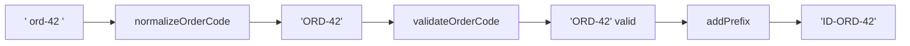
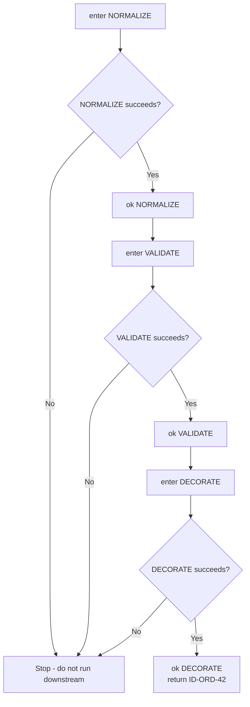
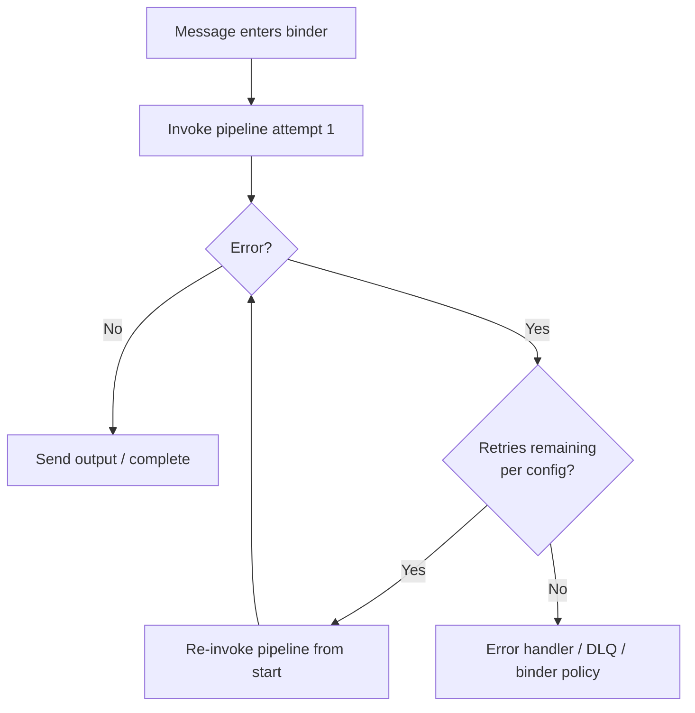
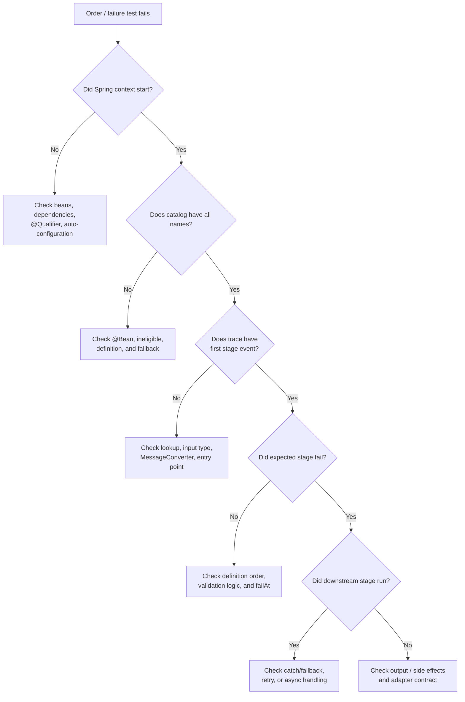

# Testing Composition Order and Per-Step Failures

**Chapter:** Testing  
**Module:** Spring Cloud Function (`SPRING_CLOUD_FUNCTION`)

Spring Cloud Function encourages packaging business logic into `Supplier`, `Function`, and `Consumer` components for reuse across Java code, HTTP, event-driven systems, and serverless environments. When a business process spans multiple steps, Spring Cloud Function enables **function composition** via definitions such as `normalizeOrderCode|validateOrderCode|addPrefix`. A small change in order or a failure in an intermediate step can completely alter the system's output and side effects.

Testing composition is therefore more than `assertEquals(expected, pipeline.apply(input))`. We also need to determine **which step was invoked, which step completed, which step failed, and whether downstream steps accidentally continued executing**. Especially for a `Consumer` writing to a database or publishing events, verifying that side effects *do not occur* after an error is a critical requirement.

This lesson builds two testing layers: (1) plain Java composition using `Function.andThen(...)`, and (2) composition via `FunctionCatalog.lookup(...)` inside a Spring context. The sample code uses JUnit 5, an in-memory trace recorder, and injectable failures at each stage. No HTTP server or message broker is required.

## 1. Goals and Completion Criteria

After this lesson, you will be able to:

1. Verify the execution order of a `Function<A,B>|Function<B,C>|Function<C,D>` chain.
2. Compare Java `andThen(...)` output with a function definition looked up via `FunctionCatalog`.
3. Inject controlled failures at the first, middle, or last step and inspect how much of the chain ran.
4. Distinguish a **step that was entered** from a **step that completed successfully**.
5. Test business validation failures and ensure downstream side-effect steps do not execute.
6. Test contract changes with `Supplier|Function`, `Function|Consumer`, and invalid compositions.
7. Distinguish errors in an imperative chain from retries, DLQs, reactive streams, and external adapters.

A solid test suite should prove **four things** for every key scenario:

| What to Verify | Question |
| --- | --- |
| Output or exception | Did the chain succeed or fail as expected? |
| **Step order** | Were stages invoked in the exact definition order? |
| **Failure point** | Which stage was entered but did not complete? |
| **No continuation** | Were stages after the failure—especially side-effect ones—skipped? |

## 2. Two Ways to Compose Functions: Java and `FunctionCatalog`

Given three Java functions:

```java
Function<String, String> normalize = input ->
    input.trim().toUpperCase(Locale.ROOT);

Function<String, String> validate = input -> {
    if (!input.matches("ORD-[0-9]+")) {
        throw new IllegalArgumentException("Invalid order code");
    }
    return input;
};

Function<String, String> decorate =
    input -> "ID-" + input;
```

**Java composition:**

```java
Function<String, String> direct =
    normalize.andThen(validate).andThen(decorate);

String result = direct.apply("  ord-42  ");
// ID-ORD-42
```

**Composition resolved by Spring Cloud Function:**

```java
Function<String, String> viaCatalog =
    catalog.lookup(
        Function.class,
        "normalizeOrderCode|validateOrderCode|addPrefix");

if (viaCatalog == null) {
    throw new IllegalStateException("Pipeline not found");
}

String result = viaCatalog.apply("  ord-42  ");
// ID-ORD-42
```

Here, `catalog` must be Spring-injected as `org.springframework.cloud.function.context.FunctionCatalog`. Java composes **function objects**; the catalog composes **functional beans by name** and may wrap them to manage metadata/conversion.

Per Spring Cloud Function documentation, `|` is the ordered composition delimiter, and `,` is also supported. In examples and tests, prefer `|` for readability:

```properties
spring.cloud.function.definition=normalizeOrderCode|validateOrderCode|addPrefix
```

This property tells adapters which pipeline to select, whereas in Java tests you can call `catalog.lookup(...)` with an explicit definition without needing HTTP or a broker.

### 2.1. Why Does Order Matter So Much?



If `validateOrderCode` runs before `normalizeOrderCode`, the input `"  ord-42  "` does not yet match `ORD-[0-9]+` and is rejected. If `addPrefix` runs before validation, `ID-ORD-42` no longer satisfies the validator's contract.

| Definition | Result for `"  ord-42  "` | Reason |
| --- | --- | --- |
| `normalizeOrderCode|validateOrderCode|addPrefix` | `ID-ORD-42` | Correct order |
| `validateOrderCode|normalizeOrderCode|addPrefix` | Validation error | Not normalized yet |
| `normalizeOrderCode|addPrefix|validateOrderCode` | Validation error | New prefix does not match validator |
| `normalizeOrderCode|addPrefix` | `ID-ORD-42` | Format validation skipped in the middle |

A test that checks only the output of the "happy path" cannot detect if a stage was skipped, replaced, or reordered when a handful of test inputs happen to yield the same output.

### 2.2. Sequential Composition vs. Multiple Independent Definitions

| String | Meaning |
| --- | --- |
| `a|b|c` | One pipeline: call `a`, then `b`, then `c` |
| `a,b,c` | Alternative composition syntax supported by documentation |
| `a;b;c` | List of **multiple independent definitions** in adapters that support it, not a sequential pipeline |

Do not use `;` in tests meant to verify `a → b → c` composition order.

## 3. Failures in an Imperative Chain Usually Block Downstream Steps

With Java `Function.andThen(...)`, the next step runs only if the previous step returns normally. If a step throws a **synchronous** exception and no wrapper catches it, downstream steps do not run in that invocation.

```java
List<String> called = new ArrayList<>();

Function<String, String> first = input -> {
    called.add("first");
    return input + "-A";
};

Function<String, String> second = input -> {
    called.add("second");
    throw new IllegalStateException("second failed");
};

Function<String, String> third = input -> {
    called.add("third");
    return input + "-C";
};

Function<String, String> chain =
    first.andThen(second).andThen(third);

assertThrows(
    IllegalStateException.class,
    () -> chain.apply("X"));
assertEquals(List.of("first", "second"), called);
```

This snippet requires importing `java.util.ArrayList`, `java.util.List`, `java.util.function.Function`, and JUnit assertions. The test proves `third` does not execute when `second` throws.

**Boundary:** this applies to synchronous imperative composition. If a step **catches errors**, returns a fallback value, schedules async work, or returns `Flux`/`Mono`, "failed step" and "whether downstream runs" must be defined by a different contract. A Spring Cloud Stream binder may also redeliver **the entire message** after an error; that is a new invocation, not a downstream step continuing inside the failed invocation.

## 4. Designing a Trace Recorder to Pinpoint Where Execution Stopped

Instead of collecting only the names of invoked steps, record **two events**:

- `enter:NORMALIZE` — normalization step started.
- `ok:NORMALIZE` — normalization step finished successfully.

If the test records `enter:VALIDATE` without **`ok:VALIDATE`**, we know the failure occurred during or immediately after entering the validation step. Downstream events must be absent when errors are unhandled.

| Case | Expected Trace |
| --- | --- |
| Success | `enter:NORMALIZE, ok:NORMALIZE, enter:VALIDATE, ok:VALIDATE, enter:DECORATE, ok:DECORATE` |
| Normalization failure | `enter:NORMALIZE` |
| Validation failure | `enter:NORMALIZE, ok:NORMALIZE, enter:VALIDATE` |
| Prefix failure | `enter:NORMALIZE, ok:NORMALIZE, enter:VALIDATE, ok:VALIDATE, enter:DECORATE` |

The recorder in this lesson is a **test fixture**, not a production tracing framework. It runs in memory without a database, message broker, or external observability stack.



## 5. Sample Spring Boot Application for Failure Scenarios

**File:** `src/main/java/example/testing/PipelineTestingApplication.java`

The application declares three `Function<String,String>` beans, one `Supplier<String>`, and one `Consumer<String>`. All share `PipelineProbe` so tests can configure "which stage should fail" and observe execution order. In production code, keep business logic separate; failure injection via `failAt` is strictly for test fixtures.

```java
package example.testing;

import java.util.List;
import java.util.Locale;
import java.util.concurrent.CopyOnWriteArrayList;
import java.util.function.Consumer;
import java.util.function.Function;
import java.util.function.Supplier;

import org.springframework.boot.SpringApplication;
import org.springframework.boot.autoconfigure.SpringBootApplication;
import org.springframework.context.annotation.Bean;

@SpringBootApplication(proxyBeanMethods = false)
public class PipelineTestingApplication {

    public static void main(String[] args) {
        SpringApplication.run(PipelineTestingApplication.class, args);
    }

    public enum Stage {
        SOURCE, NORMALIZE, VALIDATE, DECORATE, SINK
    }

    public static final class StageFailure
            extends RuntimeException {
        private final Stage stage;

        public StageFailure(Stage stage) {
            super("Injected failure at " + stage);
            this.stage = stage;
        }

        public Stage stage() {
            return stage;
        }
    }

    public static final class PipelineProbe {
        private final List<String> trace =
            new CopyOnWriteArrayList<>();
        private final List<String> audited =
            new CopyOnWriteArrayList<>();
        private volatile Stage failAt;

        public void reset(Stage stageToFail) {
            trace.clear();
            audited.clear();
            failAt = stageToFail;
        }

        public void enter(Stage stage) {
            trace.add("enter:" + stage);
            if (failAt == stage) {
                throw new StageFailure(stage);
            }
        }

        public void success(Stage stage) {
            trace.add("ok:" + stage);
        }

        public void record(String value) {
            audited.add(value);
        }

        public List<String> trace() {
            return List.copyOf(trace);
        }

        public List<String> audited() {
            return List.copyOf(audited);
        }
    }

    @Bean
    public PipelineProbe pipelineProbe() {
        return new PipelineProbe();
    }

    @Bean("normalizeOrderCode")
    public Function<String, String> normalizeOrderCode(
            PipelineProbe probe) {
        return input -> {
            probe.enter(Stage.NORMALIZE);
            if (input == null) {
                throw new IllegalArgumentException(
                    "Order code must not be null");
            }
            String result =
                input.trim().toUpperCase(Locale.ROOT);
            probe.success(Stage.NORMALIZE);
            return result;
        };
    }

    @Bean("validateOrderCode")
    public Function<String, String> validateOrderCode(
            PipelineProbe probe) {
        return value -> {
            probe.enter(Stage.VALIDATE);
            if (!value.matches("ORD-[0-9]+")) {
                throw new IllegalArgumentException(
                    "Invalid order code: expected ORD-<digits>");
            }
            probe.success(Stage.VALIDATE);
            return value;
        };
    }

    @Bean("addPrefix")
    public Function<String, String> addPrefix(
            PipelineProbe probe) {
        return value -> {
            probe.enter(Stage.DECORATE);
            String result = "ID-" + value;
            probe.success(Stage.DECORATE);
            return result;
        };
    }

    @Bean("issueOrderCode")
    public Supplier<String> issueOrderCode(
            PipelineProbe probe) {
        return () -> {
            probe.enter(Stage.SOURCE);
            String value = "  ord-42  ";
            probe.success(Stage.SOURCE);
            return value;
        };
    }

    @Bean("auditOrderCode")
    public Consumer<String> auditOrderCode(
            PipelineProbe probe) {
        return value -> {
            probe.enter(Stage.SINK);
            probe.record(value);
            probe.success(Stage.SINK);
        };
    }
}
```

`PipelineProbe.trace()` and `PipelineProbe.audited()` return immutable list snapshots so tests do not read the internal storage directly. `PipelineProbe.reset(...)` clears data and sets a failure stage; pass `null` to inject no failure.

**Concurrency note:** the tests share a singleton `PipelineProbe` inside the Spring context. This fixture is suitable when tests sharing the context **do not run concurrently**. Even with `CopyOnWriteArrayList` and `volatile`, the `reset → apply → snapshot` sequence does not become a thread-safe transaction. Do not run these scenarios in parallel against the same probe; if parallel execution is required, isolate contexts or create a separate fixture per scenario.

### 5.1. Data and Expected Trace per Stage

| Bean | Input | Output | Recorded Trace |
| --- | --- | --- | --- |
| `normalizeOrderCode` | `"  ord-42  "` | `"ORD-42"` | `enter:NORMALIZE`, `ok:NORMALIZE` |
| `validateOrderCode` | `"ORD-42"` | `"ORD-42"` | `enter:VALIDATE`, `ok:VALIDATE` |
| `addPrefix` | `"ORD-42"` | `"ID-ORD-42"` | `enter:DECORATE`, `ok:DECORATE` |
| `issueOrderCode` | Takes no input | `"  ord-42  "` | `enter:SOURCE`, `ok:SOURCE` |
| `auditOrderCode` | `"ORD-42"` | No business output | `enter:SINK`, `ok:SINK` and audit entry |

### 5.2. Registering Multiple Functions to Avoid Single-Function Fallback Confusion

The fixture defines multiple functional beans. This helps because in some versions or configurations, when only one eligible function exists, `FunctionCatalog.lookup("wrongName")` can return that sole function via *single-function fallback*.

Before executing a pipeline, tests verify each name appears in `catalog.getNames(Function.class)`. Do not treat `lookup(...) != null` as sole proof that a name was registered properly.

## 6. Test Harness: `SpringBootTest` Without a Web Server

**File:** `src/test/java/example/testing/PipelineCompositionTest.java`

The test suite below uses Spring Boot Test and JUnit Jupiter. A `@SpringBootTest(webEnvironment = NONE)` creates a real Spring context with the beans from Section 5, sufficient to test definitions through the catalog without starting an HTTP server or broker.

Typical dependencies in a project with compatible Spring Boot/Spring Cloud dependency management:

```xml
<dependency>
    <groupId>org.springframework.cloud</groupId>
    <artifactId>spring-cloud-function-context</artifactId>
</dependency>
<dependency>
    <groupId>org.springframework.boot</groupId>
    <artifactId>spring-boot-starter-test</artifactId>
    <scope>test</scope>
</dependency>
```

This is a **dependencies excerpt**, not a complete POM. Spring Boot and your project's version management are required. Do not add a Spring Cloud Stream binder just to test catalog composition order.

In this lesson, all test methods run with:

```java
@SpringBootTest(
    classes = PipelineTestingApplication.class,
    webEnvironment = SpringBootTest.WebEnvironment.NONE
)
```

Unlike plain Java unit tests, this suite **uses a Spring context** because the scope includes Spring Cloud Function registration, lookup, and composition.

### 6.1. Complete `PipelineCompositionTest` Class

```java
package example.testing;

import static org.junit.jupiter.api.Assertions.*;

import java.util.List;
import java.util.Set;
import java.util.function.Consumer;
import java.util.function.Function;
import java.util.function.Supplier;
import java.util.stream.Stream;

import org.junit.jupiter.api.BeforeEach;
import org.junit.jupiter.api.Test;
import org.junit.jupiter.api.parallel.Execution;
import org.junit.jupiter.api.parallel.ExecutionMode;
import org.junit.jupiter.params.ParameterizedTest;
import org.junit.jupiter.params.provider.Arguments;
import org.junit.jupiter.params.provider.MethodSource;
import org.springframework.beans.factory.annotation.Autowired;
import org.springframework.beans.factory.annotation.Qualifier;
import org.springframework.boot.test.context.SpringBootTest;
import org.springframework.cloud.function.context.FunctionCatalog;

import example.testing.PipelineTestingApplication.PipelineProbe;
import example.testing.PipelineTestingApplication.Stage;
import example.testing.PipelineTestingApplication.StageFailure;

@SpringBootTest(
    classes = PipelineTestingApplication.class,
    webEnvironment = SpringBootTest.WebEnvironment.NONE
)
@Execution(ExecutionMode.SAME_THREAD)
class PipelineCompositionTest {

    @Autowired
    private FunctionCatalog catalog;

    @Autowired
    private PipelineProbe probe;

    @Autowired
    @Qualifier("normalizeOrderCode")
    private Function<String, String> normalize;

    @Autowired
    @Qualifier("validateOrderCode")
    private Function<String, String> validate;

    @Autowired
    @Qualifier("addPrefix")
    private Function<String, String> decorate;

    @BeforeEach
    void resetProbe() {
        probe.reset(null);
    }

    private Function<String, String> directPipeline() {
        return normalize.andThen(validate).andThen(decorate);
    }

    private Function<String, String> catalogPipeline() {
        Function<String, String> result =
            catalog.lookup(
                Function.class,
                "normalizeOrderCode|validateOrderCode|addPrefix");
        assertNotNull(result, "Cannot resolve composed function");
        return result;
    }

    private static List<String> successfulTrace() {
        return List.of(
            "enter:NORMALIZE", "ok:NORMALIZE",
            "enter:VALIDATE", "ok:VALIDATE",
            "enter:DECORATE", "ok:DECORATE"
        );
    }

    @Test
    void catalogContainsEveryStepByItsExactName() {
        Set<String> names = catalog.getNames(Function.class);
        assertTrue(names.containsAll(Set.of(
            "normalizeOrderCode",
            "validateOrderCode",
            "addPrefix"
        )));
    }

    @Test
    void javaAndCatalogFollowTheSameOrder() {
        String input = "  ord-42  ";

        String directResult = directPipeline().apply(input);
        List<String> directTrace = probe.trace();

        probe.reset(null);

        String catalogResult = catalogPipeline().apply(input);
        List<String> catalogTrace = probe.trace();

        assertEquals("ID-ORD-42", directResult);
        assertEquals("ID-ORD-42", catalogResult);
        assertEquals(directResult, catalogResult);
        assertEquals(successfulTrace(), directTrace);
        assertEquals(successfulTrace(), catalogTrace);
    }

    static Stream<Arguments> injectedFailures() {
        return Stream.of(
            Arguments.of(
                Stage.NORMALIZE,
                List.of("enter:NORMALIZE")
            ),
            Arguments.of(
                Stage.VALIDATE,
                List.of(
                    "enter:NORMALIZE", "ok:NORMALIZE",
                    "enter:VALIDATE"
                )
            ),
            Arguments.of(
                Stage.DECORATE,
                List.of(
                    "enter:NORMALIZE", "ok:NORMALIZE",
                    "enter:VALIDATE", "ok:VALIDATE",
                    "enter:DECORATE"
                )
            )
        );
    }

    @ParameterizedTest
    @MethodSource("injectedFailures")
    void eachFailureStopsAtTheSameStageForBothPaths(
            Stage failAt, List<String> expectedTrace) {
        String input = "  ord-42  ";

        probe.reset(failAt);
        RuntimeException directError = assertThrows(
            RuntimeException.class,
            () -> directPipeline().apply(input));
        List<String> directTrace = probe.trace();

        probe.reset(failAt);
        RuntimeException catalogError = assertThrows(
            RuntimeException.class,
            () -> catalogPipeline().apply(input));
        List<String> catalogTrace = probe.trace();

        StageFailure directFailure =
            findCause(directError, StageFailure.class);
        StageFailure catalogFailure =
            findCause(catalogError, StageFailure.class);

        assertNotNull(directFailure);
        assertNotNull(catalogFailure);
        assertEquals(failAt, directFailure.stage());
        assertEquals(failAt, catalogFailure.stage());
        assertEquals(expectedTrace, directTrace);
        assertEquals(expectedTrace, catalogTrace);
        assertTrue(probe.audited().isEmpty());
    }

    @Test
    void validationErrorPreventsDecoration() {
        RuntimeException error = assertThrows(
            RuntimeException.class,
            () -> catalogPipeline().apply(" invalid-code "));

        IllegalArgumentException businessError =
            findCause(error, IllegalArgumentException.class);

        assertNotNull(businessError);
        assertEquals(
            "Invalid order code: expected ORD-<digits>",
            businessError.getMessage());
        assertEquals(
            List.of(
                "enter:NORMALIZE", "ok:NORMALIZE",
                "enter:VALIDATE"
            ),
            probe.trace());
    }

    @Test
    void reversedOrderFailsBeforeNormalization() {
        Function<String, String> reversed =
            catalog.lookup(
                Function.class,
                "validateOrderCode|normalizeOrderCode|addPrefix");
        assertNotNull(reversed);

        assertThrows(
            RuntimeException.class,
            () -> reversed.apply("  ord-42  "));

        assertEquals(
            List.of("enter:VALIDATE"),
            probe.trace());
    }

    @Test
    void sourceThenFunctionsBehavesAsSupplier() {
        Supplier<String> sourcePipeline =
            catalog.lookup(
                Supplier.class,
                "issueOrderCode|normalizeOrderCode|validateOrderCode");
        assertNotNull(sourcePipeline);

        assertEquals("ORD-42", sourcePipeline.get());
        assertEquals(
            List.of(
                "enter:SOURCE", "ok:SOURCE",
                "enter:NORMALIZE", "ok:NORMALIZE",
                "enter:VALIDATE", "ok:VALIDATE"
            ),
            probe.trace());
    }

    @Test
    void sourceFailurePreventsEveryDownstreamFunction() {
        Supplier<String> sourcePipeline =
            catalog.lookup(
                Supplier.class,
                "issueOrderCode|normalizeOrderCode|validateOrderCode");
        assertNotNull(sourcePipeline);

        probe.reset(Stage.SOURCE);
        RuntimeException error = assertThrows(
            RuntimeException.class, sourcePipeline::get);
        StageFailure failure =
            findCause(error, StageFailure.class);

        assertNotNull(failure);
        assertEquals(Stage.SOURCE, failure.stage());
        assertEquals(
            List.of("enter:SOURCE"),
            probe.trace());
    }

    @Test
    void functionThenConsumerRunsSinkLast() {
        Consumer<String> sinkPipeline =
            catalog.lookup(
                Consumer.class,
                "normalizeOrderCode|validateOrderCode|auditOrderCode");
        assertNotNull(sinkPipeline);

        sinkPipeline.accept("  ord-42  ");

        assertEquals(List.of("ORD-42"), probe.audited());
        assertEquals(
            List.of(
                "enter:NORMALIZE", "ok:NORMALIZE",
                "enter:VALIDATE", "ok:VALIDATE",
                "enter:SINK", "ok:SINK"
            ),
            probe.trace());
    }

    @Test
    void validationFailureSkipsConsumerSideEffect() {
        Consumer<String> sinkPipeline =
            catalog.lookup(
                Consumer.class,
                "normalizeOrderCode|validateOrderCode|auditOrderCode");
        assertNotNull(sinkPipeline);

        probe.reset(Stage.VALIDATE);
        RuntimeException error = assertThrows(
            RuntimeException.class,
            () -> sinkPipeline.accept("  ord-42  "));
        assertNotNull(findCause(error, StageFailure.class));

        assertEquals(
            List.of(
                "enter:NORMALIZE", "ok:NORMALIZE",
                "enter:VALIDATE"
            ),
            probe.trace());
        assertTrue(probe.audited().isEmpty());
    }

    @Test
    void sinkFailureDoesNotCreateAnAuditRecord() {
        Consumer<String> sinkPipeline =
            catalog.lookup(
                Consumer.class,
                "normalizeOrderCode|validateOrderCode|auditOrderCode");
        assertNotNull(sinkPipeline);

        probe.reset(Stage.SINK);
        RuntimeException error = assertThrows(
            RuntimeException.class,
            () -> sinkPipeline.accept("  ord-42  "));
        StageFailure failure =
            findCause(error, StageFailure.class);
        assertNotNull(failure);
        assertEquals(Stage.SINK, failure.stage());

        assertEquals(
            List.of(
                "enter:NORMALIZE", "ok:NORMALIZE",
                "enter:VALIDATE", "ok:VALIDATE",
                "enter:SINK"
            ),
            probe.trace());
        assertTrue(probe.audited().isEmpty());
    }

    private static <T extends Throwable> T findCause(
            Throwable error, Class<T> expectedType) {
        Throwable current = error;
        for (int depth = 0; current != null && depth < 30; depth++) {
            if (expectedType.isInstance(current)) {
                return expectedType.cast(current);
            }
            if (current == current.getCause()) {
                break;
            }
            current = current.getCause();
        }
        return null;
    }
}
```

The suite covers **success, per-stage failures, wrong order, validation failure, and Consumer side effects**. `findCause(...)` locates the fixture-injected exception in the `cause` chain, preventing tests from coupling rigidly to the outer wrapper exception class used in a particular version.

### 6.2. Why Use `@Execution(SAME_THREAD)`?

Tests use a singleton `PipelineProbe` bean to store traces. `@Execution(ExecutionMode.SAME_THREAD)` ensures test methods **within this class** run sequentially in JUnit Jupiter. That does not guarantee isolation if **another test class sharing the context/probe runs in parallel**. When parallel execution is enabled across the entire suite, switch to per-test fixtures or appropriate test resource synchronization.

Tests can still run in **any order** because `@BeforeEach` resets state; they do not depend on passing tests running before failing tests.

### 6.3. Warning About `lookup` Generic Signatures

`catalog.lookup(Function.class, definition)` takes only raw `Function.class` to select the interface kind. Java cannot check the full `String → String` generic type at runtime. Therefore, each test must know the input/output contract of every bean and pipeline. Do not assign an `Integer`-returning pipeline to `Function<String,String>` and treat successful compilation as type safety.

## 7. Interpreting Failure Injection Results

The three intentional failure scenarios are triggered via:

```java
probe.reset(Stage.NORMALIZE);
probe.reset(Stage.VALIDATE);
probe.reset(Stage.DECORATE);
```

In each case, the test passes `"  ord-42  "` through both the Java path and the catalog path, then compares:

| `failAt` | Stages Entered | Stages Completed | Stages Not Entered |
| --- | --- | --- | --- |
| `NORMALIZE` | NORMALIZE | None | VALIDATE, DECORATE |
| `VALIDATE` | NORMALIZE, VALIDATE | NORMALIZE | DECORATE |
| `DECORATE` | NORMALIZE, VALIDATE, DECORATE | NORMALIZE, VALIDATE | No downstream stages |

The distinction between **entered** and **completed** is crucial. Recording only `List.of("normalize", "validate")` leaves you unsure whether validation succeeded or failed after starting.

### 7.1. Why Assert Both the Exception and the Trace?

Suppose a test only had:

```java
assertThrows(
    RuntimeException.class,
    () -> catalogPipeline().apply("  ord-42  "));
```

It could pass due to a completely unrelated error, such as conversion or a different step. Our lesson's test adds:

```java
StageFailure failure =
    findCause(error, StageFailure.class);
assertNotNull(failure);
assertEquals(failAt, failure.stage());
assertEquals(expectedTrace, probe.trace());
```

That confirms the failure occurred at **the exact intended stage** and no extra calls happened afterward.

### 7.2. Why Not Always Assert the Outermost Exception Class?

With plain Java `andThen(...)`, a `StageFailure` normally surfaces directly because there is no framework wrapper. Through `FunctionCatalog`, the wrapper may perform metadata/conversion handling and—depending on version—wrap exceptions in a different outer class.

For testing business behavior, prefer:

1. Checking the **relevant cause** (here `StageFailure.stage()`).
2. Checking the trace and side effects.
3. Asserting the exact outer exception only if the application explicitly defines it as a stable contract.

If an error occurs **before any functional bean runs** (such as input conversion or unresolved lookup), the trace may be empty. Do not misreport that as the first stage having executed.

### 7.3. Validation Errors Differ from Failure Injection

`StageFailure` is an error injected by the test. By contrast, `" invalid-code "` is rejected by `validateOrderCode` due to a **business rule**. Both need tests:

| Error Source | Purpose |
| --- | --- |
| `probe.reset(Stage.VALIDATE)` | Proves the pipeline halts properly when any step throws |
| `validateOrderCode` regex check fails | Proves validation actually rejects invalid business data |
| Conversion fails before calling bean | Proves data boundary; requires separate converter tests |

Do not rely solely on injected fake exceptions while skipping real validation branches and business conditions inside each function.

## 8. Wrong-Order Tests to Prevent Regressions

A configuration change from:

```properties
spring.cloud.function.definition=normalizeOrderCode|validateOrderCode|addPrefix
```

to:

```properties
spring.cloud.function.definition=validateOrderCode|normalizeOrderCode|addPrefix
```

can cause valid requests to be rejected. `reversedOrderFailsBeforeNormalization` proves:

- `validateOrderCode` runs first.
- The trace contains `enter:VALIDATE` without `ok:VALIDATE`.
- `normalizeOrderCode` and `addPrefix` do not run.

This catches ordering configuration bugs, not just bugs inside individual beans. An adapter integration test should also verify **the definition actually configured from the environment**, because tests calling `catalog.lookup(...)` with a hardcoded string will not catch a broken production property.

### 8.1. Environment Config Tests vs. Direct Definition Tests

These two test styles serve different purposes:

| Test | What It Verifies |
| --- | --- |
| `catalog.lookup(Function.class, "normalize|validate|decorate")` | Catalog understands the string specified by the test |
| Reading `spring.cloud.function.definition` from `Environment` and resolving | Property is loaded and selects the right definition |
| HTTP/Stream/serverless adapter invoking function from real property | Selection config and adapter work end-to-end |

To test the **property** alongside the fixture, you can write a separate test class:

```java
@SpringBootTest(
    classes = PipelineTestingApplication.class,
    webEnvironment = SpringBootTest.WebEnvironment.NONE,
    properties = {
        "spring.cloud.function.definition="
            + "normalizeOrderCode|validateOrderCode|addPrefix"
    }
)
class ConfiguredDefinitionTest {

    @Autowired
    private org.springframework.core.env.Environment environment;

    @Autowired
    private FunctionCatalog catalog;

    @Test
    void configuredDefinitionHasTheIntendedOrder() {
        String definition = environment.getRequiredProperty(
            "spring.cloud.function.definition");
        assertEquals(
            "normalizeOrderCode|validateOrderCode|addPrefix",
            definition);
        assertNotNull(catalog.lookup(Function.class, definition));
    }
}
```

This is an **additional** test class example requiring the same `SpringBootTest`, `Autowired`, `Test`, `FunctionCatalog`, `Function`, and JUnit assertion imports as Section 6. It does not send messages through a binder: having the right property in the Spring `Environment` **is not enough** to prove Stream bindings or HTTP mappings exist.

## 9. Verifying No Side Effects Occur After an Error

For a pipeline ending in a `Consumer`:

```text
normalizeOrderCode
    |
validateOrderCode
    |
auditOrderCode  (side effect)
```

If validation fails, the test must prove **no audit record was written**. In the example:

```java
probe.reset(Stage.VALIDATE);
assertThrows(
    RuntimeException.class,
    () -> sinkPipeline.accept("  ord-42  "));

assertTrue(probe.audited().isEmpty());
assertFalse(probe.trace().contains("enter:SINK"));
```

Why these two assertions complement each other:

- An empty audit list shows **no completed write** in the fake.
- Absent `enter:SINK` in the trace shows **the sink was never entered**.

Checking only an empty audit list could miss a bug where the sink was invoked and failed **before saving**. In systems with external side effects, use fakes/spies that record both **send attempts** and **completed sends** as needed.

### 9.1. What If the Failure Happens Inside the Consumer Itself?

`sinkFailureDoesNotCreateAnAuditRecord` sets `failAt=SINK`. Expected trace:

```text
enter:NORMALIZE
ok:NORMALIZE
enter:VALIDATE
ok:VALIDATE
enter:SINK
```

There is no `ok:SINK` and no audit record because the fixture throws **before** calling `record(...)`.

In a real system, a `Consumer` might write and then throw. In that scenario, message retries can duplicate side effects. Design idempotency, transactions, or deduplication if the business requires *effectively once* semantics; composition itself does not guarantee exactly-once execution.

### 9.2. Why Not Use a Fake That Writes Real Data?

If a `Consumer` publishes events to a broker or writes to a database in unit/catalog tests, every run can leave persistent state behind. That harms repeatability and risks mutating real systems. Use an in-memory `PipelineProbe` to verify order and stopping conditions, then write **separate integration tests** to verify message bindings or transactions.

## 10. Testing Plain Java Without a Spring Context

To test the core **ordering and short-circuiting of `Function.andThen(...)`**, a Spring-free JUnit class is usually the fastest choice. The test below uses no `@SpringBootTest`, no `FunctionCatalog`, and no Section 5 application fixture:

**File:** `src/test/java/example/testing/PlainJavaCompositionTest.java`

```java
package example.testing;

import static org.junit.jupiter.api.Assertions.*;

import java.util.ArrayList;
import java.util.List;
import java.util.function.Function;

import org.junit.jupiter.api.Test;

class PlainJavaCompositionTest {

    @Test
    void stagesExecuteLeftToRight() {
        List<String> trace = new ArrayList<>();

        Function<String, String> first = input -> {
            trace.add("first");
            return input + "-A";
        };
        Function<String, String> second = input -> {
            trace.add("second");
            return input + "-B";
        };
        Function<String, String> third = input -> {
            trace.add("third");
            return input + "-C";
        };

        String result =
            first.andThen(second).andThen(third).apply("X");

        assertEquals("X-A-B-C", result);
        assertEquals(
            List.of("first", "second", "third"),
            trace);
    }

    @Test
    void downstreamStageIsSkippedAfterException() {
        List<String> trace = new ArrayList<>();

        Function<String, String> first = input -> {
            trace.add("first");
            return input;
        };
        Function<String, String> second = input -> {
            trace.add("second");
            throw new IllegalArgumentException("bad input");
        };
        Function<String, String> third = input -> {
            trace.add("third");
            return input;
        };

        Function<String, String> pipeline =
            first.andThen(second).andThen(third);

        assertThrows(
            IllegalArgumentException.class,
            () -> pipeline.apply("X"));
        assertEquals(List.of("first", "second"), trace);
    }
}
```

**Plain Java unit tests** answer only how `andThen` executes and short-circuits for the supplied Java functions. They do not prove that Spring registered beans with the right names, that `FunctionCatalog` understands the function definition, or that an adapter selects the right pipeline from configuration. Therefore, these unit tests **complement**, rather than replace, the tests in Section 6.

### 10.1. Keep Test Data Predictable

Do not pick a `Supplier` calling `UUID.randomUUID()`, `System.currentTimeMillis()`, or a live API and compare two executions as if they shared state. Each read can produce a different value even when composition order is right.

Instead, use a fixed-data source or a resettable fake dependency. When comparing direct composition against catalog composition, invoke both paths with:

- **The same input**.
- **The same failure injection setting**.
- **The same initial fake/trace state**.
- **The same stage definitions and order**.

Without resetting, the second path's trace appends onto the first path's trace and fails misleadingly.

## 11. Composing `Supplier`, `Function`, and `Consumer`: Pipeline Types Change

Spring Cloud Function supports compositions beyond `Function|Function`. When the resulting interface kind changes, **the method the test must call** also changes.

| Chain | Resulting Kind | Test Method | What to Verify |
| --- | --- | --- | --- |
| `Function<A,B>|Function<B,C>` | `Function<A,C>` | `apply(input)` | Order and output |
| `Supplier<A>|Function<A,B>` | `Supplier<B>` | `get()` | Source runs first, transform second |
| `Function<A,B>|Consumer<B>` | `Consumer<A>` | `accept(input)` | Transform runs before side effect |
| `Supplier<A>|Consumer<A>` | `Runnable` | `run()` | Produce then consume; no business return value |
| `Consumer<A>|Function<A,B>` | Not a valid standard composition | No standard pipeline call | `Consumer` produces no output for `Function` |
| `Consumer<A>|Supplier<B>` | Not a valid standard composition | No standard pipeline call | `Consumer` does not emit forwardable data |

Resulting types after composition are described in Spring Cloud Function documentation; **do not assume** a wrapper can automatically repair an invalid chain.

### 11.1. When `Supplier` Fails, Downstream `Function` Must Not Run

In `sourceFailurePreventsEveryDownstreamFunction`:

```java
probe.reset(Stage.SOURCE);
sourcePipeline.get();
```

That call **intentionally throws**. The real test uses `assertThrows(...)` and requires the trace to contain only `enter:SOURCE`, with no `enter:NORMALIZE` or `enter:VALIDATE`.

This proves the pipeline stops immediately at the source rather than merely checking that `Supplier.get()` threw an exception.

### 11.2. `Function|Consumer`: No Return Value to Compare

With:

```java
Consumer<String> sinkPipeline =
    catalog.lookup(
        Consumer.class,
        "normalizeOrderCode|validateOrderCode|auditOrderCode");
```

the test must call `sinkPipeline.accept(input)` and then check `probe.audited()` and the trace. **Do not cast to `Function<String,String>` and expect a return value**, because the composed result is a `Consumer`.

### 11.3. `Supplier|Consumer` Yields `Runnable`

Conceptually, `issueOrderCode|auditOrderCode` forms a pipeline with no input and no business output; the matching Java interface is `Runnable`. When applying this in a concrete project, check the `FunctionCatalog.lookup(...)` overloads and how your version's adapters trigger `Runnable`.

An appropriate test must verify **the source runs before the sink** and the sink receives the right data. Do not use `Function.apply(input)` on an inputless composition.

### 11.4. Do Not Hardcode Fixed Errors for Invalid Definitions

If you attempt to compose `auditOrderCode|normalizeOrderCode`, that chain has no valid data flow under `Consumer|Function`. Depending on version, the framework may fail at resolution time, return an unusable value, or fail upon invocation. Good tests should:

1. Verify each component's signature.
2. Disallow invalid definitions in configuration or function-selection layers.
3. Verify no valid pipeline executes with that string.

Do not treat a specific internal registry exception class as a long-term contract unless documented as guaranteed.

## 12. Distinguishing Business-Step Errors from Conversion Errors

In the main tests, every `Function` takes and returns `String`. The goal is to isolate **composition order and failure points** from conversion.

In real applications, however, you might have:

```java
record OrderRequest(String code, int quantity) {}
record ValidatedOrder(String code, int quantity) {}
record Receipt(String code, long total) {}
```

with the chain:

```text
decodeRequest : Message<byte[]> -> OrderRequest
validateOrder : OrderRequest -> ValidatedOrder
calculate     : ValidatedOrder -> Receipt
```

If `decodeRequest` or wrapper conversion fails **before `validateOrder` runs**, the validation trace will be empty. Do not record that as a business validation bug.

| Failure | Trace Signature | Appropriate Test Path |
| --- | --- | --- |
| Function name does not exist | No events from beans | `getNames(...)`, `lookup(...)`, and configuration |
| Payload cannot convert to input type | Likely no event from first stage | Dedicated `MessageConverter`/contentType test |
| Normalize step throws | `enter:NORMALIZE`, no `ok:NORMALIZE` | Failure injection / business input |
| Validate step rejects input | `ok:NORMALIZE` present, stops at `enter:VALIDATE` | Validation test |
| Sink step throws | Prior steps completed, `enter:SINK` present | Consumer/side-effect test |
| HTTP/Stream error handling | May involve exception mapping, retry, or DLQ | Adapter/binder integration test |

### 12.1. Why Not Use Type Mismatches to Test Ordering?

For instance, placing a `Function<String,Integer>` before a `Function<OrderRequest,Receipt>` depends on conversion that Spring Cloud Function may or may not support depending on metadata and configuration. A failure there does not clearly indicate whether composition order is right or wrong.

When testing order, first use stages with **explicitly compatible types**. Then add separate tests for DTO boundaries, `Message<?>`, `contentType`, and `MessageConverter` as required by the application.

### 12.2. Catalog Composition Does Not Mean Every Output Is a `String`

If:

```text
normalize : String -> String
parse     : String -> Integer
format    : Integer -> Receipt
```

the pipeline's contract is `Function<String,Receipt>`. Calling `catalog.lookup(Function.class, definition)` cannot enforce full generics at compile time due to Java *type erasure*. Tests must assert **actual values, fields, and output types** rather than trusting the declared variable type.

## 13. Reactive Composition: Error Timing Can Differ

Spring Cloud Function supports reactive functions, such as:

```java
Function<Flux<String>, Flux<String>> reactive =
    flux -> flux
        .map(value -> value.trim().toUpperCase(Locale.ROOT))
        .map(value -> {
            if (!value.matches("ORD-[0-9]+")) {
                throw new IllegalArgumentException("Invalid code");
            }
            return value;
        })
        .map(value -> "ID-" + value);
```

This snippet assumes imports for `reactor.core.publisher.Flux`, `java.util.Locale`, and `java.util.function.Function`. With reactive types:

- The function may **construct a publisher** when `apply(...)` is called.
- Logic inside `map(...)` typically executes **upon subscription**, not when building the publisher.
- Errors from `map` become **`onError` signals** and may not throw directly out of `apply(...)`.
- Operators like `onErrorResume(...)` or `retryWhen(...)` can alter error handling and how many times stages run.

### 13.1. Use `StepVerifier` Instead of `assertThrows` Alone

With a compatible `reactor-test` dependency, you can write:

```java
import static org.junit.jupiter.api.Assertions.*;

import java.util.Locale;
import java.util.function.Function;

import org.junit.jupiter.api.Test;
import reactor.core.publisher.Flux;
import reactor.test.StepVerifier;

class ReactiveCompositionTest {

    @Test
    void downstreamStopsAfterErrorSignal() {
        Function<Flux<String>, Flux<String>> pipeline =
            source -> source
                .map(s -> s.trim().toUpperCase(Locale.ROOT))
                .map(s -> {
                    if (!s.matches("ORD-[0-9]+")) {
                        throw new IllegalArgumentException(
                            "Invalid code");
                    }
                    return s;
                })
                .map(s -> "ID-" + s);

        StepVerifier.create(
                pipeline.apply(
                    Flux.just(" ord-1 ", "invalid", " ord-3 ")))
            .expectNext("ID-ORD-1")
            .expectError(IllegalArgumentException.class)
            .verify();
    }
}
```

In this example, after the second element fails, the publisher terminates with `onError`; no result is emitted for the third element. This test **does not require Spring**, though it requires Reactor and `reactor-test`.

**Do not infer** from a `Flux` test that a Spring Cloud Stream binder will retry individual messages like an imperative handler. Stream documentation explicitly notes that imperative retry/DLQ handling does not automatically apply in the same way to a reactive function receiving the publisher. For reactive flows, design and test error policies using appropriate operators.

### 13.2. A Reactive Error Does Not Necessarily Halt Every Subscription

If `onErrorResume` or `onErrorContinue` is present, how subsequent items are processed changes. Decide on the intended contract, then write `StepVerifier` tests checking **element order, completion, errors, and side-effect counts**. Never assume "every error always blocks all downstream steps" in a reactive stream without inspecting the operators.

## 14. Retry and DLQ: A Failed Invocation May Be Retried

The main tests perform only **one direct invocation**. In Spring Cloud Stream, when an imperative message handler throws an exception, the binder may apply retries, an error handler, or a DLQ depending on configuration and binder implementation.



**Consequence:** with retries enabled, steps that succeeded *before the failure point* can run **multiple times across retry attempts**. A single `catalogPipeline.apply(input)` test only proves that steps after the failure did not run **within that single invocation**.

### 14.1. What Additional Tests Are Needed When Deploying with Stream?

With a function definition:

```properties
spring.cloud.function.definition=normalizeOrderCode|validateOrderCode|addPrefix
```

write integration tests using the Spring Cloud Stream Test Binder or an appropriate real binder to verify:

- Messages arrive on the expected binding and enter the pipeline in order.
- On validation error, no normal success output is emitted.
- Handler invocation count matches the configured `max-attempts` policy.
- If a DLQ is configured, failed messages reach the expected destination after retries exhaust.
- Side effects before the failure point are not duplicated unintentionally; if re-execution is possible, the app uses idempotency.

Some binders default to multiple attempts, so **do not hardcode retry counts inside composition unit tests**. Check your version, binder, and configured consumer properties.

### 14.2. No Built-In Retry in Java `Function.andThen`

```java
Function<String, String> pipeline =
    normalize.andThen(validate).andThen(decorate);

pipeline.apply(" invalid ");
```

This Java call itself **has no retry mechanism**. If `validate` throws, the call terminates. Retries only happen if caller code, an adapter, or a configured wrapper re-invokes it.

Do not equate a Java `assertThrows(...)` test with having a Stream DLQ configured, nor assume Spring Cloud Function guarantees exactly-once delivery automatically.

## 15. Recommended Test Matrix

Whenever you add a new stage to a pipeline, update your test matrix for **order, input/output, and failure points**. The following matrix applies to the fixture in Section 5:

| ID | Definition / Case | Input or `failAt` | Primary Expectation |
| --- | --- | --- | --- |
| T01 | `normalize|validate|decorate` via Java `andThen` | `"  ord-42  "` | `ID-ORD-42`, full success trace |
| T02 | Same chain via catalog | `"  ord-42  "` | Same output and trace as T01 |
| T03 | Wrong order: validate before normalize | `"  ord-42  "` | Stops at `enter:VALIDATE` |
| T04 | Right chain; first stage fails | `NORMALIZE` | Only `enter:NORMALIZE` |
| T05 | Right chain; middle stage fails | `VALIDATE` | Normalize completes, validate stops, decorate skipped |
| T06 | Right chain; final stage fails | `DECORATE` | First two complete, decorate stops |
| T07 | Data fails business validation | `" invalid-code "` | Domain error in validate, no decorate |
| T08 | `Supplier|Function|Function` | No failure injected | SOURCE before NORMALIZE/VALIDATE, output `ORD-42` |
| T09 | Supplier fails | `SOURCE` | Downstream functions not called |
| T10 | `Function|Function|Consumer` | No failure injected | Exactly one audit entry, sink runs last |
| T11 | Validator fails before Consumer | `VALIDATE` | Audit empty, no `enter:SINK` |
| T12 | Consumer fails just before recording | `SINK` | `enter:SINK` present, no `ok:SINK`, no write |
| T13 | Definition component misspelled | `missingStage` | Name absent from catalog; wrong function not picked |
| T14 | Incompatible signature composition | `Consumer|Function` | Reject invalid config without coupling to internal error |
| T15 | Reactive pipeline with invalid item | `"ord-1", "invalid", "ord-3"` | Emits first item, terminates with `onError` per contract |
| T16 | Stream handler throws | Message broker/test binder | Verify retry, DLQ, and attempt count per config |

T01–T12 are fully illustrated with code or test methods in earlier sections. T13–T16 are extended cases requiring appropriate configuration or libraries; they were not executed while writing this article.

### 15.1. Minimum Assertion Set for a Failure Case

When adding a new stage, do not check only for an exception. A good failure test typically includes:

```java
assertNotNull(findCause(error, StageFailure.class));
assertEquals(expectedTrace, probe.trace());
assertTrue(probe.audited().isEmpty());
```

These three assertions answer three questions: **did the expected cause fail**, **which steps executed**, and **were side effects properly prevented**.

### 15.2. Verify Definition Names Before Testing Execution Failures

To avoid a "failed at VALIDATE" test that actually failed because a bean was not registered, verify:

```java
assertTrue(catalog.getNames(Function.class)
    .containsAll(Set.of(
        "normalizeOrderCode",
        "validateOrderCode",
        "addPrefix")));
```

In applications with only one eligible function, Spring Cloud Function may enable *single-function fallback* depending on version/config, causing an unrecognized lookup to return that single function. Always check **names in the catalog** and ensure your fixture includes multiple eligible functions.

## 16. Diagnosing Test Failures



| Symptom | Possible Cause | Diagnostic Check |
| --- | --- | --- |
| `catalog.lookup(...)` returns `null` | Wrong name, unregistered bean, uncomposable definition | `getNames(...)`, `@Bean` declarations |
| Test expects validation error, trace is empty | Failure happened prior to invocation, e.g., input conversion | Test with properly typed Java `String`, inspect root cause |
| `ok:VALIDATE` appears even when testing VALIDATE failure | `failAt` not set/reset properly, or test uses a different probe | Check injected bean and pre-call state |
| Trace includes events from another attempt | Shared singleton, parallel test, or retry | Isolate fixture, ensure single invocation |
| Output matches, trace is wrong | Stage skipped, replaced, or reordered | Assert both output and trace |
| Error in DECORATE, yet audit entry exists | Side effect ran out of order or caught/fallback occurred | Check sink placement and recorded data |
| Direct `andThen` passes, catalog pipeline fails | Wrong function definition or metadata/conversion | Compare each name and input/output contracts |
| Consumer does not throw as expected | Different error policy or wrong function kind tested | Check `accept(...)`, wrapper/version, and logs |
| Reactive test does not throw from `apply(...)` | Error occurs on subscription | Use `StepVerifier` |
| Broker records same event twice | Retry/redelivery or non-idempotent handling | Test binder, deduplication, consumer retries |
| Web reports error, catalog test passes | Wrong HTTP route/content type/status mapping | Dedicated Web integration test |

### 16.1. Traces Do Not Replace Distributed Tracing

`PipelineProbe` exists only within a single JVM and a single test run. If a real workflow calls multiple microservices over HTTP or a message broker, an in-process function trace does not prove external services were invoked in the right order. For that, use correlation IDs, distributed tracing, and cross-network integration tests.

### 16.2. Verifying Success After a Failure

After a failure test, include tests that re-run the pipeline with `probe.reset(null)` and valid data to confirm that errors do not corrupt fixture state. For stateful production beans, also test recovery, transaction rollback, and partial side-effect handling.

If an error stems from invalid business data, do not assume retrying the exact same payload will succeed. Malformed or invalid inputs typically need rejection or routing to an error channel rather than infinite retries.

## 17. How to Run the Tests

Illustrative file layout:

```text
src/
  main/java/example/testing/
    PipelineTestingApplication.java
  test/java/example/testing/
    PipelineCompositionTest.java
    PlainJavaCompositionTest.java
    ReactiveCompositionTest.java   (optional)
    ConfiguredDefinitionTest.java   (optional)
```

Run the main test with Maven Wrapper:

```bash
./mvnw -Dtest=PipelineCompositionTest test
```

Or Gradle Wrapper:

```bash
./gradlew test --tests "example.testing.PipelineCompositionTest"
```

Run the plain Java test:

```bash
./mvnw -Dtest=PlainJavaCompositionTest test
```

On Windows, use `mvnw.cmd` or `gradlew.bat` accordingly. These commands are **guidance for learners**, not output from runs performed while writing this guide.

### 17.1. Reading a Failure Report

If JUnit reports:

```text
Expected:
  [enter:NORMALIZE, ok:NORMALIZE, enter:VALIDATE]
Actual:
  [enter:NORMALIZE, ok:NORMALIZE,
   enter:VALIDATE, ok:VALIDATE, enter:DECORATE]
```

this is not merely "wrong output." The trace shows that validation **completed** instead of throwing, and the decorate stage ran. Check the `failAt` flag, validation execution logic, or which bean version the catalog resolved.

If a test reports:

```text
Expected: [ORD-42]
Actual:   [ORD-42, ORD-42]
```

a side effect may have been recorded twice. Before modifying the function, determine whether two test calls lacked a reset or a single message delivery triggered a binder retry/redelivery.

### 17.2. When Results Differ Between Local and CI

If CI behaves differently, check:

- Resolved Spring Boot/Spring Cloud Function versions.
- Whether parallel tests are sharing the same singleton probe.
- Whether `spring.cloud.function.definition` is overridden by a profile or environment variable.
- Whether other beans are auto-registered or filtered by `ineligible-definitions`.
- Whether an adapter/binder enables retries unexpectedly.

Never treat the catalog's name list or Spring context bean order as pipeline order. **Pipeline order is determined by the function definition.**

## 18. Practice Exercises

1. **Correct order:** run `javaAndCatalogFollowTheSameOrder`. Explain why asserting both output `ID-ORD-42` and the six trace events is necessary.
2. **First-stage failure:** set `failAt=NORMALIZE` and predict the trace before running. Why is `enter:VALIDATE` absent?
3. **Middle-stage failure:** set `failAt=VALIDATE`. Prove `NORMALIZE` completed while `DECORATE` never ran.
4. **Final-stage failure:** set `failAt=DECORATE`. Distinguish `enter:DECORATE` from `ok:DECORATE`.
5. **Real validation:** change input to `" bad-code "` and compare the business error with the synthetic `StageFailure`.
6. **Reordering:** try `normalizeOrderCode|addPrefix|validateOrderCode`. Use the trace to explain why validation no longer sees the expected format.
7. **Adding a stage:** register a `Function<String,String>` named `appendRegion`, add `Stage.REGION`, and test the four corresponding failure scenarios.
8. **Sink:** build a fake separating "attempt write" and "write completed" events. Test both when the sink fails before vs. after writing.
9. **Supplier|Consumer:** test `issueOrderCode|auditOrderCode` yielding a `Runnable` composition in your project version; verify source runs before sink.
10. **Reactive:** convert the three stages into a `Flux<String>` pipeline and use `StepVerifier` to prove `onError` blocks subsequent elements per contract.
11. **Retry:** with the Spring Cloud Stream Test Binder, configure an explicit attempt count. Verify each retry restarts the pipeline from the beginning and check for unintended duplicate writes.
12. **Real property:** write a test reading `spring.cloud.function.definition` from `Environment` to catch an accidentally reordered production config.

### Interview Questions

**Q:** Why is testing a pipeline solely by its final output insufficient?

**A:** A stage may be skipped, reordered, or trigger unintended side effects while still producing the same output for certain inputs. Testing execution traces and post-failure state verifies the actual execution structure.

**Q:** When the second function in `a|b|c` throws an unhandled synchronous exception, does `c` run?

**A:** In a normal imperative composition invocation, `c` is not called. However, if code catches the error, returns a fallback, or an adapter retries the whole invocation, behavior depends on that specific error-handling contract.

**Q:** Why does a `Consumer` require different tests than a `Function`?

**A:** `Consumer.accept(...)` has no business return value. Tests must verify side effects, recorded content/counts, and the absence of side effects when an upstream step fails.

**Q:** Can Spring Cloud Stream retry an entire pipeline after an error?

**A:** Yes, depending on the binder, version, and error-handling configuration for imperative message handlers. Consequently, an early step that succeeded on attempt 1 may run again on attempt 2. Binder integration tests and idempotency are required if side effects must not repeat.

**Q:** Why shouldn't `Flux` pipelines be tested solely with `assertThrows(() -> pipeline.apply(flux))`?

**A:** Logic inside reactive operators typically executes upon subscription. Errors are emitted as `onError` signals, so use `StepVerifier` to assert signals and element ordering.

## 19. Takeaways

- **Function composition is ordered.** `a|b|c` invokes `a`, then `b`, then `c`; it cannot be substituted with a `;`-separated list of independent definitions.
- Thorough tests must prove **output, order, failure point, and non-continuation**. Record both `enter` and `ok` events to distinguish "invoked" from "completed".
- In `Function.andThen(...)` and standard imperative composition, an unhandled synchronous exception prevents downstream stages from running within that invocation.
- `FunctionCatalog` adds registration, lookup, metadata, and conversion; plain Java tests **do not replace** Spring context tests for function definitions.
- `Supplier|Function` produces a `Supplier`; `Function|Consumer` produces a `Consumer`; `Supplier|Consumer` can produce a `Runnable`. Each requires the right invocation method and assertions.
- For `Consumer`, always verify side effects **do not occur after an error**; an adapter retry can trigger a fresh invocation and duplicate side effects.
- Conversion errors, business-step errors, reactive signals, and binder retry/DLQ policies must be tested at **separate layers**.
- Use fixtures with deterministic sources, reset state, and sequential or isolated tests to prevent flaky results.

### References

- [Spring Cloud Function — Programming Model and Function Composition](https://docs.spring.io/spring-cloud-function/reference/spring-cloud-function/programming-model.html): `andThen`, definition-based composition, composing `Supplier`/`Function`/`Consumer`, and wrappers.
- [Spring Cloud Function 4.3 — Programming Model](https://docs.spring.io/spring-cloud-function/reference/4.3/spring-cloud-function/programming-model.html): version-specific behavioral reference when cross-checking your project.
- [Java 17 — java.util.function.Function](https://docs.oracle.com/en/java/javase/17/docs/api/java.base/java/util/function/Function.html): `andThen(...)` contract.
- [JUnit 5 User Guide](https://junit.org/junit5/docs/current/user-guide/): `@ParameterizedTest`, `@MethodSource`, `@Execution`, and assertions.
- [Reactor — Testing](https://projectreactor.io/docs/core/release/reference/testing.html): `StepVerifier` for asserting `onNext`, `onError`, and `onComplete` signals.
- [Spring Cloud Stream — Error Handling](https://docs.spring.io/spring-cloud-stream/reference/spring-cloud-stream/overview-error-handling.html): retries, error handlers, DLQs, and differences between imperative and reactive functions.
