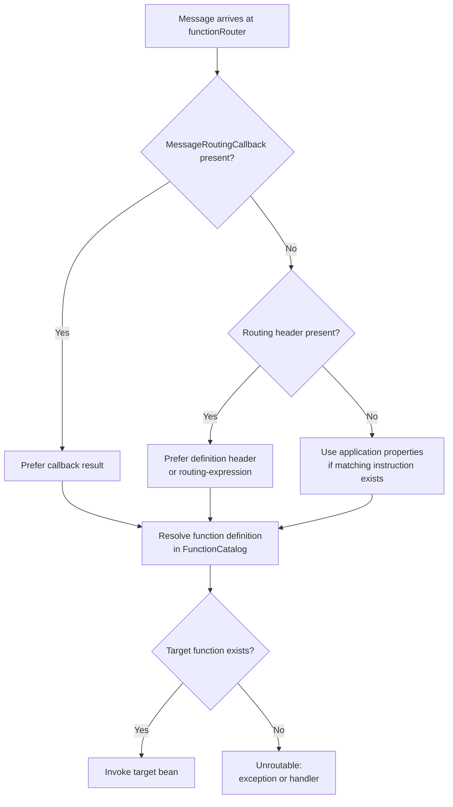
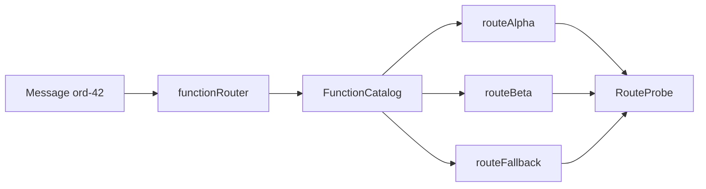
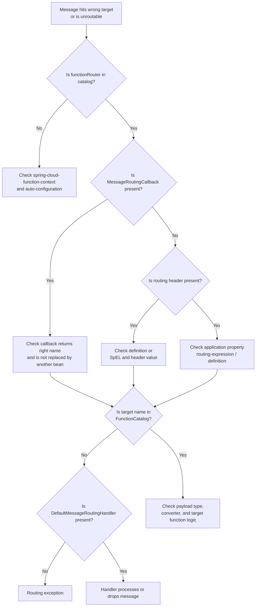

# Testing Routing Precedence and Unroutable Messages

**Chapter:** Testing  
**Module:** Spring Cloud Function (`SPRING_CLOUD_FUNCTION`)

Spring Cloud Function lets you write business logic as `Supplier`, `Function`, and `Consumer` components and reuse the same logic via Java, HTTP, events, or serverless. When an application receives multiple request kinds through a single entry point, **function routing** forwards each request to an appropriate functional bean in `FunctionCatalog`. For example, an order message can be routed to `routeAlpha` or `routeBeta` based on headers, a callback, or configuration.

Testing routing is not just confirming that a message succeeded. We need to answer two critical questions: **when multiple routing instructions conflict, which one wins?** And **when an instruction points to a nonexistent function, how is the message handled?**

This lesson builds a JUnit 5 test suite with Spring Boot and `FunctionCatalog`, without needing an HTTP server or message broker. It covers precedence rules, `MessageRoutingCallback`, the `spring.cloud.function.definition` header, SpEL expressions, application properties, `DefaultMessageRoutingHandler`, and unroutable message scenarios. Finally, we distinguish routing within a single Java call from error handling in Spring Cloud Stream or other adapters.

## 1. Goals and Testing Scope

After this lesson, you will be able to:

1. Explain the role of the `functionRouter` functional bean registered by Spring Cloud Function.
2. Test the three-tier precedence: **`MessageRoutingCallback` → Message headers → application properties**.
3. Write tests proving headers override application properties when no callback is present.
4. Write tests proving a callback takes precedence over headers and application properties.
5. Test SpEL `routing-expression` against application-controlled headers.
6. Detect function definitions pointing to nonexistent destinations or beans excluded from the catalog.
7. Test both the default exception behavior and alternative handling with `DefaultMessageRoutingHandler`.
8. Distinguish *no destination specified*, *destination named but absent*, *destination exists but throws*, and *misconfigured router*.
9. Organize tests with isolated Spring contexts so shared state, fallbacks, or configs from other tests do not leak.

| Level | Subject Under Test | Not Yet Proven |
| --- | --- | --- |
| Callback unit test | Logic choosing a function name from a `Message<?>` | That `functionRouter` actually uses the callback |
| Spring context + `FunctionCatalog` | Precedence, name resolution, and unroutable handling | That HTTP routes or message bindings were created |
| Spring Cloud Function Web test | HTTP headers entering router, status, and response | That a binder or broker sends/receives events |
| Spring Cloud Stream test | Binder, routing, error handling, and output | Serverless handler configuration |
| Serverless adapter test | Event envelope and entry point | Unrelated broker behavior |

**Lesson boundary:** uses **imperative** functions (e.g., `Function<String,String>`) and Spring `Message<?>`. *Per-message* header routing does not apply in the same way to reactive functions receiving an entire `Flux`; that limitation is explained in Section 14.

## 2. What Is `functionRouter`?

Spring Cloud Function registers a routing function named **`functionRouter`** in `FunctionCatalog`. That name can also be referenced via `RoutingFunction.FUNCTION_NAME` in the corresponding version. Conceptually, the router receives a request, resolves the **target function definition**, and invokes the registered function by name from the catalog.

Example:

```text
Incoming Message: "ord-42"
  header spring.cloud.function.definition = routeAlpha
        |
        v
     functionRouter
        |
        v
 FunctionCatalog.lookup("routeAlpha")
        |
        v
   routeAlpha("ord-42")
        |
        v
   "ALPHA:ord-42"
```

To call the router directly in a test:

```java
FunctionCatalog catalog = /* injected by Spring */;

Function<Message<String>, Object> router =
    catalog.lookup(Function.class, "functionRouter");

if (router == null) {
    throw new IllegalStateException("functionRouter not registered");
}
```

This illustrates the variable declaration and lookup; in the complete test class in Section 7, `catalog` is injected via `@Autowired`. Do not confuse **looking up the router itself** with **looking up a target function**: `catalog.lookup("routeAlpha")` invokes a named feature directly, whereas `catalog.lookup("functionRouter")` picks the target feature dynamically based on routing instructions.

### 2.1. Three Sources of Routing Instructions

Spring Cloud Function supports these main mechanisms:

| Source | How Provided | Example |
| --- | --- | --- |
| `MessageRoutingCallback` | Registered as a Spring bean | Returns `"routeAlpha"` from business rules |
| Static message header | `spring.cloud.function.definition` | Header set to `routeBeta` |
| Dynamic message header | `spring.cloud.function.routing-expression` | SpEL `headers.routeKey` |
| Application property | `spring.cloud.function.routing-expression` or matching definition config | `spring.cloud.function.routing-expression='routeFallback'` |

Both header forms sit at the **same precedence tier**; official precedence docs distinguish only the callback tier, header tier, and property tier. Do not assume which header wins across all versions when **both routing headers** are present simultaneously without checking source/runtime behavior. This lesson's tests intentionally attach **one routing header type per request**.

### 2.2. Official Precedence Rules

**Imperative routing from highest to lowest:**



**Key rules to remember:**

1. **`MessageRoutingCallback` is highest** for imperative functions, even when the message and application specify other instructions.
2. **Message headers are second** when no callback is present.
3. **Application properties are lowest** and are the instruction source usable across function kinds, including reactive functions within framework limits.

**Note:** precedence does not mean an invalid header name is silently skipped in favor of an application property. If a higher-precedence instruction **selects a nonexistent target**, that can result in an *unroutable message* rather than falling back to a lower-priority name.

## 3. Two Concepts Never to Confuse

### 3.1. Selecting the Entry Point vs. Selecting a Target Inside the Router

A Spring Cloud Stream configuration may bind the router itself as the active function:

```properties
spring.cloud.function.definition=functionRouter
```

In that context, `functionRouter` is the **entry point**. When the router runs, it still needs an **instruction to choose the target function** (callback, header, or routing expression).

For example, in an app with one router and multiple business functions:

```properties
spring.cloud.function.definition=functionRouter
spring.cloud.function.routing-expression='routeFallback'
```

In this lesson, we **do not enable a Stream binder** and always call `catalog.lookup("functionRouter")` explicitly. When testing an application-level fallback route, the test configures only `spring.cloud.function.routing-expression='routeFallback'`; avoid conflating entry-point selection with the router's fallback target.

### 3.2. Nonexistent Destination vs. a Business Function Throwing an Error

| Scenario | Does Router Invoke a Business Bean? | What to Check? |
| --- | --- | --- |
| Header chooses `routeAlpha`, bean exists | Yes | Result and which function ran |
| Header chooses `missingRoute`, bean absent from catalog | No valid target function | Routing exception or handler |
| No header/callback/property specifies a destination | Destination unclear | No-route policy and log/root cause |
| Header chooses `routeAlpha`, function throws | Yes, then business error | Error from function, not "no destination" |
| Header chooses bean excluded by `ineligible-definitions` | Bean may exist in Spring but not as catalog candidate | Names in `getNames(...)` and router policy |

If an application property selects `routeFallback` and **a message has no header**, that message is **not "unroutable"**: the router has an application-level instruction. Testing an unroutable error requires a context **without a valid fallback instruction**, or a header explicitly pointing to a nonexistent name.

## 4. Dependency Configuration and Execution Scope

This is a **Spring context testing** lesson, not plain Java unit testing. Examples assume a Spring Boot + Spring Cloud Function context + JUnit Jupiter project with compatible dependency management.

**Maven (dependencies excerpt, not a full POM):**

```xml
<dependencies>
    <dependency>
        <groupId>org.springframework.boot</groupId>
        <artifactId>spring-boot-starter</artifactId>
    </dependency>
    <dependency>
        <groupId>org.springframework.cloud</groupId>
        <artifactId>spring-cloud-function-context</artifactId>
    </dependency>
    <dependency>
        <groupId>org.springframework.boot</groupId>
        <artifactId>spring-boot-starter-test</artifactId>
        <scope>test</scope>
    </dependency>
</dependencies>
```

**Gradle Kotlin DSL (versions managed by project):**

```kotlin
dependencies {
    implementation("org.springframework.boot:spring-boot-starter")
    implementation("org.springframework.cloud:spring-cloud-function-context")
    testImplementation("org.springframework.boot:spring-boot-starter-test")
}

tasks.test {
    useJUnitPlatform()
}
```

Use `@SpringBootTest(webEnvironment = SpringBootTest.WebEnvironment.NONE)` to create `ApplicationContext` and `FunctionCatalog` **without starting an HTTP server**. Do not add a Spring Cloud Stream binder or broker connection merely to test router precedence.

**Version note:** Spring Cloud Function 4.1/4.2 and current reference docs describe this precedence order. However, the `MessageRoutingCallback.routingResult(...)` signature changed in some older lines; the code examples here use the **String-returning** signature from current docs. When targeting older versions, check the matching API instead of copying blindly.

## 5. Sample Spring Boot App: Three Distinguishable Destinations

We create three `Function<String,String>` beans so tests clearly prove which bean the router selected. We also add a `RouteProbe` bean that records invoked destination names. These functions cause no external side effects; all traces stay in memory.

**File:** `src/main/java/example/routing/RoutingPriorityApplication.java`

```java
package example.routing;

import java.util.List;
import java.util.concurrent.CopyOnWriteArrayList;
import java.util.function.Function;

import org.springframework.boot.SpringApplication;
import org.springframework.boot.autoconfigure.SpringBootApplication;
import org.springframework.context.annotation.Bean;

@SpringBootApplication(proxyBeanMethods = false)
public class RoutingPriorityApplication {

    public static void main(String[] args) {
        SpringApplication.run(RoutingPriorityApplication.class, args);
    }

    public static final class RouteProbe {
        private final List<String> invoked =
            new CopyOnWriteArrayList<>();

        public void hit(String name) {
            invoked.add(name);
        }

        public List<String> snapshot() {
            return List.copyOf(invoked);
        }

        public void reset() {
            invoked.clear();
        }
    }

    @Bean
    public RouteProbe routeProbe() {
        return new RouteProbe();
    }

    @Bean("routeAlpha")
    public Function<String, String> routeAlpha(RouteProbe probe) {
        return input -> {
            probe.hit("routeAlpha");
            return "ALPHA:" + input;
        };
    }

    @Bean("routeBeta")
    public Function<String, String> routeBeta(RouteProbe probe) {
        return input -> {
            probe.hit("routeBeta");
            return "BETA:" + input;
        };
    }

    @Bean("routeFallback")
    public Function<String, String> routeFallback(RouteProbe probe) {
        return input -> {
            probe.hit("routeFallback");
            return "FALLBACK:" + input;
        };
    }
}
```

### 5.1. Why Three Functions with Distinct Outputs?

| Bean | Output for Input `"ord-42"` | Trace |
| --- | --- | --- |
| `routeAlpha` | `ALPHA:ord-42` | `[routeAlpha]` |
| `routeBeta` | `BETA:ord-42` | `[routeBeta]` |
| `routeFallback` | `FALLBACK:ord-42` | `[routeFallback]` |

A proper precedence test must prove **exactly one specific target was chosen**, not merely `router.apply(...) != null`. `RouteProbe` catches cases where another route was called first or both routes ran unexpectedly.

Because multiple functional beans exist, tests do not depend on *single-function fallback*—which can mask bad names in single-function apps. Any target name not listed in `FunctionCatalog.getNames(Function.class)` must still be treated as having no valid route.

### 5.2. Spring Bean and Catalog Model



`RouteProbe` is a plain bean, not a `Function` or `Consumer`. It lets tests observe routing outcomes without listening on HTTP requests or a message broker.

## 6. Designing Helpers for Semantically Accurate Comparisons

When invoked through `FunctionCatalog`, the result may be a direct Java payload or a `Message<?>` depending on conversion/wrapper behavior. For tests focused only on **which function handled the message** and **what business value came out**, you can normalize the representation before asserting:

```java
import java.nio.charset.StandardCharsets;
import org.springframework.messaging.Message;

static String payloadText(Object result) {
    Object value = result instanceof Message<?> message
        ? message.getPayload() : result;

    if (value instanceof byte[] bytes) {
        return new String(bytes, StandardCharsets.UTF_8);
    }
    return String.valueOf(value);
}
```

This is a test helper, **not a production converter for arbitrary data types**. If a test's goal is serialization or header propagation, write explicit assertions on payload class, encoding, and headers rather than hiding them behind a generic helper.

A consistent message factory helper:

```java
import org.springframework.messaging.Message;
import org.springframework.messaging.support.MessageBuilder;

static Message<String> messageWithDefinition(
        String body, String destination) {
    return MessageBuilder
        .withPayload(body)
        .setHeader("spring.cloud.function.definition", destination)
        .build();
}
```

The snippets in this section are illustrative helpers. Below, the complete test classes include their corresponding methods so you can assemble them without guessing.

## 7. Testing Tier Two Precedence: Header Overrides Application Property

First, **do not register a `MessageRoutingCallback`**. Configure the context with an application-level instruction:

```properties
spring.cloud.function.routing-expression='routeFallback'
```

We expect:

- A message **without a routing header** goes to `routeFallback`.
- A message with header `spring.cloud.function.definition=routeBeta` goes to `routeBeta`, not `routeFallback`.
- A message with header `spring.cloud.function.routing-expression=headers.routeKey` and `routeKey=routeAlpha` goes to `routeAlpha`.
- Two distinct messages can choose two different destinations within the same imperative context.

**File:** `src/test/java/example/routing/HeaderAndPropertyRoutingTest.java`

```java
package example.routing;

import static org.junit.jupiter.api.Assertions.*;

import java.nio.charset.StandardCharsets;
import java.util.List;
import java.util.Set;
import java.util.function.Function;

import org.junit.jupiter.api.BeforeEach;
import org.junit.jupiter.api.Test;
import org.junit.jupiter.api.parallel.Execution;
import org.junit.jupiter.api.parallel.ExecutionMode;
import org.springframework.beans.factory.annotation.Autowired;
import org.springframework.boot.test.context.SpringBootTest;
import org.springframework.cloud.function.context.FunctionCatalog;
import org.springframework.messaging.Message;
import org.springframework.messaging.support.MessageBuilder;

import example.routing.RoutingPriorityApplication.RouteProbe;

@SpringBootTest(
    classes = RoutingPriorityApplication.class,
    webEnvironment = SpringBootTest.WebEnvironment.NONE,
    properties = {
        "spring.cloud.function.routing-expression='routeFallback'"
    }
)
@Execution(ExecutionMode.SAME_THREAD)
class HeaderAndPropertyRoutingTest {

    @Autowired
    FunctionCatalog catalog;

    @Autowired
    RouteProbe probe;

    @BeforeEach
    void reset() {
        probe.reset();
    }

    private Function<Message<String>, Object> router() {
        assertTrue(catalog.getNames(Function.class)
            .containsAll(Set.of(
                "routeAlpha", "routeBeta", "routeFallback")));

        Function<Message<String>, Object> function =
            catalog.lookup(Function.class, "functionRouter");
        assertNotNull(function);
        return function;
    }

    private static String text(Object result) {
        Object payload = result instanceof Message<?> m
            ? m.getPayload() : result;
        if (payload instanceof byte[] bytes) {
            return new String(bytes, StandardCharsets.UTF_8);
        }
        return String.valueOf(payload);
    }

    private static Message<String> withDefinition(
            String input, String destination) {
        return MessageBuilder.withPayload(input)
            .setHeader(
                "spring.cloud.function.definition", destination)
            .build();
    }

    @Test
    void propertyWinsWhenMessageHasNoRoutingHeader() {
        Message<String> incoming =
            MessageBuilder.withPayload("ord-42").build();

        Object result = router().apply(incoming);

        assertEquals("FALLBACK:ord-42", text(result));
        assertEquals(List.of("routeFallback"), probe.snapshot());
    }

    @Test
    void staticMessageHeaderOverridesApplicationProperty() {
        Message<String> incoming =
            withDefinition("ord-42", "routeBeta");

        Object result = router().apply(incoming);

        assertEquals("BETA:ord-42", text(result));
        assertEquals(List.of("routeBeta"), probe.snapshot());
    }

    @Test
    void spelHeaderSelectsDestinationFromAnotherHeader() {
        Message<String> incoming = MessageBuilder
            .withPayload("ord-42")
            .setHeader(
                "spring.cloud.function.routing-expression",
                "headers.routeKey")
            .setHeader("routeKey", "routeAlpha")
            .build();

        Object result = router().apply(incoming);

        assertEquals("ALPHA:ord-42", text(result));
        assertEquals(List.of("routeAlpha"), probe.snapshot());
    }

    @Test
    void successiveMessagesCanChooseDifferentTargets() {
        Function<Message<String>, Object> routing = router();

        Object first =
            routing.apply(withDefinition("one", "routeAlpha"));
        Object second =
            routing.apply(withDefinition("two", "routeBeta"));

        assertEquals("ALPHA:one", text(first));
        assertEquals("BETA:two", text(second));
        assertEquals(
            List.of("routeAlpha", "routeBeta"),
            probe.snapshot());
    }

    @Test
    void headerCanChooseAnExplicitComposition() {
        Message<String> incoming = withDefinition(
            "ord-42", "routeAlpha|routeBeta");

        Object result = router().apply(incoming);

        assertEquals("BETA:ALPHA:ord-42", text(result));
        assertEquals(
            List.of("routeAlpha", "routeBeta"),
            probe.snapshot());
    }

    @Test
    void invalidHigherPriorityHeaderIsNotTheFallbackRoute() {
        Message<String> incoming = withDefinition(
            "ord-42", "destinationDoesNotExist");

        assertFalse(catalog.getNames(Function.class)
            .contains("destinationDoesNotExist"));

        assertThrows(
            RuntimeException.class,
            () -> router().apply(incoming));
        assertTrue(probe.snapshot().isEmpty());
    }
}
```

**What each test verifies:**

- `propertyWinsWhenMessageHasNoRoutingHeader` verifies the lowest precedence tier.
- `staticMessageHeaderOverridesApplicationProperty` verifies conflict resolution between header and application property.
- `spelHeaderSelectsDestinationFromAnotherHeader` verifies header-level `routing-expression`.
- `successiveMessagesCanChooseDifferentTargets` verifies per-message routing for imperative functions.
- `headerCanChooseAnExplicitComposition` demonstrates that a static header can specify a composed definition when step types match.
- `invalidHigherPriorityHeaderIsNotTheFallbackRoute` tests **a higher-precedence header pointing to an invalid destination**; it does not silently fall back to `routeFallback` and treat that as proper precedence.

### 7.1. Why Assert Both Output and Trace?

If a test only asserts:

```java
assertEquals("BETA:ord-42", text(router.apply(incoming)));
```

it does not directly confirm whether another route ran and produced a side effect beforehand. In the sample functions, `probe.snapshot()` records **which target actually ran**, ensuring two functions were not invoked unexpectedly.

In production, a `Function` may write to a database or publish events; misrouting can cause not only wrong outputs but also unwanted side effects. That is why routing tests should inspect at least an **execution trace** whenever possible.

### 7.2. Why Not Test Both Routing Headers Together?

The message headers tier has two expressions: `spring.cloud.function.definition` and `spring.cloud.function.routing-expression`. In this lesson, **each message carries only one kind of routing instruction**, avoiding sending both at once and assuming an internal tie-breaking order not promised by general docs.

If a real project allows both to appear together, add a **version-specific compatibility test** verifying the chosen winner; even better, normalize ingress so each message carries only one routing mechanism.

### 7.3. SpEL and Header Data Types

The expression:

```text
headers.routeKey
```

reads the `routeKey` header value and uses the result as the function definition name. In the test, `routeKey` holds the registered string `routeAlpha`. This differs from:

```text
'routeAlpha'
```

which is a SpEL expression returning a **literal string**. When reading the name from a header, do not wrap the entire `headers.routeKey` expression in single quotes.

For expressions passed in Message headers, Spring Cloud Function uses the more restricted `SimpleEvaluationContext`, whereas expressions from application properties use `StandardEvaluationContext`. Carefully review security if external callers can control expressions or function names (see Section 13).

## 8. Testing Highest Precedence: `MessageRoutingCallback`

To prove the callback outranks headers and properties, we create **a separate context** and register `MessageRoutingCallback` via `@TestConfiguration`. The callback always returns `routeAlpha` for the fixture; meanwhile, the message requests `routeBeta` in its header, and the application property specifies `routeFallback`.

Thus **if the callback wins**, the output must be `ALPHA:ord-42` and the trace must contain only `routeAlpha`.

**File:** `src/test/java/example/routing/CallbackPriorityRoutingTest.java`

```java
package example.routing;

import static org.junit.jupiter.api.Assertions.*;

import java.nio.charset.StandardCharsets;
import java.util.List;
import java.util.function.Function;

import org.junit.jupiter.api.BeforeEach;
import org.junit.jupiter.api.Test;
import org.springframework.beans.factory.annotation.Autowired;
import org.springframework.boot.test.context.SpringBootTest;
import org.springframework.boot.test.context.TestConfiguration;
import org.springframework.cloud.function.context.FunctionCatalog;
import org.springframework.cloud.function.context.MessageRoutingCallback;
import org.springframework.context.annotation.Bean;
import org.springframework.context.annotation.Import;
import org.springframework.messaging.Message;
import org.springframework.messaging.support.MessageBuilder;

import example.routing.RoutingPriorityApplication.RouteProbe;

@SpringBootTest(
    classes = RoutingPriorityApplication.class,
    webEnvironment = SpringBootTest.WebEnvironment.NONE,
    properties = {
        "spring.cloud.function.routing-expression='routeFallback'"
    }
)
@Import(CallbackPriorityRoutingTest.CallbackConfig.class)
class CallbackPriorityRoutingTest {

    @Autowired
    FunctionCatalog catalog;

    @Autowired
    RouteProbe probe;

    @BeforeEach
    void reset() {
        probe.reset();
    }

    @Test
    void callbackOverridesHeaderAndApplicationProperty() {
        Function<Message<String>, Object> router =
            catalog.lookup(Function.class, "functionRouter");
        assertNotNull(router);

        Message<String> incoming = MessageBuilder
            .withPayload("ord-42")
            .setHeader(
                "spring.cloud.function.definition", "routeBeta")
            .build();

        Object result = router.apply(incoming);
        Object payload = result instanceof Message<?> message
            ? message.getPayload() : result;
        String output = payload instanceof byte[] bytes
            ? new String(bytes, StandardCharsets.UTF_8)
            : String.valueOf(payload);

        assertEquals("ALPHA:ord-42", output);
        assertEquals(List.of("routeAlpha"), probe.snapshot());
    }

    @TestConfiguration(proxyBeanMethods = false)
    static class CallbackConfig {

        @Bean
        MessageRoutingCallback routingCallback() {
            return new MessageRoutingCallback() {
                @Override
                public String routingResult(Message<?> message) {
                    return "routeAlpha";
                }
            };
        }
    }
}
```

**What the test proves:** a `MessageRoutingCallback` is properly registered in the Spring context and prioritized by the router even when both lower tiers provide conflicting instructions.

### 8.1. Preventing the Callback from Leaking into Other Tests

`CallbackConfig` is annotated with `@TestConfiguration` and imported via `@Import(...)` only in this test class. It **is not part of the shared application configuration**. As a result, `HeaderAndPropertyRoutingTest` does not accidentally see the callback; if it did, tests verifying header precedence over properties would no longer measure what they intend.

Do not wire callbacks using `System.setProperty(...)` or JVM-wide static state. Callback configuration belongs to each Spring context; tests should use distinct contexts or cleanly isolated fixtures.

### 8.2. Example Business-Rule Callback

In a real application, a callback can select a feature group from a trusted header:

```java
@Bean
MessageRoutingCallback businessRoutingCallback() {
    return new MessageRoutingCallback() {
        @Override
        public String routingResult(Message<?> message) {
            Object key = message.getHeaders().get("routeClass");
            if ("premium".equals(key)) {
                return "routeAlpha";
            }
            if ("standard".equals(key)) {
                return "routeBeta";
            }
            return "routeFallback";
        }
    };
}
```

This snippet is an additional design example: place it in a Spring configuration with proper `@Bean`, `MessageRoutingCallback`, and `Message` imports. Allow only **application-defined function names** rather than returning arbitrary names sent by clients. If `routeFallback` is an allowed choice, that route is an **explicit business decision by the callback**, not an automatic "unroutable fallback".

## 9. Testing Unroutable Messages: Default Exception Behavior

Spring Cloud Function documentation notes: **when the route-to function is not present in `FunctionCatalog`, the router normally throws an exception indicating no destination was found**. This helps when an application wants routing failures to be explicit so HTTP/binder/error handlers can act on them.

A negative test requires a context that:

- Has `functionRouter` and multiple real target beans.
- **Does not** register `DefaultMessageRoutingHandler`.
- Has no `MessageRoutingCallback` silently replacing routing instructions.
- Has no application routing property automatically selecting another route.
- Sends a message **explicitly naming** a nonexistent function definition, e.g., `missingOrderRoute`.

**File:** `src/test/java/example/routing/UnknownDestinationTest.java`

```java
package example.routing;

import static org.junit.jupiter.api.Assertions.*;

import java.util.List;
import java.util.function.Function;

import org.junit.jupiter.api.BeforeEach;
import org.junit.jupiter.api.Test;
import org.springframework.beans.factory.annotation.Autowired;
import org.springframework.boot.test.context.SpringBootTest;
import org.springframework.cloud.function.context.FunctionCatalog;
import org.springframework.messaging.Message;
import org.springframework.messaging.support.MessageBuilder;

import example.routing.RoutingPriorityApplication.RouteProbe;

@SpringBootTest(
    classes = RoutingPriorityApplication.class,
    webEnvironment = SpringBootTest.WebEnvironment.NONE
)
class UnknownDestinationTest {

    @Autowired
    FunctionCatalog catalog;

    @Autowired
    RouteProbe probe;

    @BeforeEach
    void reset() {
        probe.reset();
    }

    @Test
    void unknownDefinitionFailsWithoutFallbackHandler() {
        String missing = "missingOrderRoute";
        assertFalse(catalog.getNames(Function.class)
            .contains(missing));

        Function<Message<String>, Object> router =
            catalog.lookup(Function.class, "functionRouter");
        assertNotNull(router);

        Message<String> orphan = MessageBuilder
            .withPayload("ord-42")
            .setHeader(
                "spring.cloud.function.definition", missing)
            .build();

        assertThrows(
            RuntimeException.class,
            () -> router.apply(orphan));

        // Must not silently invoke another route.
        assertEquals(List.of(), probe.snapshot());
    }
}
```

This test asserts a **routing-layer error** and that zero business functions in the fixture ran. Do not force the outer exception to be a specific class like `IllegalStateException` or an exact English message if framework versions may wrap or reword it. To test a stable API error code, design an error contract at the adapter layer and test it there.

### 9.1. No Routing Instruction vs. Instruction Pointing to a Wrong Name

Two inputs:

```text
Message A:
  payload = ord-42
  no routing header
  no callback/application route

Message B:
  payload = ord-42
  spring.cloud.function.definition = missingOrderRoute
```

are not the same configuration issue. With A, the router receives **no target definition at all**. With B, the router receives a **specific target name that does not exist**. This section's main test uses B because the unresolved-function case is clearly documented.

If application requirements dictate that every message must have a route, add a test with A in a **context without an application route** and verify behavior for your version. Do not put a "missing header must fail" test inside a context that configures `routing-expression='routeFallback'`: in that context, a headerless message still has a valid target.

### 9.2. When a Bean Exists in Spring but Is Excluded from the Catalog

A `Function` bean can exist in `ApplicationContext` yet be excluded from `FunctionCatalog`:

```properties
spring.cloud.function.ineligible-definitions=routeBeta
```

In that case, `routeBeta` is no longer a normal route-to candidate. Do not use `context.containsBean("routeBeta") == true` as proof that the router can invoke it.

An extra negative check can verify:

```java
assertTrue(context.containsBean("routeBeta"));
assertFalse(catalog.getNames(Function.class)
    .contains("routeBeta"));
```

This snippet assumes the context has both `ApplicationContext context` and `FunctionCatalog catalog` injected, with the exclusion property loaded **before context creation**. Proving that the router itself cannot invoke `routeBeta` should live in a separate test class/context rather than mutating properties between test methods.

## 10. `DefaultMessageRoutingHandler`: Record and Continue the Flow

Sometimes an unroutable message **should not break the entire flow**. Spring Cloud Function provides the strategy:

```java
org.springframework.cloud.function.context.DefaultMessageRoutingHandler
```

When registered as a bean, this handler handles unroutable messages. The default implementation simply logs the unroutable message so the stream continues instead of throwing a routing exception; in effect, the message can be dropped.

**Important:** this strategy **does not automatically route to the `routeFallback` bean**. If you need to route to an actual fallback function, choose it explicitly via your own rule (callback, expression, or header) and test that fallback's business logic. `DefaultMessageRoutingHandler` is also not equivalent to a broker DLQ or retry.

### 10.1. Creating a Test Handler That Records Messages

Instead of only logging, define a subclass of `DefaultMessageRoutingHandler` that records messages passed to it:

**File:** `src/test/java/example/routing/UnroutableHandlerTest.java`

```java
package example.routing;

import static org.junit.jupiter.api.Assertions.*;

import java.util.List;
import java.util.concurrent.CopyOnWriteArrayList;
import java.util.function.Function;

import org.junit.jupiter.api.BeforeEach;
import org.junit.jupiter.api.Test;
import org.springframework.beans.factory.annotation.Autowired;
import org.springframework.boot.test.context.SpringBootTest;
import org.springframework.boot.test.context.TestConfiguration;
import org.springframework.cloud.function.context.DefaultMessageRoutingHandler;
import org.springframework.cloud.function.context.FunctionCatalog;
import org.springframework.context.annotation.Bean;
import org.springframework.context.annotation.Import;
import org.springframework.messaging.Message;
import org.springframework.messaging.support.MessageBuilder;

import example.routing.RoutingPriorityApplication.RouteProbe;

@SpringBootTest(
    classes = RoutingPriorityApplication.class,
    webEnvironment = SpringBootTest.WebEnvironment.NONE
)
@Import(UnroutableHandlerTest.UnroutableConfig.class)
class UnroutableHandlerTest {

    @Autowired
    FunctionCatalog catalog;

    @Autowired
    RouteProbe routes;

    @Autowired
    RejectedRecorder rejected;

    @BeforeEach
    void reset() {
        routes.reset();
        rejected.clear();
    }

    @Test
    void unknownTargetGoesToHandlerInsteadOfEscapingAsError() {
        Function<Message<String>, Object> router =
            catalog.lookup(Function.class, "functionRouter");
        assertNotNull(router);

        Message<String> incoming = MessageBuilder
            .withPayload("orphan-message")
            .setHeader(
                "spring.cloud.function.definition",
                "missingOrderRoute")
            .build();

        // Router return value is not a business contract
        // when DefaultMessageRoutingHandler drops a message.
        assertDoesNotThrow(() -> router.apply(incoming));

        assertEquals(1, rejected.snapshot().size());
        assertEquals(
            "orphan-message",
            rejected.snapshot().get(0).getPayload());
        assertEquals(List.of(), routes.snapshot());
    }

    static final class RejectedRecorder {
        private final List<Message<?>> messages =
            new CopyOnWriteArrayList<>();

        void record(Message<?> message) {
            messages.add(message);
        }

        List<Message<?>> snapshot() {
            return List.copyOf(messages);
        }

        void clear() {
            messages.clear();
        }
    }

    @TestConfiguration(proxyBeanMethods = false)
    static class UnroutableConfig {

        @Bean
        RejectedRecorder rejectedRecorder() {
            return new RejectedRecorder();
        }

        @Bean
        DefaultMessageRoutingHandler defaultMessageRoutingHandler(
                RejectedRecorder rejected) {
            return new DefaultMessageRoutingHandler() {
                @Override
                public void accept(Message<?> message) {
                    rejected.record(message);
                }
            };
        }
    }
}
```

**Key checks:**

1. Calling the router **does not propagate a routing exception** when the handler is properly configured.
2. The handler receives the unroutable message.
3. No business bean in the fixture is invoked unexpectedly.

Do not assert "the router always returns `null`", "always returns the original payload", or "always returns `Message<?>`" unless your adapter and version guarantee it. For a **drop** policy, business output is usually not what to assert; the focus is **message classification and zero wrong-route side effects**.

### 10.2. Why Not Put the Handler in the Shared `RoutingPriorityApplication`?

If `DefaultMessageRoutingHandler` is placed in the shared application config, `UnknownDestinationTest` will pick it up and **may stop throwing an exception**, invalidating the default negative test.

In this lesson, `@TestConfiguration` is imported only by `UnroutableHandlerTest`. Two separate contexts allow testing both policies side by side:

| Context | Handler Registered? | Message Naming `missingOrderRoute` |
| --- | --- | --- |
| `UnknownDestinationTest` | No | Expects exception |
| `UnroutableHandlerTest` | Yes | Handler invoked; no routing error thrown |

When Spring Boot Test caches contexts, cache keys account for distinct test configurations. Avoid storing dropped messages in a static field shared across contexts.

### 10.3. Designing an Unroutable-Message Policy in Production

A real system might choose:

- **Fail fast:** let the router throw; adapters handle it via an error channel or HTTP status.
- **Controlled drop:** the handler increments metrics, logs with a correlation ID, and drops the message per approved policy.
- **Route to inspection channel:** a custom handler forwards to a quarantine port or controlled error store.
- **Valid fallback routing:** a callback applies a `routeFallback` branch with well-defined input/output.

Do not conflate these four behaviors. "Did not throw an exception" **does not mean the message succeeded functionally**, and "was logged" **does not mean it reached a DLQ**. If the organization cannot lose messages, test persistence/quarantine, durability, delivery counts, and failures when the store itself fails.

## 11. Intentional Filtering Tests Differ from Unroutable Messages

Spring Cloud Function can use a routing expression to create a two-branch filter:

```text
allowed     → routeAlpha
not allowed → devNull
```

Bean example:

```java
@Bean("devNull")
public Consumer<?> devNull() {
    return message -> {
        // May record a metric or genuinely ignore.
    };
}
```

And an illustrative routing expression (in trusted configuration):

```properties
spring.cloud.function.routing-expression=headers.allowed == true ? 'routeAlpha' : 'devNull'
```

This is **routing to a valid named destination**, `devNull`, not an unroutable message. Therefore, tests should prove:

1. Both `routeAlpha` and `devNull` are registered in the catalog.
2. The allowed case executes `routeAlpha`.
3. The disallowed case executes `devNull` with zero side effects from `routeAlpha`.
4. If `devNull` drops messages, corresponding metrics/logs still satisfy requirements.

Depending on function kind and config, routing to a `Consumer` may produce no business output. Do not apply the same output assertions from `Function<String,String>` to every filter branch.

**Core distinction:**

| Case | Destination Exists in Catalog? | Policy to Test |
| --- | --- | --- |
| Filter selects `devNull` | Yes | Intentional drop branch |
| Router selects `missingOrderRoute` | No | Exception or default handler |
| Callback selects `routeFallback` | Yes | Business fallback branch |
| No header, property selects `routeFallback` | Yes | Lowest-precedence property |

## 12. Test Matrix for Precedence and Unroutable Messages

When adding a new function or changing routing expressions, use a matrix tracking **instruction source**, **expected target name**, **business outcome**, **invocation count**, and **error policy**.

| ID | Callback | Routing Header | Routing Property | Expectation |
| --- | --- | --- | --- | --- |
| R01 | None | None | `routeFallback` | `routeFallback` runs |
| R02 | None | `definition=routeBeta` | `routeFallback` | `routeBeta` runs |
| R03 | None | `routing-expression=headers.routeKey`, `routeKey=routeAlpha` | `routeFallback` | `routeAlpha` runs |
| R04 | `routeAlpha` | `definition=routeBeta` | `routeFallback` | Callback wins; `routeAlpha` runs |
| R05 | None | `definition=routeAlpha|routeBeta` | `routeFallback` | Both functions run in order |
| R06 | None | Two messages with `routeAlpha` and `routeBeta` | `routeFallback` | Each message hits its target |
| R07 | None | `definition=missingOrderRoute` | None | Exception when no handler exists |
| R08 | None | `definition=missingOrderRoute` | None | With handler: message recorded, business beans skipped |
| R09 | None | `definition=missingOrderRoute` | `routeFallback` | Does not fall back to property after bad header |
| R10 | None | None | None | No destination determined; test runtime/version separately |
| R11 | None | `definition=routeBeta` | `routeBeta` filtered from catalog | Check `ineligible-definitions` and unroutable policy |
| R12 | None | Two conflicting routing headers | `routeFallback` | Verify version-specific behavior; do not assume precedence |
| R13 | Callback returns nonexistent name | `definition=routeBeta` | `routeFallback` | Do not assume fallback to header; test unroutable policy |
| R14 | None | Selects a valid `Consumer` | None | Verify side effects; do not expect Consumer return value |
| R15 | None | Per-message reactive routing | Property set | Do not test per-message like imperative; use stream-level routing |

R01–R09 have concrete Spring Boot/JUnit tests in Sections 7–10. R10–R15 are **extended cases to write per application needs**, not already-executed tests. A row in this matrix **does not mean the framework guarantees identical exception classes or return values across every version**.

### 12.1. Minimum Assertion Set for a Valid Route

```java
assertTrue(catalog.getNames(Function.class)
    .contains("routeBeta"));

Object result = router.apply(incoming);

assertEquals("BETA:ord-42", payloadText(result));
assertEquals(List.of("routeBeta"), probe.snapshot());
```

This snippet assumes `catalog`, `router`, `incoming`, `probe`, and `payloadText(...)` are declared in the test. It demonstrates four distinct checks:

1. The target name is a valid candidate.
2. The router executes.
3. Business output matches expectations.
4. **Exactly one target function** ran.

Checking only output without checking the trace can miss a side effect from a wrong branch.

### 12.2. Minimum Assertion Set for a Nonexistent Destination

```java
assertFalse(catalog.getNames(Function.class)
    .contains("missingOrderRoute"));

assertThrows(RuntimeException.class,
    () -> router.apply(orphanMessage));

assertTrue(probe.snapshot().isEmpty());
```

This applies to a **context without a default routing handler**. Do not reuse it verbatim in a context with a custom handler whose policy is to handle the message instead of throwing.

### 12.3. Minimum Assertion Set for an Alternative Handler

```java
assertDoesNotThrow(() -> router.apply(orphanMessage));
assertEquals(1, rejected.snapshot().size());
assertTrue(probe.snapshot().isEmpty());
```

These variables belong to `UnroutableHandlerTest`. **Do not assert business output** for a message intentionally dropped. If the application requires durable quarantine storage, replace the fake check with an integration test against the event storage port.

## 13. Security When Clients Supply Function Names or SpEL

Dynamic routing is powerful, yet it risks exposing functions that clients should not be allowed to select. In particular:

- The `spring.cloud.function.definition` header can contain a bean name or a **composition**.
- The `spring.cloud.function.routing-expression` header is a SpEL expression.
- The HTTP adapter may forward certain HTTP headers into Spring `Message` headers.
- A custom `MessageRoutingCallback` may read business headers to choose target names.

Spring Cloud Function documentation notes a built-in restriction: SpEL expressions from **Message headers** are evaluated with `SimpleEvaluationContext`, whereas expressions in application properties may use the broader `StandardEvaluationContext`. **That alone is not a complete authorization system.**

### 13.1. Do Not Treat Client-Supplied Names as Arbitrary Commands

Insecure design example:

```java
@Bean
MessageRoutingCallback unsafeCallback() {
    return new MessageRoutingCallback() {
        @Override
        public String routingResult(Message<?> message) {
            // Never trust raw values from external requests.
            return String.valueOf(
                message.getHeaders().get("targetFunction"));
        }
    };
}
```

If an external caller controls `targetFunction` unchecked, clients can attempt to invoke any function definition recognized by the system. While this does not automatically allow calling arbitrary methods in the JVM, it is an orchestration surface that must be constrained by design.

Replace it with an allowlist of values:

```java
@Bean
MessageRoutingCallback safeCallback() {
    return new MessageRoutingCallback() {
        @Override
        public String routingResult(Message<?> message) {
            Object requested =
                message.getHeaders().get("operation");

            if ("normalize".equals(requested)) {
                return "routeAlpha";
            }
            if ("review".equals(requested)) {
                return "routeBeta";
            }
            return "routeFallback";
        }
    };
}
```

These two snippets are **mutually exclusive alternatives**; do not register both callback beans in the same test context, as having multiple strategy beans obscures precedence behavior.

### 13.2. Testing the Allowlist Policy

| `operation` Header | Returned Function Definition | Reason |
| --- | --- | --- |
| `normalize` | `routeAlpha` | Permitted operation |
| `review` | `routeBeta` | Permitted operation |
| `deleteEverything` | `routeFallback` | Not treated as an executable arbitrary function name |
| Header absent | `routeFallback` | Explicit application-defined fallback policy |

After unit testing the callback directly, test **through the real router** to verify the callback bean is active and overrides client routing headers. Also add **authorization** tests at the HTTP/API layer when functions are exposed externally; function-name allowlisting does not replace per-user access control.

### 13.3. Do Not Treat `DefaultMessageRoutingHandler` as a Security Boundary

A message naming a nonexistent function and getting dropped by the handler does not prove clients cannot select a function **that does exist but is unauthorized**. Those names still require:

- Policies restricting function definitions or callback mappings.
- API or ingress authentication/authorization.
- Control over which functions are exported and who may invoke them.
- Unauthorized-access tests and appropriate auditing.

If application properties or environment settings can be mutated via management endpoints, lock those down; the broader SpEL context at the property tier makes this especially important.

## 14. Reactive: Do Not Use Per-Element Header Routing Tests

An imperative `Function<String,String>` processes one message at a time, so `MessageRoutingCallback` and routing headers make sense per message.

However, a reactive function such as:

```java
Function<Flux<String>, Flux<String>> processStream =
    flux -> flux.map(String::toUpperCase);
```

receives **one publisher** representing the entire stream. The framework does not invoke `Function.apply(...)` individually for each message in that reactive execution model. Per Spring Cloud Function documentation, reactive routing **uses only application-property instructions**, not per-element routing headers in the imperative style.

| Case | Per-Message Header Routing? | Appropriate Test |
| --- | --- | --- |
| Imperative `Function<String,String>` | Yes | Per-`Message<?>` JUnit test |
| Imperative `Function<Message<String>,Message<String>>` | Yes, with matching config/adapter | JUnit header, payload, and callback tests |
| Reactive `Function<Flux<String>,Flux<String>>` | Not under the per-message model | Stream-level routing tests via application properties |

If you want per-element routing inside Reactor, write explicit reactive logic such as `groupBy` or `flatMap` per business rules, though that is **not** testing the imperative router's `MessageRoutingCallback → headers → properties` precedence in this lesson.

Running the Reactor snippet requires the Reactor dependency and `import reactor.core.publisher.Flux`. This section is explanatory; the main tests in Sections 7–10 do not use Reactor.

## 15. Boundaries with HTTP, Spring Cloud Stream, and Serverless

This lesson's tests call `functionRouter` from the Spring context using an in-memory `Message<?>`. That is an essential step, yet **it does not prove adapters translate external protocol data into the right headers and payloads**.

### 15.1. Spring Cloud Function Web

With the Web adapter, an HTTP request can supply routing instructions via headers. Additionally test:

- That the path and HTTP method actually map to the router.
- That HTTP headers transfer into the Spring `Message<?>` as expected.
- Whether clients are allowed to send `spring.cloud.function.definition` or `routing-expression`.
- When the route-to function is missing from the catalog, status/body/exception handling maps per **the application's API contract**.

Do not infer "HTTP definitely returns 404" from an `assertThrows(RuntimeException.class)` test at the catalog layer: HTTP status depends on the adapter, error handlers, and app configuration.

### 15.2. Spring Cloud Stream

In Spring Cloud Stream, configuration often binds the router as the entry function:

```properties
spring.cloud.function.definition=functionRouter
```

In that case, add tests using the **Spring Cloud Stream Test Binder** or a real binder matching your dependencies to verify:

1. Messages arrive on the expected input binding.
2. Routing headers/metadata survive from adapter into router.
3. The right target function runs and outputs reach the right output binding.
4. Unroutable cases pass through error handling or the default handler as configured.
5. Retries, DLQ, consumption counts, and acknowledgments behave properly at the binder layer.

If a custom `DefaultMessageRoutingHandler` only logs without throwing, no error may reach the binder's retry/DLQ path. If business rules require saving unroutable messages, design and test an explicit quarantine/DLQ flow; **never assume the handler itself is a DLQ**.

### 15.3. Serverless

On some serverless platforms, there is only one entry point for events, making `functionRouter` a convenient way to dispatch across multiple business functions in one app. Our tests verify routing logic inside the Spring context, while real deployments must also verify:

- Handler name/entry point and packaging.
- How cloud-provider event envelopes decode into `Message<?>`.
- Whether routing metadata transfers from the event into the message.
- Platform error, retry, and dead-letter policies when a function target is missing.

Do not use catalog test results to infer AWS Lambda or specific FaaS retry behavior; every adapter and platform has its own contract.

## 16. Diagnostic Workflow When Routing Goes Wrong

When a message hits the wrong target or becomes unroutable, inspect **the instruction-selection tier first**, then the function catalog and payload handling.



### 16.1. Practical Diagnostic Checklist

1. **Does the catalog have the router?** Check `catalog.lookup(Function.class, "functionRouter")` in the real context.
2. **Is a callback active?** If so, it outranks headers/properties for imperative functions. Check what name it returns.
3. **Which routing headers does the message carry?** Check `spring.cloud.function.definition` or `spring.cloud.function.routing-expression` and any headers referenced by SpEL.
4. **What are the effective application properties?** Check `Environment`, active profiles, and higher-precedence property sources; distinguish entry-point selection from route selection.
5. **Does the target function name exist?** Check `catalog.getNames(Function.class)` (and `Consumer` if the target is a consumer); do not rely only on Spring `containsBean(...)`.
6. **Was the name filtered out?** Check `spring.cloud.function.ineligible-definitions`.
7. **Is single-function fallback active?** Avoid concluding an invalid name is valid just from `lookup(...) != null` when only one eligible bean exists.
8. **Did the target function execute?** Use a trace/fake to count invocations rather than guessing from ambiguous outputs.
9. **Does the payload match the signature?** Only after confirming the name, inspect `MessageConverter`, content type, DTO, and business exceptions.
10. **Is a default routing handler registered?** If so, messages may be dropped without throwing; inspect metrics/logs/quarantine.
11. **Is an external adapter involved?** Test HTTP mapping, Stream bindings, serverless events, and error policies separately.

### 16.2. Symptoms and Remediation Table

| Symptom | Common Cause | How to Verify |
| --- | --- | --- |
| Header asks for `routeBeta`, but `routeAlpha` runs | Higher-priority `MessageRoutingCallback` present | Check callback beans and test three-tier conflicts |
| No header present, `routeFallback` runs | Application routing property is active | Check `Environment`; do not treat message as unroutable |
| Header present, property route does not run | Header outranks property | Run `staticMessageHeaderOverridesApplicationProperty` |
| Routing expression yields wrong name | Malformed SpEL or missing referenced header | Test `headers.routeKey` with explicit header |
| Route exists in Spring, router reports missing | Bean is ineligible or wrong catalog group | Compare `ApplicationContext` and `FunctionCatalog.getNames(...)` |
| Message targets nonexistent name and throws | Default behavior with no alternative handler | Run `UnknownDestinationTest` |
| Unroutable message produces no error | `DefaultMessageRoutingHandler` registered | Test recorder and review drop policy |
| Message dropped, yet business forbids data loss | Handler policy unsuitable | Design durable quarantine/DLQ and test adapter |
| Error inside `routeBeta` labeled "unroutable" | Confusing business/conversion error with lookup error | Verify name in catalog and bean trace |
| Catalog tests PASS, HTTP returns wrong status | Web-layer mapping or error handler | Write HTTP integration test |
| Stream message processed repeatedly | Binder retry/redelivery | Check error handling and idempotency |
| Version change breaks callback test compile | `routingResult(...)` signature changed across versions | Check `MessageRoutingCallback` API on your artifact |

### 16.3. Inspecting `Environment` Without Leaking Secrets

In a Spring Boot test with `Environment` injected:

```java
String configured = environment.getProperty(
    "spring.cloud.function.routing-expression");

assertEquals("'routeFallback'", configured);
```

This is a useful **configuration-value check** when suspecting profiles or environment variables override properties. The snippet assumes `environment` is injected as `org.springframework.core.env.Environment`. In production, log only safe keys; never dump the full environment if it holds tokens, passwords, or secrets.

## 17. Running Tests and Keeping Fixtures Stable

Suggested layout:

```text
src/
  main/java/example/routing/
    RoutingPriorityApplication.java
  test/java/example/routing/
    HeaderAndPropertyRoutingTest.java
    CallbackPriorityRoutingTest.java
    UnknownDestinationTest.java
    UnroutableHandlerTest.java
```

Run one class with Maven Wrapper:

```bash
./mvnw -Dtest=HeaderAndPropertyRoutingTest test
```

Run all classes:

```bash
./mvnw -Dtest=HeaderAndPropertyRoutingTest,CallbackPriorityRoutingTest,UnknownDestinationTest,UnroutableHandlerTest test
```

Or with Gradle Wrapper:

```bash
./gradlew test --tests "example.routing.*RoutingTest" --tests "example.routing.UnknownDestinationTest" --tests "example.routing.UnroutableHandlerTest"
```

Note: the Gradle command may require adjusting patterns depending on how your Gradle setup matches test names; the most reliable option is `./gradlew test` or naming each fully qualified class explicitly.

These commands are **practice guidance**. This article did not run Gradle, Maven, a broker, or external QA checks.

### 17.1. Keeping Callbacks and Handlers Isolated Across Contexts

`HeaderAndPropertyRoutingTest` imports neither callback nor handler. `CallbackPriorityRoutingTest` imports the callback. `UnroutableHandlerTest` imports the handler. This is intentional so each test measures **a distinct policy** without masking others.

Do not:

- Put test callbacks into the shared application configuration.
- Set routing expressions with `System.setProperty(...)` and forget to restore them for other tests.
- Mutate properties inside an already-created context expecting the router to re-register immediately.
- Share one static recorder across multiple test classes.
- Run tests in parallel against one singleton probe without isolation.

Spring Boot Test caches contexts by configuration; contexts importing a callback/handler or specifying distinct properties are created separately. However, tests sharing the same context still share singleton beans. `@BeforeEach` resets state within each class; if parallel execution is enabled suite-wide, coordinate shared resources across classes as well.

### 17.2. Checking Resolved Dependencies on Upgrade

Maven:

```bash
./mvnw dependency:tree -Dincludes=org.springframework.cloud:spring-cloud-function-context
```

Gradle:

```bash
./gradlew dependencyInsight --dependency spring-cloud-function-context --configuration runtimeClasspath
```

Major version changes can affect callback APIs, wrappers, exceptions, or header handling. When tests fail after an upgrade, inspect resolved dependencies and the **exact version's** documentation rather than bending assertions to match accidental behavior from an older version.

## 18. Practice Exercises

1. **Property precedence:** omit all routing headers, enable `routing-expression='routeFallback'`, and predict output/trace before running.
2. **Header precedence:** send a static header choosing `routeBeta` in a context with property `routeFallback`. Why is the fallback not called?
3. **SpEL header:** use `spring.cloud.function.routing-expression=headers.routeKey` with `routeKey=routeAlpha`, then switch to `routeBeta` and compare traces.
4. **Callback precedence:** import a `MessageRoutingCallback` always returning `routeAlpha`; send a header choosing `routeBeta`. Verify the callback wins.
5. **Invalid destination header:** in a context with `routeFallback`, send header `missingOrderRoute`. Explain why it should not silently drop to the lower-priority fallback.
6. **No destination:** start a context with no callback, routing header, or property; observe the exception/root cause for your version. Contrast it with `missingOrderRoute`.
7. **Default handler:** add `DefaultMessageRoutingHandler` to a separate context. Verify the message is captured by the recorder and no business function runs.
8. **Ineligible:** exclude `routeBeta` via `spring.cloud.function.ineligible-definitions` while keeping the Spring bean. Write a test proving the router cannot select the filtered name.
9. **Allowed destinations:** write a callback allowing only `routeAlpha` or `routeBeta` based on the `operation` header, rejecting arbitrary client-supplied function names.
10. **Consumer:** add a `Consumer<String>` bean writing to a fake audit log and route to it via the router. Base assertions on write count and content rather than a return value.
11. **Composition:** send header `definition=routeAlpha|routeBeta`. Why does output become `BETA:ALPHA:ord-42`, and why must the trace list both names in order?
12. **Security:** simulate an HTTP client sending a disallowed `routing-expression`. Design an ingress test verifying only permitted operations map to target names.
13. **Stream:** with Test Binder, verify routing headers reach the router and retry/DLQ policies match configuration when unroutable.
14. **Reactive:** explain why per-message routing headers do not apply the same way as to an imperative `Message<?>` function. Design a property-based stream routing test.

### Interview Questions

**Q:** When a callback returns `routeAlpha`, a message header sets `routeBeta`, and an application property sets `routeFallback`, which function runs?

**A:** Per Spring Cloud Function's documented imperative routing precedence, the callback has the highest priority. If the callback returns valid `routeAlpha`, the router invokes it. Tests should verify both output and trace rather than just inspecting config.

**Q:** Why can a message without a routing header still succeed?

**A:** The router can still obtain instructions from `MessageRoutingCallback` or application properties. A message truly lacks a destination only when no active mechanism resolves a valid name.

**Q:** If a header specifies a nonexistent function, does the router automatically fall back to the application property?

**A:** You must not rely on any such automatic behavior. Headers outrank properties; an invalid target can render the message unroutable. Model fallbacks as an explicit business decision in a callback or route policy and test them separately.

**Q:** Is `DefaultMessageRoutingHandler` equivalent to a DLQ?

**A:** No. The default handler logs and effectively drops unroutable messages; a DLQ is an adapter or binder mechanism for transporting/storing failed messages. If message durability is required, integrate quarantine/storage and test durability explicitly.

**Q:** Why separate contexts for testing "throws exception" vs. "has handler"?

**A:** Registering the handler changes the error policy. If it existed in every context, tests asserting the default routing exception would be masked by the handler. Importing the handler in its own `@TestConfiguration` lets each test verify the right policy.

**Q:** Does per-message header routing apply to `Function<Flux<T>,Flux<R>>`?

**A:** Not under the imperative function header-routing model. For reactive functions, Spring Cloud Function routes at the whole-stream level using application properties.

## 19. Summary

- Spring Cloud Function provides `functionRouter` to dispatch to a target functional bean or composition.
- For imperative functions, **precedence is `MessageRoutingCallback` → Message headers → Application properties**.
- Message headers can carry a static definition or a SpEL `routing-expression`. Do not assume a winner between conflicting headers at the same tier.
- Good tests verify **target name, business output, and invoked-function trace**; unroutable-message tests must additionally verify **error policy**.
- **Nonexistent destinations** result in a routing error by default. Registering `DefaultMessageRoutingHandler` handles/drops them without propagating an error; it is neither a business fallback nor an automatic DLQ.
- A header naming a wrong destination should not be assumed to fall back to a lower-priority application property. Design fallbacks explicitly.
- Callbacks should return **allowlisted** business function names. External SpEL, headers, and function names must be protected at the ingress/API layer.
- Catalog tests do not replace HTTP routing, Stream binding, broker retry/DLQ, or serverless event tests. Reactive functions also follow different routing rules from per-message imperative routing.

### References

- [Spring Cloud Function — Programming Model: Function Routing and Filtering](https://docs.spring.io/spring-cloud-function/reference/spring-cloud-function/programming-model.html): `functionRouter`, callback/header/property precedence, SpEL, `DefaultMessageRoutingHandler`, and function filtering.
- [Spring Cloud Function — Programming Model 4.2](https://docs.spring.io/spring-cloud-function/reference/4.2/spring-cloud-function/programming-model.html): routing mechanism reference for a specific version line.
- [Spring Cloud Stream — Event Routing](https://docs.spring.io/spring-cloud-stream/reference/spring-cloud-stream/event-routing.html): using callbacks and routing with message binders.
- [Spring Cloud Stream — Error Handling](https://docs.spring.io/spring-cloud-stream/reference/spring-cloud-stream/overview-error-handling.html): retries, error channels, and DLQs at the Stream layer.
- [Spring Boot — Testing Spring Boot Applications](https://docs.spring.io/spring-boot/reference/testing/spring-boot-applications.html): `@SpringBootTest`, context caching, and test configurations.
- [JUnit 5 User Guide](https://junit.org/junit5/docs/current/user-guide/): JUnit Jupiter assertions, test lifecycle, and parallel execution.
