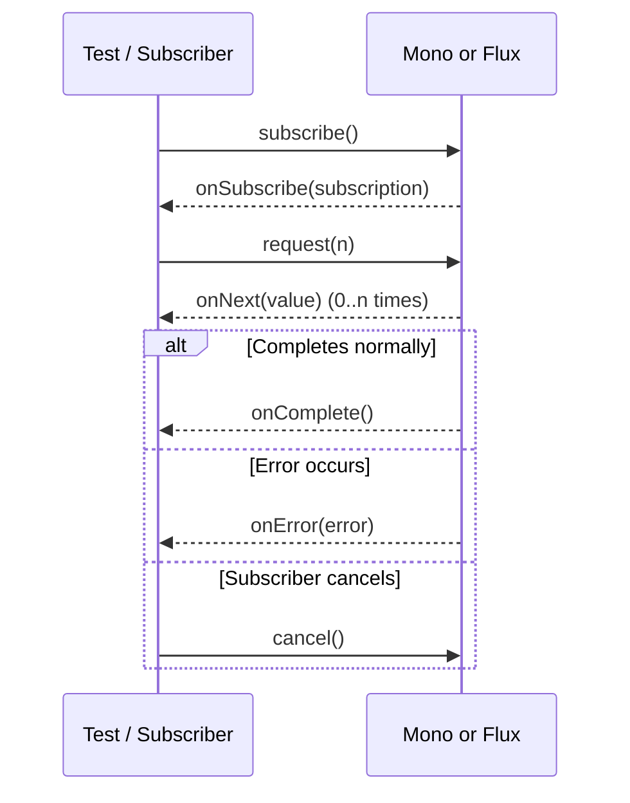

# Testing Mono, Flux, Errors, and Cancellation with StepVerifier

**Chapter:** Testing  
**Module:** Spring Cloud Function (`SPRING_CLOUD_FUNCTION`)

Spring Cloud Function supports writing business logic with standard Java interfaces as well as Project Reactor reactive types such as `Mono<T>` and `Flux<T>`. A reactive function can accept a publisher, transform the stream, and return a new publisher; that same logic can be invoked by Spring Cloud Function from Java, HTTP, events, or serverless environments.

With reactive code, simply calling a method and checking a single return value is usually insufficient. Publishers typically **do not execute until subscribed**, data is emitted via `onNext` signals ending in `onComplete` or `onError`, and a subscriber can send a `cancel` signal before the stream finishes. Therefore, tests need to verify **values, signal ordering, errors, demand, and cancellation**.

Project Reactor provides **`StepVerifier`** in the `reactor-test` module to write test scenarios matching Reactive Streams signals. This lesson covers testing `Mono` and `Flux`, errors and error recovery, backpressure, subscription cancellation, resource cleanup, virtual time, and applying these techniques to reactive functions registered in `FunctionCatalog`.

## 1. Learning Objectives

After this lesson, you will be able to:

1. Distinguish publisher, subscription, demand, and terminal signals in Reactor.
2. Test `Mono<T>` with data, empty completion, and errors using `StepVerifier`.
3. Test `Flux<T>` with multiple elements, ordering, filter/map, and stream completion.
4. Prove that an error terminates the stream and prevents subsequent elements from being processed.
5. Test `onErrorResume`, retries, and distinguish recovered errors from propagated errors.
6. Control demand with `thenRequest(...)` and verify backpressure.
7. Test cancellation with `thenCancel()`, `doOnCancel(...)`, and resource cleanup.
8. Use `withVirtualTime(...)` to test delays/backoff without waiting in real time.
9. Verify that a Spring Cloud Function reactive function is invoked to build a stream and processes items only upon subscription.
10. Distinguish in-JVM reactive function tests from external adapter, binder, and serverless tests.

| Topic | Primary `StepVerifier` Assertion |
| --- | --- |
| `Mono` emits one value | `expectNext(value).verifyComplete()` |
| `Mono.empty()` | `verifyComplete()` with no `onNext` |
| `Mono.error(...)` | `expectError(...)` |
| `Flux` emits multiple values | `expectNext(...).verifyComplete()` |
| Element order | `expectNextSequence(...)` |
| Demand/backpressure | `create(publisher, initialRequest)` and `thenRequest(n)` |
| Cancellation | `thenCancel().verify()` |
| Delay/backoff | `withVirtualTime(...)` and `thenAwait(...)` |

## 2. Understanding Publishers and Subscriptions

In Reactor, `Mono<T>` represents a stream of at most one item, while `Flux<T>` represents a stream of zero to many items. Both are publishers: they describe **a signal-emitting process**, not a value already computed when the variable is created.



Signals to distinguish:

- `onSubscribe`: the subscriber receives a subscription.
- `request(n)`: the subscriber requests up to `n` more items.
- `onNext(value)`: the publisher emits one item according to demand.
- `onComplete`: the publisher completes normally.
- `onError(error)`: the publisher terminates with an error.
- `cancel()`: the subscriber no longer wants data; the publisher should stop work and release resources appropriately.

### 2.1. Creating a Publisher Does Not Mean Running the Pipeline

```java
AtomicInteger processed = new AtomicInteger();

Flux<Integer> pipeline = Flux.range(1, 3)
    .doOnNext(value -> processed.incrementAndGet());

assertEquals(0, processed.get());

StepVerifier.create(pipeline)
    .expectNext(1, 2, 3)
    .verifyComplete();

assertEquals(3, processed.get());
```

The pipeline is declared first, while operators process items when subscribed. Some eager sources may generate data or perform side effects at creation time; to defer that, use `defer(...)` and design the source with an explicit contract.

### 2.2. `Mono` and `Flux` Are Not Two Collection Types

| Type | Item Count | Example |
| --- | --- | --- |
| `Mono<T>` | 0 or 1 | Look up an order, compute a single result |
| `Flux<T>` | 0 to many | Read order list, event stream |
| `Mono<Void>` | Emits no items; only completes or errors | An async write/delete operation |
| `Flux<Void>` | Usually not a useful element type | Revisit stream contract |

For `Mono<Void>`, do not write `expectNext(...)`. The contract to verify is completion or error, along with any side effects that occurred.

## 3. What Is `StepVerifier`?

`StepVerifier` is a DSL for declaring an expectation script over the signals a subscriber receives. You create a verifier via `StepVerifier.create(publisher)` or `StepVerifier.withVirtualTime(...)`, chain expectations, and **must trigger verification** with a terminal method such as `verifyComplete()`, `verifyError()`, `verify()`, or `thenCancel().verify()`.

Short example:

```java
StepVerifier.create(Flux.just("A", "B"))
    .expectNext("A")
    .expectNext("B")
    .verifyComplete();
```

Reading in order:

1. Subscribe to the publisher.
2. Expect the first item to be `"A"`.
3. Expect the second item to be `"B"`.
4. Expect normal completion and execute the test script.

### 3.1. Common API Groups

| Group | API | Purpose |
| --- | --- | --- |
| Subscription | `expectSubscription()` | Asserts a subscription was established |
| Item | `expectNext(...)`, `assertNext(...)` | Checks the next emitted value |
| Sequence | `expectNextSequence(...)`, `expectNextCount(n)` | Checks a list or count of items |
| Terminal | `verifyComplete()`, `expectError(...)` | Checks completion or error |
| Demand | `thenRequest(n)` | Requests more items during the script |
| Cancel | `thenCancel()` | Cancels the subscription at the current point |
| Time | `thenAwait(duration)`, `expectNoEvent(duration)` | Waits or asserts no signals arrive |
| Context | `expectAccessibleContext()` | Verifies Reactor Context if required by contract |

By default, `StepVerifier.create(publisher)` requests unbounded demand. When testing backpressure, pass an explicit initial request such as `StepVerifier.create(publisher, 0)`, then drive demand with `thenRequest(n)`.

**Note:** `verify()` can block indefinitely if the publisher never emits a terminal signal. In tests that could hang, use `verify(Duration)` or configure appropriate timeouts so CI terminates cleanly.

## 4. Preparing Dependencies for JUnit 5 and Reactor Test

To use `StepVerifier`, the test classpath needs `reactor-test` at a version compatible with `reactor-core`. In a Spring Boot project with dependency management, use the test starter and declare Reactor Test in test scope.

**Maven** (dependencies excerpt; versions managed by a compatible BOM):

```xml
<dependencies>
    <dependency>
        <groupId>org.springframework.boot</groupId>
        <artifactId>spring-boot-starter</artifactId>
    </dependency>
    <dependency>
        <groupId>org.springframework.cloud</groupId>
        <artifactId>spring-cloud-function-context</artifactId>
    </dependency>
    <dependency>
        <groupId>io.projectreactor</groupId>
        <artifactId>reactor-core</artifactId>
    </dependency>
    <dependency>
        <groupId>io.projectreactor</groupId>
        <artifactId>reactor-test</artifactId>
        <scope>test</scope>
    </dependency>
    <dependency>
        <groupId>org.springframework.boot</groupId>
        <artifactId>spring-boot-starter-test</artifactId>
        <scope>test</scope>
    </dependency>
</dependencies>
```

**Gradle Kotlin DSL** (versions managed by project):

```kotlin
dependencies {
    implementation("org.springframework.boot:spring-boot-starter")
    implementation("org.springframework.cloud:spring-cloud-function-context")
    implementation("io.projectreactor:reactor-core")
    testImplementation("io.projectreactor:reactor-test")
    testImplementation("org.springframework.boot:spring-boot-starter-test")
}

tasks.test {
    useJUnitPlatform()
}
```

Do not pick a random `reactor-test` version newer than `reactor-core`. Use compatible Spring Boot/Spring Cloud dependency management or inspect your project's dependency tree. The examples below use standard JUnit Jupiter and Reactor APIs.

## 5. Sample Reactive Business Code

We build a small order policy for testing:

- `assessOrder(Mono<OrderRequest>)` evaluates an order and returns an `OrderDecision`.
- `normalizeOrders(Flux<String>)` normalizes a stream of order codes.
- `validateOrders(Flux<String>)` emits an error if an invalid code appears.
- `delayedStatus(Mono<String>)` illustrates a delayed result.

**File:** `src/main/java/example/reactive/OrderReactiveFunctions.java`

```java
package example.reactive;

import java.time.Duration;
import java.util.Locale;
import java.util.function.Function;

import reactor.core.publisher.Flux;
import reactor.core.publisher.Mono;

public final class OrderReactiveFunctions {

    private OrderReactiveFunctions() {}

    public record OrderRequest(String orderCode, int quantity) {}

    public record OrderDecision(
            String normalizedCode, boolean accepted) {}

    public static Function<Mono<OrderRequest>, Mono<OrderDecision>>
            assessOrder() {
        return request -> request.map(value -> {
            if (value.orderCode() == null
                    || value.orderCode().isBlank()) {
                throw new IllegalArgumentException(
                    "Order code must not be blank");
            }
            String normalized = value.orderCode()
                .trim().toUpperCase(Locale.ROOT);
            return new OrderDecision(
                normalized, value.quantity() > 0);
        });
    }

    public static Function<Flux<String>, Flux<String>>
            normalizeOrders() {
        return orders -> orders
            .map(String::trim)
            .filter(value -> !value.isEmpty())
            .map(value -> value.toUpperCase(Locale.ROOT));
    }

    public static Function<Flux<String>, Flux<String>>
            validateOrders() {
        return orders -> orders.map(value -> {
            if (!value.matches("ORD-[0-9]+")) {
                throw new IllegalArgumentException(
                    "Invalid order code: " + value);
            }
            return value;
        });
    }

    public static Function<Mono<String>, Mono<String>>
            delayedStatus() {
        return status -> status.delayElement(
            Duration.ofSeconds(5));
    }
}
```

These functions are plain Java factories requiring no Spring to instantiate or test. When registering them in an application, they can back functional beans. Unit tests in the next sections invoke these functions directly.

### 5.1. Do Not Call `block()` Inside a Reactive Function

Do not write:

```java
// Avoid inside reactive pipelines:
OrderRequest request = mono.block();
return Mono.just(assessSynchronously(request));
```

Calling `block()` blocks the current thread and defeats reactive composition. Use `map(...)` for synchronous transforms, `flatMap(...)` when calling a publisher-returning function, and let the subscriber drive execution.

## 6. Testing `Mono`: Value, Empty, and Error

`Mono<T>` has three common outcomes to test:

1. Emits one value then `onComplete`.
2. Emits no value and `onComplete`.
3. Emits `onError`.

**File:** `src/test/java/example/reactive/MonoStepVerifierTest.java`

```java
package example.reactive;

import static org.junit.jupiter.api.Assertions.*;

import org.junit.jupiter.api.Test;
import reactor.core.publisher.Mono;
import reactor.test.StepVerifier;

import example.reactive.OrderReactiveFunctions.OrderRequest;
import example.reactive.OrderReactiveFunctions.OrderDecision;

class MonoStepVerifierTest {

    @Test
    void emitsOneOrderDecisionAndCompletes() {
        Mono<OrderRequest> input =
            Mono.just(new OrderRequest(" ord-42 ", 2));

        Mono<OrderDecision> result =
            OrderReactiveFunctions.assessOrder().apply(input);

        StepVerifier.create(result)
            .expectNext(new OrderDecision("ORD-42", true))
            .verifyComplete();
    }

    @Test
    void emptyInputCompletesWithoutDecision() {
        Mono<OrderRequest> input = Mono.empty();

        Mono<OrderDecision> result =
            OrderReactiveFunctions.assessOrder().apply(input);

        StepVerifier.create(result)
            .verifyComplete();
    }

    @Test
    void invalidOrderEmitsIllegalArgumentError() {
        Mono<OrderRequest> input =
            Mono.just(new OrderRequest("  ", 2));

        Mono<OrderDecision> result =
            OrderReactiveFunctions.assessOrder().apply(input);

        StepVerifier.create(result)
            .expectErrorMatches(error ->
                error instanceof IllegalArgumentException
                    && error.getMessage().contains("must not be blank"))
            .verify();
    }

    @Test
    void errorCanBeRecoveredIntoFallbackValue() {
        Mono<String> result = Mono.<String>error(
                new IllegalStateException("inventory unavailable"))
            .onErrorResume(
                IllegalStateException.class,
                error -> Mono.just("temporarily-unavailable"));

        StepVerifier.create(result)
            .expectNext("temporarily-unavailable")
            .verifyComplete();
    }
}
```

### 6.1. `Mono.empty()` Is Not `Mono.just(null)`

Reactor forbids emitting `null` via `Mono.just(null)`. To represent no result, use `Mono.empty()`. Thus:

```java
StepVerifier.create(Mono.empty())
    .verifyComplete();
```

has no `onNext` yet still emits the `onComplete` terminal signal. A test with only `verifyComplete()` accepts both an empty stream and a stream that emitted values unless other expectations are present; if **a value is required**, add `expectNext(...)`.

### 6.2. `expectError` and `expectErrorMatches`

`expectError(IllegalArgumentException.class)` checks the error type. `expectErrorMatches(...)` lets you also inspect the message or properties. Avoid asserting full stack traces or converter/framework-specific messages unless they are part of the application contract.

### 6.3. Error Recovery Changes the Terminal Signal

`onErrorResume(...)` replaces an erroring stream with another publisher. The test above proves the upstream error turns into a fallback value and completes normally. If business rules require **propagating the error**, omit recovery from the pipeline and use `expectError...` instead of expecting a fallback.

## 7. Testing `Flux`: Multiple Items, Ordering, and Empty Streams

`Flux<T>` can emit multiple `onNext` signals before completing or erroring. For finite streams, tests typically verify **all items, exact ordering, and the terminal signal**.

**File:** `src/test/java/example/reactive/FluxStepVerifierTest.java`

```java
package example.reactive;

import static org.junit.jupiter.api.Assertions.*;

import java.util.List;
import java.util.concurrent.CopyOnWriteArrayList;

import org.junit.jupiter.api.Test;
import reactor.core.publisher.Flux;
import reactor.test.StepVerifier;

class FluxStepVerifierTest {

    @Test
    void normalizesValuesAndPreservesOrder() {
        Flux<String> input =
            Flux.just(" ord-1 ", "ord-2", "  ord-3");

        Flux<String> result =
            OrderReactiveFunctions.normalizeOrders().apply(input);

        StepVerifier.create(result)
            .expectNext("ORD-1", "ORD-2", "ORD-3")
            .verifyComplete();
    }

    @Test
    void emptyFluxCompletesWithoutValues() {
        Flux<String> result =
            OrderReactiveFunctions.normalizeOrders()
                .apply(Flux.empty());

        StepVerifier.create(result)
            .verifyComplete();
    }

    @Test
    void validatorPassesAllValidValues() {
        Flux<String> normalized =
            OrderReactiveFunctions.normalizeOrders()
                .apply(Flux.just("ord-1", " ord-2 "));

        Flux<String> result =
            OrderReactiveFunctions.validateOrders()
                .apply(normalized);

        StepVerifier.create(result)
            .expectNextSequence(List.of("ORD-1", "ORD-2"))
            .verifyComplete();
    }

    @Test
    void errorStopsProcessingLaterElements() {
        List<String> visited = new CopyOnWriteArrayList<>();

        Flux<String> result = Flux.just(
                "ord-1", "invalid-code", "ord-3")
            .doOnNext(visited::add)
            .map(String::toUpperCase)
            .transform(
                OrderReactiveFunctions.validateOrders()::apply);

        StepVerifier.create(result)
            .expectNext("ORD-1")
            .expectErrorMatches(error ->
                error instanceof IllegalArgumentException
                    && error.getMessage().contains("invalid-code"))
            .verify();

        assertEquals(
            List.of("ord-1", "invalid-code"),
            visited);
    }
}
```

### 7.1. `expectNextSequence` and `expectNextCount`

`expectNextSequence(iterable)` fits when comparing a full sequence in order. `expectNextCount(n)` checks only the number of upcoming items without checking values. Whenever contents carry business meaning, prefer `expectNext(...)`, `assertNext(...)`, or `expectNextSequence(...)`.

### 7.2. Empty `Flux` and `Flux<Void>`

`Flux.empty()` completes normally without emitting items. Testing:

```java
StepVerifier.create(Flux.empty())
    .verifyComplete();
```

is not equivalent to `Flux.never()`: `never` emits nothing, never completes, and never errors. For non-terminating publishers, tests must cancel explicitly or use timeouts to avoid hanging.

### 7.3. Mid-Stream Errors Block Later Elements

In `errorStopsProcessingLaterElements`, `visited` records elements **reaching the validation step**. After `"invalid-code"`, the publisher emits `onError` and terminates; `"ord-3"` is never passed through the validation mapper.

If `onErrorContinue(...)` or another recovery operator is present, the contract changes: a failing element may be skipped while subsequent items still proceed. In that case, write dedicated tests for that recovery policy rather than expecting termination as in this example.

## 8. Testing Errors and Error Recovery in `Flux`

Reactor represents failures with the `onError` terminal signal. Once an error occurs, a standard `Flux` stops emitting further items in that subscription. However, operators such as `onErrorResume`, `onErrorReturn`, or `retryWhen` alter this behavior.

### 8.1. `onErrorResume` Switches to Another Publisher

```java
Flux<String> recovered = Flux.just("ord-1", "bad", "ord-3")
    .map(value -> {
        if ("bad".equals(value)) {
            throw new IllegalArgumentException("bad order");
        }
        return value.toUpperCase();
    })
    .onErrorResume(
        IllegalArgumentException.class,
        error -> Flux.just("QUARANTINED"));

StepVerifier.create(recovered)
    .expectNext("ORD-1")
    .expectNext("QUARANTINED")
    .verifyComplete();
```

Once a terminal error occurs, `onErrorResume` subscribes to the fallback publisher. It **does not resume the original publisher at the next item**. In this example, `"ord-3"` is never emitted; `"QUARANTINED"` comes from the replacement publisher.

### 8.2. `retryWhen` Can Re-Run the Entire Source

```java
AtomicInteger attempts = new AtomicInteger();

Mono<String> operation = Mono.defer(() -> {
    int current = attempts.incrementAndGet();
    if (current < 3) {
        return Mono.error(
            new IllegalStateException("temporary failure"));
    }
    return Mono.just("completed");
}).retryWhen(
    Retry.max(2));

StepVerifier.create(operation)
    .expectNext("completed")
    .verifyComplete();

assertEquals(3, attempts.get());
```

This snippet requires importing `java.util.concurrent.atomic.AtomicInteger` and `reactor.util.retry.Retry`. `Mono.defer(...)` recreates the operation on each subscription/retry. `Retry.max(2)` permits up to two retries after the initial attempt, totaling three attempts here.

**Do not retry every error blindly.** Validation errors usually will not succeed on retry. Retry only transient failures, and verify whether side effects are safe to repeat.

### 8.3. Distinguishing Retry from Fallback

| Operator | Meaning |
| --- | --- |
| `onErrorResume(...)` | Switches to a replacement publisher after an error |
| `onErrorReturn(value)` | Emits a fallback value and completes |
| `retry(n)` / `retryWhen(...)` | Re-subscribes to the source on error per policy |
| `doOnError(...)` | Observes the error; does not recover |

Tests should verify attempt counts for retries, fallback values for recovery, and terminal errors once retry limits are exhausted. Never treat `doOnError` as error recovery.

## 9. Testing Backpressure and Demand

Reactive Streams uses demand so subscribers request a specific number of items. `StepVerifier.create(publisher, initialRequest)` controls the initial request amount; `thenRequest(n)` adds demand during the script.

```java
@Test
void requestsValuesInBatches() {
    StepVerifier.create(Flux.range(1, 4), 0)
        .expectSubscription()
        .thenRequest(1)
        .expectNext(1)
        .thenRequest(2)
        .expectNext(2, 3)
        .thenRequest(1)
        .expectNext(4)
        .verifyComplete();
}
```

With an initial request of `0`, the subscriber asks for zero items initially. After each `thenRequest(n)`, the publisher can emit up to the requested count and the verifier checks them.

### 9.1. Proving the Publisher Emits Nothing When Demand Is Zero

```java
@Test
void noElementIsDeliveredBeforeDemand() {
    AtomicInteger delivered = new AtomicInteger();
    Flux<Integer> source = Flux.range(1, 3)
        .doOnNext(value -> delivered.incrementAndGet());

    StepVerifier.create(source, 0)
        .expectSubscription()
        .then(() -> assertEquals(0, delivered.get()))
        .thenRequest(1)
        .expectNext(1)
        .then(() -> assertEquals(1, delivered.get()))
        .thenCancel()
        .verify();
}
```

`then(Runnable)` runs assertions at that exact point in the script. This test proves items are not delivered before demand and only one item is requested before cancellation.

### 9.2. Do Not Assume Every Publisher Emits Immediately on Demand

Backpressure caps **how many items the subscriber requests**, whereas a source may still need time, a scheduler, or an external signal to produce items. Use deterministic publishers like `Flux.range(...)` when testing demand itself. If a source is asynchronous, control its scheduler or use `TestPublisher` instead of relying on arbitrary timing.

## 10. Testing Cancellation and Cleanup

Subscription cancellation is part of the reactive contract. When a subscriber is no longer interested, the publisher should stop work and release resources. Tests should prove:

- `cancel()` was sent.
- Work after the cancellation point is not delivered to the subscriber.
- Cleanup hooks or `doFinally(...)` execute as required.

### 10.1. Testing `doOnCancel`

```java
@Test
void cancellationInvokesCancelHook() {
    AtomicBoolean cancelled = new AtomicBoolean();
    List<Integer> processed = new CopyOnWriteArrayList<>();

    Flux<Integer> source = Flux.range(1, 10)
        .doOnNext(processed::add)
        .doOnCancel(() -> cancelled.set(true));

    StepVerifier.create(source, 0)
        .expectSubscription()
        .thenRequest(2)
        .expectNext(1, 2)
        .thenCancel()
        .verify();

    assertTrue(cancelled.get());
    assertEquals(List.of(1, 2), processed);
}
```

The test starts with zero initial demand and requests two items, so the synchronous source delivers only two values before the verifier sends cancel. The `processed` list proves subsequent items were never processed in this subscription.

### 10.2. Testing `Mono.never()`

```java
@Test
void neverMonoCanBeCancelled() {
    AtomicBoolean cancelled = new AtomicBoolean();

    Mono<String> never = Mono.<String>never()
        .doOnCancel(() -> cancelled.set(true));

    StepVerifier.create(never)
        .expectSubscription()
        .thenCancel()
        .verify();

    assertTrue(cancelled.get());
}
```

`Mono.never()` emits no values, errors, or completions. Never call `verifyComplete()` on it because the test will hang indefinitely without a timeout. Scripts must explicitly cancel or apply a timeout.

### 10.3. Testing Resource Release with `Flux.using`

```java
@Test
void cancellationReleasesResource() {
    AtomicBoolean closed = new AtomicBoolean();

    Flux<Integer> source = Flux.using(
        () -> "test-resource",
        resource -> Flux.range(1, 5),
        resource -> closed.set(true)
    );

    StepVerifier.create(source, 0)
        .expectSubscription()
        .thenRequest(1)
        .expectNext(1)
        .thenCancel()
        .verify();

    assertTrue(closed.get());
}
```

`Flux.using(...)` manages resource lifecycles and triggers cleanup when the sequence terminates or is cancelled. The test verifies the cancellation path does not skip closing the resource.

### 10.4. `doFinally` and `SignalType`

When distinguishing completion, error, and cancellation:

```java
AtomicReference<SignalType> finalSignal =
    new AtomicReference<>();

Flux<Integer> source = Flux.range(1, 5)
    .doFinally(finalSignal::set);

StepVerifier.create(source, 0)
    .expectSubscription()
    .thenRequest(1)
    .expectNext(1)
    .thenCancel()
    .verify();

assertEquals(SignalType.CANCEL, finalSignal.get());
```

This snippet requires importing `java.util.concurrent.atomic.AtomicReference` and `reactor.core.publisher.SignalType`. `doFinally(...)` runs after the sequence ends and receives the final signal type. It is useful for verifying metrics, traces, or cleanup hooks.

**Do not confuse `cancel` with `onComplete`.** Cancellation is sent upstream by the subscriber, not emitted downstream by the publisher like `onComplete` or `onError`.

## 11. Testing Time with `VirtualTimeScheduler`

Avoid calling `Thread.sleep(...)` to wait for `Mono.delay(...)` or retry backoff. Real-time waiting makes tests slow, flaky, and sensitive to CI scheduling. `StepVerifier.withVirtualTime(...)` installs a virtual-time scheduler so operators using default schedulers can be tested without waiting in wall-clock time.

### 11.1. Testing `Mono.delay`

```java
@Test
void delayCanBeTestedWithoutWaitingOneDay() {
    StepVerifier.withVirtualTime(
            () -> Mono.delay(Duration.ofDays(1)))
        .expectSubscription()
        .expectNoEvent(Duration.ofDays(1))
        .expectNext(0L)
        .verifyComplete();
}
```

`expectSubscription()` must precede `expectNoEvent(...)` because subscription itself is an event. Next, the verifier advances the virtual clock by one day, receives `0L` from `Mono.delay`, and verifies completion.

### 11.2. Critical Rule: Construct the Publisher Inside the `Supplier`

Right:

```java
StepVerifier.withVirtualTime(
    () -> Flux.interval(Duration.ofSeconds(1)).take(3))
    .thenAwait(Duration.ofSeconds(3))
    .expectNext(0L, 1L, 2L)
    .verifyComplete();
```

Do not build the publisher beforehand and return the pre-built variable:

```java
// Avoid this with virtual time:
Flux<Long> source =
    Flux.interval(Duration.ofSeconds(1)).take(3);

StepVerifier.withVirtualTime(() -> source)
    .thenAwait(Duration.ofSeconds(3))
    .expectNext(0L, 1L, 2L)
    .verifyComplete();
```

Reason: `withVirtualTime(...)` must install the virtual scheduler **before the operators are instantiated**. If the publisher was created outside, it may have already captured the real scheduler. Building the whole chain inside the lambda ensures operators pick up the virtual scheduler.

### 11.3. Testing Retry Backoff with Virtual Time

```java
@Test
void retryBackoffUsesVirtualTime() {
    AtomicInteger attempts = new AtomicInteger();

    StepVerifier.withVirtualTime(() ->
            Mono.defer(() -> {
                int attempt = attempts.incrementAndGet();
                if (attempt < 3) {
                    return Mono.error(
                        new IllegalStateException("temporary"));
                }
                return Mono.just("completed");
            }).retryWhen(
                Retry.fixedDelay(
                    2, Duration.ofSeconds(10))))
        .expectSubscription()
        .thenAwait(Duration.ofSeconds(20))
        .expectNext("completed")
        .verifyComplete();

    assertEquals(3, attempts.get());
}
```

Both 10-second backoff delays are advanced via the virtual clock. The entire publisher, including `Mono.defer(...)` and `retryWhen(...)`, is created **inside the Supplier**. No `Thread.sleep(20_000)` is needed.

This test requires importing `java.time.Duration`, `java.util.concurrent.atomic.AtomicInteger`, `reactor.core.publisher.Mono`, `reactor.util.retry.Retry`, and `reactor.test.StepVerifier`.

### 11.4. Limits of Virtual Time

- Operators must use schedulers that Reactor swaps for the virtual scheduler; custom schedulers created earlier may be unaffected.
- Pipelines with nested schedulers or multi-branch delays may need careful attention to creation/subscription order.
- Infinite publishers will not complete; bound them with `take(n)` or cancel explicitly.
- Virtual time controls **Reactor time**, not the OS wall clock, external HTTP client timeouts, or real broker processing latency.

## 12. `TestPublisher` and `PublisherProbe` for Controlled Scenarios

Alongside `StepVerifier`, `reactor-test` provides two helpful companions:

- **`TestPublisher`**: a test source letting the test emit items, errors, or completion at chosen moments.
- **`PublisherProbe`**: wraps a publisher to assert whether it was subscribed to, requested from, or cancelled.

### 12.1. Using `TestPublisher` to Drive Signals

```java
@Test
void testPublisherControlsValuesAndError() {
    TestPublisher<String> source = TestPublisher.create();

    StepVerifier.create(
            source.flux().map(String::toUpperCase))
        .expectSubscription()
        .then(() -> source.next("ord-1"))
        .expectNext("ORD-1")
        .then(() -> source.error(
            new IllegalStateException("source failed")))
        .expectErrorMessage("source failed")
        .verify();
}
```

Tests can trigger signals at exact moments rather than racing async sources with threads or sleeps. `TestPublisher` also offers Reactive Streams compliance modes; only use non-compliant modes when testing how a pipeline handles a misbehaving publisher. `TestPublisher` emits directly to active subscribers and should not be driven concurrently from multiple threads without synchronization.

### 12.2. Using `PublisherProbe` to Verify a Fallback Branch

```java
@Test
void fallbackPublisherIsActuallySubscribed() {
    PublisherProbe<String> fallback =
        PublisherProbe.of(Mono.just("fallback"));

    Mono<String> result = Mono.<String>error(
            new IllegalStateException("failed"))
        .onErrorResume(error -> fallback.mono());

    StepVerifier.create(result)
        .expectNext("fallback")
        .verifyComplete();

    fallback.assertWasSubscribed();
    fallback.assertWasRequested();
    fallback.assertWasNotCancelled();
}
```

The test verifies not only the fallback output, but also that the fallback branch was genuinely subscribed to and requested. This is valuable when a branch contains important logic whose final output could match another path.

### 12.3. `PublisherProbe` and Cancellation

```java
@Test
void cancellationReachesDelegatedPublisher() {
    PublisherProbe<Integer> probe =
        PublisherProbe.of(Flux.range(1, 5));

    StepVerifier.create(probe.flux(), 0)
        .expectSubscription()
        .thenRequest(1)
        .expectNext(1)
        .thenCancel()
        .verify();

    probe.assertWasSubscribed();
    probe.assertWasRequested();
    probe.assertWasCancelled();
}
```

Here, the probe proves that the cancel signal propagates down to the delegated publisher. If a pipeline has multiple branches, attach a probe to each branch to verify the right publisher is triggered or cancelled.

## 13. Reactive Functions in Spring Cloud Function

Spring Cloud Function supports functions taking and returning `Mono` and `Flux`. One critical distinction:

- For an **imperative function** such as `Function<String,String>`, the framework invokes the function per event/message in an imperative model.
- For a **reactive function** such as `Function<Flux<String>,Flux<String>>`, the framework invokes the function to obtain a stream; operators inside the stream process items when subscribed.

This directly shapes how you test. Do not expect a reactive function body to be invoked once per item. Distinguish **how many times the function is called to build a publisher** from **how many items are processed after subscription**.

### 13.1. Spring Boot App with Reactive Functional Beans

**File:** `src/main/java/example/reactive/ReactiveFunctionApplication.java`

```java
package example.reactive;

import java.util.List;
import java.util.Locale;
import java.util.concurrent.CopyOnWriteArrayList;
import java.util.concurrent.atomic.AtomicInteger;
import java.util.function.Function;

import org.springframework.boot.SpringApplication;
import org.springframework.boot.autoconfigure.SpringBootApplication;
import org.springframework.context.annotation.Bean;

import reactor.core.publisher.Flux;
import reactor.core.publisher.Mono;

@SpringBootApplication(proxyBeanMethods = false)
public class ReactiveFunctionApplication {

    public static void main(String[] args) {
        SpringApplication.run(
            ReactiveFunctionApplication.class, args);
    }

    public record OrderRequest(String orderCode, int quantity) {}

    public record OrderDecision(
        String normalizedCode, boolean accepted) {}

    public static final class ReactiveProbe {
        private final AtomicInteger functionInvocations =
            new AtomicInteger();
        private final List<String> processed =
            new CopyOnWriteArrayList<>();

        public void invoked() {
            functionInvocations.incrementAndGet();
        }

        public void processed(String value) {
            processed.add(value);
        }

        public int invocationCount() {
            return functionInvocations.get();
        }

        public List<String> processedValues() {
            return List.copyOf(processed);
        }

        public void reset() {
            functionInvocations.set(0);
            processed.clear();
        }
    }

    @Bean
    public ReactiveProbe reactiveProbe() {
        return new ReactiveProbe();
    }

    @Bean("normalizeFlux")
    public Function<Flux<String>, Flux<String>> normalizeFlux(
            ReactiveProbe probe) {
        return input -> {
            probe.invoked();
            return input.map(value -> {
                probe.processed(value);
                return value.trim().toUpperCase(Locale.ROOT);
            });
        };
    }

    @Bean("assessMono")
    public Function<Mono<OrderRequest>, Mono<OrderDecision>>
            assessMono() {
        return request -> request.map(value -> {
            if (value.orderCode() == null
                    || value.orderCode().isBlank()) {
                throw new IllegalArgumentException(
                    "Order code must not be blank");
            }
            return new OrderDecision(
                value.orderCode().trim().toUpperCase(Locale.ROOT),
                value.quantity() > 0);
        });
    }
}
```

`ReactiveProbe` only tracks two moments: how many times the function body ran and which inputs the mapper processed. It is not part of production business logic.

### 13.2. Testing Reactive Functions Directly and Through the Catalog

**File:** `src/test/java/example/reactive/ReactiveFunctionCatalogTest.java`

```java
package example.reactive;

import static org.junit.jupiter.api.Assertions.*;

import java.util.List;
import java.util.function.Function;

import org.junit.jupiter.api.BeforeEach;
import org.junit.jupiter.api.Test;
import org.springframework.beans.factory.annotation.Autowired;
import org.springframework.beans.factory.annotation.Qualifier;
import org.springframework.boot.test.context.SpringBootTest;
import org.springframework.cloud.function.context.FunctionCatalog;

import reactor.core.publisher.Flux;
import reactor.core.publisher.Mono;
import reactor.test.StepVerifier;

import example.reactive.ReactiveFunctionApplication.OrderRequest;
import example.reactive.ReactiveFunctionApplication.OrderDecision;
import example.reactive.ReactiveFunctionApplication.ReactiveProbe;

@SpringBootTest(
    classes = ReactiveFunctionApplication.class,
    webEnvironment = SpringBootTest.WebEnvironment.NONE
)
class ReactiveFunctionCatalogTest {

    @Autowired
    FunctionCatalog catalog;

    @Autowired
    ReactiveProbe probe;

    @Autowired
    @Qualifier("normalizeFlux")
    Function<Flux<String>, Flux<String>> directNormalize;

    @BeforeEach
    void resetProbe() {
        probe.reset();
    }

    @Test
    void directReactiveFunctionBuildsStreamBeforeProcessingItems() {
        Flux<String> result =
            directNormalize.apply(Flux.just(" a ", "b"));

        assertEquals(1, probe.invocationCount());
        assertTrue(probe.processedValues().isEmpty());

        StepVerifier.create(result)
            .expectNext("A", "B")
            .verifyComplete();

        assertEquals(List.of(" a ", "b"),
            probe.processedValues());
    }

    @Test
    void catalogReactiveFunctionProcessesStreamOncePerInvocation() {
        Function<Flux<String>, Flux<String>> fromCatalog =
            catalog.lookup(Function.class, "normalizeFlux");
        assertNotNull(fromCatalog);

        Flux<String> result =
            fromCatalog.apply(Flux.just(" ord-1 ", "ord-2"));

        StepVerifier.create(result)
            .expectNext("ORD-1", "ORD-2")
            .verifyComplete();

        assertEquals(1, probe.invocationCount());
        assertEquals(List.of(" ord-1 ", "ord-2"),
            probe.processedValues());
    }

    @Test
    void reactiveMonoFunctionWorksThroughCatalog() {
        Function<Mono<OrderRequest>, Mono<OrderDecision>> assess =
            catalog.lookup(Function.class, "assessMono");
        assertNotNull(assess);

        Mono<OrderDecision> result = assess.apply(
            Mono.just(new OrderRequest(" ord-42 ", 3)));

        StepVerifier.create(result)
            .expectNext(new OrderDecision("ORD-42", true))
            .verifyComplete();
    }
}
```

What these tests verify:

1. The reactive function is invoked to build a publisher; the mapper processes items when subscribed.
2. For a single `apply(Flux)` call, the function body is not re-invoked per item.
3. `FunctionCatalog` resolves the reactive bean and returns a publisher testable with `StepVerifier`.
4. A `Mono<OrderRequest> → Mono<OrderDecision>` function can be tested the same way for a single-value stream.

**Do not infer** from the tests above that HTTP, Stream, or serverless handles subscriptions or lifecycles properly. Those tests only verify the function and publisher inside the Spring context.

### 13.3. Reactive `Supplier` and Polling

Spring Cloud Function also supports `Supplier<Flux<T>>` and `Supplier<Mono<T>>`. A reactive supplier is typically invoked to create a stream that consumers subscribe to; it does not mean the supplier is invoked once per item.

For a reactive supplier producing a **finite stream** that must be polled repeatedly, Spring Cloud Function provides the `@PollableBean` marker to tell integrating frameworks that the supplier may need re-polling. This annotation **does not perform polling itself**; polling behavior belongs to the framework or adapter invoking the supplier.

If using `@PollableBean(splittable = true)`, test stream creation, polling, and element splitting at the appropriate integration layer. A `StepVerifier` test on an already-created `Flux` does not prove the adapter's poller works.

## 14. Cancellation When a Publisher Is Subscribed Multiple Times

A cold `Flux` typically replays its pipeline for each subscriber. If a publisher has side effects in operators, subscribing a second time can trigger those side effects a second time.

```java
@Test
void coldFluxReplaysForEachSubscription() {
    AtomicInteger processed = new AtomicInteger();

    Flux<Integer> source = Flux.range(1, 2)
        .doOnNext(value -> processed.incrementAndGet());

    StepVerifier.create(source)
        .expectNext(1, 2)
        .verifyComplete();

    StepVerifier.create(source)
        .expectNext(1, 2)
        .verifyComplete();

    assertEquals(4, processed.get());
}
```

Creating a publisher once does not mean single execution. Calling `StepVerifier.create(...)` twice on the same cold publisher runs two subscriptions through the source operators.

### 14.1. Cancelling One Subscriber Does Not Necessarily Cancel All Subscribers

If multiple subscribers listen to a shared source, cancelling one subscriber may not stop the source while other subscribers remain. Therefore, testing a shared stream requires clarifying:

- Whether the publisher is cold or hot/shared.
- Who owns the subscription and underlying source.
- Whether other subscribers remain when one cancels.
- Whether cleanup triggers when the current subscription ends or when zero subscribers remain.

Do not apply conclusions from a simple `Flux.range(...).doOnCancel(...)` test to a pipeline using `share()`, `publish().refCount(...)`, or external source connections.

### 14.2. Testing Cancellation of an Interval Stream

```java
@Test
void intervalStopsAfterCancellation() {
    AtomicBoolean cancelled = new AtomicBoolean();

    StepVerifier.withVirtualTime(() ->
            Flux.interval(Duration.ofSeconds(1))
                .doOnCancel(() -> cancelled.set(true)))
        .expectSubscription()
        .thenAwait(Duration.ofSeconds(2))
        .expectNext(0L, 1L)
        .thenCancel()
        .verify();

    assertTrue(cancelled.get());
}
```

This test uses virtual time to advance two seconds, receive the first two ticks, and cancel the infinite stream. Omitting `thenCancel()` and calling `verifyComplete()` would prevent the test from ever finishing because `Flux.interval(...)` never completes on its own.

## 15. Placing `StepVerifier` at the Spring Cloud Function Testing Boundary

Once a reactive bean is registered in Spring, look it up via `FunctionCatalog` and pass the returned publisher to `StepVerifier`. Keep two responsibilities distinct:

1. **Catalog/DI:** Spring registered the right functional bean and returns the reactive function by name.
2. **Reactive execution:** the publisher emits expected items, errors, and terminal signals when subscribed.

```java
Function<Flux<String>, Flux<String>> normalize =
    catalog.lookup(Function.class, "normalizeFlux");

Flux<String> output =
    normalize.apply(Flux.just(" ord-1 ", "ord-2"));

StepVerifier.create(output)
    .expectNext("ORD-1", "ORD-2")
    .verifyComplete();
```

This snippet is a condensed form of the Section 13 test. It checks **the publisher returned by the catalog**; there is no need to call `block()` or manually call `subscribe()` first.

### 15.1. Why Not Call `subscribe()` Before `StepVerifier`?

Do not write:

```java
Flux<String> output = normalize.apply(input);
output.subscribe(); // A real subscription has already started.

StepVerifier.create(output)
    .expectNext("ORD-1")
    .verifyComplete();
```

This creates two subscribers. With a cold publisher, logic may execute twice; with a hot publisher, `StepVerifier` can miss signals already emitted before it subscribed. Let `StepVerifier` be the test's subscriber unless you are explicitly testing multiple subscriptions.

### 15.2. Do Not Use `block()` to Turn a Reactive Test into a Synchronous Test

```java
// Unnecessary:
OrderDecision value = result.block();
assertEquals(expected, value);
```

`block()` forfeits the ability to verify signal sequences, demand, cancellation, and terminal signals. `StepVerifier` subscribes, observes signals, and checks assertions over time in one flow.

### 15.3. Testing Errors from a Reactive Function via the Catalog

If a reactive function emits an error:

```java
Function<Flux<String>, Flux<String>> validate =
    catalog.lookup(Function.class, "validateFlux");

Flux<String> output =
    validate.apply(Flux.just("ORD-1", "bad", "ORD-3"));

StepVerifier.create(output)
    .expectNext("ORD-1")
    .expectError(IllegalArgumentException.class)
    .verify();
```

Tests should also attach a probe to the processing step to verify `ORD-3` is not processed after the error, as in Section 7. Note that if an error occurs in a **converter before the publisher is built**, the trace inside the reactive function may still be empty.

## 16. Common Mistakes When Writing `StepVerifier` Tests

| Mistake or Omission | Issue | Fix |
| --- | --- | --- |
| Creating verifier without calling terminal `verify` | Test script never actually executes | Call `verifyComplete()`, `verify()`, or equivalent |
| Calling `verifyComplete()` on `Mono.never()` | Publisher never completes; test hangs | Use `thenCancel()` or timeout |
| Calling `expectNext(null)` | Reactive Streams forbids null values | Use `Mono.empty()` or wrapper types for absence |
| Asserting only values without complete/error | Can miss wrong terminal signal | Add `verifyComplete()` or `expectError(...)` |
| Using `Thread.sleep(...)` for delays | Slow and flaky | Use `withVirtualTime(...)` |
| Building publisher before `withVirtualTime(...)` | Operator may capture real scheduler | Construct entire pipeline inside the Supplier |
| Using default demand to infer backpressure | Initial request may be unbounded | Pass initial request and use `thenRequest(...)` |
| Calling `subscribe()` before creating `StepVerifier` | Creates two subscriptions, duplicate side effects | Let `StepVerifier` manage subscription |
| Asserting only that `doOnCancel` ran | Does not prove post-cancel items were skipped | Also check processed list or `PublisherProbe` |
| Confusing cancel with complete | Two distinct signals | Check `SignalType.CANCEL` and appropriate terminal signal |
| Asserting only wrapper's outer exception | May change across framework versions | Check business error/root cause per contract |
| Using `StepVerifier` to conclude binder retried | Test did not run through an adapter | Write Spring Cloud Stream integration tests |

### 16.1. `verify()` Can Wait Indefinitely

`verifyComplete()` and `verify()` wait for terminal signals. If a publisher never terminates, the test can hang until runner timeout. You can attach a timeout to a scenario:

```java
StepVerifier.create(Mono.delay(Duration.ofMillis(10)))
    .expectNext(0L)
    .expectComplete()
    .verify(Duration.ofSeconds(2));
```

For virtual-time tests, still avoid creating pipelines that cannot emit a terminal signal or infinite streams without `take(...)`/cancellation.

### 16.2. Do Not Equate Each Subscription with an Imperative Business Function Call

For a reactive function, the function body is invoked to return a publisher; a subscription triggers element processing. If a cold publisher is subscribed multiple times, operators may re-run for each subscription even though the publisher-building body ran only once beforehand.

Therefore, tests should track separately:

- How many times the reactive function was called to build a publisher.
- How many times the publisher was subscribed to.
- How many items were processed per subscription.
- How many times side effects executed.

## 17. Test Matrix for `Mono`, `Flux`, Errors, and Cancellation

| ID | Scenario | How to Test | Expectation |
| --- | --- | --- | --- |
| M01 | `Mono.just(value)` | `expectNext(value).verifyComplete()` | One value then completion |
| M02 | `Mono.empty()` | `verifyComplete()` | No value, completes |
| M03 | `Mono.error(error)` | `expectErrorMatches(...)` | Right error type/properties |
| M04 | `onErrorResume` | `expectNext(fallback).verifyComplete()` | Error replaced with fallback |
| F01 | `Flux.just(...)` | `expectNextSequence(...)` | All items in exact order |
| F02 | `Flux.empty()` | `verifyComplete()` | Empty stream completes |
| F03 | Mid-`Flux` error | `expectNext(...).expectError(...)` | Items after error skipped |
| F04 | `onErrorResume` | Assert output sequence | Replacement publisher runs after error |
| F05 | `retryWhen` | Count attempts | Attempt count matches policy |
| B01 | Demand 0 | `create(publisher, 0)` | No items delivered yet |
| B02 | Batched requests | `thenRequest(n)` | Emits per demand |
| C01 | Cancel `Flux` | `thenCancel()` | Cancel hook invoked |
| C02 | Cancel `Mono.never` | `thenCancel()` | Subscription cancelled |
| C03 | Cancel resource | `Flux.using(...)` | Cleanup invoked |
| C04 | Cancel delegated publisher | `PublisherProbe` | Probe confirms cancelled |
| T01 | Time-based delay | `withVirtualTime(...)` | No wall-clock waiting |
| T02 | Retry backoff | `withVirtualTime(...)` | Exact attempts and timing |
| S01 | Reactive function via catalog | `lookup(...) + StepVerifier` | Publisher emits right data/signals |
| S02 | Reactive function body | Probe invocations/processed | Body runs once per stream invocation |

This matrix is a design guide; not every row needs to appear in every test class. Pick scenarios relevant to your function's contract and risks.

## 18. Running Tests and Diagnosing Failures

Example layout:

```text
src/
  main/java/example/reactive/
    OrderReactiveFunctions.java
    ReactiveFunctionApplication.java
  test/java/example/reactive/
    MonoStepVerifierTest.java
    FluxStepVerifierTest.java
    ReactiveFunctionCatalogTest.java
    ReactiveTimingTest.java          (optional)
```

Run one class with Maven Wrapper:

```bash
./mvnw -Dtest=MonoStepVerifierTest test
```

Run the reactive suite with Gradle Wrapper:

```bash
./gradlew test --tests "example.reactive.*StepVerifierTest" --tests "example.reactive.ReactiveFunctionCatalogTest"
```

These commands are guidance for learners, not output from runs performed while writing this article.

### 18.1. Reading Signal-Based Failure Messages

- **Expected `onNext` but got `onError`:** inspect mapper/validation logic and failure location.
- **Expected `onComplete` but no terminal signal arrived:** publisher may be `never`, an infinite source, or never triggered.
- **Expected error but got fallback:** pipeline has `onErrorResume` or an error handler.
- **Expected cancel hook didn't run:** verifier didn't cancel, source already completed beforehand, or cancellation did not propagate upstream.
- **Expected 2 items but got 3:** initial demand, source emission, or cancellation placement is uncontrolled.
- **Virtual time emits no values:** publisher may have been built before the virtual scheduler, uses a custom scheduler, or clock wasn't advanced far enough.
- **Catalog test cannot find function:** check bean name, functional registration, and Spring Cloud Function dependencies.

### 18.2. When Direct Function and Catalog Differ

Check in order:

1. Do both have the same `Mono<T>`/`Flux<T>` types?
2. Same input publisher and same subscription count?
3. Did a converter or wrapper alter payload or terminal behavior?
4. Are there custom schedulers, side effects, or shared state?
5. Does one path have retry/error recovery that the other lacks?
6. Is the test checking the function body, the publisher, or an adapter?

Never judge a publisher right or wrong solely from a wrapper's class name. Inspect the signals and data the subscriber actually receives.

## 19. Practice Exercises

1. **Successful `Mono`:** write tests for `assessOrder()` with positive and zero quantity; verify both `OrderDecision` outputs.
2. **Empty `Mono`:** create an empty `Mono<OrderRequest>` source and prove the function emits no decision.
3. **Errored `Mono`:** send a whitespace-only order code and verify `IllegalArgumentException` with `StepVerifier`.
4. **Ordered `Flux`:** normalize five order codes; use `expectNextSequence(...)` to verify exact order.
5. **Errored `Flux`:** put an invalid code at the third item; record processed items and prove the fourth item never enters the validator.
6. **Fallback:** use `onErrorResume` returning a quarantine publisher; attach `PublisherProbe` to prove that branch is subscribed.
7. **Retry:** create a source that fails twice then succeeds; count attempts and use virtual time for backoff.
8. **Backpressure:** start with demand 0, request 1, 2, and 1 items in sequence; observe the source emits only per demand.
9. **Cancellation:** cancel after two items; verify `doOnCancel` and that the processed list omits the third item.
10. **Cleanup:** use `Flux.using(...)` or `usingWhen(...)` to manage a resource; test cleanup on complete, error, and cancel.
11. **Virtual time:** test `Flux.interval(...)` without wall-clock waiting by creating the publisher inside the Supplier.
12. **`FunctionCatalog`:** register a new reactive function and test it via `catalog.lookup(...)` + `StepVerifier`.
13. **Invocation vs. subscription:** count reactive function body invocations vs. processed items; explain why the two numbers differ.
14. **Cold publisher:** subscribe to the same `Flux` twice and observe repeated side effects; then design sharing or idempotency if business rules require it.
15. **Adapter:** use the Spring Cloud Stream Test Binder to verify message lifecycles, error handling, and binder cancellation/retries; do not substitute in-memory `StepVerifier` tests on `Flux` for binder tests.

### Interview Questions

**Q:** How does `Mono.empty()` differ from `Mono.never()`?

**A:** `empty` emits `onComplete` immediately without `onNext`. `never` emits no data and no terminal signal; tests must cancel or use a timeout.

**Q:** Why use `StepVerifier` instead of `block()`?

**A:** `StepVerifier` tests signal sequences, errors, completion, demand, and cancellation without turning the test into a blocking call for a single value.

**Q:** When a `Flux` errors on the second item, is the third item processed?

**A:** In a pipeline without recovery, no. `onError` is the terminal signal for that subscription. If `onErrorResume`, `retryWhen`, or another error operator is present, behavior follows the configured policy.

**Q:** What does `thenCancel()` prove?

**A:** It sends cancellation from the subscriber at that point. To prove cleanup or that the source genuinely stopped, also check `doOnCancel`, `doFinally(SignalType.CANCEL)`, `PublisherProbe.assertWasCancelled()`, or resource state.

**Q:** Why isn't a reactive function in Spring Cloud Function invoked once per item?

**A:** A reactive function takes a publisher and returns a publisher. The framework invokes the function to obtain the stream; operators inside the stream process items when a subscriber subscribes. This differs from imperative functions called once per event.

## 20. Summary

- `Mono` and `Flux` describe publishers; items are processed upon subscription according to demand and terminal signals.
- `StepVerifier` checks `onNext`, `onComplete`, `onError`, and `cancel` actions using an explicit script.
- For `Mono`, test values, empty completion, and errors. For `Flux`, test sequences, ordering, and mid-stream errors.
- Use `thenRequest(...)` to test demand/backpressure; use `thenCancel()` with probes or cleanup hooks to test cancellation.
- Use `withVirtualTime(...)` for delays/retries and construct publishers inside the `Supplier` so the virtual scheduler takes effect.
- `TestPublisher` controls input signals; `PublisherProbe` verifies subscribe/request/cancel on a branch.
- For Spring Cloud Function reactive functions, distinguish **one function invocation to create a stream** from **item processing when subscription occurs**.
- In-JVM `StepVerifier` tests do not prove that binders, HTTP adapters, or serverless platforms manage subscriptions, retries, error channels, and lifecycles properly; test adapters separately.

### References

- [Project Reactor Reference — Testing](https://projectreactor.io/docs/core/release/reference/testing.html): `StepVerifier`, `TestPublisher`, `PublisherProbe`, and virtual time.
- [StepVerifier API — reactor-test](https://projectreactor.io/docs/test/release/api/reactor/test/StepVerifier.html): expectation, demand, cancellation, and verification APIs.
- [PublisherProbe API — reactor-test](https://projectreactor.io/docs/test/release/api/reactor/test/publisher/PublisherProbe.html): verifying subscription, requests, and cancellation on delegated publishers.
- [Spring Cloud Function — Programming Model](https://docs.spring.io/spring-cloud-function/reference/spring-cloud-function/programming-model.html): reactive signatures, invocation model, `Supplier`/`Function`, and `FunctionCatalog`.
- [Spring Cloud Function 4.2 — Programming Model](https://docs.spring.io/spring-cloud-function/reference/4.2/spring-cloud-function/programming-model.html): version-specific reference when cross-checking behavior.
- [Reactive Streams Specification](https://www.reactive-streams.org/): `Publisher`, `Subscriber`, `Subscription`, and demand.
- [JUnit 5 User Guide](https://junit.org/junit5/docs/current/user-guide/): JUnit Jupiter and assertions.
